# W2 추가 특징의 고주파 선택 제어

**연구 분야:** 기존 성능 개선

**실험자:** 송준현

**변경 내용:** 원본+W2(C2)에서 W2 추가 특징을 저주파·고주파로 분리하고, 샘플별 에너지 게이트로 고주파만0–1배 조절했습니다. 저주파 경로와 기존 최종 출력 MSE는 유지했습니다.

| 확인된 결과 | 상태 | 개선 여부 |
|---|:---:|:---:|
| W2 C2 대비3seed 평균 RR PSNR +0.01737dB·SAM −0.00021°입니다. 현재 v2.3 잡음 문턱0.04dB 미만이며 RR2 SAM +0.07235°로 허용폭+0.06°를 초과했습니다. F1 대비 비교가 아닙니다. | 평가&nbsp;완료<br>3seed | 부분&nbsp;개선 |

[실험 목록](../../../research/performance/README.md#experiments) · [수치](#results) · [그래프](#graphs) · [이미지](#images) · [재현 자료](#evidence)

## 1. 목적과 상태

[50번](../50_w2_branch_inference_scaling/README.md)은 W2 가지의 세기를 높일 때 거친 축척(RR2)에서 고주파 오차가 늘어나는 현상을 보였습니다. 가지 전체를 고정 상수로 줄이는 대신 저주파는 남기고 고주파만 입력 특징에 따라 조절하면 W2의 이득을 지키면서 축척 일반화가 좋아지는지 확인했습니다.

seed42·43·44의 두 군 모두 새 초기값에서100epoch 학습과 validation-selected best/latest의 RR·RR2·FR_WALD·FR 각20장 평가를 완료했습니다. 마지막 기록은 2026-10-21 01:15:39 KST입니다. smoke·연속 실행 reference는 최종 비교에서 제외했습니다.

**실제 대조군은 W2 C2입니다.** 실험 조건을 고정한 뒤 팀 기준 모델이 [49번 F1](../49_observation_refinement_seed_repeat/README.md)으로 교체됐지만, 이미 수행한 비교의 대조군·가중치를 바꾸지 않았습니다. 이번 결과로 현재 F1 대비 우위나 원본 단독 대비 RR2 회복을 주장하지 않습니다. 이후 신규 실험은 현행 F1 기준을 따라야 합니다.

실행 당시 v2.2 판정과 JSON·소스는 원본 그대로 보존했습니다. 게시 시에는 동일 측정값에 현재 [v2.3](../../../docs/judgement_criteria.md)을 적용했습니다. 잡음 문턱만 반영한 재집계이며 새 학습·추론·test 선택은 없습니다.

## 2. 변경한 구조와 비교 조건

기준군은 원본 N0의 backbone과 [43번 C2](../43_normalized_parallel_capacity/README.md)의 W2 병렬 가지 합입니다. W2는 PixelUnshuffle2 → Conv256→128 → 잔차블록8개 → Conv128→256 → PixelShuffle2 구조입니다. 변경군은 이 가지의 출력 B를 `L(B) + g × (B−L(B))`로 바꿉니다. 원본 backbone 경로·입력·손실은 유지했습니다.

L은 `[1,4,6,4,1]/16`의 가로·세로 분리 필터, reflect 경계, 축소 없는 특징 저역통과입니다. 센서 MTF나 정확한 관측 nullspace 사영이 아닙니다. 따라서 특징 저역을 유지한다는 것과 출력 영상의 관측 저역이 정확히 보존된다는 것은 구분합니다.

게이트 입력은 B와 backbone 입력 x에서 각각 계산한 `E_high/(E_low+E_high+1e-8)`입니다. 에너지는 샘플별 채널·공간 평균 제곱이며 두 통계는 detach했습니다. 2→8→1 SiLU/sigmoid MLP가 샘플당 스칼라 g를 만들어 모든 특징 채널·위치에 공유합니다. GT·batch 공동 통계·입력 크기·평가 종류는 사용하지 않습니다. 0벡터 통계는 유한한0입니다. 마지막 Linear를0으로 초기화한 sigmoid 초기값이0.5이며, 50번 test에서 최적 α를 가져온 고정 계수가 아닙니다.

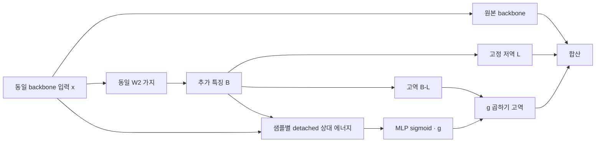

| 조건 | 두 군 공통 |
|---|---|
| 데이터 | QuickBird만 사용, train17,139·validation1,905·RR20·FR20 |
| K / 공간 배율 | K4 / 4배 |
| 입력·전처리 | 원시 DN/2047·제공 LMS, clipping 없음 |
| 학습 | seed42·43·44 각각100epoch 새 학습, micro32·유효64 |
| optimizer / LR / 손실 | Adam 기본 옵션·고정1e-4·scheduler 없음·기존 최종 출력 MSE |
| 정밀도 | core 학습 AMP FP16, 특징 필터·게이트·MSE FP32, 보정 특징을 branch dtype으로 되돌려 residual add, validation/test FP32·TF32 off |
| 초기값 | 같은 seed core/W2/게이트 state 일치, W2 마지막 Conv0으로 초기 전체 출력 일치 |
| 난수 | 모델 초기화와 CUDA sampler(seed+100000) 분리, gate hidden은 별도 고정 RNG |
| 선택 | epoch0 포함 원본 전체 validation MSE 최저, 정확한 동률이면 먼저 나온 epoch |
| 장치 | 동일 Tesla T4×2, GPU0 W2 C2·GPU1 HF selective |

각각 총2,853,951개 파라미터입니다. 기준군은 같은 초기 state를 맞추기 위해33개 게이트 파라미터를 갖지만 forward에서 우회해 gradient와 Adam 상태가 생기지 않습니다. 기준군의 실제 활성 C2는2,853,918개입니다. 초기 tensor·epoch별 실제 순서 해시가 같고,6개 학습의 AMP skip은 모두0회입니다. 두 군의 마지막 불완전 유효 batch는 실제 원소 수로 평균했습니다. 추가 손실·EMA·N1·증강은 없습니다.

과거43번의150epoch·batch32·cosine 학습을 재현한 실험은 아닙니다. 이번100epoch·유효64·고정LR의 동시 대조군으로만 해석하며 과거 절대 수치를 섞지 않습니다.

<a id="results"></a>

## 3. 정량 결과

### Validation 선택

| seed | W2 C2 best epoch / MSE | HF selective best epoch / MSE | MSE 변화율 |
|---|---:|---:|---:|
|42|100 / 0.0001376437|97 / 0.0001381353|+0.357%|
|43|100 / 0.0001375533|98 / 0.0001378869|+0.243%|
|44|100 / 0.0001385841|100 / 0.0001384562|-0.092%|

validation MSE는2/3seed에서 악화했습니다. validation MSE·PSNR·SAM은 전체1,905패치이고 validation ERGAS·SCC·Q2n만 첫32패치 진단입니다.

### Best의3seed 평균과 표본 SD

각 seed의20장 평균을 다시 평균했습니다. SD는 seed3개 간 표본 SD(ddof=1)이고 paired SD는 seed별 차이의 SD입니다. 같은20장면을60개의 독립 장면으로 보지 않습니다.

| 시험·지표 | W2 C2 평균 ± SD | HF selective 평균 ± SD | paired 변화 평균 ± SD |
|---|---:|---:|---:|
|RR PSNR ↑|38.2314258 ± 0.0130075|38.2487984 ± 0.0298232|0.0173727 ± 0.0381782|
|RR SAM ↓|4.6317196 ± 0.0093897|4.6315077 ± 0.0039354|-0.0002120 ± 0.0071928|
|RR ERGAS ↓|3.7448452 ± 0.0052722|3.7384960 ± 0.0132185|-0.0063492 ± 0.0161479|
|RR2 PSNR ↑|38.1661795 ± 0.0431642|38.1875385 ± 0.0704685|0.0213589 ± 0.1075506|
|RR2 SAM ↓|4.5020108 ± 0.0278722|4.5743610 ± 0.0366405|0.0723502 ± 0.0449772|
|FR_WALD PSNR ↑|37.6902062 ± 0.0183830|37.7113928 ± 0.0455073|0.0211867 ± 0.0345820|
|FR_WALD SAM ↓|4.0922878 ± 0.0146327|4.0870010 ± 0.0183849|-0.0052868 ± 0.0098437|
|FR 관측 RMSE DN ↓|16.5404686 ± 2.6674050|16.3169342 ± 1.7484244|-0.2235344 ± 2.4242260|
|RR 참고 SCC ↑|0.9819857 ± 0.0001200|0.9820349 ± 0.0002079|0.0000491 ± 0.0003177|
|RR 참고 Q2n ↑|0.9330512 ± 0.0010681|0.9328584 ± 0.0011088|-0.0001928 ± 0.0015869|
|FR 참고 QNR ↑|0.8399088 ± 0.0299632|0.8441047 ± 0.0087130|0.0041959 ± 0.0215204|
|FR 참고 Dλ ↓|0.0278388 ± 0.0005301|0.0253725 ± 0.0066361|-0.0024664 ± 0.0061451|
|FR 참고 Ds ↓|0.1358313 ± 0.0303877|0.1336637 ± 0.0036152|-0.0021676 ± 0.0268508|

### 현재 v2.3 판정

| 항목 | 3seed 평균 변화 또는 비율 | 기준 | 결과 |
|---|---:|---|---|
| RR PSNR | +0.0173727dB | ≥ +0.04dB | 미달·잡음 수준 |
| RR SAM / ERGAS | −0.0002120° / −0.0063492 | 각각 <0 | 통과 |
| RR2 PSNR / SAM | +0.0213589dB / +0.0723502° | ≥ −0.05dB / ≤ +0.06° | SAM 미달 |
| FR_WALD PSNR / SAM | +0.0211867dB / −0.0052868° | ≥ −0.07dB / ≤ +0.04° | 통과 |
| FR_OBS | 0.9864856배 | ≤1.10배 | 통과 |

관측 비율은 후보의 seed 평균 RMSE / 기준군의 seed 평균 RMSE입니다. seed별 비율의 평균이 아닙니다. 과반 seed 개선을 요구하거나 유리한 seed만 제외하지 않았습니다. 원래 v2.2도 RR2 SAM 미달로 부분 개선이었고, 현재 v2.3에서는 PSNR 잡음 문턱 미달이 추가됩니다. QNR·Dλ·Ds·SCC·Q2n과 RR2/FR_WALD ERGAS는 참고값입니다.

### Seed별 best와 동일 장면 변화

| seed | 지표 | W2 C2 | HF selective | 변화 | 개선 장면 |
|---|---|---:|---:|---:|---:|
|42|PSNR|38.2430720|38.2164169|-0.0266551|5/20|
|42|SAM|4.6288186|4.6337698|+0.0049511|10/20|
|42|ERGAS|3.7397851|3.7515065|+0.0117214|5/20|
|43|PSNR|38.2338166|38.2751381|+0.0413214|18/20|
|43|SAM|4.6422175|4.6337898|-0.0084277|15/20|
|43|ERGAS|3.7444440|3.7250788|-0.0193651|16/20|
|44|PSNR|38.2173886|38.2548403|+0.0374517|15/20|
|44|SAM|4.6241228|4.6269634|+0.0028407|8/20|
|44|ERGAS|3.7503066|3.7389026|-0.0114039|14/20|

| seed | 지표 | W2 C2 | HF selective | 변화 | 개선 장면 |
|---|---|---:|---:|---:|---:|
|42|PSNR|38.1661207|38.1365789|-0.0295418|9/20|
|42|SAM|4.5341723|4.5779374|+0.0437651|7/20|
|43|PSNR|38.1230448|38.2679560|+0.1449112|15/20|
|43|SAM|4.4869723|4.5360634|+0.0490912|7/20|
|44|PSNR|38.2093731|38.1580806|-0.0512925|9/20|
|44|SAM|4.4848879|4.6090821|+0.1241942|3/20|

| seed | 지표 | W2 C2 | HF selective | 변화 | 개선 장면 |
|---|---|---:|---:|---:|---:|
|42|PSNR|37.6948813|37.6844772|-0.0104042|8/20|
|42|SAM|4.0856980|4.0904162|+0.0047182|8/20|
|43|PSNR|37.6699370|37.6857665|+0.0158295|12/20|
|43|SAM|4.1090566|4.1034389|-0.0056178|12/20|
|44|PSNR|37.7058001|37.7639348|+0.0581347|15/20|
|44|SAM|4.0821088|4.0671480|-0.0149608|15/20|

| seed | 지표 | W2 C2 | HF selective | 변화 | 개선 장면 |
|---|---|---:|---:|---:|---:|
|42|OBS_RMSE_DN|16.8533416|18.1942200|+1.3408784|0/20|
|43|OBS_RMSE_DN|13.7304246|14.7349901|+1.0045654|3/20|
|44|OBS_RMSE_DN|19.0376395|16.0215925|-3.0160470|20/20|

seed43은 원래 v2.2에서 개선이었지만 RR PSNR +0.04132dB가 단일 시드 문턱0.06dB 미만이어서 현재 v2.3에서는 부분 개선(잡음 수준)입니다. seed42는 RR 세 지표 모두 악화, seed44는 RR SAM과 RR2가 불리합니다. 전체 판정은 이들을 모두 포함한 평균으로 내렸습니다.

### Latest 보조 결과

| 시험·지표 | W2 C2 평균 ± SD | HF selective 평균 ± SD | paired 변화 평균 ± SD |
|---|---:|---:|---:|
|RR PSNR ↑|38.2314258 ± 0.0130075|38.2260383 ± 0.0420942|-0.0053875 ± 0.0472624|
|RR SAM ↓|4.6317196 ± 0.0093897|4.6375626 ± 0.0137936|0.0058430 ± 0.0044379|
|RR ERGAS ↓|3.7448452 ± 0.0052722|3.7485665 ± 0.0157628|0.0037213 ± 0.0171230|
|RR2 PSNR ↑|38.1661795 ± 0.0431642|38.1219667 ± 0.0625298|-0.0442128 ± 0.0759322|
|RR2 SAM ↓|4.5020108 ± 0.0278722|4.5513025 ± 0.0545341|0.0492917 ± 0.0791091|
|FR_WALD PSNR ↑|37.6902062 ± 0.0183830|37.6896830 ± 0.0771149|-0.0005231 ± 0.0590431|
|FR_WALD SAM ↓|4.0922878 ± 0.0146327|4.0918989 ± 0.0293700|-0.0003889 ± 0.0151592|
|FR 관측 RMSE DN ↓|16.5404686 ± 2.6674050|16.3319120 ± 1.5164652|-0.2085566 ± 2.4323368|
|RR 참고 SCC ↑|0.9819857 ± 0.0001200|0.9819748 ± 0.0001776|-0.0000110 ± 0.0001811|
|RR 참고 Q2n ↑|0.9330512 ± 0.0010681|0.9334586 ± 0.0005647|0.0004074 ± 0.0008202|
|FR 참고 QNR ↑|0.8399088 ± 0.0299632|0.8396475 ± 0.0103472|-0.0002613 ± 0.0235720|
|FR 참고 Dλ ↓|0.0278388 ± 0.0005301|0.0261050 ± 0.0069342|-0.0017338 ± 0.0064220|
|FR 참고 Ds ↓|0.1358313 ± 0.0303877|0.1375797 ± 0.0047193|0.0017484 ± 0.0280887|

latest 평균은 RR PSNR·SAM·ERGAS가 모두 악화했습니다. RR2 SAM 허용폭은 통과하지만 주 결과를 latest로 바꾸지 않습니다. checkpoint와 seed에 따라 부호가 달라지는 점도 기록합니다.

평가는 고정된 공통 평가 프로토콜로 수행했습니다. MS는 QB DLPan41tap·4배·위상2, PAN은 QB GNyq0.15·41tap·동일 위상, LMS는23tap입니다. RR2 정답은 RR MS, FR_WALD 정답은 실제 FR MS입니다. 원해상도 FR에는 정답이 없습니다. FR_OBS는 MS 좌표 가장자리5화소를 제외한 RMSE(DN)입니다. 패키지의 측정 연산 코드가 현재 main과 줄바꿈을 제외하고 같은지 검증했습니다. 원해상도 고주파 정확도나 다른 센서의 개선까지 입증한 것은 아닙니다.

## 4. 기준선 대비 차이와 해석

고주파를 선택적으로 조절했지만 W2 대비 RR 이득은 잡음 문턱보다 작았고, 해결하려던 RR2 분광각 악화도 남았습니다. 따라서 이번 구조로 축척 일반화 문제가 해결됐다는 가설은 지지되지 않았습니다. 참고 QNR은 +0.00420이나 판정에는 사용하지 않았습니다.

Best에서 관측한 gate 평균은 아래와 같습니다. 각 값은 해당 시험20장 평균이며 학습 전체의 평균이 아닙니다.

| seed | RR | RR2 | FR_WALD | FR |
|---|---:|---:|---:|---:|
|42|0.880923|0.881455|0.880534|0.883440|
|43|0.849099|0.849678|0.849160|0.855732|
|44|0.869186|0.870831|0.869268|0.872165|

게이트는0.5에서 약0.85–0.88로 커졌고, 같은 seed 안에서는 RR과 RR2 사이 변화가 작았습니다. **이번 입력 통계·스칼라 게이트가 축척별 차이를 충분히 구분하지 못했을 가능성**이 있습니다. 다만 gate를 고정한 대조 실험은 없으므로 인과로 단정하지 않습니다. W2 자체도 함께 재학습돼 특징 크기로 감쇠를 보상할 수 있으므로 g가0.87이라는 사실을 최종 영상 고주파가 정확히13% 줄었다는 뜻으로 해석하지 않습니다.

| seed | W2 C2 학습, 분 | HF selective 학습, 분 | W2 C2 peak GiB | HF selective peak GiB |
|---|---:|---:|---:|---:|
|42|81.88|103.46|3.098|3.533|
|43|81.48|103.71|3.098|3.533|
|44|81.66|104.36|3.098|3.533|

학습 active 구간 합계는 구간 내 checkpoint 비용을 포함하고 데이터 적재·validation·test·ZIP을 제외합니다. 변경군은 대략27% 더 오래 걸리고 약0.435GiB 더 사용했습니다.

| seed | RR forward W2 C2 / HF, ms | FR forward W2 C2 / HF, ms |
|---|---:|---:|
|42|37.568 / 55.135|105.509 / 121.739|
|43|40.788 / 42.095|106.449 / 125.494|
|44|42.477 / 54.551|106.256 / 122.434|

첫 장면에서 warmup3회 후5회 forward 중앙값이며 전송·지표 계산을 제외합니다. 독립 하드웨어 속도 벤치마크가 아니므로 실제 두 GPU 동시 실행의 기록으로 해석합니다. validation 합계·전체 장면별 forward 시간·평가 peak 메모리는 원본 JSON에 있습니다.

<a id="graphs"></a>

## 5. 학습·평가 그래프

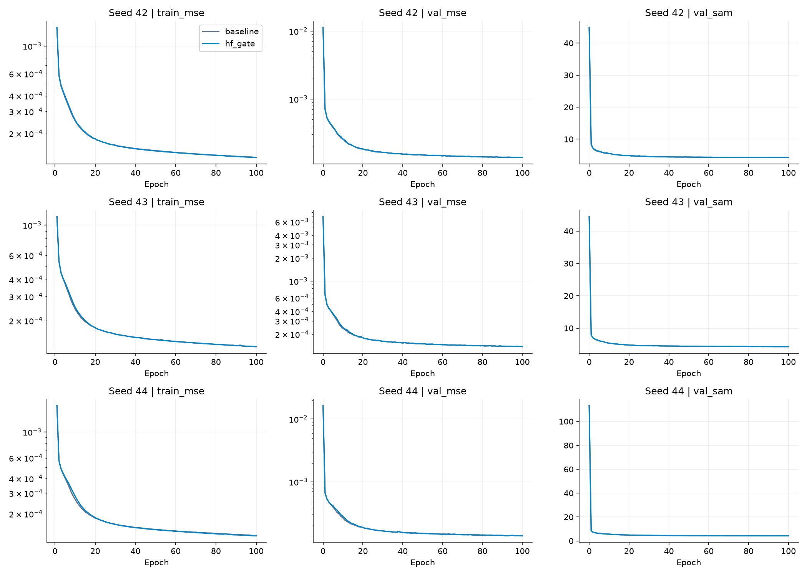

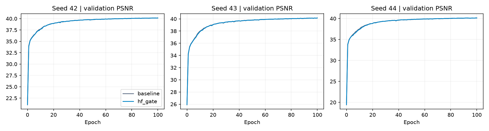

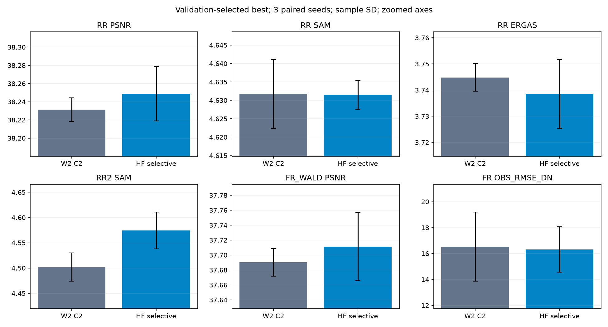

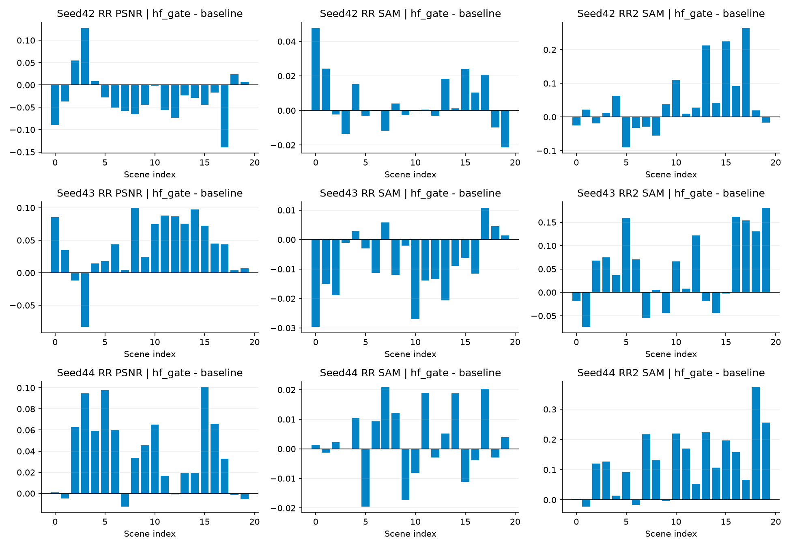

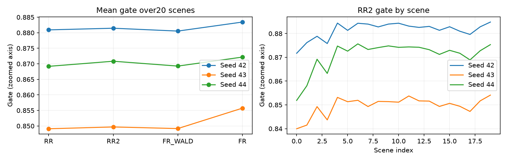

비교·gate 그래프는 작은 차이를 보기 위해 축을 확대했습니다. 오차 막대는 seed 간 표본 SD입니다.

<a id="images"></a>

## 6. 결과 이미지

평가 전에 고정한 seed42의0기준 장면1·8·11·13·19를 같은 순서로 표시합니다. 전체 장면이며 **LR MS 최근접 표시 · PAN 입력 · HF selective 예측 · GT** 순서입니다. RGB[2,1,0], GT 밴드별1/99 percentile의 공통 대비를 사용했습니다. 표시 범위 제한은 학습·평가 clipping과 다릅니다. FR에 GT를 만들지 않았습니다.

### 장면 1

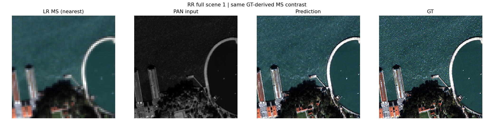

### 장면 8

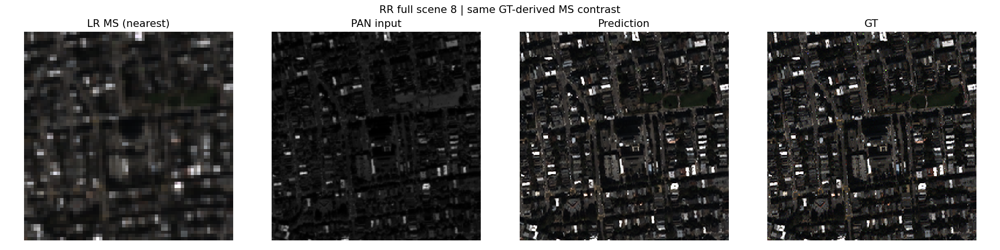

### 장면 11

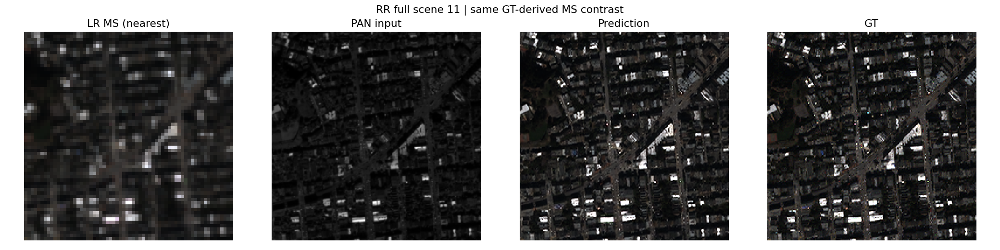

### 장면 13

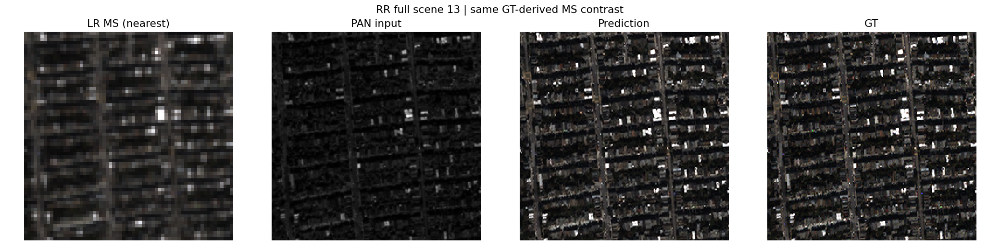

### 장면 19

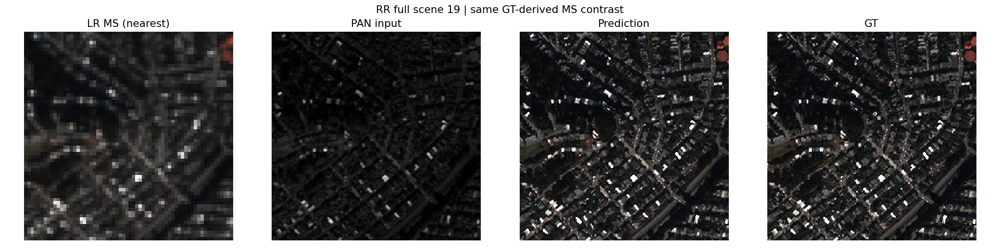

[seed43 동일 장면](results/seed_43/hf_gate/evaluations/best/)과 [seed44 동일 장면](results/seed_44/hf_gate/evaluations/best/)도 보존했습니다. 기준군·latest의 같은 장면 패널도 원본 결과 폴더에 있습니다. 기준 모델 교체를 제안하는 결과가 아니며 F1과의 FR·RR2 비교 이미지는 확보하지 않았습니다.

<a id="evidence"></a>

## 7. 재현 자료

- [설정·고정 예시](config.json), [원본 프로토콜](provenance/experiment.json), [원본 소스](provenance/code/), [군별 설정](provenance/configs/), [환경](provenance/environment_contract.json), [데이터 해시](provenance/data_contract.json)를 보존했습니다.
- [초기·best/latest15개 원본 가중치](checkpoints/), [원본 ZIP 해시](provenance/archive.json), [파일 manifest](manifest.json), [원본 대응](results/source_artifact_map.json)을 남겼습니다. 원본 소스와 checkpoint 내부 설정은 바꾸지 않았습니다.
- [분석 검증](results/analysis.json), [현재 v2.3 판정](results/judgement_v2_3.json), [원래 v2.2 판정](provenance/judgement_v2_2.json), [현재 기준 원문](provenance/current_judgement_criteria.md), [측정 연산 대응](results/current_protocol_compatibility.json), [게이트 통계](results/gate_statistics.json)를 연결합니다.
- ZIP CRC·전체 원본 artifact 해시·실제 소스·smoke 재개 증거·초기 가중치·배치 순서·전체 데이터 사용·validation best·가중치/평가 결과 해시·4시험 각20장 평균을 확인했습니다. 기준군 gate의 초기값 유지·변경군 gate의 실제 학습·평가 범위0–1도 확인했습니다.
- 15개 checkpoint strict load·12개 합성 CPU 유한 출력을 확인했습니다. 이번 게시 과정에서 원본 비공개 H5 재추론·추가 학습은 하지 않았습니다. 저장된 장면 수치와 증거의 정합을 검증한 것이며 실제 H5 전체 성능을 새로 측정한 것은 아닙니다.

```bash
python SSA-MRN/common/verify.py --experiment 52 --research-track performance
python SSA-MRN/experiments/performance/52_w2_frequency_selective_attenuation/prepare.py
python SSA-MRN/experiments/performance/52_w2_frequency_selective_attenuation/evaluate.py
```

`evaluate.py`는 보존된 best 측정값에서 v2.3 판정만 재계산합니다. `run.py`는 당시 소스를 포함한 기본smoke Kaggle 셀이며 v2.2와 W2 C2 대조군을 포함한 **과거 조건 재현용**입니다. 현재 F1을 대조군으로 하는 신규 실험 코드는 별도로 구성해야 합니다. 코드 버전·해시는 provenance에 보존했고, 원본 데이터·다른 실험·학습 중 checkout은 변경하지 않았습니다.

## 8. 개선 여부와 다음 단계

**W2 C2 대비 부분 개선·채택 보류**입니다. 현재 v2.3에서 RR PSNR 이득이 잡음 수준이고 RR2 SAM도 허용폭을 초과해, 고주파 선택 제어로 축척 약점을 해결했다고 판단하지 않습니다. 현재 F1 대비 우위는 평가하지 않았으며 기준 모델 교체를 제안하지 않습니다.

후속에서는 스칼라 gate의 축척 구분 능력과 공동 학습 중 W2의 보상 여부를 먼저 진단할 수 있습니다. train/validation으로 고정한 별도 실험에서 다루고, 이번 test를 보고 계수나 checkpoint를 바꾼 결과를 같은 반복 비교에 합치지 않습니다. 신규 비교는 현행 F1 대조군을 따릅니다. QB 한 센서·탐색에 반복 사용한 test 범위이며, 다른 센서·원해상도 세부의 참값까지 검증하지 않았습니다.
