# 53. 2배 거친 학습 쌍을 섞은 축척 혼합 학습

**연구 분야:** 기존 성능 개선

**실험자:** 이병현

**변경 내용:** 학습 패치(64×64)마다 2배 거친 학습 쌍(PAN·정답 32×32, MS 8×8)을 만들어 원래 쌍과 함께 학습했습니다. 구조는 바꾸지 않았습니다. 43번 C2(원본+W2)에 적용한 C2MS를 seed 42·43·44로, 당시 기준 F1에 적용한 F1MS를 seed 42로 학습해 같은 시드의 F1과 비교했습니다. 이 결과로 2026-10-21 기준 모델을 C2MS로 교체했습니다.

| 확인된 결과 | 상태 | 개선 여부 |
|---|:---:|:---:|
| C2MS 3시드 평균이 F1 대비 RR PSNR +0.679 dB·SAM −0.226°·ERGAS −0.317(20/20장), RR2 +1.139 dB, FR_WALD +1.352 dB, 관측 RMSE 0.78배로 판정 항목을 모두 통과했고, 세 시드 각각도 개선이었습니다(+0.675·+0.671·+0.692 dB). 원본 대비로는 RR +0.873 dB입니다. 같은 학습의 F1MS(seed 42)는 RR −0.291 dB로 개선 없음이었습니다. C2MS 파라미터는 F1의 6.2배입니다. | 평가&nbsp;완료<br>3seed | 개선 |

[실험 목록](../../../research/performance/README.md) · [수치](#results) · [그래프](#graphs) · [이미지](#images) · [재현 자료](#evidence)

## 1. 목적과 상태

[성능 43번](../43_normalized_parallel_capacity/README.md) C2는 원본에 큰 병렬 가지 W2를 더해 RR이 크게 올랐지만, 한 단계 더 줄인 RR2에서 무너져 채택하지 못했습니다. [성능 50번](../50_w2_branch_inference_scaling/README.md)은 이 실패가 W2의 세부 주입 세기가 축척에 따라 맞지 않는 현상이라고 진단했습니다. 같은 학습 패치로 만든 더 거친 축척의 쌍을 함께 보여 주면 모델이 축척에 맞는 세부 세기를 배워, W2의 RR 이득을 지키면서 RR2도 통과할 수 있는지 확인했습니다.

판정 방법(주 판정 C2MS 대 F1, 큰 개선 조건, 진단 두 개, FR·RR2 비교 패널)은 학습 전에 [config.json](config.json)의 `judgement`에 고정했습니다. 2026-10-20 23:07-2026-10-21 02:09(KST)에 C2MS seed 42, 02:09-07:02에 F1MS seed 42를 150에폭씩 학습했습니다. seed 42 결과가 큰 개선 조건을 채운 뒤 승인을 받아, 별도 실행 폴더에서 같은 코드·설정으로 C2MS seed 43(07:49-10:47)과 seed 44(10:47-13:47)를 학습했습니다. 학습 코드의 기본 RR·FR 평가 뒤 [evaluate.py](evaluate.py)로 3시드 v2.3 판정, 결과 이미지, FR·RR2 패널, 그래프를 만들었습니다. 3시드 결과로 기준 모델 교체 조건(3시드 개선과 FR·RR2 비교 확인)을 채워 2026-10-21 기준 모델을 C2MS로 교체했습니다.

작업 당시 번호는 52번이었습니다. 같은 날 성능 52번이 다른 실험에 먼저 쓰여 53번으로 등록했습니다. 서버 실행 경로와 보존한 원본 소스는 작업 당시 그대로입니다.

## 2. 변경한 구조와 비교 조건

| 군 | 구조 | 파라미터 | 학습 데이터 | 시드 |
|---|---|---:|---|---|
| C0 (원본, 참고) | 원본 SSA-MRN K4 | 426,654 | 원래 쌍 | 42·43·44, [43번](../43_normalized_parallel_capacity/README.md) 가중치 재사용 |
| F1 (당시 기준) | 원본 + G5 보정기 2개 | 461,804 | 원래 쌍 | 42·43·44, [49번](../49_observation_refinement_seed_repeat/README.md) 가중치 재사용 |
| C2 (참고) | 원본 + W2 | 2,853,918 | 원래 쌍 | 42·43·44, [43번](../43_normalized_parallel_capacity/README.md) 가중치 재사용 |
| **C2MS** | 원본 + W2 (C2와 동일) | 2,853,918 | **원래 쌍 + 2배 거친 쌍** | 42·43·44, 새로 학습 |
| **F1MS** | 원본 + G5 보정기 2개 (F1과 동일) | 461,804 | **원래 쌍 + 2배 거친 쌍** | 42, 새로 학습 |

C2MS와 F1MS는 [48번 model.py](../48_parallel_capacity_observation_refinement/model.py)의 `C2`·`F1`을 그대로 만들기 때문에, 초기 가중치가 같은 시드의 C2·F1과 같습니다(학습 전 해시로 확인). 바뀐 것은 학습 데이터와 손실뿐입니다.

### 2배 거친 학습 쌍 ([prepare.py](prepare.py))

| 항목 | 만드는 방법 |
|---|---|
| 정답 GT′ (4×32×32) | 학습 정답(64×64)을 2배 축소용 센서 MTF(QB GNyq, 41탭, 4배용 커널과 같은 genMTF 구성)로 흐리고 위상 1에서 2배 솎음 |
| PAN′ (1×32×32) | 학습 PAN을 PAN MTF(GNyq 0.15)로 같은 방식으로 흐리고 솎음 |
| MS′ (4×8×8) | GT′에 데이터셋의 4배 Wald 관측 연산(위상 2)을 적용 |
| LMS′ (4×32×32) | MS′를 데이터셋 LMS와 같은 23탭 보간으로 확대 |

학습·검증 분할에서만 만들었고 test는 쓰지 않았습니다. 같은 4배 커널을 이 방식으로 다시 만들면 기존 커널과 차이가 0이었고, 2배 커널의 DC 이득은 0.9995-0.9997이었습니다. 거친 MS′와 제공 MS를 2배 줄인 영상의 상대 RMSE는 0.040이었습니다.

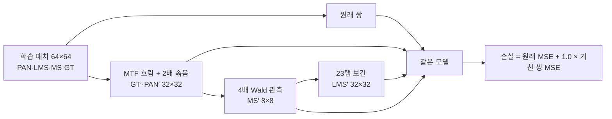

| 조건 | 내용 |
|---|---|
| 학습 절차 | 43·49번과 동일: 150에폭, batch·micro 32, Adam, 에폭별 cosine 1e-4 → 1e-6, AMP FP16, cuDNN deterministic, TF32 끔, channels_last |
| 손실 | 매 step 같은 패치 인덱스의 원래 쌍 MSE + 1.0 × 2배 거친 쌍 MSE (DN/2047 좌표) |
| 데이터 순서 | 같은 시드의 43·49번과 같은 에폭별 순서. 거친 쌍은 같은 인덱스를 사용 |
| 선택 | epoch0 포함 원래 축척 validation MSE 최소(43·49번과 같음). 거친 축척 validation은 기록만 함 |
| 평가 | [common/evaluation_protocol.py](../../../common/evaluation_protocol.py)로 RR·RR2·FR_WALD·FR 각 20장 |
| 장치 | RTX 3060 Ti 1장, 한 번에 한 학습. seed 43·44는 별도 실행 폴더에서 같은 코드·캐시(해시 일치)로 학습 |

## 3. 정량 결과
<a id="results"></a>

### 3시드 평균 (test 20장, best 가중치, 괄호는 시드 간 표본 SD)

| 시험·지표 | C0 (원본) | F1 (당시 기준) | C2 | C2MS |
|---|---:|---:|---:|---:|
| RR PSNR ↑ | 37.429 (0.056) | 37.623 (0.021) | 38.132 (0.048) | **38.302** (0.027) |
| RR SAM ↓ | 4.941 | 4.802 | 4.598 | **4.576** |
| RR ERGAS ↓ | 4.124 | 4.029 | 3.784 | **3.712** |
| RR2 PSNR ↑ | 38.199 | 38.185 | 38.082 | **39.324** (0.174) |
| RR2 SAM ↓ | 4.488 | 4.399 | 4.613 | **4.124** |
| FR_WALD PSNR ↑ | 36.137 | 36.420 | 37.601 | **37.771** (0.053) |
| FR_WALD SAM ↓ | 4.489 | 4.332 | 4.047 | **4.033** |
| FR 관측 RMSE (DN) ↓ | 24.57 | 19.90 | 15.89 | **15.51** |
| 참고 RR Q2n ↑ | 0.923 | 0.926 | 0.934 | **0.934** |
| 참고 FR QNR ↑ | 0.914 | **0.921** | 0.840 | 0.810 |
| 참고 FR Ds ↓ | 0.045 | 0.046 | 0.140 | 0.169 |

F1MS(seed 42)는 RR 37.308 dB·SAM 5.067°, RR2 38.803 dB, FR_WALD 36.085 dB, 관측 RMSE 21.66 DN이었습니다.

### v2.3 판정

| 비교 | 시드 | RR ΔPSNR / ΔSAM / ΔERGAS | RR2 ΔPSNR / ΔSAM | FR_WALD ΔPSNR / ΔSAM | 관측 비율 | RR 개선 장면 | 판정 |
|---|---|---|---|---|---:|---:|---|
| **C2MS 대 F1** | 42·43·44 평균 | +0.679 / −0.226° / −0.317 | +1.139 / −0.275° | +1.352 / −0.299° | 0.779 | 20/20 | **개선** |
| C2MS 대 F1 | 42 | +0.675 / −0.231° / −0.320 | +1.252 / −0.376° | +1.369 / −0.301° | 0.771 | 20/20 | 개선 |
| C2MS 대 F1 | 43 | +0.671 / −0.209° / −0.311 | +1.238 / −0.218° | +1.309 / −0.285° | 0.797 | 20/20 | 개선 |
| C2MS 대 F1 | 44 | +0.692 / −0.237° / −0.321 | +0.927 / −0.232° | +1.377 / −0.312° | 0.769 | 20/20 | 개선 |
| C2MS 대 C0 (원본) | 42·43·44 평균 | +0.873 / −0.365° / −0.413 | +1.125 / −0.365° | +1.635 / −0.457° | 0.631 | 20/20 | 개선 |
| C2MS 대 C2 (진단 1) | 42·43·44 평균 | +0.170 / −0.021° / −0.072 | +1.242 / −0.489° | +0.170 / −0.015° | 0.976 | 19/20 | 개선 |
| F1MS 대 F1 (진단 2) | 42 | −0.291 / +0.259° / +0.135 | +0.635 / −0.218° | −0.264 / +0.191° | 1.068 | 0/20 | 개선 없음 |
| F1 대 C0 (재현 확인) | 42·43·44 평균 | +0.194 / −0.139° / −0.095 | −0.014 / −0.089° | +0.283 / −0.157° | 0.810 | 20/20 | 개선 |

여러 시드는 같은 시드끼리 짝지은 평균으로 판정했고 잡음 문턱은 0.04 dB(단일 시드 0.06 dB)입니다. 장면별 개선 수는 시드 평균 장면 값으로 셌습니다. 마지막 줄의 F1 대 C0 값은 [49번 보고서](../49_observation_refinement_seed_repeat/README.md)의 값과 같아, 같은 측정이 재현됨을 확인했습니다.

| 미리 정한 항목 (seed 42) | 기준 | 결과 |
|---|---|---|
| 주 판정 | C2MS 대 F1의 v2.3 판정 | 개선 |
| 큰 개선 조건 | 주 판정 개선이면서 RR ΔPSNR ≥ +0.40 dB | 충족 (+0.675 dB) |
| 진단 1 | C2MS 대 C2 RR ΔPSNR ≥ −0.15 dB, 주 판정의 RR2 통과 | 충족 (+0.197 dB) |
| 진단 2 | F1MS 대 F1 (데이터만 바꾼 효과) | 개선 없음 |
| 3시드 (승인 후 추가) | C2MS 대 F1 3시드 평균 v2.3 | 개선 (+0.679 dB, 세 시드 모두 개선) |

### Validation 선택

| 시드 | C2 best epoch / validation PSNR | C2MS best epoch / validation PSNR | C2MS 2배 거친 validation PSNR | F1 best epoch / validation PSNR |
|---|---|---|---:|---|
| 42 | 141 / 40.327 dB | 149 / 40.283 dB | 46.85 dB | 148 / 39.506 dB |
| 43 | 150 / 40.321 dB | 146 / 40.267 dB | 46.81 dB | 147 / 39.527 dB |
| 44 | 142 / 40.325 dB | 149 / 40.275 dB | 46.86 dB | 146 / 39.528 dB |

F1MS(seed 42)는 best epoch 148, validation 39.362 dB, 2배 거친 validation 45.35 dB였습니다. C2MS의 AMP 건너뛴 업데이트는 시드별 18·20·18회, F1MS는 21회(각 80,400회 중)였습니다. 학습 시간은 C2MS 시드당 약 178-181분, F1MS 292분(validation·checkpoint 포함 에폭 시간 합)이었습니다. 학습 코드의 기본 평가와 evaluate.py의 RR 평균 차이는 1e-7 미만이었습니다.

### 시험 시점 8방향 평균 (TTA ×8, 학습 없음)

같은 기간에 회전·뒤집기 8방향 출력을 평균하는 방법도 [tta.py](provenance/code/tta.py)로 확인했습니다(seed 42·43·44, [수치](results/tta8.json)).

| 모델 | RR ΔPSNR | RR2 ΔPSNR | FR_WALD ΔPSNR | 판정 (평균 대 원래) |
|---|---:|---:|---:|---|
| C0 (원본) | −0.953 | +1.017 | −1.138 | 개선 없음 |
| F1 | −1.000 | +1.035 | −1.175 | 개선 없음 |
| C2 | −0.598 | +1.402 | −1.137 | 개선 없음 |

이 데이터셋은 MS가 PAN 대비 위상 2(4화소 중 두 번째)에서 표본화돼 있어, 뒤집거나 회전하면 PAN·MS 정렬이 학습 때와 달라집니다. 그래서 RR과 FR_WALD가 크게 나빠졌습니다. 정렬을 맞추는 보정은 하지 않았습니다.

## 4. 기준선 대비 차이와 해석

- **세 시드 모두 같은 결과였습니다.** C2MS 대 F1의 RR 이득은 +0.671에서 +0.692 dB로 시드 간 차이가 0.02 dB 정도이고, 세 시드 모두 판정 항목을 모두 통과했습니다. 원본 대비로는 +0.873 dB로, 원본 → F1의 개선(+0.194 dB)의 약 4.5배입니다.
- **크기 섞기는 큰 모델에서만 효과가 있었습니다.** 같은 학습을 받은 C2MS는 F1 대비 모든 시험에서 크게 좋아졌지만, F1MS는 RR·FR_WALD가 나빠지고 학습한 축척과 가까운 RR2만 좋아졌습니다. 작은 F1은 두 축척을 함께 맞추느라 원래 축척 성능을 잃었고, 용량이 큰 C2는 두 축척을 모두 맞출 여유가 있었던 것으로 보입니다.
- **C2의 RR2 약점은 사라졌습니다.** C2는 F1 대비 RR2가 −0.10 dB(3시드)였지만 C2MS는 +1.14 dB입니다. 50번이 진단한 "축척에 맞지 않는 세부 세기"를 학습 데이터로 고칠 수 있다는 가설과 맞습니다. C2MS는 C2보다 RR도 +0.17 dB 높았습니다.
- **RR2 이득에는 비슷한 축척을 학습한 효과가 섞여 있습니다.** 학습에 2배 거친 쌍을 넣었고 RR2는 4배 거친 시험이라, RR2는 C2MS에게 처음 보는 축척이 아닙니다. 반대로 실제 목표인 FR(원래 해상도)은 학습한 어떤 축척보다 세밀합니다. FR 방향으로의 일반화는 이번 시험으로 직접 확인되지 않습니다.
- **validation과 test의 방향이 세 시드 모두 달랐습니다.** 원래 축척 validation에서는 C2MS가 C2보다 0.04-0.05 dB 낮았지만, test RR에서는 시드 평균 0.17 dB 높았습니다(19/20장). 세 시드에서 같은 방향으로 반복돼 우연으로 보기 어렵습니다. 크기 섞기의 이득이 학습 패치와 같은 분포의 validation보다 별도 장면인 test에서 크게 나타나는 것으로 보이며, 원인은 확인하지 않았습니다. 이후 크기 섞기의 비율 같은 설정을 원래 축척 validation만으로 고르면 섞지 않는 쪽이 선택될 수 있다는 점을 주의해야 합니다. 이번 판정은 규칙대로 validation을 각 모델의 epoch 선택에만 쓰고 개선 여부는 test로 정했습니다.
- **FR에서는 세부가 더 강해졌습니다.** FR 고정 5장면(seed 42)에서 출력과 LMS의 평균 차이(주입한 세부)는 C2MS가 가장 컸습니다(F1보다 5-10%). 야구장 장면(FR 8)에서는 테두리를 따르는 링 무늬도 F1보다 진했습니다. 정답이 없어 진짜 세부인지 과샤프닝인지는 판단할 수 없습니다. 참고 지표인 QNR은 F1 대비 −0.11(3시드)로 나빠졌지만, [46번](../46_fr_spatial_index_validity/README.md)·[51번](../51_fr_detail_index_validity/README.md)에서 Ds가 QB 정답 순위를 거꾸로 매겼기 때문에 판정에 쓰지 않았습니다.
- **비용이 큽니다.** C2MS의 파라미터는 F1의 6.2배이고, 거친 쌍 계산이 매 step 더해집니다. 추론 시간은 따로 재지 않았습니다.
- **한계:** QB 한 센서, 탐색에 반복 사용한 test입니다. 대조군 C0·F1·C2는 이전 실험의 가중치를 재사용했습니다(같은 코드·캐시·시드·학습 일정). F1MS는 seed 42 하나입니다.

## 5. 학습·평가 그래프
<a id="graphs"></a>

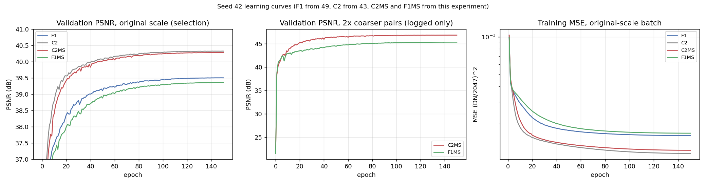

왼쪽은 선택에 쓴 원래 축척 validation PSNR, 가운데는 기록만 한 2배 거친 쌍 validation PSNR, 오른쪽은 원래 축척 배치의 학습 MSE입니다. 진한 선이 seed 42, 연한 선이 seed 43·44입니다. C0·C2·F1 곡선은 43·49번의 기록입니다.

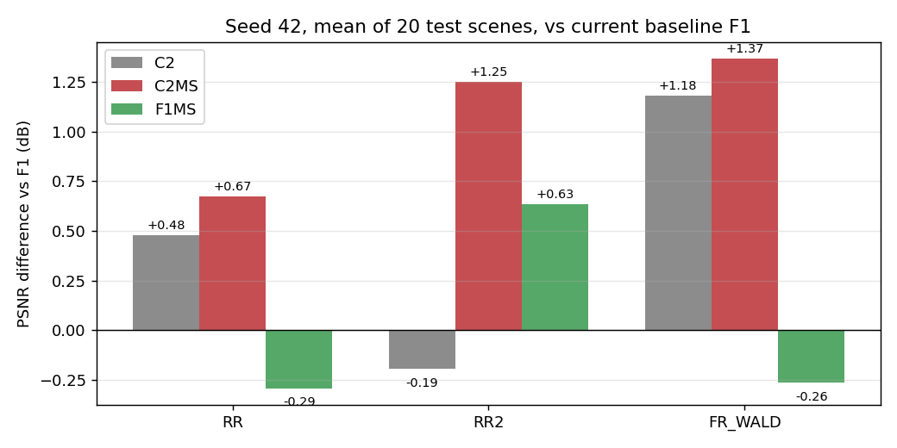

같은 시드 F1 대비 test 20장 평균 PSNR 차이입니다. 막대는 시드 평균, 점은 각 시드 값입니다(F1MS는 seed 42 하나).

## 6. 결과 이미지
<a id="images"></a>

seed 42에서, 정답 영상만 보고 풍경 종류로 고른 RR test 고정 6장면(0-based 0 바다·항구 방파제, 1 부두·곡선 방파제·수목, 3 요트 마리나·운동장, 7 숲 공원, 14 언덕 공원·곡선 주택가, 17 산지 녹지·산책로)에서 현재 기준 F1과 C2MS를 비교합니다. 장면 선택에 쓴 [정답 목록](provenance/scene_selection/rr_gt_contact_sheet.png)도 보존했습니다. 모두 seed 42이고 RGB 밴드 [2,1,0], 장면별 정답 1-99% 공통 대비입니다.

| 장면 | 풍경 | 장면 PSNR F1 → C2MS | 확대 영역 PSNR F1 → C2MS |
|---:|---|---|---|
| 0 | 바다·항구 방파제 | 41.68 → 42.81 dB (+1.13) | 35.45 → 37.38 dB |
| 1 | 부두·곡선 방파제·수목 | 42.64 → 43.18 dB (+0.53) | 39.89 → 40.76 dB |
| 3 | 요트 마리나·운동장 | 36.57 → 37.96 dB (+1.39) | 33.17 → 35.36 dB |
| 7 | 숲 공원 | 39.01 → 39.41 dB (+0.39) | 36.73 → 38.12 dB |
| 14 | 언덕 공원·곡선 주택가 | 37.85 → 38.47 dB (+0.63) | 35.99 → 36.97 dB |
| 17 | 산지 녹지·산책로 | 38.96 → 39.40 dB (+0.43) | 36.04 → 36.64 dB |

### 원본 크기 비교

위 줄은 LR MS(최근접 확대) · PAN 입력 · F1 · C2MS · 정답, 아래 줄은 F1과 C2MS의 |예측 − 정답| 지도입니다. 오차 지도는 F1 오차의 99퍼센타일을 공통 색 척도로 쓰며 밝을수록 오차가 큽니다.

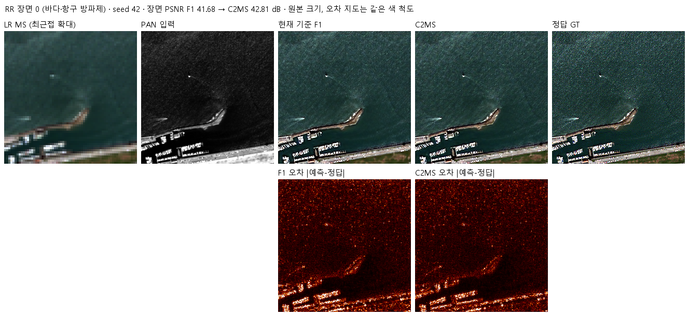

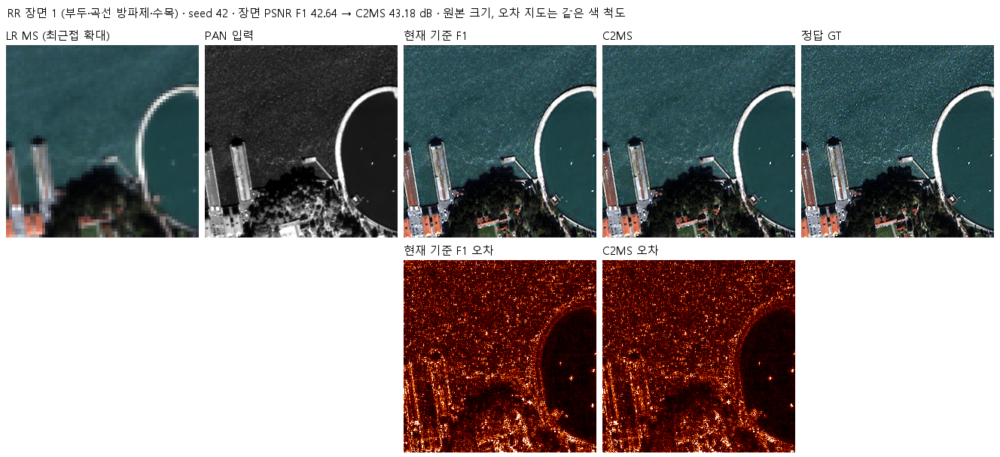

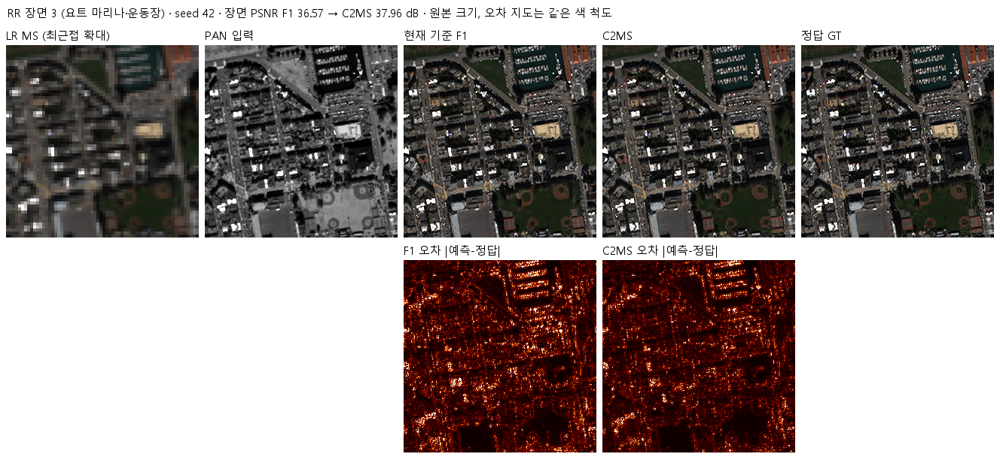

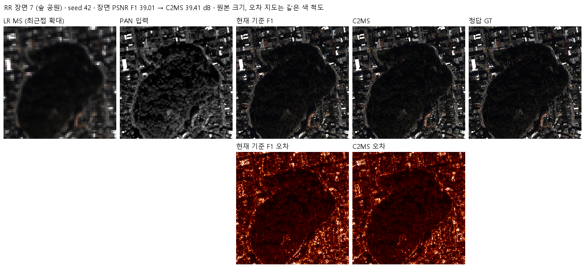

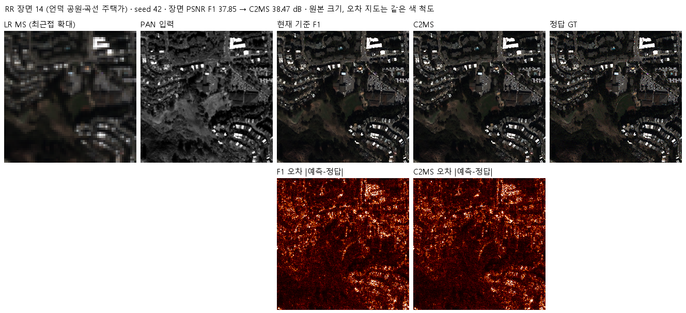

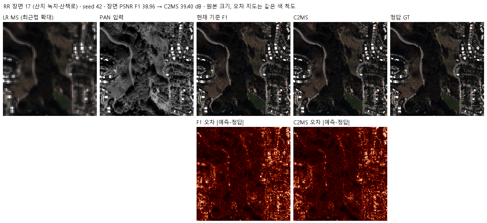

### 확대 비교

각 장면에서 C2MS의 개선(F1 오차 − C2MS 오차)이 가장 큰 64×64 창을 4배 확대했습니다. C2MS에 유리하게 고른 창이므로, 장면 전체의 차이는 위 표의 장면 PSNR로 확인합니다. 왼쪽부터 정답 전체(노란 상자가 확대 영역) · 정답 · F1 · C2MS · F1 오차 · C2MS 오차입니다.

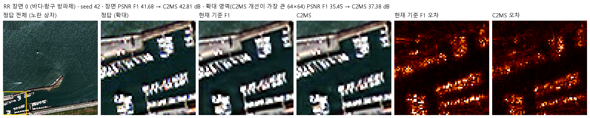

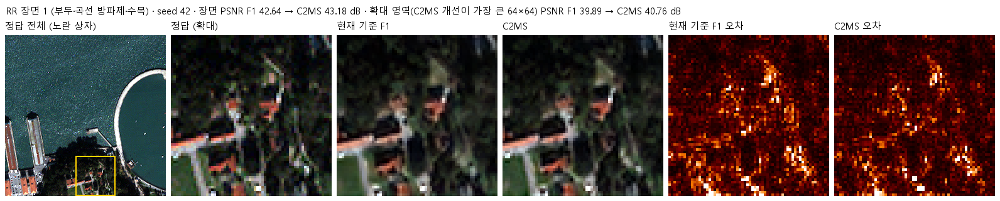

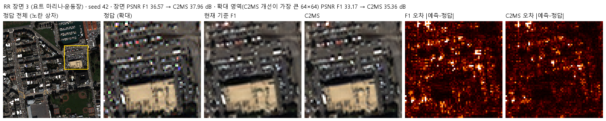

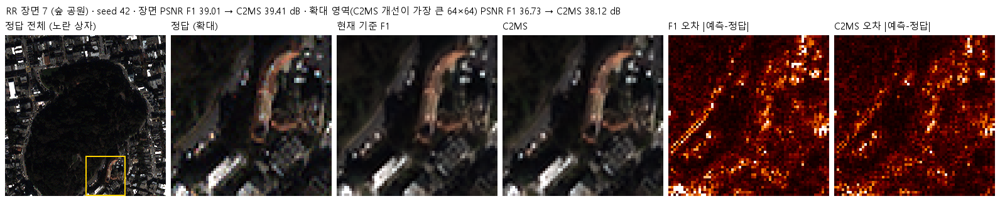

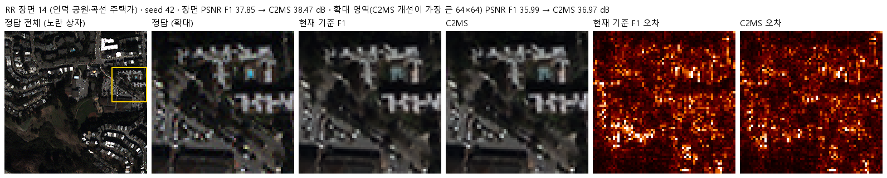

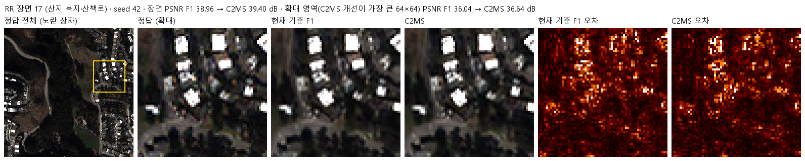

마리나·운동장(장면 3)과 바다·항구(장면 0)에서 정박한 배, 방파제, 건물 경계의 오차가 가장 많이 줄었습니다. 숲(장면 7)과 산지(장면 17)는 개선 폭이 작고 나무 질감은 두 모델이 비슷합니다. F1MS와 F1의 같은 형식 비교는 [F1MS 이미지 폴더](results/images/F1MS_vs_F1/)에, 원본 SSA-MRN과 C2MS의 비교(루트 README에 표시)는 [원본 비교 폴더](results/images/C2MS_vs_original/)에 있습니다.

### FR·RR2 비교 패널 (학습 전에 고정한 장면 1·8·11·13·19)

FR은 512×512 출력의 가운데 128×128을 3배, RR2는 64×64 전체를 6배 확대했습니다. 위 줄은 입력과 F1 · C2 · C2MS · F1MS, 아래 줄은 FR에서 |출력 − LMS|(주입한 세부), RR2에서 |출력 − 정답|입니다. FR에는 정답이 없습니다.

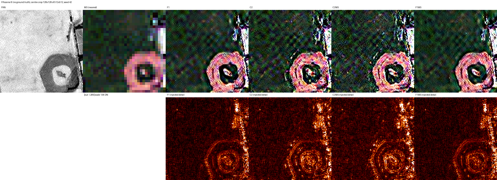

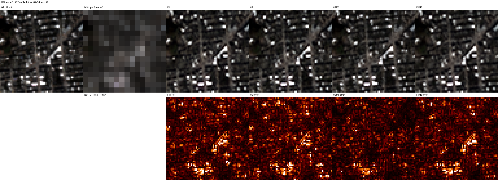

나머지 장면은 [FR·RR2 패널 폴더](results/fr_rr2_visual/)에 있습니다. 학습 코드가 만든 기존 형식의 4패널(LR MS · PAN · 예측 · 정답, 장면 1·8·11·13·19)은 [C2MS seed 42](results/C2MS_QB_s42/evaluation/)·[43](results/C2MS_QB_s43/evaluation/)·[44](results/C2MS_QB_s44/evaluation/)와 [F1MS](results/F1MS_QB_s42/evaluation/) 평가 폴더에 있습니다.

## 7. 재현 자료
<a id="evidence"></a>

- 중간발표용 기존 가중치의 실제 MATLAB 재채점은 [실험 53·54 GitHub Actions 평가 안내](../../../common/matlab_reevaluation/README.md)를 사용합니다. 재학습하지 않으며 이 보고서의 원래 수치는 보존합니다. MATLAB 완료 여부는 성공한 Actions와 결과 artifact로 확인합니다.

- 코드: [설정·사전 판정](config.json), [모델](model.py), [거친 쌍 생성](prepare.py), [학습](train.py), [실행 제어](run.py), [평가](evaluate.py), [결과 이미지 도구](../../../common/result_images.py)
- 원본 소스(작업 당시 그대로): [provenance/code](provenance/code/), 실행 기록: [seed 42 C2MS·F1MS](provenance/run_records/)와 [seed 43·44 C2MS](provenance/run_records_s43_s44/)(데이터 해시, 환경, 사전 점검, 큐 상태, 실행 설정)
- 가중치: C2MS [seed 42](checkpoints/C2MS_QB_s42/)·[43](checkpoints/C2MS_QB_s43/)·[44](checkpoints/C2MS_QB_s44/)와 [F1MS](checkpoints/F1MS_QB_s42/)의 `initial.pt`·`best.pt`·`latest.pt`
- 결과: [v2.3 판정·장면별 수치](results/evaluation_v2_3.json), 학습 기록·기본 평가 C2MS [seed 42](results/C2MS_QB_s42/)·[43](results/C2MS_QB_s43/)·[44](results/C2MS_QB_s44/), [F1MS](results/F1MS_QB_s42/), [TTA](results/tta8.json), [파일 manifest](manifest.json)
- 현재 `prepare.py`·`train.py`·`run.py`는 원본에서 `coarse.py`를 `prepare.py`로 바꾼 import만 다릅니다. 같은 입력에서 `prepare.py`와 보존한 `coarse.py`의 출력 차이는 0이었고, 모든 가중치는 현재 `model.py`로 strict load한 뒤 평가했습니다. seed 43·44는 이 현재 코드로 학습했습니다.

```bash
python SSA-MRN/common/verify.py --experiment 53 --research-track performance
python SSA-MRN/experiments/performance/53_scale_mixed_training/evaluate.py --data <QB_H5_폴더>
```

## 8. 개선 여부와 다음 단계

**개선(3시드)**입니다. C2MS는 당시 기준 F1 대비 3시드 평균과 세 시드 각각에서 RR 주 판정과 RR2·FR_WALD·관측 보조 판정을 모두 통과했고, FR·RR2 비교 패널도 확인했습니다. 기준 모델 교체 조건을 채워 **2026-10-21 기준 모델을 C2MS로 교체**했습니다. 루트 README의 기준 모델 이미지는 원본 SSA-MRN과의 비교로 바꿨습니다. 같은 학습을 F1에 적용한 F1MS는 개선 없음이었으므로, 크기 섞기는 용량이 큰 구조와 함께 써야 효과가 있습니다.

다음 후보는 다음과 같습니다(학습은 승인 후 진행).
1. 다른 센서(GF2·WV3 등) 데이터에서의 확인
2. 용량을 더 키운 구조에 같은 크기 섞기 적용
3. 학습 패치와 겹치지 않는 장면으로 만든 validation으로 validation·test 불일치 확인
