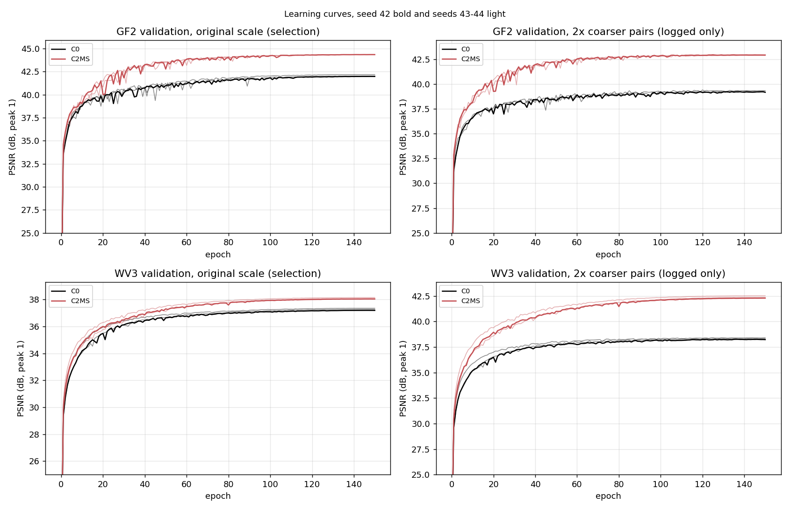
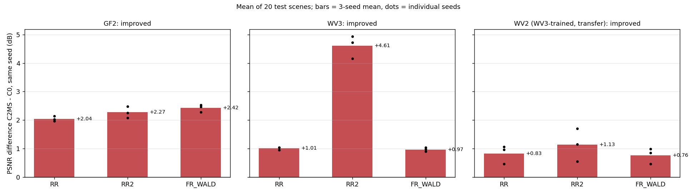

# 54. 축척 혼합 학습 기준 모델 C2MS의 다른 센서 적용

**연구 분야:** 기존 성능 개선

**실험자:** 이병현

**변경 내용:** 현재 기준 모델 C2MS(원본 SSA-MRN K4 + W2 병렬 가지, 원래 학습 쌍과 2배 거친 학습 쌍을 섞은 축척 혼합 학습, [성능 53번](../53_scale_mixed_training/README.md))를 QB가 아닌 GF2(4밴드)와 WV3(8밴드) 데이터로 새로 학습했습니다. 같은 센서·시드의 원본 SSA-MRN(C0)과 비교했고, WV3로 학습한 두 모델은 학습하지 않은 WV2 test에도 그대로 적용했습니다. 구조와 학습 절차는 53번과 같고, 센서별로 바뀐 것은 밴드 수·정규화 최대값·MTF 관측 연산입니다.

| 확인된 결과 | 상태 | 개선 여부 |
|---|:---:|:---:|
| C2MS 3시드 평균이 원본(C0) 대비 GF2 RR PSNR +2.045 dB·SAM −0.163°·ERGAS −0.188, WV3 +1.007 dB·−0.419°·−0.313, WV2 전이 +0.828 dB·−0.399°·−0.426로 세 대상 모두 RR2·FR_WALD·관측 보조 판정을 통과했고(관측 RMSE 0.57-0.68배), RR PSNR은 세 대상 모두 20/20장에서 높았습니다. 시드 9쌍도 모두 개선이었습니다. QB의 원본 대비 이득(+0.873 dB)보다 GF2·WV3에서 컸습니다. | 평가&nbsp;완료<br>3seed | 개선 |

[실험 목록](../../../research/performance/README.md) · [수치](#results) · [그래프](#graphs) · [이미지](#images) · [재현 자료](#evidence)

## 1. 목적과 상태

53번에서 C2MS를 기준 모델로 채택한 근거는 QB 한 센서의 3시드 결과였습니다. 축척 혼합 학습의 이득이 QB 데이터에만 맞춰진 것인지, 밴드 수·비트 깊이·MTF가 다른 센서에서도 유지되는지 확인했습니다. 학습 데이터가 없는 WV2에는 WV3 모델을 그대로 적용해, 처음 보는 센서로의 전이도 함께 봤습니다(PanCollection 관례).

판정 방법(센서별 C2MS 대 C0 같은 시드 짝, v2.3, WV2 전이, 결과 이미지 6장면)은 학습 전에 [config.json](config.json)의 `judgement`에 고정했고, 학습은 2026-10-21 사용자 승인 후 시작했습니다. 2026-10-21 15시경부터 2026-10-22 18:31(KST)까지 12개 실행(2센서 × 2군 × 3시드)을 한 번에 하나씩 150에폭 학습했습니다. 각 실행이 끝나면 학습 코드가 기본 RR·FR을 평가했고, 모든 학습이 끝난 뒤 18:45-18:49에 [evaluate.py](evaluate.py)로 v2.3 보조 판정(RR2·FR_WALD·FR 관측), 결과 이미지, 그래프를 만들었습니다.

GF2 C0 seed 42 학습 중(2026-10-21 15:15) 같은 GPU에서 센서 점검을 함께 돌리다 점검을 강제 종료한 직후 학습이 CUDA 오류(illegal memory access)로 멈췄습니다. 15:41에 같은 설정으로 `latest.pt`(모델·옵티마이저·난수 상태·데이터 순서 포함)에서 재개했고, 이후 실행은 학습 하나만 GPU를 쓰도록 했습니다. 실패 기록은 [실행 기록](provenance/run_records/controller_failure_20261021_1515.json)과 [해당 실행 폴더](results/C0_GF2_s42/)에 보존했습니다.

## 2. 변경한 구조와 비교 조건

| 군 | 구조 | 파라미터 (4밴드 / 8밴드) | 학습 데이터 | 시드 |
|---|---|---:|---|---|
| C0 (원본, 대조군) | 원본 SSA-MRN K4 | 426,654 / 518,830 | 원래 쌍 | 42·43·44, 새로 학습 |
| **C2MS** (현재 기준) | 원본 + W2 병렬 가지 | 2,853,918 / 2,946,094 | **원래 쌍 + 2배 거친 쌍** | 42·43·44, 새로 학습 |

두 군은 [model.py](model.py)에서 [43번 model.py](../43_normalized_parallel_capacity/model.py)의 C0·C2를 센서 밴드 수로 만들므로, 4밴드 GF2에서는 초기 가중치가 QB 43번의 같은 시드와 같습니다. 같은 시드의 C0와 C2MS는 원본 부분의 초기값이 같고, C2MS의 W2 출력층은 0으로 시작합니다. 12개 실행의 `initial.pt`는 모두 현재 `model.py`가 시드로 만든 가중치와 차이 0이었습니다([확인 기록](provenance/initial_weights_check.json)).

### 센서별 조건 ([prepare.py](prepare.py))

| 센서 | 밴드 | 정규화 | MS MTF GNyq | PAN MTF GNyq | 학습 / 검증 / test | 역할 |
|---|---:|---:|---|---:|---|---|
| GF2 | 4 | 1023 (10bit) | 0.3 × 4 (Toolbox 기본값) | 0.15 (가정) | 19,809 / 2,201 / RR·FR 각 20 | 학습·평가 |
| WV3 | 8 | 2047 | 0.325-0.365, NIR2 0.315 (Toolbox) | 0.14 | 9,714 / 1,080 / RR·FR 각 20 | 학습·평가 |
| WV2 | 8 | 2047 | 0.35 × 7, 0.27 (Toolbox) | 0.11 | test만 RR·FR 각 20 | WV3 모델 전이 평가 |

- MS MTF는 DLPan-Toolbox `genMTF`의 값입니다. GF2는 Toolbox 목록에 없어 기본값 0.3을 씁니다. 세 센서 모두 test 정답에 MTF 흐림 + 4배 다운샘플링(위상 2)을 적용하면 제공 MS와 1e-11 DN 이하 차이로 같았습니다([센서 점검](provenance/sensor_audit.json), `evaluation_v2_3.json`의 `checks`).
- PAN MTF는 Toolbox `MTF_PAN`의 값입니다. GF2는 목록에 없어 Toolbox의 기본값 0.15를 썼으며, 데이터로 확인할 수 없습니다. 이 값은 2배 거친 학습 쌍의 PAN과 RR2·FR_WALD 입력의 PAN에 쓰입니다.
- 입력은 센서 최대값으로 나눠 학습·평가했습니다. PSNR은 기존 지표 코드대로 모든 센서에서 peak 2047로 계산하므로 GF2의 절대 PSNR은 약 6 dB 높게 나옵니다. 같은 센서 안의 차이에는 영향이 없습니다.

| 조건 | 내용 |
|---|---|
| 학습 절차 | 43·53번과 동일: 150에폭, batch·micro 32, Adam, 에폭별 cosine 1e-4 → 1e-6, AMP FP16, cuDNN deterministic, TF32 끔, channels_last |
| 손실 | C0: 원래 쌍 MSE. C2MS: 원래 쌍 MSE + 1.0 × 같은 패치로 만든 2배 거친 쌍 MSE(센서 MTF 사용, 53번과 같은 구성) |
| 선택 | epoch0 포함 원래 축척 validation MSE 최소. 거친 축척 validation은 기록만 함 |
| 평가 | test 20장씩 RR·RR2·FR_WALD·FR. RR2·FR_WALD 입력과 FR 관측 RMSE는 대상 센서의 4배 Wald 연산(MS·PAN MTF, 위상 2)으로 만듦. 판정은 같은 시드 C0와 짝지은 3시드 평균(잡음 문턱 0.04 dB, 단일 시드 0.06 dB), 허용 폭은 QB에서 정한 v2.3 값을 그대로 씀 |
| 장치 | RTX 3060 Ti 1장, 한 번에 한 학습 |

## 3. 정량 결과
<a id="results"></a>

### 3시드 평균 (test 20장, best 가중치, 괄호는 시드 간 표본 SD)

| 시험·지표 | GF2 C0 | GF2 C2MS | WV3 C0 | WV3 C2MS | WV2 전이 C0 | WV2 전이 C2MS |
|---|---:|---:|---:|---:|---:|---:|
| RR PSNR ↑ | 46.549 (0.105) | **48.594** (0.075) | 37.536 (0.069) | **38.543** (0.071) | 28.586 (0.273) | **29.413** (0.098) |
| RR SAM ↓ | 0.953 | **0.791** | 3.494 | **3.075** | 6.253 | **5.854** |
| RR ERGAS ↓ | 0.896 | **0.708** | 2.571 | **2.258** | 5.046 | **4.620** |
| RR2 PSNR ↑ | 43.001 | **45.272** | 35.212 | **39.819** (0.444) | 30.676 | **31.807** |
| RR2 SAM ↓ | 1.370 | **1.171** | 3.888 | **2.607** | 5.549 | **5.082** |
| FR_WALD PSNR ↑ | 44.907 | **47.330** | 35.104 | **36.070** | 28.596 | **29.360** |
| FR_WALD SAM ↓ | 1.029 | **0.858** | 3.539 | **3.067** | 6.831 | **6.481** |
| FR 관측 RMSE (DN) ↓ | 5.06 | **2.98** | 25.61 | **17.39** | 32.32 (6.85) | **18.45** (1.12) |
| 참고 RR Q2n ↑ | 0.969 | **0.979** | 0.882 | **0.896** | 0.806 | **0.828** |
| 참고 FR QNR ↑ | 0.907 | **0.941** | 0.948 | **0.952** | **0.916** | 0.910 |
| 참고 FR Dλ ↓ | 0.036 | **0.026** | **0.018** | 0.021 | **0.043** | 0.045 |
| 참고 FR Ds ↓ | 0.059 | **0.034** | 0.035 | **0.028** | **0.043** | 0.048 |

GF2 PSNR은 peak 2047 기준이라 10bit 데이터에서 약 6 dB 높게 나옵니다.

### v2.3 판정 (C2MS 대 같은 시드 C0)

| 대상 | 시드 | RR ΔPSNR / ΔSAM / ΔERGAS | RR2 ΔPSNR / ΔSAM | FR_WALD ΔPSNR / ΔSAM | 관측 비율 | RR 개선 장면 | 판정 |
|---|---|---|---|---|---:|---:|---|
| **GF2** | 42·43·44 평균 | +2.045 / −0.163° / −0.188 | +2.271 / −0.200° | +2.423 / −0.172° | 0.588 | 20/20 | **개선** |
| GF2 | 42 | +2.025 / −0.160° / −0.187 | +2.256 / −0.198° | +2.465 / −0.175° | 0.606 | 20/20 | 개선 |
| GF2 | 43 | +1.966 / −0.153° / −0.178 | +2.074 / −0.182° | +2.282 / −0.161° | 0.542 | 20/20 | 개선 |
| GF2 | 44 | +2.144 / −0.174° / −0.198 | +2.483 / −0.218° | +2.522 / −0.180° | 0.618 | 20/20 | 개선 |
| **WV3** | 42·43·44 평균 | +1.007 / −0.419° / −0.313 | +4.606 / −1.281° | +0.966 / −0.472° | 0.679 | 20/20 | **개선** |
| WV3 | 42 | +1.034 / −0.447° / −0.324 | +4.158 / −1.193° | +1.032 / −0.526° | 0.712 | 20/20 | 개선 |
| WV3 | 43 | +1.033 / −0.418° / −0.316 | +4.727 / −1.307° | +0.894 / −0.432° | 0.688 | 20/20 | 개선 |
| WV3 | 44 | +0.953 / −0.392° / −0.299 | +4.935 / −1.344° | +0.972 / −0.458° | 0.637 | 20/20 | 개선 |
| **WV2 전이** | 42·43·44 평균 | +0.828 / −0.399° / −0.426 | +1.131 / −0.467° | +0.764 / −0.350° | 0.571 | 20/20 | **개선** |
| WV2 전이 | 42 | +0.957 / −0.668° / −0.536 | +1.148 / −0.772° | +0.849 / −0.589° | 0.620 | 20/20 | 개선 |
| WV2 전이 | 43 | +0.465 / −0.207° / −0.217 | +0.546 / −0.292° | +0.464 / −0.302° | 0.687 | 19/20 | 개선 |
| WV2 전이 | 44 | +1.061 / −0.323° / −0.525 | +1.701 / −0.336° | +0.980 / −0.159° | 0.456 | 20/20 | 개선 |

장면별 개선 수는 시드 평균 장면 값으로 셌습니다. 3시드 평균에서 RR2 PSNR은 세 대상 모두 20/20장, FR_WALD PSNR은 GF2·WV3 20/20장, WV2 19/20장에서 C2MS가 높았습니다.

### Validation 선택과 학습 시간

| 실행 | best epoch (seed 42·43·44) | 원래 축척 validation PSNR | 2배 거친 validation PSNR | 학습 시간 (시드당) |
|---|---|---|---|---:|
| GF2 C0 | 147·149·148 | 41.98·42.18·42.02 dB | 39.20·39.32·39.25 dB | 약 101분 |
| GF2 C2MS | 148·149·147 | 44.34·44.36·44.34 dB | 42.92·42.91·42.86 dB | 약 220분 |
| WV3 C0 | 148·150·150 | 37.19·37.35·37.27 dB | 38.23·38.39·38.32 dB | 약 68분 |
| WV3 C2MS | 148·148·149 | 38.03·38.14·38.07 dB | 42.28·42.50·42.35 dB | 약 145분 |

validation PSNR은 정규화 값(peak 1) 기준입니다. 학습 시간은 validation·checkpoint를 포함한 에폭 시간의 합이며, GF2 C0 seed 42(105분)는 중단·재개 구간 때문에 조금 깁니다. AMP가 건너뛴 업데이트는 실행마다 5-24회(GF2 93,000회, WV3 45,600회 중)였습니다. 학습 코드의 기본 평가와 evaluate.py의 RR 평균 차이는 최대 9.4e-8이었습니다.

## 4. 기준선 대비 차이와 해석

- **QB에서 본 개선이 다른 센서에서도 그대로 나타났고 오히려 컸습니다.** 원본 대비 RR PSNR 이득은 QB +0.873 dB([53번](../53_scale_mixed_training/README.md)), GF2 +2.045 dB, WV3 +1.007 dB입니다. 세 센서 모두 3시드 각각이 개선이고 시드 간 차이도 0.2 dB 이내여서, 채택 근거가 QB에만 맞춰진 결과는 아니었습니다.
- **원본은 한 단계 거친 시험(RR2)에서 크게 약했고, C2MS는 이를 뒤집었습니다.** WV3에서 원본은 RR 37.54 dB보다 RR2 35.21 dB가 2.3 dB 낮았지만, C2MS는 RR2 39.82 dB로 RR보다 1.3 dB 높았습니다(+4.606 dB). GF2도 RR2 +2.271 dB입니다. 53번과 같이 2배 거친 쌍을 학습했기 때문에 RR2(4배 거친 시험)는 C2MS에게 처음 보는 축척이 아닙니다. 이 이득은 축척 혼합 학습의 직접 효과로 보고, RR보다 크다는 점을 FR 방향의 일반화 근거로 쓰지 않습니다.
- **학습하지 않은 WV2에서도 이득이 유지됐고, 시드에 덜 흔들렸습니다.** WV2 RR 이득은 +0.828 dB로 WV3(+1.007 dB)보다 조금 작습니다. 원본 C0는 WV2에서 시드 간 SD가 RR 0.27 dB, 관측 RMSE 6.85 DN으로 컸지만 C2MS는 0.10 dB, 1.12 DN이었습니다. seed 43의 이득(+0.465 dB)이 가장 작은 것은 C2MS가 나빠서가 아니라 C0 seed 43이 WV2에서 유난히 좋았기 때문입니다(C0 RR 28.87 dB, 다른 시드 28.57·28.32 dB).
- **WV2에서는 결과 이미지로도 차이가 크게 보입니다(2026-10-22 추가 분석).** 학습한 센서에서는 두 모델 모두 정답에 가까워 장면 전체로는 구분이 어렵지만, WV2에서는 원본이 흐려지고 색이 틀어집니다. test 20장·3시드 평균으로 정답 대비 선명도(출력의 4방향 Laplacian 절댓값 평균 ÷ 정답)는 원본 0.34, C2MS 0.47(세 시드 모두 C2MS가 높음)이고, 넣은 세부(출력 − LMS)와 실제 세부(정답 − LMS)의 상관은 0.70과 0.74, 밴드별 평균 밝기 치우침의 최댓값은 7.2%와 1.0%입니다. 원본은 파랑 밴드가 평균 7.2% 밝게 나와 RGB [4,2,1] 표시에서 회보라색으로 보입니다. 같은 지표가 WV3에서는 선명도 0.84·0.88, 치우침 0.2% 이하로 비슷합니다. WV2 입력은 WV3보다 PAN 고주파가 약하고(48.5 대 60.9) 정답 고주파는 강해서(155.9 대 115.2), WV3에서 배운 세부 주입 비율로는 세부가 모자랍니다. 이 차이가 W2 용량과 축척 혼합 학습 중 어디서 왔는지는 이 실험만으로 나눌 수 없습니다. 측정은 `evaluate.py --transfer-detail`로 보관 가중치에서 다시 계산했습니다([수치](results/transfer_detail.json)).
- **FR 관측 일치도 좋아졌습니다.** FR 출력을 센서 관측 연산(MTF 흐림 + 4배 다운샘플링)으로 줄였을 때 실제 MS와의 RMSE가 원본의 0.57-0.68배였습니다. FR_WALD도 세 대상 모두 좋아졌습니다.
- **참고 지표 QNR은 QB와 다르게 움직였습니다.** QB에서는 C2MS의 QNR이 원본보다 0.10 낮았지만(Ds 악화), GF2에서는 0.907 → 0.941로 좋아졌고 WV3는 비슷, WV2는 0.006 낮았습니다. [46번](../46_fr_spatial_index_validity/README.md)·[51번](../51_fr_detail_index_validity/README.md)에서 Ds가 QB 정답 순위를 거꾸로 매겼기 때문에 QNR·Dλ·Ds는 판정에 쓰지 않았습니다.
- **비용은 QB와 같은 구조적 부담입니다.** 파라미터는 원본의 6.7배(4밴드)·5.7배(8밴드)이고, 학습 시간은 같은 센서 원본의 약 2.1-2.2배였습니다.
- **한계:** 대조군은 원본 C0 하나입니다. 이 센서들에서 W2 가지(C2)만 쓴 군이나 이전 기준 F1을 학습하지 않아, 이득을 W2의 용량과 축척 혼합 학습으로 나눌 수 없습니다. GF2 PAN MTF(0.15)는 데이터로 확인하지 못한 가정값입니다. 잡음 문턱과 보조 판정 허용 폭은 QB 시드 변동으로 정한 값을 그대로 썼습니다(이번 이득은 문턱보다 10배 이상 커서 판정에는 영향이 없습니다). test는 이 연구에서 반복 사용한 공개 test입니다. GF2 C0 seed 42는 한 번 중단 후 재개한 실행입니다.

## 5. 학습·평가 그래프
<a id="graphs"></a>



위 줄은 GF2, 아래 줄은 WV3입니다. 왼쪽은 선택에 쓴 원래 축척 validation PSNR, 오른쪽은 기록만 한 2배 거친 쌍 validation PSNR입니다(정규화 값, peak 1). 진한 선이 seed 42, 연한 선이 seed 43·44입니다. 두 센서 모두 C2MS가 초반부터 원래 축척에서도 앞서고, 거친 축척에서는 차이가 더 큽니다.



같은 시드 C0 대비 test 20장 평균 PSNR 차이입니다. 막대는 3시드 평균, 점은 각 시드 값입니다. WV2는 WV3로 학습한 모델의 전이 결과입니다.

## 6. 결과 이미지
<a id="images"></a>

seed 42의 원본 SSA-MRN(C0)과 현재 기준 C2MS를 [결과 이미지 도구](../../../common/result_images.py)로 비교했습니다. 장면은 학습 전에 config.json에 고정한 RR test 0-based 0·1·3·7·14·17번입니다. 이 번호는 QB에서 풍경 종류로 고른 표준 번호를 다른 센서에도 그대로 쓴 것으로, GF2·WV3·WV2의 같은 번호 장면은 QB와 다른 장소이며 결과를 보고 고르지 않았습니다. RGB는 GF2 밴드 [2,1,0], WV3·WV2 밴드 [4,2,1](빨강·초록·파랑)이고, 장면별 정답 1-99% 공통 대비입니다.

| 장면 | GF2 장면 PSNR 원본 → C2MS | WV3 | WV2 전이 |
|---:|---|---|---|
| 0 | 45.00 → 47.62 dB (+2.62) | 38.53 → 39.81 dB (+1.28) | 27.80 → 28.69 dB (+0.89) |
| 1 | 46.89 → 49.16 dB (+2.27) | 36.24 → 37.60 dB (+1.36) | 26.02 → 26.82 dB (+0.79) |
| 3 | 48.08 → 49.67 dB (+1.58) | 40.61 → 41.25 dB (+0.64) | 33.71 → 34.94 dB (+1.23) |
| 7 | 48.45 → 50.65 dB (+2.20) | 37.22 → 38.39 dB (+1.17) | 28.38 → 29.18 dB (+0.80) |
| 14 | 45.72 → 47.87 dB (+2.14) | 32.78 → 33.56 dB (+0.78) | 27.91 → 28.93 dB (+1.02) |
| 17 | 47.18 → 49.23 dB (+2.05) | 34.90 → 36.01 dB (+1.11) | 28.43 → 29.39 dB (+0.96) |

18개 장면 모두 C2MS의 장면 PSNR이 높았습니다. 원본 크기 비교는 위 줄이 LR MS(최근접 확대) · PAN 입력 · 원본 · C2MS · 정답, 아래 줄이 원본과 C2MS의 |예측 − 정답| 지도입니다(원본 오차의 99퍼센타일을 공통 색 척도로 사용, 밝을수록 오차가 큼). 확대 비교는 C2MS의 개선(원본 오차 − C2MS 오차)이 가장 큰 64×64 창을 4배 확대한 것으로, C2MS에 유리하게 고른 창입니다. 왼쪽부터 정답 전체(노란 상자가 확대 영역) · 원본 · C2MS · 정답 · 원본 오차 · C2MS 오차로, 원본 크기 비교와 같은 원본 → C2MS → 정답 순서입니다. 장면 전체의 차이는 위 표의 장면 PSNR로 확인합니다.

<details>
<summary><b>GF2</b> 원본 크기 비교·확대 비교 (6장면)</summary>


</details>

<details>
<summary><b>WV3</b> 원본 크기 비교·확대 비교 (6장면)</summary>


</details>

<details>
<summary><b>WV2 전이</b> (WV3로 학습한 모델) 원본 크기 비교·확대 비교 (6장면)</summary>


</details>

학습 코드가 만든 기존 형식의 4패널(LR MS · PAN · 예측 · 정답, 같은 6장면)은 각 실행의 평가 폴더(예: [C2MS GF2 seed 42](results/C2MS_GF2_s42/evaluation/))에 있습니다.

## 7. 재현 자료
<a id="evidence"></a>

- 중간발표용 [실제 MATLAB 재평가 전체 표](../../../docs/c2ms_matlab_evaluation_tables.md)와 [이 실험의 장면별 수치·증거](results/matlab_reevaluation/40202998202/summary.json)를 보존했습니다. 기존 validation best를 재학습 없이 RR·FR 전체20장과 보조 시험에 적용하고 MATLAB R2025b의 원본 DLPan 함수로 계산했습니다. 이 보고서의 원래 수치는 과거 기록으로 유지합니다.

- 코드: [설정·사전 판정](config.json), [모델](model.py), [센서 연산·거친 쌍 생성](prepare.py), [학습](train.py), [실행 제어](run.py), [평가](evaluate.py), [결과 이미지 도구](../../../common/result_images.py)
- 학습 당시 소스·설정: [provenance/code](provenance/code/). 현재 `model.py`·`prepare.py`·`train.py`·`run.py`·학습 당시 `config.json`은 서버 실행본과 해시가 같습니다. 판정을 낸 평가 코드는 [evaluate_run.py](provenance/code/evaluate_run.py)이고(해시가 `evaluation_v2_3.json`의 기록과 같음), 현재 `evaluate.py`는 이후 그래프 배치만 고친 판입니다. 결과 이미지 도구에는 이번에 센서 옵션(파일·정규화·RGB 밴드)을 추가했으며, QB 기본값의 출력은 수정 전과 픽셀 단위로 같습니다.
- 실행 기록: [provenance/run_records](provenance/run_records/)(실행 설정, 데이터 해시, 환경, 사전 점검·벤치마크, 큐 상태, 중단 기록), [센서 점검](provenance/sensor_audit.json)과 [점검 코드](provenance/sensor_audit.py), [초기 가중치 확인](provenance/initial_weights_check.json)
- 가중치: [checkpoints](checkpoints/)의 `<군>_<센서>_s<시드>/best.pt`·`latest.pt` 12쌍. `initial.pt`는 시드로 똑같이 다시 만들어져 보관하지 않았습니다.
- 결과: [v2.3 판정·장면별 수치](results/evaluation_v2_3.json), [WV2 전이 선명도·색 분석](results/transfer_detail.json), 실행별 학습 기록·기본 평가([results](results/)의 `<군>_<센서>_s<시드>/`), [파일 manifest](manifest.json)

```bash
python SSA-MRN/common/verify.py --experiment 54 --research-track performance
python SSA-MRN/experiments/performance/54_multi_sensor_scale_mixed_training/evaluate.py --data <PanCollection_H5_폴더> --runtime <runs/를 담은 폴더>
```

## 8. 개선 여부와 다음 단계

**개선(3시드)**입니다. C2MS는 GF2·WV3와 WV2 전이에서 원본 대비 3시드 평균과 시드 9쌍 모두 RR 주 판정과 RR2·FR_WALD·관측 보조 판정을 통과했습니다. 기준 모델 C2MS의 이득이 QB에만 한정되지 않음을 확인했으며, 기준 모델은 그대로 C2MS입니다.

다음 후보는 다음과 같습니다(학습은 승인 후 진행).
1. 다른 센서에서 W2 가지만 쓴 군(C2)을 함께 학습해 용량 효과와 축척 혼합 효과 나누기
2. C2MS 경량화(파라미터가 원본의 5.7-6.7배)와 같은 성능 유지 여부
3. 여러 배율(2배·8배 등) 학습·평가로 축척 혼합 학습의 범위 확인
