# 55. 축척 혼합 학습을 뺀 W2 병렬 가지 모델의 센서 전이 비교

**연구 분야:** 기존 성능 개선

**실험자:** 이병현

**변경 내용:** 현재 기준 모델 C2MS(원본 SSA-MRN K4 + W2 병렬 가지 + 축척 혼합 학습)에서 2배 거친 학습 쌍의 손실만 뺀 C2(원본 + W2, 원래 학습 쌍만)를 WV3로 3시드 학습했습니다. [성능 54번](../54_multi_sensor_scale_mixed_training/README.md)의 원본(C0)·C2MS와 같은 시드끼리 WV3 test와 학습하지 않은 WV2 test(전이)에서 비교해, 54번에서 본 C2MS의 WV2 전이 이득이 W2 용량에서 왔는지 축척 혼합 학습에서 왔는지 나눴습니다.

| 확인된 결과 | 상태 | 개선 여부 |
|---|:---:|:---:|
| WV2 전이에서 C2MS가 C2보다 RR PSNR +1.305 dB·SAM −0.751°·ERGAS −0.719, RR2 +2.354 dB, FR_WALD +1.397 dB, 관측 RMSE 0.92배로 판정 항목을 모두 통과했습니다(세 시드 모두, 20/20장). C2는 원본보다도 RR −0.477 dB로 나빠서, WV2 전이 이득은 W2 용량이 아니라 **축척 혼합 학습**에서 왔습니다. 학습 센서 WV3에서는 C2가 원본 대비 +1.062 dB로 C2MS(+1.007 dB)와 비슷했고, 축척 혼합의 효과는 RR2(+3.818 dB)에서만 컸습니다. 후보 C2는 기준 C2MS 대비 개선 없음입니다. | 평가&nbsp;완료<br>3seed | 개선&nbsp;없음 |

[실험 목록](../../../research/performance/README.md) · [수치](#results) · [그래프](#graphs) · [이미지](#images) · [재현 자료](#evidence)

## 1. 목적과 상태

54번에서 C2MS는 학습하지 않은 WV2에서도 원본보다 RR +0.828 dB였고, 원본보다 선명하고 색 치우침이 작았습니다. 하지만 C2MS는 원본과 두 가지가 다릅니다. W2 병렬 가지로 파라미터가 5.7배(8밴드)이고, 2배 거친 학습 쌍을 섞어 학습했습니다. 54번에는 W2만 쓴 군이 없어서 이 이득의 원인을 나눌 수 없었습니다. 이번 실험은 축척 혼합만 뺀 C2를 같은 절차로 학습해 원인을 분리했습니다.

판정 방법(주 판정 WV2 C2MS 대 C2, 보조 비교 C2 대 C0와 WV3의 같은 비교, 선명도·색 분석, WV2 결과 이미지)은 학습 전에 [config.json](config.json)의 `judgement`에 고정했고, 학습은 2026-10-22 사용자 승인 후 시작했습니다. 2026-10-22 23:40(KST)부터 2026-10-23 03:58까지 WV3 C2 seed 42·43·44를 150에폭씩 학습했고, 각 실행 뒤 학습 코드가 기본 RR·FR(WV2 포함)을 평가했습니다. 2026-10-23 08:05에 [evaluate.py](evaluate.py)로 v2.3 판정, 선명도·색 분석, 이미지, 그래프를 만들었습니다. 원본(C0)과 C2MS는 54번의 보관 가중치를 다시 평가했습니다.

## 2. 변경한 구조와 비교 조건

| 군 | 구조 | 파라미터 (8밴드) | 학습 데이터 | 출처 |
|---|---|---:|---|---|
| C0 (원본) | 원본 SSA-MRN K4 | 518,830 | 원래 쌍 | [54번](../54_multi_sensor_scale_mixed_training/README.md) WV3 seed 42-44 |
| **C2** (이번 실험) | 원본 + W2 병렬 가지 | 2,946,094 | 원래 쌍만 | 새로 학습 seed 42-44 |
| C2MS (현재 기준) | 원본 + W2 병렬 가지 | 2,946,094 | 원래 쌍 + 2배 거친 쌍 | [54번](../54_multi_sensor_scale_mixed_training/README.md) WV3 seed 42-44 |

[model.py](model.py)는 54번 `Model('C2MS')`를 그대로 만들기 때문에, 같은 시드의 C2와 C2MS는 초기 가중치가 정확히 같습니다(세 시드 모두 서버에서 확인). 두 군의 차이는 손실의 2배 거친 쌍 항(`coarse_weight` 1 대 0) 하나입니다. 거친 쌍 validation은 C2에서도 기록만 했습니다.

| 조건 | 내용 |
|---|---|
| 데이터 | WV3 학습 9,714 / 검증 1,080, test RR·FR 각 20장. WV2는 test만(전이). 입력은 2047로 정규화 |
| 학습 절차 | 54번과 동일: 150에폭, batch·micro 32, Adam, 에폭별 cosine 1e-4 → 1e-6, AMP FP16, cuDNN deterministic, TF32 끔, channels_last |
| 손실 | 원래 쌍 MSE만 (C2MS는 + 1.0 × 2배 거친 쌍 MSE) |
| 선택 | epoch0 포함 원래 축척 validation MSE 최소 |
| 평가 | 54번 `evaluate.py`의 지표·센서 Wald 연산·v2.3 판정 함수를 그대로 사용. test 20장씩 RR·RR2·FR_WALD·FR, 같은 시드 짝 3시드 평균(잡음 문턱 0.04 dB) |
| 선명도·색 분석 | 54번 `--transfer-detail`과 같은 정의: 출력의 4방향 Laplacian 절댓값 평균 ÷ 정답, (출력 − LMS)와 (정답 − LMS)의 상관·표준편차 비, 밴드별 평균 밝기 치우침 |
| 장치 | RTX 3060 Ti 1장, 한 번에 한 학습, 별도 실행 폴더 |

## 3. 정량 결과
<a id="results"></a>

### 3시드 평균 (test 20장, best 가중치, 괄호는 시드 간 표본 SD)

| 시험·지표 | WV3 C0 | WV3 C2 | WV3 C2MS | WV2 C0 | WV2 C2 | WV2 C2MS |
|---|---:|---:|---:|---:|---:|---:|
| RR PSNR ↑ | 37.536 (0.069) | **38.598** (0.054) | 38.543 (0.071) | 28.586 (0.273) | 28.109 (0.112) | **29.413** (0.098) |
| RR SAM ↓ | 3.494 | 3.078 | **3.075** | 6.253 | 6.604 | **5.854** |
| RR ERGAS ↓ | 2.571 | **2.248** | 2.258 | 5.046 | 5.339 | **4.620** |
| RR2 PSNR ↑ | 35.212 | 36.001 | **39.819** | 30.676 | 29.453 | **31.807** |
| FR_WALD PSNR ↑ | 35.104 | 36.047 | **36.070** | 28.596 | 27.963 | **29.360** |
| FR 관측 RMSE (DN) ↓ | 25.61 | 18.61 | **17.39** | 32.32 | 20.08 | **18.45** |
| 선명도 (정답 대비) | 0.842 | 0.870 | 0.878 | 0.337 | 0.531 | 0.465 |
| 넣은 세부와 실제 세부의 상관 ↑ | 0.932 | 0.948 | 0.948 | 0.698 | 0.635 | **0.740** |
| 넣은 세부의 세기 (정답 대비) | 0.937 | 0.956 | 0.955 | 0.585 | 0.749 | 0.619 |
| 밴드별 밝기 치우침 최대 ↓ | 0.2% | 0.1% | 0.1% | 7.8% | 2.2% | 2.4% |
| 참고 FR QNR ↑ | 0.948 | 0.951 | 0.952 | 0.916 | 0.849 | 0.910 |
| 참고 FR Ds ↓ | 0.035 | 0.027 | 0.028 | 0.043 | 0.086 | 0.048 |

선명도와 세부 세기는 1에 가까울수록 정답과 같고, 1보다 작으면 흐리거나 세부가 모자란 것입니다. 색 치우침 최댓값은 시드별 최댓값의 평균입니다.

### v2.3 판정 (같은 시드 짝)

| 비교 | 시험 | 시드 | RR ΔPSNR / ΔSAM / ΔERGAS | RR2 ΔPSNR / ΔSAM | FR_WALD ΔPSNR / ΔSAM | 관측 비율 | RR 개선 장면 | 판정 |
|---|---|---|---|---|---|---:|---:|---|
| **C2MS 대 C2 (주 판정)** | WV2 | 42·43·44 평균 | +1.305 / −0.751° / −0.719 | +2.354 / −0.989° | +1.397 / −0.790° | 0.919 | 20/20 | **개선** |
| C2MS 대 C2 | WV2 | 42 / 43 / 44 | +1.510 / +1.251 / +1.152 | +2.885 / +2.286 / +1.892 | +1.773 / +1.317 / +1.103 | 0.950 / 0.905 / 0.901 | 20 / 20 / 20 | 개선 / 개선 / 개선 |
| C2 대 C0 | WV2 | 42·43·44 평균 | −0.477 / +0.352° / +0.294 | −1.223 / +0.522° | −0.633 / +0.440° | 0.621 | 2/20 | 개선 없음 |
| C2MS 대 C0 (54번과 같은 값) | WV2 | 42·43·44 평균 | +0.828 / −0.399° / −0.426 | +1.131 / −0.467° | +0.764 / −0.350° | 0.571 | 20/20 | 개선 |
| C2MS 대 C2 | WV3 | 42·43·44 평균 | −0.055 / −0.003° / +0.010 | +3.818 / −1.073° | +0.023 / −0.006° | 0.935 | 6/20 | 부분 개선 |
| C2 대 C0 | WV3 | 42·43·44 평균 | +1.062 / −0.416° / −0.323 | +0.788 / −0.208° | +0.943 / −0.466° | 0.727 | 20/20 | 개선 |
| C2MS 대 C0 (54번과 같은 값) | WV3 | 42·43·44 평균 | +1.007 / −0.419° / −0.313 | +4.606 / −1.281° | +0.966 / −0.472° | 0.679 | 20/20 | 개선 |

이번 실험의 후보 C2를 현재 기준 C2MS와 비교하면, WV2에서는 모든 지표가 나쁘고(위 주 판정의 반대) WV3에서는 RR이 +0.055 dB 높지만 RR2가 −3.818 dB입니다. 그래서 표의 개선 여부는 개선 없음입니다. C0·C2MS의 이번 측정값은 54번 보관 평가와 최대 1.1e-7 차이로 같았고, C2의 RR 평균은 학습 코드의 기본 평가와 같았습니다.

### Validation 선택과 학습 시간

| 군 | best epoch (seed 42·43·44) | 원래 축척 validation PSNR | 2배 거친 validation PSNR | 학습 시간 (시드당) |
|---|---|---|---|---:|
| C0 (54번) | 148·150·150 | 37.19·37.35·37.27 dB | 38.23·38.39·38.32 dB | 약 68분 |
| **C2** | 145·148·150 | 38.14·38.23·38.14 dB | 39.01·39.12·39.00 dB | 약 85분 |
| C2MS (54번) | 148·148·149 | 38.03·38.14·38.07 dB | 42.28·42.50·42.35 dB | 약 145분 |

validation PSNR은 정규화 값(peak 1) 기준입니다. 원래 축척 validation에서는 C2가 C2MS보다 0.07-0.11 dB 높았고, 2배 거친 validation에서는 C2MS가 3.3-3.4 dB 높았습니다. AMP가 건너뛴 업데이트는 실행마다 4-5회(45,600회 중)였습니다.

## 4. 기준선 대비 차이와 해석

- **WV2 전이 이득은 축척 혼합 학습에서 왔습니다.** 구조와 초기 가중치가 같고 손실만 다른 C2MS와 C2를 비교하면, WV2에서 C2MS가 RR +1.305 dB, RR2 +2.354 dB, FR_WALD +1.397 dB로 세 시드·20장 모두에서 앞섰습니다. 반대로 W2 용량만 더한 C2는 원본보다도 RR −0.477 dB로 나빴습니다. 큰 모델이 학습 센서에 맞춰질수록 처음 보는 센서에서 더 크게 틀릴 수 있는데, 축척 혼합 학습이 이를 막았습니다.
- **C2는 세부를 많이 넣지만 틀린 세부를 넣습니다.** WV2에서 C2의 선명도(0.531)와 세부 세기(0.749)는 C2MS(0.465, 0.619)보다 높지만, 넣은 세부와 실제 세부의 상관은 0.635로 세 군 중 가장 낮습니다. 겉보기에는 더 선명하지만 정답과 다른 무늬가 늘어 PSNR이 떨어진 것입니다. 정답 없는 참고 지표 Ds도 C2가 가장 나빴습니다(0.086). C2MS는 세부를 덜 넣는 대신 맞는 세부를 넣었습니다(상관 0.740). 원본 C0는 세부를 너무 적게 넣어 흐립니다(0.337).
- **색 치우침은 W2 용량만으로도 줄었습니다.** WV2의 밴드별 밝기 치우침 최댓값은 원본 7.8%에서 C2 2.2%, C2MS 2.4%로 비슷하게 줄었습니다. 관측 RMSE도 C2(20.1 DN)와 C2MS(18.5 DN)가 비슷했습니다. 54번에서 본 C2MS의 색 개선은 주로 W2 용량의 효과이고, 정확한 세부와 PSNR 이득은 축척 혼합 학습의 효과로 나뉩니다.
- **학습 센서에서는 축척 혼합이 RR을 올리지 않았습니다.** WV3에서 원본 대비 RR 이득은 C2 +1.062 dB, C2MS +1.007 dB로 비슷하고, C2MS 대 C2는 −0.055 dB(잡음 문턱 수준)였습니다. 축척 혼합의 효과는 한 단계 거친 시험 RR2에서만 컸습니다(+3.818 dB). QB(53번)에서는 C2MS가 C2보다 RR +0.170 dB였으므로, 원래 축척 RR에 대한 효과는 센서에 따라 다릅니다.
- **validation은 이 차이를 보여 주지 못합니다.** 원래 축척 validation에서는 C2가 C2MS보다 높았습니다. 원래 축척 validation만으로 학습 방식을 고르면 축척 혼합을 빼는 쪽이 선택되므로, 센서 전이나 거친 축척 시험을 함께 봐야 합니다.
- **한계:** WV3 학습·WV2 전이 한 쌍의 센서만 확인했습니다. C0·C2MS는 54번 실행을 재평가한 값으로, 같은 코드·데이터·시드·일정이지만 별도 실행입니다. 잡음 문턱과 보조 판정 허용 폭은 QB에서 정한 값입니다. test는 이 연구에서 반복 사용한 공개 test입니다.

## 5. 학습·평가 그래프
<a id="graphs"></a>

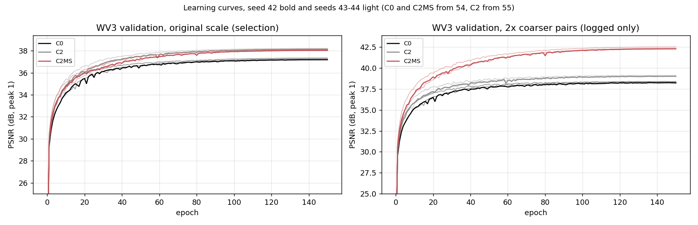

왼쪽은 선택에 쓴 원래 축척 WV3 validation PSNR, 오른쪽은 기록만 한 2배 거친 쌍 validation PSNR입니다(정규화 값, peak 1). 진한 선이 seed 42, 연한 선이 seed 43·44입니다. 원래 축척에서는 C2와 C2MS가 겹치고, 거친 축척에서는 C2MS만 크게 높습니다.

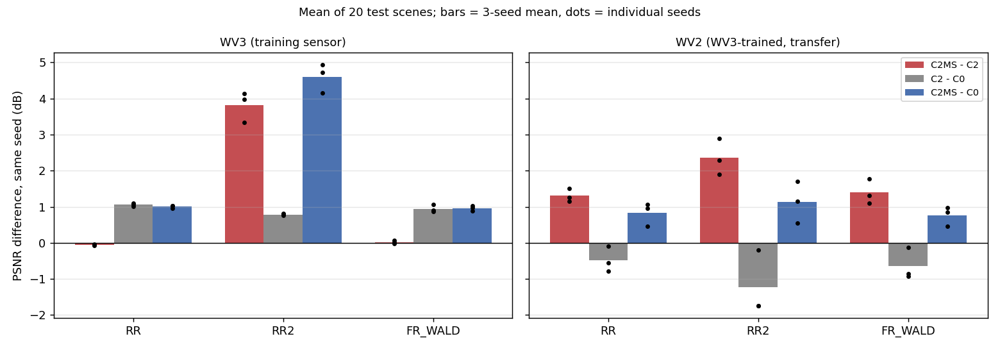

왼쪽은 학습 센서 WV3, 오른쪽은 전이 WV2의 같은 시드 PSNR 차이입니다. 막대는 3시드 평균, 점은 각 시드 값입니다. 빨강이 축척 혼합의 효과(C2MS − C2), 회색이 W2 용량의 효과(C2 − C0)입니다.

## 6. 결과 이미지
<a id="images"></a>

WV2 RR test 고정 6장면(0-based 0·1·3·7·14·17, seed 42)에서 C2와 C2MS를 [결과 이미지 도구](../../../common/result_images.py)로 비교했습니다. RGB 밴드 [4,2,1], 장면별 정답 1-99% 공통 대비입니다. 원본 크기 비교는 위 줄이 LR MS(최근접 확대) · PAN 입력 · C2 · C2MS · 정답, 아래 줄이 C2와 C2MS의 |예측 − 정답| 지도입니다(C2 오차의 99퍼센타일을 공통 색 척도로 사용). 확대 비교는 C2MS의 개선(C2 오차 − C2MS 오차)이 가장 큰 64×64 창을 4배 확대한 정답 전체(노란 상자) · C2 · C2MS · 정답 · C2 오차 · C2MS 오차이며, C2MS에 유리하게 고른 창입니다. 원본과 C2MS의 같은 장면 비교는 [54번 이미지](../54_multi_sensor_scale_mixed_training/results/images/WV2_C2MS_vs_original/)에 있습니다.

| 장면 | 장면 PSNR C2 → C2MS | 확대 영역 PSNR C2 → C2MS |
|---:|---|---|
| 0 | 27.31 → 28.69 dB (+1.38) | 23.70 → 24.85 dB |
| 1 | 25.39 → 26.82 dB (+1.43) | 22.93 → 24.71 dB |
| 3 | 33.70 → 34.94 dB (+1.23) | 27.06 → 28.56 dB |
| 7 | 27.60 → 29.18 dB (+1.58) | 23.63 → 25.71 dB |
| 14 | 27.36 → 28.93 dB (+1.58) | 26.75 → 29.36 dB |
| 17 | 27.57 → 29.39 dB (+1.82) | 26.08 → 28.39 dB |

여섯 장면 모두 C2MS가 높았습니다. C2는 원본(54번 이미지)보다 선명해 보이지만 정답에 없는 세부를 만듭니다. 장면 14 확대 비교에서는 연못 경계를 따라 여러 겹의 링 무늬가 생기고 연못 안쪽 색이 갈색으로 틀어지며, 장면 7에서는 밝은 지붕의 대비가 과하게 나옵니다. 그래서 C2의 오차 지도는 경계를 따라 더 밝습니다.

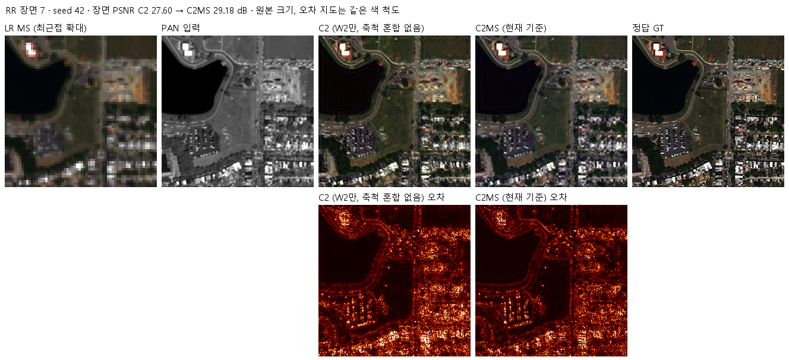

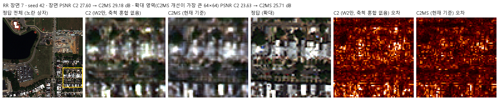

<details>
<summary><b>나머지 5장면 펼치기</b> (0·1·3·14·17)</summary>

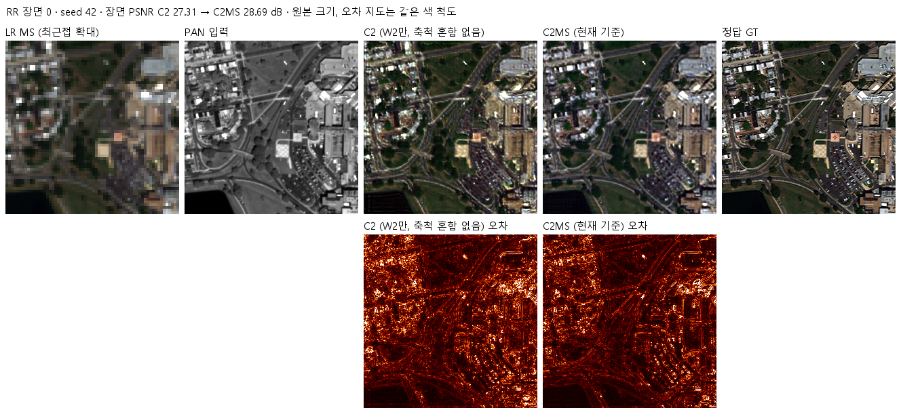

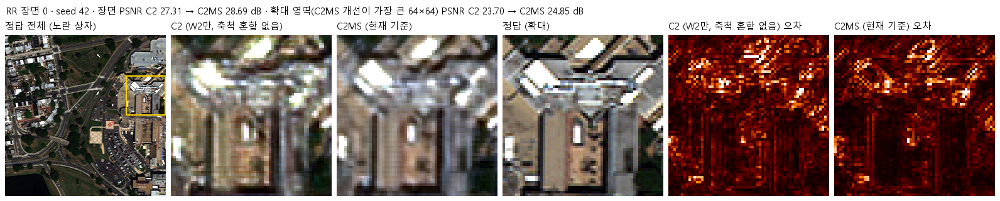

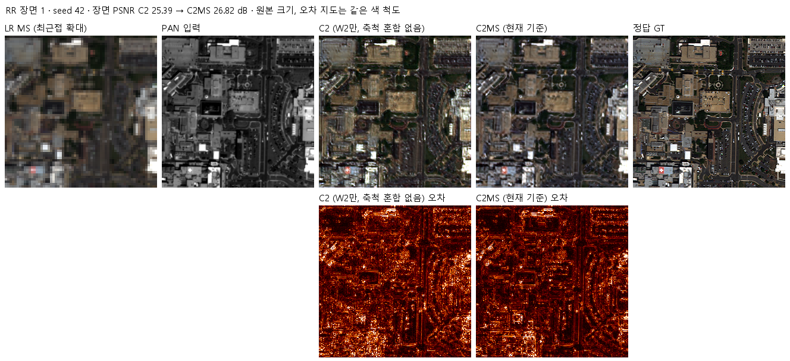

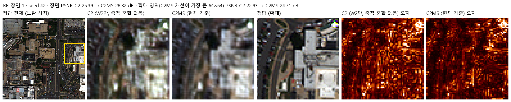

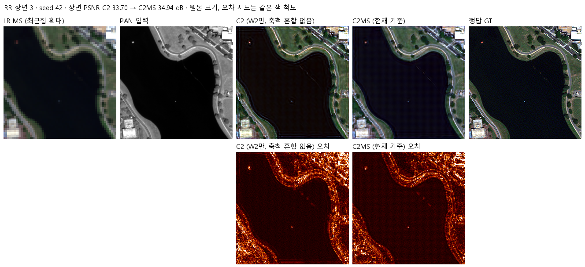

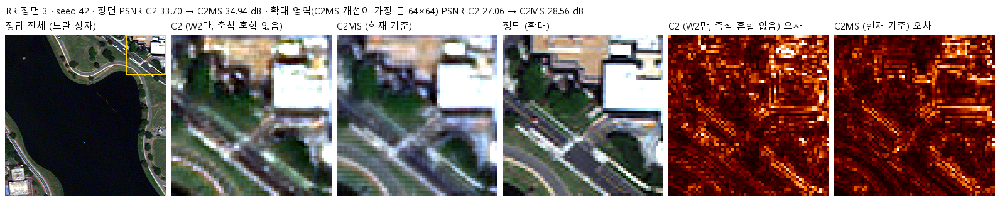

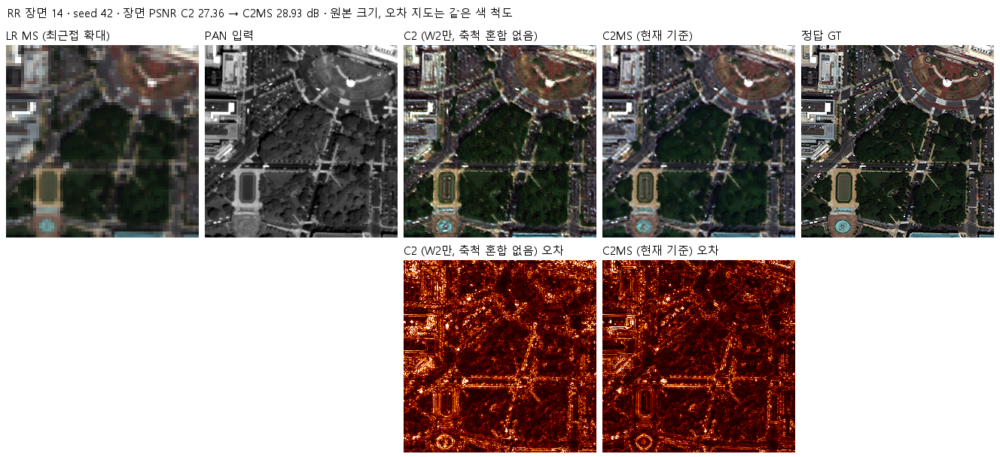

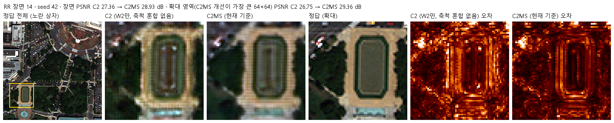

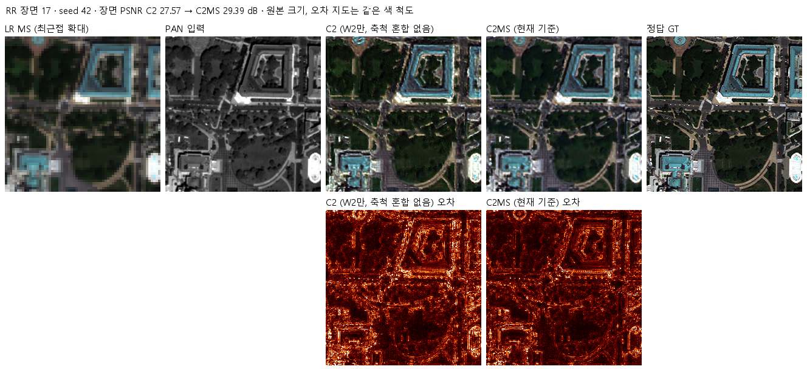

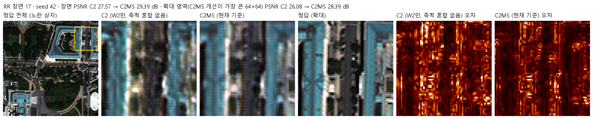

</details>

장면 7은 루트 README와 같은 장면을 먼저 보이기 위해 앞에 두었습니다. 학습 코드가 만든 WV3 4패널(LR MS · PAN · 예측 · 정답)은 각 실행의 평가 폴더(예: [seed 42](results/C2_WV3_s42/evaluation/))에 있습니다.

## 7. 재현 자료
<a id="evidence"></a>

- 코드: [설정·사전 판정](config.json), [모델](model.py), [센서 연산](prepare.py)(54번 그대로 사용), [학습](train.py), [실행 제어](run.py), [평가](evaluate.py)
- 학습 당시 소스·설정: [provenance/code](provenance/code/). 판정을 낸 평가 코드는 `provenance/code/evaluate.py`이고(해시가 `evaluation_v2_3.json`의 기록과 같음), 현재 `evaluate.py`는 이후 그래프 제목만 줄인 판입니다.
- 실행 기록: [provenance/run_records](provenance/run_records/)(실행 설정, 데이터 해시, 환경, 사전 점검·벤치마크, 큐 상태)
- 가중치: [checkpoints](checkpoints/)의 `C2_WV3_s<시드>/best.pt`. 재개용 `latest.pt`와 초기 `initial.pt`는 Release `weights-experiments-performance-55`에 있고 manifest의 `release_assets`에 해시가 있습니다. C0·C2MS 가중치는 [54번](../54_multi_sensor_scale_mixed_training/checkpoints/)에 있습니다.
- 결과: [v2.3 판정·장면별 수치·선명도·색 분석](results/evaluation_v2_3.json), 실행별 학습 기록·기본 평가([results](results/)의 `C2_WV3_s<시드>/`), [파일 manifest](manifest.json)

```bash
python SSA-MRN/common/verify.py --experiment 55 --research-track performance --releases
python SSA-MRN/experiments/performance/55_parallel_branch_without_scale_mixing/evaluate.py --data <PanCollection_H5_폴더>
```

## 8. 개선 여부와 다음 단계

**개선 없음(후보 C2, 기준 C2MS 대비)**입니다. 이 실험의 목적이었던 원인 분리에서는, 주 판정 WV2 C2MS 대 C2가 3시드·세 시드 각각 **개선**으로, C2MS의 WV2 전이 이득이 W2 용량이 아니라 축척 혼합 학습에서 왔음을 확인했습니다. W2 용량은 학습 센서의 RR과 색 치우침을 개선하고, 축척 혼합 학습은 거친 축척(RR2)과 처음 보는 센서에서 맞는 세부를 넣게 합니다. 기준 모델은 그대로 C2MS입니다.

다음 후보는 다음과 같습니다(학습은 승인 후 진행).
1. 다른 전이 쌍(GF2 → QB 등)에서 같은 비교로 결론이 유지되는지 확인
2. 축척 혼합 비율·배율(1.5배·3배 등)을 바꿔 전이 이득을 더 키울 수 있는지 확인
3. C2MS 경량화 시 전이 이득이 유지되는지 확인
