# 56. 원본 SSA-MRN에 축척 혼합 학습만 적용한 W2 용량·축척 혼합 2×2 기여 분해

**연구 분야:** 기존 성능 개선

**실험자:** 이병현

**변경 내용:** W2 병렬 가지 없이 원본 SSA-MRN K4에 축척 혼합 학습(원래 학습 쌍 + 2배 거친 학습 쌍, [성능 53번](../53_scale_mixed_training/README.md)의 손실)만 적용한 C0MS를 QB로 3시드 학습했습니다. [성능 43번](../43_normalized_parallel_capacity/README.md)의 원본(C0)·원본+W2(C2), 53번의 C2MS(원본+W2+축척 혼합)와 같은 시드끼리 비교해, W2 용량과 축척 혼합 학습의 효과를 2×2로 나눴습니다.

| 확인된 결과 | 상태 | 개선 여부 |
|---|:---:|:---:|
| C0MS는 원본보다 RR PSNR −0.293 dB·SAM +0.120°·ERGAS +0.147, FR_WALD −0.525 dB로 나빠졌고(세 시드 모두, RR 0/20장), 한 단계 거친 시험 RR2만 +1.910 dB 좋아졌습니다. W2만 쓴 C2는 RR +0.702 dB였지만 RR2 −0.117 dB로 미달했고, 둘을 함께 쓴 C2MS만 RR +0.873 dB·RR2 +1.125 dB·FR_WALD +1.635 dB로 모든 판정 항목을 통과했습니다. 상호작용(함께 쓴 효과 − 따로 쓴 효과의 합)은 RR +0.463 dB·FR_WALD +0.695 dB입니다. | 평가&nbsp;완료<br>3seed | 개선&nbsp;없음 |

[실험 목록](../../../research/performance/README.md) · [수치](#results) · [그래프](#graphs) · [이미지](#images) · [재현 자료](#evidence)

## 1. 목적과 상태

현재 기준 모델 C2MS는 원본에 두 가지를 더했습니다. 하나는 W2 병렬 가지(용량)이고, 다른 하나는 2배 거친 학습 쌍을 섞는 학습(축척 혼합)입니다. 지금까지 원본(C0), W2만(C2), 둘 다(C2MS)는 있었지만 축척 혼합만 쓴 군이 없어서, 축척 혼합이 혼자서도 효과가 있는지, W2와 함께여야 효과가 나는지 나눌 수 없었습니다. 53번에서 작은 모델 F1에 축척 혼합을 적용한 F1MS는 개선 없음이었지만(seed 42), F1은 원본이 아니라 관측 오차 보정기를 붙인 모델이었습니다. 이번 실험은 원본에 축척 혼합만 적용해 2×2를 채웠습니다.

판정 방법(주 판정 C0MS 대 C0, 2×2 보조 비교와 상호작용, QB 결과 이미지)은 학습 전에 [config.json](config.json)의 `judgement`에 고정했고, 학습은 2026-10-23 사용자 승인 후 시작했습니다. 2026-10-23 08:44(KST)부터 16:44까지 QB C0MS seed 42·43·44를 150에폭씩 학습했고, 각 실행 뒤 학습 코드가 기본 RR·FR을 평가했습니다. 같은 날 20:43에 [evaluate.py](evaluate.py)로 v2.3 판정, 상호작용, 이미지, 그래프를 만들었습니다. C0·C2(43번)와 C2MS(53번)는 보관 가중치를 다시 평가했습니다. 평가 전 서버를 한 번 재부팅했고, 학습 결과는 재부팅 전에 모두 저장돼 있었습니다.

## 2. 변경한 구조와 비교 조건

| | 축척 혼합 없음 (원래 쌍만) | 축척 혼합 있음 (원래 + 2배 거친 쌍) |
|---|---|---|
| **원본 SSA-MRN K4** (426,654) | C0 ([43번](../43_normalized_parallel_capacity/README.md)) | **C0MS (이번 실험)** |
| **원본 + W2 병렬 가지** (2,853,918) | C2 ([43번](../43_normalized_parallel_capacity/README.md)) | C2MS ([53번](../53_scale_mixed_training/README.md), 현재 기준) |

괄호 안은 파라미터 수입니다. [model.py](model.py)는 54번 `Model('C0')`를 그대로 만들며, QB(4밴드)에서는 43번 C0와 같습니다. 같은 시드의 C0MS와 C0는 초기 가중치가 정확히 같고(세 시드 모두 확인, 53번에 기록된 43번 C0 초기 해시와도 같음), 차이는 손실의 2배 거친 쌍 항 하나입니다. 거친 쌍은 [prepare.py](prepare.py)가 54번 QB 연산으로 만들며, 같은 입력에서 53번 `prepare.py`와 차이가 0이었습니다.

| 조건 | 내용 |
|---|---|
| 데이터 | QB 학습 17,139 / 검증 1,905, test RR·FR 각 20장. 입력은 2047로 정규화 |
| 학습 절차 | 43·53번과 동일: 150에폭, batch·micro 32, Adam, 에폭별 cosine 1e-4 → 1e-6, AMP FP16, cuDNN deterministic, TF32 끔, channels_last |
| 손실 | 원래 쌍 MSE + 1.0 × 같은 패치의 2배 거친 쌍 MSE(53번과 같음) |
| 선택 | epoch0 포함 원래 축척 validation MSE 최소. 거친 축척 validation은 기록만 함 |
| 평가 | [common/evaluation_protocol.py](../../../common/evaluation_protocol.py)로 RR·RR2·FR_WALD·FR 각 20장, 53번 `evaluate.py`의 v2.3 판정 함수, 같은 시드 짝 3시드 평균(잡음 문턱 0.04 dB) |
| 상호작용 | (C2MS − C2) − (C0MS − C0): W2가 있을 때와 없을 때 축척 혼합의 효과 차이. 0보다 크면 함께 쓸 때 효과가 더 큼 |
| 장치 | RTX 3060 Ti 1장, 한 번에 한 학습, 별도 실행 폴더 |

## 3. 정량 결과
<a id="results"></a>

### 3시드 평균 (QB test 20장, best 가중치, 괄호는 시드 간 표본 SD)

| 시험·지표 | C0 (원본) | **C0MS** (축척 혼합만) | C2 (W2만) | C2MS (둘 다) |
|---|---:|---:|---:|---:|
| RR PSNR ↑ | 37.429 (0.056) | 37.136 (0.081) | 38.132 (0.048) | **38.302** (0.027) |
| RR SAM ↓ | 4.941 | 5.061 | 4.597 | **4.576** |
| RR ERGAS ↓ | 4.124 | 4.272 | 3.783 | **3.712** |
| RR2 PSNR ↑ | 38.199 | **40.110** | 38.082 | 39.324 |
| RR2 SAM ↓ | 4.488 | **3.812** | 4.613 | 4.124 |
| FR_WALD PSNR ↑ | 36.137 | 35.612 | 37.601 | **37.771** |
| FR_WALD SAM ↓ | 4.489 | 4.628 | 4.047 | **4.033** |
| FR 관측 RMSE (DN) ↓ | 24.57 | 23.87 | 15.89 | **15.51** |
| 참고 RR Q2n ↑ | 0.923 | 0.921 | 0.934 | 0.934 |
| 참고 FR QNR ↑ | 0.914 | **0.925** | 0.840 | 0.810 |
| 참고 FR Ds ↓ | 0.045 | **0.040** | 0.140 | 0.169 |

### v2.3 판정 (같은 시드 짝)

| 비교 | 무엇의 효과인가 | RR ΔPSNR / ΔSAM / ΔERGAS | RR2 ΔPSNR / ΔSAM | FR_WALD ΔPSNR / ΔSAM | 관측 비율 | RR 개선 장면 | 판정 (시드 42·43·44) |
|---|---|---|---|---|---:|---:|---|
| **C0MS 대 C0 (주 판정)** | W2 없이 축척 혼합 | −0.293 / +0.120° / +0.147 | +1.910 / −0.676° | −0.525 / +0.139° | 0.971 | 0/20 | **개선 없음** (개선 없음·개선 없음·개선 없음) |
| C2 대 C0 | 축척 혼합 없이 W2 | +0.702 / −0.344° / −0.341 | −0.117 / +0.124° | +1.464 / −0.442° | 0.647 | 20/20 | 부분 개선 (부분·부분·개선) |
| C2MS 대 C2 | W2가 있을 때 축척 혼합 | +0.170 / −0.021° / −0.072 | +1.242 / −0.489° | +0.170 / −0.015° | 0.976 | 19/20 | 개선 (개선·개선·개선) |
| C2MS 대 C0MS | 축척 혼합이 있을 때 W2 | +1.165 / −0.485° / −0.560 | −0.786 / +0.312° | +2.160 / −0.595° | 0.650 | 20/20 | 부분 개선 (부분·부분·부분) |
| C2MS 대 C0 (53번과 같은 값) | 둘 다 | +0.873 / −0.365° / −0.413 | +1.125 / −0.365° | +1.635 / −0.457° | 0.631 | 20/20 | 개선 (개선·개선·개선) |

### 상호작용: (C2MS − C2) − (C0MS − C0)

| 시험 | PSNR | SAM | ERGAS | 해석 |
|---|---:|---:|---:|---|
| RR | **+0.463 dB** | −0.141° | −0.219 | 축척 혼합은 W2와 함께일 때만 원래 축척 RR을 올림 (seed별 +0.518·+0.420·+0.451) |
| FR_WALD | **+0.695 dB** | −0.153° | −0.336 | 같은 방향 |
| RR2 | −0.668 dB | +0.187° | +0.258 | 거친 축척 이득은 원본 혼자일 때 더 큼 (C0MS +1.910 대 C2MS − C2 +1.242) |

C0·C2·C2MS의 이번 측정값은 53번 보관 평가와 최대 2.7e-8 차이로 같았고, C0MS의 RR 평균은 학습 코드의 기본 평가와 같았습니다.

### Validation 선택과 학습 시간

| 군 | best epoch (seed 42·43·44) | 원래 축척 validation PSNR | 2배 거친 validation PSNR |
|---|---|---|---|
| C0 (43번) | 148·147·150 | 39.29·39.32·39.33 dB | 기록 없음 |
| **C0MS** | 143·146·150 | 39.05·39.13·39.14 dB | 44.75·44.90·44.87 dB |
| C2 (43번) | 141·150·142 | 40.33·40.32·40.33 dB | 기록 없음 |
| C2MS (53번) | 149·146·149 | 40.28·40.27·40.28 dB | 46.85·46.81·46.86 dB |

C0MS는 원래 축척 validation에서도 C0보다 0.19-0.24 dB 낮아, test RR과 같은 방향이었습니다. 학습 시간은 시드당 약 159분(검증·체크포인트 포함), AMP가 건너뛴 업데이트는 19-22회(80,400회 중)였습니다.

## 4. 기준선 대비 차이와 해석

- **축척 혼합만으로는 원래 축척 성능이 떨어집니다.** 원본에 축척 혼합만 적용한 C0MS는 RR −0.293 dB, FR_WALD −0.525 dB로 세 시드·20장 모두에서 원본보다 나빴습니다. 대신 RR2는 +1.910 dB로 네 군 중 가장 높았습니다. 원본 크기의 모델은 두 축척을 함께 맞출 여유가 없어서, 거친 축척을 잘 맞추는 대신 원래 축척을 내준 것으로 보입니다. 작은 모델 F1에 같은 학습을 적용한 53번 F1MS(RR −0.291 dB, RR2 +0.635 dB)와 같은 모습입니다.
- **W2만으로는 축척이 바뀌면 무너집니다.** C2는 RR +0.702 dB, FR_WALD +1.464 dB로 원래 축척에서는 크게 좋아졌지만 RR2가 −0.117 dB로 미달했습니다(43번 결과 재확인).
- **둘을 함께 쓸 때만 모든 항목을 통과합니다.** C2MS는 원래 축척 이득(RR +0.873 dB)과 거친 축척 이득(RR2 +1.125 dB)을 함께 가졌습니다. 상호작용은 RR +0.463 dB, FR_WALD +0.695 dB로, 축척 혼합은 W2 용량이 있을 때만 원래 축척 성능을 올렸습니다. 세 시드 모두 +0.42 dB 이상이었습니다. W2의 용량이 두 축척을 함께 맞출 여유를 주고, 축척 혼합이 그 용량이 한 축척에만 맞춰지지 않게 잡아 주는 관계로 해석합니다.
- **RR2만 보면 원본 + 축척 혼합이 가장 높습니다.** RR2 상호작용은 −0.668 dB로, 거친 축척 이득은 W2 없이 학습할 때 더 컸습니다. RR2는 학습한 2배 거친 쌍과 가까운 시험이라 축척 혼합의 직접 효과가 크게 드러나며, 모델 선택에서 RR2 하나만 보면 원래 축척 성능이 나쁜 C0MS를 고르게 됩니다. 그래서 v2.3은 RR을 주 판정으로, RR2를 보조 판정으로 둡니다.
- **참고 지표:** 정답 없는 FR QNR·Ds는 C0MS가 가장 좋고 C2MS가 가장 나빴습니다. [46번](../46_fr_spatial_index_validity/README.md)·[51번](../51_fr_detail_index_validity/README.md)에서 Ds가 QB 정답 순위를 거꾸로 매겼으므로 판정에 쓰지 않았습니다.
- **한계:** QB 한 센서입니다. C0·C2는 43번, C2MS는 53번 실행을 재평가한 값이며 같은 코드 계열·데이터·시드·일정이지만 별도 실행입니다. 축척 혼합 비율(1.0)과 배율(2배)은 하나만 확인했습니다. test는 이 연구에서 반복 사용한 공개 test입니다.

## 5. 학습·평가 그래프
<a id="graphs"></a>

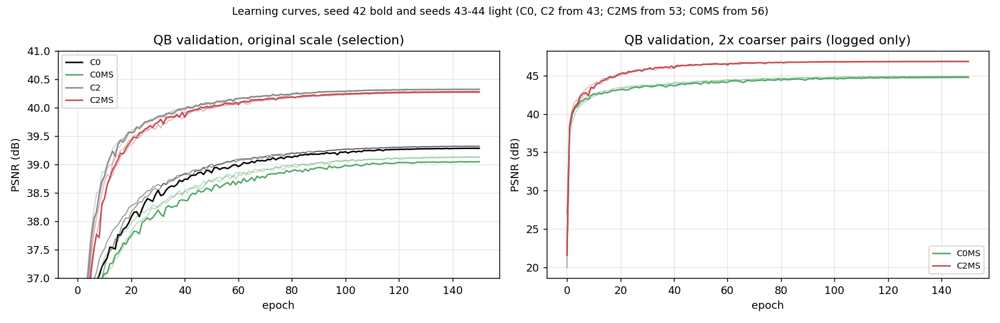

왼쪽은 선택에 쓴 원래 축척 QB validation PSNR, 오른쪽은 기록만 한 2배 거친 쌍 validation PSNR입니다. 진한 선이 seed 42, 연한 선이 seed 43·44입니다. C0·C2는 거친 축척 validation을 기록하지 않아 오른쪽에 없습니다. 원래 축척에서는 C0MS가 C0보다 내내 낮고, C2MS는 C2와 거의 겹칩니다.

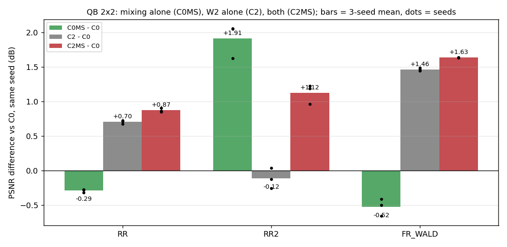

같은 시드 C0 대비 test 20장 평균 PSNR 차이입니다. 막대는 3시드 평균, 점은 각 시드 값입니다. 초록이 축척 혼합만(C0MS), 회색이 W2만(C2), 빨강이 둘 다(C2MS)입니다.

## 6. 결과 이미지
<a id="images"></a>

QB RR test 고정 6장면(seed 42)에서 원본 C0와 C0MS를 [결과 이미지 도구](../../../common/result_images.py)로 비교했습니다. RGB 밴드 [2,1,0], 장면별 정답 1-99% 공통 대비입니다. 원본 크기 비교는 위 줄이 LR MS(최근접 확대) · PAN 입력 · 원본 · C0MS · 정답, 아래 줄이 원본과 C0MS의 |예측 − 정답| 지도입니다(원본 오차의 99퍼센타일을 공통 색 척도로 사용). 확대 비교는 C0MS의 개선(원본 오차 − C0MS 오차)이 가장 큰 64×64 창을 4배 확대한 정답 전체(노란 상자) · 원본 · C0MS · 정답 · 원본 오차 · C0MS 오차이며, C0MS에 유리하게 고른 창입니다. 원본과 C2MS의 같은 장면 비교는 [53번 이미지](../53_scale_mixed_training/results/images/C2MS_vs_original/)에 있습니다.

| 장면 | 풍경 | 장면 PSNR 원본 → C0MS | 확대 영역 PSNR 원본 → C0MS |
|---:|---|---|---|
| 0 | 바다·항구 방파제 | 41.45 → 40.93 dB (−0.52) | 43.99 → 44.27 dB |
| 1 | 부두·곡선 방파제·수목 | 42.44 → 42.17 dB (−0.27) | 44.38 → 44.40 dB |
| 3 | 요트 마리나·운동장 | 36.22 → 35.57 dB (−0.65) | 37.13 → 36.98 dB |
| 7 | 숲 공원 | 38.83 → 38.60 dB (−0.24) | 36.44 → 36.48 dB |
| 14 | 언덕 공원·곡선 주택가 | 37.62 → 37.28 dB (−0.33) | 43.30 → 43.10 dB |
| 17 | 산지 녹지·산책로 | 38.73 → 38.57 dB (−0.16) | 38.97 → 38.95 dB |

여섯 장면 모두 C0MS가 낮았고, C0MS에 가장 유리한 창을 골라도 원본과 거의 같거나 낮았습니다. 두 모델의 차이는 눈으로 구분하기 어려울 만큼 작습니다.

<details>
<summary><b>원본 크기 비교 펼치기</b> (6장면)</summary>

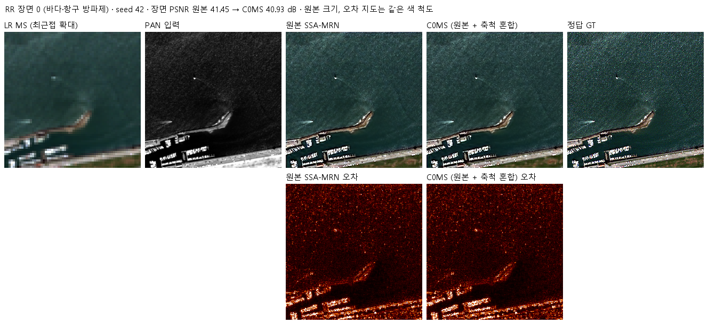

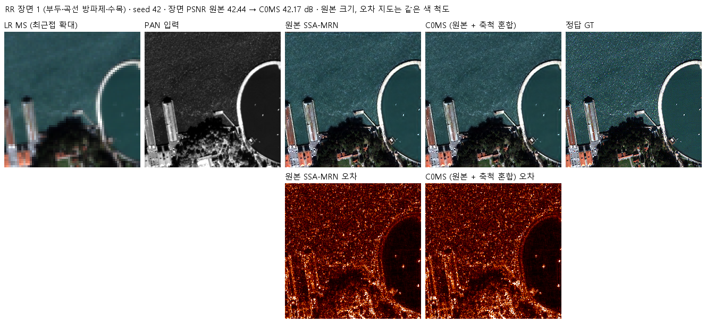

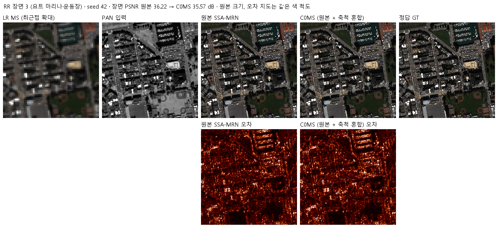

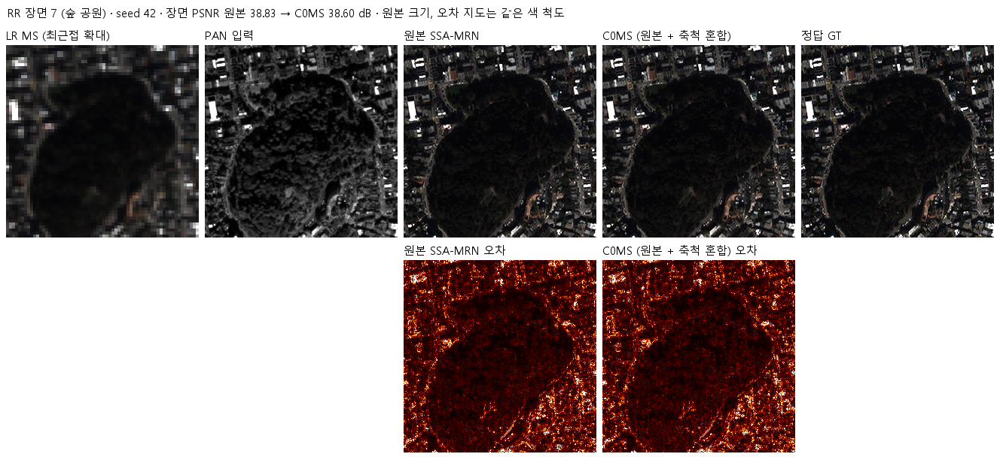

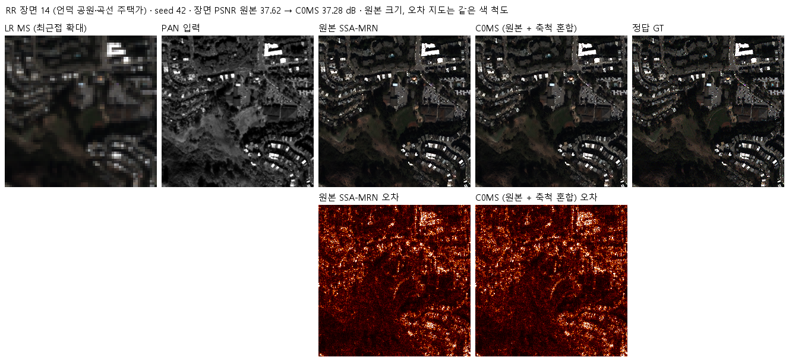

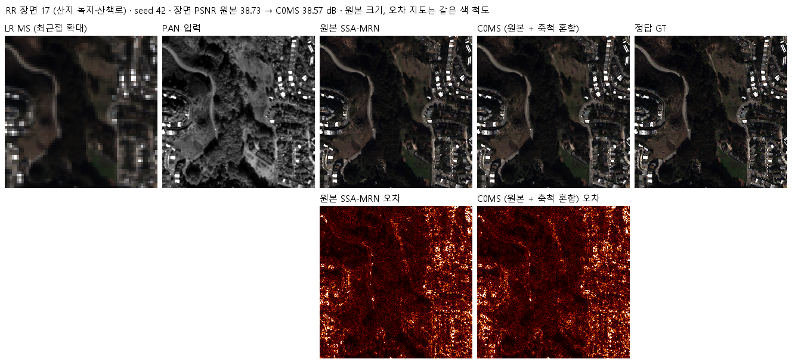

</details>

<details>
<summary><b>확대 비교 펼치기</b> (6장면)</summary>

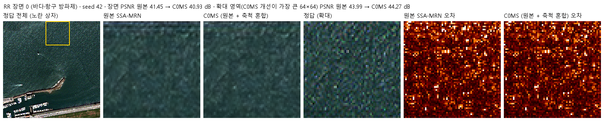

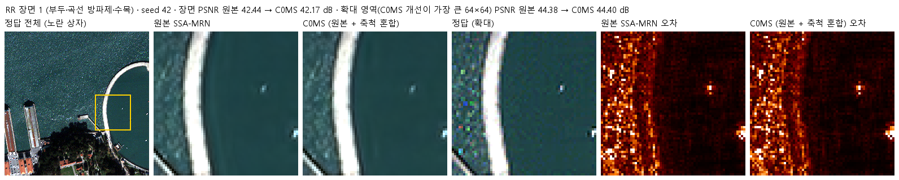

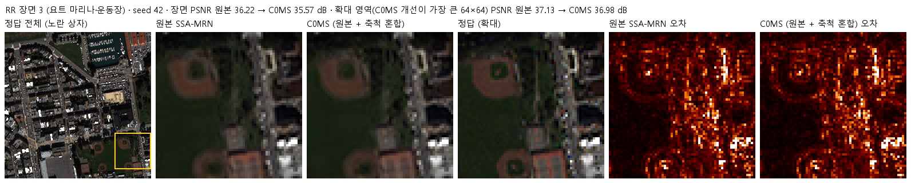

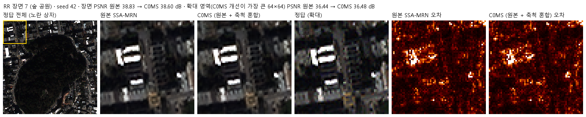

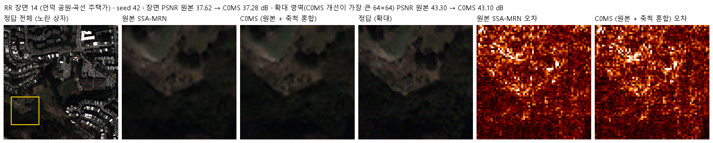

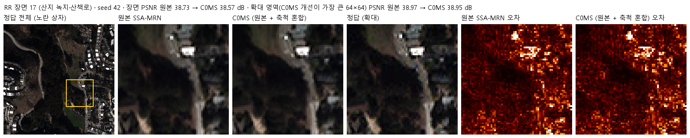

</details>

학습 코드가 만든 4패널(LR MS · PAN · 예측 · 정답)은 각 실행의 평가 폴더(예: [seed 42](results/C0MS_QB_s42/evaluation/))에 있습니다.

## 7. 재현 자료
<a id="evidence"></a>

- 코드: [설정·사전 판정](config.json), [모델](model.py), [센서 연산](prepare.py)(54번 그대로 사용), [학습](train.py), [실행 제어](run.py), [평가](evaluate.py)
- 학습·평가 당시 소스·설정: [provenance/code](provenance/code/)(현재 파일과 같음), 실행 기록: [provenance/run_records](provenance/run_records/)(실행 설정, 데이터 해시, 환경, 사전 점검·벤치마크, 큐 상태)
- 가중치: [checkpoints](checkpoints/)의 `C0MS_QB_s<시드>/best.pt`. 재개용 `latest.pt`와 초기 `initial.pt`는 Release `weights-experiments-performance-56`에 있고 manifest의 `release_assets`에 해시가 있습니다. C0·C2는 [43번](../43_normalized_parallel_capacity/checkpoints/), C2MS는 [53번](../53_scale_mixed_training/checkpoints/) 가중치입니다.
- 결과: [v2.3 판정·상호작용·장면별 수치](results/evaluation_v2_3.json), 실행별 학습 기록·기본 평가([results](results/)의 `C0MS_QB_s<시드>/`), [파일 manifest](manifest.json)

```bash
python SSA-MRN/common/verify.py --experiment 56 --research-track performance --releases
python SSA-MRN/experiments/performance/56_original_scale_mixed_training/evaluate.py --data <QuickBird_H5_폴더>
```

## 8. 개선 여부와 다음 단계

**개선 없음(3시드)**입니다. 원본에 축척 혼합 학습만 적용하면 원래 축척 RR·FR_WALD가 나빠지고 거친 축척 RR2만 좋아졌습니다. 2×2 비교에서 W2 용량만 쓰면 축척 변화(RR2)에 약하고, 축척 혼합만 쓰면 원래 축척 성능을 잃으며, 둘을 함께 쓴 C2MS만 모든 판정 항목을 통과했습니다. 축척 혼합은 W2 용량이 있을 때 원래 축척 RR을 +0.463 dB 더 올리는 상호작용을 보였습니다. 기준 모델은 그대로 C2MS입니다.

다음 후보는 다음과 같습니다(학습은 승인 후 진행).
1. C2MS의 남은 차이(PAKAN 대비 QB PSNR −0.22 dB, SAM +0.14°)를 줄이는 학습 조건: EMA, 학습 연장, SAM 보조 손실
2. 축척 혼합 비율과 배율(1.5배·3배)을 바꿔 상호작용이 커지는지 확인
3. W2 용량을 줄였을 때 상호작용이 유지되는지(경량화와 연결)
