# 57. 기준 모델 C2MS의 학습 조건 선별: 가중치 EMA와 분광 손실

**연구 분야:** 기존 성능 개선

**실험자:** 이병현

**변경 내용:** 현재 기준 모델 C2MS의 구조는 그대로 두고 학습 조건만 바꿔 QB seed 42로 선별했습니다. 모든 실행에서 가중치의 지수 이동 평균(EMA, β 0.99)을 함께 기록해, 실행 하나로 일반 가중치와 EMA 가중치를 모두 평가했습니다. 바꾼 조건은 ① EMA, ② 분광 손실(0.01 × 픽셀별 1 − cosine)이고, ③ 학습 연장(300에폭)은 4에폭에서 중단했습니다. 대조군은 [성능 53번](../53_scale_mixed_training/README.md) C2MS seed 42입니다.

| 확인된 결과 | 상태 | 개선 여부 |
|---|:---:|:---:|
| 분광 손실은 53번 C2MS 대비 RR PSNR +0.035 dB·SAM −0.048°·ERGAS −0.015로 세 지표를 모두 개선했고 SAM은 20/20장에서 낮아졌지만, PSNR 이득이 단일 시드 잡음 문턱(0.06 dB)보다 작고 53번 대비 RR2(−0.219 dB)·관측 비율(1.110)이 허용 폭을 넘었습니다. 같은 학습 코드로 다시 학습한 C2MS도 53번 대비 RR2 −0.306 dB여서 이 차이는 실행 간 변동으로 보이며, 같은 코드의 C2MS 대비로는 모든 보조 판정을 통과했습니다. EMA는 효과가 없었습니다(±0.001 dB). 분광 손실의 3시드·다른 센서 확인은 성능 58번(진행 중)에서 합니다. | 평가&nbsp;완료<br>seed42 | 부분&nbsp;개선 |

[실험 목록](../../../research/performance/README.md) · [수치](#results) · [그래프](#graphs) · [이미지](#images) · [재현 자료](#evidence)

## 1. 목적과 상태

C2MS는 QB에서 현재 최고 모델 U2Net + PAKAN(논문값 RR PSNR 38.520 dB, SAM 4.439°, ERGAS 3.698)보다 PSNR 0.22 dB, SAM 0.14° 뒤처져 있습니다. 구조를 바꾸지 않고 학습 조건만으로 이 차이를 줄일 수 있는지 확인했습니다. 후보는 원본에서 RR +0.089 dB였던 EMA([성능 26번](../../../research/performance/26_ema_weight_averaging/README.md)), SAM 차이를 직접 겨냥한 분광 손실([성능 14번](../../../research/performance/14_auxiliary_losses/README.md)의 spectral 손실), 그리고 cosine 일정을 두 배로 늘린 학습 연장입니다.

판정 방법(각 후보 대 53번 C2MS seed 42, 단일 시드 v2.3, 개선 후보만 3시드 확장)은 학습 전에 [config.json](config.json)의 `judgement`에 고정했고, 학습은 2026-10-23 사용자 승인 후 seed 42만으로 시작했습니다. 2026-10-23 21:07(KST)부터 C2MS(150에폭)와 분광 손실(150에폭)을 학습했고, 2026-10-24 04:10에 둘 다 끝났습니다. 이어서 시작한 300에폭 실행은 사용자 결정으로 04:16에 4에폭에서 중단했습니다. 학습 연장은 C2MS와 분광 손실 중 더 나은 쪽이 정해진 뒤 그 모델로 진행하기로 했습니다. 같은 날 04:18-04:34에 [evaluate.py](evaluate.py)로 v2.3 판정, 이미지, 그래프를 만들었습니다(서버 GPU는 58번 학습 중이라 CPU로 평가).

## 2. 변경한 구조와 비교 조건

| 후보 | 실행 | 가중치 | 학습 손실 | 에폭 |
|---|---|---|---|---:|
| C2MS 재현 | C2MS | 일반 (`best.pt`) | 원래 쌍 MSE + 1.0 × 2배 거친 쌍 MSE (53번과 같음) | 150 |
| C2MS + EMA | C2MS | EMA (`best_ema.pt`) | 같음 | 150 |
| **C2MS + 분광 손실** | C2MS_SAM | 일반 | 위 + 0.01 × 평균(1 − cos(예측 밴드 벡터, 정답 밴드 벡터)) | 150 |
| C2MS + 분광 손실 + EMA | C2MS_SAM | EMA | 같음 | 150 |
| 학습 연장 (중단) | C2MS_L300 | - | C2MS와 같음 | 300 중 4에서 중단 |

모든 실행은 [model.py](model.py)가 54번 `Model('C2MS')`로 만들며, QB에서는 53번 C2MS·43번 C2와 같은 시드의 초기 가중치가 정확히 같습니다(세 실행 모두 확인). EMA는 26번과 같이 β 0.99로, 적용된 optimizer 갱신마다 일반 가중치를 평균하고 학습에는 되먹이지 않습니다. 이 모델은 `state_dict`의 242개 항목 중 공유된 16개가 있어서 실제 텐서는 226개이며, 같은 텐서를 한 번만 갱신하도록 구현해 모든 파라미터가 정확히 β로 갱신되는 것을 학습 전에 확인했습니다. 일반 가중치와 EMA 가중치는 각자의 원래 축척 validation MSE로 따로 골랐습니다.

| 조건 | 내용 |
|---|---|
| 데이터 | QB 학습 17,139 / 검증 1,905, test RR·FR 각 20장. 입력은 2047로 정규화 |
| 학습 절차 | 53번과 동일: batch·micro 32, Adam, 에폭별 cosine 1e-4 → 1e-6, AMP FP16, cuDNN deterministic, TF32 끔, channels_last |
| 평가 | [common/evaluation_protocol.py](../../../common/evaluation_protocol.py)로 RR·RR2·FR_WALD·FR 각 20장, 53번 `evaluate.py`의 v2.3 판정 함수(단일 시드 잡음 문턱 0.06 dB) |
| 대조군 | 53번 C2MS seed 42(같은 코드 계열·데이터·시드·일정, 별도 실행). 같은 학습 코드의 비교로 57번 C2MS 일반 가중치 대비도 함께 보고 |
| 장치 | RTX 3060 Ti 1장, 한 번에 한 학습, 별도 실행 폴더 |

## 3. 정량 결과
<a id="results"></a>

### QB test 20장, seed 42

| 시험·지표 | 53번 C2MS (대조군) | C2MS 재현 | C2MS + EMA | **분광 손실** | 분광 손실 + EMA | U2Net + PAKAN (논문) |
|---|---:|---:|---:|---:|---:|---:|
| RR PSNR ↑ | 38.274 | 38.283 | 38.283 | **38.308** | **38.309** | 38.520 |
| RR SAM ↓ | 4.577 | 4.574 | 4.574 | **4.530** | 4.531 | 4.439 |
| RR ERGAS ↓ | 3.723 | 3.719 | 3.719 | **3.708** | **3.708** | 3.698 |
| RR2 PSNR ↑ | **39.421** | 39.115 | 39.100 | 39.202 | 39.201 | - |
| FR_WALD PSNR ↑ | 37.718 | 37.739 | 37.736 | **37.763** | **37.763** | - |
| FR_WALD SAM ↓ | 4.041 | 4.025 | 4.025 | **3.978** | **3.978** | - |
| FR 관측 RMSE (DN) ↓ | **15.65** | 17.59 | 17.58 | 17.36 | 17.38 | - |
| 참고 RR Q2n ↑ | 0.934 | 0.934 | 0.935 | 0.935 | 0.935 | 0.939 (Q4) |
| 참고 FR QNR ↑ | 0.826 | 0.828 | 0.828 | **0.845** | 0.845 | - |
| 참고 FR Ds ↓ | 0.151 | 0.151 | 0.151 | **0.131** | 0.132 | - |

PAKAN 값은 논문에 보고된 값이며 우리 지표 계산과 공식 코드의 정합은 별도 과제입니다. 분광 손실로 PAKAN과의 SAM 차이는 0.138°에서 0.090°로, PSNR 차이는 −0.246 dB에서 −0.212 dB로 줄었습니다.

### v2.3 판정 (단일 시드, 잡음 문턱 0.06 dB)

| 비교 | RR ΔPSNR / ΔSAM / ΔERGAS | RR2 ΔPSNR / ΔSAM | FR_WALD ΔPSNR / ΔSAM | 관측 비율 | RR 개선 장면 (PSNR / SAM) | 판정 |
|---|---|---|---|---:|---:|---|
| C2MS 재현 대 53번 | +0.009 / −0.003° / −0.004 | −0.306 / +0.177° | +0.021 / −0.016° | 1.124 | 12 / 12 | 부분 개선 |
| C2MS + EMA 대 53번 | +0.009 / −0.003° / −0.004 | −0.320 / +0.181° | +0.018 / −0.016° | 1.124 | 12 / 12 | 부분 개선 |
| **분광 손실 대 53번** | **+0.035 / −0.048° / −0.015** | −0.219 / +0.177° | +0.044 / −0.063° | 1.110 | 14 / **20** | **부분 개선** |
| 분광 손실 + EMA 대 53번 | +0.035 / −0.046° / −0.015 | −0.220 / +0.185° | +0.045 / −0.063° | 1.111 | 14 / 20 | 부분 개선 |
| C2MS + EMA 대 C2MS 재현 | −0.000 / +0.001° / +0.000 | −0.014 / +0.004° | −0.003 / +0.001° | 0.999 | 10 / 4 | 개선 없음 |
| 분광 손실 대 C2MS 재현 | +0.026 / −0.044° / −0.011 | +0.087 / −0.001° | +0.024 / −0.047° | 0.987 | 13 / **20** | 부분 개선 (모든 보조 판정 통과, 이득은 잡음 문턱 미만) |
| 분광 손실 + EMA 대 C2MS 재현 | +0.026 / −0.043° / −0.011 | +0.086 / +0.008° | +0.024 / −0.046° | 0.988 | 13 / 20 | 부분 개선 |

53번 대조군의 이번 측정값은 53번 보관 평가와 최대 4.4e-6 차이로 같았고, 두 실행의 일반 가중치 RR 평균은 학습 코드의 기본 평가와 같았습니다.

### Validation 선택과 학습 시간

| 실행 | 일반 best epoch / validation PSNR | EMA best epoch / validation PSNR | 2배 거친 validation PSNR | 학습 시간 |
|---|---|---|---:|---:|
| 53번 C2MS (대조군) | 149 / 40.283 dB | - | 46.85 dB | 약 180분 |
| C2MS | 145 / 40.282 dB | 150 / 40.282 dB | 46.85 dB | 약 208분 |
| 분광 손실 | 150 / 40.307 dB | 150 / 40.307 dB | 46.84 dB | 약 212분 |

분광 손실은 원래 축척 validation에서도 C2MS보다 0.025 dB 높아 test RR과 같은 방향이었습니다. 학습 시간이 53번보다 긴 것은 에폭마다 EMA validation이 추가됐기 때문입니다. AMP가 건너뛴 업데이트는 18-19회(80,400회 중)였습니다.

## 4. 기준선 대비 차이와 해석

- **분광 손실은 노린 대로 SAM을 줄였습니다.** SAM은 −0.048°로, 같은 코드로 C2MS를 다시 학습했을 때의 변동(−0.003°)보다 16배 크고 20장 모두에서 낮아졌습니다. RR PSNR·ERGAS와 FR_WALD도 함께 좋아졌고, 참고 지표 QNR·Ds도 좋아졌습니다. 다만 PSNR 이득(+0.035 dB)은 단일 시드 잡음 문턱보다 작아 한 시드로는 확정할 수 없습니다.
- **53번 대조군과의 보조 판정 미달은 실행 간 변동입니다.** 같은 코드로 다시 학습한 C2MS조차 53번 대비 RR2 −0.306 dB, 관측 비율 1.124로 허용 폭을 넘었습니다. RR2의 C2MS 3시드 표본 SD가 0.174 dB여서, 별도 실행 하나와 비교하면 RR2 허용 폭(−0.05 dB)보다 큰 차이가 우연히 생길 수 있습니다. 같은 학습 코드의 C2MS 대비로는 분광 손실이 RR2 +0.087 dB를 포함해 모든 보조 판정을 통과했습니다. 결론은 같은 시드 짝 3시드 평균(성능 58번)으로 냅니다.
- **EMA는 이 학습 일정에서 효과가 없습니다.** cosine 일정으로 학습률이 마지막에 1e-6까지 내려가 가중치가 거의 움직이지 않아서, 평균한 가중치가 일반 가중치와 같아집니다(RR 차이 0.0001 dB, 두 실행 모두 EMA의 best가 150에폭). 26번의 원본 +0.089 dB는 다른 학습 환경의 결과로 보입니다.
- **한계:** seed 42 한 시드이며 QB만 확인했습니다. 분광 손실 계수는 0.01 하나입니다. 대조군은 별도 실행입니다. test는 이 연구에서 반복 사용한 공개 test입니다.

## 5. 학습·평가 그래프
<a id="graphs"></a>

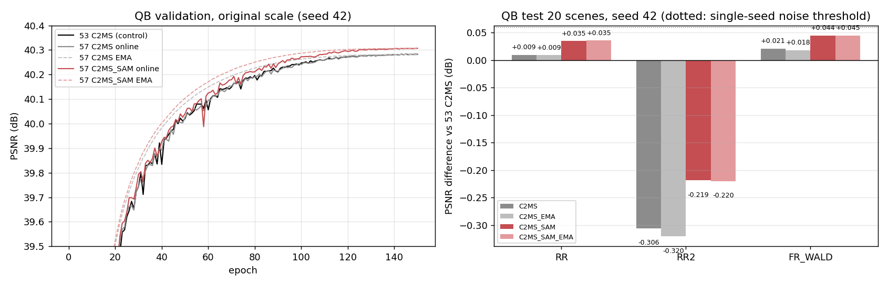

왼쪽은 원래 축척 QB validation PSNR(seed 42)입니다. 검정이 53번 C2MS, 회색이 이번 C2MS(실선 일반, 점선 EMA), 빨강이 분광 손실입니다. 분광 손실은 40에폭 이후 대체로 조금 높고, EMA 곡선은 학습 후반에 일반 가중치와 겹칩니다. 오른쪽은 53번 C2MS 대비 test 20장 평균 PSNR 차이이며 점선이 단일 시드 잡음 문턱(0.06 dB)입니다. RR2의 음수 막대는 C2MS 재현에서도 같은 크기로 나타나는 실행 간 변동입니다.

## 6. 결과 이미지
<a id="images"></a>

QB RR test 고정 6장면(seed 42)에서 현재 기준 C2MS(53번)와 분광 손실 모델을 [결과 이미지 도구](../../../common/result_images.py)로 비교했습니다. RGB 밴드 [2,1,0], 장면별 정답 1-99% 공통 대비입니다. 원본 크기 비교는 위 줄이 LR MS(최근접 확대) · PAN 입력 · C2MS · 분광 손실 · 정답, 아래 줄이 두 모델의 |예측 − 정답| 지도입니다(C2MS 오차의 99퍼센타일을 공통 색 척도로 사용). 확대 비교는 분광 손실의 개선(C2MS 오차 − 분광 손실 오차)이 가장 큰 64×64 창을 4배 확대한 정답 전체(노란 상자) · C2MS · 분광 손실 · 정답 · C2MS 오차 · 분광 손실 오차이며, 분광 손실에 유리하게 고른 창입니다.

| 장면 | 풍경 | 장면 PSNR C2MS → 분광 손실 | 확대 영역 PSNR C2MS → 분광 손실 |
|---:|---|---|---|
| 0 | 바다·항구 방파제 | 42.81 → 42.77 dB (−0.04) | 37.39 → 37.55 dB |
| 1 | 부두·곡선 방파제·수목 | 43.18 → 43.15 dB (−0.03) | 40.50 → 40.88 dB |
| 3 | 요트 마리나·운동장 | 37.96 → 38.08 dB (+0.11) | 37.29 → 37.78 dB |
| 7 | 숲 공원 | 39.41 → 39.54 dB (+0.14) | 39.46 → 39.81 dB |
| 14 | 언덕 공원·곡선 주택가 | 38.47 → 38.40 dB (−0.07) | 35.91 → 36.17 dB |
| 17 | 산지 녹지·산책로 | 39.40 → 39.43 dB (+0.03) | 35.78 → 36.20 dB |

장면 PSNR은 여섯 장면 중 세 장면에서 높고 세 장면에서 낮아, PSNR 차이는 장면에 따라 엇갈립니다. 두 모델의 차이는 눈으로 구분하기 어려울 만큼 작습니다.

<details>
<summary><b>원본 크기 비교 펼치기</b> (6장면)</summary>

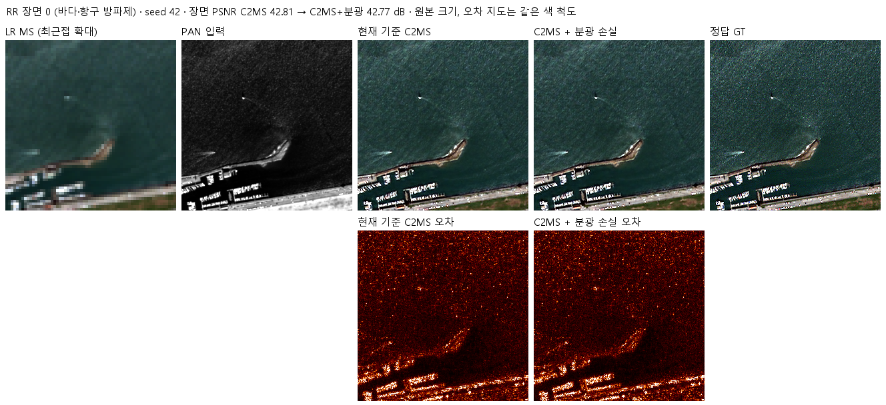

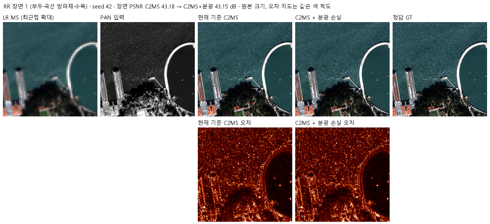

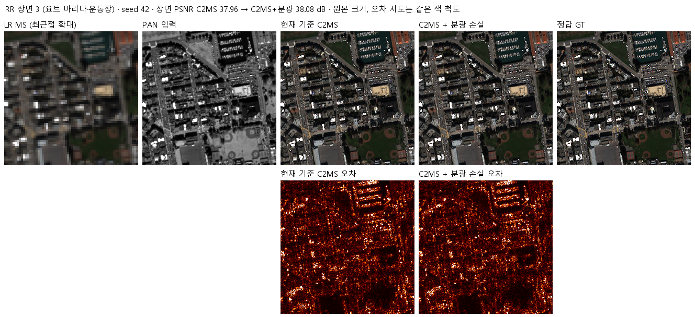

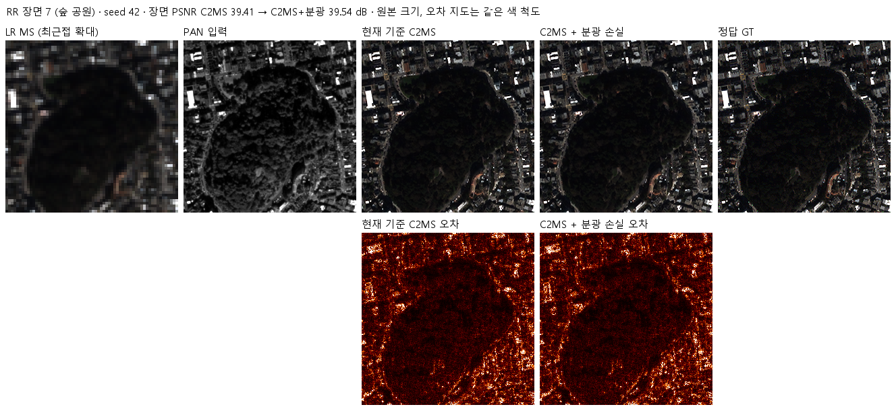

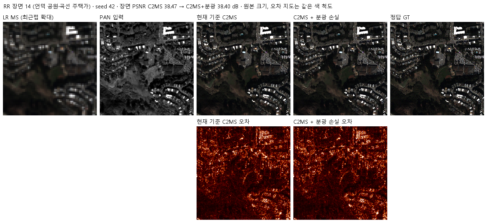

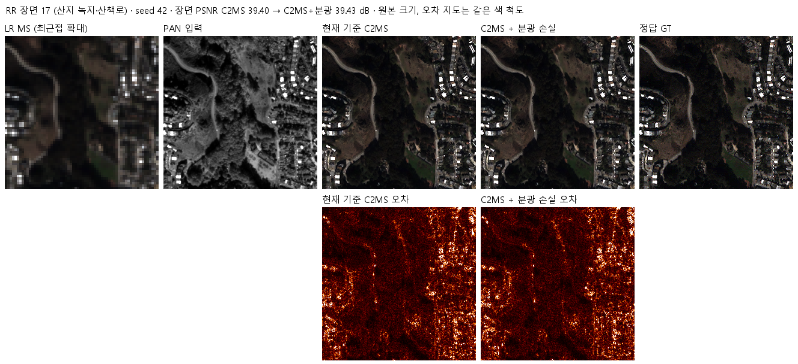

</details>

<details>
<summary><b>확대 비교 펼치기</b> (6장면)</summary>

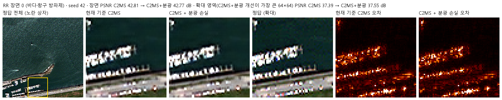

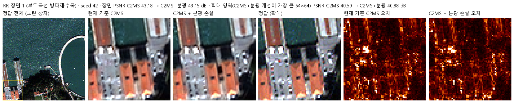

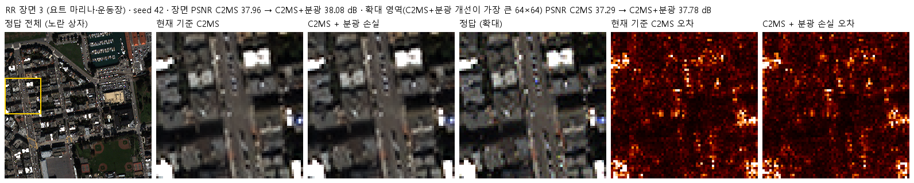

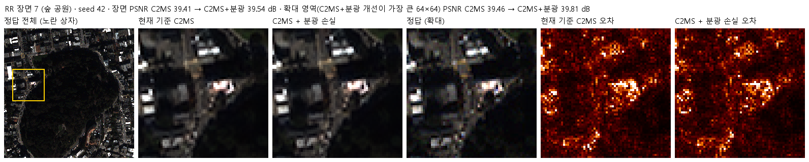

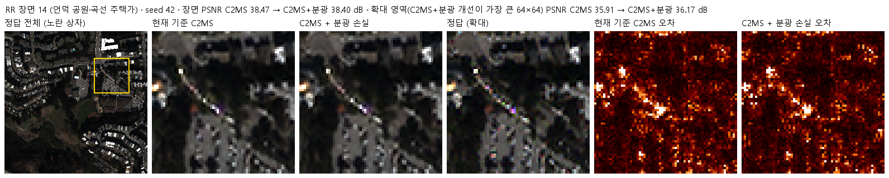

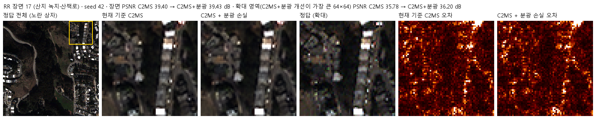

</details>

학습 코드가 만든 4패널(LR MS · PAN · 예측 · 정답)은 각 실행의 평가 폴더(일반 `evaluation/`, EMA `evaluation_ema/`)에 있습니다.

## 7. 재현 자료
<a id="evidence"></a>

- 코드: [설정·사전 판정](config.json), [모델](model.py), [센서 연산](prepare.py)(54번 그대로 사용), [학습](train.py)(54번 학습 틀에 EMA·군별 에폭·분광 손실 추가), [실행 제어](run.py), [평가](evaluate.py)
- 학습·평가 당시 소스·설정: [provenance/code](provenance/code/)(현재 파일과 같음), 실행 기록: [provenance/run_records](provenance/run_records/)
- 가중치: [checkpoints](checkpoints/)의 `C2MS_QB_s42/`·`C2MS_SAM_QB_s42/`에 `best.pt`(일반)와 `best_ema.pt`(EMA). 재개용 `latest.pt`와 초기 `initial.pt`는 Release `weights-experiments-performance-57`에 있습니다. 중단한 300에폭 실행은 가중치를 보관하지 않고 기록만 [results/C2MS_L300_QB_s42_stopped](results/C2MS_L300_QB_s42_stopped/)에 남겼습니다.
- 결과: [v2.3 판정·장면별 수치](results/evaluation_v2_3.json), 실행별 학습 기록·기본 평가([results](results/)), [파일 manifest](manifest.json)

```bash
python SSA-MRN/common/verify.py --experiment 57 --research-track performance --releases
python SSA-MRN/experiments/performance/57_c2ms_training_conditions/evaluate.py --data <QuickBird_H5_폴더>
```

## 8. 개선 여부와 다음 단계

**부분 개선(seed 42)**입니다. 분광 손실은 RR 세 지표를 모두 개선했고 특히 SAM을 20/20장에서 낮췄지만, PSNR 이득이 단일 시드 잡음 문턱보다 작고 53번 대조군 대비 RR2·관측 일치는 실행 간 변동 때문에 허용 폭을 넘었습니다. EMA는 이 학습 일정에서 효과가 없어 후보에서 뺍니다. 기준 모델은 그대로 C2MS입니다.

다음 단계는 다음과 같습니다(2026-10-24 사용자 결정).
1. 분광 손실 모델을 QB seed 43·44와 GF2·WV3 seed 42-44로 학습해 같은 시드 짝 3시드 평균으로 판정합니다(성능 58번, 진행 중).
2. 58번 결과로 C2MS와 분광 손실 중 더 나은 모델을 정해, 그 모델로 300에폭 학습을 각 데이터셋 1시드로 진행합니다.
