# 58. 기준 모델 C2MS에 분광 손실을 더한 학습의 반복 시드·다른 센서 확인

**연구 분야:** 기존 성능 개선 · **실험자:** 이병현

**변경 내용:** 현재 기준 모델 C2MS의 구조·축척 혼합 학습을 유지하고, 원래 해상도 학습 쌍에 `0.01 × mean(1 − cosine)` 분광 손실을 더했습니다. QB·GF2·WV3를 seed 42·43·44로 비교하고 WV3 학습 모델의 WV2 전이도 확인했습니다. QB seed 42는 성능 57번의 동일 실행을 재사용했습니다.

| 확인된 결과 | 상태 | 개선 여부 |
|---|:---:|:---:|
| C2MS 대비 3시드 RR PSNR: QB +0.0263 dB, GF2 +0.0815 dB, WV3 +0.0344 dB, WV2 전이 −0.2147 dB입니다. GF2는 v2.3 통과, QB는 RR2 미달, WV3는 잡음 문턱 미만, WV2는 전이 성능이 하락했습니다. | 평가&nbsp;완료 | 부분&nbsp;개선 |

[실험 목록](../../../research/performance/README.md) · [수치](#results) · [그래프](#graphs) · [이미지](#images) · [재현 자료](#evidence)

## 1. 목적과 상태

성능 57번의 QB seed 42에서 분광 손실은 RR PSNR +0.035 dB, SAM −0.048°였지만 잡음 문턱을 넘지 못했습니다. 이 작은 이득이 반복 시드에서 유지되는지, 다른 센서와 학습하지 않은 WV2로도 이어지는지 확인했습니다.

2026-10-24 사용자 승인 후 신규 8개 실행(QB 2개, GF2 3개, WV3 3개)을 직렬로 각각 150에폭 학습했습니다. 마지막 WV3 seed 44 학습은 2026-10-25 07:52:26 KST에 끝났고 컨트롤러는 07:53:15에 모든 학습·평가 완료를 기록했습니다. 정답 기반 보조 평가를 포함한 v2.3 결과를 별도로 보존했습니다. 아래 결과는 단일 시드의 승패가 아니라 같은 시드 대조군과 짝지은 전체 3시드 평균입니다.

## 2. 변경한 구조와 비교 조건

C2MS는 원본 SSA-MRN K4의 backbone에 W2 병렬 가지를 더한 모델이며, 원래 학습 쌍과 2배 거친 쌍을 함께 학습합니다. 이번 실험은 모델의 입력·연산·출력을 바꾸지 않고 학습 목적에만 분광 손실을 추가했습니다. PAN·LMS·MS를 입력하고 원래 해상도의 MS 예측을 출력하는 구조는 같습니다.

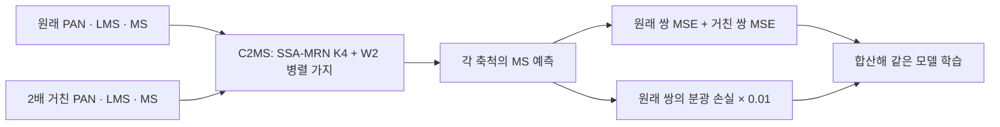

픽셀의 예측 밴드 벡터와 정답 밴드 벡터의 방향이 다를수록 분광 손실이 커집니다. 밝기 오차를 재는 MSE에 색·분광 방향을 맞추는 제약을 보탠 가설입니다. 분모 안정화 등 실제 연산은 [train.py](train.py)의 `spectral_loss` 구현을 기준으로 합니다.

| 항목 | 실제 비교 조건 |
|---|---|
| 대조군 | QB: 성능 53번 C2MS, GF2·WV3: 성능 54번 C2MS, 같은 seed 42·43·44 |
| 후보 | C2MS_SAM, 분광 가중치 0.01 한 가지 |
| 모델·입출력 | K4, 공간 배율 4, QB·GF2 4밴드, WV3·WV2 8밴드 |
| 학습 손실 | 원래 쌍 MSE + 1.0 × 2배 거친 쌍 MSE + 0.01 × 원래 쌍 분광 손실 |
| 학습량·최적화 | 150에폭, Adam, lr 1e-4에서 1e-6으로 감소, batch 32·micro 32 |
| 정밀도 | core 학습 FP16 AMP, 변환·손실·validation·평가 FP32, channels_last, TF32 끔 |
| 데이터 | 같은 데이터 SHA-256·시드·학습 순서를 사용하며 센서별 관측 연산·정규화는 성능 54번을 따릅니다. |
| 가중치 선택 | 원래 해상도 validation MSE 최솟값, epoch 0 포함·동률은 먼저 나온 값, test로 선택하지 않습니다. |
| EMA | β=0.99의 별도 가중치 평균, 초기 가중치부터 시작하며 학습 모델에는 되먹이지 않습니다. validation으로 별도 선택합니다. |
| 재사용 | 후보 QB seed 42는 성능 57번, 대조군은 53·54번이며 재학습하지 않았습니다. |
| 평가 | 대상별 RR·FR 각 20장, RR2·FR_WALD·FR 관측 일치 포함, WV2는 WV3 학습 모델의 센서 전이입니다. |


### 가중치 선택과 AMP 업데이트

실제 학습 기록의 validation 최솟값으로 선택 epoch를 다시 확인했습니다. AMP 누락 업데이트는 기록대로 표시하며 모든 실행이 같은 업데이트 수라고 가정하지 않습니다. QB seed 42 기록은 57번에서 확인합니다.

| 센서 | 시드 | 일반 best epoch | EMA best epoch | AMP 누락 업데이트 |
|---|---:|---:|---:|---:|
| QB | 43 | 148 | 150 | 19 |
| QB | 44 | 149 | 149 | 18 |
| GF2 | 42 | 144 | 148 | 22 |
| GF2 | 43 | 149 | 149 | 22 |
| GF2 | 44 | 146 | 148 | 24 |
| WV3 | 42 | 150 | 150 | 4 |
| WV3 | 43 | 148 | 149 | 5 |
| WV3 | 44 | 148 | 149 | 5 |

대조군은 이전 실행을 사용했으므로 동시 실행 환경이 완전히 같은 비교는 아닙니다. AMP 누락 업데이트도 실행별로 함께 보존합니다. EMA는 후보에만 적용한 보조 결과이므로 일반 C2MS와의 차이를 EMA 하나의 효과로 해석하지 않습니다.

<a id="results"></a>

## 3. 정량 결과

PSNR은 높을수록, SAM·ERGAS는 낮을수록 좋습니다. 각 시드의 20장 평균을 구한 뒤 3시드를 같은 비중으로 평균했습니다. 차이는 **후보 − C2MS**입니다. 주 판정은 일반 best이며 EMA는 보조 결과입니다.

### 일반 best의 3시드 RR 평균

| 대상 | 모델 | PSNR ↑ (dB) | SAM ↓ (°) | ERGAS ↓ |
|---|---|---:|---:|---:|
| QB | C2MS | 38.3018 | 4.5760 | 3.7116 |
| QB | 분광 손실 추가 | 38.3282 | 4.5285 | 3.7013 |
| QB | **차이** | **+0.0263** | **-0.0475** | **-0.0102** |
| GF2 | C2MS | 48.5943 | 0.7909 | 0.7078 |
| GF2 | 분광 손실 추가 | 48.6758 | 0.7827 | 0.7010 |
| GF2 | **차이** | **+0.0815** | **-0.0081** | **-0.0068** |
| WV3 | C2MS | 38.5429 | 3.0748 | 2.2578 |
| WV3 | 분광 손실 추가 | 38.5773 | 3.0539 | 2.2485 |
| WV3 | **차이** | **+0.0344** | **-0.0209** | **-0.0093** |
| WV2 전이 | C2MS | 29.4134 | 5.8536 | 4.6199 |
| WV2 전이 | 분광 손실 추가 | 29.1987 | 5.8540 | 4.7431 |
| WV2 | **차이** | **-0.2147** | **+0.0004** | **+0.1232** |

### v2.3 주·보조 판정

3시드 RR PSNR 잡음 문턱은 +0.04 dB입니다. RR2는 ΔPSNR ≥ −0.05 dB·ΔSAM ≤ +0.06°, FR_WALD는 ΔPSNR ≥ −0.07 dB·ΔSAM ≤ +0.04°, FR 관측 RMSE 비율은 1.10 이하가 통과 조건입니다. 자세한 정의는 [판정 기준](../../../docs/judgement_criteria.md)을 따릅니다.

| 대상 | RR2 ΔPSNR / ΔSAM | FR_WALD ΔPSNR / ΔSAM | FR 관측 RMSE 비율 | 판정과 이유 |
|---|---:|---:|---:|---|
| QB | -0.1831 / +0.0976 | +0.0351 / -0.0557 | 1.0537 | 부분 개선: RR 이득이 잡음 문턱 미만이며 RR2 PSNR·SAM 미달 |
| GF2 | +0.0299 / -0.0014 | +0.0707 / -0.0075 | 0.9859 | 개선: 주 판정·보조 판정 모두 통과 |
| WV3 | +0.3320 / -0.1065 | +0.0022 / -0.0066 | 0.9700 | 부분 개선: 보조 판정은 통과했으나 RR 이득이 잡음 문턱 미만 |
| WV2 | -0.2722 / +0.0381 | -0.2625 / +0.0825 | 0.9764 | 개선 없음: RR 세 지표 모두 악화, RR2 PSNR·FR_WALD PSNR/SAM 미달 |

### 시드별 RR 차이

| 대상 | 시드 | ΔPSNR (dB) | ΔSAM (°) | ΔERGAS |
|---|---:|---:|---:|---:|
| QB | 42 | +0.0346 | -0.0475 | -0.0146 |
| QB | 43 | +0.0247 | -0.0566 | -0.0099 |
| QB | 44 | +0.0196 | -0.0384 | -0.0062 |
| GF2 | 42 | +0.1559 | -0.0126 | -0.0130 |
| GF2 | 43 | +0.0163 | -0.0025 | -0.0016 |
| GF2 | 44 | +0.0723 | -0.0093 | -0.0059 |
| WV3 | 42 | +0.0464 | -0.0309 | -0.0136 |
| WV3 | 43 | +0.0584 | -0.0225 | -0.0133 |
| WV3 | 44 | -0.0016 | -0.0095 | -0.0011 |
| WV2 | 42 | -0.2139 | -0.0624 | +0.1399 |
| WV2 | 43 | -0.1798 | +0.1032 | +0.0896 |
| WV2 | 44 | -0.2504 | -0.0396 | +0.1401 |

### EMA와 FR 참고 지표

EMA도 각 시드에서 validation MSE로 선택했습니다. 아래는 **후보 EMA best − 일반 C2MS best** 차이입니다. test를 보고 일반 best와 EMA 중 하나를 골라 주 판정을 바꾸지 않습니다.

| 대상 | EMA ΔRR PSNR | EMA ΔRR SAM | EMA v2.3 판정 | 일반 best ΔFR QNR (참고) |
|---|---:|---:|---|---:|
| QB | +0.0267 | -0.0470 | 부분 개선 | +0.0247 |
| GF2 | +0.0814 | -0.0079 | 개선 | +0.0040 |
| WV3 | +0.0371 | -0.0213 | 부분 개선 | +0.0019 |
| WV2 | -0.2186 | +0.0028 | 개선 없음 | -0.0066 |

QNR·Dλ·Ds는 판정에 사용하지 않습니다. [시드별 차이 CSV](results/comparison_summary.csv)와 모든 장면의 RR·RR2·FR_WALD·FR 지표·EMA 수치는 [원본 평가 JSON](results/evaluation_v2_3.json)에 있습니다.

## 4. 기준선 대비 차이와 해석

- **QB:** SAM은 3시드 평균으로 모든 20장에 걸쳐 낮아졌지만 PSNR 이득은 +0.0263 dB입니다. RR2 PSNR −0.1831 dB·SAM +0.0976°로 거친 축척에서의 성능이 나빠져 보조 판정을 통과하지 못했습니다.
- **GF2:** PSNR +0.0815 dB, SAM −0.0081°, ERGAS −0.0068이며 보조 판정을 모두 통과했습니다. 이번 분광 가중치의 효과가 가장 일관되게 확인된 센서입니다.
- **WV3:** RR 세 지표와 보조 판정이 모두 나아졌지만 PSNR +0.0344 dB가 잡음 문턱 +0.04 dB보다 작습니다. 작은 수치 차이를 확정적인 개선으로 확대 해석하지 않습니다.
- **WV2 전이:** WV3로 학습한 모델을 학습하지 않은 WV2에 적용하면 RR PSNR −0.2147 dB, ERGAS +0.1232로 악화했습니다. 학습 센서의 SAM 감소가 다른 센서의 성능 향상을 보장하지 않습니다. 분광 손실이 원인일 수 있다는 가설은 세울 수 있지만 이 실험만으로 기전을 확정하지 않습니다.

C2MS의 학습에는 2배 거친 쌍이 들어가므로 RR2는 완전히 처음 보는 축척이 아닙니다. 기존 test를 반복 활용한 탐색이며 가중치 0.01만 시험했습니다. GF2의 개선을 모든 센서에 일반화하거나 현재 기준 모델을 자동 교체하지 않습니다.

<a id="graphs"></a>

## 5. 학습·평가 그래프

아래 곡선은 실제 보관된 기록입니다. 검은색은 C2MS, 붉은색은 후보이며 seed 42는 진하게, 43·44는 옅게 표시합니다. 학습 MSE는 원래 쌍의 MSE이며 분광·거친 쌍 손실을 합친 전체 목적함수와 다릅니다. 학습 MSE와 SAM은 로그 축입니다.

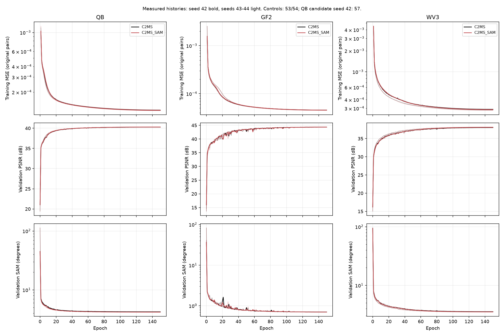

후반부 validation PSNR의 작은 차이는 다음 확대 축 그래프로 확인합니다. validation은 가중치 선택용이며 최종 test 개선 판정과 구분합니다.

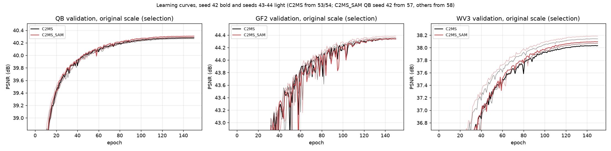

아래 막대는 3시드 평균 PSNR 차이이고 점은 개별 시드입니다. 점선 +0.04 dB는 RR 주 판정의 잡음 문턱으로, RR2·FR_WALD의 허용폭과는 다릅니다.

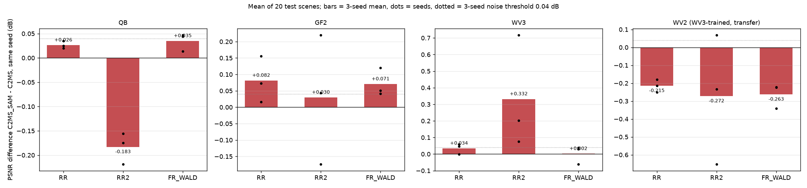

<a id="images"></a>

## 6. 결과 이미지

고정 6장면(0-based 0·1·3·7·14·17), seed 42를 사용했습니다. QB 장면은 정답만 보고 미리 정한 바다·항구, 부두·수목, 마리나·운동장, 숲 공원, 언덕 주택가, 산지 녹지입니다. WV2에는 같은 인덱스를 사용하지만 QB의 풍경 설명을 그대로 적용하지 않습니다. `common/result_images.py`로 생성했으며 후보에 유리한 장면으로 교체하지 않았습니다.

원본 크기 비교는 256×256 전체 장면의 **LR MS · PAN · C2MS · 후보 · 정답**, 그리고 **C2MS 오차 · 후보 오차**입니다. 두 오차는 같은 색 척도를 사용합니다. 확대 비교는 **정답 전체(노란 상자) · C2MS · 후보 · 정답 · C2MS 오차 · 후보 오차** 순서입니다. 예측의 RGB 표시 대비는 같은 정답 기준을 사용합니다.

확대 창은 후보의 개선(기준 오차 − 후보 오차)이 가장 큰 64×64 창을 골라 4배 확대한 것으로 **후보에 유리하게 선택한 표시**입니다. 전체 장면 성능과 함께 읽어야 합니다. 여기의 정답은 RR 정답이며 FR 정답을 만든 것이 아닙니다.


### QB · seed 42

| 장면 | C2MS PSNR | 후보 PSNR | 차이 (dB) |
|---:|---:|---:|---:|
| 0 | 42.8118 | 42.7678 | -0.0440 |
| 1 | 43.1790 | 43.1467 | -0.0323 |
| 3 | 37.9643 | 38.0774 | +0.1131 |
| 7 | 39.4053 | 39.5448 | +0.1395 |
| 14 | 38.4725 | 38.3979 | -0.0746 |
| 17 | 39.3962 | 39.4271 | +0.0309 |

**QB 장면 0 · 원본 크기와 확대 비교**

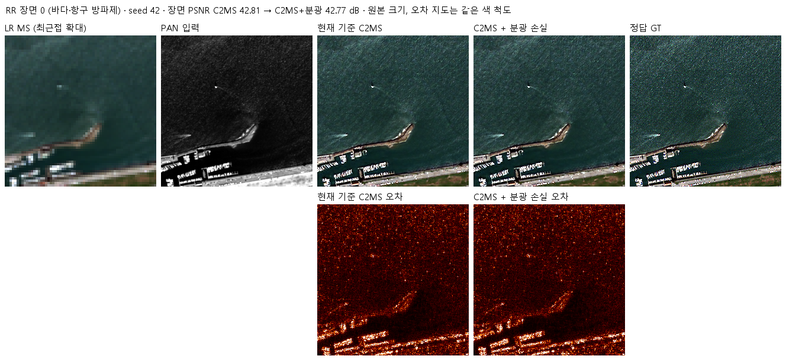

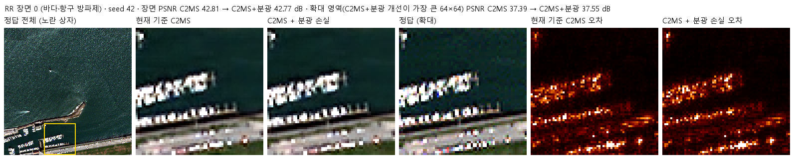

<details><summary>QB 장면 1 · 두 비교 형식</summary>

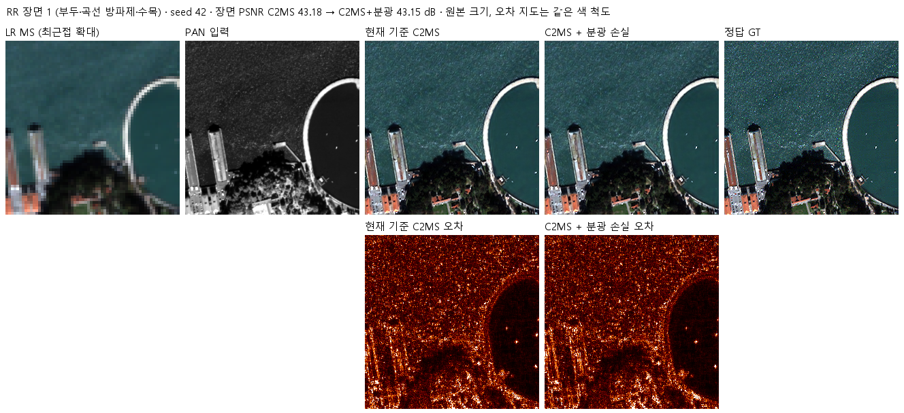

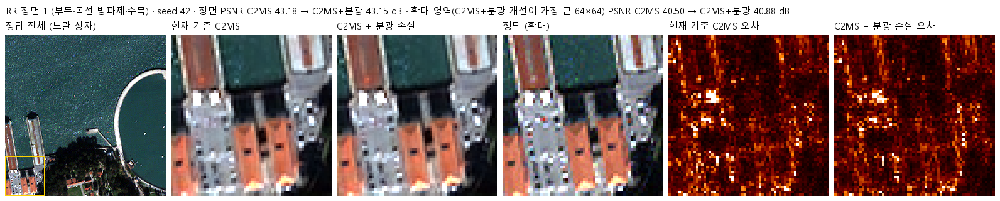

</details>


<details><summary>QB 장면 3 · 두 비교 형식</summary>

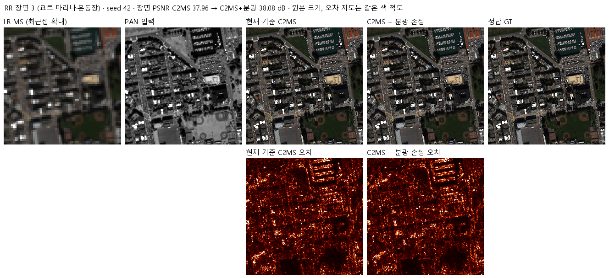

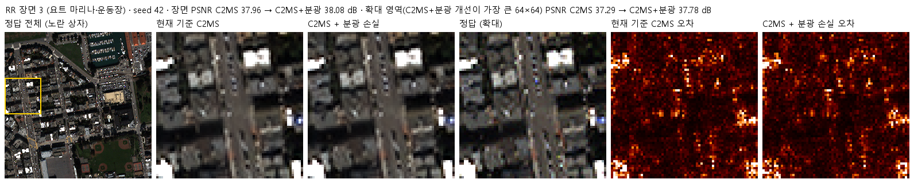

</details>


<details><summary>QB 장면 7 · 두 비교 형식</summary>

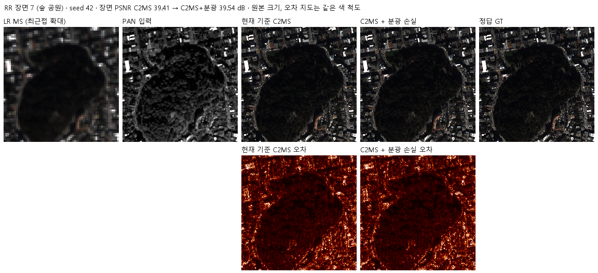

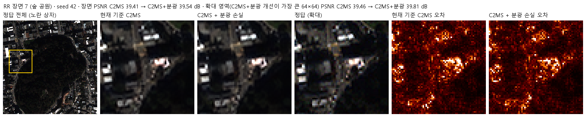

</details>


<details><summary>QB 장면 14 · 두 비교 형식</summary>

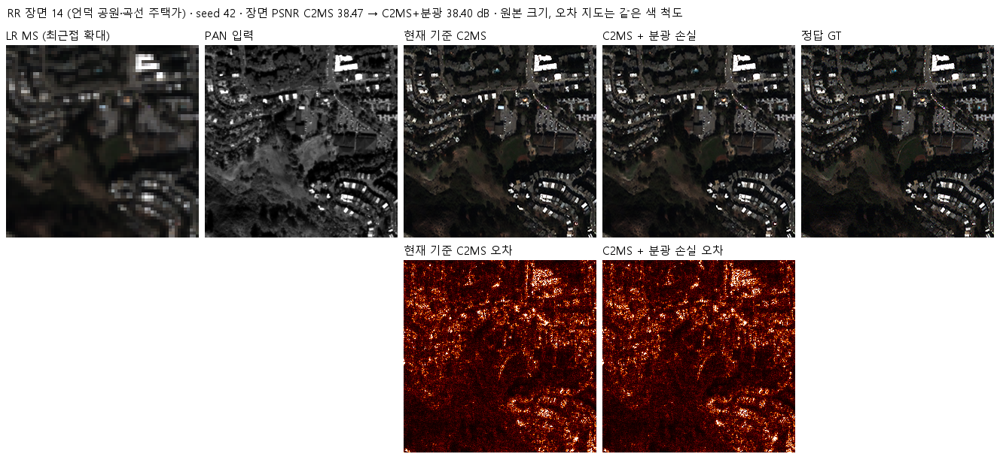

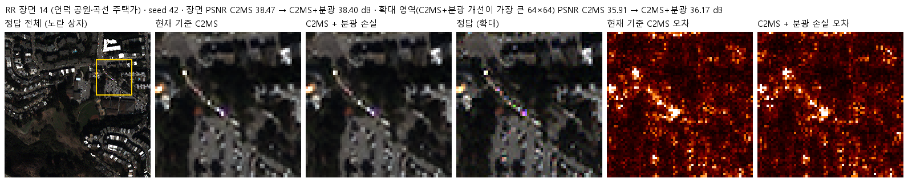

</details>


<details><summary>QB 장면 17 · 두 비교 형식</summary>

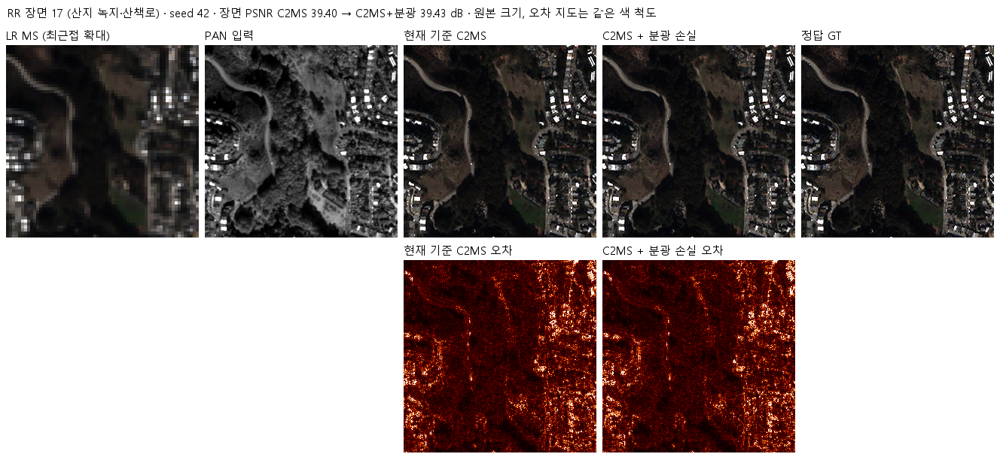

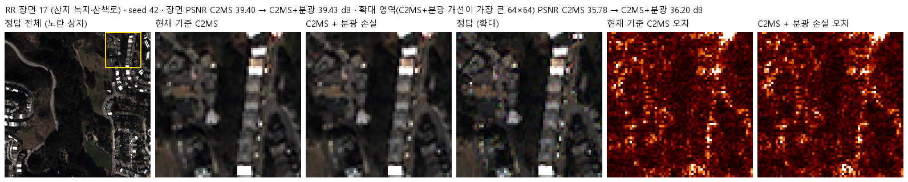

</details>


### WV2 센서 전이 · seed 42

| 장면 | C2MS PSNR | 후보 PSNR | 차이 (dB) |
|---:|---:|---:|---:|
| 0 | 28.6907 | 28.6239 | -0.0668 |
| 1 | 26.8150 | 26.7742 | -0.0408 |
| 3 | 34.9369 | 35.1201 | +0.1832 |
| 7 | 29.1763 | 28.9835 | -0.1928 |
| 14 | 28.9318 | 28.7402 | -0.1916 |
| 17 | 29.3858 | 29.3103 | -0.0755 |

**WV2 장면 0 · 원본 크기와 확대 비교**

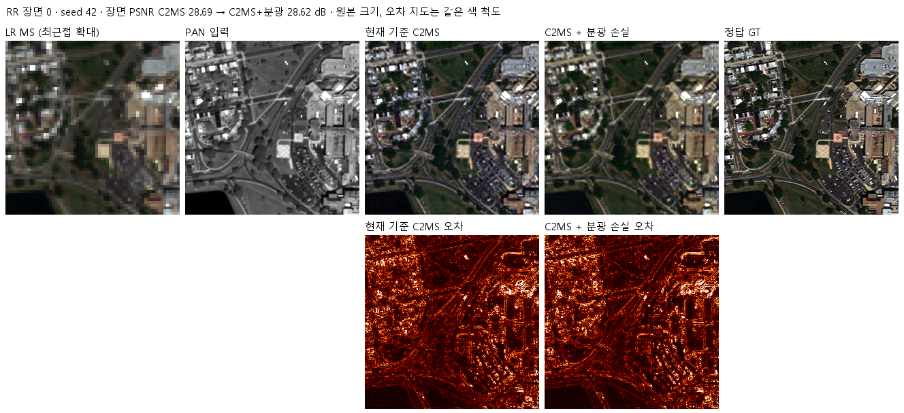

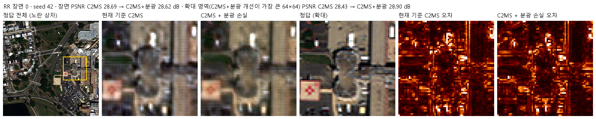

<details><summary>WV2 장면 1 · 두 비교 형식</summary>

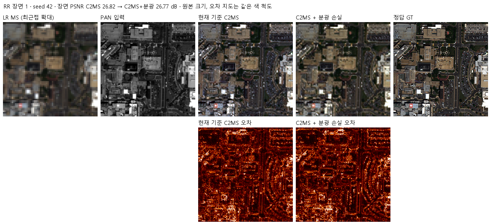

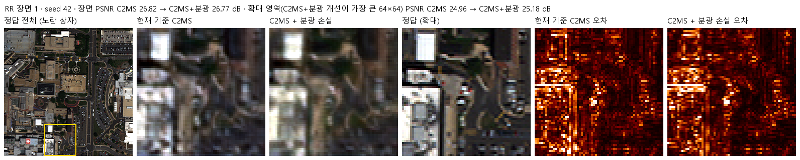

</details>


<details><summary>WV2 장면 3 · 두 비교 형식</summary>

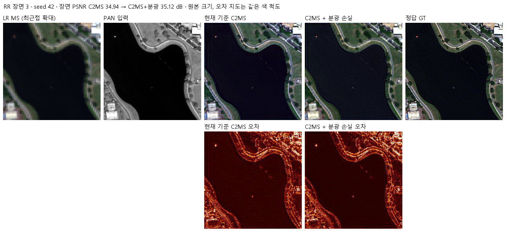

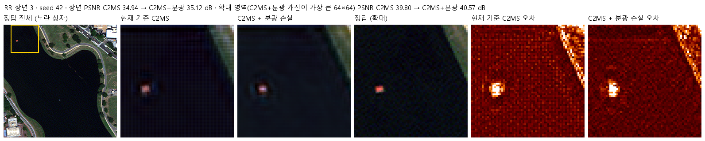

</details>


<details><summary>WV2 장면 7 · 두 비교 형식</summary>

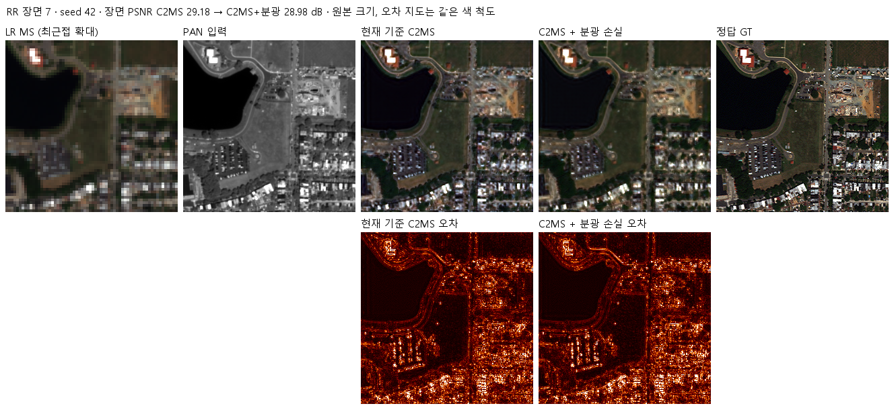

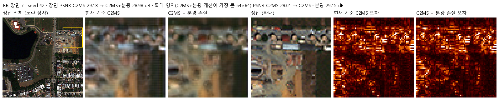

</details>


<details><summary>WV2 장면 14 · 두 비교 형식</summary>

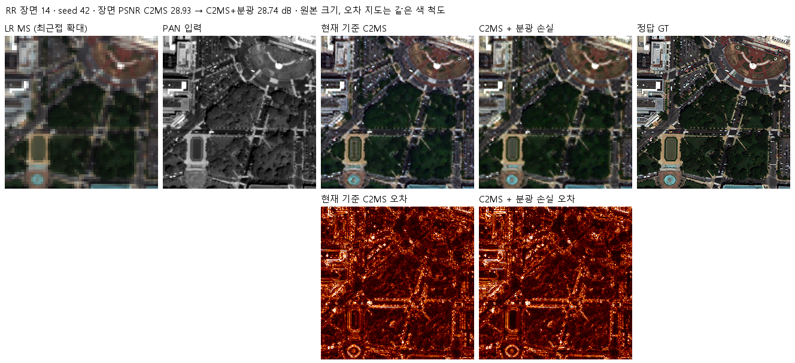

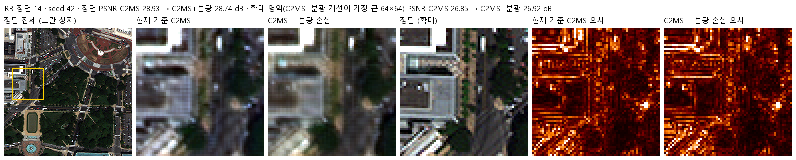

</details>


<details><summary>WV2 장면 17 · 두 비교 형식</summary>

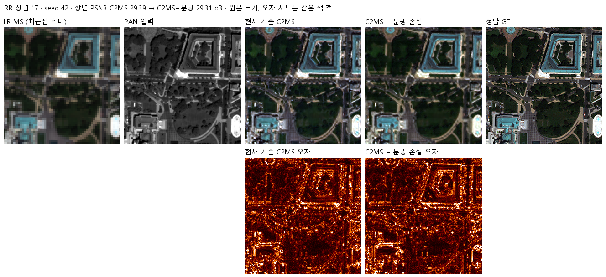

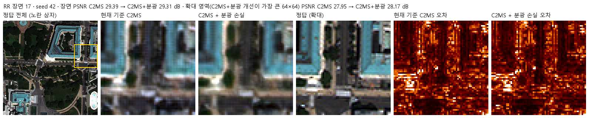

</details>


장면별 선택 창 좌표·표시 통계는 [QB 이미지 기록](results/images/QB_C2MS_SAM_vs_C2MS/result_images.json)과 [WV2 이미지 기록](results/images/WV2_C2MS_SAM_vs_C2MS/result_images.json)에 있습니다.

<a id="evidence"></a>

## 7. 재현 자료

| 자료 | 위치 |
|---|---|
| 모델·실행·학습·평가 | [model.py](model.py) · [run.py](run.py) · [train.py](train.py) · [evaluate.py](evaluate.py) · [config.json](config.json) |
| 학습·평가 당시 원본 소스·설정 | [provenance/code](provenance/code) · [runtime 설정](provenance/run_records/runtime_config.json) |
| 전체 수치·장면별 결과·판정 | [evaluation_v2_3.json](results/evaluation_v2_3.json) |
| 학습 당시 데이터 해시·환경·완료 기록 | [데이터 manifest](provenance/run_records/data_manifest.json) · [환경](provenance/run_records/environment.json) · [완료 기록](provenance/run_records/all_complete.json) |
| 후보 일반 best·EMA best | [checkpoints](checkpoints), 신규 8개 실행의 선택 가중치 16개를 Git에 보존합니다. |
| 재개용 latest·초기 가중치 | [실험별 GitHub Release](https://github.com/BIYONGHIYON/CtrS/releases/tag/weights-experiments-performance-58), 정확한 경로·크기·해시는 manifest의 release_assets에 기록합니다. |
| 재집계·로딩 검사 | [archive_validation.json](results/archive_validation.json), 해시 검사와 CPU 합성 입력 검사는 실제 데이터 성능 재평가와 구분합니다. |
| 보존 파일 목록·해시 | [manifest.json](manifest.json) |

QB seed 42의 후보 가중치·학습 기록·재개 가중치는 [성능 57번](../57_c2ms_training_conditions/README.md), 같은 시드 C2MS 대조군은 [53번](../53_scale_mixed_training/README.md)과 [54번](../54_multi_sensor_scale_mixed_training/README.md)에 그대로 있습니다. 복제하거나 다른 실험으로 재명명하지 않습니다. 각 실행의 compact history·초기 상태 해시·선택 epoch·AMP 업데이트 수는 results의 실행별 폴더에 보존했습니다.

```bash
python SSA-MRN/common/verify.py --experiment 58 --research-track performance --releases
```

`evaluate.py --data <데이터 폴더> --graphs-only`는 보존된 학습 기록으로 그래프만 다시 만듭니다. 원본 v2.3 평가를 다시 실행할 때는 같은 데이터 해시·대조군·가중치를 준비하고 `--out <새 출력 폴더>`를 사용해 원본 결과를 덮어쓰지 않습니다. 재평가 당시 소스는 provenance에 별도로 보존합니다.

## 8. 개선 여부와 다음 단계

**전체 판정은 부분 개선**입니다. GF2는 3시드 평균에서 v2.3을 통과했지만 QB는 RR2 미달·잡음 수준, WV3는 잡음 수준, WV2 전이는 개선 없음입니다. EMA도 센서별 판정을 바꾸지 않았습니다.

현재 기준 모델 C2MS를 유지합니다. 분광 가중치·축척별 적용 범위의 추가 검토는 다음 연구 가설로 남기며 이번 정리에서 새 학습을 시작하지 않았습니다. 센서별 성공과 전이 실패를 함께 보존하고, 더 좋은 시드나 EMA만 골라 전체 성공으로 보고하지 않습니다.
