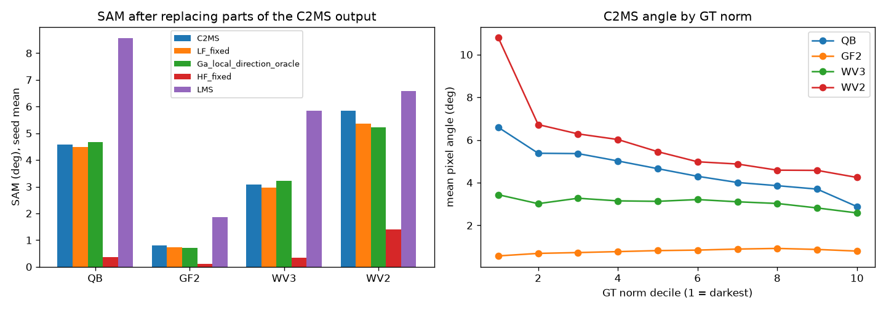

# 60. norm을 보존하는 분광 방향 보정

**연구 분야:** 기존 성능 개선 · **실험자:** 이병현

**변경 내용:** 기준 모델 C2MS 출력의 픽셀별 밴드 벡터 크기(norm)는 그대로 두고 방향만 고치는 보정 헤드를 계획했습니다. 학습하기 전에 0단계로, 보관된 C2MS 가중치(QB·GF2·WV3 seed 42·43·44, WV3 모델의 WV2 전이)가 남긴 각도 오차가 어디에 있는지와 두 관문(Ga 국소 방향 보정 상한, Gb 방향 오차의 PSNR 비중)을 학습 없이 확인했습니다.

| 확인된 결과 | 상태 | 개선 여부 |
|---|:---:|:---:|
| QB 3시드에서 고주파만 정답으로 바꾸면 SAM 4.576° → 0.361°, 저주파만 바꾸면 4.481°로, 각도 오차는 대부분 고주파 세부에 있었습니다. 방향만 정답으로 바꾼 상한은 PSNR +2.40 dB로 Gb를 통과했지만, 8×8 창의 교차 적합 밴드 변환 상한은 SAM +0.088°(악화)로 Ga(−0.50° 이상 감소)에 미달해 1단계 학습을 하지 않았습니다. | 사전&nbsp;검증&nbsp;완료 | 성능&nbsp;비교&nbsp;아님 |

[실험 목록](../../../research/performance/README.md) · [수치](#results) · [그래프](#graphs) · [이미지](#images) · [재현 자료](#evidence)

## 1. 목적과 상태

C2MS는 QB RR SAM 4.58°로 단일 추론 모델 13개 중 7위입니다. 목표는 PSNR을 유지하면서 SAM을 크게 줄이는 것입니다. 지금까지 SAM 감소는 대부분 PSNR 상승에 따라온 것이었습니다(성능 47번 재평가에서 W2는 +0.72 dB에 SAM −0.35°). SAM을 직접 겨냥한 분광 손실(성능 57·58번)은 QB SAM −0.048°에 그쳤고 WV2 전이를 −0.21 dB 낮췄습니다. 저주파 쪽 보정은 W2 위에서 거의 더해지지 않았습니다(성능 45번 관측 일치 사영 −0.009°, 성능 48번 관측 보정기 −0.013°).

한 픽셀에서 출력 norm n을 고정하면 `‖y′ − g‖² = n² + |g|² − 2·n·|g|·cos θ′`이므로 방향이 정답에 가까워질수록 그 픽셀의 제곱 오차는 반드시 줄어듭니다. 그래서 방향만 고치는 헤드에 각도 손실을 주면 PSNR을 떨어뜨리지 않고 SAM을 줄일 수 있다는 가설을 세웠습니다. MSE만 쓰면 이득이 n·|g|에 비례해 밝은 픽셀에 집중되는 반면, SAM은 모든 픽셀의 각도를 같은 비중으로 평균합니다.

학습 전 0단계는 2026-10-26에 로컬 CPU에서 실행했고 04:13 KST에 끝났습니다(672.6초). 사전 관문 Ga가 미달해 1단계(헤드 학습)는 시작하지 않았습니다.

## 2. 변경한 구조와 비교 조건

0단계는 모델을 바꾸지 않습니다. 보관된 C2MS 출력 y를 정답 g와 비교해 아래 진단과 오라클을 계산했습니다. 오라클은 정답을 쓰는 상한이며 실제로 만들 수 있는 모델이 아닙니다.

| 항목 | 정의 |
|---|---|
| 대상 모델 | C2MS best.pt: QB는 [성능 53번](../53_scale_mixed_training/README.md), GF2·WV3는 [성능 54번](../54_multi_sensor_scale_mixed_training/README.md), seed 42·43·44. WV2는 WV3 모델의 전이 |
| 데이터 | 각 센서 RR test 20장 전체(정답 있음). FR은 정답이 없어 쓰지 않았습니다 |
| 추론·지표 | CPU FP32 추론, DN에서 `common/metrics.rr_metrics`. 보관 평가의 RR PSNR·SAM을 모든 모델에서 1e-3 이내로 재현했습니다 |
| 저주파 | 센서 MS MTF(성능 54번 `prepare.SENSORS`, 41탭, 복제 경계)를 전체 해상도에 적용, 추출 없음 |
| D1-D3 | 픽셀 각도를 정답 norm 10분위, PAN Sobel 경사 3분위, 정답 NDVI(0 미만 / 0-0.3 / 0.3 이상)로 나눔 |
| D4 | 저주파만 정답으로 교체(`y − L(y) + L(g)`), 고주파만 정답으로 교체(`L(y) + g − L(g)`) |
| D5·D6 | 주어진 LMS의 SAM, MSE 가중치 n·|g|와 각도의 상관 |
| Ga | 8×8 창마다 y → g의 B×(B+1) 아핀 밴드 변환을 바둑판 한쪽 절반에서 최소제곱으로 맞추고 다른 절반에 적용(자기 정답을 보지 않는 교차 적합). 결과는 y의 norm을 유지: `|y| · normalize(Ay + b)` |
| Gb | `|y| · (g / |g|)`: C2MS norm에 정답 방향(SAM 0) |

### 사전에 고정한 관문

측정 전에 [config.json](config.json)의 `phase0.gates`에 고정했습니다. QB 3시드 평균으로 판정하고 다른 센서는 함께 보고합니다.

| 관문 | 통과 조건 | 의미 |
|---|---|---|
| Ga | QB SAM 감소 ≥ 0.50° | 국소적인 분광 방향 보정이 원리상 도달할 수 있는 여지 |
| Gb | QB RR PSNR 이득 ≥ 0.30 dB | C2MS 오차 중 방향만의 비중 |
| 결정 | 둘 다 통과하면 1단계(C2MS 고정 + 방향 헤드), 하나라도 미달이면 0단계만 보고하고 설계를 수정 | |

1단계 계획(H0 C2MS, H1 방향 헤드 + MSE, H2 방향 헤드 + MSE + λ·각도, H3 자유 잔차 헤드, λ와 에폭의 validation 선택, 2단계 조건)은 config의 `phase1_plan`에 함께 고정했습니다.

## 3. 정량 결과

모든 수치는 RR test 20장의 장면 평균을 3시드에 같은 비중으로 평균한 값입니다. [phase0.json](results/phase0.json)에 시드별·장면별 값이 있습니다.

### 출력의 일부를 정답으로 바꿨을 때

| 대상 | C2MS PSNR / SAM | 저주파 교체 | 고주파 교체 | LMS | Ga 국소 방향 오라클 | Gb 방향 상한 |
|---|---:|---:|---:|---:|---:|---:|
| QB | 38.302 / 4.576° | 38.483 / 4.481° | 60.840 / 0.361° | 28.369 / 8.557° | 38.344 / **4.664°** | **40.705** / 0° |
| GF2 | 48.594 / 0.791° | 49.155 / 0.740° | 66.410 / 0.104° | 38.024 / 1.852° | 49.090 / 0.713° | 52.945 / 0° |
| WV3 | 38.543 / 3.075° | 38.806 / 2.970° | 58.209 / 0.351° | 29.050 / 5.838° | 38.160 / 3.209° | 42.690 / 0° |
| WV2 전이 | 29.413 / 5.854° | 30.112 / 5.362° | 44.069 / 1.393° | 26.154 / 6.587° | 29.472 / 5.220° | 31.125 / 0° |

### 관문 판정 (QB 3시드)

| 관문 | 측정값 | 기준 | 결과 |
|---|---:|---:|:---:|
| Ga | SAM 감소 −0.088°(SAM 증가) | ≥ 0.50° | 미달 |
| Gb | PSNR +2.403 dB | ≥ 0.30 dB | 통과 |

시드별 Ga SAM은 QB 4.662° / 4.670° / 4.662°(C2MS 4.577° / 4.590° / 4.561°)로 세 시드 모두 악화했습니다.

### 각도가 큰 픽셀

| 대상 | norm 하위 10% / 상위 10% 평균 각도 | 하위 10%의 SAM 합 비중 | PAN 경사 평탄 / 중간 / 경계 | NDVI <0 / 0-0.3 / ≥0.3 (픽셀 비중) | n·|g|와 각도 순위 상관 |
|---|---:|---:|---|---|---:|
| QB | 6.59° / 2.88° | 14.4% | 3.96° / 4.69° / 5.08° | 4.66° (45%) / 4.35° (33%) / 5.43° (22%) | −0.31 |
| GF2 | 0.57° / 0.80° | 7.2% | 0.54° / 0.79° / 1.04° | 0.74° (62%) / 0.92° (37%) / 0.78° (1%) | +0.14 |
| WV3 | 3.44° / 2.58° | 11.1% | 2.15° / 3.03° / 4.05° | 3.68° (22%) / 3.26° (44%) / 3.86° (34%) | −0.06 |
| WV2 전이 | 10.79° / 4.25° | 18.4% | 4.22° / 5.91° / 7.44° | 8.08° (20%) / 5.74° (44%) / 6.02° (36%) | −0.34 |

## 4. 기준선 대비 차이와 해석

- **각도 오차는 고주파 세부에 있습니다.** 고주파만 정답으로 바꾸면 SAM이 QB 0.36°, WV3 0.35°로 떨어지고, 저주파만 바꾸면 0.1° 정도만 줄어듭니다. 성능 45·48번에서 저주파·관측 쪽 보정이 SAM을 거의 줄이지 못한 결과와 맞습니다.
- **방향 오차가 PSNR에서도 차지하는 비중이 큽니다.** norm은 그대로 두고 방향만 정답으로 바꾸면 PSNR이 QB +2.40 dB, WV3 +4.15 dB 오릅니다. 방향을 고치는 것은 PSNR과 충돌하지 않는다는 가설과 맞습니다.
- **국소적인 밴드 변환으로는 그 여지에 닿지 못합니다.** 8×8 창의 아핀 밴드 변환을 정답으로 맞춰도(교차 적합) QB·WV3에서는 SAM이 오히려 늘었습니다. 남은 각도 오차가 창 안에서 공통된 밴드 섞임이 아니라 픽셀마다 다른 고주파 세부의 밴드 비율에 있다는 뜻으로 해석합니다. 창 크기나 교차 적합 방식의 영향은 이번에 따로 시험하지 않았습니다.
- **어두운 픽셀은 일부 원인입니다.** QB·WV2에서는 어두울수록 각도가 커서 하위 10%가 SAM 합의 14-18%를 차지하지만, WV3는 차이가 작고 GF2는 반대입니다. 경계(PAN 경사 상위 1/3)에서 각도가 큰 경향은 네 대상에서 같습니다.
- **WV2 전이는 성격이 다릅니다.** 저주파 교체만으로 SAM이 0.49° 줄고, 국소 방향 오라클도 −0.63°를 보였습니다. 학습하지 않은 센서에서는 넓은 영역의 색 치우침이 각도 오차의 일부라는 뜻입니다.

이 결과는 이미 여러 번 탐색에 쓴 RR test로 계산했습니다. 오라클은 정답을 쓰는 상한이므로 성능 개선으로 해석하지 않습니다.

## 5. 학습·평가 그래프

학습을 하지 않았으므로 학습 곡선은 없습니다. 왼쪽은 출력 일부를 정답으로 바꾼 뒤의 SAM(3시드 평균), 오른쪽은 정답 norm 10분위별 C2MS 픽셀 평균 각도입니다.

## 6. 결과 이미지

0단계는 새 예측을 만들지 않으므로 후보 예측 이미지가 없습니다. C2MS의 고정 6장면 이미지는 [성능 53번](../53_scale_mixed_training/README.md#images)에 있습니다.

## 7. 재현 자료

- [prepare.py](prepare.py): 0단계 진단·관문 계산. `python prepare.py`로 다시 만들고, `--plot-only`로 그래프만 다시 그립니다. 보관된 RR 평균을 재현하지 못하면 중단합니다.
- [config.json](config.json): 측정 전에 고정한 진단·관문·1단계 계획.
- [results/phase0.json](results/phase0.json): 대상·시드별 평균, 장면별 PSNR·SAM·ERGAS, 사용한 가중치 경로와 SHA-256, 실행 환경.
- [manifest.json](manifest.json): 이 폴더 파일의 크기·SHA-256.

## 8. 개선 여부와 다음 단계

학습한 후보가 없으므로 **성능 비교 아님**입니다. Gb는 통과했지만 Ga가 미달해 계획한 1단계(국소 정보 위주의 작은 방향 헤드)는 진행하지 않았습니다.

다음 설계에서 고칠 점은 다음과 같습니다.

- 방향 보정은 창 단위 밴드 변환이 아니라 **고주파 세부 자체의 밴드 비율**을 픽셀 단위로 다뤄야 합니다. 예를 들어 출력을 `L(y)`와 고주파로 나누고, 고주파 쪽의 밴드별 주입 비율만 norm 보존 형태로 고치는 구조입니다.
- Ga 미달이 창 크기나 교차 적합 방식 때문인지(16×16, 32×32 창, 밴드별 이득만 쓰는 대각 변환)는 사후 분석으로 따로 표시해 확인할 수 있습니다.
- WV2 전이에서는 저주파 색 치우침도 각도 오차의 큰 몫이므로, 전이 개선과 학습 센서 개선을 따로 설계해야 합니다.
