# 61. 고주파 세부의 밴드 비율 보정

**연구 분야:** 기존 성능 개선 · **실험자:** 이병현

**변경 내용:** 기준 모델 C2MS 출력의 고주파 세부 `H = y − L(y)`를 픽셀마다 세기 `|H|`와 밴드 비율 `H/|H|`로 나눴습니다. 0단계에서는 둘 중 어느 쪽을 고쳐야 SAM이 줄어드는지 학습 없이 확인했습니다. 1단계에서는 C2MS를 고정하고, 고주파의 세기는 그대로 둔 채 밴드 비율만 돌리는 작은 헤드(파라미터 23,812개)를 QB seed 42로 선별 학습했습니다. [성능 60번](../60_norm_preserving_spectral_direction_refinement/README.md)의 후속입니다.

| 확인된 결과 | 상태 | 개선 여부 |
|---|:---:|:---:|
| 0단계: 고주파 밴드 비율만 정답으로 바꾸면 QB SAM 4.576° → 2.467°로 관문을 통과했습니다. 1단계 선별(QB seed 42): 가장 나은 H1(MSE만)이 C2MS 대비 RR PSNR +0.034 dB·SAM −0.040°였고, 각도 손실을 더한 H2는 SAM이 더 줄지 않고 관측 비율이 1.10을 넘었습니다. 다섯 후보 모두 잡음 수준의 부분 개선이며 SAM 목표(−0.15°)에 미달했습니다. | 평가&nbsp;완료 seed42 | 부분&nbsp;개선 |

[실험 목록](../../../research/performance/README.md) · [수치](#results) · [그래프](#graphs) · [이미지](#images) · [재현 자료](#evidence)

## 1. 목적과 상태

성능 60번은 C2MS의 각도 오차가 대부분 고주파 세부에 있다는 것을 확인했습니다(QB 고주파만 정답으로 교체 시 SAM 0.361°). 그러나 8×8 창의 밴드 변환 오라클은 SAM을 줄이지 못해 1단계로 가지 않았습니다. 이번에는 고주파 세부를 픽셀마다 세기와 밴드 비율로 나눠, SAM 오차가 세부를 **얼마나 세게** 넣는지에서 오는지, **어떤 색 배분**으로 넣는지에서 오는지 구분했습니다. 그 결과에 따라 밴드 비율만 고치는 헤드가 PSNR을 유지하면서 SAM을 줄이는지 확인했습니다.

- 0단계는 2026-10-26 로컬 CPU에서 실행했고 04:31 KST에 끝났습니다(517.8초). G1·G2를 통과해 1단계는 고주파 밴드 비율 헤드로 정해졌습니다.
- 1단계 선별은 사용자 승인 후 서버(RTX 3060 Ti)에서 실행했습니다. 04:48 KST에 첫 학습을 시작했고 05:18에 다섯 run의 학습과 test 평가를 모두 마쳤습니다.
- 첫 실행은 준비 단계에서 TF32를 끄지 않아 미리 계산한 C2MS 출력이 FP32 직접 계산과 최대 3e-4 어긋났고, preflight가 이를 잡아 학습 전에 멈췄습니다. 그 runtime을 지우고 TF32를 끈 뒤 다시 실행했습니다(재실행 차이 1.1e-6). 실패 기록은 `provenance/attempt1_tf32_preflight_fail/`에 있습니다.

선별 결과가 SAM 목표에 크게 못 미쳐, 계획했던 3시드·다른 센서 확장은 하지 않았습니다. 기준 모델은 C2MS로 유지합니다.

## 2. 변경한 구조와 비교 조건

### 0단계: 진단 (학습 없음)

모델·데이터·저주파 연산은 성능 60번과 같으며 60번 [prepare.py](../60_norm_preserving_spectral_direction_refinement/prepare.py)의 로더를 그대로 사용했습니다. 보관된 C2MS RR PSNR·SAM을 모든 모델에서 1e-3 이내로 다시 재현했습니다.

| 항목 | 정의 |
|---|---|
| 대상 모델 | C2MS best.pt: QB [성능 53번](../53_scale_mixed_training/README.md), GF2·WV3 [성능 54번](../54_multi_sensor_scale_mixed_training/README.md), seed 42·43·44. WV2는 WV3 모델의 전이 |
| 데이터 | 각 센서 RR test 20장 전체 |
| 저주파 L | 센서 MS MTF를 전체 해상도에 적용(추출 없음). `H_y = y − L(y)`, `H_g = g − L(g)` |
| O1 고주파 비율 오라클 | `L(y) + |H_y| · H_g/|H_g|`: 고주파 세기는 C2MS, 밴드 비율만 정답 |
| O2 고주파 세기 오라클 | `L(y) + |H_g| · H_y/|H_y|`: 밴드 비율은 C2MS, 세기만 정답 |
| O3 정답 없는 규칙 | `L(y) + (H_y·u)u`, `u = L(y)/|L(y)|`: 고주파 중 그 자리 저주파 색을 따르는 부분만 남김 |
| Ga 민감도(사후) | 60번 Ga의 교차 적합 아핀 변환을 16×16·32×32 창으로, 8×8 밴드별 이득·편향(대각)으로 다시 계산. 판정 없음 |

관문은 측정 전에 [config.json](config.json)의 `phase0.gates`에 고정했습니다. QB 3시드 평균으로 판정합니다.

| 관문 | 통과 조건 |
|---|---|
| G1 비율 | O1의 QB SAM 감소 ≥ 0.50° |
| G2 세기 | O2의 QB SAM 감소 ≥ 0.50° |
| G3 규칙 | O3의 QB SAM 감소 ≥ 0.10°이고 RR PSNR 변화 ≥ −0.04 dB |
| 결정 | G1 통과 → 1단계 고주파 밴드 비율 헤드, 아니면 G2 통과 → 고주파 세기 헤드, 둘 다 미달 → 0단계만 보고. G3 통과는 학습 없는 후보 표시이며 1단계 결정에 쓰지 않음 |

### 1단계: C2MS 고정 + 고주파 헤드 선별

C2MS 출력 y 뒤에 작은 헤드를 붙였습니다. C2MS는 바꾸지 않고(eval 모드, 기울기 없음) 헤드만 학습했습니다. 구현은 [model.py](model.py)입니다.

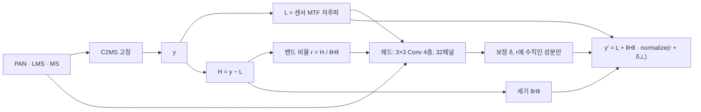

| 항목 | 설정 |
|---|---|
| 헤드 입력 | 고주파 밴드 비율 r, 저주파 색 방향 L/|L|, LMS 색 방향, 상대 세기 |H|/|L|, PAN 고주파(PAN − PAN MTF 저주파) |
| 헤드 구조 | 3×3 Conv(32) + PReLU 3층, 3×3 Conv(밴드 수). 마지막 층 0 초기화로 학습 시작 시 출력이 C2MS와 같음(preflight 차이 6e-8) |
| H1 | 밴드 비율 헤드, MSE만 (용량 대조) |
| H2 | 밴드 비율 헤드, MSE + λ·픽셀 각도(atan2 형태), λ ∈ {0.003, 0.01, 0.03} |
| H3 | 자유 잔차 헤드 `y′ = y + δ`, MSE + λ·각도. λ는 H2 중 validation SAM이 가장 낮은 0.003 |
| 손실 적용 | 원래 쌍과 2배 거친 쌍 모두(가중치 1.0, C2MS의 축척 혼합 유지) |
| 데이터 | QB train 17,139 / validation 1,905 패치(성능 59번 캐시를 SHA-256 확인 후 하드링크). C2MS 출력은 FP32로 한 번 미리 계산 |
| 학습 | 30에폭, Adam, 학습률 1e-3 → 1e-5 cosine, batch 32, FP32, TF32 끔, seed 42 |
| 선택 | run마다 validation PSNR ≥ 에폭 0(C2MS) − 0.02 dB인 에폭 중 validation SAM 최소. test는 선택에 쓰지 않음 |
| 평가 | 대조군 C2MS와 C2MS + 선택 헤드를 같은 QB RR·FR test 20장에서 평가. RR·RR2·FR_WALD·FR 관측 RMSE |
| 판정 | [판정 기준](../../../docs/judgement_criteria.md) v2.3, 단일 시드(잡음 문턱 0.06 dB), 같은 시드 C2MS 대비. SAM 목표(ΔSAM ≤ −0.15°, ΔPSNR ≥ −0.04 dB)는 따로 보고 |

## 3. 정량 결과

### 0단계: 고주파의 세기와 밴드 비율

RR test 20장의 장면 평균을 3시드에 같은 비중으로 평균했습니다. 칸은 PSNR(dB) / SAM(°)입니다. [phase0.json](results/phase0.json)에 시드별·장면별 값이 있습니다.

| 대상 | C2MS | O1 비율만 정답 | O2 세기만 정답 | O3 규칙 | 고주파 전체 정답 |
|---|---:|---:|---:|---:|---:|
| QB | 38.302 / 4.576 | 40.789 / **2.467** | 40.430 / 3.926 | 35.490 / 8.365 | 60.840 / 0.361 |
| GF2 | 48.594 / 0.791 | 52.076 / **0.390** | 50.163 / 0.696 | 44.460 / 1.728 | 66.410 / 0.104 |
| WV3 | 38.543 / 3.075 | 43.389 / **1.280** | 39.189 / 2.892 | 34.623 / 5.494 | 58.209 / 0.351 |
| WV2 전이 | 29.413 / 5.854 | 31.403 / **3.781** | 30.173 / 5.990 | 28.815 / 6.673 | 44.069 / 1.393 |

| 관문 (QB 3시드) | 측정값 | 결과 |
|---|---:|:---:|
| G1 비율 | SAM −2.109° | 통과 |
| G2 세기 | SAM −0.650° | 통과 |
| G3 규칙 | SAM +3.789°, PSNR −2.812 dB | 미달 |

| 대상 | 고주파 에너지 중 저주파 색 방향 비율 (C2MS / 정답) | 고주파 세기 합 비율 (C2MS ÷ 정답) | 고주파 밴드 비율의 평균 각도 차 |
|---|---:|---:|---:|
| QB | 0.877 / 0.842 | 0.913 | 29.4° |
| GF2 | 0.773 / 0.748 | 0.939 | 25.2° |
| WV3 | 0.831 / 0.785 | 0.931 | 32.7° |
| WV2 전이 | 0.805 / 0.747 | 0.622 | 52.0° |

Ga 민감도(사후, 판정 없음): QB SAM은 C2MS 4.576°에 대해 아핀 16×16 4.598°, 32×32 4.582°, 대각 8×8 4.604°로 모두 같거나 나빴습니다. GF2·WV3는 −0.01°에서 −0.07°, WV2 전이는 −0.30°에서 −0.70°였습니다.

### 1단계: QB seed 42 test (C2MS 대비)

대조군 C2MS는 RR PSNR 38.2738 dB, SAM 4.5770°, ERGAS 3.7230입니다(성능 53번 보관 평가와 같음). 차이는 **후보 − C2MS**입니다. 판정 정의와 수치는 [judgement_v2_3.json](results/judgement_v2_3.json)에 있습니다.

| 후보 | 선택 에폭 | ΔRR PSNR | ΔRR SAM | ΔRR ERGAS | 개선 장면 PSNR / SAM | RR2 ΔPSNR / ΔSAM | FR_WALD ΔPSNR / ΔSAM | 관측 RMSE 비율 | v2.3 |
|---|---:|---:|---:|---:|---:|---:|---:|---:|---|
| H1 MSE만 | 29 | **+0.0339** | **−0.0404** | **−0.0131** | 20 / 20 | +0.0168 / −0.0450 | +0.0420 / −0.0513 | 1.027 | 부분 개선(잡음 수준) |
| H2 λ 0.003 | 28 | +0.0118 | −0.0372 | −0.0056 | 20 / 20 | +0.0041 / −0.0427 | +0.0228 / −0.0481 | 1.146 ✗ | 부분 개선 |
| H2 λ 0.01 | 28 | +0.0063 | −0.0350 | −0.0039 | 18 / 20 | −0.0006 / −0.0301 | +0.0189 / −0.0451 | 1.106 ✗ | 부분 개선 |
| H2 λ 0.03 | 28 | +0.0012 | −0.0327 | −0.0015 | 11 / 20 | −0.0078 / −0.0332 | +0.0119 / −0.0429 | 1.195 ✗ | 부분 개선 |
| H3 자유 잔차 λ 0.003 | 28 | +0.0037 | −0.0187 | −0.0019 | 20 / 20 | −0.0082 / −0.0177 | +0.0055 / −0.0209 | 1.013 | 부분 개선(잡음 수준) |

RR2·FR_WALD는 다섯 후보 모두 허용폭 안입니다. 관측 RMSE 비율은 1.10 이하가 통과입니다. SAM 목표(ΔSAM ≤ −0.15°)는 다섯 후보 모두 미달입니다. 참고 지표 FR QNR 변화는 +0.001에서 +0.010입니다.

validation에서도 선택 에폭의 C2MS 대비 차이는 H1 PSNR +0.044 dB·SAM −0.033°, H2 λ 0.003 +0.017 dB·−0.031°, λ 0.01 +0.011 dB·−0.031°, λ 0.03 +0.006 dB·−0.029°, H3 −0.008 dB·−0.015°였습니다.

## 4. 기준선 대비 차이와 해석

- **고칠 여지는 고주파의 색 배분에 있습니다.** 세기를 그대로 두고 밴드 비율만 맞추면 QB SAM이 절반 가까이(−2.11°) 줄고 PSNR도 +2.49 dB 오릅니다. 세기만 맞춘 경우(−0.65°)보다 세 배 이상 크며, 네 대상 모두 같은 순서입니다. C2MS는 세부를 그 자리 색 그대로 정답보다 많이 넣고(QB 0.877 대 0.842), 세기는 정답의 0.91배입니다.
- **그러나 학습한 헤드는 그 여지의 2%도 가져오지 못했습니다.** 가장 나은 H1도 SAM −0.040°입니다. 밴드 비율을 돌릴 수 있는 구조를 줘도, C2MS 출력·PAN 고주파·LMS 색 방향만으로는 정답 고주파의 밴드 비율을 거의 예측하지 못한다는 뜻으로 해석합니다. 헤드 크기(23,812개)와 3×3 수용 영역의 한계일 수도 있으며, 이번 선별로는 둘을 구분하지 못했습니다.
- **각도 손실은 효과가 없었고 관측 일치를 해쳤습니다.** λ를 키울수록 PSNR 이득은 줄고(+0.012 → +0.001 dB), SAM 감소도 작아졌으며(−0.037° → −0.033°), 관측 RMSE 비율이 1.10을 넘었습니다. 각도를 직접 밀면 고주파가 입력 MS와 맞지 않는 방향으로 돌아갑니다. validation에서도 SAM은 MSE만 쓴 H1이 가장 낮았습니다.
- **norm 보존 제약은 도움이 됐습니다.** 같은 손실(λ 0.003)에서 밴드 비율만 돌리는 H2가 출력을 자유롭게 바꾸는 H3보다 SAM을 두 배 줄였고(−0.037° 대 −0.019°), H3는 validation PSNR이 학습 초반 크게 흔들렸습니다.
- 학습 곡선은 30에폭 끝에서 거의 평평해 학습량 부족보다는 정보·용량의 한계로 봅니다. 단일 시드이고 QB만 확인했습니다.

## 5. 학습·평가 그래프

0단계 진단: 출력 일부를 정답으로 바꾸거나 규칙을 적용한 뒤의 SAM(3시드 평균)입니다.

1단계 validation 곡선: 에폭 0(C2MS) 대비 PSNR·SAM 차이입니다. 점선은 선택 하한(−0.02 dB)입니다. 기록은 각 run의 `history.json`입니다.

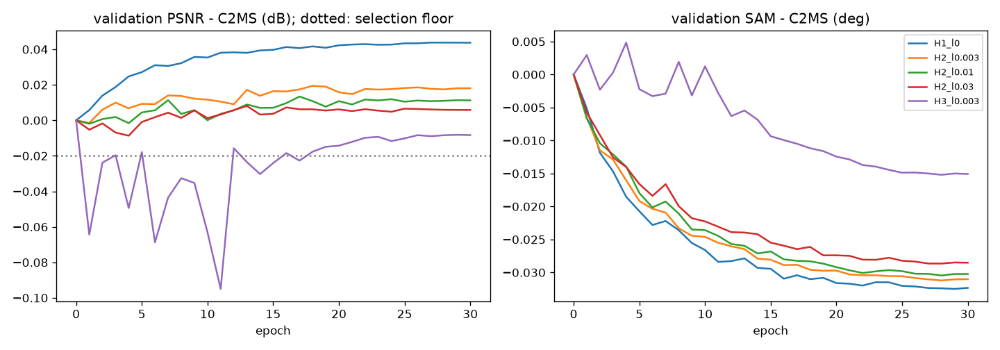

1단계 test 차이: RR·RR2·FR_WALD의 C2MS 대비 PSNR·SAM 차이입니다. 왼쪽 점선은 단일 시드 잡음 문턱(0.06 dB), 오른쪽 점선은 SAM 1차 목표(−0.15°)입니다.

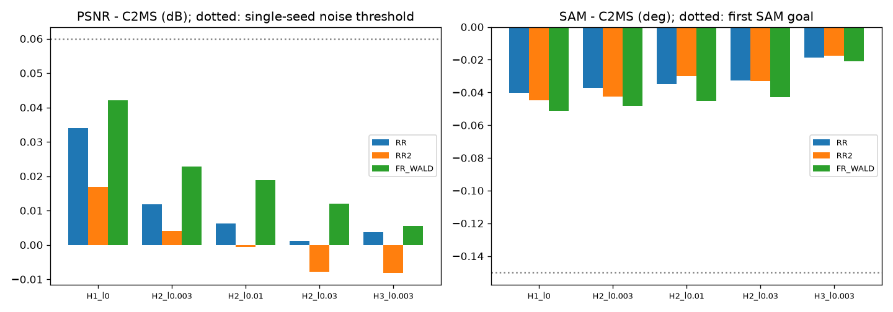

## 6. 결과 이미지

고정 6장면(QB RR test 0-based 0·1·3·7·14·17, seed 42)에서 현재 기준 C2MS와 validation 규칙으로 고른 주 후보 H2 λ 0.003을 비교했습니다. 장면은 정답만 보고 풍경으로 미리 정한 바다·항구, 부두·수목, 마리나·운동장, 숲 공원, 언덕 주택가, 산지 녹지이며 결과를 보고 바꾸지 않았습니다. `common/result_images.py`로 로컬 CPU에서 만들었고, 장면 PSNR은 서버 평가와 소수 넷째 자리까지 같습니다.

원본 크기 비교는 256×256 전체 장면의 **LR MS · PAN · C2MS · 후보 · 정답**과 **C2MS 오차 · 후보 오차**(같은 색 척도)입니다. 확대 비교는 후보의 개선이 가장 큰 64×64 창을 4배 확대한 **정답 전체(노란 상자) · C2MS · 후보 · 정답 · C2MS 오차 · 후보 오차**입니다. 확대 창은 **후보에 유리하게 고른 표시**이며 전체 차이는 장면 PSNR로 함께 읽어야 합니다.

| 장면 | C2MS PSNR | H2 λ 0.003 PSNR | 차이 (dB) |
|---:|---:|---:|---:|
| 0 | 42.8118 | 42.8186 | +0.0068 |
| 1 | 43.1790 | 43.2039 | +0.0249 |
| 3 | 37.9643 | 37.9898 | +0.0255 |
| 7 | 39.4053 | 39.4138 | +0.0085 |
| 14 | 38.4725 | 38.4867 | +0.0142 |
| 17 | 39.3962 | 39.4121 | +0.0159 |

차이가 0.03 dB 이하라 이미지에서 눈에 띄는 변화는 없습니다.

**장면 3 (요트 마리나·운동장) · 원본 크기와 확대 비교**

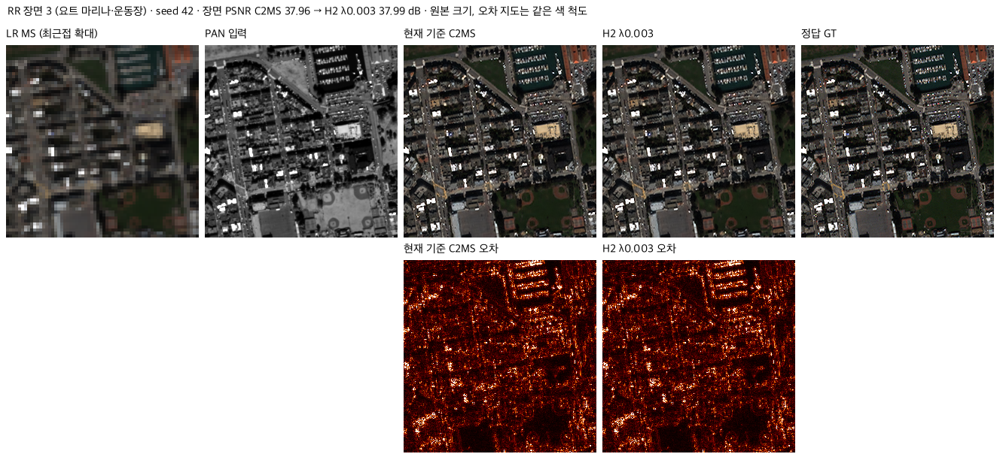

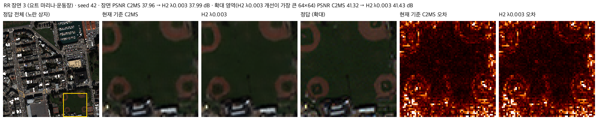

장면 0 · 두 비교 형식

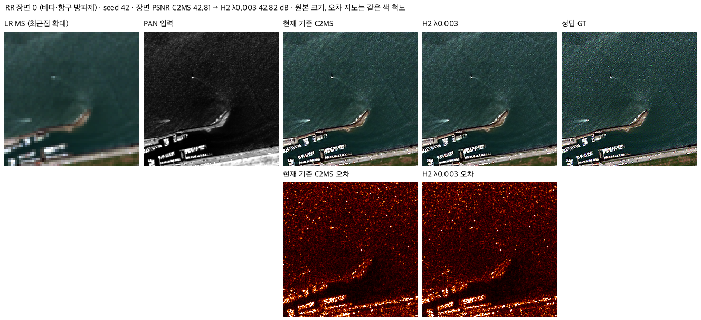

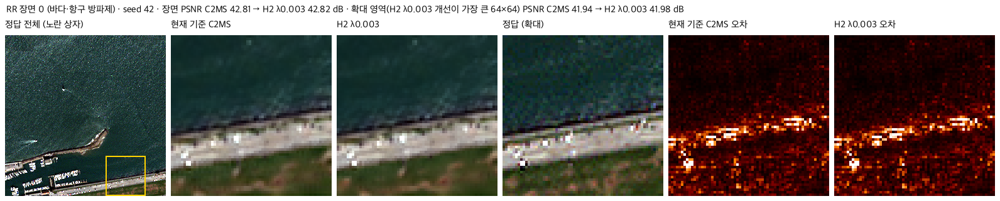

장면 1 · 두 비교 형식

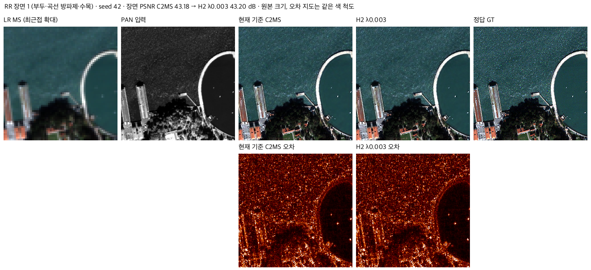

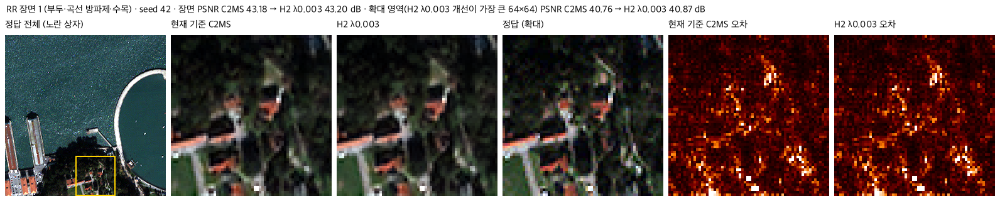

장면 7 · 두 비교 형식

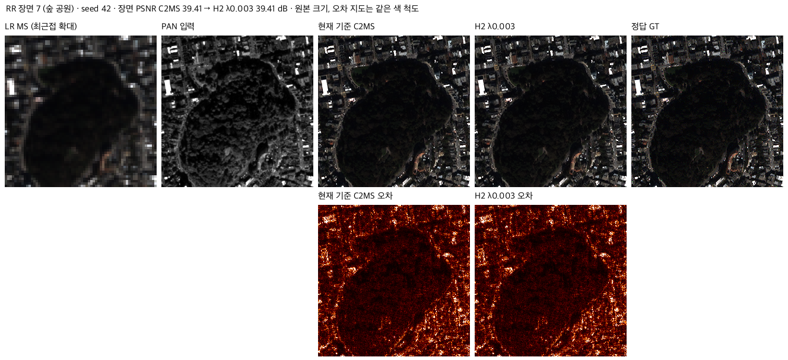

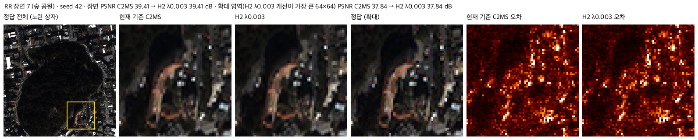

장면 14 · 두 비교 형식

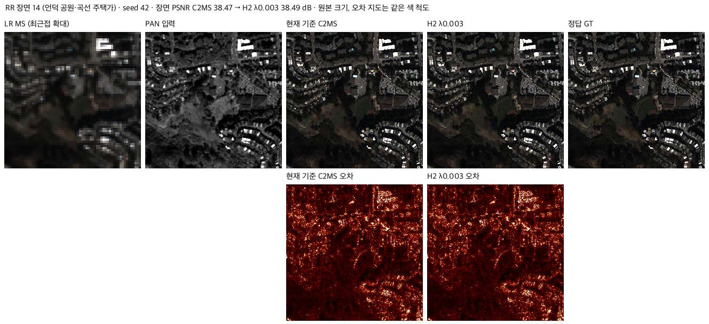

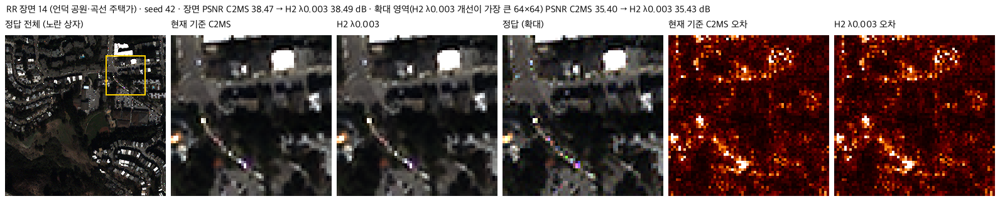

장면 17 · 두 비교 형식

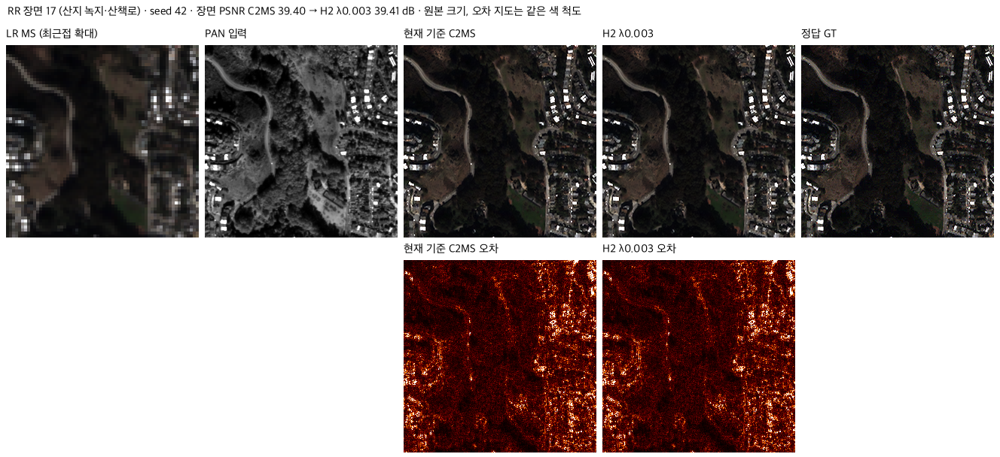

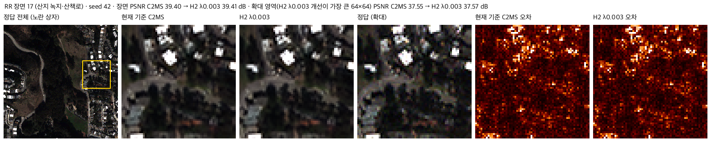

## 7. 재현 자료

- [prepare.py](prepare.py): 0단계 진단·관문 계산(60번 로더 사용, 보관된 RR 평균을 재현하지 못하면 중단).
- [model.py](model.py)·[train.py](train.py)·[run.py](run.py): 1단계 헤드, 학습·test 평가 작업자, 서버 컨트롤러(캐시 하드링크, C2MS 출력 미리 계산, preflight, 순차 큐).
- [evaluate.py](evaluate.py): 서버 평가 기록으로 v2.3 판정·그래프를 만들고 결과 이미지를 그립니다.
- [config.json](config.json): 측정 전에 고정한 0단계 관문, 1단계 설정(`phase1`)과 계획. 서버에 봉인된 설정·소스 해시는 [runtime_config.json](provenance/run_records/runtime_config.json)에 있습니다. 저장소의 학습 소스(model·train·run.py와 공용 코드 13개)는 봉인 해시와 같고, config.json은 평가 후 첫머리의 상태·개선 여부 필드만 바꿔 해시가 다릅니다.
- 가중치: `checkpoints/<후보>/best.pt`(Git). 재개용 `latest.pt`는 GitHub Release `weights-experiments-performance-61`에 있고 [manifest.json](manifest.json)의 `release_assets`에 기록했습니다. 헤드는 0 초기화와 seed로 결정되므로 `initial.pt`는 따로 두지 않았습니다.
- 결과: `results/<후보>/`의 `history.json`, `training_complete.json`, `evaluation_complete.json`(장면별 RR·RR2·FR_WALD·FR), [judgement_v2_3.json](results/judgement_v2_3.json), [phase0.json](results/phase0.json).
- 실행 기록: `provenance/run_records/`(준비·preflight·컨트롤러 로그, 데이터·캐시 manifest, 환경), `provenance/attempt1_tf32_preflight_fail/`, 서버 소스 manifest와 실행 스크립트.

## 8. 개선 여부와 다음 단계

QB seed 42 단일 시드 선별에서 다섯 후보 모두 RR 세 지표와 보조 판정 RR2·FR_WALD를 통과했지만, PSNR 이득이 잡음 문턱(0.06 dB) 미만이어서 **부분 개선**입니다. H2 세 후보는 관측 RMSE 비율도 1.10을 넘었습니다. SAM 목표에는 모두 크게 미달했습니다. 기준 모델은 C2MS로 유지하고, 이 헤드 방식의 3시드·다른 센서 확장은 하지 않습니다.

남은 질문은 "고주파 밴드 비율을 고칠 정보가 입력에 있는가"입니다. 다음 실험 후보는 다음과 같습니다.

- 정답 고주파의 밴드 비율을 입력(PAN·LMS·C2MS 출력·C2MS 중간 특징)에서 얼마나 예측할 수 있는지 먼저 측정하는 진단.
- C2MS 고정을 풀고 처음부터 같이 학습하는 2단계. 각도 손실은 이번 결과로 보아 쓰지 않거나 관측 일치 제약과 함께 씁니다.
- WV2 전이는 고주파 세기 부족(정답의 0.62배)이 커서 학습 센서와 별도로 다룹니다.
