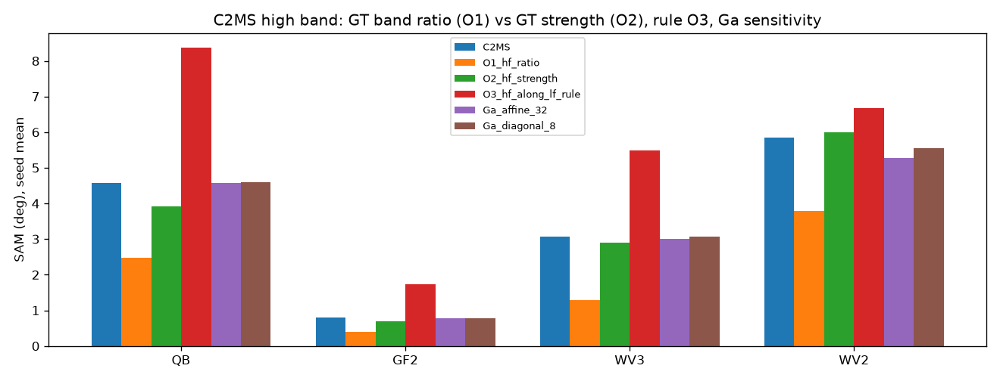

# 61. 고주파 세부의 밴드 비율 보정

**연구 분야:** 기존 성능 개선 · **실험자:** 이병현

**변경 내용:** 기준 모델 C2MS 출력의 고주파 세부 `H = y − L(y)`를 픽셀마다 세기 `|H|`와 밴드 비율 `H/|H|`로 나누고, 둘 중 어느 쪽을 고쳐야 SAM이 줄어드는지 학습 없이 확인했습니다. 결과에 따라 고주파의 세기는 두고 밴드 비율만 돌리는 보정 헤드(1단계)를 계획했습니다. [성능 60번](../60_norm_preserving_spectral_direction_refinement/README.md)의 후속입니다.

| 확인된 결과 | 상태 | 개선 여부 |
|---|:---:|:---:|
| QB 3시드에서 고주파의 밴드 비율만 정답으로 바꾸면 SAM 4.576° → 2.467°(PSNR +2.49 dB), 세기만 바꾸면 3.926°였습니다. G1(비율)·G2(세기) 모두 통과했고 규칙에 따라 1단계는 밴드 비율 헤드로 정했습니다. 정답 없는 규칙 O3는 SAM 8.365°로 크게 악화했습니다. 1단계 학습은 승인 대기입니다. | 사전&nbsp;검증&nbsp;완료 | 판단&nbsp;보류 |

[실험 목록](../../../research/performance/README.md) · [수치](#results) · [그래프](#graphs) · [이미지](#images) · [재현 자료](#evidence)

## 1. 목적과 상태

성능 60번은 C2MS의 각도 오차가 대부분 고주파 세부에 있다는 것을 확인했습니다(QB 고주파만 정답으로 교체 시 SAM 0.361°). 그러나 8×8 창의 밴드 변환 오라클은 SAM을 줄이지 못해 1단계로 가지 않았습니다. 이번에는 고주파 세부를 픽셀마다 세기와 밴드 비율로 나눠, SAM 오차가 세부를 **얼마나 세게** 넣는지에서 오는지, **어떤 색 배분**으로 넣는지에서 오는지 구분했습니다. 60번 Ga 미달이 창 크기 때문인지도 사후 확인했습니다.

0단계는 2026-10-26 로컬 CPU에서 실행했고 04:31 KST에 끝났습니다(517.8초). 관문을 통과했으므로 1단계(C2MS 고정 + 고주파 밴드 비율 헤드)는 사용자 승인 후 시작합니다.

## 2. 변경한 구조와 비교 조건

0단계는 모델을 바꾸지 않습니다. 모델·데이터·저주파 연산은 성능 60번과 같으며 60번 [prepare.py](../60_norm_preserving_spectral_direction_refinement/prepare.py)의 로더를 그대로 사용했습니다. 보관된 C2MS RR PSNR·SAM을 모든 모델에서 1e-3 이내로 다시 재현했습니다.

| 항목 | 정의 |
|---|---|
| 대상 모델 | C2MS best.pt: QB [성능 53번](../53_scale_mixed_training/README.md), GF2·WV3 [성능 54번](../54_multi_sensor_scale_mixed_training/README.md), seed 42·43·44. WV2는 WV3 모델의 전이 |
| 데이터 | 각 센서 RR test 20장 전체 |
| 저주파 L | 센서 MS MTF를 전체 해상도에 적용(추출 없음). `H_y = y − L(y)`, `H_g = g − L(g)` |
| O1 고주파 비율 오라클 | `L(y) + |H_y| · H_g/|H_g|`: 고주파 세기는 C2MS, 밴드 비율만 정답 |
| O2 고주파 세기 오라클 | `L(y) + |H_g| · H_y/|H_y|`: 밴드 비율은 C2MS, 세기만 정답 |
| O3 정답 없는 규칙 | `L(y) + (H_y·u)u`, `u = L(y)/|L(y)|`: 고주파 중 그 자리 저주파 색을 따르는 부분만 남김 |
| Ga 민감도(사후) | 60번 Ga의 교차 적합 아핀 변환을 16×16·32×32 창으로, 8×8 밴드별 이득·편향(대각)으로 다시 계산. 판정 없음 |

### 사전에 고정한 관문

측정 전에 [config.json](config.json)의 `phase0.gates`에 고정했습니다. QB 3시드 평균으로 판정합니다.

| 관문 | 통과 조건 |
|---|---|
| G1 비율 | O1의 QB SAM 감소 ≥ 0.50° |
| G2 세기 | O2의 QB SAM 감소 ≥ 0.50° |
| G3 규칙 | O3의 QB SAM 감소 ≥ 0.10°이고 RR PSNR 변화 ≥ −0.04 dB |
| 결정 | G1 통과 → 1단계 고주파 밴드 비율 헤드, 아니면 G2 통과 → 고주파 세기 헤드, 둘 다 미달 → 0단계만 보고. G3 통과는 학습 없는 후보 표시이며 1단계 결정에 쓰지 않음 |

## 3. 정량 결과

RR test 20장의 장면 평균을 3시드에 같은 비중으로 평균했습니다. 칸은 PSNR(dB) / SAM(°)입니다. [phase0.json](results/phase0.json)에 시드별·장면별 값이 있습니다.

| 대상 | C2MS | O1 비율만 정답 | O2 세기만 정답 | O3 규칙 | 고주파 전체 정답 |
|---|---:|---:|---:|---:|---:|
| QB | 38.302 / 4.576 | 40.789 / **2.467** | 40.430 / 3.926 | 35.490 / 8.365 | 60.840 / 0.361 |
| GF2 | 48.594 / 0.791 | 52.076 / **0.390** | 50.163 / 0.696 | 44.460 / 1.728 | 66.410 / 0.104 |
| WV3 | 38.543 / 3.075 | 43.389 / **1.280** | 39.189 / 2.892 | 34.623 / 5.494 | 58.209 / 0.351 |
| WV2 전이 | 29.413 / 5.854 | 31.403 / **3.781** | 30.173 / 5.990 | 28.815 / 6.673 | 44.069 / 1.393 |

### 관문 판정 (QB 3시드)

| 관문 | 측정값 | 결과 |
|---|---:|:---:|
| G1 비율 | SAM −2.109° | 통과 |
| G2 세기 | SAM −0.650° | 통과 |
| G3 규칙 | SAM +3.789°, PSNR −2.812 dB | 미달 |
| 1단계 | 고주파 밴드 비율 헤드 | |

O1의 시드별 QB SAM은 2.473° / 2.472° / 2.456°입니다.

### C2MS 고주파의 성질

| 대상 | 고주파 에너지 중 저주파 색 방향 비율 (C2MS / 정답) | 고주파 세기 합 비율 (C2MS ÷ 정답) | 고주파 밴드 비율의 평균 각도 차 |
|---|---:|---:|---:|
| QB | 0.877 / 0.842 | 0.913 | 29.4° |
| GF2 | 0.773 / 0.748 | 0.939 | 25.2° |
| WV3 | 0.831 / 0.785 | 0.931 | 32.7° |
| WV2 전이 | 0.805 / 0.747 | 0.622 | 52.0° |

### Ga 민감도 (사후, 판정 없음)

| 대상 | C2MS SAM | 아핀 16×16 | 아핀 32×32 | 대각 8×8 |
|---|---:|---:|---:|---:|
| QB | 4.576 | 4.598 | 4.582 | 4.604 |
| GF2 | 0.791 | 0.767 | 0.783 | 0.768 |
| WV3 | 3.075 | 3.029 | 3.009 | 3.065 |
| WV2 전이 | 5.854 | 5.155 | 5.277 | 5.558 |

## 4. 기준선 대비 차이와 해석

- **SAM 오차의 주된 원인은 고주파의 색 배분입니다.** 세기를 그대로 두고 밴드 비율만 맞추면 QB SAM이 절반 가까이(−2.11°) 줄고 PSNR도 +2.49 dB 오릅니다. 세기만 맞춘 경우(−0.65°)보다 효과가 세 배 이상 크며, 네 대상 모두 같은 순서입니다.
- **C2MS는 세부를 그 자리의 색 그대로 너무 많이 넣습니다.** 고주파 에너지 중 저주파 색 방향 성분이 정답보다 많고(QB 0.877 대 0.842), 세기는 정답보다 약합니다(0.91배). 실제 세부에는 밴드마다 다르게 움직이는 성분이 더 있다는 뜻입니다. 이 성분까지 없애는 규칙 O3가 크게 나빠진 것도 같은 결과입니다.
- **창 단위 밴드 변환은 창을 키워도 효과가 없습니다.** QB 16×16·32×32·대각 변환 모두 SAM이 C2MS와 같거나 나빴습니다. 60번 Ga 미달은 창 크기 때문이 아니라, 필요한 보정이 픽셀마다 다르기 때문으로 해석합니다.
- **WV2 전이는 고주파 세기가 크게 부족합니다(0.62배).** 밴드 비율 차이도 52°로 가장 큽니다. 학습한 센서와는 원인이 달라 별도로 다뤄야 합니다.
- O1은 정답을 쓰는 상한이므로 학습한 헤드가 이 값에 이른다는 뜻이 아닙니다. 1단계에서 이 여지 중 얼마를 가져올 수 있는지 확인해야 합니다.

## 5. 학습·평가 그래프

학습을 하지 않았으므로 학습 곡선은 없습니다. 아래는 출력 일부를 정답으로 바꾸거나 규칙을 적용한 뒤의 SAM(3시드 평균)입니다.

## 6. 결과 이미지

0단계는 새 예측을 만들지 않으므로 후보 예측 이미지가 없습니다. 1단계 학습 후 고정 6장면 이미지를 만듭니다.

## 7. 재현 자료

- [prepare.py](prepare.py): 0단계 진단·관문 계산. 60번 prepare.py의 로더를 사용하며 보관된 RR 평균을 재현하지 못하면 중단합니다. `--plot-only`로 그래프만 다시 그립니다.
- [config.json](config.json): 측정 전에 고정한 관문과 1단계 계획.
- [results/phase0.json](results/phase0.json): 대상·시드별 평균, 장면별 PSNR·SAM·ERGAS, 사용한 가중치 SHA-256, 실행 환경.
- [manifest.json](manifest.json): 이 폴더 파일의 크기·SHA-256.

## 8. 개선 여부와 다음 단계

학습한 후보가 아직 없으므로 **판단 보류**입니다. G1이 통과해 1단계는 고주파 밴드 비율 헤드로 정해졌습니다.

1단계 계획([config.json](config.json)의 `phase1_plan`):

- C2MS를 고정하고, 고주파 세기 `|H_y|`는 그대로 둔 채 밴드 비율만 돌리는 작은 헤드(5만 개 이하)를 붙입니다. 마지막 층을 0으로 초기화해 학습 시작 시 출력은 C2MS와 같습니다.
- 비교 군은 H0 C2MS, H1 헤드 + MSE, H2 헤드 + MSE + λ·각도, H3 자유 잔차 헤드이며, λ와 에폭은 validation으로 고릅니다.
- 원래 쌍과 2배 거친 쌍 모두에 적용해 축척 혼합 학습을 유지하고, RR2·FR_WALD·관측 비율·WV2 전이를 함께 봅니다.
