# 62. C2MS 내부 특징과 넓은 문맥을 쓰는 고주파 밴드 비율 헤드

**연구 분야:** 기존 성능 개선 · **실험자:** 이병현

**변경 내용:** [성능 61번](../61_high_frequency_band_ratio_correction/README.md)의 고주파 밴드 비율 헤드(C2MS 고정, `y′ = L + ‖H‖ · normalize(r + δ⊥)`, MSE만)에 두 가지를 나눠 더했습니다. 하나는 C2MS backbone의 64채널 내부 특징 입력이고, 다른 하나는 수용 영역 9×9에서 31×31로 넓힌 U-Net 헤드입니다. 2×2 비교(F0-F3)를 QB seed 42로 선별했습니다.

| 확인된 결과 | 상태 | 개선 여부 |
|---|:---:|:---:|
| 가장 나은 F3(내부 특징 + 넓은 문맥)가 C2MS 대비 RR PSNR +0.043 dB·SAM −0.044°였고, 네 군 모두 validation SAM 감소 0.03-0.04°로 확장 관문(0.10°)에 미달했습니다. 학습 패치 SAM도 같은 폭(0.032-0.038°)만 줄어, 사전 규칙에 따라 "이 입력으로는 고주파의 색을 예측할 수 없다"고 판정하고 헤드 방식을 정리합니다. 네 군 모두 잡음 수준의 부분 개선입니다. | 평가&nbsp;완료 seed42 | 부분&nbsp;개선 |

[실험 목록](../../../research/performance/README.md) · [수치](#results) · [그래프](#graphs) · [이미지](#images) · [재현 자료](#evidence)

## 1. 목적과 상태

61번에서 고주파의 밴드 비율만 정답으로 바꾸면 QB SAM이 4.576°에서 2.467°로 줄었습니다. 하지만 이를 학습한 헤드는 −0.040°만 가져왔습니다. 그 헤드가 본 입력은 C2MS 최종 출력, PAN 고주파, LMS 색뿐이었고, 수용 영역은 9×9였습니다. 정답 고주파의 색 배분을 맞추지 못한 이유가 **정보 부족**인지 **문맥 부족**인지를 2×2 비교로 나눠 확인했습니다.

61번 결과에서 두 가지를 고쳤습니다.

- 각도 손실을 빼고 MSE만 썼습니다. 61번에서 각도 손실은 SAM을 더 줄이지 못하고 관측 비율을 1.10 넘게 올렸습니다.
- 학습 패치 1,905장의 SAM을 매 에폭 함께 기록했습니다. 학습 데이터에서도 못 맞추는지(용량·정보 한계), validation에서만 안 되는지(일반화 한계)를 구분하기 위해서입니다.

2026-10-26 사용자 승인 후 서버(RTX 3060 Ti)에서 실행했습니다. 05:37 KST에 preflight를 통과했고, 06:50에 네 군의 학습(각 30에폭)과 test 평가를 모두 마쳤습니다. 기준 모델은 C2MS로 유지합니다.

## 2. 변경한 구조와 비교 조건

| 군 | C2MS 내부 특징 | 헤드 (수용 영역) | 파라미터 | 확인하는 것 |
|---|:---:|---|---:|---|
| F0 | 없음 | 3×3 Conv 4층, 32채널 (9×9) | 23,812 | 61번 H1 재실행(실행 간 차이) |
| F1 | 없음 | 2단 U-Net 32/48/64, 덧셈 skip (31×31) | 155,684 | 문맥 효과 |
| F2 | backbone 출력 64채널 | 3×3 Conv 4층 (9×9) | 42,244 | 정보 효과 |
| F3 | backbone 출력 64채널 | 2단 U-Net (31×31) | 174,116 | 결합 |

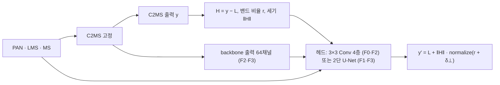

- **내부 특징:** C2MS `backbone`(원본 + W2 병렬 가지) 출력입니다. 전체 해상도 64채널이며 SSAI 융합 직전이고, forward hook으로 읽습니다.
- **공통 입력:** 61번 헤드 입력(고주파 밴드 비율, 저주파 색, LMS 색, 상대 세기, PAN 고주파)입니다.
- **출력:** 61번과 같은 norm 보존 형태입니다. 마지막 층을 0으로 초기화해 학습 시작 시 출력이 C2MS와 같습니다(서버 preflight 차이 6e-8, 원래 쌍과 거친 쌍 모두).

| 항목 | 설정 |
|---|---|
| 대조군 | C2MS QB seed 42([성능 53번](../53_scale_mixed_training/README.md) best.pt), 고정 |
| C2MS 실행 | 모든 군에서 매 step FP32(TF32 끔)로 forward해 같은 입력을 봄 |
| 손실 | 원래 쌍 MSE + 2배 거친 쌍 MSE(가중치 1.0) |
| 데이터 | QB train 17,139 / validation 1,905 패치(성능 59번 캐시를 SHA-256 확인 후 하드링크) |
| 학습 | 30에폭, Adam 1e-3 → 1e-5 cosine, batch 32, FP32, seed 42 |
| 학습 패치 측정 | 학습 패치 중 고르게 뽑은 1,905장을 매 에폭 측정 |
| 선택 | validation PSNR ≥ 에폭 0(C2MS) − 0.02 dB인 에폭 중 validation SAM 최소. test는 선택에 쓰지 않음 |
| 평가 | C2MS와 C2MS + 선택 헤드를 QB RR·FR test 20장에서 평가(RR·RR2·FR_WALD·FR 관측 RMSE) |
| 판정 | [판정 기준](../../../docs/judgement_criteria.md) v2.3, 단일 시드(잡음 문턱 0.06 dB). SAM 목표(ΔSAM ≤ −0.15°, ΔPSNR ≥ −0.04 dB)는 따로 보고 |

### 사전에 고정한 관문

학습 전에 [config.json](config.json)의 `gates`에 고정했습니다.

| 경우 | 다음 단계 |
|---|---|
| validation SAM 감소 ≥ 0.10°이고 validation PSNR ≥ C2MS − 0.02 dB인 군이 있음 | 그 군을 QB·GF2·WV3 3시드와 WV2 전이로 확장(사용자 승인 후) |
| 통과 군이 없고, 모든 군의 학습 패치 SAM 감소도 0.10° 미만 | 이 입력들로는 고주파의 색을 예측할 수 없다고 보고 헤드 방식을 정리 |
| 통과 군이 없지만, 학습 패치 SAM은 0.10° 이상 줄어든 군이 있음 | 일반화 한계로 보고 정규화·증강 쪽으로 다음 설계 |

## 3. 정량 결과

### 관문 (선택 에폭, C2MS = 에폭 0 대비)

| 군 | 선택 에폭 | val PSNR | val SAM 감소 | 학습 패치 PSNR | 학습 패치 SAM 감소 | 확장 |
|---|---:|---:|---:|---:|---:|:---:|
| F0 | 29 | +0.044 | 0.033° | +0.047 | 0.032° | ✗ |
| F1 | 29 | +0.046 | 0.033° | +0.051 | 0.033° | ✗ |
| F2 | 29 | +0.050 | 0.036° | +0.054 | 0.036° | ✗ |
| F3 | 29 | +0.053 | 0.037° | +0.060 | 0.038° | ✗ |

모든 에폭 중 학습 패치 SAM 감소의 최댓값도 선택 에폭 값과 같았습니다. 판정은 **정보 한계**(`stop_information_limit`)입니다. 수치는 [judgement_v2_3.json](results/judgement_v2_3.json)의 `gates`에 있습니다.

### QB seed 42 test (C2MS 대비)

대조군 C2MS는 RR PSNR 38.2738 dB, SAM 4.5770°, ERGAS 3.7230입니다(성능 53번 보관 평가와 같음). 차이는 **후보 − C2MS**입니다.

| 군 | ΔRR PSNR | ΔRR SAM | ΔRR ERGAS | 개선 장면 PSNR / SAM | RR2 ΔPSNR / ΔSAM | FR_WALD ΔPSNR / ΔSAM | 관측 RMSE 비율 | v2.3 |
|---|---:|---:|---:|---:|---:|---:|---:|---|
| F0 | +0.0338 | −0.0401 | −0.0130 | 20 / 20 | +0.0159 / −0.0473 | +0.0435 / −0.0520 | 1.030 | 부분 개선(잡음 수준) |
| F1 | +0.0370 | −0.0402 | −0.0142 | 20 / 20 | +0.0161 / −0.0547 | +0.0489 / −0.0529 | 1.072 | 부분 개선(잡음 수준) |
| F2 | +0.0385 | −0.0437 | −0.0145 | 20 / 20 | +0.0094 / −0.0557 | +0.0529 / −0.0560 | 1.059 | 부분 개선(잡음 수준) |
| F3 | **+0.0428** | **−0.0443** | **−0.0159** | 20 / 20 | +0.0146 / −0.0501 | +0.0600 / −0.0581 | 1.051 | 부분 개선(잡음 수준) |

네 군 모두 RR 세 지표와 보조 판정 RR2·FR_WALD·관측 일치를 통과했지만, PSNR 이득이 잡음 문턱(0.06 dB) 미만입니다. SAM 목표(−0.15°)는 모두 미달입니다. 참고 지표 FR QNR 변화는 +0.009에서 +0.010입니다.

F0는 61번 H1(test PSNR +0.0339, SAM −0.0404)을 거의 그대로 재현했습니다. 61번은 C2MS 출력을 미리 계산해 썼고, 이번에는 매 step 다시 계산했다는 점만 다릅니다.

## 4. 기준선 대비 차이와 해석

- **정보와 문맥을 더 줘도 SAM은 거의 그대로입니다.** F0 대비 내부 특징(F2)이 −0.0036°, 넓은 문맥(F1)이 −0.0001°, 둘 다(F3)가 −0.0042°를 더했을 뿐입니다. PSNR도 F3가 +0.009 dB 더 높은 정도입니다.
- **학습 데이터에서도 못 맞춥니다.** 네 군 모두 학습 패치 SAM 감소가 validation과 같은 폭이었습니다(0.032-0.038°). 일반화 문제가 아니라, 학습 데이터에서조차 고주파의 색 배분을 예측하지 못한다는 뜻입니다.
- 61번 오라클(밴드 비율만 정답 −2.11°)과 학습으로 얻는 값(약 −0.04°)의 차이는, C2MS 출력·내부 특징·PAN·LMS에 그 정보가 거의 없기 때문으로 해석합니다. PAN은 한 채널이라 세부가 밴드마다 어떻게 다른지 알려주지 못하고, LMS는 그 해상도의 세부를 담지 못합니다.
- **한계:** 이번 헤드는 C2MS를 고정한 채 MSE로 학습된 특징만 썼습니다. C2MS를 처음부터 함께 학습하면 다른 특징을 배울 가능성은 남아 있습니다. 다만 C2MS 전체를 분광 손실로 학습한 [성능 58번](../58_spectral_loss_multi_sensor/README.md)도 QB SAM −0.048°였습니다. 단일 시드, QB만 확인했습니다.

## 5. 학습·평가 그래프

에폭 0(C2MS) 대비 validation PSNR, validation SAM, 학습 패치 SAM입니다. 점선은 확장 관문(SAM −0.10°)입니다. 기록은 각 군의 `history.json`입니다.

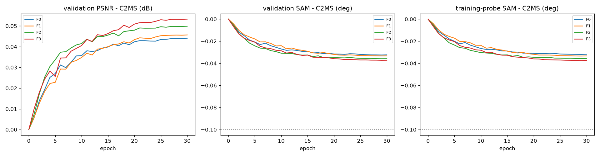

test에서 RR·RR2·FR_WALD의 C2MS 대비 차이입니다. 왼쪽 점선은 단일 시드 잡음 문턱(0.06 dB), 오른쪽 점선은 SAM 1차 목표(−0.15°)입니다.

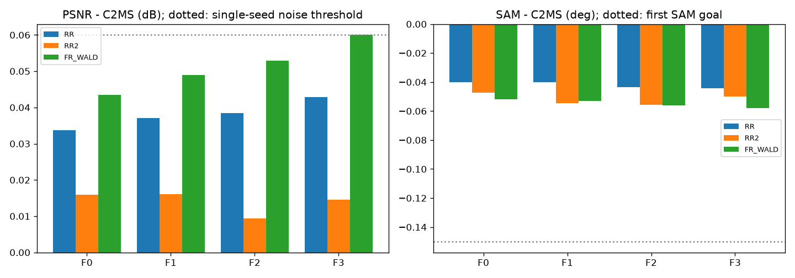

## 6. 결과 이미지

고정 6장면(QB RR test 0-based 0·1·3·7·14·17, seed 42)에서 현재 기준 C2MS와 F3를 비교했습니다. F3는 선택 에폭의 validation SAM이 가장 낮은 군입니다. 장면은 정답만 보고 풍경으로 미리 정했고 결과를 보고 바꾸지 않았습니다. `common/result_images.py`로 로컬 CPU에서 만들었고, 장면 PSNR은 서버 평가와 소수 넷째 자리까지 같습니다.

원본 크기 비교는 256×256 전체 장면의 **LR MS · PAN · C2MS · 후보 · 정답**과 **C2MS 오차 · 후보 오차**(같은 색 척도)입니다. 확대 비교는 후보의 개선이 가장 큰 64×64 창을 4배 확대한 **정답 전체(노란 상자) · C2MS · 후보 · 정답 · C2MS 오차 · 후보 오차**입니다.

**확대 창은 장면마다 후보에 가장 유리한 곳을 고른 것입니다.** 아래 표처럼 장면 17을 뺀 다섯 장면에서 확대 창의 차이가 장면 전체 차이보다 1.5-4배 큽니다. 장면 17은 오차 감소가 가장 큰 창의 PSNR 차이가 오히려 작았습니다. 눈으로 보이는 차이는 이 점을 감안해 읽어야 합니다.

| 장면 | 풍경 | 장면 PSNR (C2MS → F3) | 장면 차이 | 확대 창 PSNR (C2MS → F3) | 확대 창 차이 | 확대 창 평균 절대 오차 |
|---:|---|---:|---:|---:|---:|---:|
| 0 | 바다·항구 방파제 | 42.812 → 42.827 | +0.015 | 40.924 → 40.987 | +0.063 | −0.7% |
| 1 | 부두·곡선 방파제·수목 | 43.179 → 43.233 | +0.054 | 40.759 → 40.917 | +0.158 | −2.0% |
| 3 | 요트 마리나·운동장 | 37.964 → 38.017 | +0.053 | 38.115 → 38.195 | +0.080 | −1.9% |
| 7 | 숲 공원 | 39.405 → 39.436 | +0.030 | 40.196 → 40.244 | +0.048 | −1.0% |
| 14 | 언덕 공원·곡선 주택가 | 38.473 → 38.514 | +0.042 | 35.999 → 36.064 | +0.065 | −0.7% |
| 17 | 산지 녹지·산책로 | 39.396 → 39.424 | +0.028 | 34.665 → 34.681 | +0.016 | −0.6% |

**장면 1 (부두·곡선 방파제·수목) · 원본 크기와 확대 비교**

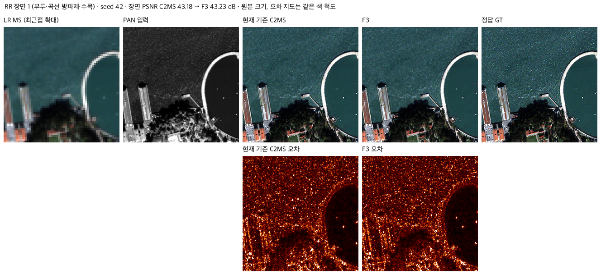

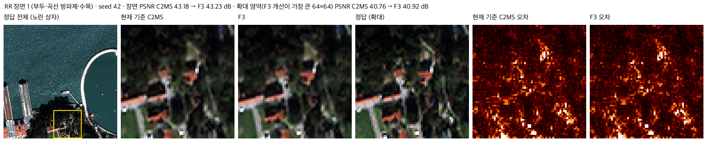

장면 0 · 두 비교 형식

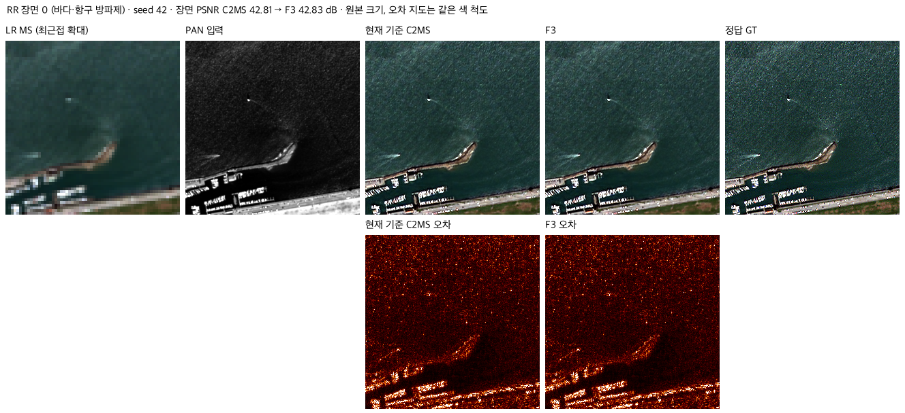

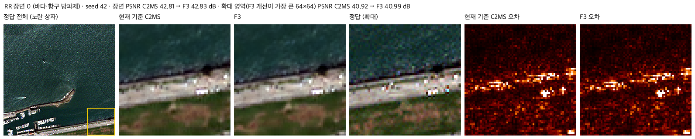

장면 3 · 두 비교 형식

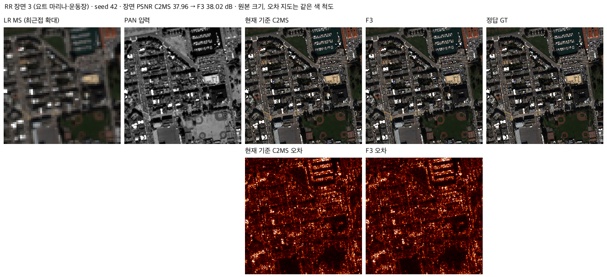

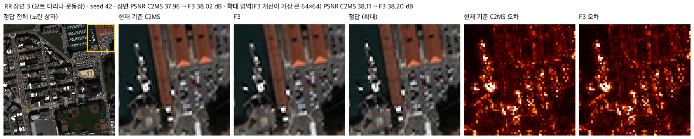

장면 7 · 두 비교 형식

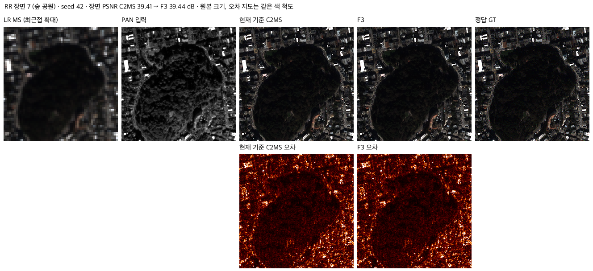

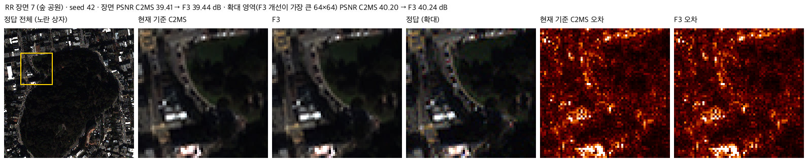

장면 14 · 두 비교 형식

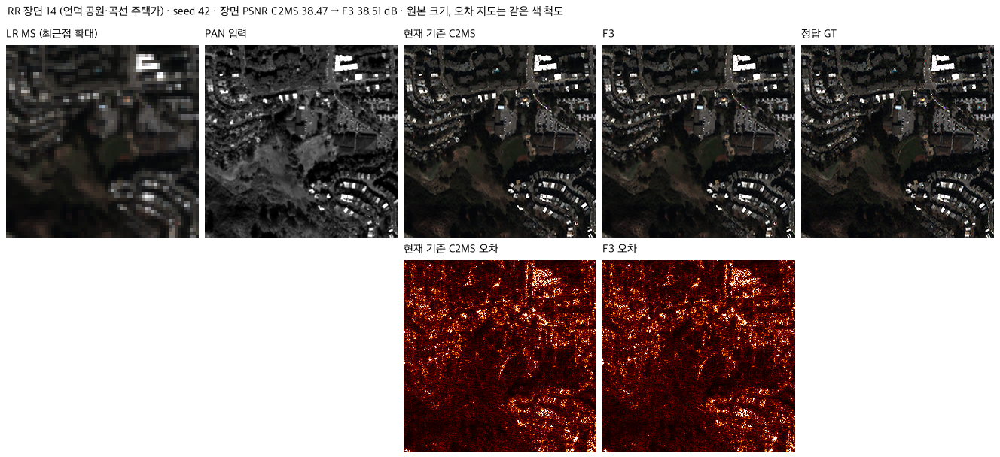

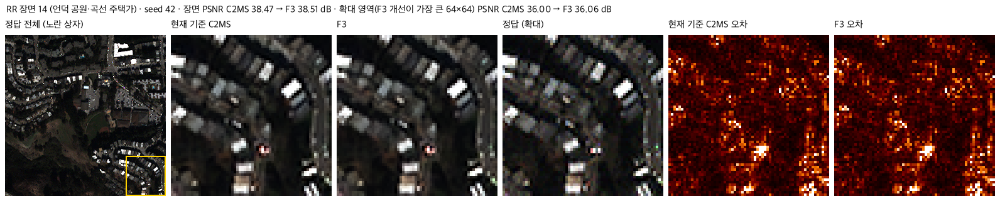

장면 17 · 두 비교 형식

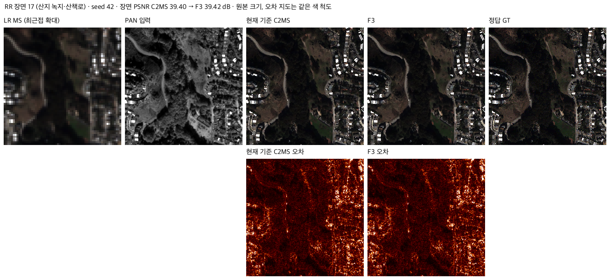

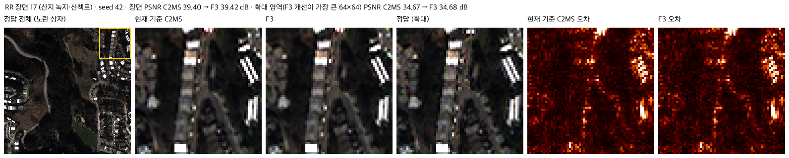

## 7. 재현 자료

- [model.py](model.py): F0-F3 헤드와 C2MS 내부 특징 hook. 61번 [model.py](../61_high_frequency_band_ratio_correction/model.py)의 구성 요소를 가져옵니다.
- [train.py](train.py)·[run.py](run.py): 서버 학습·평가 작업자와 컨트롤러(캐시 하드링크, preflight와 step 벤치마크, 순차 큐).
- [evaluate.py](evaluate.py): 서버 평가 기록으로 관문·v2.3 판정·그래프를 만들고 결과 이미지를 그립니다.
- [config.json](config.json): 학습 전에 고정한 설정과 관문. 서버에 봉인된 설정·소스 해시는 [runtime_config.json](provenance/run_records/runtime_config.json)에 있습니다. 저장소의 학습 소스는 봉인 해시와 같고, config.json은 평가 후 첫머리의 상태·개선 여부 필드만 바꿨습니다.
- 가중치: `checkpoints/<군>/best.pt`(Git). 재개용 `latest.pt`는 GitHub Release `weights-experiments-performance-62`에 있고 [manifest.json](manifest.json)의 `release_assets`에 기록했습니다. 헤드는 0 초기화와 seed로 결정되므로 `initial.pt`는 따로 두지 않았습니다.
- 결과: `results/<군>/`의 `history.json`, `training_complete.json`, `evaluation_complete.json`(장면별 RR·RR2·FR_WALD·FR), [judgement_v2_3.json](results/judgement_v2_3.json), 결과 이미지와 `result_images.json`.
- 실행 기록: `provenance/run_records/`(준비·preflight·컨트롤러 로그, 데이터·캐시 manifest, 환경), 서버 소스 manifest와 실행 스크립트.

## 8. 개선 여부와 다음 단계

QB seed 42 단일 시드 선별에서 네 군 모두 RR 세 지표와 보조 판정을 통과했지만 PSNR 이득이 잡음 문턱(0.06 dB) 미만이어서 **부분 개선**입니다. SAM 목표에는 모두 크게 미달했습니다. 확장 관문을 통과한 군이 없고 학습 패치 SAM도 0.10° 미만이라, 사전 규칙에 따라 **C2MS 출력 뒤에 붙이는 고주파 밴드 비율 헤드 방식은 여기서 정리합니다.** 기준 모델은 C2MS로 유지합니다.

60-62번을 종합하면, C2MS의 남은 각도 오차는 대부분 고주파 세부의 밴드별 배분에 있습니다. 그리고 그 배분은 현재 입력(PAN 한 채널, 저해상도 MS)과 C2MS가 배운 특징으로는 거의 예측되지 않습니다. 같은 입력으로 학습하는 손실 조정(분광 손실의 계수·배분·형태)도 같은 한계에 부딪힐 가능성이 높습니다. 다음 SAM 연구는 다음 방향을 검토합니다.

- WV2 전이: 저주파 색 치우침(60번에서 저주파 교체만으로 SAM −0.49°)과 고주파 세기 부족(61번에서 정답의 0.62배)이 커서, 학습 센서와 다른 원인을 직접 겨냥할 수 있습니다.
- QB 등 학습 센서: SAM은 PSNR과 함께 움직였습니다(47번 재평가). 별도 SAM 기법보다 전체 복원 성능을 올리는 구조 개선 쪽이 SAM에도 유리할 가능성이 큽니다.
