# 63. C2MS 학습 손실을 MSE에서 L1로 교체

**연구 분야:** 기존 성능 개선 · **실험자:** 이병현

**변경 내용:** 기준 모델 C2MS의 구조·축척 혼합·학습 일정은 그대로 두고, 원래 쌍과 2배 거친 쌍의 학습 손실만 MSE에서 L1(평균 절대 오차)로 바꿔 처음부터 학습했습니다. QB seed 42로 먼저 선별했습니다.

| 확인된 결과 | 상태 | 개선 여부 |
|---|:---:|:---:|
| 53번 C2MS 대비 test RR PSNR +0.084 dB·SAM −0.060°·ERGAS −0.027(PSNR 17/20장, SAM 20/20장)로 주 판정과 잡음 문턱을 통과했습니다. RR2는 2026-10-27 정한 고정 대조값(57번 재학습 C2MS) 기준으로 통과했지만(+0.120 dB, −0.063°), 관측 비율(1.32)이 미달했습니다. validation은 PSNR −0.073 dB로 test와 반대 방향입니다. | 평가&nbsp;완료 seed42 | 부분&nbsp;개선 |

[실험 목록](../../../research/performance/README.md) · [수치](#results) · [그래프](#graphs) · [이미지](#images) · [재현 자료](#evidence)

## 1. 목적과 상태

[성능 60-62번](../62_feature_context_band_ratio_head/README.md)에서 C2MS 출력 뒤의 보정 헤드로는 SAM을 0.04° 넘게 줄이지 못했습니다. QB에서 SAM이 C2MS보다 낮은 단일 추론 모델(ARConv 4.430°, U2Net+PAKAN 4.439°, CANNet 4.507°)은 별도의 분광 모듈 없이 내용에 따라 바뀌는 합성곱과 **L1 손실**로 학습했습니다. C2MS는 MSE로 학습했고, 저장소에서 주 손실을 L1로 바꾼 실험은 없었습니다. L1은 모든 픽셀 오차에 같은 크기의 기울기를 주므로, 작지만 넓게 퍼진 색 오차를 더 고르게 줄여 SAM을 낮출 수 있다는 가설입니다.

2026-10-26 사용자 승인 후 서버(RTX 3060 Ti)에서 07:10 KST에 학습을 시작했고, 10:21에 150에폭 학습을, 10:22에 test 평가를 마쳤습니다. 기준 모델은 C2MS로 유지합니다.

## 2. 변경한 구조와 비교 조건

| 항목 | C2MS (대조군) | 이번 후보 |
|---|---|---|
| 구조 | SSA-MRN K4 + W2 병렬 가지 (2,853,918개) | 같음 |
| 손실 | 원래 쌍 MSE + 1.0 × 거친 쌍 MSE | **원래 쌍 L1 + 1.0 × 거친 쌍 L1** |
| 학습 | 150에폭, Adam 1e-4 → 1e-6 cosine, batch 32, FP16 AMP(손실 FP32), channels_last | 같음 |
| 초기화·데이터 순서 | seed 42 | 같음 |
| 가중치 선택 | 원래 축척 validation MSE 최소(에폭 0 포함) | 같음 (150에폭 선택) |

- **구현:** 성능 54번 학습기를 그대로 쓰고, 그 안의 제곱 오차 식 다섯 곳(학습 step, 거친 쌍 항, 벤치마크, preflight)만 절대 오차로 바꿨습니다. 각 치환은 정확히 한 번 일치해야 하며, 나머지 코드는 같습니다([train.py](train.py)). 서버 검증에서 학습 루프가 절대 오차를 쓰는 것을 확인했습니다. 기록의 `train_mse` 이름은 54번 그대로지만 값은 평균 절대 오차입니다.
- **거친 쌍의 상대 비중:** 가중치를 똑같이 1.0으로 두면 L1에서는 거친 쌍 항의 비중이 커집니다. 실제 학습 기록에서 거친 쌍 ÷ 원래 쌍 학습 손실은 첫 에폭 0.833, 마지막 에폭 0.421이었습니다. 53번 MSE는 각각 0.709, 0.208이었으므로, 학습 후반에는 거친 쌍의 상대 비중이 약 2배였습니다.
- **AMP:** 80,400회 중 24회 업데이트가 건너뛰어졌습니다(53·58번과 비슷한 수준).

### 대조군을 다시 학습하지 않은 이유

공식 대조군은 보관된 [성능 53번](../53_scale_mixed_training/README.md) C2MS(같은 시드)입니다. [성능 57번](../57_c2ms_training_conditions/README.md)에서 같은 시드로 C2MS를 다시 학습했을 때, 53번 대비 RR은 PSNR +0.009 dB·SAM −0.003°로 거의 같았습니다. 반면 RR2는 −0.306 dB, 관측 비율은 1.124로 크게 흔들렸습니다. 그래서 주 판정에는 보관된 대조군을 쓰고, 57번 재학습 C2MS(seed 42)를 두 번째 참조로 함께 평가했습니다.

### 사전에 정한 단계와 관문

| 단계 | 내용 | 다음으로 가는 조건 |
|---|---|---|
| 1 선별 | QB seed 42 | 53번 대비 test RR SAM ≤ −0.05°이고 RR PSNR ≥ −0.04 dB, validation도 같은 방향 |
| 2 반복 | QB seed 43·44 추가, 53번과 짝지은 3시드 v2.3 | 개선 또는 SAM 목표 달성 |
| 3 확장 | GF2·WV3 3시드와 WV2 전이 | 사용자 승인 후 |

## 3. 정량 결과

QB RR·FR test 20장 평균입니다. 세 모델을 같은 서버·같은 코드로 함께 평가했습니다. 판정 정의와 장면별 수치는 [QB_v2_3.json](results/C2MS_L1_QB_s42/evaluation/QB_v2_3.json)에 있습니다.

| 모델 | RR PSNR | RR SAM | RR ERGAS | RR2 PSNR / SAM | FR_WALD PSNR / SAM | FR 관측 RMSE (DN) |
|---|---:|---:|---:|---:|---:|---:|
| C2MS (53번, 공식 대조군) | 38.2738 | 4.5770 | 3.7230 | 39.4206 / 4.0639 | 37.7183 / 4.0410 | 15.65 |
| C2MS (57번 재학습, 참조) | 38.2829 | 4.5736 | 3.7193 | 39.1148 / 4.2410 | 37.7389 / 4.0247 | 17.59 |
| **C2MS L1 (이번)** | **38.3577** | **4.5172** | **3.6964** | 39.2345 / 4.1779 | 37.8258 / 3.9638 | 20.69 |

### v2.3 판정

| 비교 | ΔRR PSNR / SAM / ERGAS | RR2 ΔPSNR / ΔSAM | FR_WALD ΔPSNR / ΔSAM | 관측 비율 | 판정 |
|---|---|---|---|---:|---|
| **53번 대비 (공식)** | +0.0839 / −0.0598 / −0.0266 | −0.1861 / +0.1141 ✗ | +0.1075 / −0.0771 | 1.322 ✗ | **부분 개선** |
| 57번 대비 (참조) | +0.0748 / −0.0564 / −0.0230 | +0.1197 / −0.0631 | +0.0869 / −0.0609 | 1.176 ✗ | 부분 개선 |

- 53번 대비 개선 장면 수(PSNR / SAM)는 RR 17 / 20, RR2 7 / 5, FR_WALD 16 / 20입니다.
- 참고 지표 FR QNR은 0.826 → 0.954, Dλ 0.027 → 0.017, Ds 0.151 → 0.029로 크게 달라졌습니다. 판정에는 쓰지 않습니다.

### 1단계 관문

| 조건 | 결과 |
|---|---|
| test RR SAM ≤ −0.05° | −0.060° ✓ |
| test RR PSNR ≥ −0.04 dB | +0.084 dB ✓ |
| validation도 같은 방향 | SAM −0.026° ✓, **PSNR −0.073 dB ✗** (53번 같은 에폭 선택 가중치 대비) |

test 조건은 통과했지만 validation PSNR이 반대 방향이라, 미리 정한 조건을 다 만족하지는 못했습니다. 2단계(seed 43·44) 진행 여부는 사용자가 결정합니다.

### validation (선택 가중치, 53번 선택 가중치 대비)

| | 원래 축척 PSNR / SAM | 거친 축척 PSNR / SAM |
|---|---:|---:|
| C2MS L1 − C2MS | −0.073 dB / −0.026° | **+0.291 dB / −0.097°** |

## 4. 기준선 대비 차이와 해석

- **원래 축척 RR은 세 지표가 모두 좋아졌습니다.** PSNR +0.084 dB는 잡음 문턱을 넘었고, SAM −0.060°는 [성능 58번](../58_spectral_loss_multi_sensor/README.md)의 분광 손실(−0.048°)보다 컸습니다. SAM은 20장 모두에서 낮아졌습니다.
- **validation과 test가 엇갈렸습니다.** validation PSNR은 −0.073 dB로 test와 반대이고, 45에폭부터 150에폭까지 같은 에폭의 53번 C2MS보다 매 에폭 0.043-0.091 dB 낮았습니다. 단일 시드로는 둘 중 어느 쪽이 실제 경향인지 구분할 수 없습니다. 57번에서는 validation과 test 차이가 잘 맞았던 것과 다릅니다.
- **거친 축척은 validation과 test가 반대입니다.** validation은 +0.291 dB로 크게 좋았지만, test RR2는 53번 대비 −0.186 dB였습니다. 57번 재학습 C2MS 대비로는 +0.120 dB였습니다. RR2는 같은 조건에서도 실행마다 크게 흔들리므로(57번 재학습 −0.306 dB), 이 차이는 단일 시드 비교로 판단하지 않습니다. L1에서 거친 쌍 항의 상대 비중이 약 2배가 된 점도 함께 기록합니다.
- **관측 일치는 실제로 나빠진 것으로 보입니다.** 원래 해상도 출력을 관측 연산으로 줄인 값과 입력 MS의 차이가 53번 대비 1.32배, 57번 대비 1.18배로 두 대조군 모두에서 허용폭(1.10)을 넘었습니다. 같은 출력에서 FR Ds·QNR은 크게 좋아져, L1이 원래 해상도 출력의 성질을 크게 바꿨다는 점은 분명합니다.

## 5. 학습·평가 그래프

학습 L1(원래 축척), validation PSNR, validation SAM입니다. 가중치는 validation MSE 최소인 150에폭이 선택됐습니다.

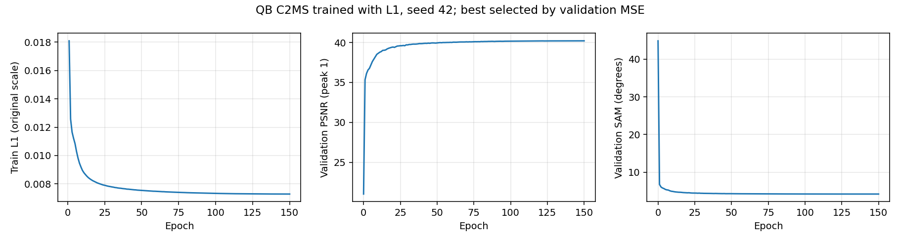

53번 C2MS 대비 RR·RR2·FR_WALD PSNR 차이입니다.

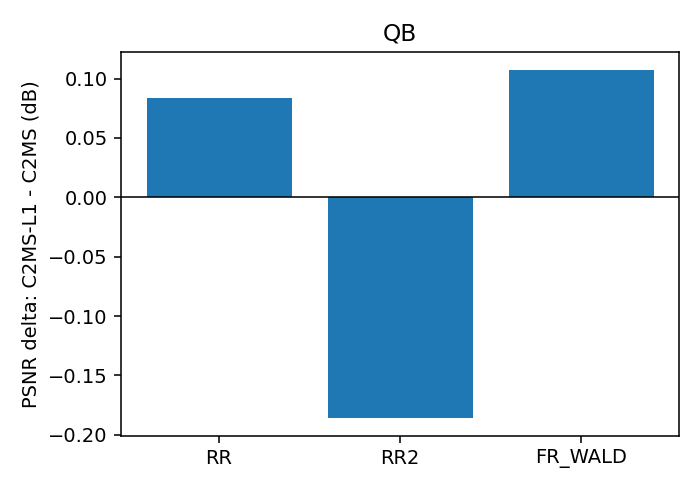

## 6. 결과 이미지

고정 6장면(QB RR test 0-based 0·1·3·7·14·17, seed 42)에서 현재 기준 C2MS(53번)와 L1 학습 모델을 비교했습니다. 장면은 정답만 보고 풍경으로 미리 정했고 결과를 보고 바꾸지 않았습니다. `common/result_images.py`로 서버 평가 중에 만들었습니다.

원본 크기 비교는 256×256 전체 장면의 **LR MS · PAN · C2MS · 후보 · 정답**과 **C2MS 오차 · 후보 오차**(같은 색 척도)입니다. 확대 비교는 후보의 개선이 가장 큰 64×64 창을 4배 확대한 **정답 전체(노란 상자) · C2MS · 후보 · 정답 · C2MS 오차 · 후보 오차**입니다. **확대 창은 장면마다 후보에 가장 유리한 곳을 고른 것**이라, 아래 표처럼 확대 창의 차이가 장면 전체 차이보다 큽니다.

| 장면 | 풍경 | 장면 PSNR (C2MS → L1) | 장면 차이 | 확대 창 PSNR (C2MS → L1) | 확대 창 차이 |
|---:|---|---:|---:|---:|---:|
| 0 | 바다·항구 방파제 | 42.812 → 42.922 | +0.110 | 37.253 → 37.666 | +0.413 |
| 1 | 부두·곡선 방파제·수목 | 43.179 → 43.269 | +0.090 | 40.496 → 41.250 | +0.754 |
| 3 | 요트 마리나·운동장 | 37.964 → 38.211 | +0.247 | 35.463 → 36.802 | +1.339 |
| 7 | 숲 공원 | 39.405 → 39.629 | +0.224 | 35.795 → 36.686 | +0.891 |
| 14 | 언덕 공원·곡선 주택가 | 38.473 → 38.511 | +0.038 | 35.524 → 35.866 | +0.342 |
| 17 | 산지 녹지·산책로 | 39.396 → 39.586 | +0.190 | 34.665 → 35.341 | +0.676 |

**장면 3 (요트 마리나·운동장) · 원본 크기와 확대 비교**

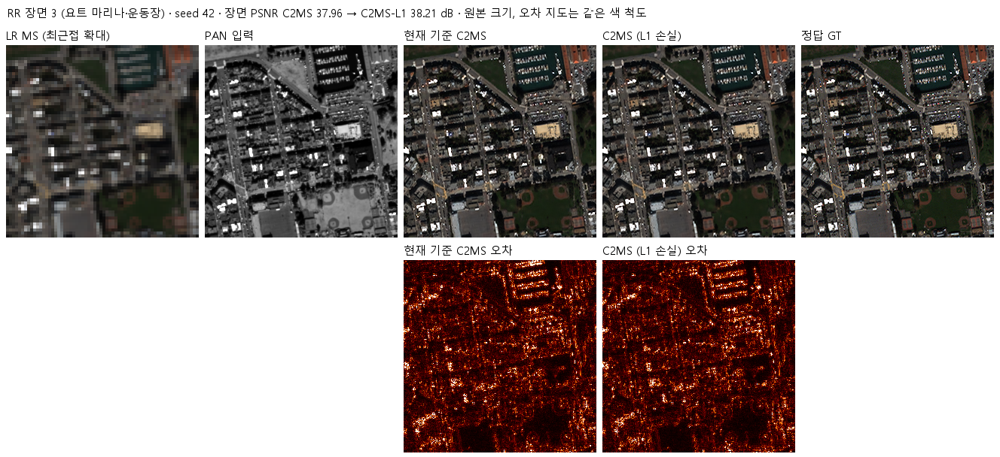

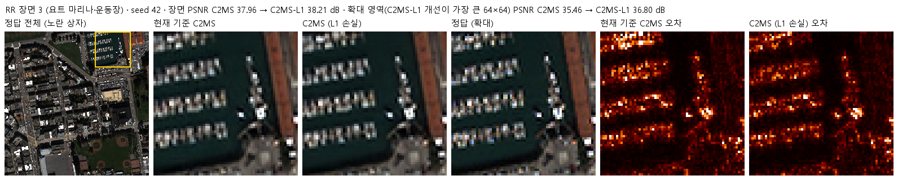

장면 0 · 두 비교 형식

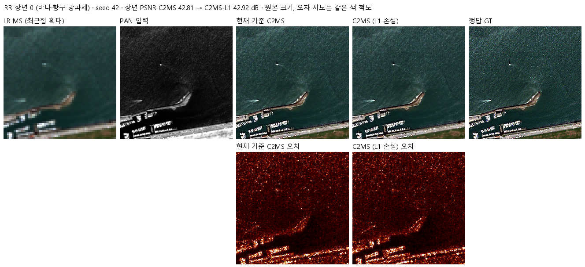

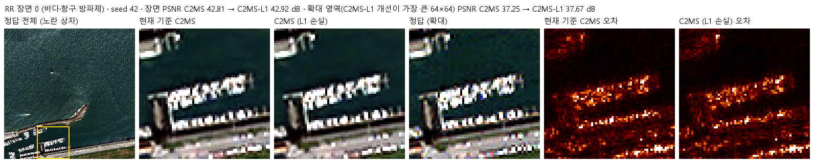

장면 1 · 두 비교 형식

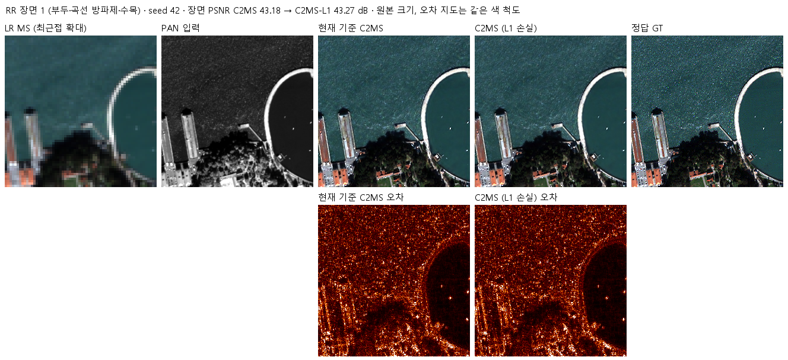

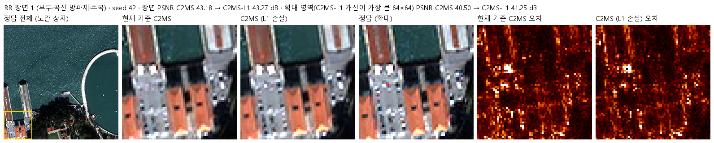

장면 7 · 두 비교 형식

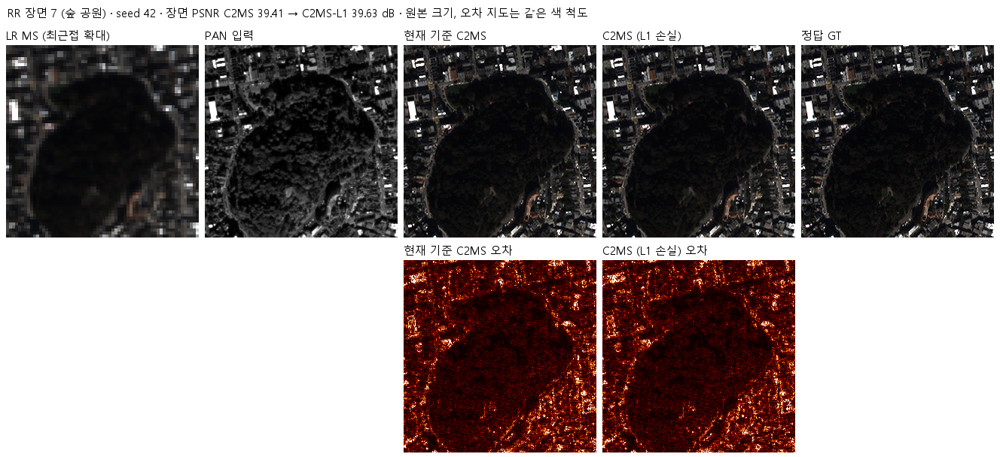

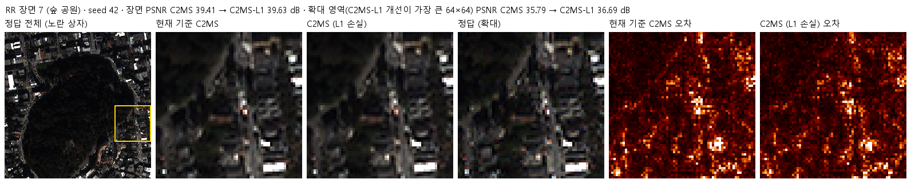

장면 14 · 두 비교 형식

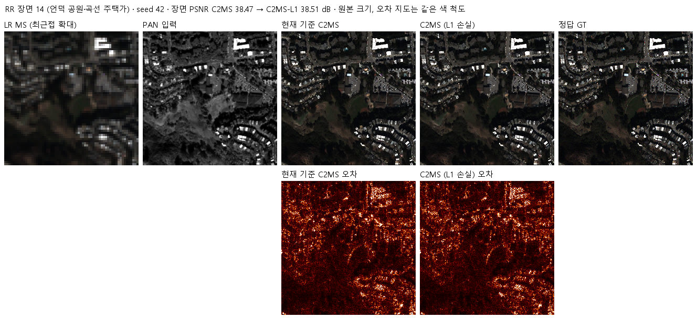

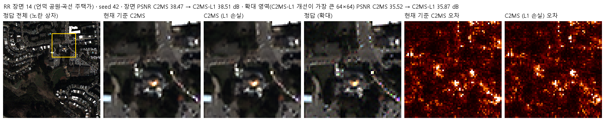

장면 17 · 두 비교 형식

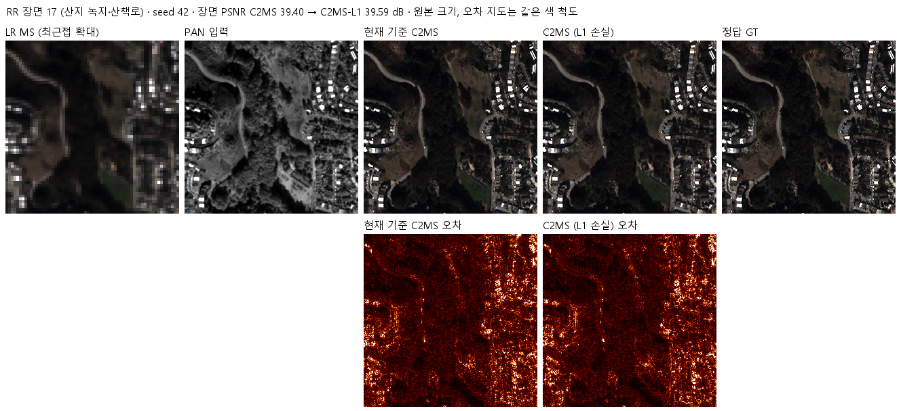

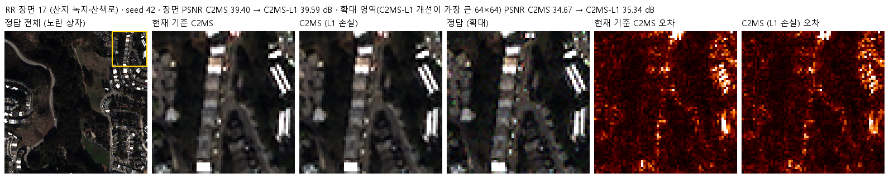

## 7. 재현 자료

- [train.py](train.py): 54번 학습기에 L1 치환만 적용한 학습 진입점. [model.py](model.py)·[prepare.py](prepare.py)는 54번 C2MS 구조와 센서 연산을 그대로 씁니다.
- [run.py](run.py)·[evaluate.py](evaluate.py): 59번 컨트롤러(캐시 하드링크, 벤치마크, preflight, 순차 큐)와 평가(53번 대조군·57번 참조 대비 v2.3, 결과 이미지).
- [config.json](config.json): 학습 전에 고정한 설정·대조군 방침·관문. 서버에 봉인된 설정·소스 해시는 [runtime_config.json](provenance/run_records/runtime_config.json)에 있습니다. 저장소의 학습 소스는 봉인 해시와 같고, config.json은 평가 후 첫머리의 상태·개선 여부 필드만 바꿨습니다.
- 가중치: `checkpoints/C2MS_L1_QB_s42/best.pt`(Git, 150에폭). 재개용 `latest.pt`와 초기 `initial.pt`는 GitHub Release `weights-experiments-performance-63`에 있고 [manifest.json](manifest.json)의 `release_assets`에 기록했습니다.
- 결과: `results/C2MS_L1_QB_s42/`의 `history.json`, `training_complete.json`, `evaluation_complete.json`, `evaluation/QB_v2_3.json`(장면별 RR·RR2·FR_WALD·FR), 그래프와 결과 이미지.
- 실행 기록: `provenance/run_records/`(준비·벤치마크·preflight·컨트롤러 기록, 캐시 manifest, 환경), 서버 소스 manifest와 실행 스크립트.

### RR2를 고정 대조값으로 다시 집계 (2026-10-27)

[2026-10-27 RR2 고정 대조값](../../../docs/judgement_criteria.md#qb-rr2-고정-대조값-2026-10-27) 규칙에 따라 RR2 보조 판정을 57번 재학습 C2MS seed 42 값(39.1148 dB, 4.2410°)과 다시 비교했습니다. L1 모델의 RR2는 39.2345 dB / 4.1779°로, 고정 대조값 대비 +0.120 dB / −0.063°여서 **통과**합니다. 관측 비율(53번 대비 1.32)은 여전히 미달이라 판정은 **부분 개선**으로 같습니다.

## 8. 개선 여부와 다음 단계

QB seed 42에서 RR 세 지표가 모두 좋아지고 PSNR 이득이 잡음 문턱을 넘었지만, 관측 비율이 보조 판정을 통과하지 못해 **부분 개선**입니다. RR2는 처음에 53번 대비 미달이었지만, 2026-10-27 고정 대조값 규칙으로 다시 집계하면 통과합니다. 기준 모델은 C2MS로 유지합니다.

- 1단계 관문은 test 조건을 통과했지만 validation PSNR이 반대 방향이라 사전 조건을 모두 만족하지 못했습니다. seed 43·44로 넓히면 validation과 test 중 어느 쪽이 실제 경향인지, RR2 미달이 실행 간 변동인지를 3시드 평균으로 판단할 수 있습니다. 진행 여부는 사용자 결정으로 남깁니다.
- 관측 비율 악화는 두 대조군 모두에서 나타났으므로 실제 경향으로 봅니다. L1을 계속 쓴다면 원래 해상도 출력의 관측 일치를 함께 확인해야 합니다.
- L1에 분광 손실을 더한 후속 [성능 65번](../65_l1_spectral_loss/README.md)은 같은 조건에서 SAM을 0.051° 더 줄였습니다(53번 대비 −0.111°).
