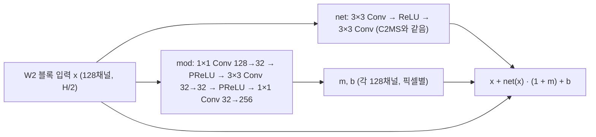

# 64. C2MS W2 가지의 픽셀별 아핀 변조

**연구 분야:** 기존 성능 개선 · **실험자:** 이병현

**변경 내용:** 기준 모델 C2MS의 W2 병렬 가지 잔차 블록 8개에 픽셀별 아핀 변조를 넣었습니다. 블록 출력 `x + net(x)`를 `x + net(x) · (1 + m(x)) + b(x)`로 바꾸고, 변조 계수 m·b는 작은 부분망이 픽셀마다 만듭니다. 손실·축척 혼합·학습 일정은 C2MS와 같으며, QB seed 42로 먼저 선별합니다.

| 확인된 결과 | 상태 | 개선 여부 |
|---|:---:|:---:|
| 아직 학습하지 않았습니다. 성능 63번 학습이 서버에서 끝나면 자동으로 시작하도록 예약했습니다(2026-10-26). | 계획 | 판단&nbsp;보류 |

[실험 목록](../../../research/performance/README.md) · [수치](#results) · [그래프](#graphs) · [이미지](#images) · [재현 자료](#evidence)

## 1. 목적과 상태

[성능 60-62번](../62_feature_context_band_ratio_head/README.md)에서 C2MS 출력 뒤의 보정 헤드로는 SAM을 0.04° 넘게 줄이지 못했습니다. QB SAM이 C2MS보다 낮은 단일 추론 모델들은 별도의 분광 모듈 없이 **내용에 따라 바뀌는 연산**으로 SAM을 낮췄습니다. 그중 ARConv(CVPR 2025)는 ablation에서 픽셀별 아핀 변조를 뺐을 때 SAM 손실이 가장 컸습니다(WV3 +0.135°). 이 변조를 C2MS의 W2 가지에 넣으면, 가지가 픽셀마다 특징의 세기와 치우침을 조절해 SAM을 PSNR과 함께 낮출 수 있다는 가설입니다.

손실은 C2MS와 같은 MSE로 두어 구조 변경 하나의 효과만 봅니다. L1 손실의 효과는 [성능 63번](../63_l1_reconstruction_loss/README.md)에서 따로 봅니다.

2026-10-26 사용자 승인으로, 서버의 63번 학습이 끝나면(`all_complete.json` 생성, 실행 중인 Python 없음) 자동으로 시작하도록 대기 스크립트를 걸었습니다.

## 2. 변경한 구조와 비교 조건

| 항목 | C2MS (대조군) | 이번 후보 C2MS_AM |
|---|---|---|
| 구조 | SSA-MRN K4 + W2 병렬 가지 (2,853,918개) | W2 블록 8개에 변조 부분망 추가 (3,029,022개, +175,104개) |
| 초기 상태 | 43번 C2 초기값 | C2MS 부분은 43번 C2와 같은 초기값, 변조 부분망은 별도 seed(+1000)이고 마지막 층이 0이라 학습 시작 시 출력이 C2MS와 같음 |
| 손실 | 원래 쌍 MSE + 1.0 × 거친 쌍 MSE | 같음 |
| 학습 | 150에폭, Adam 1e-4 → 1e-6 cosine, batch 32, FP16 AMP, channels_last, seed 42 | 같음 |
| 가중치 선택 | 원래 축척 validation MSE 최소 | 같음 |

- **구현:** 성능 54번 학습기를 그대로 씁니다. 바뀌는 것은 preflight의 초기값 확인 한 줄입니다. 원래는 전체 초기값이 43번 C2와 같은지 확인하는데, 변조 가중치가 추가됐으므로 공통 C2MS 가중치가 같은지만 확인하도록 바꿨습니다([train.py](train.py)).
- **로컬 확인:**
  - 공통 가중치가 43번 C2 초기값과 같고, 학습 시작 시 출력 차이는 0입니다.
  - W2 출력층이 0으로 초기화돼 있어 첫 step에는 변조 부분망에 기울기가 흐르지 않습니다. 두 번째 step부터는 정상적으로 학습되는 것을 확인했습니다.
- **대조군:** 63번과 같은 방침입니다. 보관된 [성능 53번](../53_scale_mixed_training/README.md) C2MS가 공식 대조군이고, [성능 57번](../57_c2ms_training_conditions/README.md) 재학습 C2MS를 참조로 함께 봅니다. 대조군을 새로 학습하지 않는 근거는 [config.json](config.json)의 `control_policy`에 있습니다.

### 단계와 관문 (학습 전에 고정)

| 단계 | 내용 | 다음으로 가는 조건 |
|---|---|---|
| 1 선별 | QB seed 42 (약 3.5-4시간) | 53번 대비 test RR SAM ≤ −0.05°이고 RR PSNR ≥ −0.04 dB, 또는 단일 시드 v2.3 개선. validation도 같은 방향 |
| 2 반복 | QB seed 43·44 추가, 53번과 짝지은 3시드 v2.3 | 개선 또는 SAM 목표 달성 |
| 3 확장 | GF2·WV3 3시드와 WV2 전이 | 사용자 승인 후 |

## 3. 정량 결과

아직 학습하지 않았습니다.

## 4. 기준선 대비 차이와 해석

아직 학습하지 않았습니다.

## 5. 학습·평가 그래프

학습 후 넣습니다.

## 6. 결과 이미지

평가 후 고정 6장면 두 형식과 장면별 확대 창 PSNR 표를 넣습니다.

## 7. 재현 자료

- [model.py](model.py): C2MS_AM(W2 블록 변조)과 대조군 C2MS 생성.
- [train.py](train.py): 54번 학습기에 preflight 초기값 확인만 바꾼 학습 진입점.
- [prepare.py](prepare.py)·[run.py](run.py)·[evaluate.py](evaluate.py): 59·63번과 같은 컨트롤러·평가(53번 대조군·57번 참조 대비 v2.3, 결과 이미지).
- [config.json](config.json): 학습 전에 고정한 설정·대조군 방침·관문.

## 8. 개선 여부와 다음 단계

학습·평가가 끝나면 판정합니다.
