# 64. C2MS W2 가지의 픽셀별 아핀 변조

**연구 분야:** 기존 성능 개선 · **실험자:** 이병현

**변경 내용:** 기준 모델 C2MS의 W2 병렬 가지 잔차 블록 8개에 픽셀별 아핀 변조를 넣었습니다. 블록 출력 `x + net(x)`를 `x + net(x) · (1 + m(x)) + b(x)`로 바꾸고, 변조 계수 m·b는 작은 부분망이 픽셀마다 만듭니다. 손실·축척 혼합·학습 일정은 C2MS와 같으며, QB seed 42로 먼저 선별합니다.

| 확인된 결과 | 상태 | 개선 여부 |
|---|:---:|:---:|
| 53번 C2MS 대비 test RR PSNR −0.087 dB·SAM +0.004°·ERGAS +0.037로 세 지표가 모두 나빠졌고, RR2 −0.465 dB, FR_WALD −0.082 dB였습니다. 원래 해상도 출력의 관측 오차가 4.89배로 크게 커졌습니다. validation은 C2MS와 거의 같았습니다(+0.012 dB, −0.005°). | 평가&nbsp;완료 seed42 | 개선&nbsp;없음 |

[실험 목록](../../../research/performance/README.md) · [수치](#results) · [그래프](#graphs) · [이미지](#images) · [재현 자료](#evidence)

## 1. 목적과 상태

[성능 60-62번](../62_feature_context_band_ratio_head/README.md)에서 C2MS 출력 뒤의 보정 헤드로는 SAM을 0.04° 넘게 줄이지 못했습니다. QB SAM이 C2MS보다 낮은 단일 추론 모델들은 별도의 분광 모듈 없이 **내용에 따라 바뀌는 연산**으로 SAM을 낮췄습니다. 그중 ARConv(CVPR 2025)는 ablation에서 픽셀별 아핀 변조를 뺐을 때 SAM 손실이 가장 컸습니다(WV3 +0.135°). 이 변조를 C2MS의 W2 가지에 넣으면, 가지가 픽셀마다 특징의 세기와 치우침을 조절해 SAM을 PSNR과 함께 낮출 수 있다는 가설입니다.

손실은 C2MS와 같은 MSE로 두어 구조 변경 하나의 효과만 봅니다. L1 손실의 효과는 [성능 63번](../63_l1_reconstruction_loss/README.md)에서 따로 봅니다.

2026-10-26 사용자 승인으로, 서버의 63번 학습이 끝나면 자동으로 시작하도록 대기 스크립트를 걸었습니다. 대기 스크립트는 10:23 KST에 63번 완료와 실행 중인 Python이 없음을 확인하고 소스 검증 후 64번을 시작했습니다. 14:10에 150에폭 학습을, 14:11에 test 평가를 마쳤습니다. 기준 모델은 C2MS로 유지합니다.

## 2. 변경한 구조와 비교 조건

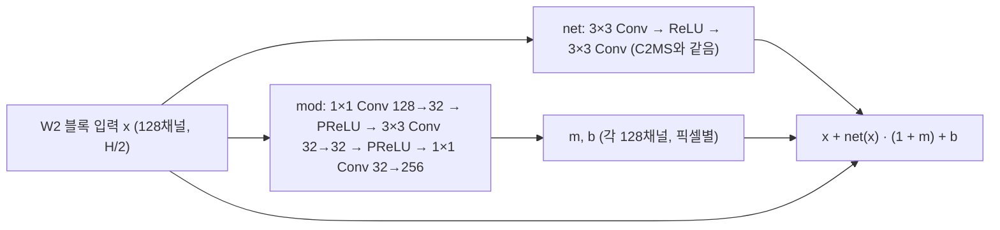

| 항목 | C2MS (대조군) | 이번 후보 C2MS_AM |
|---|---|---|
| 구조 | SSA-MRN K4 + W2 병렬 가지 (2,853,918개) | W2 블록 8개에 변조 부분망 추가 (3,029,022개, +175,104개) |
| 초기 상태 | 43번 C2 초기값 | C2MS 부분은 43번 C2와 같은 초기값, 변조 부분망은 별도 seed(+1000)이고 마지막 층이 0이라 학습 시작 시 출력이 C2MS와 같음 |
| 손실 | 원래 쌍 MSE + 1.0 × 거친 쌍 MSE | 같음 |
| 학습 | 150에폭, Adam 1e-4 → 1e-6 cosine, batch 32, FP16 AMP, channels_last, seed 42 | 같음 |
| 가중치 선택 | 원래 축척 validation MSE 최소 | 같음 |

- **구현:** 성능 54번 학습기를 그대로 씁니다. 바뀌는 것은 preflight의 초기값 확인 한 줄입니다. 원래는 전체 초기값이 43번 C2와 같은지 확인하는데, 변조 가중치가 추가됐으므로 공통 C2MS 가중치가 같은지만 확인하도록 바꿨습니다([train.py](train.py)).
- **확인:**
  - 공통 가중치가 43번 C2 초기값과 같고, 학습 시작 시 출력 차이는 0입니다.
  - W2 출력층이 0으로 초기화돼 있어 첫 step에는 변조 부분망에 기울기가 흐르지 않습니다. 두 번째 step부터는 정상적으로 학습되는 것을 로컬에서 확인했습니다.
  - 서버 preflight(초기값 확인, 두 축척 forward/backward, AMP 재개)를 통과했습니다. 80,400회 중 19회 업데이트가 건너뛰어졌습니다.
- **대조군:** 63번과 같은 방침입니다. 보관된 [성능 53번](../53_scale_mixed_training/README.md) C2MS가 공식 대조군이고, [성능 57번](../57_c2ms_training_conditions/README.md) 재학습 C2MS를 참조로 함께 봅니다. 대조군을 새로 학습하지 않는 근거는 [config.json](config.json)의 `control_policy`에 있습니다.

### 단계와 관문 (학습 전에 고정)

| 단계 | 내용 | 다음으로 가는 조건 |
|---|---|---|
| 1 선별 | QB seed 42 (약 3.5-4시간) | 53번 대비 test RR SAM ≤ −0.05°이고 RR PSNR ≥ −0.04 dB, 또는 단일 시드 v2.3 개선. validation도 같은 방향 |
| 2 반복 | QB seed 43·44 추가, 53번과 짝지은 3시드 v2.3 | 개선 또는 SAM 목표 달성 |
| 3 확장 | GF2·WV3 3시드와 WV2 전이 | 사용자 승인 후 |

## 3. 정량 결과

QB RR·FR test 20장 평균입니다. 세 모델을 같은 서버·같은 코드로 함께 평가했습니다. 장면별 수치는 [QB_v2_3.json](results/C2MS_AM_QB_s42/evaluation/QB_v2_3.json)에 있습니다.

| 모델 | RR PSNR | RR SAM | RR ERGAS | RR2 PSNR / SAM | FR_WALD PSNR / SAM | FR 관측 RMSE (DN) |
|---|---:|---:|---:|---:|---:|---:|
| C2MS (53번, 공식 대조군) | 38.2738 | 4.5770 | 3.7230 | 39.4206 / 4.0639 | 37.7183 / 4.0410 | 15.65 |
| C2MS (57번 재학습, 참조) | 38.2829 | 4.5736 | 3.7193 | 39.1148 / 4.2410 | 37.7389 / 4.0247 | 17.59 |
| **C2MS_AM (이번)** | **38.1868** | **4.5810** | **3.7596** | 38.9557 / 4.2678 | 37.6368 / 4.0389 | **76.47** |

| 비교 | ΔRR PSNR / SAM / ERGAS | RR2 ΔPSNR / ΔSAM | FR_WALD ΔPSNR / ΔSAM | 관측 비율 | 판정 |
|---|---|---|---|---:|---|
| **53번 대비 (공식)** | −0.0869 / +0.0040 / +0.0366 | −0.4649 / +0.2040 ✗ | −0.0815 / −0.0021 ✗ | 4.887 ✗ | **개선 없음** |
| 57번 대비 (참조) | −0.0960 / +0.0074 / +0.0403 | −0.1590 / +0.0268 ✗ | −0.1021 / +0.0142 ✗ | 4.346 ✗ | 개선 없음 |

- 53번 대비 개선 장면 수(PSNR / SAM)는 RR 5 / 10, RR2 1 / 2, FR_WALD 4 / 9입니다.
- validation(선택 141에폭)은 53번 선택 가중치 대비 PSNR +0.012 dB·SAM −0.005°, 거친 축척 +0.016 dB·−0.012°로 거의 같았습니다.
- **원래 해상도 관측 오차:** 장면별로 C2MS의 2.6-19.6배였고(중앙값 62.1 DN, 최대 280.4 DN), 20장 모두에서 커졌습니다. 참고 지표 FR QNR은 0.826 → 0.703, Ds 0.151 → 0.255로 나빠졌습니다.
- 1단계 관문(SAM ≤ −0.05°, PSNR ≥ −0.04 dB, 또는 단일 시드 개선)은 통과하지 못했습니다.

## 4. 기준선 대비 차이와 해석

- **validation에서는 C2MS와 거의 같았는데, test에서는 모든 축척에서 나빠졌습니다.** 원래 축척 RR은 −0.087 dB, 학습에 포함된 2배 거친 축척(RR2)은 −0.465 dB였습니다.
- **원래 해상도 입력에서 출력이 크게 어긋납니다.** 관측 오차가 모든 장면에서 커졌고, 가장 큰 장면은 19.6배였습니다. 픽셀별 변조 `net(x)·(1 + m) + b`는 크기 제한이 없습니다. 그래서 학습 패치(64×64)와 성질이 다른 입력에서는 변조 계수가 커져 출력이 흔들리는 것으로 추정합니다. test에서 변조 계수의 크기를 직접 재 보지는 않아, 원인은 확인하지 못했습니다.
- ARConv의 아핀 변조는 커널 모양도 픽셀마다 바꾸는 합성곱 안에 있는 요소이고, 출력을 LMS에 더하는 잔차 구조 전체가 처음부터 함께 학습됩니다. 이번에는 C2MS의 W2 블록에 변조만 떼어 넣었으므로 같은 효과를 기대하기 어려웠을 수 있습니다.
- 단일 시드이고 QB만 확인했습니다.

## 5. 학습·평가 그래프

학습 MSE(원래 축척), validation PSNR, validation SAM입니다. 가중치는 validation MSE 최소인 141에폭이 선택됐습니다.

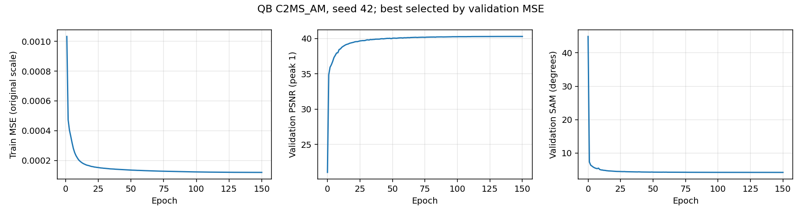

53번 C2MS 대비 RR·RR2·FR_WALD PSNR 차이입니다.

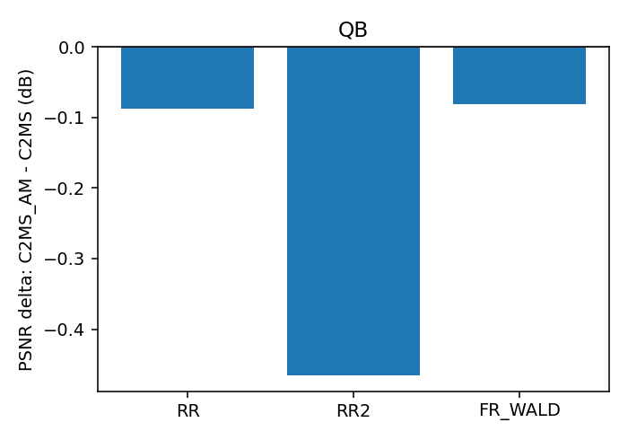

## 6. 결과 이미지

고정 6장면(QB RR test 0-based 0·1·3·7·14·17, seed 42)에서 현재 기준 C2MS(53번)와 C2MS_AM을 비교했습니다. 장면은 정답만 보고 풍경으로 미리 정했고 결과를 보고 바꾸지 않았습니다. `common/result_images.py`로 서버 평가 중에 만들었습니다.

원본 크기 비교는 256×256 전체 장면의 **LR MS · PAN · C2MS · 후보 · 정답**과 **C2MS 오차 · 후보 오차**(같은 색 척도)입니다. 확대 비교는 후보의 개선이 가장 큰 64×64 창을 4배 확대한 **정답 전체(노란 상자) · C2MS · 후보 · 정답 · C2MS 오차 · 후보 오차**입니다. **확대 창은 장면마다 후보에 가장 유리한 곳을 고른 것**이라, 장면 전체가 나빠진 장면에서도 확대 창은 좋아 보일 수 있습니다.

| 장면 | 풍경 | 장면 PSNR (C2MS → AM) | 장면 차이 | 확대 창 PSNR (C2MS → AM) | 확대 창 차이 |
|---:|---|---:|---:|---:|---:|
| 0 | 바다·항구 방파제 | 42.812 → 42.658 | −0.154 | 37.389 → 37.209 | −0.180 |
| 1 | 부두·곡선 방파제·수목 | 43.179 → 43.138 | −0.041 | 45.225 → 45.480 | +0.255 |
| 3 | 요트 마리나·운동장 | 37.964 → 37.896 | −0.068 | 35.162 → 36.011 | +0.849 |
| 7 | 숲 공원 | 39.405 → 39.469 | +0.064 | 39.491 → 39.730 | +0.239 |
| 14 | 언덕 공원·곡선 주택가 | 38.473 → 38.215 | −0.258 | 38.205 → 38.504 | +0.299 |
| 17 | 산지 녹지·산책로 | 39.396 → 39.477 | +0.081 | 34.665 → 35.084 | +0.419 |

**장면 14 (언덕 공원·곡선 주택가) · 원본 크기와 확대 비교** (장면 전체가 가장 많이 나빠진 장면입니다)

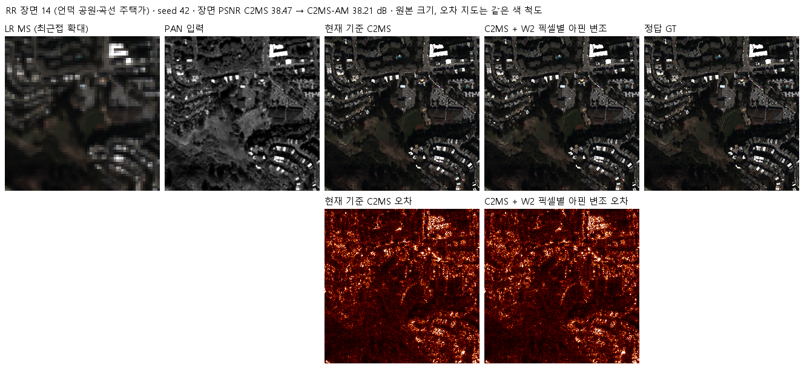

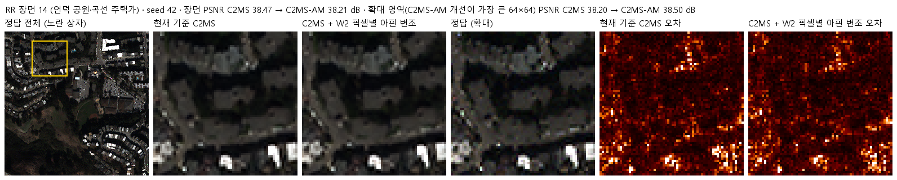

장면 0 · 두 비교 형식

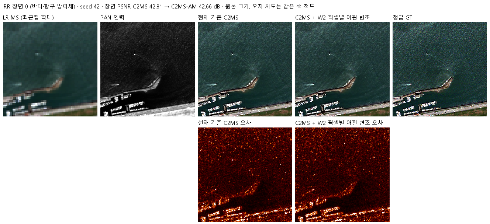

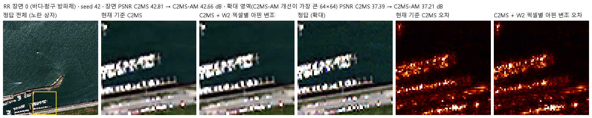

장면 1 · 두 비교 형식

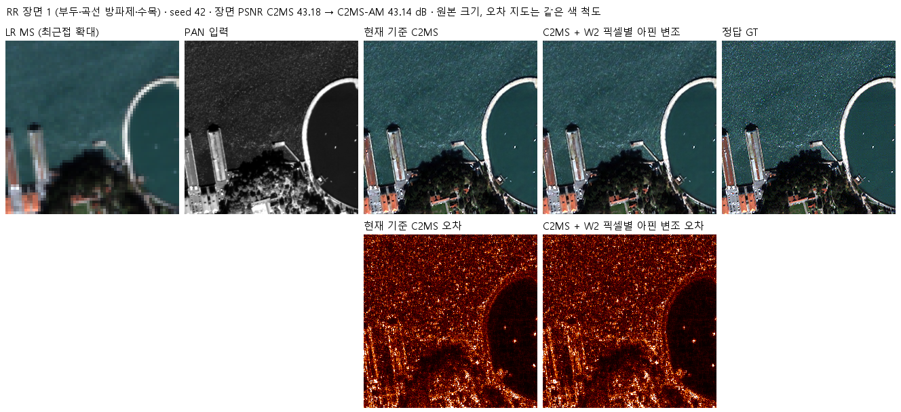

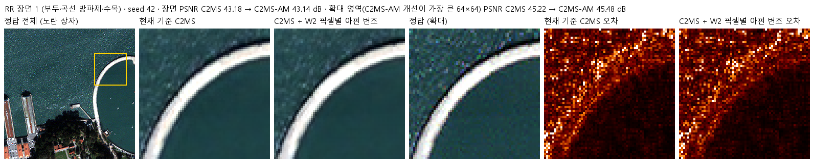

장면 3 · 두 비교 형식

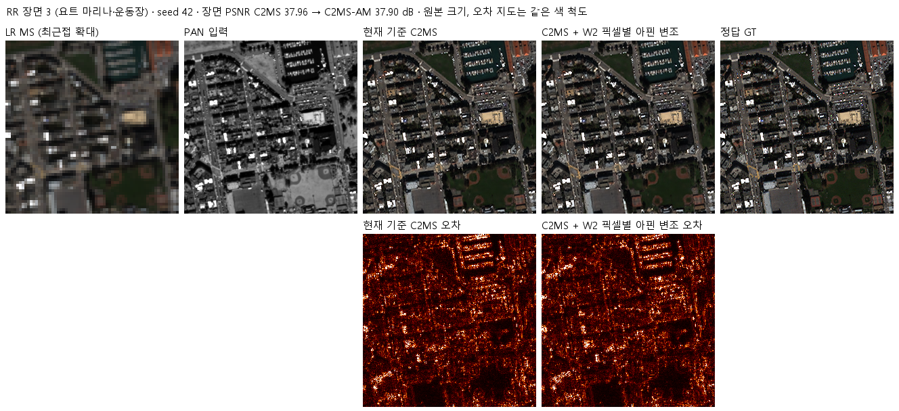

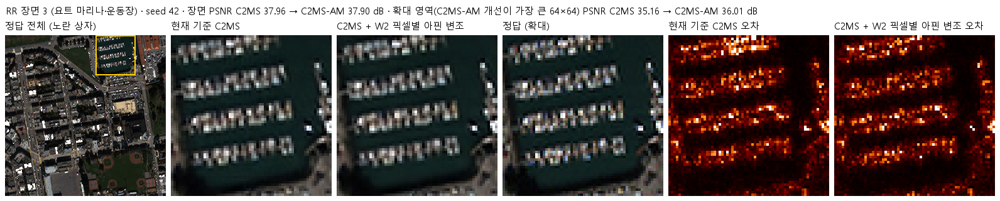

장면 7 · 두 비교 형식

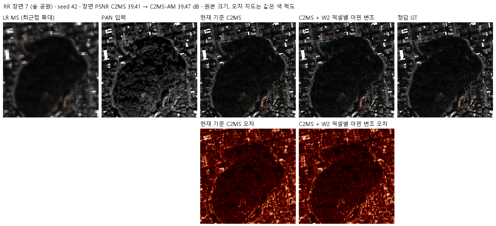

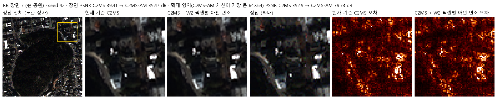

장면 17 · 두 비교 형식

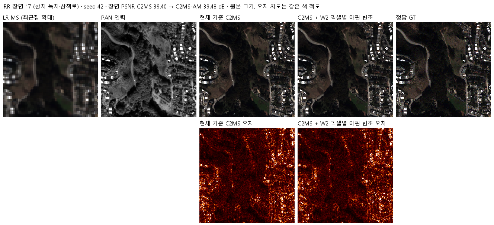

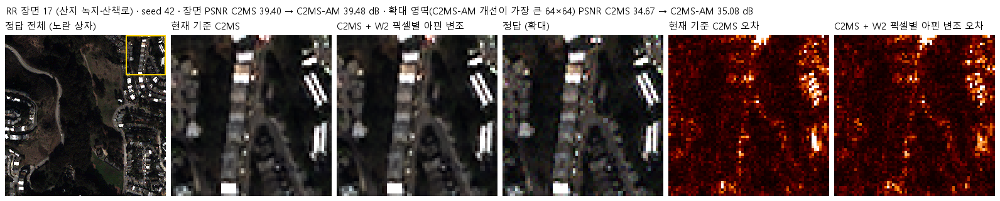

## 7. 재현 자료

- [model.py](model.py): C2MS_AM(W2 블록 변조)과 대조군 C2MS 생성.
- [train.py](train.py): 54번 학습기에 preflight 초기값 확인만 바꾼 학습 진입점.
- [prepare.py](prepare.py)·[run.py](run.py)·[evaluate.py](evaluate.py): 59·63번과 같은 컨트롤러·평가(53번 대조군·57번 참조 대비 v2.3, 결과 이미지).
- [config.json](config.json): 학습 전에 고정한 설정·대조군 방침·관문. 서버에 봉인된 설정·소스 해시는 [runtime_config.json](provenance/run_records/runtime_config.json)에 있습니다. 저장소의 학습 소스는 봉인 해시와 같고, config.json은 평가 후 첫머리의 상태·개선 여부 필드만 바꿨습니다.
- 가중치: `checkpoints/C2MS_AM_QB_s42/best.pt`(Git, 141에폭). 재개용 `latest.pt`와 초기 `initial.pt`는 GitHub Release `weights-experiments-performance-64`에 있고 [manifest.json](manifest.json)의 `release_assets`에 기록했습니다.
- 결과: `results/C2MS_AM_QB_s42/`의 `history.json`, `training_complete.json`, `evaluation_complete.json`, `evaluation/QB_v2_3.json`, 그래프와 결과 이미지.
- 실행 기록: `provenance/run_records/`(준비·벤치마크·preflight·컨트롤러 기록, 캐시 manifest, 환경), 자동 시작 대기 스크립트와 기록(`wait64.ps1`, `watcher.log`), 서버 소스 manifest와 실행 스크립트.

## 8. 개선 여부와 다음 단계

QB seed 42에서 RR 세 지표가 모두 나빠지고 보조 판정 세 가지도 모두 미달이어서 **개선 없음**입니다. 1단계 관문을 통과하지 못해 seed 43·44로 넓히지 않습니다. 기준 모델은 C2MS로 유지합니다.

- 원래 해상도 관측 오차의 급증은 변조 계수에 크기 제한이 없는 구조 때문일 가능성이 있습니다. 다시 시도한다면 `m`을 `tanh` 등으로 제한하거나, 변조를 W2 가지가 아닌 합성곱 내부(ARConv 방식)에 두는 설계가 필요합니다.
