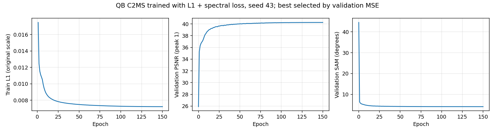
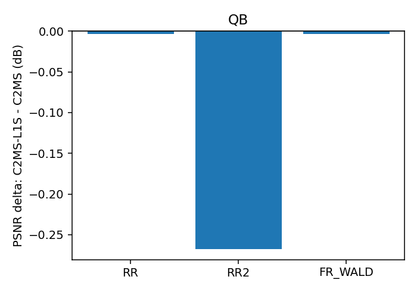
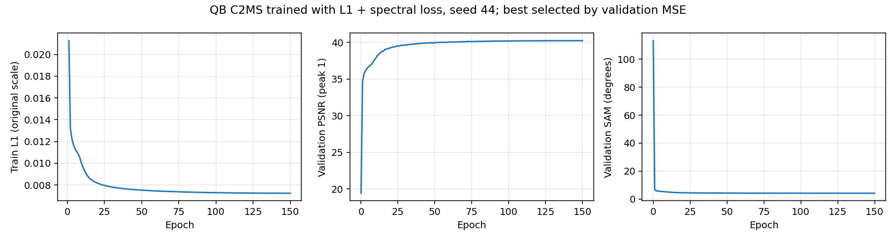
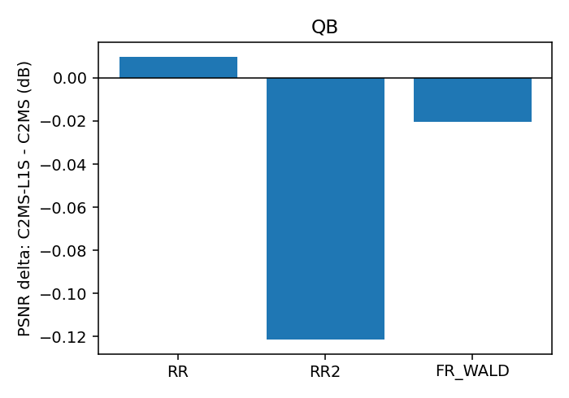

# 65. C2MS에 L1 손실과 분광 손실을 함께 적용

**연구 분야:** 성능 개선 · **실험자:** 이병현

**변경 내용:** 기준 모델 C2MS의 구조·축척 혼합·학습 일정은 그대로 둡니다. 원래 쌍과 2배 거친 쌍의 복원 손실을 MSE에서 L1으로 바꾸고([성능 63번](../63_l1_reconstruction_loss/README.md)), 원래 쌍에 [성능 58번](../58_spectral_loss_multi_sensor/README.md)의 분광 손실(픽셀별 1 − cos)을 더합니다. 분광 손실 계수는 58번과 같은 상대적 세기(0.46)로 맞췄습니다. QB seed 42로 선별한 뒤 seed 43·44를 더해 3시드로 판정했습니다.

| 확인된 결과 | 상태 | 개선 여부 |
|---|:---:|:---:|
| QB 3시드(42-44) 평균으로 같은 시드 53번 C2MS 대비 test RR PSNR +0.028 dB·**SAM −0.100°**·ERGAS −0.008로 세 지표가 모두 좋아졌습니다. SAM은 세 시드 모두 20/20장에서 낮아졌습니다(시드별 −0.083에서 −0.111°). 그러나 PSNR 이득이 2시드 이상 잡음 문턱(0.04 dB)보다 작고(시드별 +0.077, −0.003, +0.010 dB), 관측 비율(1.43)이 허용폭을 넘었습니다. RR2(고정 대조값 기준 시드 평균 −0.010 dB·+0.058°)와 FR_WALD는 통과했습니다. SAM 1차 목표(−0.15°)에는 미달했습니다. 3단계 중간(seed 42·43, 54번 C2MS 대비 2시드 평균): GF2는 PSNR +0.142 dB·SAM −0.025°로 수치 항목을 모두 통과했고, WV3는 SAM −0.077°·PSNR +0.049 dB이지만 FR_WALD·관측 비율이 미달이며, WV2 전이는 PSNR −0.619 dB입니다. | 평가&nbsp;완료 QB&nbsp;3시드 GF2·WV3&nbsp;seed&nbsp;42·43&nbsp;평가 seed&nbsp;44&nbsp;학습&nbsp;중 | 부분&nbsp;개선 |

[실험 목록](../../../research/performance/README.md) · [수치](#results) · [그래프](#graphs) · [이미지](#images) · [재현 자료](#evidence)

## 1. 목적과 상태

58번(MSE + 0.01 × 분광 손실)은 QB SAM을 0.048° 줄였지만 RR2 미달로 개선 판정을 받지 못했습니다. 63번(L1)은 학습 74에폭까지 거친 축척 validation이 C2MS보다 PSNR +0.15-0.48 dB 높았습니다. L1이 거친 축척을 지켜 주면, 분광 손실의 SAM 이득을 RR2 손해 없이 얻을 수 있다는 가설입니다.

2026-10-26 사용자 승인으로, 서버의 64번 학습이 끝나면 자동으로 시작하도록 대기 스크립트를 걸었습니다. 대기 스크립트는 14:12 KST에 63·64번 완료와 실행 중인 Python이 없음을 확인하고 소스 검증 후 65번을 시작했습니다. 17:45에 150에폭 학습을, 17:46에 test 평가를 마쳤습니다. 기준 모델은 C2MS로 유지합니다.

사용자 결정에 따라 2026-10-26 18시대에 QB seed 43·44 학습을 서버 새 runtime에서 시작했습니다. 대조군은 같은 시드의 53번 C2MS이고, 같은 시드의 58번 분광 손실 C2MS(MSE + 0.01)를 참조로 함께 평가합니다. 이를 위해 [evaluate.py](evaluate.py)·[run.py](run.py)가 대조군·참조 경로의 `<seed>`를 시드로 바꾸도록 고쳤고, 학습 코드는 바꾸지 않았습니다. seed 42 단계의 설정은 [config.json](config.json)의 `stage1_record`와 봉인 기록에 남겼습니다. seed 43은 2026-10-26 21:35, seed 44는 2026-10-27 01:08에 150에폭 학습을 마쳤고, 이어서 01:09까지 두 시드의 test 평가를 마쳤습니다. seed 42와 함께 같은 시드 53번 C2MS와 짝지은 3시드 평균으로 판정했습니다.

2026-10-27 사용자 결정으로 3단계(GF2·WV3 3시드와 WV2 전이)를 시작했습니다. QB 3시드가 확장 조건(개선 또는 SAM −0.15°)을 충족하지 못했지만, 다른 센서에서도 같은 경향인지 확인하기 위해 진행합니다. 시드별로 결과를 먼저 볼 수 있도록 seed 42의 GF2 → WV3, seed 43의 GF2 → WV3, seed 44의 GF2 → WV3 순서로 학습하고, 각 실행은 학습이 끝나는 즉시 평가합니다(WV2는 WV3 모델의 전이 test). 분광 계수는 QB와 같은 0.46을 모든 센서에 그대로 씁니다. 대조군은 같은 시드의 [성능 54번](../54_multi_sensor_scale_mixed_training/README.md) C2MS, 참조는 같은 시드의 58번 분광 손실 C2MS입니다. 이를 위해 [run.py](run.py)가 각 실행을 학습 직후 평가하도록 순서만 바꿨고, 학습·평가 코드는 그대로입니다. 설정은 [config.json](config.json)의 `stage3`, 2단계 설정은 `stage2_record`에 있습니다.

## 2. 변경한 구조와 비교 조건

| 항목 | C2MS (대조군) | 58번 | 63번 | **이번 후보 C2MS_L1S** |
|---|---|---|---|---|
| 복원 손실 (원래 + 거친 쌍) | MSE + MSE | MSE + MSE | L1 + L1 | **L1 + L1** |
| 분광 손실 (원래 쌍) | 없음 | 0.01 × (1 − cos) | 없음 | **0.46 × (1 − cos)** |
| 구조·학습 일정·선택 | C2MS (150에폭, Adam 1e-4 → 1e-6 cosine, batch 32, FP16 AMP, validation MSE 최소) | 같음 | 같음 | 같음 |

- **분광 손실 계수 0.46:** L1의 기울기는 MSE보다 훨씬 커서, 58번 값 0.01을 그대로 쓰면 분광 손실의 상대적 세기가 크게 약해집니다. 사용자 결정에 따라 학습 전에 계수를 정해 고정했습니다.
  - 보관된 53번 C2MS의 출력에서 QB 학습 패치 256장(32장씩 8묶음)으로 측정했습니다. 출력에 대한 기울기 크기는 L1이 MSE의 46.0배였습니다.
  - 그래서 `0.01 × 46.0 = 0.46`으로 정했습니다. 묶음별 값은 0.43-0.49로 안정적이었습니다([측정 기록](provenance/spectral_weight_calibration.json)).
  - 학습 초반에는 오차가 커서 이 비율이 다를 수 있습니다.
- **구현:** 58번 학습기(54번 학습기 + 분광 손실 + EMA 기록)를 그대로 쓰고, 제곱 오차 식 다섯 곳만 절대 오차로 바꿉니다([train.py](train.py)). EMA는 58번처럼 기록만 하고, 주 결과는 validation MSE로 고른 일반 가중치입니다.
- **대조군과 참조:**
  - 공식 대조군은 보관된 [성능 53번](../53_scale_mixed_training/README.md) C2MS입니다.
  - [성능 57번](../57_c2ms_training_conditions/README.md)의 재학습 C2MS와 분광 손실 C2MS(MSE + 0.01)도 함께 평가합니다.
  - 63번(L1만)과는 같은 20장면의 장면별 기록으로 나중에 비교해, L1 아래에서 분광 손실이 더한 효과를 따로 봅니다.
  - 대조군을 새로 학습하지 않는 근거는 [config.json](config.json)의 `control_policy`에 있습니다.

### 단계와 관문 (학습 전에 고정)

| 단계 | 내용 | 다음으로 가는 조건 |
|---|---|---|
| 1 선별 | QB seed 42 (약 3.5시간) | 53번 대비 test RR SAM ≤ −0.05°이고 RR PSNR ≥ −0.04 dB, 또는 단일 시드 v2.3 개선. validation도 같은 방향 |
| 2 반복 | QB seed 43·44 추가, 53번과 짝지은 3시드 v2.3 | 개선 또는 SAM 목표 달성 |
| 3 확장 | GF2·WV3 3시드와 WV2 전이 | 사용자 승인 후 |

## 3. 정량 결과

### 3단계 중간 결과: GF2·WV3·WV2 (seed 42·43)

seed 44는 아직 학습 중이므로 아래는 **판정이 아닌 중간 결과**입니다. 각 시드는 같은 시드의 54번 C2MS와 짝지었고, RR2도 같은 시드 54번과 비교합니다(고정 대조값은 QB 전용). 2시드 평균의 잡음 문턱은 0.04 dB입니다. 원본 값은 `results/C2MS_L1S_<센서>_s<seed>/evaluation/<대상>_v2_3.json`에 있고, best는 148-150에폭입니다.

| 대상 | 시드 | RR ΔPSNR / ΔSAM / ΔERGAS | RR2 ΔPSNR / ΔSAM | FR_WALD ΔPSNR / ΔSAM | 관측 비율 | 단일 시드 판정 | 58번 대비 ΔRR PSNR / ΔSAM |
|---|---:|---|---|---|---:|---|---|
| GF2 | 42 | +0.133 / −0.022° / −0.012 | −0.044 / −0.020° | +0.184 / −0.027° | 1.018 | 개선 | −0.023 / −0.010° |
| | 43 | +0.151 / −0.028° / −0.015 | +0.089 / −0.023° | +0.256 / −0.040° | 1.013 | 개선 | +0.135 / −0.026° |
| | **평균** | **+0.142 / −0.025° / −0.013** | +0.022 / −0.022° | +0.220 / −0.034° | 1.016 | 수치 항목 모두 통과 | +0.056 / −0.018° |
| WV3 | 42 | +0.093 / −0.089° / −0.008 | +0.996 / −0.297° | −0.062 / −0.044° | 1.232 | 부분 개선 | +0.047 / −0.058° |
| | 43 | +0.006 / −0.064° / +0.014 | −0.843 / +0.161° | −0.123 / −0.018° | 1.418 | 부분 개선 | −0.053 / −0.042° |
| | **평균** | +0.049 / **−0.077°** / +0.003 | +0.077 / −0.068° | −0.092 ✗ / −0.031° | 1.322 ✗ | 부분 개선 | −0.003 / −0.050° |
| WV2 (WV3 모델 전이) | 42 | −1.079 / +0.134° / +0.545 | −1.024 / +0.055° | −0.971 / +0.182° | 1.917 | 개선 없음 | −0.865 / +0.197° |
| | 43 | −0.159 / −0.100° / +0.070 | +0.625 / −0.234° | +0.290 / −0.220° | 2.152 | 부분 개선 | +0.021 / −0.204° |
| | **평균** | −0.619 / +0.017° / +0.308 | −0.200 / −0.090° | −0.341 / −0.019° | 2.028 | 개선 없음 | −0.422 / −0.003° |

- **GF2:** 두 시드 모두 단일 시드 개선이고, 평균도 v2.3 수치 항목을 모두 통과합니다. 관측 비율도 1.02로 QB(1.43)와 달리 문제가 없습니다.
- **WV3:** SAM은 두 시드 모두 줄었지만 PSNR 이득은 seed 43에서 거의 없고, 평균 FR_WALD PSNR(−0.092 dB)과 관측 비율(1.32)이 허용폭을 넘습니다. RR2는 시드에 따라 +1.0 dB와 −0.8 dB로 크게 갈리는데, 대조군 C2MS의 RR2도 시드에 따라 39.3 dB와 40.0 dB로 0.7 dB 차이가 납니다.
- **WV2 전이:** seed 42는 RR PSNR이 1.08 dB 떨어졌고, seed 43은 SAM은 줄었지만 PSNR은 −0.16 dB입니다. 관측 비율은 2배 안팎입니다. 사영을 붙인 결과는 [성능 66번](../66_observation_error_projection_analysis/README.md#sensors)에 있습니다.

### QB 3시드 판정 (seed 42-44)

QB RR·FR test 20장 평균을 시드별로 같은 시드의 53번 C2MS와 짝지어 평균했습니다. 잡음 문턱은 2시드 이상 기준 0.04 dB이고, RR2는 [2026-10-27 고정 대조값](../../../docs/judgement_criteria.md#qb-rr2-고정-대조값-2026-10-27)(57번 재학습 C2MS seed 42, 39.1148 dB / 4.2410°)과 후보의 시드 평균 RR2를 비교합니다. 시드별 원본 값은 `results/C2MS_L1S_QB_s<seed>/evaluation/QB_v2_3.json`에 있습니다.

| 시드 | RR ΔPSNR / ΔSAM / ΔERGAS | 개선 장면 RR PSNR / SAM | RR2 (고정 대조값 대비) ΔPSNR / ΔSAM | FR_WALD ΔPSNR / ΔSAM | 관측 비율 |
|---|---|---:|---|---|---:|
| 42 | +0.077 / −0.111° / −0.030 | 17 / 20 | +0.039 / +0.044° | +0.090 / −0.124° | 1.473 |
| 43 | −0.003 / −0.107° / +0.006 | 12 / 20 | +0.046 / +0.028° | −0.004 / −0.112° | 1.394 |
| 44 | +0.010 / −0.083° / +0.001 | 14 / 20 | −0.113 / +0.103° | −0.020 / −0.089° | 1.414 |
| **3시드 평균** | **+0.028 / −0.100° / −0.008** | - | **−0.010 / +0.058°** ✓ | **+0.022 / −0.108°** ✓ | **1.427** ✗ |

| 판정 항목 | 결과 |
|---|---|
| 주 판정 (RR 세 지표가 모두 개선) | 통과 |
| 잡음 문턱 (RR PSNR +0.04 dB 이상) | **미달** (+0.028 dB) |
| 보조 1 RR2 (−0.05 dB, +0.06° 허용) | 통과 (−0.010 dB, +0.058°: SAM이 허용폭에 0.002° 남음) |
| 보조 2 FR_WALD (−0.07 dB, +0.04° 허용) | 통과 |
| 보조 3 관측 비율 (1.10 이하) | **미달** (1.427) |
| **3시드 판정** | **부분 개선** |

- SAM 목표: 3시드 평균 −0.100°로 1차 −0.15°, 도전 −0.28° 모두 미달입니다. 3단계(GF2·WV3 확장)로 가는 조건(개선 또는 SAM 목표 달성)은 충족하지 못했습니다.
- 같은 시드 53번 대비 RR2는 시드 평균 −0.219 dB / +0.175°입니다(참고, 판정에는 고정 대조값 사용).
- 참고 지표(시드 평균, C2MS → 후보): FR QNR 0.810 → 0.949, Ds 0.169 → 0.030, Dλ 0.026 → 0.022, 관측 RMSE 15.51 → 22.13 DN입니다.
- 58번 분광 손실 C2MS(MSE + 0.01) 대비(같은 시드, 참고): seed 43은 RR PSNR −0.028 dB·SAM −0.051°, seed 44는 −0.010 dB·−0.045°입니다. L1 + 분광은 MSE + 분광보다 SAM을 약 0.05° 더 낮추지만 PSNR은 조금 낮습니다.
- **validation(선택 가중치, 53번 선택 가중치 대비):** PSNR −0.045 / −0.018 / −0.047 dB(평균 −0.037), SAM −0.073 / −0.078 / −0.067°(평균 −0.073°)입니다. SAM은 test와 같은 방향이고, PSNR은 validation에서 세 시드 모두 조금 낮았습니다.
- 선택 에폭은 150 / 148 / 149, AMP가 건너뛴 업데이트는 80,400회 중 24 / 24 / 25회입니다.

### seed 42 상세 (1단계 선별)

QB RR·FR test 20장 평균입니다. 네 모델을 같은 서버·같은 코드로 함께 평가했고, 63번(L1만)은 같은 장면의 보관 기록과 비교했습니다. 장면별 수치는 [QB_v2_3.json](results/C2MS_L1S_QB_s42/evaluation/QB_v2_3.json)에 있습니다.

| 모델 | 손실 | RR PSNR | RR SAM | RR ERGAS | RR2 PSNR / SAM | FR_WALD PSNR / SAM | FR 관측 RMSE (DN) |
|---|---|---:|---:|---:|---:|---:|---:|
| C2MS (53번, 공식 대조군) | MSE | 38.2738 | 4.5770 | 3.7230 | 39.4206 / 4.0639 | 37.7183 / 4.0410 | 15.65 |
| C2MS (57번 재학습, 참조) | MSE | 38.2829 | 4.5736 | 3.7193 | 39.1148 / 4.2410 | 37.7389 / 4.0247 | 17.59 |
| 분광 손실 C2MS (57번, 참조) | MSE + 0.01 분광 | 38.3083 | 4.5295 | 3.7084 | 39.2019 / 4.2404 | 37.7626 / 3.9780 | 17.36 |
| C2MS L1 ([63번](../63_l1_reconstruction_loss/README.md), 보관 기록) | L1 | 38.3577 | 4.5172 | 3.6964 | 39.2345 / 4.1779 | 37.8258 / 3.9638 | 20.69 |
| **C2MS L1 + 분광 (이번)** | L1 + 0.46 분광 | **38.3511** | **4.4665** | **3.6928** | 39.1538 / 4.2850 | 37.8087 / 3.9174 | 23.04 |

### v2.3 판정

| 비교 | ΔRR PSNR / SAM / ERGAS | RR2 ΔPSNR / ΔSAM | FR_WALD ΔPSNR / ΔSAM | 관측 비율 | 판정 |
|---|---|---|---|---:|---|
| **53번 대비 (공식)** | +0.0773 / −0.1105 / −0.0302 | −0.2669 / +0.2211 ✗ | +0.0904 / −0.1235 | 1.473 ✗ | **부분 개선** |
| 57번 재학습 C2MS 대비 | +0.0682 / −0.1071 / −0.0266 | +0.0390 / +0.0440 | +0.0698 / −0.1073 | 1.310 ✗ | 부분 개선 |
| 57번 분광 손실 C2MS 대비 | +0.0427 / −0.0630 / −0.0157 | −0.0481 / +0.0447 | +0.0461 / −0.0606 | 1.327 ✗ | 부분 개선 |
| 63번 L1 대비 (보관 기록) | −0.0066 / −0.0507 / −0.0036 | −0.0807 / +0.1071 | −0.0171 / −0.0464 | 1.114 | 참고 |

- 53번 대비 개선 장면 수(PSNR / SAM)는 RR 17 / 20, RR2 4 / 2, FR_WALD 14 / 20입니다.
- 참고 지표 FR QNR은 0.826 → 0.952, Ds 0.151 → 0.029로 63번과 비슷하게 크게 달라졌습니다. 판정에는 쓰지 않습니다.
- SAM 목표: 1차 −0.15°, 도전 −0.28° 모두 미달(−0.111°)입니다.

### 1단계 관문

| 조건 | 결과 |
|---|---|
| test RR SAM ≤ −0.05° | −0.111° ✓ |
| test RR PSNR ≥ −0.04 dB | +0.077 dB ✓ |
| validation도 같은 방향 (선택 가중치, 53번 선택 가중치 대비) | SAM −0.073° ✓, PSNR −0.045 dB (조건 −0.04 dB에 0.005 dB 미달) |

63번과 같이 test 조건은 통과했지만 validation PSNR이 조건에 조금 못 미쳤습니다. 2단계(seed 43·44)는 사용자 결정으로 진행했습니다.

### validation과 학습 기록

- 선택 가중치는 validation MSE 최소인 150에폭입니다. 53번 선택 가중치 대비 validation은 PSNR −0.045 dB·SAM −0.073°, 거친 축척 PSNR +0.264 dB·SAM −0.088°입니다.
- 거친 쌍 ÷ 원래 쌍 학습 L1은 첫 에폭 0.833, 마지막 에폭 0.434로 63번(0.833, 0.421)과 비슷합니다.
- 80,400회 중 24회 업데이트가 건너뛰어졌습니다. EMA(β 0.99)는 148에폭이 validation 최소였지만(PSNR 40.238 dB), test 평가는 하지 않았습니다.

## 4. 기준선 대비 차이와 해석

- **3시드에서 SAM 이득은 반복됐고 PSNR 이득은 반복되지 않았습니다.** SAM은 세 시드 모두 −0.08° 이상 낮아지고 60장 모두에서 낮아졌습니다. PSNR은 seed 42만 +0.077 dB였고 seed 43·44는 0에 가까워(−0.003, +0.010 dB), seed 42의 PSNR 이득은 시드 운이 컸던 것으로 봅니다. validation PSNR도 세 시드 모두 C2MS보다 조금 낮아 같은 방향입니다. 결론적으로 L1 + 분광 손실은 **PSNR을 유지한 채 SAM을 약 0.10° 줄이는** 변경입니다.
- **관측 비율 미달은 세 시드 모두 1.39-1.47로 일관됩니다.** 원인 분석과 관측 일치 사영 결과는 [성능 66번](../66_observation_error_projection_analysis/README.md)에 있습니다. 사영을 붙이면 3시드 평균 RR PSNR이 +0.072 dB가 되어 판정 수치가 모두 허용폭 안에 들어오지만, 사영은 추론 단계에 붙이는 연산이라 이 실험의 판정과 분리합니다.
- **RR2는 seed 44만 허용폭 밖입니다.** 고정 대조값 대비 seed 42·43은 +0.04 dB 수준이고 seed 44는 −0.113 dB입니다. 시드 평균은 통과했지만 SAM 쪽 여유가 0.002°로 거의 없습니다.

아래는 seed 42 선별 때의 해석이며, 3시드 결과와 다른 부분은 위 내용을 따릅니다.

- **SAM을 가장 많이 줄인 단일 변경입니다.** 53번 대비 RR SAM −0.111°는 지금까지의 SAM 실험(58번 −0.048°, 61·62번 헤드 −0.04°, 63번 −0.060°)보다 큽니다. SAM은 20장 모두에서 낮아졌고, PSNR도 +0.077 dB 올랐습니다. QB RR SAM 4.467°는 논문 보고값 기준 ARConv 4.430°, U2Net+PAKAN 4.439°에 가까운 수준입니다. 다만 지표 계산 방식과 학습 횟수가 달라 직접 순위로 비교하지는 않습니다.
- **분광 손실은 L1 위에서 효과가 더 컸습니다.** 63번(L1만) 대비 SAM −0.051°를 더했고 PSNR은 거의 같습니다(−0.007 dB). MSE 위의 분광 손실(57번)은 SAM −0.048°였으므로, 같은 상대 세기에서 비슷한 SAM 이득이 PSNR 손해 없이 더해진 셈입니다.
- **RR2는 대조군에 따라 판정이 갈렸습니다.** 53번 대비로는 −0.267 dB로 미달이지만, 57번 재학습 C2MS 대비로는 +0.039 dB로 허용폭 안입니다. validation 거친 축척은 +0.264 dB로 좋았습니다. 53번의 RR2가 이례적으로 높다고 보고, 2026-10-27부터 QB RR2는 57번 재학습 C2MS seed 42 값을 고정 대조값으로 씁니다([2026-10-27 RR2 고정 대조값](../../../docs/judgement_criteria.md#qb-rr2-고정-대조값-2026-10-27)). 이 기준으로는 **통과**입니다.
- **관측 일치 악화는 일관됩니다.** 원래 해상도 출력의 관측 RMSE가 세 대조군 모두 대비 1.31-1.47배로 허용폭(1.10)을 넘었고, 63번(L1만)보다도 1.11배 컸습니다. L1 학습과 분광 손실이 모두 원래 해상도 출력을 입력 MS와 덜 맞게 만드는 방향입니다. 같은 출력에서 FR Ds·QNR은 크게 좋아져, 원래 해상도 출력의 성질이 크게 달라졌다는 점은 분명합니다.
- 단일 시드이고 QB만 확인했습니다.

## 5. 학습·평가 그래프

학습 L1(원래 축척), validation PSNR, validation SAM입니다. 가중치는 validation MSE 최소인 150에폭이 선택됐습니다.

53번 C2MS 대비 RR·RR2·FR_WALD PSNR 차이입니다(RR2 막대는 같은 시드 53번 대비).

seed 43·44 학습 곡선과 test 비교

## 6. 결과 이미지

고정 6장면(QB RR test 0-based 0·1·3·7·14·17, seed 42)에서 현재 기준 C2MS(53번)와 L1 + 분광 손실 모델을 비교했습니다. 장면은 정답만 보고 풍경으로 미리 정했고 결과를 보고 바꾸지 않았습니다. `common/result_images.py`로 서버 평가 중에 만들었습니다. seed 43·44의 같은 형식 이미지도 서버 평가 때 만들어 `results/C2MS_L1S_QB_s<seed>/evaluation/QB/`에 보관했고, 본문에는 seed 42만 표시합니다.

원본 크기 비교는 256×256 전체 장면의 **LR MS · PAN · C2MS · 후보 · 정답**과 **C2MS 오차 · 후보 오차**(같은 색 척도)입니다. 확대 비교는 후보의 개선이 가장 큰 64×64 창을 4배 확대한 **정답 전체(노란 상자) · C2MS · 후보 · 정답 · C2MS 오차 · 후보 오차**입니다. **확대 창은 장면마다 후보에 가장 유리한 곳을 고른 것**이라, 아래 표처럼 확대 창의 차이가 장면 전체 차이보다 큽니다.

| 장면 | 풍경 | 장면 PSNR (C2MS → L1+분광) | 장면 차이 | 확대 창 PSNR (C2MS → L1+분광) | 확대 창 차이 |
|---:|---|---:|---:|---:|---:|
| 0 | 바다·항구 방파제 | 42.812 → 43.008 | +0.196 | 41.592 → 42.599 | +1.007 |
| 1 | 부두·곡선 방파제·수목 | 43.179 → 43.270 | +0.091 | 40.496 → 41.186 | +0.690 |
| 3 | 요트 마리나·운동장 | 37.964 → 38.052 | +0.088 | 36.664 → 37.476 | +0.812 |
| 7 | 숲 공원 | 39.405 → 39.677 | +0.272 | 35.795 → 36.642 | +0.847 |
| 14 | 언덕 공원·곡선 주택가 | 38.473 → 38.521 | +0.048 | 35.819 → 36.238 | +0.419 |
| 17 | 산지 녹지·산책로 | 39.396 → 39.592 | +0.196 | 34.665 → 35.368 | +0.703 |

**장면 7 (숲 공원) · 원본 크기와 확대 비교**

장면 0 · 두 비교 형식

장면 1 · 두 비교 형식

장면 3 · 두 비교 형식

장면 14 · 두 비교 형식

장면 17 · 두 비교 형식

## 7. 재현 자료

- [train.py](train.py): 58번 학습기에 L1 치환만 적용한 학습 진입점. [model.py](model.py)·[prepare.py](prepare.py)는 54번 C2MS 구조와 센서 연산을 그대로 씁니다.
- [run.py](run.py)·[evaluate.py](evaluate.py): 63번과 같은 컨트롤러와 평가(53번 대조군과 57번 두 참조 대비 v2.3, 결과 이미지).
- [config.json](config.json): 학습 전에 고정한 설정·계수·대조군 방침·관문. [분광 계수 측정 기록](provenance/spectral_weight_calibration.json). 서버에 봉인된 설정·소스 해시는 [runtime_config.json](provenance/run_records/runtime_config.json)에 있습니다. 저장소의 학습 소스는 봉인 해시와 같고, config.json은 평가 후 첫머리의 상태·개선 여부 필드만 바꿨습니다.
- 가중치: seed별 `checkpoints/C2MS_L1S_QB_s<seed>/best.pt`(선택 에폭 150 / 148 / 149)와 `best_ema.pt`는 Git에 있습니다. 재개용 `latest.pt`와 초기 `initial.pt`(세 시드)는 GitHub Release `weights-experiments-performance-65`에 있고 [manifest.json](manifest.json)의 `release_assets`에 기록했습니다.
- 3단계 가중치: `checkpoints/C2MS_L1S_<GF2|WV3>_s<42|43>/best.pt`(선택 에폭 GF2 149·150, WV3 149·148)와 `best_ema.pt`는 Git에, `latest.pt`·`initial.pt`는 같은 Release에 있습니다. 결과는 `results/C2MS_L1S_<GF2|WV3>_s<seed>/`(WV3는 `evaluation/WV2_v2_3.json` 포함)에 있습니다. 실행 기록은 seed 44가 끝난 뒤 함께 보관합니다.
- 결과: `results/C2MS_L1S_QB_s<seed>/`의 `history.json`, `training_complete.json`, `evaluation_complete.json`, `evaluation/QB_v2_3.json`(장면별 수치), 그래프와 결과 이미지.
- 실행 기록: seed 42는 `provenance/run_records/`(준비·벤치마크·preflight·컨트롤러 기록, 캐시 manifest, 환경)와 자동 시작 대기 스크립트·기록(`wait65.ps1`, `watcher.log`), seed 43·44는 `provenance/stage2/`(서버 소스 manifest·검증, 실행 스크립트, `run_records/`)에 있습니다. stage2의 봉인 설정은 [runtime_config.json](provenance/stage2/run_records/runtime_config.json)입니다.

## 8. 개선 여부와 다음 단계

QB 3시드 평균으로 RR 세 지표가 모두 좋아졌고 SAM은 −0.100°로 일관되게 낮아졌지만, PSNR 이득(+0.028 dB)이 잡음 문턱(0.04 dB)보다 작고 관측 비율(1.43)이 보조 판정을 통과하지 못해 **부분 개선**입니다. RR2와 FR_WALD는 통과했습니다. 기준 모델은 C2MS로 유지합니다.

- 3단계(GF2·WV3 확장) 조건인 개선 또는 SAM 목표(−0.15°)는 충족하지 못했지만, 사용자 결정으로 2026-10-27 GF2·WV3 3시드와 WV2 전이를 학습 중입니다. seed 42·43까지 GF2는 2시드 평균 수치 항목을 모두 통과했고, WV3는 SAM만 일관되게 줄었으며, WV2 전이는 PSNR이 떨어졌습니다. 센서별 판정은 seed 44까지 끝난 뒤 3시드 평균으로 합니다.
- L1 + 분광 손실은 PSNR을 유지하면서 SAM을 약 0.10° 줄이는 가장 큰 단일 변경입니다. 남은 문제는 원래 해상도 관측 일치이며, [성능 66번](../66_observation_error_projection_analysis/README.md)에서 추론 때 관측 일치 사영을 붙이면 이 문제가 없어지고 3시드 평균 판정 수치가 모두 허용폭 안에 드는 것을 확인했습니다. 이를 후보로 채택할지는 사용자가 결정합니다.
