# 65. C2MS에 L1 손실과 분광 손실을 함께 적용

**연구 분야:** 성능 개선 · **실험자:** 이병현

**변경 내용:** 기준 모델 C2MS의 구조·축척 혼합·학습 일정은 그대로 둡니다. 원래 쌍과 2배 거친 쌍의 복원 손실을 MSE에서 L1으로 바꾸고([성능 63번](../63_l1_reconstruction_loss/README.md)), 원래 쌍에 [성능 58번](../58_spectral_loss_multi_sensor/README.md)의 분광 손실(픽셀별 1 − cos)을 더합니다. 분광 손실 계수는 58번과 같은 상대적 세기(0.46)로 맞췄습니다. QB seed 42로 먼저 선별합니다.

| 확인된 결과 | 상태 | 개선 여부 |
|---|:---:|:---:|
| 53번 C2MS 대비 test RR PSNR +0.077 dB·**SAM −0.111°**·ERGAS −0.030(PSNR 17/20장, SAM 20/20장)으로 주 판정과 잡음 문턱을 통과했습니다. 63번(L1만)보다 SAM이 0.051° 더 낮고 PSNR은 같은 수준입니다. RR2는 2026-10-27 정한 고정 대조값(57번 재학습 C2MS) 기준으로 통과했지만(+0.039 dB, +0.044°), 관측 비율(53번 대비 1.47)이 미달입니다. SAM 1차 목표(−0.15°)에는 미달했습니다. | 평가&nbsp;완료 seed42 seed43·44 학습&nbsp;중 | 부분&nbsp;개선 |

[실험 목록](../../../research/performance/README.md) · [수치](#results) · [그래프](#graphs) · [이미지](#images) · [재현 자료](#evidence)

## 1. 목적과 상태

58번(MSE + 0.01 × 분광 손실)은 QB SAM을 0.048° 줄였지만 RR2 미달로 개선 판정을 받지 못했습니다. 63번(L1)은 학습 74에폭까지 거친 축척 validation이 C2MS보다 PSNR +0.15-0.48 dB 높았습니다. L1이 거친 축척을 지켜 주면, 분광 손실의 SAM 이득을 RR2 손해 없이 얻을 수 있다는 가설입니다.

2026-10-26 사용자 승인으로, 서버의 64번 학습이 끝나면 자동으로 시작하도록 대기 스크립트를 걸었습니다. 대기 스크립트는 14:12 KST에 63·64번 완료와 실행 중인 Python이 없음을 확인하고 소스 검증 후 65번을 시작했습니다. 17:45에 150에폭 학습을, 17:46에 test 평가를 마쳤습니다. 기준 모델은 C2MS로 유지합니다.

사용자 결정에 따라 2026-10-26 18시대에 QB seed 43·44 학습을 서버 새 runtime에서 시작했습니다. 대조군은 같은 시드의 53번 C2MS이고, 같은 시드의 58번 분광 손실 C2MS(MSE + 0.01)를 참조로 함께 평가합니다. 이를 위해 [evaluate.py](evaluate.py)·[run.py](run.py)가 대조군·참조 경로의 `<seed>`를 시드로 바꾸도록 고쳤고, 학습 코드는 바꾸지 않았습니다. seed 42 단계의 설정은 [config.json](config.json)의 `stage1_record`와 봉인 기록에 남겼습니다. 결과가 나오면 seed 42와 함께 짝지은 3시드 평균으로 판정합니다.

## 2. 변경한 구조와 비교 조건

| 항목 | C2MS (대조군) | 58번 | 63번 | **이번 후보 C2MS_L1S** |
|---|---|---|---|---|
| 복원 손실 (원래 + 거친 쌍) | MSE + MSE | MSE + MSE | L1 + L1 | **L1 + L1** |
| 분광 손실 (원래 쌍) | 없음 | 0.01 × (1 − cos) | 없음 | **0.46 × (1 − cos)** |
| 구조·학습 일정·선택 | C2MS (150에폭, Adam 1e-4 → 1e-6 cosine, batch 32, FP16 AMP, validation MSE 최소) | 같음 | 같음 | 같음 |

- **분광 손실 계수 0.46:** L1의 기울기는 MSE보다 훨씬 커서, 58번 값 0.01을 그대로 쓰면 분광 손실의 상대적 세기가 크게 약해집니다. 사용자 결정에 따라 학습 전에 계수를 정해 고정했습니다.
  - 보관된 53번 C2MS의 출력에서 QB 학습 패치 256장(32장씩 8묶음)으로 측정했습니다. 출력에 대한 기울기 크기는 L1이 MSE의 46.0배였습니다.
  - 그래서 `0.01 × 46.0 = 0.46`으로 정했습니다. 묶음별 값은 0.43-0.49로 안정적이었습니다([측정 기록](provenance/spectral_weight_calibration.json)).
  - 학습 초반에는 오차가 커서 이 비율이 다를 수 있습니다.
- **구현:** 58번 학습기(54번 학습기 + 분광 손실 + EMA 기록)를 그대로 쓰고, 제곱 오차 식 다섯 곳만 절대 오차로 바꿉니다([train.py](train.py)). EMA는 58번처럼 기록만 하고, 주 결과는 validation MSE로 고른 일반 가중치입니다.
- **대조군과 참조:**
  - 공식 대조군은 보관된 [성능 53번](../53_scale_mixed_training/README.md) C2MS입니다.
  - [성능 57번](../57_c2ms_training_conditions/README.md)의 재학습 C2MS와 분광 손실 C2MS(MSE + 0.01)도 함께 평가합니다.
  - 63번(L1만)과는 같은 20장면의 장면별 기록으로 나중에 비교해, L1 아래에서 분광 손실이 더한 효과를 따로 봅니다.
  - 대조군을 새로 학습하지 않는 근거는 [config.json](config.json)의 `control_policy`에 있습니다.

### 단계와 관문 (학습 전에 고정)

| 단계 | 내용 | 다음으로 가는 조건 |
|---|---|---|
| 1 선별 | QB seed 42 (약 3.5시간) | 53번 대비 test RR SAM ≤ −0.05°이고 RR PSNR ≥ −0.04 dB, 또는 단일 시드 v2.3 개선. validation도 같은 방향 |
| 2 반복 | QB seed 43·44 추가, 53번과 짝지은 3시드 v2.3 | 개선 또는 SAM 목표 달성 |
| 3 확장 | GF2·WV3 3시드와 WV2 전이 | 사용자 승인 후 |

## 3. 정량 결과

QB RR·FR test 20장 평균입니다. 네 모델을 같은 서버·같은 코드로 함께 평가했고, 63번(L1만)은 같은 장면의 보관 기록과 비교했습니다. 장면별 수치는 [QB_v2_3.json](results/C2MS_L1S_QB_s42/evaluation/QB_v2_3.json)에 있습니다.

| 모델 | 손실 | RR PSNR | RR SAM | RR ERGAS | RR2 PSNR / SAM | FR_WALD PSNR / SAM | FR 관측 RMSE (DN) |
|---|---|---:|---:|---:|---:|---:|---:|
| C2MS (53번, 공식 대조군) | MSE | 38.2738 | 4.5770 | 3.7230 | 39.4206 / 4.0639 | 37.7183 / 4.0410 | 15.65 |
| C2MS (57번 재학습, 참조) | MSE | 38.2829 | 4.5736 | 3.7193 | 39.1148 / 4.2410 | 37.7389 / 4.0247 | 17.59 |
| 분광 손실 C2MS (57번, 참조) | MSE + 0.01 분광 | 38.3083 | 4.5295 | 3.7084 | 39.2019 / 4.2404 | 37.7626 / 3.9780 | 17.36 |
| C2MS L1 ([63번](../63_l1_reconstruction_loss/README.md), 보관 기록) | L1 | 38.3577 | 4.5172 | 3.6964 | 39.2345 / 4.1779 | 37.8258 / 3.9638 | 20.69 |
| **C2MS L1 + 분광 (이번)** | L1 + 0.46 분광 | **38.3511** | **4.4665** | **3.6928** | 39.1538 / 4.2850 | 37.8087 / 3.9174 | 23.04 |

### v2.3 판정

| 비교 | ΔRR PSNR / SAM / ERGAS | RR2 ΔPSNR / ΔSAM | FR_WALD ΔPSNR / ΔSAM | 관측 비율 | 판정 |
|---|---|---|---|---:|---|
| **53번 대비 (공식)** | +0.0773 / −0.1105 / −0.0302 | −0.2669 / +0.2211 ✗ | +0.0904 / −0.1235 | 1.473 ✗ | **부분 개선** |
| 57번 재학습 C2MS 대비 | +0.0682 / −0.1071 / −0.0266 | +0.0390 / +0.0440 | +0.0698 / −0.1073 | 1.310 ✗ | 부분 개선 |
| 57번 분광 손실 C2MS 대비 | +0.0427 / −0.0630 / −0.0157 | −0.0481 / +0.0447 | +0.0461 / −0.0606 | 1.327 ✗ | 부분 개선 |
| 63번 L1 대비 (보관 기록) | −0.0066 / −0.0507 / −0.0036 | −0.0807 / +0.1071 | −0.0171 / −0.0464 | 1.114 | 참고 |

- 53번 대비 개선 장면 수(PSNR / SAM)는 RR 17 / 20, RR2 4 / 2, FR_WALD 14 / 20입니다.
- 참고 지표 FR QNR은 0.826 → 0.952, Ds 0.151 → 0.029로 63번과 비슷하게 크게 달라졌습니다. 판정에는 쓰지 않습니다.
- SAM 목표: 1차 −0.15°, 도전 −0.28° 모두 미달(−0.111°)입니다.

### 1단계 관문

| 조건 | 결과 |
|---|---|
| test RR SAM ≤ −0.05° | −0.111° ✓ |
| test RR PSNR ≥ −0.04 dB | +0.077 dB ✓ |
| validation도 같은 방향 (선택 가중치, 53번 선택 가중치 대비) | SAM −0.073° ✓, PSNR −0.045 dB (조건 −0.04 dB에 0.005 dB 미달) |

63번과 같이 test 조건은 통과했지만 validation PSNR이 조건에 조금 못 미칩니다. 2단계(seed 43·44) 진행 여부는 사용자가 결정합니다.

### validation과 학습 기록

- 선택 가중치는 validation MSE 최소인 150에폭입니다. 53번 선택 가중치 대비 validation은 PSNR −0.045 dB·SAM −0.073°, 거친 축척 PSNR +0.264 dB·SAM −0.088°입니다.
- 거친 쌍 ÷ 원래 쌍 학습 L1은 첫 에폭 0.833, 마지막 에폭 0.434로 63번(0.833, 0.421)과 비슷합니다.
- 80,400회 중 24회 업데이트가 건너뛰어졌습니다. EMA(β 0.99)는 148에폭이 validation 최소였지만(PSNR 40.238 dB), test 평가는 하지 않았습니다.

## 4. 기준선 대비 차이와 해석

- **SAM을 가장 많이 줄인 단일 변경입니다.** 53번 대비 RR SAM −0.111°는 지금까지의 SAM 실험(58번 −0.048°, 61·62번 헤드 −0.04°, 63번 −0.060°)보다 큽니다. SAM은 20장 모두에서 낮아졌고, PSNR도 +0.077 dB 올랐습니다. QB RR SAM 4.467°는 논문 보고값 기준 ARConv 4.430°, U2Net+PAKAN 4.439°에 가까운 수준입니다. 다만 지표 계산 방식과 학습 횟수가 달라 직접 순위로 비교하지는 않습니다.
- **분광 손실은 L1 위에서 효과가 더 컸습니다.** 63번(L1만) 대비 SAM −0.051°를 더했고 PSNR은 거의 같습니다(−0.007 dB). MSE 위의 분광 손실(57번)은 SAM −0.048°였으므로, 같은 상대 세기에서 비슷한 SAM 이득이 PSNR 손해 없이 더해진 셈입니다.
- **RR2는 대조군에 따라 판정이 갈렸습니다.** 53번 대비로는 −0.267 dB로 미달이지만, 57번 재학습 C2MS 대비로는 +0.039 dB로 허용폭 안입니다. validation 거친 축척은 +0.264 dB로 좋았습니다. 53번의 RR2가 이례적으로 높다고 보고, 2026-10-27부터 QB RR2는 57번 재학습 C2MS seed 42 값을 고정 대조값으로 씁니다([2026-10-27 RR2 고정 대조값](../../../docs/judgement_criteria.md#qb-rr2-고정-대조값-2026-10-27)). 이 기준으로는 **통과**입니다.
- **관측 일치 악화는 일관됩니다.** 원래 해상도 출력의 관측 RMSE가 세 대조군 모두 대비 1.31-1.47배로 허용폭(1.10)을 넘었고, 63번(L1만)보다도 1.11배 컸습니다. L1 학습과 분광 손실이 모두 원래 해상도 출력을 입력 MS와 덜 맞게 만드는 방향입니다. 같은 출력에서 FR Ds·QNR은 크게 좋아져, 원래 해상도 출력의 성질이 크게 달라졌다는 점은 분명합니다.
- 단일 시드이고 QB만 확인했습니다.

## 5. 학습·평가 그래프

학습 L1(원래 축척), validation PSNR, validation SAM입니다. 가중치는 validation MSE 최소인 150에폭이 선택됐습니다.

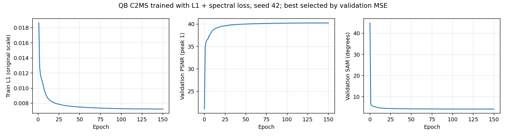

53번 C2MS 대비 RR·RR2·FR_WALD PSNR 차이입니다.

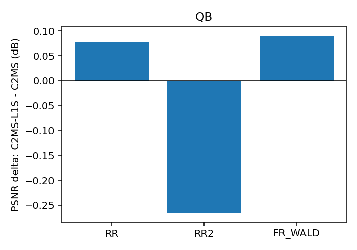

## 6. 결과 이미지

고정 6장면(QB RR test 0-based 0·1·3·7·14·17, seed 42)에서 현재 기준 C2MS(53번)와 L1 + 분광 손실 모델을 비교했습니다. 장면은 정답만 보고 풍경으로 미리 정했고 결과를 보고 바꾸지 않았습니다. `common/result_images.py`로 서버 평가 중에 만들었습니다.

원본 크기 비교는 256×256 전체 장면의 **LR MS · PAN · C2MS · 후보 · 정답**과 **C2MS 오차 · 후보 오차**(같은 색 척도)입니다. 확대 비교는 후보의 개선이 가장 큰 64×64 창을 4배 확대한 **정답 전체(노란 상자) · C2MS · 후보 · 정답 · C2MS 오차 · 후보 오차**입니다. **확대 창은 장면마다 후보에 가장 유리한 곳을 고른 것**이라, 아래 표처럼 확대 창의 차이가 장면 전체 차이보다 큽니다.

| 장면 | 풍경 | 장면 PSNR (C2MS → L1+분광) | 장면 차이 | 확대 창 PSNR (C2MS → L1+분광) | 확대 창 차이 |
|---:|---|---:|---:|---:|---:|
| 0 | 바다·항구 방파제 | 42.812 → 43.008 | +0.196 | 41.592 → 42.599 | +1.007 |
| 1 | 부두·곡선 방파제·수목 | 43.179 → 43.270 | +0.091 | 40.496 → 41.186 | +0.690 |
| 3 | 요트 마리나·운동장 | 37.964 → 38.052 | +0.088 | 36.664 → 37.476 | +0.812 |
| 7 | 숲 공원 | 39.405 → 39.677 | +0.272 | 35.795 → 36.642 | +0.847 |
| 14 | 언덕 공원·곡선 주택가 | 38.473 → 38.521 | +0.048 | 35.819 → 36.238 | +0.419 |
| 17 | 산지 녹지·산책로 | 39.396 → 39.592 | +0.196 | 34.665 → 35.368 | +0.703 |

**장면 7 (숲 공원) · 원본 크기와 확대 비교**

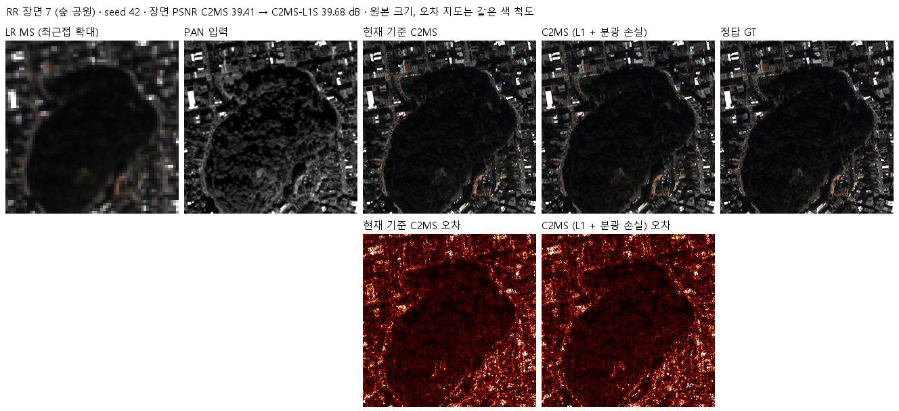

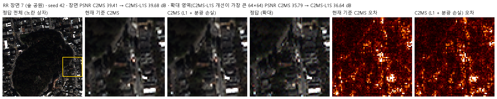

장면 0 · 두 비교 형식

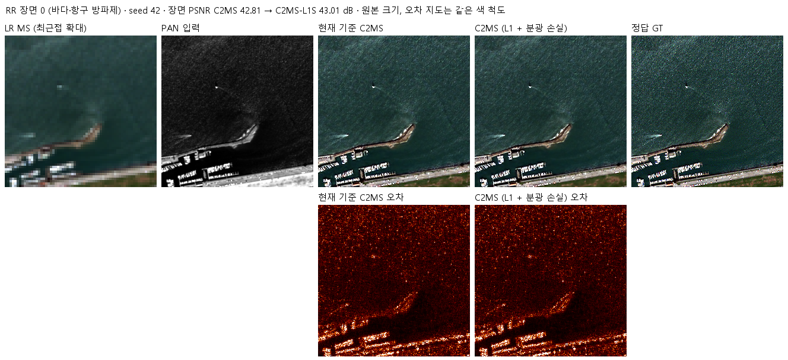

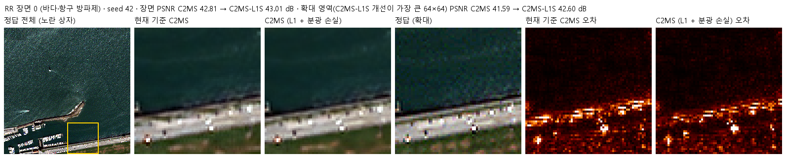

장면 1 · 두 비교 형식

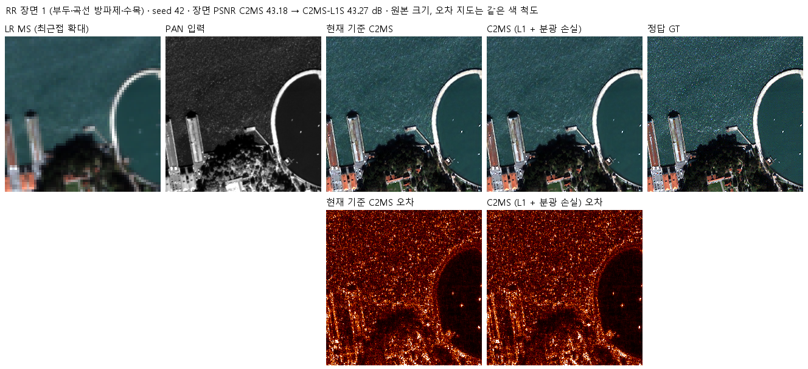

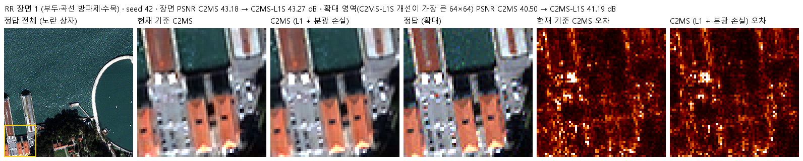

장면 3 · 두 비교 형식

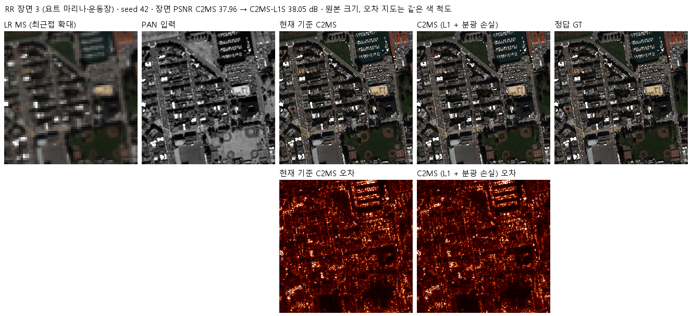

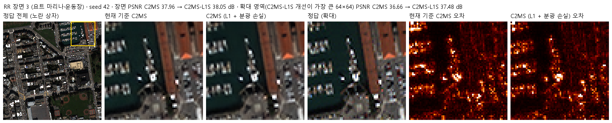

장면 14 · 두 비교 형식

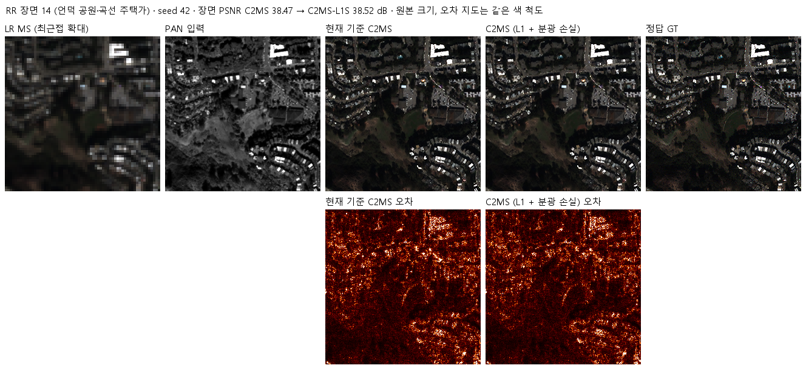

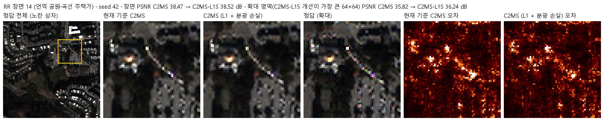

장면 17 · 두 비교 형식

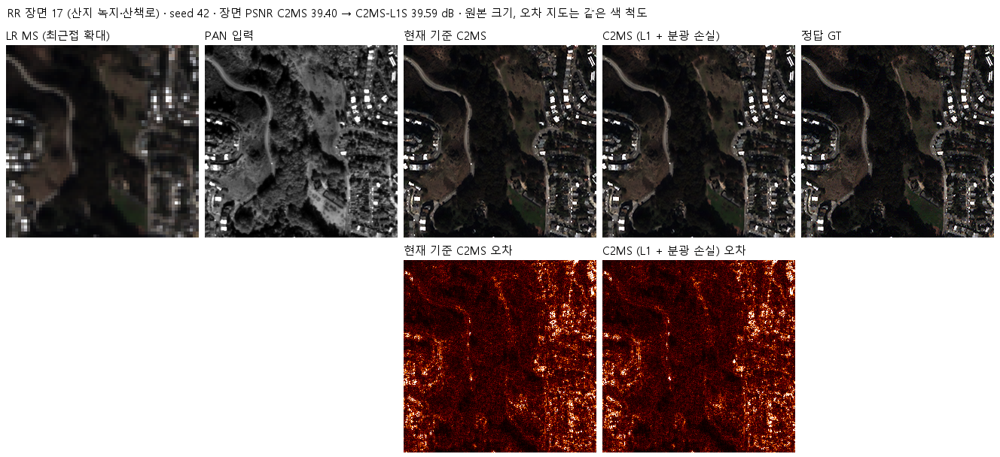

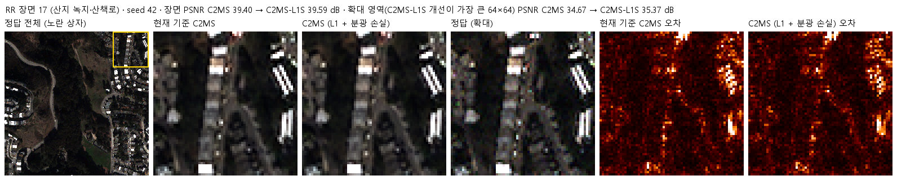

## 7. 재현 자료

- [train.py](train.py): 58번 학습기에 L1 치환만 적용한 학습 진입점. [model.py](model.py)·[prepare.py](prepare.py)는 54번 C2MS 구조와 센서 연산을 그대로 씁니다.
- [run.py](run.py)·[evaluate.py](evaluate.py): 63번과 같은 컨트롤러와 평가(53번 대조군과 57번 두 참조 대비 v2.3, 결과 이미지).
- [config.json](config.json): 학습 전에 고정한 설정·계수·대조군 방침·관문. [분광 계수 측정 기록](provenance/spectral_weight_calibration.json). 서버에 봉인된 설정·소스 해시는 [runtime_config.json](provenance/run_records/runtime_config.json)에 있습니다. 저장소의 학습 소스는 봉인 해시와 같고, config.json은 평가 후 첫머리의 상태·개선 여부 필드만 바꿨습니다.
- 가중치: `checkpoints/C2MS_L1S_QB_s42/best.pt`(150에폭)와 `best_ema.pt`(148에폭)는 Git에 있습니다. 재개용 `latest.pt`와 초기 `initial.pt`는 GitHub Release `weights-experiments-performance-65`에 있고 [manifest.json](manifest.json)의 `release_assets`에 기록했습니다.
- 결과: `results/C2MS_L1S_QB_s42/`의 `history.json`, `training_complete.json`, `evaluation_complete.json`, `evaluation/QB_v2_3.json`, 그래프와 결과 이미지.
- 실행 기록: `provenance/run_records/`(준비·벤치마크·preflight·컨트롤러 기록, 캐시 manifest, 환경), 자동 시작 대기 스크립트와 기록(`wait65.ps1`, `watcher.log`), 서버 소스 manifest와 실행 스크립트.

## 8. 개선 여부와 다음 단계

QB seed 42에서 RR 세 지표가 모두 좋아지고 PSNR 이득이 잡음 문턱을 넘었으며 SAM은 지금까지 가장 크게 줄었지만, 관측 비율이 보조 판정을 통과하지 못해 **부분 개선**입니다. RR2는 2026-10-27 고정 대조값 기준으로 통과합니다. 기준 모델은 C2MS로 유지합니다.

- 1단계 관문은 test 조건을 통과했지만 validation PSNR이 조건에 0.005 dB 못 미쳤습니다. 사용자 결정으로 seed 43·44를 학습 중이며, test 이득이 반복되는지 3시드 평균으로 판단합니다.
- 원래 해상도 관측 일치 악화는 63·65번에서 반복됐습니다. L1 계열을 계속한다면 관측 일치를 지키는 장치(예: 관측 일치 손실, [성능 45번](../45_exact_observation_projection/README.md)의 관측 일치 사영)를 함께 검토해야 합니다.
