# 66. L1 학습 모델의 원래 해상도 관측 오차 분석과 관측 일치 사영

**연구 분야:** 성능 개선 · **실험자:** 이병현

**변경 내용:** 새로 학습하지 않았습니다. [성능 63번](../63_l1_reconstruction_loss/README.md)(L1)과 [성능 65번](../65_l1_spectral_loss/README.md)(L1 + 분광 손실)이 보조 판정에서 원래 해상도 관측 비율(1.32, 1.47)로 미달한 원인을 분석했습니다. 보관된 seed 42 가중치의 관측 오차를 성분별로 나누고, [성능 45번](../45_exact_observation_projection/README.md)의 관측 일치 사영을 추론 때 붙였을 때 RR·RR2·FR_WALD·FR 지표가 어떻게 바뀌는지 같은 test 20장에서 다시 평가했습니다.

| 확인된 결과 | 상태 | 개선 여부 |
|---|:---:|:---:|
| L1 계열의 관측 오차 증가는 MS 나이퀴스트 아래의 저주파 성분에서 나왔습니다(65번 seed 42 22.6 DN, C2MS 14.9 DN). 고주파 에일리어싱은 오히려 줄었습니다. 사영은 관측 오차를 0으로 만들면서 RR PSNR을 세 시드 모두 약 +0.04 dB 올렸습니다. QB 3시드(42-44) 평균으로 65번 + 사영은 같은 시드 53번 C2MS 대비 RR PSNR +0.072 dB·SAM −0.102°·ERGAS −0.027이었고, RR2(고정 대조값 대비 −0.001 dB / +0.051°)·FR_WALD·관측 일치를 포함한 v2.3 수치 항목을 모두 허용폭 안에서 통과했습니다. 사영끼리 비교하면(C2MS + 사영 대비) PSNR +0.033 dB로 잡음 문턱 미만입니다. 65번 3단계(seed 42·43, 54번 C2MS 대비 2시드 평균)에 사영을 붙이면 GF2 RR PSNR +0.230 dB·SAM −0.032°, WV3 +0.133 dB·SAM −0.089°로 두 센서 모두 수치 항목을 통과했습니다. WV2 전이는 사영으로 SAM −0.287°가 됐지만 PSNR은 −0.126 dB입니다. | 사전&nbsp;검증&nbsp;완료 | 성능&nbsp;비교&nbsp;아님 |

[실험 목록](../../../research/performance/README.md) · [수치](#results) · [그래프](#graphs) · [이미지](#images) · [재현 자료](#evidence)

## 1. 목적과 상태

63·65번은 RR 세 지표가 모두 좋아졌지만, 원래 해상도(FR) 출력을 관측 연산으로 줄인 값과 입력 MS의 차이(관측 RMSE)가 C2MS보다 1.3-1.5배 커서 보조 판정을 통과하지 못했습니다. 같은 출력에서 FR_WALD와 FR Dλ는 좋아졌으므로, 이 오차가 실제 색 왜곡인지 판단하기 어려웠습니다. 두 가지를 확인했습니다.

1. 관측 오차가 어떤 성분에서 늘었는가(밴드 평균 치우침, 저주파, 고주파 에일리어싱).
2. 관측 일치 사영으로 이 오차를 지우면 다른 지표가 유지되는가.

2026-10-26 사용자 요청으로 로컬 CPU에서 seed 42를 실행했고(1,312초), 2026-10-27 65번 seed 43 학습이 끝난 뒤 seed 43을 같은 스크립트로 추가했습니다(660초). seed 44는 같은 날 65번 평가가 끝난 뒤 서버 CPU에서 자동으로 실행했습니다(01:10-01:16, 359초). 서버에서 돌리기 위해 [prepare.py](prepare.py)에 test 파일·65번 가중치·출력 위치 인자(`--rr`, `--fr`, `--l1s`, `--out`)를 추가했고 기본값과 계산은 바꾸지 않았습니다. seed 44의 사영하지 않은 값은 서버 GPU 평가(65번)와 최대 1.4e-6 차이로 같았고, FFT 연산 확인값도 2.4e-15였습니다. seed 43에는 63번(L1만) 가중치가 없어 C2MS와 65번만 계산했습니다. 결과 이미지까지 만들었습니다. 같은 계산을 먼저 임시 스크립트로 한 번 돌렸고, 저장소의 [prepare.py](prepare.py)로 다시 돌린 평균 지표가 완전히 같은 것을 확인했습니다. 기준 모델은 C2MS로 유지합니다.

2026-10-27 사용자 요청으로 65번 3단계의 GF2·WV3 seed 42·43 가중치에도 사영을 붙였습니다(WV2 전이 포함). 65번 seed 44가 서버 GPU에서 학습 중이어서, 서버 자원을 확인한 뒤 남는 CPU(4스레드, 낮은 우선순위)로 실행 중인 학습 폴더와 분리된 폴더에서 돌렸습니다. seed 42는 18:26-18:57, seed 43은 사용자 요청으로 18:37부터 병렬로 돌려 19:06에 끝났습니다. 이를 위해 [prepare.py](prepare.py)에 `--sensor`(GF2·WV3), `--data`, `--c2ms`, `--threads` 인자를 추가했고, QB 기본 계산은 바꾸지 않았습니다.

## 2. 변경한 구조와 비교 조건

| 항목 | 내용 |
|---|---|
| 모델 | 시드별 보관 가중치(seed 42-44): C2MS([성능 53번](../53_scale_mixed_training/README.md)), L1([성능 63번](../63_l1_reconstruction_loss/README.md)), L1 + 분광([성능 65번](../65_l1_spectral_loss/README.md)) |
| 데이터 | QB RR·FR test 각 20장(서버 평가와 같은 파일) |
| GF2·WV3·WV2 | 65번 3단계 `C2MS_L1S_<GF2\|WV3>_s<42\|43>`와 같은 시드 54번 C2MS. 각 센서 RR·FR test 각 20장(54번 config의 SHA-256 확인), WV2는 WV3 모델의 전이. 관측 연산·정규화는 test 대상 센서의 것 |
| 지표 | 서버 평가와 같음: RR, RR2(RR 입력을 54번 Wald 연산으로 줄이고 RR MS를 정답으로), FR_WALD(FR 입력을 줄이고 FR MS를 정답으로), FR 지표와 관측 RMSE(가장자리 5픽셀 제외) |
| 관측 연산 D | 54번 Wald 연산(QB MS·PAN MTF 41탭, 복제 경계, 위상 2 추출)을 FFT로 계산했습니다. 직접 계산과의 최대 차이는 MS 2.6e-15, PAN 2.2e-15입니다. 직접 계산은 CPU에서 매우 느려 FFT 형태를 썼습니다 |
| 관측 오차 분해 | `e = D(y) − MS`(가장자리 제외)를 밴드별 평균(치우침), 저주파 성분 `D(lowpass(y)) − MS`, 고주파 성분 `D(y − lowpass(y))`로 나눔. lowpass는 MS 나이퀴스트(1/8 cycles/pixel)에서 자르는 이상 FFT 필터이며, `e = 저주파 + 고주파` |
| 사영 | 45번과 같은 `y′ = y + Dᵀ Mᵀ (M D Dᵀ Mᵀ)⁻¹ M (MS − D y)`. 가장자리 5픽셀을 뺀 내부 마스크, 밴드별 공액 기울기법(float64, 상대 잔차 1e-8, 최대 400회). 장면당 108-109회 반복. RR·RR2·FR_WALD·FR의 모든 추론에 적용 |
| 결과 이미지 | 65번 출력과 65번 + 사영 출력을 고정 6장면에서 비교(사영의 시각적 영향 확인용, 기준 모델 비교가 아님) |

사영은 학습하는 모델이 아니라 추론 뒤에 붙는 계산 단계입니다. validation으로 고른 것이 아니라 이미 여러 번 쓴 test에서 사후로 확인했으므로, 판정은 **성능 비교 아님**으로 둡니다.

## 3. 정량 결과

아래 표들은 QB seed 42, test 20장 평균입니다. seed 43·44와 3시드 평균은 뒤의 [시드별 결과](#seeds)에 정리했습니다. 사영하지 않은 값은 서버 평가(53·63·65번 보고서)와 소수 넷째 자리까지 같습니다. 원본 값은 [analysis_s42.json](results/analysis_s42.json)에 있습니다.

### 원래 해상도 관측 오차 분해 (DN)

| 모델 | 전체 | 밴드 평균 치우침 | 치우침 제외 | 저주파 성분 | 고주파 에일리어싱 |
|---|---:|---:|---:|---:|---:|
| C2MS | 15.65 | 3.70 | 15.20 | 14.92 | 6.84 |
| L1 | 20.69 | 4.88 | 20.11 | 20.26 | 6.20 |
| L1 + 분광 | 23.04 | 2.42 | 22.91 | **22.64** | 5.89 |

### 사영 전후 지표

| 모델 | RR PSNR | RR SAM | RR ERGAS | RR2 PSNR / SAM | FR_WALD PSNR / SAM | FR Dλ / Ds / QNR (참고) | 관측 RMSE |
|---|---:|---:|---:|---:|---:|---:|---:|
| C2MS | 38.2738 | 4.5770 | 3.7230 | 39.4206 / 4.0639 | 37.7183 / 4.0410 | 0.027 / 0.151 / 0.826 | 15.65 |
| C2MS + 사영 | 38.3136 | 4.5662 | 3.7064 | 39.4286 / 4.0611 | 37.7424 / 4.0328 | 0.020 / 0.180 / 0.803 | 0 |
| L1 | 38.3577 | 4.5172 | 3.6964 | 39.2345 / 4.1779 | 37.8258 / 3.9638 | 0.017 / 0.029 / 0.954 | 20.69 |
| L1 + 사영 | 38.4015 | 4.5124 | 3.6773 | 39.2426 / 4.1707 | 37.8478 / 3.9608 | 0.015 / 0.074 / 0.913 | 0 |
| L1 + 분광 | 38.3511 | 4.4665 | 3.6928 | 39.1538 / 4.2850 | 37.8087 / 3.9174 | 0.020 / 0.029 / 0.952 | 23.04 |
| **L1 + 분광 + 사영** | **38.3963** | **4.4646** | **3.6736** | 39.1624 / 4.2777 | 37.8338 / 3.9170 | 0.020 / 0.068 / 0.913 | 0 |

### 사영의 효과 (같은 모델의 사영 전 대비)

| 모델 | ΔRR PSNR / SAM / ERGAS | RR PSNR·SAM 개선 장면 | RR2 ΔPSNR / ΔSAM | FR_WALD ΔPSNR / ΔSAM |
|---|---|---:|---:|---:|
| C2MS | +0.040 / −0.011 / −0.017 | 20 / 20 | +0.008 / −0.003 | +0.024 / −0.008 |
| L1 | +0.044 / −0.005 / −0.019 | 20 / 18 | +0.008 / −0.007 | +0.022 / −0.003 |
| L1 + 분광 | +0.045 / −0.002 / −0.019 | 20 / 15 | +0.009 / −0.007 | +0.025 / −0.000 |

### 53번 C2MS와의 비교 (v2.3 항목, 참고)

| 비교 | ΔRR PSNR / SAM / ERGAS | RR2 ΔPSNR / ΔSAM | FR_WALD ΔPSNR / ΔSAM | 관측 비율 |
|---|---|---:|---:|---:|
| L1 + 분광 + 사영 − C2MS | +0.123 / −0.112 / −0.049 | −0.258 / +0.214 ✗ | +0.116 / −0.124 | 0 |
| L1 + 분광 + 사영 − C2MS + 사영 | +0.083 / −0.102 / −0.033 | −0.266 / +0.217 ✗ | +0.091 / −0.116 | 0 / 0 |

### 시드별 결과 (seed 42-44)

seed 43·44는 [analysis_s43.json](results/analysis_s43.json)·[analysis_s44.json](results/analysis_s44.json)에 있습니다. 65번 seed 43·44 가중치는 [성능 65번](../65_l1_spectral_loss/README.md)의 2단계 학습에서 나온 best.pt(148·149에폭)입니다. 사영하지 않은 값은 서버 평가와 같습니다.

| 시드 | 모델 | RR PSNR | RR SAM | RR ERGAS | RR2 PSNR / SAM | FR_WALD PSNR / SAM | 관측 RMSE | 저주파 성분 |
|---:|---|---:|---:|---:|---:|---:|---:|---:|
| 42 | C2MS | 38.2738 | 4.5770 | 3.7230 | 39.4206 / 4.0639 | 37.7183 / 4.0410 | 15.65 | 14.92 |
| 42 | C2MS + 사영 | 38.3136 | 4.5662 | 3.7064 | 39.4286 / 4.0611 | 37.7424 / 4.0328 | 0 | - |
| 42 | L1 + 분광 | 38.3511 | 4.4665 | 3.6928 | 39.1538 / 4.2850 | 37.8087 / 3.9174 | 23.04 | 22.64 |
| 42 | **L1 + 분광 + 사영** | **38.3963** | **4.4646** | **3.6736** | 39.1624 / 4.2777 | 37.8338 / 3.9170 | 0 | - |
| 43 | C2MS | 38.3053 | 4.5897 | 3.7107 | 39.4278 / 4.1390 | 37.7720 / 4.0409 | 15.74 | 14.66 |
| 43 | C2MS + 사영 | 38.3449 | 4.5788 | 3.6943 | 39.4353 / 4.1367 | 37.7939 / 4.0344 | 0 | - |
| 43 | L1 + 분광 | 38.3022 | 4.4826 | 3.7162 | 39.1604 / 4.2686 | 37.7683 / 3.9286 | 21.94 | 21.58 |
| 43 | **L1 + 분광 + 사영** | **38.3447** | **4.4816** | **3.6981** | 39.1668 / 4.2632 | 37.7910 / 3.9286 | 0 | - |
| 44 | C2MS | 38.3265 | 4.5612 | 3.7010 | 39.1229 / 4.1680 | 37.8233 / 4.0158 | 15.15 | 14.22 |
| 44 | C2MS + 사영 | 38.3639 | 4.5526 | 3.6854 | 39.1297 / 4.1667 | 37.8446 / 4.0098 | 0 | - |
| 44 | L1 + 분광 | 38.3363 | 4.4780 | 3.7015 | 39.0015 / 4.3436 | 37.8030 / 3.9270 | 21.41 | 20.94 |
| 44 | **L1 + 분광 + 사영** | **38.3794** | **4.4752** | **3.6831** | 39.0109 / 4.3344 | 37.8270 / 3.9262 | 0 | - |

같은 시드 C2MS 대비 차이입니다.

| 비교 | 시드 | ΔRR PSNR / SAM / ERGAS | RR 개선 장면 PSNR / SAM | RR2 ΔPSNR / ΔSAM | FR_WALD ΔPSNR / ΔSAM |
|---|---:|---|---:|---:|---:|
| 사영의 효과 (C2MS + 사영 − C2MS) | 42 | +0.040 / −0.011 / −0.017 | 20 / 20 | +0.008 / −0.003 | +0.024 / −0.008 |
| | 43 | +0.040 / −0.011 / −0.016 | 20 / 20 | +0.008 / −0.002 | +0.022 / −0.006 |
| | 44 | +0.037 / −0.009 / −0.016 | 20 / 20 | +0.007 / −0.001 | +0.021 / −0.006 |
| 사영의 효과 (65번 + 사영 − 65번) | 42 | +0.045 / −0.002 / −0.019 | 20 / 15 | +0.009 / −0.007 | +0.025 / −0.000 |
| | 43 | +0.043 / −0.001 / −0.018 | 20 / 13 | +0.006 / −0.005 | +0.023 / +0.000 |
| | 44 | +0.043 / −0.003 / −0.018 | 20 / 15 | +0.009 / −0.009 | +0.024 / −0.001 |
| 65번 + 사영 − C2MS | 42 | +0.123 / −0.112 / −0.049 | 18 / 20 | −0.258 / +0.214 | +0.116 / −0.124 |
| | 43 | +0.039 / −0.108 / −0.013 | 15 / 20 | −0.261 / +0.124 | +0.019 / −0.112 |
| | 44 | +0.053 / −0.086 / −0.018 | 16 / 20 | −0.112 / +0.166 | +0.004 / −0.090 |
| 65번 + 사영 − C2MS + 사영 | 42 | +0.083 / −0.102 / −0.033 | 17 / 20 | −0.266 / +0.217 | +0.091 / −0.116 |
| | 43 | −0.000 / −0.097 / +0.004 | 12 / 20 | −0.269 / +0.127 | −0.003 / −0.106 |
| | 44 | +0.016 / −0.077 / −0.002 | 15 / 20 | −0.119 / +0.168 | −0.018 / −0.084 |

#### 3시드 평균 (v2.3 항목, 참고)

같은 시드 C2MS와 짝지은 3시드 평균입니다. RR2는 후보의 시드 평균 RR2를 [고정 대조값](../../../docs/judgement_criteria.md#qb-rr2-고정-대조값-2026-10-27)(39.1148 dB / 4.2410°)과 비교했습니다. 잡음 문턱은 0.04 dB입니다.

| 비교 | ΔRR PSNR / SAM / ERGAS | RR2 (고정 대조값 대비) ΔPSNR / ΔSAM | FR_WALD ΔPSNR / ΔSAM | 관측 비율 | v2.3 수치 항목 |
|---|---|---:|---:|---:|---|
| 65번 − C2MS (65번 판정) | +0.028 / −0.100 / −0.008 | −0.010 / +0.058 | +0.022 / −0.108 | 1.427 ✗ | 잡음 문턱·관측 비율 미달 |
| **65번 + 사영 − C2MS** | **+0.072 / −0.102 / −0.027** | −0.001 / +0.051 | +0.046 / −0.109 | 0 | **모두 통과** |
| 65번 + 사영 − C2MS + 사영 | +0.033 / −0.092 / −0.010 | −0.001 / +0.051 | +0.024 / −0.102 | (둘 다 0) | 잡음 문턱 미달 |
| C2MS + 사영 − C2MS | +0.039 / −0.010 / −0.016 | (C2MS + 사영 시드 평균 +0.22 / −0.12) | +0.022 / −0.007 | 0 | 참고 |

- 관측 오차의 대부분이 저주파 성분인 것과 사영이 RR PSNR을 약 +0.04 dB 올리는 것은 세 시드에서 같았습니다.
- 65번의 SAM 이득(약 −0.10°)은 세 시드에서 반복됐지만, PSNR 이득은 seed 42(+0.08 dB)만 컸고 seed 43·44는 0에 가까웠습니다(−0.003, +0.010 dB).
- RR2는 seed 44만 고정 대조값 대비 허용폭 밖입니다(65번 + 사영 −0.104 dB / +0.093°). 시드 평균은 통과하지만 SAM 여유는 0.009°입니다.
- 65번 + 사영의 PSNR 이득 +0.072 dB 가운데 약 +0.04 dB는 사영 자체의 효과이고(C2MS에도 같은 크기), L1 + 분광 손실의 몫은 사영끼리 비교한 +0.033 dB입니다. SAM 이득(−0.09에서 −0.10°)은 거의 전부 손실에서 나옵니다.

### GF2·WV3·WV2 (65번 3단계, seed 42·43)

[성능 65번](../65_l1_spectral_loss/README.md)의 3단계 GF2·WV3 가중치(seed 42·43)에 같은 사영을 붙였습니다. 대조군은 같은 시드의 [성능 54번](../54_multi_sensor_scale_mixed_training/README.md) C2MS이고, WV2는 WV3 모델의 전이 test입니다. 관측 연산과 정규화는 54·65번 평가와 같이 각 test 대상 센서의 것(GF2 1023, WV3·WV2 2047)을 씁니다. FFT 연산 확인값은 모든 센서에서 3e-15 이하였고, 사영하지 않은 값은 서버의 65번 평가와 같습니다. 공액 기울기법 반복은 장면당 GF2 58회, WV3 52회, WV2 70-71회였습니다. seed 44는 학습 중이어서 넣지 않았습니다. 원본 값은 `results/analysis_<GF2|WV3>_s<seed>.json`에 있습니다.

**test 20장 평균 (시드별)**

| 대상 | 시드 | 모델 | RR PSNR | RR SAM | RR ERGAS | RR2 PSNR / SAM | FR_WALD PSNR / SAM | 관측 RMSE | 저주파 / 밴드 평균 치우침 |
|---|---:|---|---:|---:|---:|---:|---:|---:|---:|
| GF2 | 42 | C2MS | 48.5073 | 0.7966 | 0.7148 | 45.1898 / 1.1788 | 47.3279 / 0.8567 | 3.03 | 2.98 / 0.22 |
| | | C2MS + 사영 | 48.6022 | 0.7882 | 0.7070 | 45.1960 / 1.1780 | 47.3796 / 0.8515 | 0 | - |
| | | 65번 | 48.6401 | 0.7743 | 0.7029 | 45.1455 / 1.1584 | 47.5122 / 0.8300 | 3.09 | 3.11 / 0.29 |
| | | **65번 + 사영** | **48.7326** | **0.7676** | **0.6955** | 45.1526 / 1.1577 | 47.5582 / 0.8260 | 0 | - |
| | 43 | C2MS | 48.6360 | 0.7898 | 0.7050 | 45.1622 / 1.1799 | 47.2998 / 0.8644 | 2.82 | 2.79 / 0.25 |
| | | C2MS + 사영 | 48.7117 | 0.7829 | 0.6989 | 45.1687 / 1.1789 | 47.3466 / 0.8595 | 0 | - |
| | | 65번 | 48.7875 | 0.7617 | 0.6902 | 45.2507 / 1.1570 | 47.5557 / 0.8239 | 2.86 | 2.86 / 0.34 |
| | | **65번 + 사영** | **48.8703** | **0.7555** | **0.6836** | 45.2573 / 1.1562 | 47.6027 / 0.8204 | 0 | - |
| WV3 | 42 | C2MS | 38.4927 | 3.0902 | 2.2671 | 39.3150 / 2.7315 | 36.0115 / 3.0811 | 18.46 | 17.31 / 2.07 |
| | | C2MS + 사영 | 38.5808 | 3.0661 | 2.2470 | 39.3520 / 2.7240 | 36.0741 / 3.0662 | 0 | - |
| | | 65번 | 38.5857 | 3.0009 | 2.2589 | 40.3113 / 2.4342 | 35.9498 / 3.0373 | 22.75 | 22.54 / 7.82 |
| | | **65번 + 사영** | **38.6630** | **2.9890** | **2.2405** | 40.3383 / 2.4297 | 36.0048 / 3.0322 | 0 | - |
| | 43 | C2MS | 38.6239 | 3.0490 | 2.2392 | 39.9868 / 2.5553 | 36.1014 / 3.0554 | 17.23 | 16.06 / 1.14 |
| | | C2MS + 사영 | 38.7040 | 3.0290 | 2.2212 | 40.0130 / 2.5497 | 36.1565 / 3.0436 | 0 | - |
| | | 65번 | 38.6297 | 2.9850 | 2.2531 | 39.1439 / 2.7164 | 35.9783 / 3.0378 | 24.43 | 23.97 / 7.84 |
| | | **65번 + 사영** | **38.7204** | **2.9724** | **2.2311** | 39.1839 / 2.7089 | 36.0448 / 3.0318 | 0 | - |
| WV2 (전이) | 42 | C2MS | 29.5233 | 5.8541 | 4.5371 | 31.9321 / 5.0916 | 29.4735 / 6.4865 | 19.73 | 19.53 / 6.47 |
| | | C2MS + 사영 | 29.7674 | 5.6504 | 4.4338 | 32.0058 / 5.0334 | 29.6642 / 6.3713 | 0 | - |
| | | 65번 | 28.4447 | 5.9884 | 5.0823 | 30.9077 / 5.1463 | 28.5030 / 6.6686 | 37.82 | 38.02 / 28.20 |
| | | 65번 + 사영 | 29.0017 | 5.6449 | 4.8145 | 31.0773 / 5.0394 | 28.8779 / 6.4639 | 0 | - |
| | 43 | C2MS | 29.3332 | 5.8892 | 4.6702 | 31.6913 / 5.1302 | 29.2206 / 6.5121 | 17.66 | 16.83 / 3.65 |
| | | C2MS + 사영 | 29.4814 | 5.7474 | 4.5945 | 31.7320 / 5.0954 | 29.3295 / 6.4233 | 0 | - |
| | | 65번 | 29.1743 | 5.7887 | 4.7400 | 32.3158 / 4.8958 | 29.5102 / 6.2921 | 38.00 | 38.15 / 27.97 |
| | | **65번 + 사영** | **29.6024** | **5.5239** | **4.5367** | 32.4341 / 4.8189 | 29.7761 / 6.1785 | 0 | - |

**2시드 평균 (같은 시드 54번 C2MS와 짝지음, v2.3 항목, 참고)**

잡음 문턱은 0.04 dB이고, RR2도 같은 시드 54번과 비교합니다(고정 대조값은 QB 전용). 사영끼리 비교한 행의 관측 비율은 둘 다 0이라 의미가 없습니다.

| 대상 | 비교 | ΔRR PSNR / SAM / ERGAS | RR2 ΔPSNR / ΔSAM | FR_WALD ΔPSNR / ΔSAM | 관측 비율 | v2.3 수치 항목 |
|---|---|---|---:|---:|---:|---|
| GF2 | 65번 − C2MS (65번 중간 결과) | +0.142 / −0.025 / −0.013 | +0.022 / −0.022 | +0.220 / −0.034 | 1.016 | 모두 통과 |
| | **65번 + 사영 − C2MS** | **+0.230 / −0.032 / −0.020** | +0.029 / −0.022 | +0.267 / −0.037 | 0 | **모두 통과** |
| | C2MS + 사영 − C2MS | +0.085 / −0.008 / −0.007 | +0.006 / −0.001 | +0.049 / −0.005 | 0 | 모두 통과 |
| | 65번 + 사영 − C2MS + 사영 | +0.145 / −0.024 / −0.013 | +0.023 / −0.021 | +0.217 / −0.032 | (둘 다 0) | 모두 통과 |
| WV3 | 65번 − C2MS (65번 중간 결과) | +0.049 / −0.077 / +0.003 | +0.077 / −0.068 | −0.092 ✗ / −0.031 | 1.322 ✗ | ERGAS·FR_WALD·관측 비율 미달 |
| | **65번 + 사영 − C2MS** | **+0.133 / −0.089 / −0.017** | +0.110 / −0.074 | −0.032 / −0.036 | 0 | **모두 통과** |
| | C2MS + 사영 − C2MS | +0.084 / −0.022 / −0.019 | +0.032 / −0.007 | +0.059 / −0.013 | 0 | 모두 통과 |
| | 65번 + 사영 − C2MS + 사영 | +0.049 / −0.067 / +0.002 | +0.079 / −0.068 | −0.090 ✗ / −0.023 | (둘 다 0) | ERGAS·FR_WALD 미달 |
| WV2 (전이) | 65번 − C2MS (65번 중간 결과) | −0.619 / +0.017 / +0.308 | −0.200 ✗ / −0.090 | −0.341 ✗ / −0.019 | 2.028 ✗ | 미달 |
| | 65번 + 사영 − C2MS | −0.126 / **−0.287** / +0.072 | −0.056 ✗ / −0.182 | −0.020 / −0.178 | 0 | PSNR·ERGAS·RR2 미달 |
| | C2MS + 사영 − C2MS | +0.196 / −0.173 / −0.089 | +0.057 / −0.047 | +0.150 / −0.102 | 0 | 모두 통과 |
| | 65번 + 사영 − C2MS + 사영 | −0.322 / −0.114 / +0.161 | −0.113 ✗ / −0.135 | −0.170 ✗ / −0.076 | (둘 다 0) | 미달 |

- **GF2:** 65번은 사영 없이도 수치 항목을 모두 통과했고, 사영을 붙이면 C2MS 대비 RR PSNR +0.230 dB가 됩니다. 사영 효과(+0.085 dB)는 QB(+0.04 dB)의 두 배 정도이고, 사영끼리 비교해도 65번의 이득(+0.145 dB)이 그대로 남습니다.
- **WV3:** 65번만으로는 관측 비율(1.32)과 FR_WALD에서 미달이었지만, 65번 + 사영은 C2MS 대비 수치 항목을 모두 통과합니다(RR PSNR +0.133 dB, SAM −0.089°). 다만 이 통과는 사영 자체의 효과(+0.084 dB)에 기대며, 사영끼리 비교하면 PSNR +0.049 dB이고 FR_WALD는 여전히 미달입니다. SAM 이득(−0.07°)은 손실에서 나옵니다.
- **WV2 전이:** 65번의 관측 오차가 38 DN으로 C2MS의 두 배이고, 그중 밴드 평균 치우침이 28 DN(C2MS 3.7-6.5 DN)입니다. 즉 WV3로 학습한 L1 + 분광 모델이 WV2에서 밴드 밝기를 통째로 어긋나게 냅니다. 사영은 이 치우침을 지워 RR PSNR을 +0.56 dB(seed 42), +0.43 dB(seed 43) 올리고 SAM을 크게 낮추지만(C2MS 대비 −0.287°), 평균 PSNR은 여전히 C2MS보다 0.126 dB 낮습니다. seed 42가 −0.522 dB, seed 43이 +0.269 dB로 시드에 따라 크게 갈립니다.
- **사영의 효과는 모든 센서에서 RR PSNR·SAM·ERGAS를 함께 좋게 했고**, C2MS에서 GF2 +0.085, WV3 +0.084, WV2 +0.196 dB입니다. 원래 해상도 관측과의 어긋남이 큰 전이(WV2)에서 가장 컸습니다.

## 4. 기준선 대비 차이와 해석

- **늘어난 관측 오차는 저주파 성분입니다.** L1 + 분광의 관측 오차 23.0 DN 가운데 22.6 DN이 MS 나이퀴스트 아래 대역에서 나옵니다. 고주파 에일리어싱(6.8 → 5.9 DN)과 밴드 평균 치우침(3.7 → 2.4 DN)은 오히려 작습니다. 처음에 세운 "L1이 세부를 강하게 넣어 에일리어싱으로 오차가 커진다"는 가설은 맞지 않았습니다. L1 계열 출력은 원래 해상도에서 넓은 영역의 밝기·색 분포가 장소마다 입력 MS와 조금씩 어긋납니다.
- **이 저주파 어긋남은 사영으로 지울 수 있고, 지우면 지표가 좋아집니다.** 사영 후 관측 오차는 0이 되고, 세 모델 모두 RR PSNR이 20장 모두에서 올랐습니다(+0.040-0.045 dB). RR2·FR_WALD도 조금씩 좋아졌습니다. 참고 지표 Ds는 나빠졌는데, 45번에서 본 것과 같은 경향입니다.
- **RR2는 사영으로 바뀌지 않습니다.** L1 + 분광의 RR2는 사영 후에도 같은 시드 53번 C2MS 대비 −0.258 dB(seed 42), −0.261 dB(seed 43), −0.112 dB(seed 44)입니다. 사영은 원래 축척 관측을 맞추는 연산이라 2배 거친 축척의 차이는 그대로 남습니다. 다만 53번의 RR2가 이례적으로 높다고 보고 2026-10-27부터 QB RR2는 57번 재학습 C2MS seed 42 값(39.1148 dB, 4.2410°)을 고정 대조값으로 씁니다([2026-10-27 RR2 고정 대조값](../../../docs/judgement_criteria.md#qb-rr2-고정-대조값-2026-10-27)). 이 기준으로 65번 + 사영의 RR2는 seed 42 +0.048 dB / +0.037°, seed 43 +0.052 dB / +0.022°로 통과, seed 44 −0.104 dB / +0.093°로 미달이며, 3시드 평균 −0.001 dB / +0.051°로 **통과**합니다.
- **사영끼리 비교한 이득:** 사영은 C2MS에도 +0.040 dB를 주므로, L1 + 분광의 순수 이득은 사영끼리 비교한 RR PSNR +0.083 dB, SAM −0.102°입니다.
- **비용:** 사영은 장면당 공액 기울기법 108회 반복이 붙습니다(로컬 CPU에서 512×512 한 장 약 30초). 한 번에 출력하는 CNN과는 구분해서 보고해야 합니다.

## 5. 학습·평가 그래프

학습하지 않았으므로 학습 곡선은 없습니다. 왼쪽은 관측 오차 분해, 오른쪽은 C2MS 대비 RR·RR2·FR_WALD PSNR 차이입니다(+P는 사영 적용).

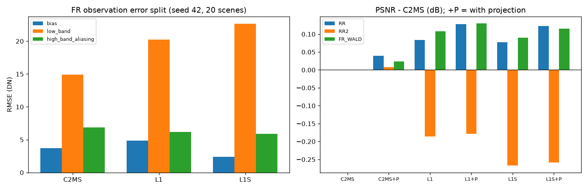

seed 43·44 그래프

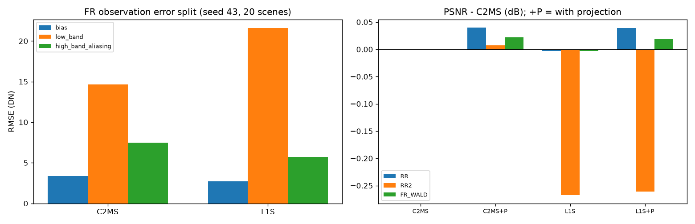

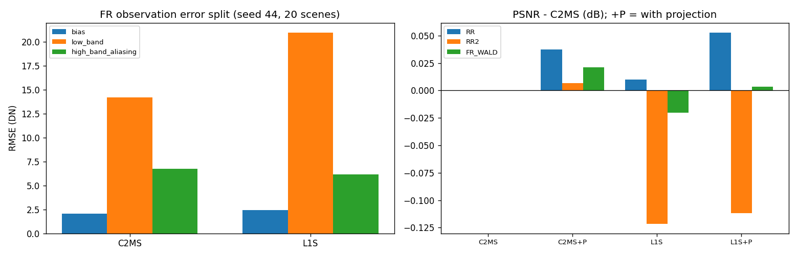

GF2·WV3·WV2(65번 3단계) seed 42 그래프입니다. WV2에서 65번의 밴드 평균 치우침이 크게 늘어난 것과 사영의 효과가 보입니다.

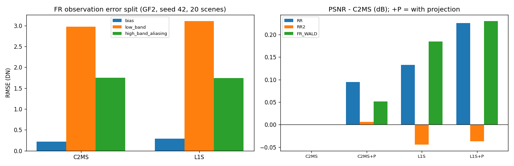

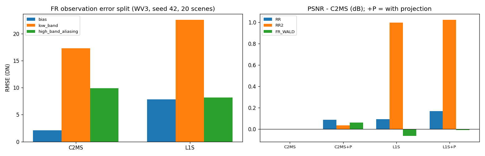

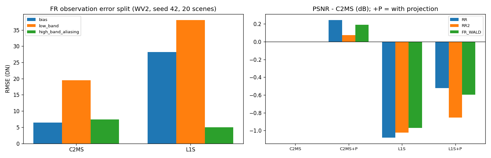

seed 43 그래프 (GF2·WV3·WV2)

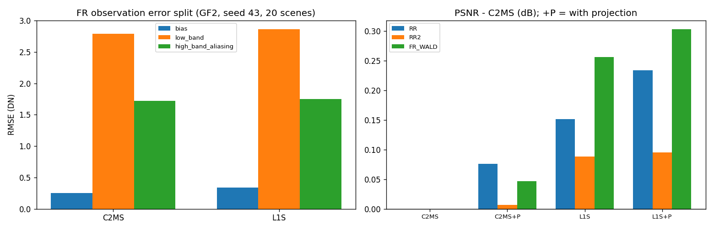

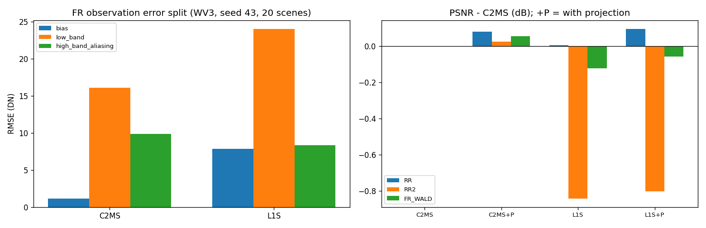

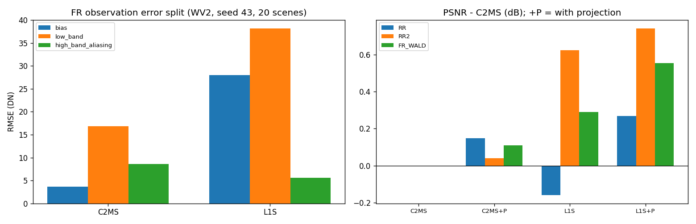

## 6. 결과 이미지

사영이 출력을 눈에 띄게 바꾸는지 확인하려고, 고정 6장면(QB RR test 0-based 0·1·3·7·14·17, seed 42)에서 65번 출력과 65번 + 사영 출력을 비교했습니다. 이 비교는 기준 모델 대 후보 비교가 아니므로, 왼쪽 "기준" 자리에 65번 출력을 두었습니다. 장면은 정답만 보고 미리 정한 것입니다. `common/result_images.py`로 만들었습니다.

원본 크기 비교는 **LR MS · PAN · 65번 · 65번 + 사영 · 정답**과 두 오차 지도(같은 색 척도)입니다. 확대 비교는 사영의 개선이 가장 큰 64×64 창을 4배 확대한 것으로, **사영에 유리하게 고른 창**입니다. 장면 PSNR은 모두 0.03-0.05 dB 올랐고, RR 크기(256×256)에서는 가장자리에 눈에 띄는 흔적이 보이지 않았습니다. 원래 해상도(512×512)에서 사영이 가장자리 근처 출력을 크게 바꾸는 경우(장면 0에서 최대 2,200 DN, 평균 51 DN)는 정답이 없어 이미지로 판정하지 않았습니다.

| 장면 | 풍경 | 65번 | 65번 + 사영 | 차이 (dB) |
|---:|---|---:|---:|---:|
| 0 | 바다·항구 방파제 | 43.008 | 43.037 | +0.029 |
| 1 | 부두·곡선 방파제·수목 | 43.270 | 43.312 | +0.042 |
| 3 | 요트 마리나·운동장 | 38.052 | 38.099 | +0.047 |
| 7 | 숲 공원 | 39.677 | 39.707 | +0.030 |
| 14 | 언덕 공원·곡선 주택가 | 38.521 | 38.561 | +0.040 |
| 17 | 산지 녹지·산책로 | 39.592 | 39.624 | +0.032 |

**장면 0 (바다·항구 방파제) · 원본 크기와 확대 비교**

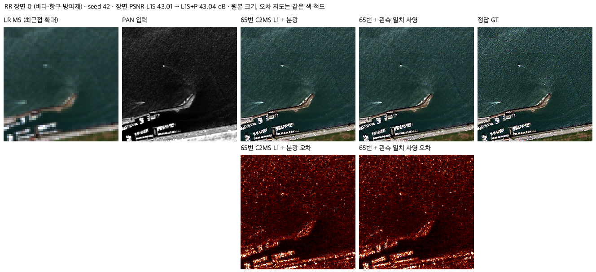

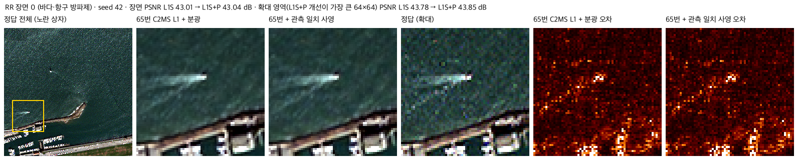

나머지 5장면 · 두 비교 형식

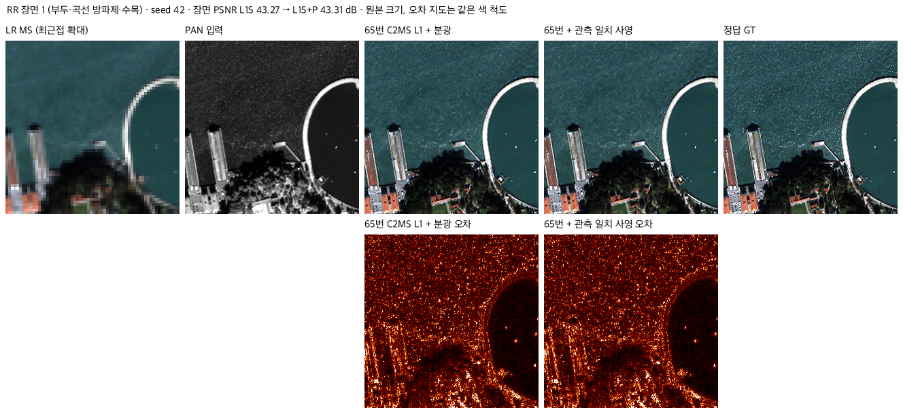

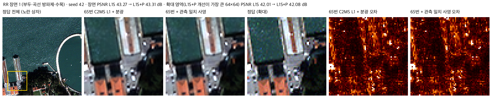

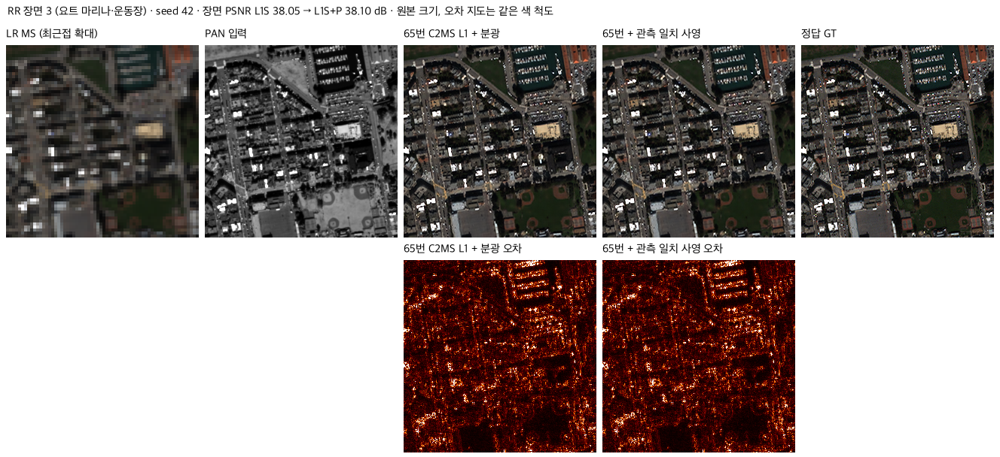

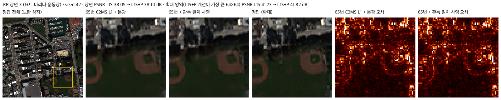

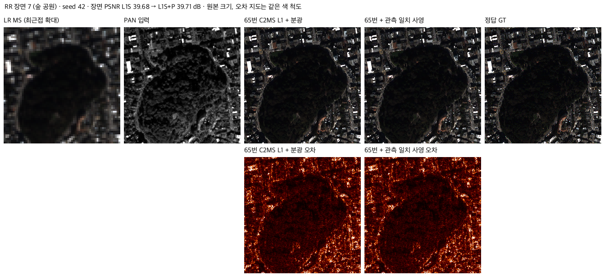

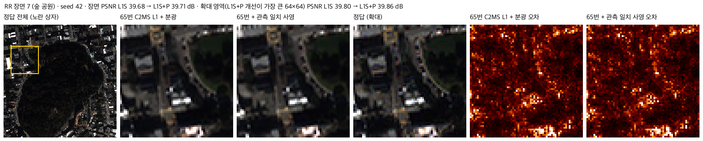

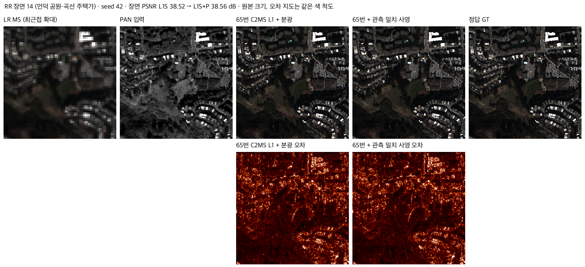

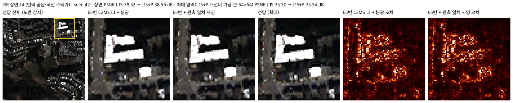

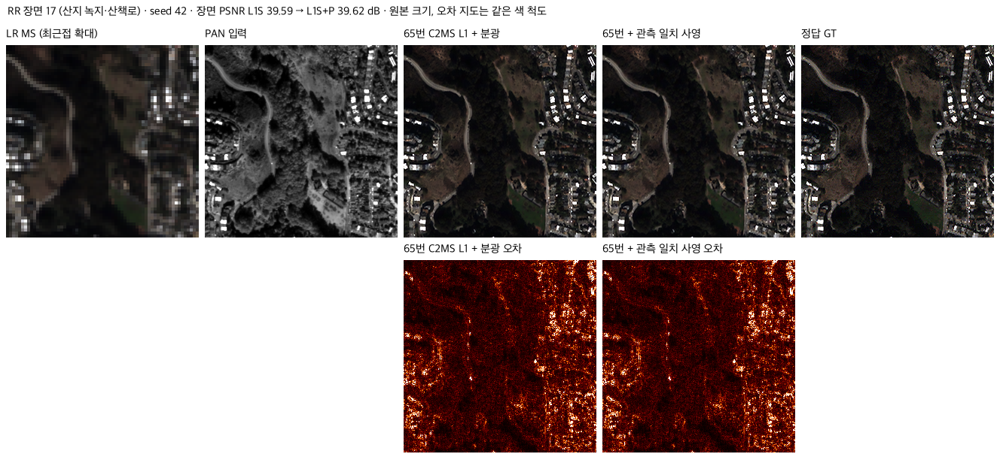

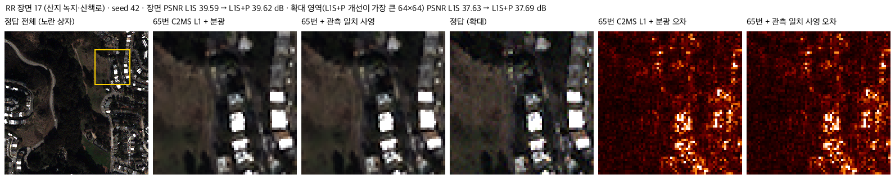

## 7. 재현 자료

- [prepare.py](prepare.py): 관측 오차 분해, 사영 전후 재평가, 그래프·결과 이미지 생성. `--seed`로 시드를 고르고, 결과 이미지는 고정 seed 42로만 만듭니다. 53·63·65번 보관 가중치와 65번 `model.py`·`prepare.py`(54번 C2MS 구조·센서 연산)를 그대로 씁니다. `--plot-only`, `--images-only`로 일부만 다시 만들 수 있습니다.
- [config.json](config.json): 분석 설정.
- [results/analysis_s42.json](results/analysis_s42.json)·[analysis_s43.json](results/analysis_s43.json)·[analysis_s44.json](results/analysis_s44.json): 시드별, 모델·사영 여부별 평균과 장면별 RR·RR2·FR_WALD·FR 지표, 관측 오차 분해, 공액 기울기법 반복 수, FFT 연산 확인값.
- `provenance/server_seed44/`: seed 44 서버 실행 기록입니다. 65번 종료를 기다린 대기 스크립트와 실행 스크립트, 대기 기록, 실행 로그, 입력 해시(`inputs_sha256.json`: test RR·FR 파일, 65번·53번 seed 44 `best.pt`, `prepare.py`)가 있으며, 입력 해시는 저장소의 파일과 같습니다.
- `results/analysis_<GF2|WV3>_s<42|43>.json`과 대상별 그래프 `analysis_<센서>_s<seed>_<대상>.png`: 65번 3단계 가중치의 사영 전후 지표, 관측 오차 분해, 대상별 v2.3 비교(65번·65번 + 사영·C2MS + 사영 대 C2MS, 65번 + 사영 대 C2MS + 사영). `python prepare.py --sensor WV3 --seed 42`처럼 다시 만들 수 있습니다(가중치는 65·54번 보관본).
- `provenance/server_stage3/`: GF2·WV3 서버 실행 기록입니다. 실행 스크립트(`run66s3.ps1`, seed 43 병렬용 `run66s3b.ps1`, 시작 스크립트), 실행·대기 기록, 로그, 입력 해시(`inputs_<센서>_s<seed>.json`: 65번·54번 `best.pt`, `prepare.py`)가 있으며, 입력 해시는 저장소의 파일과 같습니다. 첫 스크립트의 기록에서 GF2 seed 42의 종료 코드가 빈칸인 것은 PowerShell이 종료 코드를 읽지 못한 것이고, 오류 출력은 비어 있었으며 결과 파일도 끝까지 기록됐습니다.
- [manifest.json](manifest.json): 이 폴더 파일의 크기·SHA-256.

## 8. 개선 여부와 다음 단계

학습한 후보가 아닌 사후 분석이므로 **성능 비교 아님**입니다.

- L1 계열의 관측 비율 미달은 원래 해상도 출력의 저주파 어긋남 때문이며, 추론 시 관측 일치 사영으로 다른 지표 손해 없이 없앨 수 있습니다.
- QB 3시드 평균으로 65번 + 사영은 원래 C2MS 대비 v2.3의 수치 항목을 모두 통과했습니다(RR PSNR +0.072 dB, SAM −0.102°, RR2 고정 대조값 대비 −0.001 dB / +0.051°, 관측 오차 0). 다만 이 수치는 이미 여러 번 쓴 test에서 사후로 얻었고, PSNR 이득의 절반 이상은 C2MS에도 똑같이 생기는 사영 자체의 효과입니다. 그래서 이 분석의 판정은 성능 비교 아님으로 둡니다.
- 65번 3단계 seed 42·43에서도 사영을 붙인 65번은 GF2(RR PSNR +0.230 dB)와 WV3(+0.133 dB)에서 C2MS 대비 수치 항목을 모두 통과했습니다. 손실의 순수 몫(사영끼리 비교)은 GF2 +0.145 dB로 크고, WV3는 +0.049 dB와 SAM −0.067°입니다. WV2 전이에서는 65번이 밴드 밝기를 크게 어긋나게 내며, 사영으로 줄여도 PSNR은 C2MS보다 낮습니다. seed 44는 65번 학습이 끝난 뒤 추가할 수 있습니다.
- 65번 + 사영을 새 후보로 정식 판정하려면, 사영을 포함한 추론 방식을 학습 전처럼 미리 정하고 비교 상대(사영 없는 C2MS 또는 사영을 붙인 C2MS)를 정한 새 실험으로 등록해야 합니다. 진행 여부는 사용자가 결정합니다.
- 사영을 쓰려면 추론 비용 증가와 원래 해상도 가장자리의 큰 보정을 함께 보고해야 합니다. 관측 일치를 학습 손실로 넣어 사영 없이 같은 효과를 얻는 방법도 후속 후보입니다.
