# 68. C2MS SSAI 경로 접기·미사용 층 정리, 65번 SAM 이득의 주파수 분해, 시드 앙상블 진단

**연구 분야:** 성능 개선 · **실험자:** 이병현

**변경 내용:** 새로 학습하지 않았습니다. 보관된 가중치로 다음 세 가지를 확인했습니다. ① 기준 모델 C2MS에서 SSA 어텐션이 원본처럼 사실상 쓰이지 않는지 확인하고, SSAI 세 단계를 밴드별 상수로 접은 구조(FOLDED)와 forward에서 한 번도 쓰이지 않는 공식 코드의 층을 지운 구조(PRUNED)가 같은 출력을 내는지 봤습니다. ② [성능 65번](../65_l1_spectral_loss/README.md)(L1 + 분광 손실)의 SAM 감소가 저주파와 고주파 중 어디에서 왔는지 나눴습니다. ③ 같은 학습의 seed 42-44 출력을 평균한 시드 앙상블로 시드 간 분산이 얼마나 되는지 측정했습니다.

| 확인된 결과 | 상태 | 개선 여부 |
|---|:---:|:---:|
| ① 공식 코드에서 forward가 쓰지 않는 층(QB 118,308개, WV3 190,152개)을 지워도 출력이 비트 단위로 같았습니다. SSA를 상수로 접은 FOLDED는 QB 3시드에서 출력 차이가 최대 0.08 DN이었지만, WV3 seed 42 모델에서는 드문 지점에서 최대 1,343 DN(FR, 평균 지표 변화 0.003 dB 이하)이 나 사전 관문에 미달했습니다. 접어도 추론 시간은 측정 잡음 안에서 같았습니다. ② 65번의 SAM 감소(QB −0.100°)는 91%가 고주파에서 왔고(세기 0.039°, 밴드 비율 0.053°), 저주파 여지 0.084°는 그대로 남아 있었습니다(고주파 주도). WV2 전이에서 65번의 PSNR 손해(−0.277 dB)는 모두 저주파에서 나왔습니다. ③ C2MS 3시드 앙상블은 구성원 평균보다 QB validation PSNR +0.191 dB·SAM −0.083°로 관문을 넘었고, test에서는 QB +0.256 dB, WV3 +0.286 dB, WV2 전이 +0.464 dB였습니다. 6개 앙상블은 QB RR 38.615 dB·SAM 4.395°입니다. | 사전&nbsp;검증&nbsp;완료 | 성능&nbsp;비교&nbsp;아님 |

[실험 목록](../../../research/performance/README.md) · [수치](#results) · [그래프](#graphs) · [이미지](#images) · [재현 자료](#evidence)

## 1. 목적과 상태

지금까지의 기록을 검토하면서 다음 단계의 우선순위를 정하는 데 필요한 세 가지 질문이 남았습니다.

1. **경량화:** 원본 A0에서는 SSA 출력을 0으로 바꿔도 지표가 같았습니다([SSAI 11번](../../ssai/11_ssai_contribution_headroom/README.md)). C2MS에서도 그런지 확인하지 않았습니다. 또 공식 `network.py`는 forward에서 쓰지 않는 층을 많이 정의해 두어, 보고하는 파라미터 수(C2MS 2,853,918개)에 이 층이 포함돼 있습니다.
2. **SAM:** 65번은 QB SAM을 3시드 평균 0.100° 줄였습니다. [성능 60번](../60_norm_preserving_spectral_direction_refinement/README.md)에서 C2MS의 저주파만 정답으로 바꿀 때 줄어드는 SAM이 약 0.095°였으므로, 65번이 이 저주파 여지를 다 쓴 것이라면 손실 조정만으로는 더 줄이기 어렵습니다. [성능 61·62번](../62_feature_context_band_ratio_head/README.md)에서는 고주파 밴드 비율을 출력 뒤 헤드로 고치지 못했습니다.
3. **분산:** 같은 학습을 시드만 바꿔 반복한 출력이 서로 얼마나 다르고, 평균하면 얼마나 좋아지는지 측정한 적이 없습니다. 차이가 크면 앙상블을 교사로 쓰는 증류(작은 W2 학습 포함)를 검토할 수 있습니다.

판정 규칙과 관문은 측정 전에 [config.json](config.json)에 고정했습니다(2026-10-28, 무작위 입력으로 추론 시간만 재 본 뒤). 같은 날 로컬 CPU에서 실행했습니다. 첫 실행은 CPU에서 41×41 float64 블러(Wald 열화·저주파 분리)를 직접 계산하다가 메모리 부족으로 멈춰서 중단했고, [성능 66번](../66_observation_error_projection_analysis/README.md)처럼 같은 연산을 FFT로 계산하도록 바꿔 다시 실행했습니다. 두 형태의 차이는 5e-12 DN 이하입니다([fft_check.json](results/fft_check.json)). 다시 실행한 계산은 03:34-04:46 KST에 QB test, QB validation, WV3·WV2 test 순서로 끝났습니다. 추론 시간은 처음 잴 때 다른 계산이 겹쳐서, 다른 작업이 없는 상태로 04:46-04:48에 다시 쟀습니다. 학습은 하지 않았고 기준 모델은 C2MS로 유지합니다.

## 2. 변경한 구조와 비교 조건

### 진단 1: SSAI 접기와 미사용 층

C2MS의 SSAI는 밴드마다 PAN 특징과 MS 특징을 곱한 뒤 **영상 전체(H×W) softmax**로 공간 가중치를 만들고, 밴드별 출력을 융합 conv(`conv48tnum_k`)와 PReLU로 섞습니다. 가중치 평균이 정확히 1/(H×W)이므로 SSA 출력은 매우 작아질 수 있습니다. SSA 출력이 0이면 융합 conv의 출력은 bias뿐이어서, 각 단계는 밴드별 상수 `c_k = PReLU_k(bias_k)`를 더하는 연산이 됩니다.

| 변형 | 바꾼 것 | 확인한 test |
|---|---|---|
| A | C2MS 그대로 | 전체 |
| PRUNED | forward가 부르지 않는 공식 코드의 층을 모듈에서 지움(`resblock`, `conv48t48_*`, `convnum3tn64`, SSA의 `conv6t12` 등) | QB RR·FR, WV3·WV2 RR |
| Z_SSA | SSA 블록 출력만 0(융합 conv bias와 PReLU는 유지, SSAI 11번과 같은 정의) | QB RR·FR, WV3·WV2 RR |
| **FOLDED** | SSA 블록과 융합 conv를 없앤 독립 모듈. 전체·절반 해상도 단계는 `res += c_1`, `res_half += c_2`, 1/4 해상도 단계는 상수 영상 `c_3`을 decoder에 넣음(밴드 수 × 3개 숫자) | 전체 |
| Z_STAGE | 세 SSAI 단계 출력을 모두 0(상수도 제거, SSAI 11번과 같은 정의) | RR |

FOLDED는 정의상 Z_SSA와 같은 값을 냅니다. 관문은 모든 모델·test에서 A와 FOLDED의 출력 차이가 최대 0.5 DN 이하이고, test 평균 PSNR·SAM 차이가 0.001 이하, 관측 RMSE 비율이 1 ± 0.001이며, PRUNED가 A와 비트 단위로 같을 때 통과입니다. 통과하면 SSA 블록과 미사용 층을 재학습 없이 지울 수 있다는 뜻이고, 기준 모델 자체를 바꾸지는 않습니다. 파라미터 수와 추론 시간(CPU 4스레드, Apple MPS, 256²·512² 한 장과 64² 32장, 10회 중앙값)도 함께 쟀습니다.

### 진단 2: 65번 SAM 이득의 주파수 분해

같은 시드의 C2MS 출력 `y_c`와 65번 출력 `y_l`을 대상 센서 MS MTF 블러 `L`(60번과 같은 41탭, 복제 경계, 추출 없음)로 저주파 `L(y)`와 고주파 `H = y − L(y)`로 나눴습니다. 저주파·고주파를 서로 바꿔 끼운 네 조합의 SAM으로 감소량을 섀플리 값으로 나누면 `ΔLF + ΔHF`가 정확히 전체 감소량이 됩니다.

- ΔLF = ½[(S(L_c+H_c) − S(L_l+H_c)) + (S(L_c+H_l) − S(L_l+H_l))]
- ΔHF = ½[(S(L_c+H_c) − S(L_c+H_l)) + (S(L_l+H_c) − S(L_l+H_l))]
- 고주파 부분은 다시 픽셀별 세기 `|H|`와 밴드 비율 `H/|H|`로 같은 방식으로 나눴습니다([성능 61번](../61_high_frequency_band_ratio_correction/README.md)의 정의).
- 65번에 남은 저주파 여지는 `S(y_l) − S(L(g) + H(y_l))`(60번의 저주파 정답 교체)입니다.

사전 규칙: QB 3시드 평균에서 저주파 몫이 0.70 이상이고 65번에 남은 저주파 여지가 0.03° 이하이면 "저주파 여지 소진"(손실 가중치 조정으로 더 줄이기 어렵고 고주파 밴드 비율 정보가 필요), 고주파 몫이 0.50 이상이면 "고주파 주도"(학습 목표로 고주파 밴드 비율을 움직일 수 있으므로 손실 쪽 후속 유지), 그 밖은 "혼합"입니다.

### 진단 3: 시드 앙상블

| 앙상블 | 구성 |
|---|---|
| E_C2MS | C2MS seed 42·43·44 출력의 평균 |
| E_L1S | 65번 seed 42·43·44 출력의 평균 |
| E_ALL | 여섯 출력의 평균 |

비교 대상은 구성원 지표의 평균(단일 시드 평균)입니다. 판단에는 **QB validation만** 쓰고 test 값은 함께 보고만 합니다. 사전 규칙: E_C2MS나 E_L1S가 구성원 평균보다 validation PSNR +0.10 dB 이상 또는 SAM −0.05° 이하이면 "분산 여지 있음"(앙상블 교사 증류 실험을 계획), 아니면 "분산 여지 작음"입니다. test에서는 앙상블의 SAM 변화도 진단 2와 같은 방식으로 저주파·고주파로 나눴습니다.

### 공통 조건

| 항목 | 내용 |
|---|---|
| 가중치 | C2MS: QB [53번](../53_scale_mixed_training/README.md), WV3 [54번](../54_multi_sensor_scale_mixed_training/README.md) / 65번 L1 + 분광: QB·WV3. seed 42·43·44, 보관된 `best.pt`를 strict load |
| 데이터 | QB validation 1,905개(64×64), QB·WV3·WV2 RR·FR test 각 20장. 파일 SHA-256을 config와 대조. WV2는 WV3 모델의 전이이며 WV3 validation은 로컬에 없어 WV3·WV2는 test만 봄 |
| 지표 | RR, RR2(RR 입력을 대상 센서 Wald 연산으로 한 번 더 줄임), FR_WALD, FR 관측 RMSE(가장자리 5 제외). [common/metrics.py](../../../common/metrics.py)의 정의, 최댓값 2047 |
| 정밀도·장치 | 로컬 CPU(4스레드) FP32 추론, 지표는 float64 DN. Wald 연산과 저주파 분리는 FFT 형태 |
| 재현 확인 | A와 65번 출력의 test 평균을 보관된 평가(53·54번 `evaluation_v2_3.json`, 65번 `<대상>_v2_3.json`)와 대조: RR PSNR·SAM 1e-3, RR2·FR_WALD 5e-3, 관측 RMSE 0.05 DN 이내가 아니면 실행을 멈춤 |

## 3. 정량 결과

보관된 평가와의 재현 대조는 C2MS·65번 18개 조합(3대상 × 2모델 × 3시드) 모두 통과했습니다. QB는 차이가 1e-5 미만이었고 WV3·WV2는 최대 4e-6이었습니다. validation 값도 체크포인트에 기록된 값과 1e-6 dB 이내로 같았습니다. 원본 값은 [summary.json](results/summary.json)과 대상별 `results/raw_<대상>.json`에 있습니다.

### 진단 1: SSAI 접기와 미사용 층

**FOLDED − C2MS** (3시드, 각 test 20장. 최대 차이는 모든 장면·픽셀·밴드에서의 최댓값, PSNR·SAM은 test 평균의 시드 평균 차이)

| 대상 | test | 최대 \|차이\| (DN) | ΔPSNR (dB) | ΔSAM (°) | 관측 RMSE 비율 |
|---|---|---:|---:|---:|---:|
| QB | RR | 0.005 | −0.0000002 | −0.000002 | |
| QB | RR2 | 0.049 | −0.00007 | +0.00011 | |
| QB | FR_WALD | 0.019 | −0.000001 | −0.000006 | |
| QB | FR | 0.005 | | | 0.9999992 |
| QB | validation 1,905개 | 0.084 | −0.00001에서 +0.00001 | | |
| WV3 | RR | **5.42** | −0.00003 | +0.000006 | |
| WV3 | RR2 | **6.49** | −0.0022 | +0.0004 | |
| WV3 | FR_WALD | **9.29** | −0.00003 | −0.000006 | |
| WV3 | FR | **1,343** | | | 0.999992 |
| WV2 전이 | RR | 0.36 | +0.000005 | −0.000004 | |
| WV2 전이 | RR2 | **4.06** | +0.00006 | −0.00012 | |
| WV2 전이 | FR_WALD | **1.05** | +0.00007 | −0.00003 | |
| WV2 전이 | FR | **586** | | | 0.999988 |

- **QB는 관문을 통과했습니다.** C2MS의 SSA 블록 출력 최댓값은 정규화 값 × 2047로 환산해 0.01-0.33이었고, FOLDED와 Z_SSA는 모든 장면에서 비트 단위로 같았습니다.
- **WV3·WV2의 0.5 DN 초과는 거의 모두 seed 42 한 모델에서 나왔습니다.** seed 43·44의 최대 차이는 0.58 DN 이하였습니다(WV3 seed 44 RR2 한 장면). seed 42의 전체 해상도 SSA 출력은 최대 41(같은 환산)로, 전역 softmax가 일부 지점에 몰립니다. 가장 큰 FR 차이(WV3 장면 7)는 512×512 중 163개 픽셀에서만 1 DN을 넘었습니다.
- 사후 관찰로, 정답이 있는 WV3 RR에서 0.5 DN 넘게 달라진 248개 픽셀(11장)의 평균 절대 오차는 C2MS 105.85 DN, FOLDED 105.89 DN으로 같았습니다. FR 장면 7의 음수 출력 픽셀 수도 둘 다 667개였습니다. 이 국소 차이가 어느 쪽에 유리한지는 판단할 근거가 없습니다.
- **PRUNED는 세 대상·세 시드의 모든 장면에서 C2MS와 비트 단위로 같았습니다.**
- **Z_STAGE**(상수까지 제거)는 RR PSNR이 QB −6.49 dB(seed별 −1.82, −7.54, −10.09), WV3 −2.92 dB, WV2 −0.70 dB로 크게 떨어졌습니다. 세 단계의 밴드별 상수는 꼭 필요한 보정입니다.

**파라미터 수**

| 구성 | QB (4밴드) | WV3 (8밴드) |
|---|---:|---:|
| C2MS (보고값) | 2,853,918 | 2,946,094 |
| forward가 쓰지 않는 층 | 118,308 (4.1%) | 190,152 (6.5%) |
| PRUNED (실제로 쓰는 파라미터) | 2,735,610 | 2,755,942 |
| SSA 블록(실제로 쓰는 부분) | 4,464 | 12,384 |
| 밴드 융합 conv·PReLU | 1,743 | 6,939 |
| FOLDED (+ 상수) | 2,729,403 (+12) | 2,736,619 (+24) |
| W2 병렬 가지 | 2,427,264 (85.0%) | 2,427,264 (82.4%) |

QB에서 쓰이지 않는 층의 대부분은 공식 코드에 남아 있는 별도 `resblock`(73,856개)과 SSA 블록마다의 `conv6t12`(7,920개)입니다. 목록은 [summary.json](results/summary.json)의 `parameters.unused_by_module`에 있습니다.

**추론 시간** (QB seed 42 가중치, 무작위 입력, 3회 예열 뒤 10회 중앙값, ms)

| 장치 | 입력 | C2MS | FOLDED |
|---|---|---:|---:|
| CPU 4스레드 | 1 × 256² | 498 | 591 |
| CPU 4스레드 | 1 × 512² | 2,911 | 2,997 |
| CPU 4스레드 | 32 × 64² | 1,926 | 1,768 |
| Apple MPS | 1 × 256² | 80 | 111 |
| Apple MPS | 1 × 512² | 479 | 422 |
| Apple MPS | 32 × 64² | 244 | 220 |

차이의 방향이 조건마다 바뀌어(−12%에서 +38%) 측정 잡음과 구분되지 않습니다. 메모리 8GB 장치에서 다른 프로그램과 함께 잰 값이므로 절대값은 참고용입니다. SSAI는 연산량의 약 0.3%이므로 지우더라도 속도 이득은 거의 없습니다.

### 진단 2: 65번 SAM 이득의 주파수 분해

C2MS → 65번의 RR SAM 감소를 섀플리 값으로 나눈 결과입니다(양수가 65번이 좋음, 3시드 평균).

| 대상 | SAM C2MS → 65번 | 감소 | 저주파 | 고주파: 세기 | 고주파: 밴드 비율 | 저주파 몫 |
|---|---|---:|---:|---:|---:|---:|
| QB | 4.576 → 4.476 | 0.100 | 0.009 | 0.039 | 0.053 | 0.09 |
| WV3 | 3.075 → 2.996 | 0.079 | 0.012 | 0.018 | 0.049 | 0.15 |
| WV2 전이 | 5.854 → 5.763 | 0.090 | **−0.084** | 0.091 | 0.084 | − |

| 대상 | PSNR 변화 (dB) | 저주파 | 고주파 | 남은 저주파 여지: C2MS | 남은 저주파 여지: 65번 |
|---|---:|---:|---:|---:|---:|
| QB | +0.028 | −0.001 | +0.029 | 0.095° | 0.084° |
| WV3 | +0.047 | +0.004 | +0.043 | 0.105° | 0.092° |
| WV2 전이 | **−0.277** | **−0.385** | +0.108 | 0.491° | 0.578° |

- QB seed별 감소는 0.111°, 0.107°, 0.083°이고 저주파 몫은 세 시드 모두 0.07-0.10이었습니다. 장면 60개 모두에서 고주파 쪽 감소가 양수였고, 장면별 고주파 몫의 중앙값은 0.91입니다.
- **사전 규칙의 판정은 "고주파 주도"입니다**(QB 고주파 몫 0.91 ≥ 0.50). 65번은 C2MS가 가진 저주파 여지(0.095°) 중 0.011°만 썼습니다.
- WV2 전이에서는 65번이 고주파로 SAM을 0.175° 줄였지만 저주파에서 0.084° 늘렸고, PSNR 손해는 전부 저주파(−0.385 dB)에서 나왔습니다.

### 진단 3: 시드 앙상블

**QB validation** (판단 기준, 1,905개 패치, 53/54번 학습기와 같은 정의)

| 구성 | 구성원 평균 PSNR / SAM | 앙상블 PSNR / SAM | 차이 |
|---|---|---|---|
| E_C2MS | 40.275 / 4.227° | 40.466 / 4.144° | **+0.191 dB / −0.083°** |
| E_L1S | 40.238 / 4.154° | 40.364 / 4.094° | **+0.126 dB / −0.061°** |
| E_ALL | 40.257 / 4.191° | 40.479 / 4.097° | +0.223 dB / −0.094° |

두 앙상블 모두 관문(+0.10 dB 또는 −0.05°)을 넘어 **"분산 여지 있음"**입니다.

**test** (구성원 평균 대비 차이, 3시드. RR2·FR_WALD는 PSNR / SAM, 관측 비율은 앙상블 ÷ 구성원 평균)

| 대상 | 앙상블 | RR PSNR / SAM / ERGAS | RR2 | FR_WALD | 관측 비율 | RR 절대값 |
|---|---|---|---|---|---:|---|
| QB | E_C2MS | +0.256 / −0.113 / −0.109 | +0.594 / −0.243 | +0.296 / −0.128 | 0.85 | 38.558 dB · 4.463° |
| QB | E_L1S | +0.160 / −0.085 / −0.070 | +0.507 / −0.242 | +0.183 / −0.094 | 0.98 | 38.489 dB · 4.391° |
| QB | E_ALL | +0.299 / −0.131 / −0.127 | +0.721 / −0.313 | +0.338 / −0.146 | 0.86 | **38.615 dB · 4.395°** |
| WV3 | E_C2MS | +0.286 / −0.106 / −0.065 | +0.436 / −0.168 | +0.214 / −0.082 | 0.92 | 38.828 dB · 2.969° |
| WV3 | E_L1S | +0.179 / −0.070 / −0.043 | +0.326 / −0.127 | +0.135 / −0.056 | 0.97 | 38.769 dB · 2.926° |
| WV3 | E_ALL | +0.329 / −0.116 / −0.077 | +0.505 / −0.191 | +0.252 / −0.092 | 0.88 | 38.895 dB · 2.920° |
| WV2 전이 | E_C2MS | **+0.464 / −0.348** / −0.223 | +0.939 / −0.443 | +0.473 / −0.287 | 0.83 | 29.877 dB · 5.506° |
| WV2 전이 | E_L1S | +0.204 / −0.236 / −0.111 | +0.439 / −0.300 | +0.225 / −0.191 | 0.96 | 29.340 dB · 5.528° |
| WV2 전이 | E_ALL | +0.559 / −0.410 / −0.270 | +1.119 / −0.526 | +0.545 / −0.322 | 0.81 | 29.834 dB · 5.398° |

같은 시드 C2MS 3시드 평균(QB 38.302 dB · 4.576°, WV3 38.543 dB · 3.075°, WV2 29.413 dB · 5.854°)과 비교하면 E_ALL은 QB +0.313 dB · −0.181°, WV3 +0.352 dB · −0.155°, WV2 +0.421 dB · −0.455°입니다.

앙상블의 SAM 감소도 대부분 고주파에서 나왔습니다. E_C2MS 기준으로 QB 0.113° 중 고주파 0.106°(밴드 비율 0.066°), WV3 0.106° 중 0.092°(밴드 비율 0.069°), WV2 0.348° 중 0.216°(저주파 0.131°)입니다.

## 4. 기준선 대비 차이와 해석

- **SSAI는 경량화 수단이 아닙니다.** SSA 블록과 융합 conv를 합쳐도 C2MS 파라미터의 0.2-0.7%이고, 지워도 속도 차이가 측정되지 않았습니다. QB 모델에서는 SSA가 사실상 쓰이지 않았지만, WV3 seed 42처럼 전역 softmax가 일부 지점에 몰리는 모델이 있어 학습된 가중치에서 그대로 떼어 낼 수는 없습니다. SSAI를 구조에서 빼려면 FOLDED 구조를 처음부터 학습해 비교해야 합니다. 세 단계가 남기는 밴드별 상수는 꼭 필요합니다(Z_STAGE −0.7에서 −6.5 dB).
- **보고하는 파라미터 수에는 쓰이지 않는 층이 들어 있습니다.** 기준 모델이 실제로 쓰는 파라미터는 QB 2,735,610개, WV3 2,755,942개입니다. 원본 SSA-MRN(QB 426,654개)도 실제로는 308,346개만 씁니다. 실질적인 경량화 대상은 파라미터의 82-85%, 연산의 약 3분의 2를 차지하는 W2 가지입니다.
- **65번의 SAM 이득은 저주파 여지를 쓴 것이 아니었습니다.** 학습 손실을 바꾸자 고주파의 세기와 밴드 비율이 함께 정답에 가까워졌습니다. [성능 61·62번](../62_feature_context_band_ratio_head/README.md)은 C2MS 출력 뒤의 헤드로는 고주파 밴드 비율을 거의 고치지 못해 "입력 정보 한계"로 정리했지만, 학습 목표를 바꾸면 백본이 이 비율을 바꿀 수 있습니다. 저주파 여지(QB 0.084°, WV3 0.092°)도 따로 남아 있습니다.
- **65번의 WV2 손해는 저주파(밝기·색 치우침) 문제입니다.** 고주파 세부는 C2MS보다 나아졌습니다. [성능 66번](../66_observation_error_projection_analysis/README.md)에서 관측 일치 사영이 65번의 WV2 밴드 평균 치우침을 지워 PSNR을 크게 올린 결과와 맞습니다.
- **같은 학습을 시드만 바꾼 모델들이 서로 다른 세부를 넣습니다.** 세 개를 평균하면 C2MS 기준 QB +0.256 dB로, C2MS 채택 이후의 어떤 단일 변경보다 큽니다. 처음 보는 센서(WV2)에서 +0.464 dB로 가장 컸습니다. 앙상블의 SAM 감소도 고주파 밴드 비율에서 많이 나와, 61·62번이 정보 한계로 본 오차의 일부는 모델 분산이라는 뜻입니다. 학습한 모델 하나가 같은 입력으로 낼 수 있는 정확도에 아직 도달하지 못했다는 근거입니다.
- 앙상블은 추론을 3-6번 해야 하는 출력 평균이며 단일 모델 후보가 아닙니다. 다른 논문의 단일 모델 값과 순위를 매기지 않습니다. 이번 결과는 모두 탐색에 여러 번 쓴 test를 다시 본 것이고, 결정은 사전 규칙대로 QB validation으로만 했습니다.

## 5. 학습·평가 그래프

학습하지 않았으므로 학습 곡선은 없습니다. 위 왼쪽부터 진단 1의 FOLDED − C2MS 최대 차이(로그 축, 점선은 0.5 DN 관문)와 추론 시간, 진단 2의 SAM 분해입니다. 아래는 진단 3의 앙상블 PSNR·SAM 변화(점선은 validation 관문)와 진단 2의 PSNR 분해입니다.

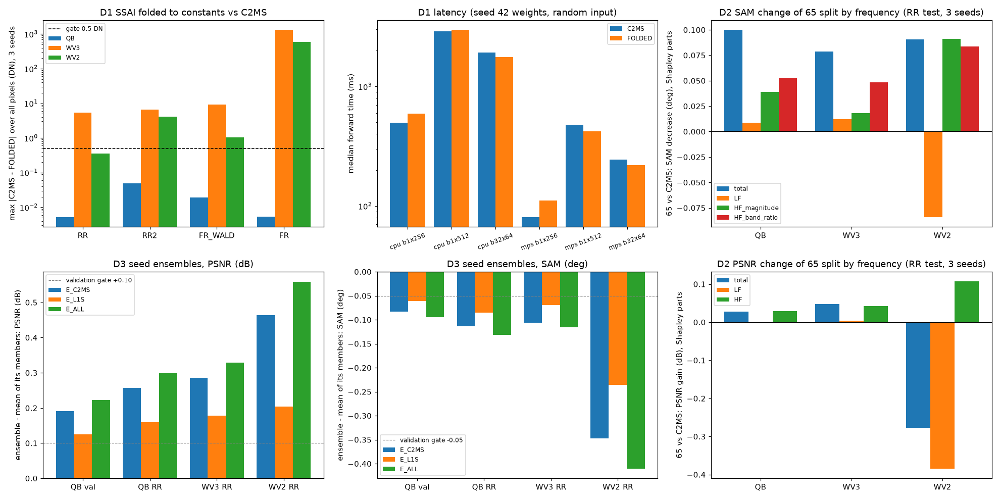

## 6. 결과 이미지

고정 6장면(QB RR test 0-based 0·1·3·7·14·17)에서 현재 기준 C2MS seed 42와 C2MS 3시드 앙상블(E_C2MS)을 비교했습니다. 같은 학습의 시드만 다른 모델을 평균했으므로 앙상블 효과만 보입니다. 장면은 정답만 보고 풍경으로 미리 정했습니다. 원본 크기 비교는 LR MS(최근접 확대) · PAN · C2MS · 앙상블 · 정답과 두 오차 지도(C2MS 오차 99퍼센타일 공통 척도)이고, 확대 비교는 앙상블의 개선이 가장 큰 64×64 창을 4배 확대한 것입니다. **확대 창은 앙상블에 유리하게 고른 창**이므로 전체 차이는 장면 PSNR로 봅니다. RGB 밴드 [2,1,0], 정답 1-99퍼센타일 대비입니다. FOLDED는 QB에서 C2MS와 0.005 DN 이내로 같아 따로 이미지를 만들지 않았습니다.

| 장면 | 풍경 | 장면 PSNR C2MS → 앙상블 | 확대 창 PSNR |
|---:|---|---|---|
| 0 | 바다·항구 방파제 | 42.81 → 43.04 dB | 37.25 → 37.87 dB |
| 1 | 부두·곡선 방파제·수목 | 43.18 → 43.39 dB | 40.50 → 41.09 dB |
| 3 | 요트 마리나·운동장 | 37.96 → 38.40 dB | 35.46 → 36.49 dB |
| 7 | 숲 공원 | 39.41 → 39.77 dB | 35.79 → 36.66 dB |
| 14 | 언덕 공원·곡선 주택가 | 38.47 → 38.76 dB | 34.63 → 34.98 dB |
| 17 | 산지 녹지·산책로 | 39.40 → 39.70 dB | 34.67 → 35.16 dB |

여섯 장면 모두 앙상블이 높았습니다. 원본 크기에서는 두 출력과 오차 지도가 눈으로 거의 구분되지 않고, 확대 창에서 건물·선박 가장자리 오차의 밝은 점이 조금 줄어든 정도입니다.

**장면 0**

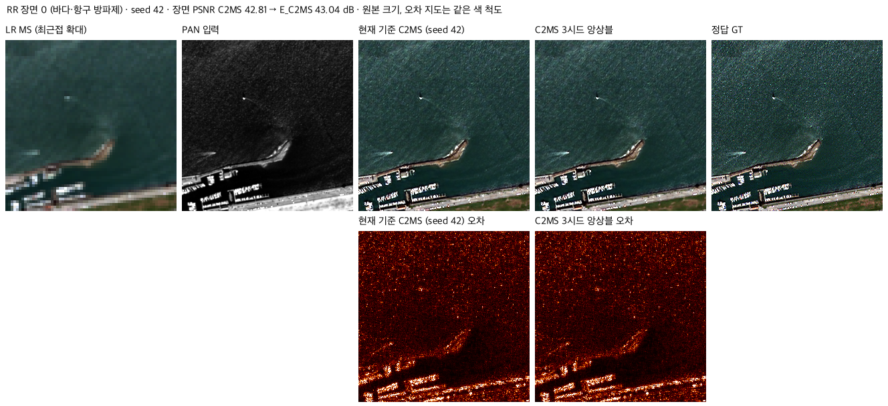

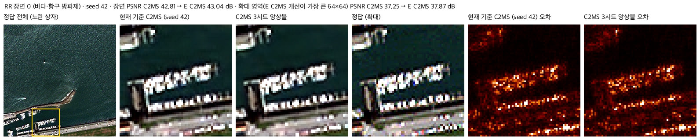

나머지 5장면 (1·3·7·14·17)

**장면 1**

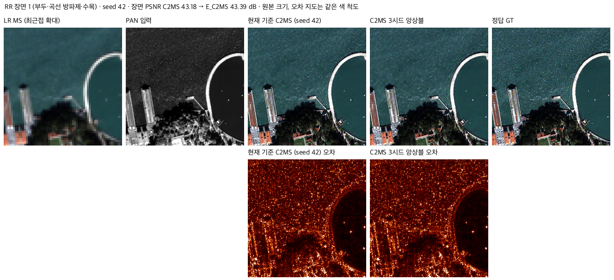

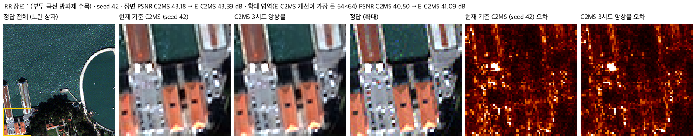

**장면 3**

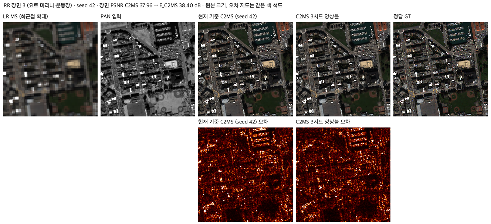

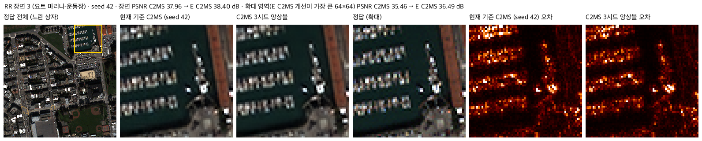

**장면 7**

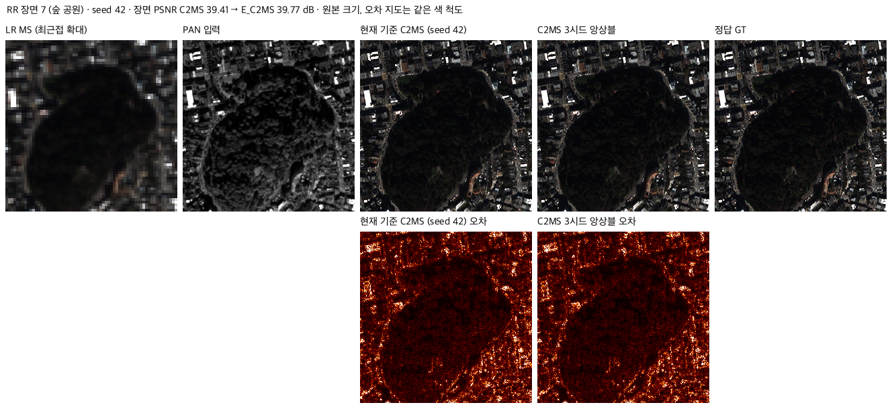

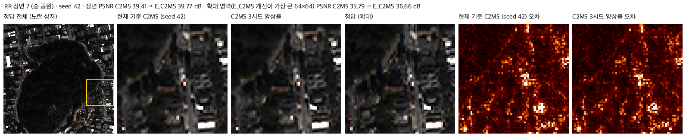

**장면 14**

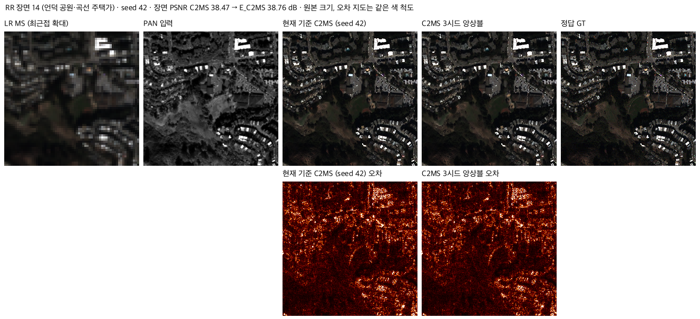

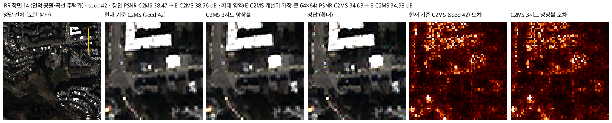

**장면 17**

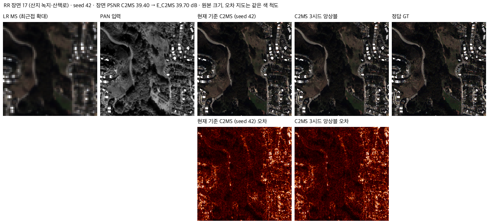

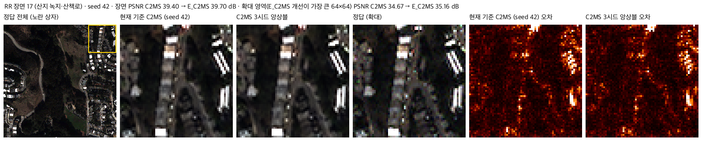

## 7. 재현 자료

- [config.json](config.json): 측정 전에 고정한 변형·규칙·관문·데이터 해시.
- [prepare.py](prepare.py): 전체 계산. `--part check`(FFT 형태 확인), `test --targets QB WV3 WV2`(대상별 RR·RR2·FR_WALD·FR, 장면별 값), `val`(QB validation), `latency`, `images`, `summary`(집계·관문·그래프). 결과는 `results/` 아래에만 씁니다.
- `results/raw_<QB|WV3|WV2>.json`: 시드·장면별 지표, 출력 차이, 주파수 분해, 앙상블, 재현 대조. `results/validation_QB.json`, `results/latency.json`, `results/summary.json`(관문 판정 포함), `results/fft_check.json`.
- 보존 파일 해시는 [manifest.json](manifest.json)에 있고 `python SSA-MRN/common/verify.py --experiment 68_ssai_folding_sam_split_seed_ensemble --research-track performance`로 확인합니다. 해시 확인과 성능 재평가는 별개입니다.
- 실행: 저장소 루트에서 `python SSA-MRN/experiments/performance/68_ssai_folding_sam_split_seed_ensemble/prepare.py`(데이터는 `SSA-MRN/data/`). 예측 배열은 저장하지 않습니다.

## 8. 개선 여부와 다음 단계

**성능 비교 아님**입니다. 학습 없는 사후 진단이며 기준 모델은 C2MS로 유지합니다. 사전 관문의 판정은 다음과 같습니다.

| 진단 | 사전 관문 | 판정 |
|---|---|---|
| 1. SSAI 접기·미사용 층 | 모든 모델·test에서 최대 차이 0.5 DN 이하, PRUNED 비트 단위 동일 | **미달**: PRUNED는 통과, FOLDED는 QB 통과·WV3 seed 42 미달 → 학습된 가중치에서 SSA를 바로 떼지 않음 |
| 2. 65번 SAM 분해 | 저주파 몫 0.70 이상·남은 여지 0.03° 이하면 "저주파 소진", 고주파 몫 0.50 이상이면 "고주파 주도" | **고주파 주도**(QB 고주파 몫 0.91, 남은 저주파 여지 0.084°) |
| 3. 시드 앙상블 | QB validation +0.10 dB 또는 −0.05° | **분산 여지 있음**(E_C2MS +0.191 dB·−0.083°, E_L1S +0.126 dB·−0.061°) |

다음 단계(모두 계획이며 시작하지 않았습니다)

1. **앙상블 증류(PSNR·SAM·WV2 전이·경량화 공통):** E_C2MS나 E_ALL의 출력을 교사로 C2MS 한 개를 처음부터 학습하고, 같은 교사로 W2를 줄인 학생(예: 128 → 64채널)도 학습합니다. 정답 손실에 교사 출력 손실을 더하고, 원래 쌍과 2배 거친 쌍 모두에 적용합니다. 후보와 계수는 validation으로 고르고, 경량 학생에는 학습 전에 비열등 허용폭을 정합니다.
2. **경량 구조:** 실제로 쓰는 파라미터 기준으로 보고하고(QB 2,735,610개), SSAI를 뺀 FOLDED 구조는 1번의 경량 학생과 함께 처음부터 학습해 확인합니다. SSAI만 빼는 독립 실험은 속도 이득이 없어 우선순위가 낮습니다.
3. **SAM:** 학습 목표로 고주파 밴드 비율을 움직일 수 있으므로 65번 계열 손실 후속을 유지합니다. 남은 저주파 여지(QB 0.084°)는 별도 과제입니다. 65번 계열을 WV2에 쓸 때는 저주파 치우침을 막는 장치(관측 일치 사영 등)가 필요합니다.
