# 69. 65번 손실의 저주파 제곱 오차 보정: 관측 일치 손실과 저주파·고주파 손실 분리

**연구 분야:** 성능 개선 · **실험자:** 이병현

**변경 내용:** 기준 모델 C2MS의 구조·축척 혼합·학습 일정은 그대로 둡니다. [성능 65번](../65_l1_spectral_loss/README.md)의 손실(L1 + 0.46 × 분광)에서 저주파에 제곱 오차를 되돌리는 두 갈래를 처음부터 학습합니다. ① 65번 손실에 관측 일치 손실 `λ_O · ‖D(y) − D(정답)‖²`를 더하는 갈래(C2MS_L1SO), ② 저주파에는 제곱 오차, 고주파에는 L1을 쓰는 갈래(C2MS_SPLIT)입니다. 추론은 모델 한 번이며 사후 처리를 붙이지 않습니다.

| 확인된 결과 | 상태 | 개선 여부 |
|---|:---:|:---:|
| QB·WV3 seed 42 단일 시드, 같은 시드 C2MS 대비. **두 갈래 모두 원래 해상도 관측 비율을 C2MS보다 낮췄지만(QB 0.72·0.77, WV3 0.56·0.75, WV2 전이 0.63·0.74; 65번은 1.47·1.23·1.92), 65번의 SAM 이득을 지키지 못했습니다.** QB RR은 C2MS_L1SO −0.105 dB·SAM −0.022°, C2MS_SPLIT +0.027 dB·SAM −0.056°(65번 seed 42 +0.077 dB·−0.111°)였고, WV3에서는 두 갈래 모두 −0.94·−0.86 dB로 크게 나빠졌습니다(validation도 −0.74·−0.69 dB). WV2 전이는 C2MS_SPLIT만 +0.055 dB·SAM −0.206°(13/20장)로 C2MS보다 조금 높았습니다. 학습 전에 정한 1단계 관문을 통과한 갈래가 없어 2단계는 하지 않습니다. | 평가&nbsp;완료 seed42 | 부분&nbsp;개선 |

[실험 목록](../../../research/performance/README.md) · [수치](#results) · [그래프](#graphs) · [이미지](#images) · [재현 자료](#evidence)

## 1. 목적과 상태

65번은 QB SAM을 3시드 평균 0.100° 낮췄지만, RR PSNR 이득(+0.028 dB)이 잡음 문턱(0.04 dB)에 못 미치고 FR 관측 비율(1.43)이 허용폭(1.10)을 넘어 부분 개선이었습니다. 이후 실험에서 원인이 저주파에 있다는 근거가 모였습니다.

- [성능 68번](../68_ssai_folding_sam_split_seed_ensemble/README.md): 65번의 SAM 감소 중 91%가 고주파(세기 0.039°, 밴드 비율 0.053°)에서 왔고, 저주파 몫은 0.009°였습니다. WV2 전이에서 65번이 잃은 PSNR(−0.277 dB)은 모두 저주파(−0.385 dB)에서 나왔습니다.
- [성능 66번](../66_observation_error_projection_analysis/README.md): 늘어난 관측 오차는 MS 나이퀴스트 아래의 저주파 성분이었습니다. 관측을 정확히 맞추는 사후 사영은 RR PSNR을 세 시드 모두 약 +0.04 dB 올렸습니다. MSE로 학습한 모델은 평균을 내므로 `D(y) = MS`를 거의 지키지만, L1은 중앙값을 내므로 이 선형 조건을 지키지 않습니다.

그래서 저주파에서는 제곱 오차로 평균을 내게 하고, 고주파에서는 L1과 분광 손실로 SAM 이득을 유지하면 두 미달 항목을 함께 고칠 수 있다는 가설입니다. [성능 14번](../../../research/performance/14_auxiliary_losses/README.md)의 관측 손실은 MSE로 학습한 원본 모델에 더해 효과가 없었지만, MSE 모델은 관측 일치를 원래 거의 지키므로 L1 모델에서는 다시 확인할 이유가 있습니다.

다른 연구와 비교할 수 있도록 학습만 바꾸고, 추론에는 사영·앙상블·센서 정보를 쓰지 않습니다. 2026-10-28에 계획으로 등록했고, 같은 날 사용자 지시로 서버(RTX 3060 Ti, `C:/CtrS-p69/run`)에서 17:56 KST에 1단계 학습을 시작했습니다. 기준 모델은 C2MS로 유지합니다.

시작 전 서버 준비에서 두 가지를 확인했습니다. 학습 패치의 위상 표는 QB (1,2)·(2,1)·(2,2)가 5,671·5,737·5,731개, WV3는 9,714개 모두 (2,2)였고 두 센서 모두 내부 불일치가 1e-12 DN 수준이었습니다. 58번 preflight의 AMP 한 단계 시험은 무작위 입력과 실제 패치 모두에서 시작 배율 1024일 때 FP16 기울기가 넘쳤습니다. 초기화 직후 저주파 제곱 항 때문에 손실이 약 18, 파라미터 기울기가 최대 약 84로 커서이며, 배율 64에서는 유한했습니다(NaN 아님, [진단 스크립트](provenance/diag_amp_overflow.py)). 그래서 preflight 시험만 실제 학습 패치 2장과 시작 배율 64로 바꿨고, 학습은 58번과 같이 1024에서 시작해 넘침이 나면 GradScaler가 그 단계를 건너뛰고 배율을 줄입니다. 건너뛴 횟수는 학습 기록에 남습니다.

네 학습과 평가는 2026-10-29 06:59 KST에 모두 끝났습니다(학습 종료: QB 두 갈래 10-28 21:36·10-29 01:17, WV3 두 갈래 04:08·06:57, 각 학습 직후 평가). AMP 넘침으로 건너뛴 단계는 80,400회 중 QB 21·23회, WV3 45,600회 중 7·8회로 65번(QB 24회)과 비슷했습니다. 선택 에폭은 QB 150·150, WV3 148·145입니다.

## 2. 변경한 구조와 비교 조건

| 갈래 | 원래 쌍 | 2배 거친 쌍 (가중치 1.0) |
|---|---|---|
| C2MS (대조군, QB 53번·WV3 54번) | MSE | MSE |
| 65번 C2MS_L1S (참조) | L1 + 0.46 × 분광 | L1 |
| **C2MS_L1SO** | L1 + 0.46 × 분광 + 500.0 × `mean(D_p(y) − D_p(정답))²` | L1 + 500.0 × `mean(D(y) − D(정답))²` |
| **C2MS_SPLIT** | 431.5 × `mean(L(y − 정답))²` + `mean|H(y − 정답)|` + 0.46 × 분광 | 431.5 × `mean(L(y − 정답))²` + `mean|H(y − 정답)|` |

- **D_p:** 학습 센서의 54번 Wald MS 연산(밴드별 MS MTF, 41탭, 복제 경계)과 위상 p의 4배 추출입니다. 원래 쌍은 패치마다 자신의 위상을 쓰고, 2배 거친 쌍은 그 쌍을 만든 위상 2를 씁니다. 주어진 MS 대신 `D_p(정답)`과 비교하는 것은 가장자리 5픽셀 안쪽에서는 같은 값이고, 패치 경계에서 잘린 위치와 원래 영상 관측이 다른 문제를 피하기 위해서입니다.
- **L, H:** L은 학습 센서의 밴드별 MS MTF 블러(추출 없음)로, 60·68번 진단과 같은 저주파 정의입니다. H = y − L(y)입니다.
- **계수:** 65번 분광 계수와 같은 원리(수렴한 출력에서 기울기 세기를 맞춤)로 학습 전에 정했습니다. QB 학습 패치 256개에서 65번 seed 42 출력에 대해 `λ_O = |∇L1_저주파| / |∇관측 손실|`, `k_S = |∇L1_저주파| / |∇MSE_저주파|`입니다. 즉 두 갈래 모두 새 저주파 제곱 오차가 65번 L1의 저주파 부분과 같은 세기로 작용합니다. 모든 센서에 같은 값을 씁니다.

| 조건 | 내용 |
|---|---|
| 구조·학습 | C2MS 그대로, 65번과 같은 150에폭·Adam 1e-4 → 1e-6 cosine·batch 32·AMP FP16(손실은 FP32)·결정론 모드 |
| 데이터 | QB·WV3 학습/검증(54번과 같음), 2배 거친 쌍은 54번 CoarsePairs(59번 캐시를 해시 확인 후 재사용) |
| 패치 위상 | 실행 준비 때 학습·검증 패치마다 16개 위상 중 내부 불일치가 가장 작은 위상을 정해 해시와 함께 기록하고, 1e-6 DN을 넘는 패치가 있으면 preflight에서 멈춤 |
| 선택 | 원래 축척 validation MSE 최소 에폭(53-65번과 같음) |
| 구현 | 65번 학습기에서 복원 손실 식만 정해진 위치에서 바꿈(63·65·67번 방식) |
| 장치 | 서버 RTX 3060 Ti, 한 번에 한 학습, 별도 실행 폴더 |

### 단계와 관문 (학습 전에 고정)

| 단계 | 내용 | 다음으로 가는 조건 |
|---|---|---|
| 0 확인 | 학습 패치의 관측 일치와 손실 계수(학습 없음, 로컬 CPU) | 완료 |
| 1 선별 | QB·WV3 seed 42 × 두 갈래, 4회(회당 약 2.7시간, 모두 약 11시간). WV3 모델은 WV2 전이도 평가 | 아래 관문을 모두 통과한 갈래. 둘 다 통과하면 QB validation SAM이 낮은 갈래(같으면 C2MS_L1SO) |
| 2 반복 | 통과한 갈래: QB seed 43·44, GF2·WV3 seed 42-44(WV2 전이 포함) | 사용자 승인 후. 센서별 3시드 v2.3 판정 |

| 1단계 관문 | 조건 (같은 시드 C2MS 대비) | 65번 seed 42 참고값 |
|---|---|---|
| QB | FR 관측 비율 ≤ 1.10, RR SAM ≤ −0.07°(65번 이득의 70%), RR PSNR ≥ +0.04 dB | 1.47, −0.111°, +0.077 dB |
| WV3 | FR 관측 비율 ≤ 1.10, RR SAM ≤ −0.05°, RR PSNR ≥ 0 | 관측 비율 미달, −0.089°, +0.093 dB |
| WV2 전이 | RR PSNR ≥ C2MS − 0.06 dB | −1.078 dB |

관측 비율만 1.10을 넘고 학습 축척의 관측 손실은 충분히 줄었다면, 학습 축척의 제약이 FR 축척까지 이어지지 않는다는 뜻입니다. 그때는 관측 일치 출력층(학습과 추론 모두에 들어가는 모델 구성 요소)을 다음 설계로 둡니다.

## 3. 정량 결과

### 학습 전 확인

학습 전 확인 결과는 다음과 같습니다([observation_check.json](provenance/observation_check.json), [loss_weight_calibration.json](provenance/loss_weight_calibration.json)).

| QB 학습 패치 256개 | 고정 위상 2 | 패치별 위상 |
|---|---:|---:|
| `D(정답) − MS` 내부 최대 (DN) | 204.3 | 2.3e-12 |
| `D(정답) − MS` 내부 RMS (DN) | 10.6 | 4.6e-13 이하 |
| 위상 분포 | | (1,2) 86 · (2,1) 84 · (2,2) 86 |

2배 거친 쌍은 같은 Wald 연산으로 만들어 위상 2에서 4e-5 DN 이내로 같았습니다.

| 출력 (seed 42) | λ_O | k_S |
|---|---:|---:|
| 65번 C2MS_L1S (사용) | 500.0 (배치별 459-559) | 431.5 (376-489) |
| 53번 C2MS (참고) | 526.0 | 425.8 |

### 1단계 결과 (seed 42, test 20장 평균, 같은 시드 C2MS 대비 차이)

C2MS는 QB 53번, WV3 54번(WV2는 그 전이)입니다. 65번은 같은 시드의 참조입니다. 관측 비율은 원래 해상도 관측 RMSE ÷ C2MS입니다. 원본 값은 `results/<갈래>_<센서>_s42/evaluation/<대상>_v2_3.json`에 있습니다.

| 대상 | 모델 | RR PSNR / SAM | RR ΔPSNR / ΔSAM / ΔERGAS | RR2 ΔPSNR / ΔSAM | FR_WALD ΔPSNR / ΔSAM | 관측 비율 | PSNR 상승 장면 | v2.3 |
|---|---|---|---|---|---|---:|---:|---|
| QB | C2MS (대조군) | 38.274 / 4.577° | | | | 1 | | 비교 기준 |
| QB | 65번 (참조) | 38.351 / 4.467° | +0.077 / −0.111° / −0.030 | | | 1.473 | | |
| QB | **C2MS_L1SO** | 38.169 / 4.555° | −0.105 / −0.022° / +0.054 | −0.019 / +0.057° | +0.029 / −0.075° | **0.716** | 2/20 | 부분 개선 |
| QB | **C2MS_SPLIT** | 38.300 / 4.521° | +0.027 / −0.056° / −0.007 | +0.012 / +0.031° | +0.087 / −0.084° | **0.773** | 12/20 | 부분 개선 |
| WV3 | 65번 (참조) | | +0.093 / −0.089° | | | 1.232 | | |
| WV3 | C2MS_L1SO | 37.557 / 3.438° | −0.936 / +0.347° / +0.278 | −0.050 / +0.087° ✗ | −1.019 ✗ / +0.436° ✗ | 0.559 | 0/20 | 개선 없음 |
| WV3 | C2MS_SPLIT | 37.631 / 3.365° | −0.862 / +0.275° / +0.253 | +0.707 / −0.106° | −0.760 ✗ / +0.270° ✗ | 0.754 | 0/20 | 개선 없음 |
| WV2 전이 | 65번 (참조) | | −1.079 / +0.134° | | | 1.917 | | |
| WV2 전이 | C2MS_L1SO | 28.782 / 5.741° | −0.742 / −0.114° / +0.450 | −0.385 ✗ / −0.255° | −0.627 ✗ / −0.019° | 0.630 | 1/20 | 부분 개선 |
| WV2 전이 | C2MS_SPLIT | 29.579 / 5.648° | **+0.055 / −0.206°** / +0.008 | +0.548 / −0.353° | −0.056 / −0.103° | 0.740 | 13/20 | 부분 개선 |

QB의 RR2는 57번 고정 대조값 대비로도 C2MS_L1SO +0.287 dB·−0.120°, C2MS_SPLIT +0.317 dB·−0.146°로 통과입니다.

**세부 지표 (RR, 67번 정의, 1이 정답)**

| 대상 | 모델 | 세부 에너지 | 넣은 세부 | 밴드 밝기 치우침 (DN) |
|---|---|---:|---:|---:|
| QB | C2MS / 65번 | 0.949 / 0.937 | 0.958 / 0.948 | 0.09 / 0.33 |
| QB | C2MS_L1SO / C2MS_SPLIT | 0.935 / 0.937 | 0.945 / 0.948 | 0.10 / 0.08 |
| WV3 | C2MS / C2MS_L1SO / C2MS_SPLIT | 0.947 / 0.913 / 0.926 | 0.956 / 0.926 / 0.937 | 0.17 / 0.13 / 0.12 |
| WV2 전이 | C2MS / 65번 | 0.585 / 0.452 | 0.631 / 0.523 | 5.56 / 23.01 |
| WV2 전이 | C2MS_L1SO / C2MS_SPLIT | 0.423 / 0.479 | 0.498 / 0.550 | 3.04 / 3.00 |

**validation (선택 에폭, 원래 축척)**

| 센서 | C2MS | 65번 | C2MS_L1SO | C2MS_SPLIT |
|---|---|---|---|---|
| QB PSNR / SAM | 40.283 / 4.226° | 40.238 / 4.153° | 40.191 / 4.197° | 40.204 / 4.191° |
| WV3 PSNR / SAM | 38.034 / 3.538° | 38.077 / 3.447° | 37.291 / 3.813° | 37.345 / 3.761° |

### 1단계 관문

| 갈래 | QB 관측 ≤ 1.10 | QB SAM ≤ −0.07° | QB PSNR ≥ +0.04 dB | WV3 관측 ≤ 1.10 | WV3 SAM ≤ −0.05° | WV3 PSNR ≥ 0 | WV2 PSNR ≥ −0.06 dB | 통과 |
|---|:---:|:---:|:---:|:---:|:---:|:---:|:---:|:---:|
| C2MS_L1SO | ✓ (0.716) | ✗ (−0.022) | ✗ (−0.105) | ✓ | ✗ (+0.347) | ✗ (−0.936) | ✗ (−0.742) | ✗ |
| C2MS_SPLIT | ✓ (0.773) | ✗ (−0.056) | ✗ (+0.027) | ✓ | ✗ (+0.275) | ✗ (−0.862) | ✓ (+0.055) | ✗ |

## 4. 기준선 대비 차이와 해석

- **관측 불일치는 고쳤습니다.** 두 갈래 모두 세 대상에서 관측 비율이 C2MS보다도 낮고(0.56-0.77), 65번의 밴드 밝기 치우침(QB 0.33, WV2 23.0 DN)도 C2MS 수준 이하로 줄었습니다. 학습 축척에서 건 저주파 제곱 오차가 원래 해상도(FR)까지 이어졌다는 뜻이며, 계획 때 걱정한 "FR 축척으로 이어지지 않는 경우"는 나타나지 않았습니다.
- **그러나 65번의 SAM 이득이 대부분 사라졌습니다.** QB SAM 감소가 65번 −0.111°에서 C2MS_L1SO −0.022°, C2MS_SPLIT −0.056°로 줄었고, 세부 에너지·넣은 세부도 C2MS보다 조금 낮습니다. [성능 68번](../68_ssai_folding_sam_split_seed_ensemble/README.md)은 65번 출력의 SAM 이득이 고주파에 있다고 분해했지만, 학습 손실에 저주파 제곱 항을 넣으면 고주파 쪽 학습도 함께 바뀌었습니다. 출력의 주파수 분해만으로 학습 손실의 효과를 예측할 수 없다는 결과입니다.
- **WV3에서는 학습 자체가 덜 됐습니다.** test뿐 아니라 validation도 C2MS보다 PSNR 0.74·0.69 dB 낮고 SAM은 0.27·0.22° 높아, 일반화가 아니라 최적화 문제로 봅니다. 계수는 QB의 65번 수렴 출력에서 정했고 WV3에도 그대로 썼습니다. 수렴 시점에 맞춘 계수라 학습 초반에는 저주파 제곱 항이 손실을 크게 지배하며(초기 손실 약 18), 이 영향이 8밴드 WV3에서 더 컸던 것으로 추정합니다. 확인하지는 않았습니다.
- **L1을 저주파에서 뺀 SPLIT이 L1을 남긴 L1SO보다 모든 대상에서 나았습니다**(QB +0.13 dB, WV3 +0.07 dB, WV2 +0.80 dB). WV2 전이에서 C2MS_SPLIT은 C2MS보다 SAM −0.206°, 밝기 치우침 5.6 → 3.0 DN이었지만 세부 에너지는 0.585 → 0.479로 더 흐렸습니다.
- 모두 단일 시드입니다. 68번에서 시드 간 차이가 컸으므로 QB +0.027 dB 같은 작은 차이는 잡음 수준입니다.

## 5. 학습·평가 그래프

각 갈래의 학습 곡선(학습 손실·validation PSNR·SAM)과 C2MS 대비 test PSNR 차이입니다. 학습 손실은 갈래마다 정의가 달라(저주파 제곱 항 포함) 갈래끼리 크기를 비교하지 않습니다.

**C2MS_SPLIT · QB**

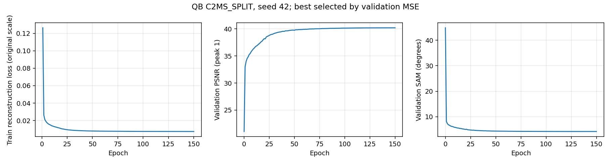

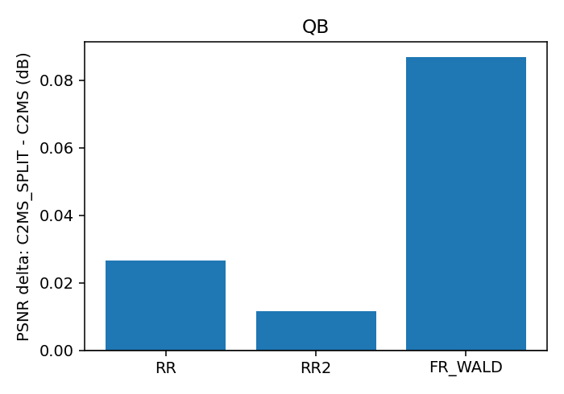

**C2MS_SPLIT · WV3 (WV2 전이 포함)**

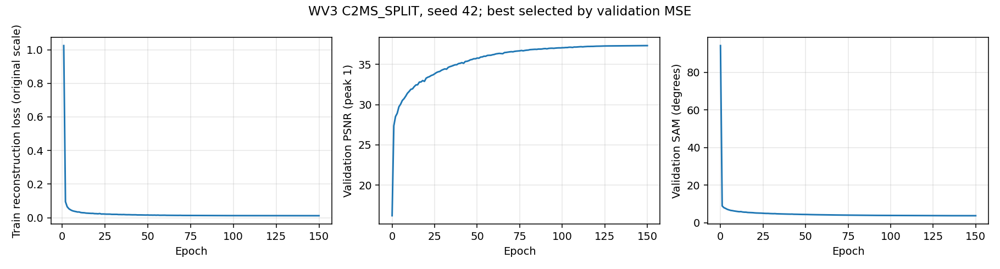

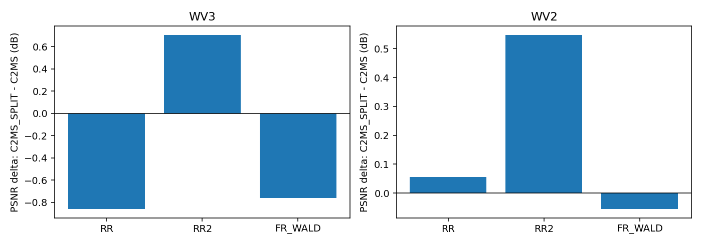

C2MS_L1SO 그래프

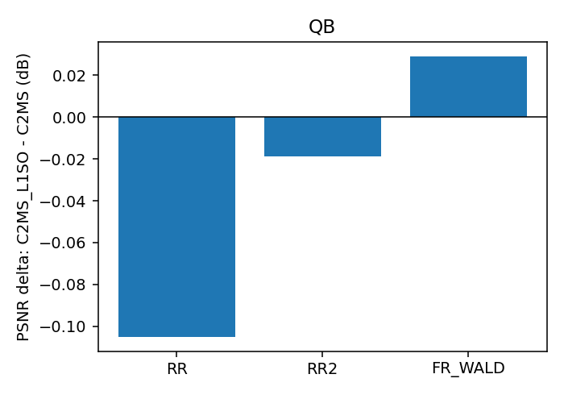

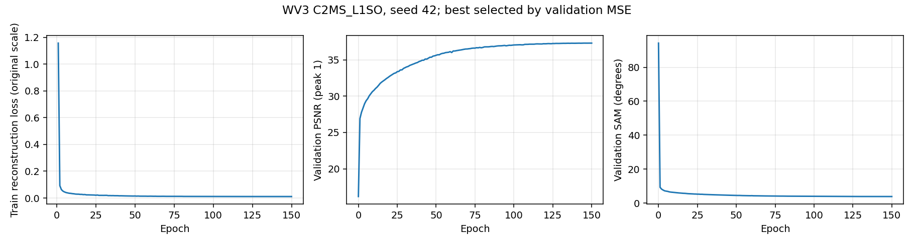

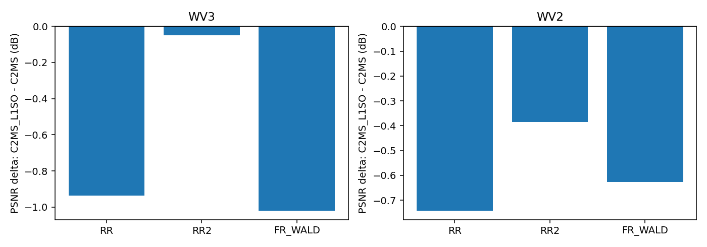

## 6. 결과 이미지

고정 6장면(0-based 0·1·3·7·14·17, seed 42)의 현재 기준 C2MS 대 후보 이미지를 `common/result_images.py`로 서버 평가 때 만들었습니다. 장면은 결과를 보기 전에 정한 고정 번호입니다. 원본 크기 비교는 LR MS(최근접 확대) · PAN · C2MS · 후보 · 정답과 두 오차 지도(C2MS 오차 99퍼센타일 공통 척도)이고, 확대 비교는 후보의 개선이 가장 큰 64×64 창을 4배 확대한 것입니다. **확대 창은 후보에 유리하게 고른 창**이므로 전체 차이는 장면 PSNR로 봅니다. QB는 RGB 밴드 [2,1,0], WV3·WV2는 [4,2,1]입니다.

| 대상 · 후보 | 0 | 1 | 3 | 7 | 14 | 17 |
|---|---|---|---|---|---|---|
| QB · C2MS → C2MS_SPLIT | 42.81 → 42.97 | 43.18 → 43.26 | 37.96 → 38.10 | 39.41 → 39.55 | 38.47 → 38.43 | 39.40 → 39.49 |
| QB · C2MS → C2MS_L1SO | 42.81 → 42.76 | 43.18 → 43.14 | 37.96 → 38.03 | 39.41 → 39.37 | 38.47 → 38.38 | 39.40 → 39.34 |
| WV2 전이 · C2MS → C2MS_SPLIT | 28.69 → 28.77 | 26.82 → 26.98 | 34.94 → 35.35 | 29.18 → 29.14 | 28.93 → 28.85 | 29.39 → 29.42 |

**QB · C2MS_SPLIT · 장면 0**

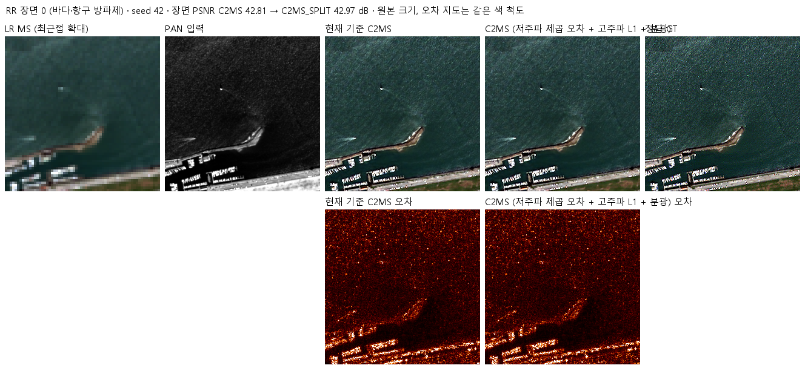

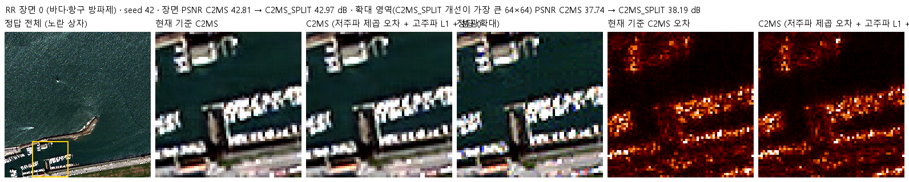

**WV2 전이 · C2MS_SPLIT · 장면 0**

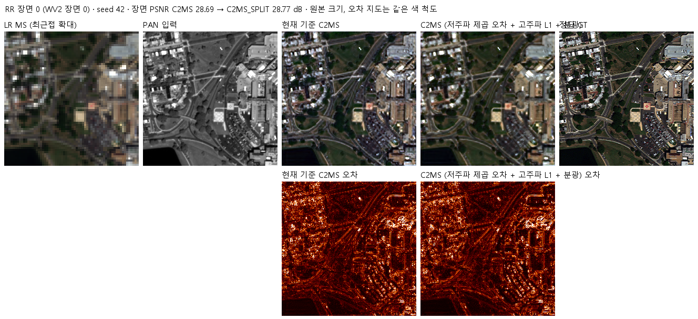

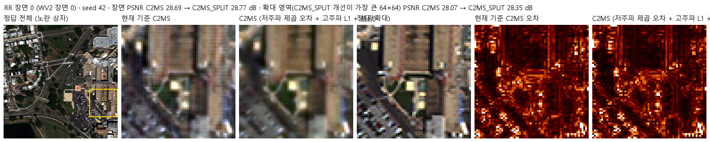

QB C2MS_SPLIT 나머지 5장면 (1·3·7·14·17)

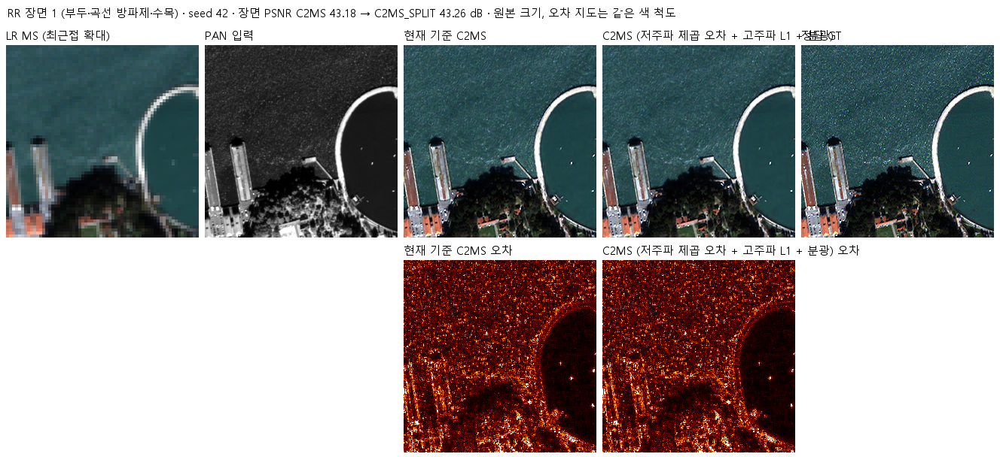

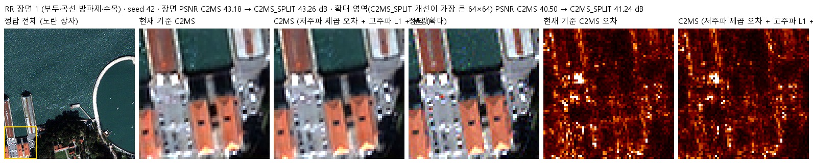

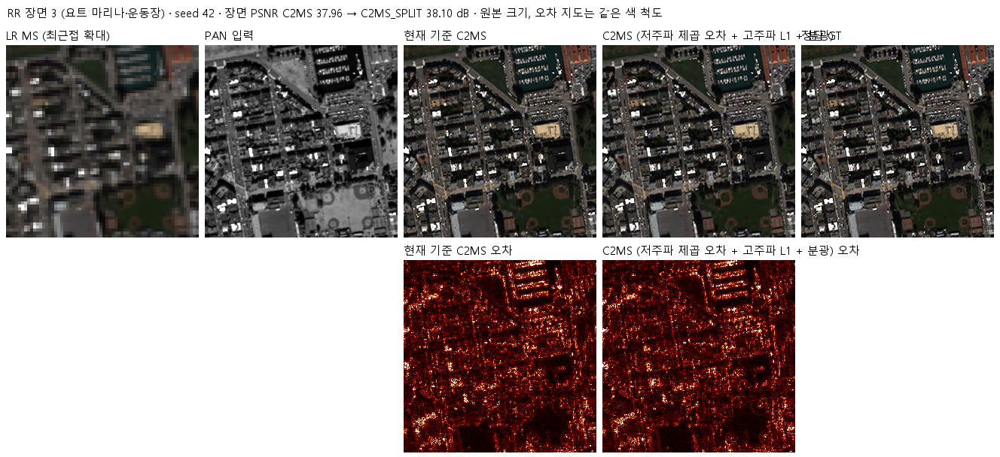

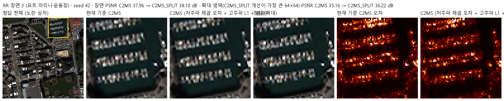

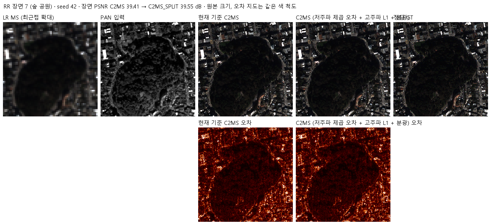

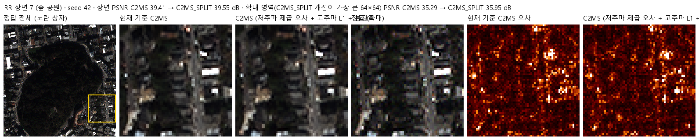

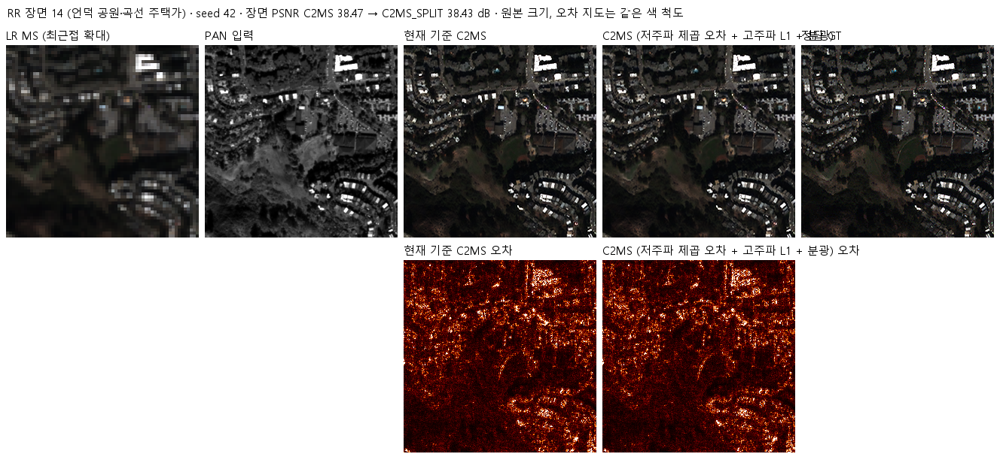

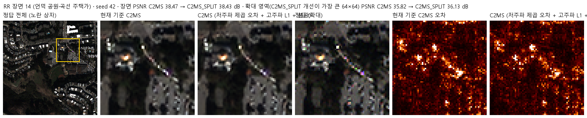

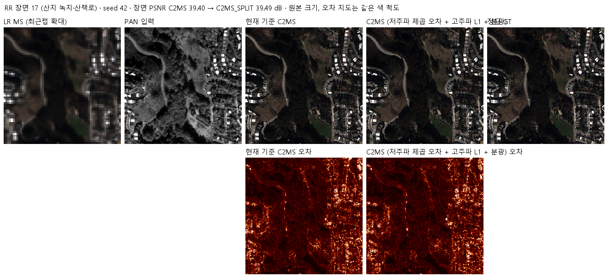

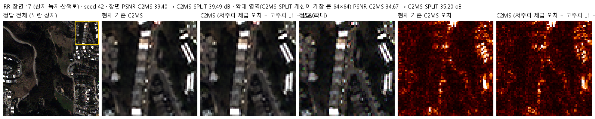

다른 갈래·대상(QB C2MS_L1SO, WV3, WV2 C2MS_L1SO)의 같은 형식 이미지는 `results/<갈래>_<센서>_s42/evaluation/<대상>/`에 있습니다.

## 7. 재현 자료

- [config.json](config.json): 학습 전에 고정한 갈래·연산·계수·단계·관문·데이터 해시.
- [prepare.py](prepare.py): 학습 전 확인. `--check`는 학습 패치의 관측 일치와 패치별 위상, `--calibrate`는 손실 계수를 계산합니다(로컬 CPU, 결과는 `provenance/`).
- [train.py](train.py): 58번 학습기(54번 학습기 + 분광 손실 + EMA 기록)를 그대로 불러와 제곱 오차 식만 정해진 위치에서 69번 손실로 바꿉니다. 바꿀 위치가 정한 횟수만큼 일치하지 않으면 실행을 거부합니다. preflight에서 손실 식, 위상 표(float64 H5와 대조), 캐시와 H5의 행 순서, 2배 거친 쌍의 관측 일치를 확인합니다.
- [run.py](run.py): 67번 컨트롤러에 학습 분할의 패치별 위상 표 계산(float64 H5, 54번 직접 합성곱, 내부 불일치 1e-6 DN 초과 시 거부)을 더했습니다. [evaluate.py](evaluate.py): 67번 평가(v2.3, 세부 지표, 결과 이미지)와 같고, QB에서는 57번 C2MS(QB RR2 고정 대조값)와 65번을 참조로 함께 평가합니다.
- [model.py](model.py): 54번 C2MS 구조를 그대로 씁니다. [prepare.py](prepare.py)는 54번 센서 연산을 그대로 내보내고 위상별 추출 함수를 더했습니다.
- 가중치: `checkpoints/<갈래>_<센서>_s42/best.pt`(선택 에폭 QB 150·150, WV3 148·145)와 `best_ema.pt`는 Git에 있습니다. 재개용 `latest.pt`와 초기 `initial.pt`는 GitHub Release `weights-experiments-performance-69`에 있고 [manifest.json](manifest.json)의 `release_assets`에 크기·SHA-256이 있습니다.
- 결과: `results/<갈래>_<센서>_s42/`의 `history.json`, `training_complete.json`, `evaluation_complete.json`, `evaluation/<대상>_v2_3.json`(장면별 수치), 그래프와 결과 이미지. 실행 기록은 `provenance/run_records/`(실행 설정·캐시와 위상 표 manifest·환경·preflight 기록, 처음 두 번의 preflight 실패 기록 포함)에 있고, 상세 학습 로그는 Git에 넣지 않았습니다.
- 서버 실행 자료(`provenance/`): 소스 묶음 manifest, 서버 검증(`verify_ctrs69_server.py`), 배치·실행 스크립트(`stage69.ps1`, `launch69.cmd`, `start69.ps1`)와 실행 기록(`launcher.json`, 마지막 서버 검증 결과 `source_verification.json`), AMP 넘침 진단(`diag_amp_overflow.py`).

## 8. 개선 여부와 다음 단계

**부분 개선**입니다(seed 42 단일 시드). 학습 전에 정한 1단계 관문을 통과한 갈래가 없어 2단계(3시드)는 하지 않으며, 기준 모델은 C2MS로 유지합니다.

| 갈래 | QB (RR ΔPSNR / ΔSAM) | WV3 | WV2 전이 |
|---|---|---|---|
| C2MS_L1SO | 부분 개선 (−0.105 / −0.022°) | 개선 없음 (−0.936 / +0.347°) | 부분 개선 (−0.742 / −0.114°) |
| C2MS_SPLIT | 부분 개선 (+0.027 / −0.056°) | 개선 없음 (−0.862 / +0.275°) | 부분 개선 (+0.055 / −0.206°) |

- 저주파 제곱 오차는 65번 계열의 관측 불일치와 밝기 치우침을 없애는 데는 효과가 있었고, FR 축척까지 이어졌습니다.
- 하지만 같은 계수로는 SAM 이득을 잃고, WV3에서는 학습이 크게 덜 됐습니다. 이번 결과로는 원인을 계수 크기(수렴 시점에 맞춘 값, QB에서만 정함)와 손실 형태 자체로 나눌 수 없습니다.
- 이 방향을 이어 간다면 계수를 줄이거나 학습 초반에 서서히 키우는 갈래, 센서별로 계수를 정하는 갈래를 validation 기준으로 먼저 고르는 것이 필요합니다. 다음 실험은 사용자와 함께 정합니다.
