# 72. C2MS 이득의 주파수 대역·구조 크기 분해

**연구 분야:** 기존 성능 개선

**실험자:** 이병현

**변경 내용:** 새로 학습하지 않았습니다. 보관된 가중치로 test 출력을 다시 만들어, 원본 SSA-MRN 대비 C2MS의 이득이 어떤 주파수 대역과 어떤 크기의 구조에서 나왔는지 나눴습니다. QB에서는 W2 가지 추가(C0 → C2)와 축척 혼합 학습(C2 → C2MS)의 몫도 따로 봤습니다. 남은 4 px 미만 오차의 원인도 진단했습니다.

| 확인된 결과 | 상태 | 개선 여부 |
|---|:---:|:---:|
| QB RR 이득 +0.873 dB(3시드)의 87.3%가 주기 8 px 미만(4-8 px 46.9%, 2-4 px 40.2%)에서 나왔고, 16 px 초과 대역은 0.8%였습니다. 구조별로는 미세 구조+작은 세부가 화소의 25.0%로 이득의 57.8%를 냈고, 큰 구조·외곽선은 13.6%로 10.9%였습니다. GF2·WV3도 8 px 미만이 83.9%·88.2%였습니다. 학습하지 않은 WV2만 16 px 초과가 62.9%로, 밝기·색 보정이 중심이었습니다. 4 px 미만 오차는 QB·WV3에서 위치 어긋남이 아니었고 PAN 선형 보정 여지도 1-2%였으며, GF2만 17-23%였습니다. | 사전&nbsp;검증&nbsp;완료 3seed | 성능&nbsp;비교&nbsp;아님 |

[실험 목록](../../../research/performance/README.md) · [수치](#results) · [그래프](#graphs) · [이미지](#images) · [재현 자료](#evidence)

## 1. 목적과 상태

C2MS가 원본보다 낫다는 것은 [성능 53번](../53_scale_mixed_training/README.md)·[54번](../54_multi_sensor_scale_mixed_training/README.md)에서 확인했지만, 그 이득이 영상의 어느 성분에서 나왔는지는 나눠 본 적이 없습니다. 다음 세 질문을 확인했습니다.

1. 이득은 고주파에서 나왔습니까, 저주파에서 나왔습니까?
2. 이득은 큰 외곽선에서 나왔습니까, 작은 세부에서 나왔습니까?
3. C2MS를 만든 두 변경(W2 가지, 축척 혼합 학습)의 역할은 어떻게 다릅니까?
4. 남은 2-4 px 오차는 줄일 수 있는 오차입니까?

2026-11-02 로컬 CPU에서 계산했고 학습은 하지 않았습니다. 탐색에 반복 사용한 test를 다시 본 사후 분석이므로 판정이 아니라 원인 분석입니다.

## 2. 변경한 구조와 비교 조건

구조는 바꾸지 않았습니다. 비교 대상은 다음과 같습니다.

| 군 | 구조 | 학습 데이터 | 가중치 |
|---|---|---|---|
| C0 (원본) | 원본 SSA-MRN K4 | 원래 쌍 | QB [43번](../43_normalized_parallel_capacity/README.md), GF2·WV3 [54번](../54_multi_sensor_scale_mixed_training/README.md) |
| C2 (W2만 추가) | 원본 + W2 | 원래 쌍 | QB [43번](../43_normalized_parallel_capacity/README.md) |
| C2MS (현재 기준) | 원본 + W2 | 원래 쌍 + 2배 거친 쌍 | QB [53번](../53_scale_mixed_training/README.md), GF2·WV3 [54번](../54_multi_sensor_scale_mixed_training/README.md) |

### 주파수 분해

오차 `e = 출력 − 정답`을 장면·밴드별로 FFT한 뒤, 무늬의 주기(한 번 반복되는 데 걸리는 화소 수)로 나눴습니다. 주기가 짧을수록 고주파입니다. 4배 입력 MS는 주기 8 px(MS 나이퀴스트)보다 짧은 무늬를 담을 수 없으므로, 8 px 미만은 PAN에서 가져와야 하는 대역입니다.

아래 그림은 장면 3의 정답 밝기를 대역별로 나눈 것입니다. 16 px 초과는 지형의 큰 밝기 분포이고, 8 px 미만은 건물 가장자리와 작은 물체의 세부입니다.

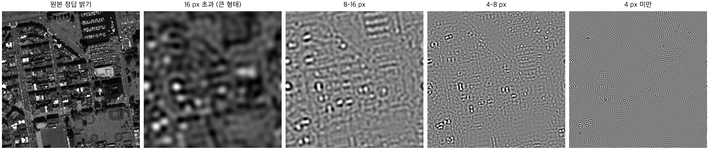

| 항목 | 방법 |
|---|---|
| MSE 분해 | 파시발 정리로 대역별 에너지의 합이 MSE와 정확히 같습니다. 직류 성분(DC)은 영상 평균의 치우침입니다. |
| PSNR 분해 | 로그 평균을 쓰는 LMDI 분해로 대역별 기여(dB)의 합이 PSNR 변화와 정확히 같습니다. 잔차 항이 없습니다. |
| SAM 분해 | 여섯 주파수 묶음의 정확한 샤플리 값입니다. SAM은 대역별로 더해지지 않아 묶음 사이 상호작용을 평균해서 나눕니다. |
| 세기와 상관 | 대역 안에서 `출력 = H × 정답 + 나머지`로 나눠, 세기 부족 `(1−H)²|정답|²`과 정답과 상관없는 성분 `|나머지|²`을 구했습니다. `H`가 1이면 세부 세기가 정답과 같습니다. 상관없는 성분이 곧 위치 오차인 것은 아닙니다. |

### 구조 크기 분류

정답 영상의 밴드 평균 밝기만 써서 화소를 나눴습니다. 모델 출력은 쓰지 않았습니다. 스케일 정규화 기울기 `M_s = s × |∇G_s I|`는 계단 경계에서는 `s`를 키워도 유지되고, 폭이 `s`보다 좁은 구조에서는 줄어듭니다. 그래서 `M_1`의 60% 이상을 유지한 채 도달한 가장 큰 스케일로 구조 크기를 정했습니다.

| 부류 | 기준 | 합성 영상에서 잡힌 구조 |
|---|---|---|
| 평탄 영역 | `M_1`이 데이터셋 전체 중앙값 미만 | 없음 |
| 미세 구조 | `s = 1`까지 | 폭 1-2 선, 2×2 물체 |
| 작은 세부 | `s = 2`까지 | 폭 2-4 선, 4×4 물체 |
| 중간 구조 | `s = 4`까지 | 폭 4-8 선, 8×8 물체 |
| 큰 구조 | `s = 8`까지 | 폭 16 선, 계단 경계 |
| 큰 직선 외곽선 | 큰 구조 중 구조 텐서 일관성 0.5 이상 | 곧은 계단 경계 |

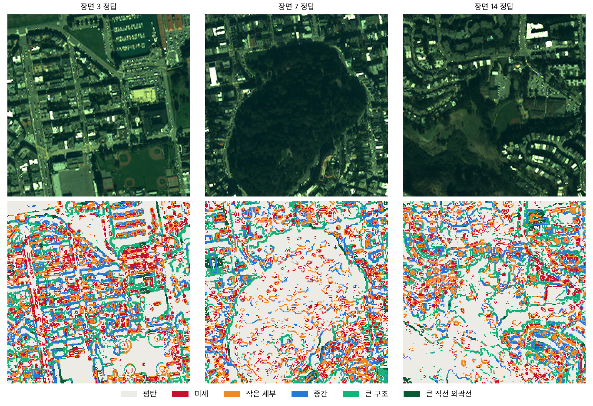

**처음 쓴 분류는 폐기했습니다.** Canny 외곽선의 길이로 나눈 첫 분류는 QB 화소의 77.2%가 "짧은 외곽선", 0.1%가 "긴 외곽선"이었고, 스케일 지속성으로 나눈 분류도 71.6%가 한 부류에 몰려 구분력이 없었습니다. 이 분류의 dB 몫까지 본 뒤 폐기했다는 점을 밝힙니다. 대신 쓴 구조 크기 분류는 합성 영상과 QB 부류 크기만 보고 정했고, dB 몫을 본 뒤로는 임계값을 바꾸지 않았습니다. 폐기한 분류의 수치는 [structure_rejected_canny.json](results/structure_rejected_canny.json)에 남겼습니다.

### 4 px 미만 오차의 원인 진단

남은 오차가 큰 2-4 px 대역을 따로 진단했습니다. 대역 경계는 이 진단에서 주기 4 px로 묶었습니다.

| 항목 | 방법 |
|---|---|
| 출력의 위치 오차 | 64×64 블록·밴드마다 C2MS와 정답 사이의 어긋남을 `0.25 ≤ f < 0.33`에서 찾고, 찾을 때 쓰지 않은 `0.33 ≤ f ≤ 0.5`의 오차 변화를 잽니다. 반대 방향도 같이 잽니다. 정답을 쓰므로 상한입니다. 대조군은 다른 블록의 어긋남입니다. |
| PAN의 어긋남 | PAN과 정답 밝기의 어긋남을 4-8 px 대역에서 찾아 4 px 미만 상관에 적용합니다. 실제 표준편차는 4-8 px와 8-16 px 두 추정의 공분산으로 구해 추정 잡음을 뺍니다. 정답 없는 추정은 PAN과 LMS의 8-16 px 대역을 씁니다. |
| 잡음 상한 | 정답이 가장 평탄한 10% 화소의 C2MS 오차가 전체 4 px 미만 오차에서 차지하는 비율입니다. |
| PAN 선형 보정 | 남은 오차를 PAN의 4 px 미만·4-8 px 대역 9×9 FIR로 회귀합니다. 장면을 둘로 나눠 한쪽에서 맞추고 다른 쪽에서 평가합니다. 원래 PAN과 정답 없이 정렬한 PAN을 비교합니다. 얕은 시험이므로 줄지 않아도 깊은 모델의 가능성을 배제하지는 않습니다. |

어긋남의 첫 계산은 추정과 적용의 부호가 서로 반대인 오류가 있어 버렸습니다. 지금 코드는 위치를 아는 합성 영상으로 부호를 확인한 뒤에만 실행됩니다.

### 공통 조건

| 항목 | 내용 |
|---|---|
| 데이터 | QB·GF2·WV3·WV2 RR test 각 20장(256×256), QB RR2 20장(64×64). 파일 SHA-256을 config와 대조 |
| WV2 | WV3로 학습한 모델을 학습하지 않은 WV2에 적용한 전이 |
| RR2 | 주파수 분해만 했습니다. 64×64 장면은 `s = 8` 구조 분류에 너무 작습니다. C2MS는 2배 거친 쌍으로 학습했으므로 RR2가 처음 보는 축척은 아닙니다. |
| 시드 | 42·43·44, 같은 시드끼리 짝지어 평균 |
| 지표 | [common/metrics.py](../../../common/metrics.py) 정의(밴드별 PSNR 평균, 최고값 2047) |
| 불확실성 | 20개 장면 부트스트랩 95% 구간. 장면이 같은 원본 영상에서 나왔을 수 있어 실제 불확실성의 하한입니다. |
| 재현 확인 | 27개 가중치·대상 조합의 장면별 RR PSNR이 보관값과 1.9e-6 dB 이내로 일치했고, QB RR2 평균도 53번 보고값과 같습니다. |
| 장치 | 로컬 CPU(4스레드) FP32 추론, 지표는 float64 DN |

## 3. 정량 결과

### QB: 주파수 대역별 이득 (C0 → C2MS, +0.873 dB)

시드별 총이득은 +0.907·+0.861·+0.850 dB입니다.

| 오차의 주기 | 원본 MSE | C2MS MSE | 오차 감소 | 이득 (dB) | 95% 구간 | 이득 몫 |
|---|---:|---:|---:|---:|---:|---:|
| 16 px 초과 | 1.7 | 0.5 | 68% | 0.007 | | 0.8% |
| 8-16 px | 29.5 | 10.6 | 64% | 0.104 | 0.098-0.111 | 11.9% |
| **4-8 px** | 236.8 | 156.4 | 34% | **0.409** | 0.367-0.460 | **46.9%** |
| **2-4 px** | 582.4 | 511.9 | 12% | **0.351** | 0.270-0.451 | **40.2%** |
| 2 px 미만 (대각) | 51.9 | 51.4 | 1% | 0.001 | −0.001-0.004 | 0.2% |

- 8-16 px·4-8 px·2-4 px는 20장 모두에서 이득이 양수였습니다.
- 해닝(Hann) 창을 씌워 다시 계산해도 몫 변화는 1%p 이내였습니다.
- SAM 이득 0.365°의 분해는 16 px 초과 0.006°, 8-16 px 0.049°, 4-8 px 0.191°, 4 px 미만 0.118°입니다.
- C2MS에 남은 MSE의 70.0%가 2-4 px, 21.4%가 4-8 px입니다. 2-4 px의 세부 세기 `H`는 0.807입니다.

### QB: 구조 크기별 이득

| 구조 | 화소 비율 | 이득 몫 | 화소당 기여 | 오차 감소 | 이득 95% 구간 (dB) |
|---|---:|---:|---:|---:|---:|
| **미세 구조** | 11.0% | **32.9%** | **3.0배** | 24.2% | 0.229-0.359 |
| **작은 세부** | 14.0% | **24.9%** | 1.8배 | 19.3% | 0.181-0.261 |
| 중간 구조 | 11.4% | 11.5% | 1.0배 | 15.5% | 0.083-0.120 |
| 큰 구조 (복잡) | 12.4% | 9.8% | 0.8배 | 16.5% | 0.071-0.100 |
| 큰 직선 외곽선 | 1.2% | 1.1% | 0.9배 | 15.1% | 0.007-0.013 |
| 평탄 영역 | 50.0% | 19.9% | 0.4배 | 16.8% | 0.150-0.201 |

같은 국소 대비끼리 묶어도 순서가 유지됩니다.

| 대비 구간 | 미세 구조 | 작은 세부 | 중간 구조 | 큰 구조 |
|---|---:|---:|---:|---:|
| 낮음 | 23.9% | 19.4% | 17.6% | 16.8% |
| 중간 | 22.8% | 21.3% | 16.5% | 17.1% |
| 높음 | 24.7% | 18.8% | 14.4% | 14.2% |

대역과 구조를 함께 보면 4-8 px 오차는 미세 구조 41%, 큰 구조·외곽선 약 31% 줄었습니다. 4 px 미만 오차는 미세 구조 13.6%, 큰 구조·외곽선 9-11% 줄었습니다.

| 임계값 변경 | 미세+작은 세부 몫 | 큰 구조 몫 | 평탄 몫 |
|---|---:|---:|---:|
| 기준 (유지율 0.6, 중앙값) | 57.8% | 10.9% | 19.9% |
| 유지율 0.5 | 49.8% | 15.3% | 19.9% |
| 유지율 0.7 | 62.9% | 7.7% | 19.9% |
| 평탄 기준 40% | 59.8% | 13.9% | 14.1% |
| 평탄 기준 60% | 54.6% | 7.9% | 27.0% |

### QB: 두 변경의 역할

| 항목 | W2 가지 추가 (C0 → C2) | 축척 혼합 학습 (C2 → C2MS) |
|---|---:|---:|
| 이득 | +0.702 dB | +0.170 dB |
| 시드별 | +0.710·+0.723·+0.674 | +0.197·+0.137·+0.176 |
| 8-16 px 몫 | 14.7% | −0.9% |
| 4-8 px 몫 | 52.3% | 21.6% |
| 2-4 px 몫 | 32.1% | **77.6%** |
| 2-4 px 세부 세기 `H` | **0.762 → 0.806** | 0.806 → 0.807 |
| 2-4 px 세기 부족 오차 | **138.5 → 92.2** | 92.2 → 91.0 |
| 2-4 px 상관없는 성분 | 443.9 → 443.7 | **443.7 → 420.8** |
| MSE 감소 (밝기 / 색) | 71.2 / 68.6 | 25.0 / 6.7 |
| 구조별 몫 상위 | 미세 33.6%, 작은 세부 22.3% | 작은 세부 36.9%, 미세 29.5% |

밝기는 밴드 평균 오차, 색은 그 나머지 성분입니다.

QB RR2 이득 +1.125 dB도 주기 8 px 미만이 88.3%였습니다. 2-4 px 오차는 W2만 넣었을 때 455.2 → 513.5로 12.8% 늘었고, 축척 혼합을 더하면 375.7로 줄었습니다.

### 데이터별 비교

| 데이터 | 이득 (dB) | 시드별 | 16 px 초과 | 8-16 px | 8 px 미만 |
|---|---:|---:|---:|---:|---:|
| QB | +0.873 | +0.907·+0.861·+0.850 | 0.8% | 11.9% | **87.3%** |
| GF2 | +2.045 | +2.025·+1.966·+2.144 | 1.1% | 15.0% | **83.9%** |
| WV3 | +1.007 | +1.034·+1.033·+0.953 | 2.2% | 9.6% | **88.2%** |
| QB RR2 | +1.125 | +1.186·+1.225·+0.963 | 1.0% | 10.7% | **88.3%** |
| WV2 (전이) | +0.828 | +0.957·+0.465·+1.061 | **62.9%** | 20.2% | 16.9% |

| 구조 (이득 몫 / 오차 감소) | QB | GF2 | WV3 | WV2 (전이) |
|---|---:|---:|---:|---:|
| 미세 구조 | 32.9% / 24.2% | 17.0% / 44.4% | 33.3% / 28.4% | 20.6% / 14.9% |
| 작은 세부 | 24.9% / 19.3% | 19.9% / 40.5% | 19.4% / 22.7% | 18.0% / 13.7% |
| 중간 구조 | 11.5% / 15.5% | 10.4% / 35.9% | 11.4% / 21.9% | 11.3% / 14.0% |
| 큰 구조 (복잡) | 9.8% / 16.5% | 20.6% / 37.5% | 15.2% / 19.9% | 12.7% / 12.8% |
| 큰 직선 외곽선 | 1.1% / 15.1% | 11.0% / 38.6% | 5.8% / 22.9% | 5.9% / 12.8% |
| 평탄 영역 | 19.9% / 16.8% | 21.1% / 33.3% | 14.8% / 17.9% | 31.5% / 18.1% |

WV2에서는 영상 평균 치우침(DC)이 PSNR 이득의 43.0%를 차지했고, SAM 이득 0.399° 중 0.237°도 DC에서 나왔습니다. 4-8 px 대역은 세부 에너지가 정답 대비 0.342 → 0.448배로 늘었지만 MSE는 2950.8 → 2932.8로 거의 그대로였고, 2 px 미만 대역의 MSE는 39.1% 늘었습니다.

### 교차 확인

분해식을 쓰지 않고, 원본 출력의 한쪽 대역만 C2MS로 바꾼 영상을 직접 만들어 쟀습니다(QB, 전체 +0.873 dB·SAM −0.365°).

| 경계 | 고주파만 교체 | 저주파만 교체 |
|---|---:|---:|
| 16 px | +0.865 dB·SAM −0.356° | +0.007 dB·SAM −0.004° |
| 8 px | +0.751 dB·SAM −0.260° | +0.102 dB·SAM −0.006° |
| 4 px | +0.329 dB·SAM −0.018° | +0.496 dB·SAM −0.146° |

PSNR은 위 분해와 일치합니다. SAM은 대역 사이 상호작용이 커서 두 값의 합이 전체보다 작습니다. 8 px 미만 몫은 샤플리 값으로 85%, 직접 교체로 71%입니다.

### 4 px 미만 오차의 원인 진단

C2MS 3시드입니다. "남는 오차"는 보정 전을 100%로 둔 값입니다.

| 항목 | QB | GF2 | WV3 |
|---|---:|---:|---:|
| 남은 전체 오차 중 4 px 미만 비율 | 77% | 40% | 75% |
| 위치를 보정한 뒤 남는 오차 | 100.3% | **77.5%** | 99.1% |
| 다른 블록의 어긋남을 쓴 대조군 | 108.2% | 136.9% | 144.2% |
| PAN 선형 보정 뒤 남는 오차 | 98.2% | **83.0%** | 98.9% |
| 정렬한 PAN 선형 보정 뒤 남는 오차 | 98.3% | **81.6%** | 99.3% |
| 잡음 상한 | 14.8% | 14.2% | 1.7% |
| PAN 어긋남 평균 (세로, 가로 px) | −0.20, +0.50 | −0.39, +0.22 | +0.22, +0.07 |
| PAN 어긋남 실제 표준편차 | 0.16, 0.00 | 0.22, 0.07 | 0.33, 0.12 |
| PAN–정답 4 px 미만 상관: 보정 전 | 0.67 | 0.72 | 0.77 |
| 정답 기준 보정 후 | 0.88 | 0.90 | 0.92 |
| 정답 없이 보정 후 | 0.83 | 0.81 | 0.89 |
| C2MS–정답 4 px 미만 상관 | 0.91 | 0.93 | 0.96 |

QB 학습 패치 1,500개에서는 PAN 어긋남 평균이 −0.07, +0.13 px, 실제 표준편차가 0.29, 0.42 px였습니다. 패치마다 달라서 고정 필터 하나로는 보정할 수 없습니다.

| 다른 여지 | QB | GF2 | WV3 | WV2 (전이) |
|---|---:|---:|---:|---:|
| 2개 시드 평균 | +0.191 dB | +0.277 dB | +0.211 dB | +0.341 dB |
| 3개 시드 평균 | +0.256 dB | +0.373 dB | +0.285 dB | +0.464 dB |
| 3개 평균의 4 px 미만 오차 감소 | 4.4% | 6.6% | 3.5% | 4.4% |
| 정답 기준 국소 PAN 세기 뒤 4 px 미만 남는 오차 (σ 4) | 94.9% | 88.1% | 94.8% | 64.3% |
| 장면별 최적 세부 세기 상한 | +0.023 dB | | +0.047 dB | +0.281 dB |
| 입력만으로 잰 세부 세기 보정 | −0.101 dB | | −0.110 dB | +0.175 dB |

입력만으로 잰 세기 보정은 영상을 한 단계 더 줄여 MS를 참조로 세기를 잰 뒤, 학습 센서의 평균으로 나눠 적용한 값입니다. GF2에서는 계산하지 않았습니다.

## 4. 기준선 대비 차이와 해석

**쉽게 말하면,** 원본은 지도처럼 큰 모양은 이미 거의 정확하게 만들고 있었습니다. 주기 16 px를 넘는 큰 밝기 분포의 오차는 전체의 0.2%뿐입니다. 그래서 C2MS가 나아질 수 있는 곳은 건물 모서리, 차량, 나무, 좁은 길처럼 몇 화소 안에서 밝기가 바뀌는 곳이었고, 실제 이득도 거기서 나왔습니다.

- **고주파가 이득의 대부분입니다.** QB·GF2·WV3에서 83.9-88.2%가 MS로는 담을 수 없는 8 px 미만 대역입니다.
- **감소율과 기여는 다릅니다.** 저주파 오차는 68%로 가장 많이 줄었지만 원래 오차가 작아 이득의 0.8%입니다. 반대로 2-4 px 오차는 12%만 줄었지만 원래 오차가 커서 이득의 40.2%입니다.
- **작은 구조일수록 개선 폭이 큽니다.** 같은 대비에서도 오차 감소가 미세 구조 23-25%, 작은 세부 19-21%, 중간 14-18%, 큰 구조 14-17%입니다. 다만 GF2는 큰 구조 비율이 높아 큰 구조 몫이 31.6%입니다.
- **큰 외곽선도 나빠지지 않았습니다.** 오차가 약 16% 줄었고 95% 구간이 모두 0보다 큽니다. 전체 몫이 작은 이유는 해당 화소와 오차가 적기 때문입니다.
- **두 변경의 역할이 다릅니다.** W2는 2-4 px에서 세부 세기를 키웠고 상관없는 성분은 줄이지 못했습니다. 축척 혼합은 반대로 세기를 그대로 둔 채 상관없는 성분을 줄였습니다. 즉 W2는 세부를 더 많이 넣었고, 축척 혼합은 넣은 세부 중 정답과 맞는 비율을 높였습니다. 축척 혼합의 MSE 감소는 79%가 밝기 성분이라, 색보다 PAN 세부 주입을 개선했습니다.
- **남은 2-4 px 오차는 대부분 위치 문제가 아닙니다.** QB·WV3 출력에서 블록별 위치를 보정해도 4 px 미만 오차는 그대로였고, PAN 선형 보정으로도 1-2%만 줄었습니다. PAN은 입력 단계에서 정답과 약 0.2-0.5 px 어긋나 있지만, C2MS가 이를 이미 맞추고 있습니다. 잡음 상한을 빼도 남는 오차의 대부분은 입력에 단순한 형태로 들어 있지 않은 정보로 보입니다. [성능 62번](../62_feature_context_band_ratio_head/README.md)의 입력 정보 한계 판단과 같은 방향입니다.
- **GF2만 예외입니다.** 4 px 미만 오차가 위치 보정으로 22.5%, PAN 선형 보정으로 17.1-18.4% 줄어듭니다. 원인은 확인하지 못했고, 두 여지가 겹치는지도 확인하지 않았습니다.
- **WV2의 이득은 성격이 다릅니다.** 학습하지 않은 센서에서는 밝기·색 치우침을 줄인 저주파 이득이 중심입니다. 구조별 오차 감소도 13-18%로 고르며, 평탄 영역이 가장 큽니다. 루트 README의 "더 선명하다"는 세부 에너지 기준으로 맞지만, 4-8 px 대역이 더 정확해진 것은 아닙니다.

한계는 다음과 같습니다.

- 구조 분류는 밝기만 본 기하 분류이며 건물·도로 같은 의미 구분이 아닙니다.
- MSE 기준이라 오차가 큰 화소의 영향이 큽니다. 위 대비 구간 표로 이 영향을 따로 확인했습니다.
- 축척 혼합 몫은 시드별 차이가 있습니다(2-4 px 72.9-88.9%). 이득 자체가 +0.137-+0.197 dB로 작기 때문입니다.
- WV2 이득은 시드별 차이가 크므로(+0.465-+1.061 dB) 대역 몫도 3시드 평균으로만 읽어야 합니다.

## 5. 학습·평가 그래프

새 학습이 없어 학습 곡선은 없습니다. 아래는 QB 대역·구조별 이득 몫과 데이터별 주파수 구성입니다. 가운데 그래프에서 파란 막대가 회색 막대보다 길면 화소 비율보다 많은 이득을 냈다는 뜻입니다.

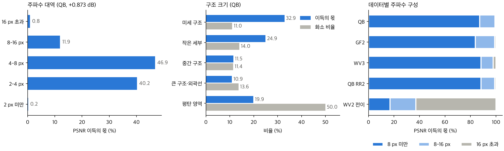

## 6. 결과 이미지

고정 6장면(QB RR test 0-based 0·1·3·7·14·17)에서 원본 SSA-MRN과 C2MS를 seed 42로 비교했습니다. 이번 분석의 대상이 원본 대비 이득이므로 비교 상대를 원본으로 두었습니다. 장면은 정답만 보고 풍경 종류로 고른 표준 장면입니다.

원본 크기 비교는 LR MS · PAN · 원본 · C2MS · 정답과 두 오차 지도(같은 색 척도)입니다. 확대 비교는 C2MS 개선이 가장 큰 64×64 창을 4배 확대한 정답 전체(노란 상자) · 원본 · C2MS · 정답 · 원본 오차 · C2MS 오차입니다. 확대 창은 C2MS에 유리하게 고른 것이므로 전체 차이는 장면 PSNR로 읽어야 합니다. 표시는 RGB 밴드 [2,1,0]에 장면별 정답 1-99% 늘이기를 썼습니다.

| 장면 | 풍경 | 장면 PSNR 원본 → C2MS | 확대 창 PSNR |
|---:|---|---|---|
| 0 | 바다·항구 방파제 | 41.45 → 42.81 dB | 35.30 → 37.38 dB |
| 1 | 부두·곡선 방파제·수목 | 42.44 → 43.18 dB | 39.45 → 40.76 dB |
| 3 | 요트 마리나·운동장 | 36.22 → 37.96 dB | 33.03 → 35.36 dB |
| 7 | 숲 공원 | 38.83 → 39.41 dB | 36.54 → 38.12 dB |
| 14 | 언덕 공원·곡선 주택가 | 37.62 → 38.47 dB | 35.68 → 36.97 dB |
| 17 | 산지 녹지·산책로 | 38.73 → 39.40 dB | 35.11 → 36.09 dB |

### 장면 0 · 바다·항구 방파제

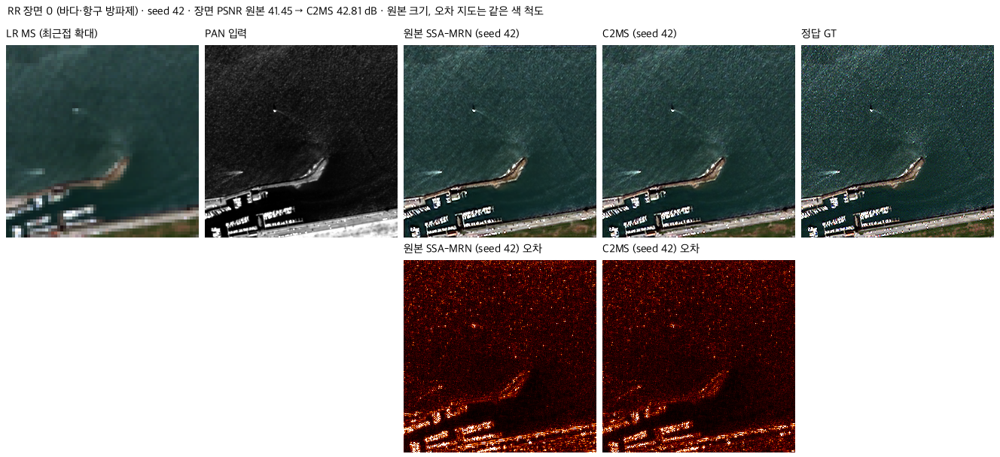

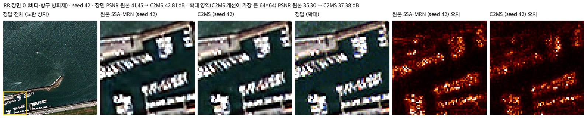

### 장면 1 · 부두·곡선 방파제·수목

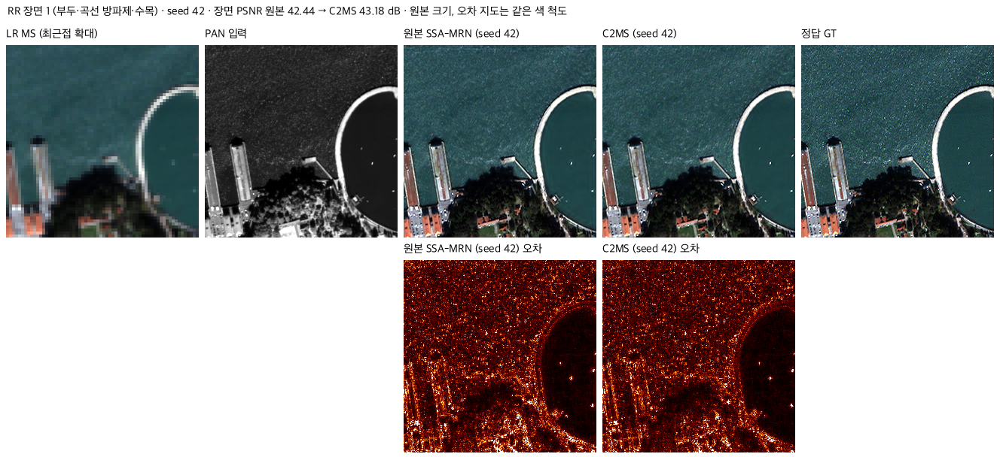

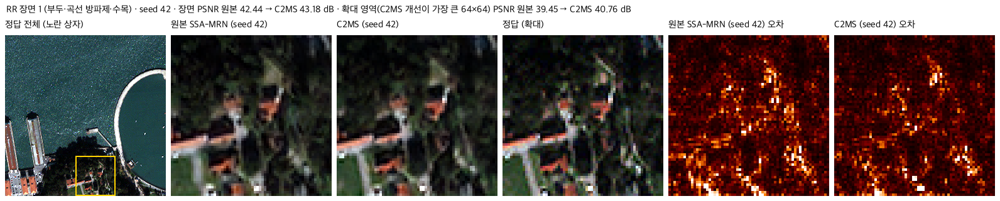

### 장면 3 · 요트 마리나·운동장

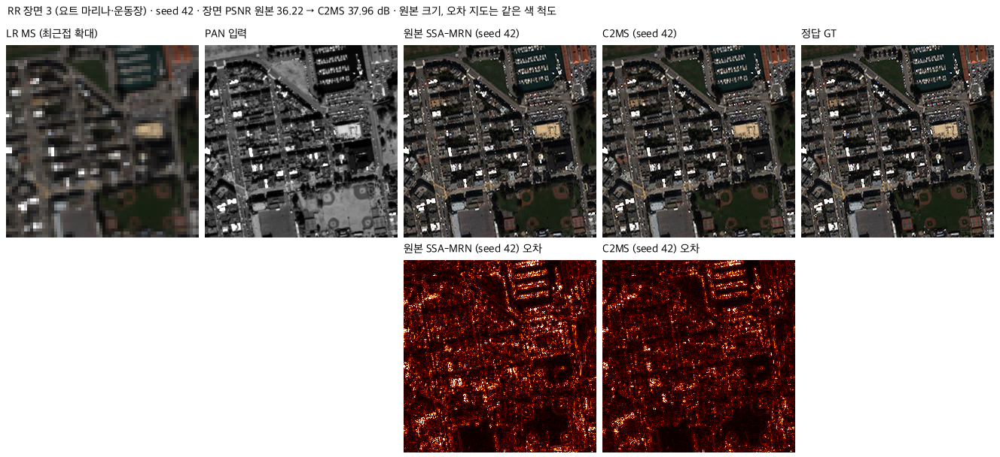

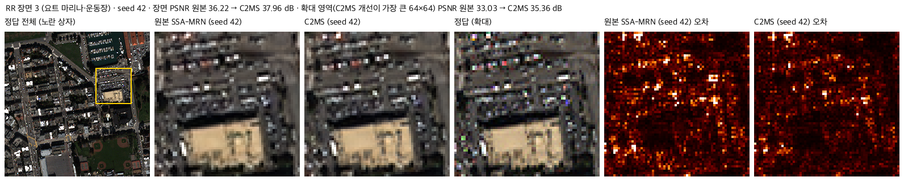

### 장면 7 · 숲 공원

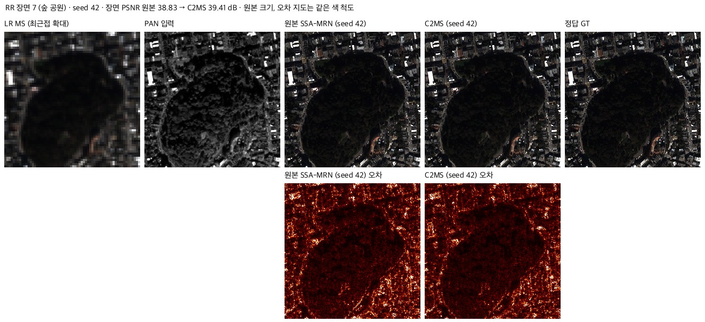

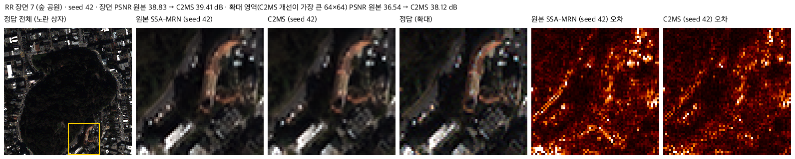

### 장면 14 · 언덕 공원·곡선 주택가

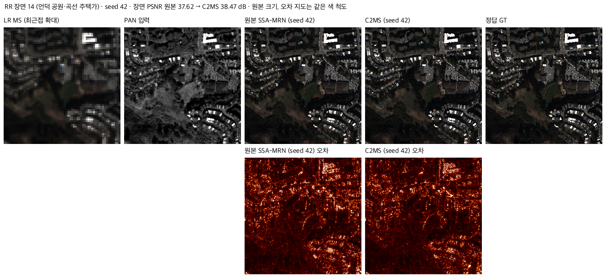

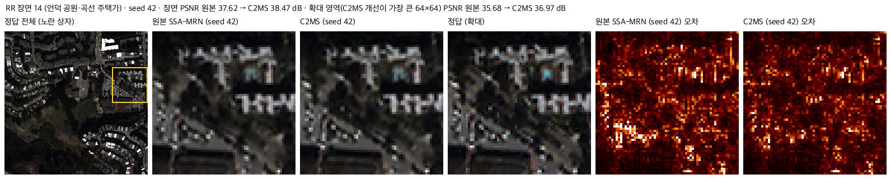

### 장면 17 · 산지 녹지·산책로

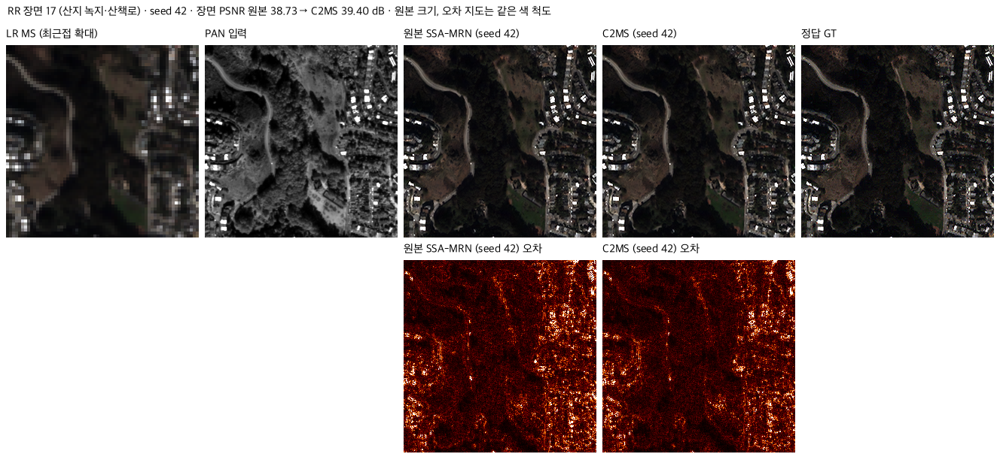

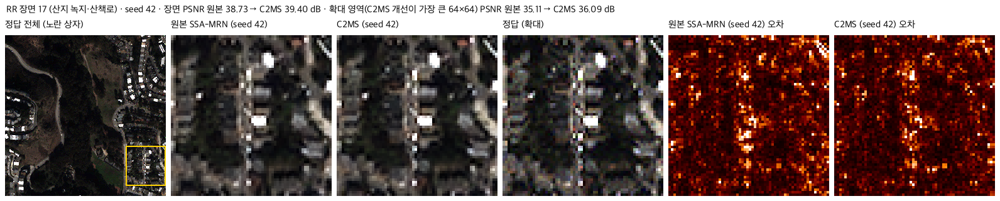

## 7. 재현 자료

- [config.json](config.json): 대역·구조 분류 정의, 정의를 정한 순서, 가중치 경로, 데이터 해시, 재현 허용폭.
- [prepare.py](prepare.py): 전체 계산. `--part check`(합성 영상 분류), `predict`(출력 생성·보관 PSNR 대조), `frequency`, `rr2`, `swap`, `structure`, `canny`(폐기한 분류), `headroom`, `selfcal`, `fine`, `images`, `summary`(집계·그래프). 예측 배열은 `--cache` 폴더에만 쓰고 보관하지 않습니다. [성능 68번 prepare.py](../68_ssai_folding_sam_split_seed_ensemble/prepare.py)의 Wald 연산과 추론 함수를 재사용합니다.
- `results/frequency_<QB|GF2|WV3|WV2|QB_RR2>.json`: 대역별 MSE·세기·기여·시드별 값·SAM 분해.
- `results/structure_<QB|GF2|WV3|WV2>.json`: 구조별 기여·장면별 값·임계값 민감도·대비 구간·대역 교차표·밝기와 색 분해.
- `results/summary.json`, `results/band_swap_check.json`, `results/structure_check.json`, `results/structure_rejected_canny.json`, `results/reproduction.json`.
- `results/fine_detail.json`(4 px 미만 원인 진단), `results/fine_headroom.json`(시드 평균·국소 PAN 세기 상한), `results/fine_selfcal.json`(입력 기반 세기 보정).
- 보존 파일 해시는 [manifest.json](manifest.json)에 있고 `python SSA-MRN/common/verify.py --experiment 72_c2ms_gain_frequency_structure_analysis --research-track performance`로 확인합니다. 해시 확인과 성능 재평가는 별개입니다.
- 실행: 저장소 루트에서 `python SSA-MRN/experiments/performance/72_c2ms_gain_frequency_structure_analysis/prepare.py --cache <임시 폴더>`(데이터는 `SSA-MRN/data/`).

## 8. 개선 여부와 다음 단계

**성능 비교 아님**입니다. 학습 없는 사후 분석이며 기준 모델은 C2MS로 유지합니다.

| 질문 | 답 |
|---|---|
| 고주파인가, 저주파인가 | 학습한 센서는 고주파입니다(8 px 미만 83.9-88.2%). 학습하지 않은 WV2는 저주파입니다(16 px 초과 62.9%). |
| 큰 외곽선인가, 작은 세부인가 | QB·WV3는 작은 세부입니다(미세+작은 세부 57.8%·52.7%). GF2는 고르게 나뉘지만 감소율은 미세 구조가 가장 높습니다. 큰 외곽선도 개선됐지만 기여가 작습니다. |
| W2와 축척 혼합의 차이 | W2는 세부 세기를 키웠고, 축척 혼합은 정답과 상관없는 성분을 줄였습니다. |

| 2-4 px 오차는 왜 남는가 | QB·WV3는 위치 어긋남이 아니며 단순 PAN 보정 여지도 1-2%입니다. GF2만 보정 여지가 17-23%입니다. |
이 결과가 가리키는 다음 확인 항목은 세 가지입니다.

- 학습 센서의 수치를 올리려면 시드 앙상블로 드러난 여지가 가장 큽니다. 3시드 평균은 구성원 평균보다 QB +0.256 dB, GF2 +0.373 dB, WV3 +0.285 dB였습니다.
- 2-4 px 오차를 직접 겨냥하는 변경은 GF2에서 먼저 시험합니다. 선형 시험 기준 전체 이득 어림값은 GF2 약 +0.3 dB, QB 약 +0.06 dB, WV3 약 +0.04 dB입니다. 이 값은 남은 오차 중 4 px 미만 비율에 선형 보정 감소율을 곱한 것입니다.
- WV2는 4-8 px 세부가 늘었는데 정확해지지 않았고, 2 px 미만 오차가 늘었습니다. 전이 성능은 세부를 더 넣는 것만으로 올라가지 않습니다.
