# 73. C2MS L1 학습의 높은 학습률 단계 감소와 학습 연장

**연구 분야:** 기존 성능 개선

**실험자:** 이병현

**변경 내용:** C2MS 구조와 축척 혼합 학습은 그대로 두고 학습 조건만 바꿉니다. 손실은 [성능 63번](../63_l1_reconstruction_loss/README.md)과 같은 L1이고, 학습률을 4e-4에서 시작해 100에폭마다 0.7배로 줄이며 360에폭 학습합니다. 학습 길이만의 효과를 나누기 위해 1e-4 cosine으로 360에폭 학습하는 갈래도 함께 둡니다.

| 확인된 결과 | 상태 | 개선 여부 |
|---|:---:|:---:|
| validation과 test가 반대로 움직였습니다. **C2MS_L1S**(4e-4 단계 감소)는 validation PSNR이 53번 C2MS보다 +0.189 dB 높았지만, test RR은 PSNR −0.295 dB(20장 중 19장 하락)·SAM −0.027°·ERGAS +0.130이었습니다. **C2MS_L1C**(1e-4 cosine 360에폭)는 RR PSNR −0.026 dB·SAM −0.043°입니다. 두 갈래 모두 SAM만 좋아져 v2.3 부분 개선이고, 1단계 관문은 둘 다 통과하지 못했습니다. | 평가&nbsp;완료 seed42 | 부분&nbsp;개선 |

[실험 목록](../../../research/performance/README.md) · [수치](#results) · [그래프](#graphs) · [이미지](#images) · [재현 자료](#evidence)

## 1. 목적과 상태

QB에서 C2MS보다 수치가 높은 모델들은 C2MS보다 3-5배 작지만 학습 조건이 다릅니다. 확인한 다섯 편은 모두 L1 손실을 쓰고, 최대 학습률이 3e-4에서 2e-3이며, 200-800에폭 학습했습니다.

| 모델 | QB PSNR / SAM (논문 보고) | 파라미터 | 학습 조건 |
|---|---:|---:|---|
| S2WMamba | 38.533 / 4.445 | 0.63M | L1, AdamW 4e-4, 100에폭마다 ×0.7, 360에폭 |
| U2Net + PAKAN | 38.520 / 4.439 | 미기재 | L1, Adam 4e-4, 100에폭마다 ×0.7, 500에폭 |
| CANNet | 38.488 / 4.496 | 미기재 | L1, Adam 5e-4 고정, QB 200에폭 |
| LFormer | 38.674 / 4.382 | 0.59M | L1 + 0.1 SSIM, Adam 3e-4, 300·500에폭에 ×0.1, 800에폭 (WV3·GF2 기준) |
| C2MS | 38.302 / 4.576 (3시드) | 2.85M | MSE, Adam 1e-4 → 1e-6 cosine, 150에폭 |

반면 C2MS 전체 네트워크는 지금까지 1e-4보다 높은 학습률로 학습한 적이 없습니다(61·62번의 1e-3은 작은 헤드만 학습). 관련 기록은 다음과 같습니다.

- [성능 63번](../63_l1_reconstruction_loss/README.md): 같은 일정에서 손실만 L1로 바꿔 QB seed 42 RR +0.084 dB·SAM −0.060°였습니다.
- [성능 59번](../59_extended_cosine_training/README.md): MSE로 300에폭 학습해 GF2 +0.205 dB·WV3 +0.366 dB였지만, QB는 validation +0.096 dB인데 test가 −0.284 dB였습니다.
- [성능 72번](../72_c2ms_gain_frequency_structure_analysis/README.md): 학습 센서에서 남은 여지 중 가장 큰 것은 시드마다 달라지는 오차였고, 구조를 바꾸는 가지 실험의 대조군이 이 실험 결과에 따라 달라질 수 있어 먼저 확인합니다.

**가설:** C2MS가 용량이 아니라 학습 일정 때문에 덜 학습됐다면, 구조를 바꾸지 않고 학습률을 높여 길게 학습하는 것만으로 RR PSNR이 오르고 SAM이 내려갑니다.

2026-11-03 계획을 등록하고 학습 코드를 작성했습니다. 같은 날 확인한 서버는 재구성돼 있었습니다. 원본 데이터만 `C:\CtrS\PAN-MS`로 다시 복사돼 있고, 이전 학습 캐시·실행 폴더·torch 환경은 남아 있지 않았습니다. 그래서 새 Python 환경(Python 3.11.17, torch 2.7.1+cu128; 이전 학습은 Python 3.10.6, 같은 torch)을 설치하고 학습 캐시를 H5에서 새로 만들었습니다. 다시 만든 정규화·거친 쌍 캐시는 63번에 기록된 해시와 모두 같았습니다.

20:02 KST에 C2MS_L1S 학습을 시작해 3에폭 안정성 확인을 통과했고(건너뛴 AMP 업데이트 0, 학습 L1 0.0152 → 0.0093), 2026-11-04 03:39에 360에폭을 마쳤습니다. 이어서 C2MS_L1C를 03:40부터 11:21까지 학습했고, 11:23에 두 갈래의 test 평가와 비교를 마쳤습니다. 기준 모델은 C2MS로 유지합니다.

## 2. 변경한 구조와 비교 조건

구조는 C2MS와 같습니다(2,853,918개). 바꾸는 것은 학습 조건뿐입니다.

| 항목 | C2MS (53번, 공식 대조군) | C2MS_L1 (63번, 참조) | **C2MS_L1S** | **C2MS_L1C** |
|---|---|---|---|---|
| 손실 | 원래 쌍 MSE + 거친 쌍 MSE | 원래 쌍 L1 + 거친 쌍 L1 | 63번과 같음 | 63번과 같음 |
| 학습률 | 1e-4 → 1e-6 cosine | 같음 | **4e-4, 100에폭마다 ×0.7** | 1e-4 → 1e-6 cosine |
| 에폭 | 150 | 150 | **360** | **360** |
| 그 밖의 조건 | Adam, batch 32, FP16 AMP, channels_last, seed 42 | 같음 | 같음 | 같음 |
| 가중치 선택 | 원래 축척 validation MSE 최소(에폭 0 포함) | 같음 | 같음 | 같음 |

C2MS_L1S의 학습률은 1-100에폭 4e-4, 101-200에폭 2.8e-4, 201-300에폭 1.96e-4, 301-360에폭 1.372e-4입니다. S2WMamba와 PAKAN의 일정을 그대로 따랐습니다.

| 비교 | 나뉘는 효과 |
|---|---|
| 각 갈래 대 53번 C2MS | 공식 판정(v2.3) |
| C2MS_L1S 대 C2MS_L1C | 같은 손실·길이에서 학습률 일정의 효과 |
| C2MS_L1C 대 63번 | 같은 손실·학습률에서 학습 길이의 효과 |

대조군은 다시 학습하지 않습니다. 63번과 같은 이유로, 보관된 53번 C2MS를 공식 대조군으로 쓰고 57번 재학습 C2MS를 RR2·관측 비율의 참조로 함께 보고합니다.

### 사전에 정한 단계와 관문

| 단계 | 내용 | 다음으로 가는 조건 |
|---|---|---|
| 안정성 확인 | C2MS_L1S 3에폭 | 손실이 모두 유한하고, 건너뛴 AMP 업데이트가 1% 이하이며, 3에폭 학습 손실이 1에폭보다 낮을 것. 실패하면 멈추고 학습률은 사용자 승인 없이 바꾸지 않음 |
| 1. 선별 | QB seed 42, 두 갈래 | 53번 대비 v2.3 통과, RR PSNR +0.06 dB 이상, validation PSNR도 53번보다 높을 것 |
| 2. 센서 확장 | 통과한 갈래의 GF2·WV3 seed 42, WV2 전이 보고 | 사용자 승인 후 진행 |
| 3. 시드 확장 | 통과한 센서의 seed 43·44 | 3시드 평균 v2.3. 기준 모델 교체에는 3시드 개선이 필요 |

| 항목 | 내용 |
|---|---|
| 데이터 | QB train 17,139개·validation 1,905개(64×64), test RR·FR 각 20장. 파일 SHA-256을 config와 대조 |
| 실행 | 서버 RTX 3060 Ti 1장, 한 번에 한 학습, 새 실행 폴더. 학습 캐시는 해시 확인 후 재사용 |
| 실제 시간 | 갈래당 약 7시간 40분(에폭당 약 76초, 53번은 150에폭에 약 3시간) |
| 보고 | 에폭별 validation PSNR·SAM, RR·RR2·FR_WALD·FR 관측, FR QNR·Dλ·Ds(참고), 72번 주파수 분해 |

## 3. 정량 결과

QB RR·FR test 20장 평균입니다. 다섯 모델을 같은 서버·같은 코드로 함께 평가했습니다. 장면별 수치는 갈래마다 `results/<갈래>_QB_s42/evaluation/QB_v2_3.json`에 있습니다.

| 모델 | RR PSNR | RR SAM | RR ERGAS | RR2 PSNR / SAM | FR_WALD PSNR / SAM | FR 관측 RMSE (DN) |
|---|---:|---:|---:|---:|---:|---:|
| C2MS (53번, 공식 대조군) | 38.2738 | 4.5770 | 3.7230 | 39.4206 / 4.0639 | 37.7183 / 4.0410 | 15.65 |
| C2MS (57번 재학습, RR2 고정 대조값) | 38.2829 | 4.5736 | 3.7193 | 39.1148 / 4.2410 | 37.7389 / 4.0247 | 17.59 |
| C2MS L1 (63번, 150에폭 참조) | 38.3577 | 4.5172 | 3.6964 | 39.2345 / 4.1779 | 37.8258 / 3.9638 | 20.69 |
| **C2MS_L1S** (4e-4 단계 감소, 360에폭) | 37.9784 | 4.5496 | 3.8528 | **39.8385 / 3.9218** | 37.4681 / 3.9787 | 18.43 |
| **C2MS_L1C** (1e-4 cosine, 360에폭) | 38.2479 | 4.5344 | 3.7408 | 38.8286 / 4.3915 | 37.8116 / 3.9595 | 18.21 |

### v2.3 판정

주 판정(RR)·FR_WALD·관측 비율은 같은 시드의 53번 C2MS와, RR2는 [2026-10-27 QB 고정 대조값](../../../docs/judgement_criteria.md#qb-rr2-고정-대조값-2026-10-27)(57번 재학습 C2MS seed 42, 39.1148 dB / 4.2410°)과 비교했습니다.

| 갈래 | ΔRR PSNR / SAM / ERGAS | RR2 ΔPSNR / ΔSAM (고정 대조값) | FR_WALD ΔPSNR / ΔSAM | 관측 비율 | 판정 |
|---|---|---|---|---:|---|
| C2MS_L1S | −0.2954 / −0.0274 / +0.1298 | +0.7237 / −0.3192 | −0.2502 ✗ / −0.0622 | 1.178 ✗ | **부분 개선** (SAM만 개선) |
| C2MS_L1C | −0.0258 / −0.0427 / +0.0178 | −0.2862 ✗ / +0.1505 ✗ | +0.0934 / −0.0814 | 1.164 ✗ | **부분 개선** (SAM만 개선) |

- 53번 대비 개선 장면 수(PSNR / SAM)는 L1S가 RR 1 / 20, RR2 19 / 17, FR_WALD 2 / 20이고, L1C가 RR 8 / 20, RR2 2 / 3, FR_WALD 17 / 20입니다.
- 서버 평가 기록(`evaluation_complete.json`)의 `official_vs_53`은 RR2까지 53번과 비교한 값입니다. 고정 대조값으로 바꿔도 두 갈래의 판정은 같습니다.
- 참고 지표 FR QNR은 53번 0.826 대비 L1S 0.896·L1C 0.935이고, Ds는 0.151 → 0.085·0.046입니다. 판정에는 쓰지 않습니다.

### 두 갈래와 63번 비교 (같은 L1 손실)

| 비교 | 나뉘는 효과 | ΔRR PSNR / SAM / ERGAS | ΔRR2 PSNR | ΔFR_WALD PSNR | Δvalidation PSNR |
|---|---|---|---:|---:|---:|
| C2MS_L1S − C2MS_L1C | 학습률 일정 (같은 길이) | −0.2695 / +0.0152 / +0.1120 | +1.0099 | −0.3436 | +0.115 |
| C2MS_L1C − 63번 | 학습 길이 (같은 학습률) | −0.1098 / +0.0172 / +0.0444 | −0.4059 | −0.0141 | +0.147 |

### 1단계 관문

| 조건 | C2MS_L1S | C2MS_L1C |
|---|---|---|
| 53번 대비 v2.3 개선 | 부분 개선 ✗ | 부분 개선 ✗ |
| test RR PSNR +0.06 dB 이상 | −0.295 dB ✗ | −0.026 dB ✗ |
| validation PSNR이 53번보다 높음 | +0.189 dB ✓ | +0.074 dB ✓ |

두 갈래 모두 통과하지 못해 2단계(GF2·WV3)와 3단계(seed 43·44)는 진행하지 않았습니다. 통과한 갈래에 적용하기로 한 72번 주파수 분해도 하지 않았습니다.

### validation (선택 가중치)

| 모델 | 선택 에폭 | 원래 축척 PSNR / SAM | 거친 축척 PSNR / SAM |
|---|---:|---:|---:|
| C2MS (53번) | 149 | 40.283 / 4.226 | 46.846 / 2.480 |
| C2MS L1 (63번) | 150 | 40.209 / 4.201 | 47.138 / 2.384 |
| C2MS_L1S | 204 | **40.472 / 4.136** | **47.268 / 2.338** |
| C2MS_L1C | 360 | 40.356 / 4.153 | 47.139 / 2.388 |

AMP에서 건너뛴 업데이트는 L1S 74회·L1C 72회(각 192,960회 중 0.04%)였습니다.

## 4. 기준선 대비 차이와 해석

- **가설은 QB seed 42에서 확인되지 않았습니다.** 학습률을 4배로 올리면 validation은 52에폭에 이미 53번 C2MS의 최종값을 넘었고, 최종 +0.189 dB·−0.091°까지 좋아졌습니다. 그러나 같은 가중치의 test RR PSNR은 −0.295 dB였고, 20장 중 19장에서 내려갔습니다. 장면 하나의 이상치가 아니라 거의 모든 장면에서 같은 방향입니다.
- **validation과 test가 반대로 움직이는 QB 현상이 다시 나타났습니다.** [성능 59번](../59_extended_cosine_training/README.md)(MSE 300에폭)도 validation +0.096 dB·test −0.284 dB였습니다. 이번 두 비교(학습률, 학습 길이)도 모두 validation은 오르고 test RR은 내려갔습니다. 반대로 [성능 63번](../63_l1_reconstruction_loss/README.md)은 validation −0.073 dB·test +0.084 dB였습니다. QB에서는 학습을 더 강하게 하거나 길게 할수록 validation 점수와 test 점수의 방향이 어긋나므로, validation만으로 학습 조건을 고르면 test에서 손해를 볼 수 있습니다. validation 패치가 어떻게 나뉘었는지와 이 차이의 원인은 이번에 확인하지 않았습니다.
- **거친 축척은 반대로 크게 좋아졌습니다.** L1S의 RR2는 53번 대비 +0.418 dB(19/20장), 고정 대조값 대비 +0.724 dB였고, 거친 축척 validation도 +0.42 dB 높았습니다. 원래 축척 RR과 FR_WALD는 내려갔으므로, 높은 학습률이 2배 거친 쌍에 더 잘 맞추는 방향으로 학습을 이끈 것으로 보입니다. 다만 RR2는 같은 조건에서도 실행마다 0.3 dB 넘게 흔들리므로([성능 57번](../57_c2ms_training_conditions/README.md)), 단일 시드로 원인을 단정하지 않습니다.
- **같은 학습률로 길게만 학습해도 원래 축척 test는 좋아지지 않았습니다.** L1C는 63번보다 validation이 +0.147 dB 높았지만 test RR은 −0.110 dB였고, 53번 대비로는 −0.026 dB로 잡음 수준입니다. 63번에서 얻은 L1의 RR 이득(+0.084 dB)은 360에폭으로 늘리자 사라졌습니다.
- **SAM은 모든 L1 모델에서 조금씩 낮았습니다.** 53번 대비 RR SAM은 63번 −0.060°, L1C −0.043°, L1S −0.027°이고, 세 모델 모두 20장 전부에서 낮아졌습니다. 이번 판정이 개선 없음이 아니라 부분 개선인 것은 이 SAM 때문입니다.
- **상위 모델의 학습 조건을 그대로 옮기는 것은 C2MS에 맞지 않았습니다.** 상위 모델은 0.6M 안팎으로 C2MS(2.85M)보다 3-5배 작습니다. 같은 학습률·길이에서 C2MS는 학습 데이터 분포에 더 빨리, 더 많이 맞춰지는 것으로 보입니다. C2MS의 남은 여지는 학습 일정보다 다른 곳에 있다고 판단합니다.

## 5. 학습·평가 그래프

53번 C2MS, 63번 L1, 두 갈래의 validation PSNR·SAM을 수렴 구간으로 확대했습니다. 가중치는 validation MSE 최소 에폭(L1S 204, L1C 360)에서 선택됐습니다.

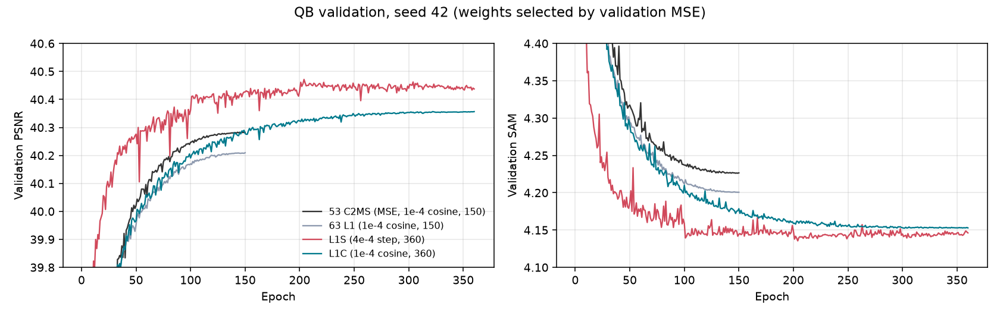

53번 C2MS 대비 test PSNR·SAM 차이입니다. RR과 FR_WALD는 원래 축척, RR2는 2배 거친 축척입니다.

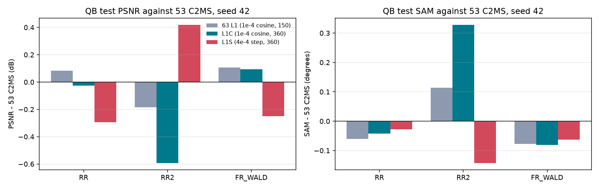

갈래별 학습 L1·validation PSNR·validation SAM·학습률 전체 곡선입니다.

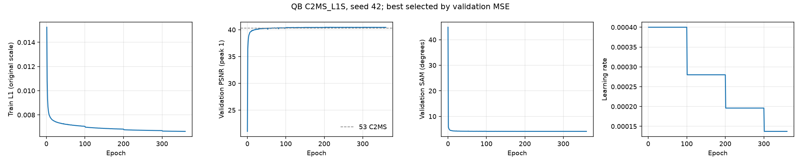

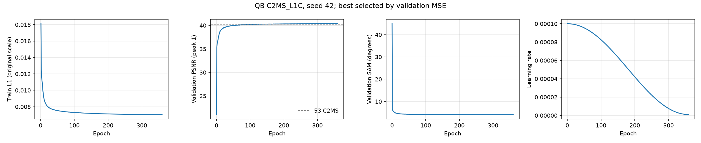

## 6. 결과 이미지

고정 6장면(QB RR test 0-based 0·1·3·7·14·17, seed 42)에서 현재 기준 C2MS(53번)와 각 갈래를 비교했습니다. 장면은 정답만 보고 풍경으로 미리 정했고 결과를 보고 바꾸지 않았습니다. 관문을 통과한 갈래가 없어, 주 가설인 L1S를 본문에 싣고 L1C는 접어 두었습니다. `common/result_images.py`로 서버 평가 중에 만들었습니다.

원본 크기 비교는 256×256 전체 장면의 **LR MS · PAN · C2MS · 후보 · 정답**과 **C2MS 오차 · 후보 오차**(같은 색 척도)입니다. 확대 비교는 후보의 개선이 가장 큰 64×64 창을 4배 확대한 **정답 전체(노란 상자) · C2MS · 후보 · 정답 · C2MS 오차 · 후보 오차**입니다. **확대 창은 장면마다 후보에 가장 유리한 곳을 고른 것**이라, 장면 전체가 나빠진 경우에도 확대 창은 좋아 보입니다. 전체 차이는 장면 PSNR로 판단합니다.

| 장면 | 풍경 | 장면 PSNR C2MS → L1S | 차이 | 장면 PSNR C2MS → L1C | 차이 |
|---:|---|---:|---:|---:|---:|
| 0 | 바다·항구 방파제 | 42.812 → 41.814 | −0.998 | 42.812 → 42.747 | −0.065 |
| 1 | 부두·곡선 방파제·수목 | 43.179 → 43.252 | +0.073 | 43.179 → 43.261 | +0.082 |
| 3 | 요트 마리나·운동장 | 37.964 → 37.673 | −0.291 | 37.964 → 38.200 | +0.235 |
| 7 | 숲 공원 | 39.405 → 39.301 | −0.104 | 39.405 → 39.159 | −0.246 |
| 14 | 언덕 공원·곡선 주택가 | 38.473 → 38.175 | −0.298 | 38.473 → 38.422 | −0.051 |
| 17 | 산지 녹지·산책로 | 39.396 → 39.266 | −0.130 | 39.396 → 39.517 | +0.120 |

**장면 0 (바다·항구 방파제) · C2MS_L1S · 원본 크기와 확대 비교**

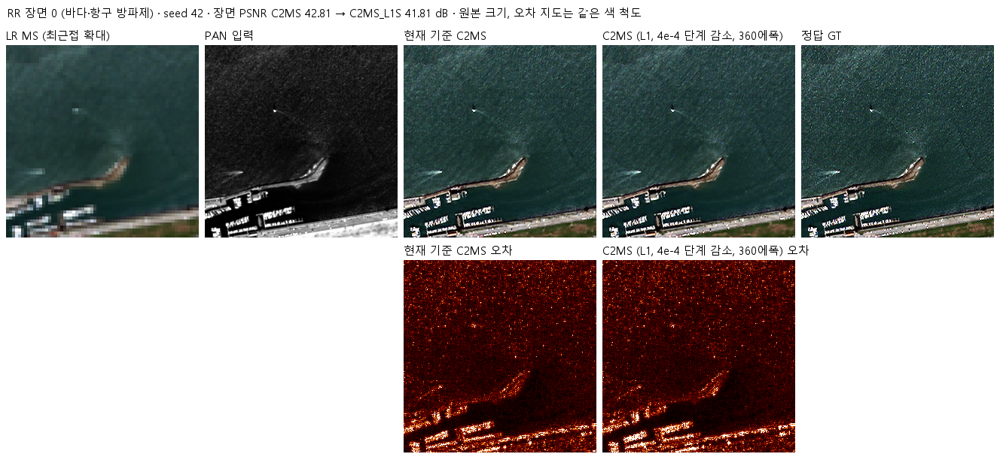

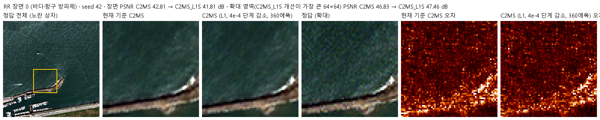

C2MS_L1S · 장면 1·3·7·14·17

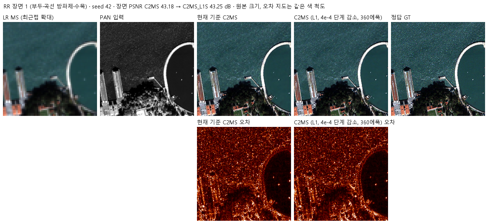

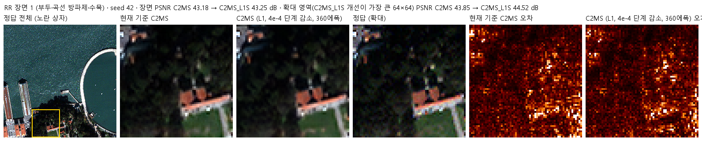

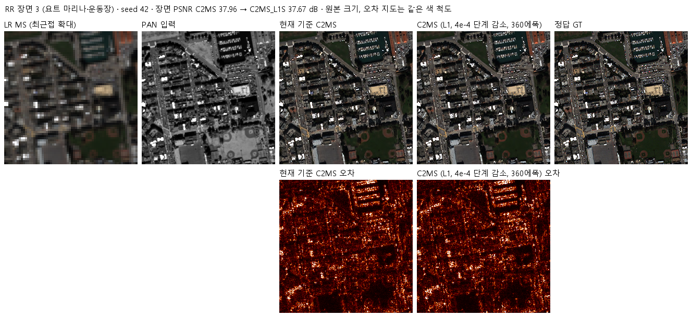

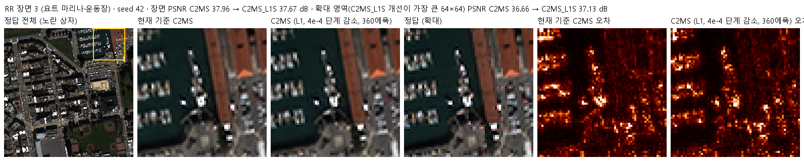

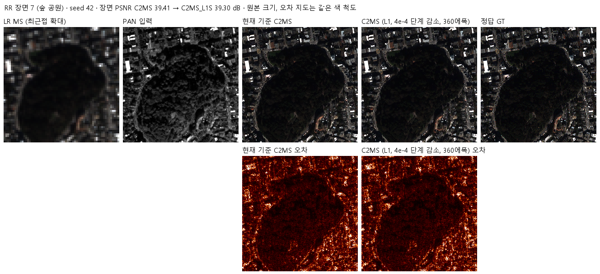

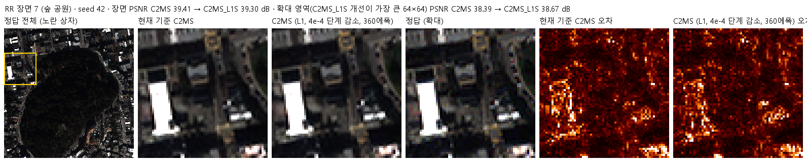

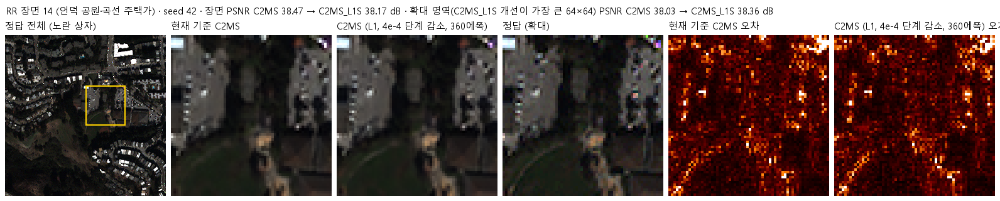

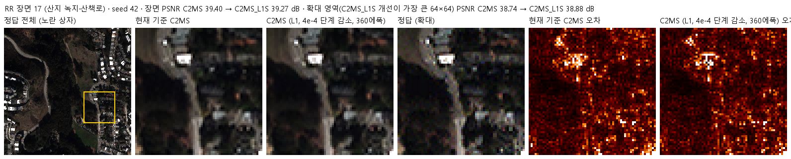

C2MS_L1C · 장면 0·1·3·7·14·17

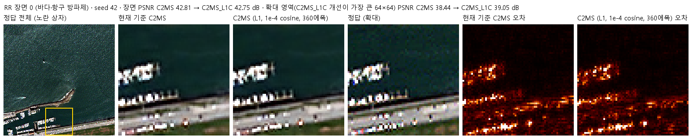

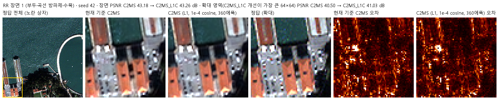

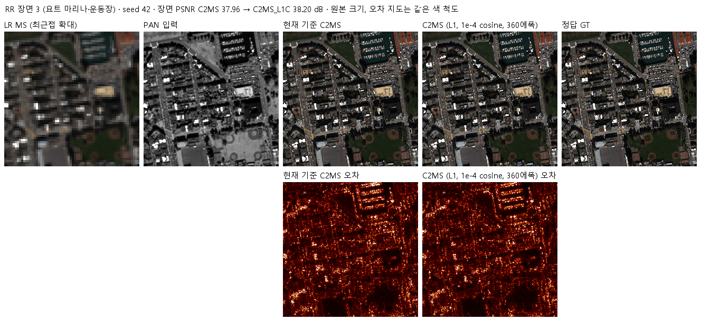

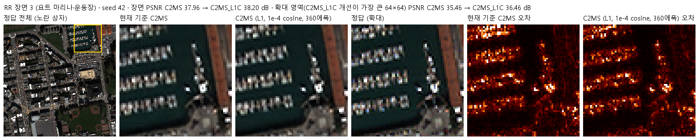

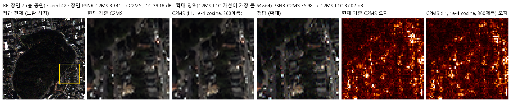

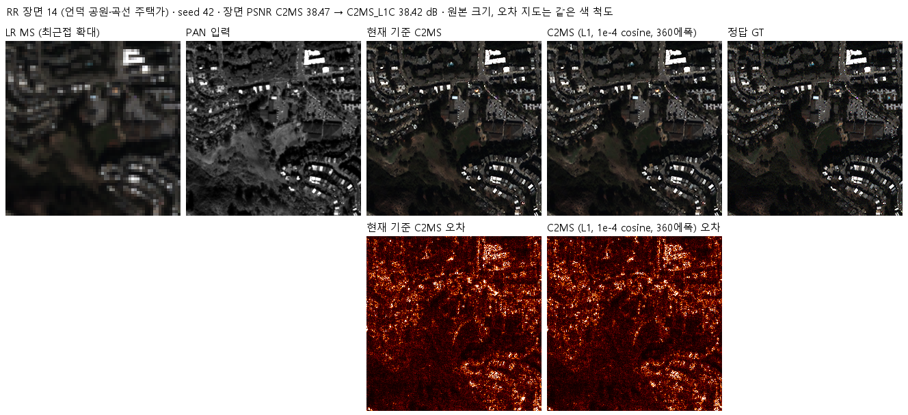

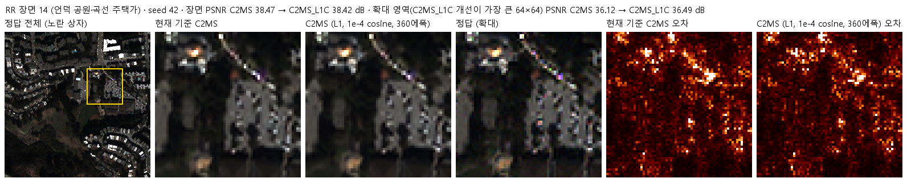

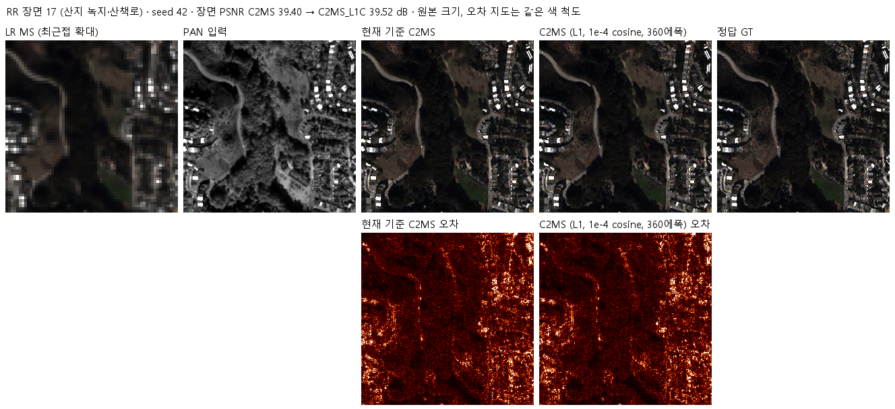

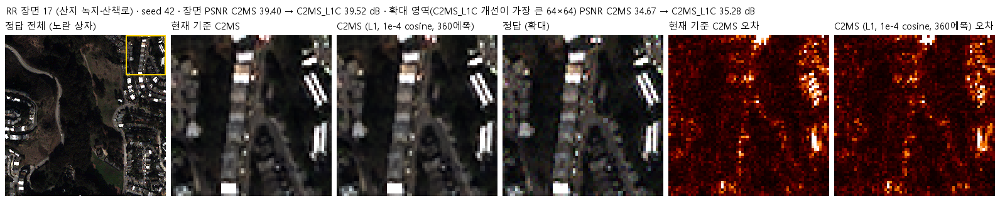

## 7. 재현 자료

- [config.json](config.json): 학습 전에 고정한 가설·갈래·학습률 일정·비교·관문·데이터 해시. 서버에 봉인된 설정과 소스 해시는 [runtime_config.json](provenance/run_records/runtime_config.json)에 있습니다. 저장소의 학습·평가 소스는 봉인 해시와 같고, config.json은 평가 후 첫머리의 상태·개선 여부 필드만 바꿨습니다.
- [train.py](train.py): 54번 학습기에서 L1 손실(63번과 같은 다섯 곳), 갈래별 학습률 일정, 3에폭 안정성 확인만 바꿉니다. 각 치환은 정확히 한 번 일치해야 실행됩니다.
- [run.py](run.py): 캐시를 H5에서 새로 만들어 63번 기록 해시와 대조하고, 설정을 봉인한 뒤 두 갈래를 차례로 학습·평가합니다.
- [evaluate.py](evaluate.py): 각 갈래를 53번(공식), 57번·63번(참조)과 v2.3으로 비교하고, 마지막에 두 갈래를 비교합니다([comparisons.json](results/comparisons.json)).
- [model.py](model.py), [prepare.py](prepare.py): C2MS 구조와 54번 센서 연산을 그대로 씁니다.
- 가중치: `checkpoints/C2MS_L1S_QB_s42/best.pt`(204에폭), `checkpoints/C2MS_L1C_QB_s42/best.pt`(360에폭). 재개용 `latest.pt`와 초기 `initial.pt`는 GitHub Release `weights-experiments-performance-73`에 있고 [manifest.json](manifest.json)의 `release_assets`에 기록했습니다.
- 결과: 갈래마다 `results/<갈래>_QB_s42/`의 `history.json`, `training_complete.json`, `evaluation_complete.json`, `evaluation/QB_v2_3.json`(장면별 RR·RR2·FR_WALD·FR), 학습 곡선과 결과 이미지. L1S에는 `stability_check.json`도 있습니다.
- 그래프: [provenance/figures73.py](provenance/figures73.py)가 보관된 결과만 읽어 `results/comparison.png`와 `results/validation_curves.png`를 그립니다(평가 후 로컬에서 생성).
- 실행 기록: `provenance/run_records/`(준비·벤치마크·preflight·컨트롤러 기록, 캐시 manifest, 환경), 서버 소스 manifest·검증 결과, 설치·전송·실행 스크립트, 설치한 패키지 목록(`pip_freeze.txt`).

## 8. 개선 여부와 다음 단계

QB seed 42에서 두 갈래 모두 RR SAM만 조금 낮아지고 PSNR·ERGAS는 나빠져 **부분 개선**입니다. C2MS_L1S는 validation이 가장 좋았지만 test RR PSNR이 −0.295 dB로, 실제로는 C2MS보다 나쁩니다. 1단계 관문을 통과한 갈래가 없어 센서·시드 확장은 하지 않았습니다. 기준 모델은 C2MS로 유지합니다.

- 학습률을 높이거나 학습을 길게 하는 방향은 QB에서 원래 축척 test를 개선하지 못했습니다. 이후 구조 변경 실험은 지금처럼 53번 C2MS(1e-4 cosine, 150에폭)를 대조군으로 두면 됩니다.
- QB에서 validation과 test의 방향이 어긋나는 현상이 59·63·73번에서 반복됐습니다. 학습 조건을 다시 비교한다면 QB validation 한 가지로 고르지 말고, test가 validation과 같은 방향인지 함께 확인해야 합니다.
