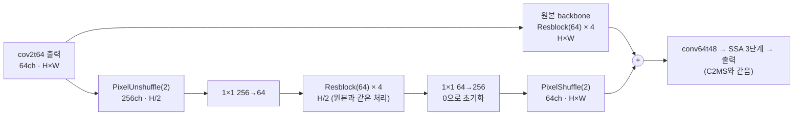

# 74. W2 병렬 가지의 폭·깊이를 원본 backbone과 같게 줄인 C2MS

**연구 분야:** 성능 개선

**실험자:** 이병현

**변경 내용:** C2MS의 W2 병렬 가지에서 PixelUnshuffle(2)·PixelShuffle(2)는 그대로 두고, 그 사이를 원본 backbone과 같은 처리(64채널 잔차 블록 4개)로 바꿨습니다. 가지 파라미터는 2,427,264개에서 328,512개로, 모델 전체는 2,853,918개에서 755,166개로 줄어듭니다. 학습 조건은 53번 C2MS와 같습니다.

| 확인된 결과 | 상태 | 개선 여부 |
|---|:---:|:---:|
| 아직 없습니다. QB seed 42로 학습합니다. | 계획 | 판단&nbsp;보류 |

[실험 목록](../../../research/performance/README.md) · [수치](#results) · [그래프](#graphs) · [이미지](#images) · [재현 자료](#evidence)

## 1. 목적과 상태

C2MS는 원본 SSA-MRN 대비 QB RR PSNR +0.873 dB를 냈지만, 파라미터 2.85M 중 85%(2.43M)가 W2 가지의 128채널 블록 8개입니다. 이 이득이 큰 용량에서 오는지, 절반 해상도에서 2×2 위치 정보를 섞어 처리하는 구조에서 오는지는 나눠 본 적이 없습니다.

- [성능 29번](../29_capacity_refinement/README.md): 같은 블록 8개를 원래 해상도에 붙인 W3는 원본 대비 +0.643 dB, PixelUnshuffle을 쓴 W2는 +0.723 dB였습니다(seed 42).
- [성능 72번](../72_c2ms_gain_frequency_structure_analysis/README.md): C2MS 이득의 87.3%가 주기 8 px 미만에서 나왔습니다.
- [성능 73번](../73_l1_step_learning_rate_schedule/README.md): QB에서 C2MS보다 수치가 높은 모델은 0.6M 안팎인데, C2MS를 더 빠르거나 길게 학습해도 QB test는 좋아지지 않았습니다.

**가설:** C2MS의 이득이 주로 절반 해상도 처리 구조에서 온다면, 가지 내부를 원본 backbone과 같은 크기로 줄여도(0.76M) 원본 대비 이득의 대부분이 남습니다.

2026-11-04 사용자 결정으로 등록하고 바로 학습을 시작합니다. 결과가 나오면 한 번에 보관합니다.

## 2. 변경한 구조와 비교 조건

| 항목 | C2MS (53번, 공식 대조군) | **C2MS_M (이번)** |
|---|---|---|
| 가지 해상도 | PixelUnshuffle(2) → H/2 | 같음 |
| 가지 진입·출구 | 1×1 256→128, 128→256 | **1×1 256→64, 64→256** |
| 가지 블록 | 128채널 × 8개 | **64채널 × 4개 (원본 backbone과 같음)** |
| 가지 파라미터 | 2,427,264 | **328,512** |
| 모델 전체 | 2,853,918 | **755,166** |
| 그 밖의 구조 | 원본 SSA-MRN K4 + 가지 출력을 원본 backbone 출력에 더함 | 같음 |
| 학습 | 원래 쌍 MSE + 1.0 × 2배 거친 쌍 MSE, Adam 1e-4 → 1e-6 cosine 150에폭, batch 32, FP16 AMP | 같음 |
| 가중치 선택 | 원래 축척 validation MSE 최소(에폭 0 포함) | 같음 |

- 블록은 원본 backbone의 `Resblock`과 같은 구조(3×3 합성곱 → ReLU → 3×3 합성곱 + 건너뛰기 연결)입니다.
- 마지막 1×1을 0으로 초기화해 초기 출력이 같은 시드의 원본 SSA-MRN(43번 C0)과 정확히 같습니다. 사전 검사에서 원본 부분의 가중치 해시와 초기 출력이 같은지 확인합니다.
- 용량(폭 128 → 64)과 깊이(8 → 4)가 함께 바뀝니다. 둘의 효과는 이번 실험으로 나누지 않습니다.

| 비교 | 의미 |
|---|---|
| C2MS_M 대 53번 C2MS | 공식 판정(v2.4, RR만) |
| C2MS_M 대 57번 재학습 C2MS | 같은 조건 C2MS의 실행 간 차이 참조 |
| C2MS_M 대 원본(43번 C0) | C2MS 이득 중 남은 비율 |

대조군은 다시 학습하지 않습니다. 가지를 1/7로 줄였으므로 C2MS보다 좋아지는 것은 기대하지 않으며, 원본 대비 이득이 얼마나 남는지를 함께 보고합니다. 다음 단계(seed 43·44 또는 GF2·WV3)는 결과를 보고 사용자가 결정합니다.

| 항목 | 내용 |
|---|---|
| 데이터 | QB train 17,139개·validation 1,905개(64×64), test RR·FR 각 20장. 파일 SHA-256을 config와 대조 |
| 실행 | 서버 RTX 3060 Ti 1장, 새 실행 폴더. 학습 캐시는 H5에서 다시 만들어 63번 기록 해시와 대조 |
| 예상 시간 | 약 3시간 |
| 보고 | 에폭별 validation PSNR·SAM, RR(판정), FR QNR·Dλ·Ds(참고), 원본 대비 이득 비율 |

## 3. 정량 결과

아직 없습니다.

## 4. 기준선 대비 차이와 해석

아직 없습니다.

## 5. 학습·평가 그래프

아직 없습니다.

## 6. 결과 이미지

아직 없습니다. 고정 6장면(QB RR test 0-based 0·1·3·7·14·17)에서 C2MS와 C2MS_M을 비교합니다.

## 7. 재현 자료

- [config.json](config.json): 학습 전에 고정한 가설·구조·비교·데이터 해시.
- [model.py](model.py): 원본 backbone과 같은 처리를 하는 축소 가지(`MatchedParallel`).
- [train.py](train.py): 54번 학습기를 그대로 쓰고, 사전 검사의 초기 상태 확인 한 곳만 바꿉니다(원본 부분이 43번 C0와 같고 초기 출력도 같은지).
- [run.py](run.py): 캐시를 H5에서 다시 만들어 63번 기록 해시와 대조하고, 설정을 봉인한 뒤 학습·평가합니다.
- [evaluate.py](evaluate.py): 53번(공식), 57번, 원본(43번 C0)과 RR로 비교하고 결과 이미지·그래프를 만듭니다.
- [prepare.py](prepare.py): 54번 센서 연산을 그대로 씁니다.

## 8. 개선 여부와 다음 단계

**판단 보류**입니다. 학습 전입니다.
