# 74. W2 병렬 가지의 폭·깊이를 원본 backbone과 같게 줄인 C2MS

**연구 분야:** 성능 개선

**실험자:** 이병현

**변경 내용:** C2MS의 W2 병렬 가지에서 PixelUnshuffle(2)·PixelShuffle(2)는 그대로 두고, 그 사이를 원본 backbone과 같은 처리(64채널 잔차 블록 4개)로 바꿨습니다. 가지 파라미터는 2,427,264개에서 328,512개로, 모델 전체는 2,853,918개에서 755,166개로 줄어듭니다. 학습 조건은 53번 C2MS와 같습니다.

| 확인된 결과 | 상태 | 개선 여부 |
|---|:---:|:---:|
| 53번 C2MS 대비 test RR PSNR −0.521 dB·SAM +0.317°·ERGAS +0.244로 세 지표가 모두 나빠져 개선 없음입니다(20장 모두 하락). 원본 SSA-MRN 대비로는 +0.385 dB·SAM −0.071°로 C2MS 이득(+0.907 dB)의 42%가 남았습니다. 파라미터는 C2MS의 26%(0.76M)입니다. | 평가&nbsp;완료 seed42 | 개선&nbsp;없음 |

[실험 목록](../../../research/performance/README.md) · [수치](#results) · [그래프](#graphs) · [이미지](#images) · [재현 자료](#evidence)

## 1. 목적과 상태

C2MS는 원본 SSA-MRN 대비 QB RR PSNR +0.873 dB를 냈지만, 파라미터 2.85M 중 85%(2.43M)가 W2 가지의 128채널 블록 8개입니다. 이 이득이 큰 용량에서 오는지, 절반 해상도에서 2×2 위치 정보를 섞어 처리하는 구조에서 오는지는 나눠 본 적이 없습니다.

- [성능 29번](../29_capacity_refinement/README.md): 같은 블록 8개를 원래 해상도에 붙인 W3는 원본 대비 +0.643 dB, PixelUnshuffle을 쓴 W2는 +0.723 dB였습니다(seed 42).
- [성능 72번](../72_c2ms_gain_frequency_structure_analysis/README.md): C2MS 이득의 87.3%가 주기 8 px 미만에서 나왔습니다.
- [성능 73번](../73_l1_step_learning_rate_schedule/README.md): QB에서 C2MS보다 수치가 높은 모델은 0.6M 안팎인데, C2MS를 더 빠르거나 길게 학습해도 QB test는 좋아지지 않았습니다.

**가설:** C2MS의 이득이 주로 절반 해상도 처리 구조에서 온다면, 가지 내부를 원본 backbone과 같은 크기로 줄여도(0.76M) 원본 대비 이득의 대부분이 남습니다.

2026-11-04 사용자 결정으로 등록하고 14:21 KST에 학습을 시작했습니다. 17:11에 150에폭 학습을, 17:12에 test 평가를 마쳤습니다. 기준 모델은 C2MS로 유지합니다.

## 2. 변경한 구조와 비교 조건

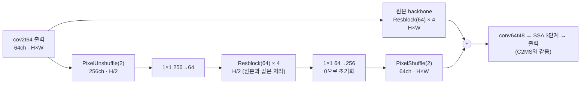

| 항목 | C2MS (53번, 공식 대조군) | **C2MS_M (이번)** |
|---|---|---|
| 가지 해상도 | PixelUnshuffle(2) → H/2 | 같음 |
| 가지 진입·출구 | 1×1 256→128, 128→256 | **1×1 256→64, 64→256** |
| 가지 블록 | 128채널 × 8개 | **64채널 × 4개 (원본 backbone과 같음)** |
| 가지 파라미터 | 2,427,264 | **328,512** |
| 모델 전체 | 2,853,918 | **755,166** |
| 그 밖의 구조 | 원본 SSA-MRN K4 + 가지 출력을 원본 backbone 출력에 더함 | 같음 |
| 학습 | 원래 쌍 MSE + 1.0 × 2배 거친 쌍 MSE, Adam 1e-4 → 1e-6 cosine 150에폭, batch 32, FP16 AMP | 같음 |
| 가중치 선택 | 원래 축척 validation MSE 최소(에폭 0 포함) | 같음 |

- 블록은 원본 backbone의 `Resblock`과 같은 구조(3×3 합성곱 → ReLU → 3×3 합성곱 + 건너뛰기 연결)입니다.
- 마지막 1×1을 0으로 초기화해 초기 출력이 같은 시드의 원본 SSA-MRN(43번 C0)과 정확히 같습니다. 사전 검사에서 원본 부분의 가중치 해시와 초기 출력이 같은지 확인합니다.
- 용량(폭 128 → 64)과 깊이(8 → 4)가 함께 바뀝니다. 둘의 효과는 이번 실험으로 나누지 않습니다.

| 비교 | 의미 |
|---|---|
| C2MS_M 대 53번 C2MS | 공식 판정(v2.4, RR만) |
| C2MS_M 대 57번 재학습 C2MS | 같은 조건 C2MS의 실행 간 차이 참조 |
| C2MS_M 대 원본(43번 C0) | C2MS 이득 중 남은 비율 |

대조군은 다시 학습하지 않습니다. 가지를 1/7로 줄였으므로 C2MS보다 좋아지는 것은 기대하지 않으며, 원본 대비 이득이 얼마나 남는지를 함께 보고합니다. 다음 단계(seed 43·44 또는 GF2·WV3)는 결과를 보고 사용자가 결정합니다.

| 항목 | 내용 |
|---|---|
| 데이터 | QB train 17,139개·validation 1,905개(64×64), test RR·FR 각 20장. 파일 SHA-256을 config와 대조 |
| 실행 | 서버 RTX 3060 Ti 1장, 새 실행 폴더. 학습 캐시는 H5에서 다시 만들어 63번 기록 해시와 대조 |
| 실제 시간 | 2시간 50분(에폭당 약 68초, 스텝 0.138초로 C2MS와 거의 같음) |
| 보고 | 에폭별 validation PSNR·SAM, RR(판정), FR QNR·Dλ·Ds(참고), 원본 대비 이득 비율, 두 학습 동시 실행 속도 |

## 3. 정량 결과

QB RR·FR test 20장 평균입니다. 네 모델을 같은 서버·같은 코드로 함께 평가했습니다. 장면별 수치는 [QB_v2_4.json](results/C2MS_M_QB_s42/evaluation/QB_v2_4.json)에 있습니다.

| 모델 | 파라미터 | RR PSNR | RR SAM | RR ERGAS | FR QNR / Dλ / Ds (참고) |
|---|---:|---:|---:|---:|---:|
| 원본 SSA-MRN (43번 C0) | 426,654 | 37.3671 | 4.9651 | 4.1554 | 0.917 / 0.043 / 0.042 |
| C2MS (53번, 공식 대조군) | 2,853,918 | 38.2738 | 4.5770 | 3.7230 | 0.826 / 0.027 / 0.151 |
| C2MS (57번 재학습, 참조) | 2,853,918 | 38.2829 | 4.5736 | 3.7193 | 0.828 / 0.025 / 0.151 |
| **C2MS_M (이번)** | **755,166** | **37.7524** | **4.8941** | **3.9670** | 0.925 / 0.031 / 0.046 |

### v2.4 판정

| 비교 | ΔRR PSNR / SAM / ERGAS | 개선 장면 수(PSNR / SAM) | 판정 |
|---|---|---:|---|
| **53번 C2MS 대비 (공식)** | −0.5214 / +0.3171 / +0.2440 | 0 / 0 | **개선 없음** |
| 57번 C2MS 대비 (참조) | −0.5305 / +0.3205 / +0.2476 | 0 / 0 | 개선 없음 |
| 원본 대비 (참조) | +0.3853 / −0.0710 / −0.1885 | 20 / 20 | 개선 |

### C2MS 이득 중 남은 비율

| 지표 | C2MS − 원본 | C2MS_M − 원본 | 남은 비율 |
|---|---:|---:|---:|
| RR PSNR | +0.907 dB | +0.385 dB | **42%** |
| RR SAM | −0.388° | −0.071° | 18% |
| RR ERGAS | −0.432 | −0.188 | 44% |

같은 seed 42 비교라 C2MS의 원본 대비 이득이 3시드 평균(+0.873 dB)과 조금 다릅니다.

### validation (선택 가중치)

| 모델 | 선택 에폭 | 원래 축척 PSNR / SAM | 거친 축척 PSNR |
|---|---:|---:|---:|
| C2MS (53번) | 149 | 40.283 / 4.226 | 46.846 |
| **C2MS_M** | 150 | 39.548 / 4.522 | 45.628 |

AMP에서 건너뛴 업데이트는 80,400회 중 21회였습니다.

### 두 학습 동시 실행 속도

학습과 평가가 끝나 GPU가 빈 뒤에, 버리는 모델로 C2MS_M 스텝 시간을 쟀습니다(각 40스텝 중앙값). 단독 학습 중 GPU 사용률은 41-47%였습니다.

| 실행 | 스텝 시간 | 초당 스텝(합계) |
|---|---:|---:|
| 단독 | 0.148초 | 6.8 |
| 두 개 동시 | 각 0.189초 | 10.6 |

두 개를 동시에 돌리면 전체 처리량이 약 1.5배가 됩니다. 150에폭 학습 두 개를 하나씩 차례로 돌리면 약 5.7시간, 동시에 돌리면 약 4시간으로 예상됩니다. 메모리는 하나당 0.36 GiB입니다.

## 4. 기준선 대비 차이와 해석

- **가설은 확인되지 않았습니다.** 가지를 원본 backbone 크기로 줄이자 C2MS 대비 RR이 세 지표 모두 나빠졌고, 20장 모두에서 PSNR·SAM이 C2MS보다 낮았습니다. 원본 대비 이득은 42%만 남았습니다. C2MS 이득의 절반 이상은 W2 가지의 큰 용량(128채널 × 8블록)에서 나옵니다.
- **SAM 이득이 특히 많이 줄었습니다.** PSNR·ERGAS는 C2MS 이득의 42-44%가 남았지만 SAM은 18%만 남았습니다. 밴드 간 색 관계를 맞추는 데 가지 용량이 더 많이 필요한 것으로 보입니다.
- **파라미터당 효율은 작은 가지가 높습니다.** C2MS의 W2 가지는 2.43M으로 +0.907 dB를, 줄인 가지는 0.33M으로 +0.385 dB를 냈습니다. 줄인 가지는 C2MS 가지 파라미터의 13.5%로 이득의 42%를 냈고, 나머지 +0.52 dB에는 2.1M이 더 들었습니다.
- **두 축척을 함께 맞추는 데서 차이가 더 컸습니다.** validation은 원래 축척 −0.73 dB, 2배 거친 축척 −1.22 dB였습니다. 작은 가지로는 축척 혼합 학습의 두 축척을 동시에 맞추기 어려웠습니다.
- **학습 시간은 줄지 않았습니다.** 스텝 시간이 C2MS와 거의 같았고(0.138초), 학습 중 GPU 사용률이 절반 정도였습니다. 이 모델에서 시간은 W2 가지가 아니라 SSA 단계의 작은 연산에서 주로 쓰입니다. 그래서 두 학습을 동시에 돌리면 처리량이 늘어납니다.
- 폭(128 → 64)과 깊이(8 → 4)가 함께 바뀌어, 둘 중 어느 쪽이 더 중요한지는 이번 결과로 나눌 수 없습니다.

## 5. 학습·평가 그래프

학습 MSE(원래 축척), validation PSNR·SAM, 학습률입니다. 점선은 53번 C2MS의 선택 가중치 validation PSNR입니다. 가중치는 validation MSE 최소인 150에폭이 선택됐습니다.

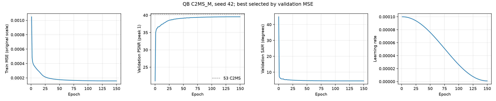

53번 C2MS 대비 test RR PSNR·SAM·ERGAS 차이입니다. 원본(43번 C0)과 57번 재학습 C2MS를 함께 표시했습니다.

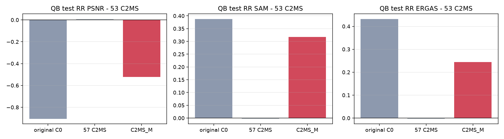

## 6. 결과 이미지

고정 6장면(QB RR test 0-based 0·1·3·7·14·17, seed 42)에서 현재 기준 C2MS(53번)와 C2MS_M을 비교했습니다. 장면은 정답만 보고 풍경으로 미리 정했고 결과를 보고 바꾸지 않았습니다. `common/result_images.py`로 서버 평가 중에 만들었습니다.

원본 크기 비교는 256×256 전체 장면의 **LR MS · PAN · C2MS · 후보 · 정답**과 **C2MS 오차 · 후보 오차**(같은 색 척도)입니다. 확대 비교는 후보의 개선이 가장 큰 64×64 창을 4배 확대한 **정답 전체(노란 상자) · C2MS · 후보 · 정답 · C2MS 오차 · 후보 오차**입니다. **확대 창은 장면마다 후보에 가장 유리한 곳을 고른 것**이라, 장면 전체가 나빠졌어도 확대 창은 좋아 보일 수 있습니다. 전체 차이는 장면 PSNR로 판단합니다.

| 장면 | 풍경 | 장면 PSNR (C2MS → C2MS_M) | 장면 차이 | 확대 창 PSNR (C2MS → C2MS_M) | 확대 창 차이 |
|---:|---|---:|---:|---:|---:|
| 0 | 바다·항구 방파제 | 42.812 → 42.413 | −0.398 | 43.779 → 44.165 | +0.386 |
| 1 | 부두·곡선 방파제·수목 | 43.179 → 42.648 | −0.531 | 51.934 → 51.514 | −0.420 |
| 3 | 요트 마리나·운동장 | 37.964 → 37.244 | −0.720 | 35.162 → 35.918 | +0.756 |
| 7 | 숲 공원 | 39.405 → 39.124 | −0.282 | 39.026 → 39.196 | +0.170 |
| 14 | 언덕 공원·곡선 주택가 | 38.473 → 37.942 | −0.531 | 44.787 → 44.559 | −0.228 |
| 17 | 산지 녹지·산책로 | 39.396 → 39.050 | −0.347 | 34.665 → 35.171 | +0.506 |

**장면 0 (바다·항구 방파제) · 원본 크기와 확대 비교**

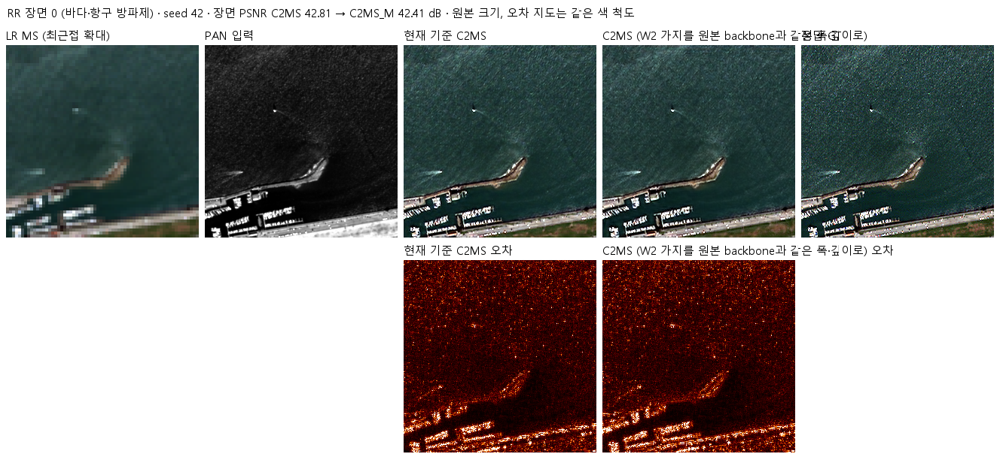

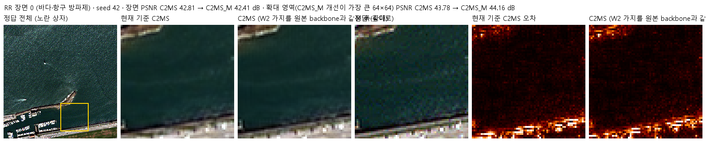

장면 1 · 두 비교 형식

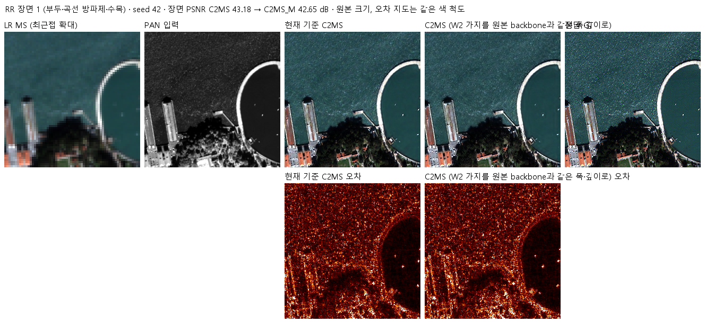

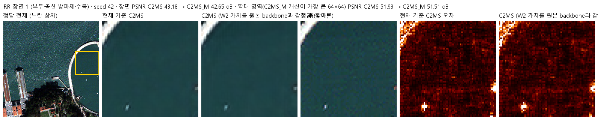

장면 3 · 두 비교 형식

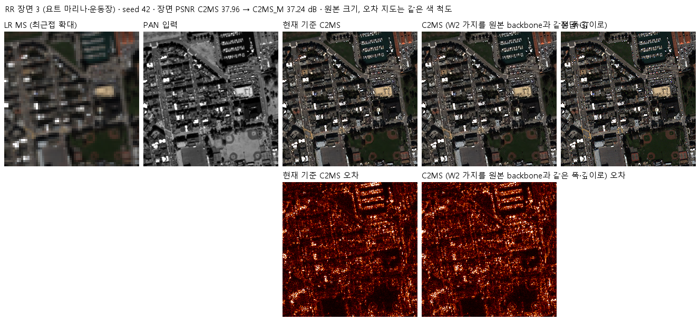

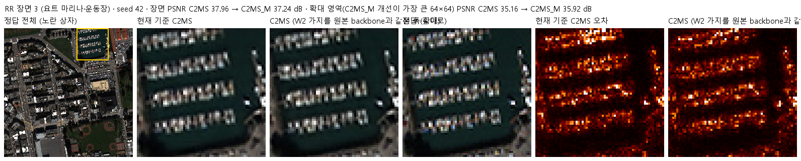

장면 7 · 두 비교 형식

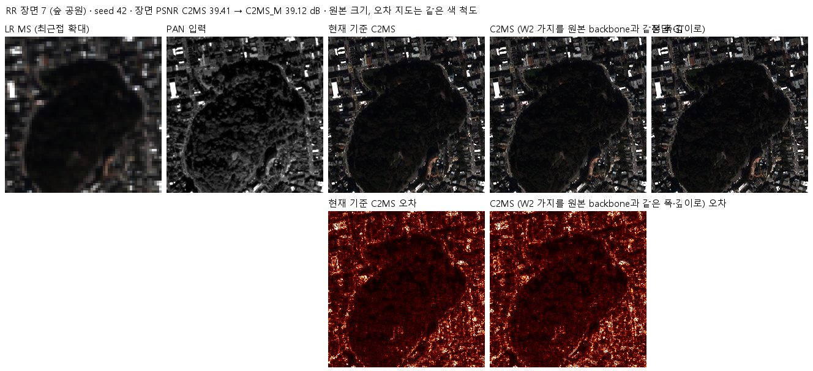

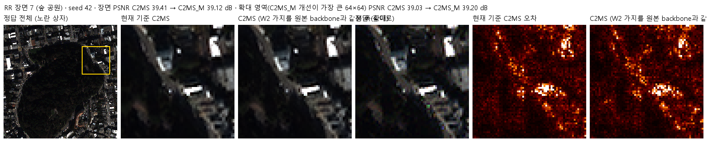

장면 14 · 두 비교 형식

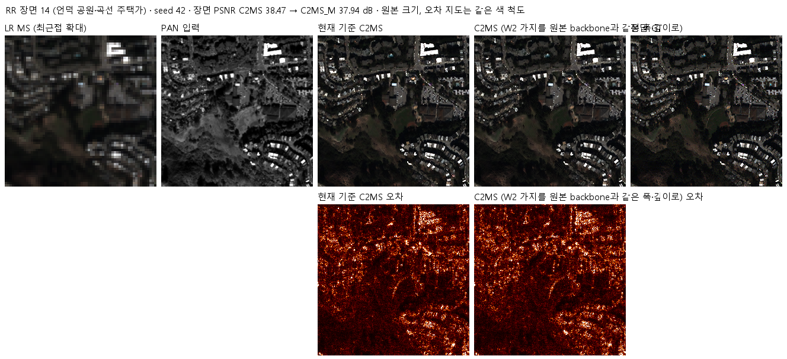

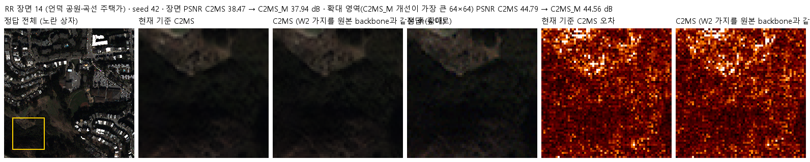

장면 17 · 두 비교 형식

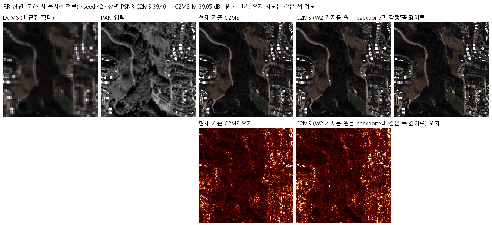

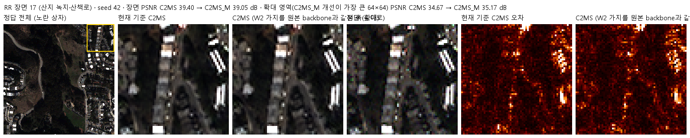

## 7. 재현 자료

- [config.json](config.json): 학습 전에 고정한 가설·구조·비교·데이터 해시. 서버에 봉인된 설정과 소스 해시는 [runtime_config.json](provenance/run_records/runtime_config.json)에 있습니다. 저장소의 학습·평가 소스는 봉인 해시와 같고, config.json은 평가 후 첫머리의 상태·개선 여부 필드만 바꿨습니다.
- [model.py](model.py): 원본 backbone과 같은 처리를 하는 축소 가지(`MatchedParallel`).
- [train.py](train.py): 54번 학습기를 그대로 쓰고, 사전 검사의 초기 상태 확인 한 곳만 바꿨습니다. 사전 검사에서 원본 부분의 가중치가 43번 C0와 같고 초기 출력이 비트 단위로 같은 것을 확인했습니다.
- [run.py](run.py): 캐시를 H5에서 다시 만들어 63번 기록 해시와 대조(정규화·거친 쌍 모두 일치)하고, 설정을 봉인한 뒤 학습·평가합니다.
- [evaluate.py](evaluate.py): 53번(공식), 57번, 원본(43번 C0)과 RR로 비교하고 결과 이미지·그래프를 만듭니다.
- [prepare.py](prepare.py): 54번 센서 연산을 그대로 씁니다.
- 가중치: `checkpoints/C2MS_M_QB_s42/best.pt`(150에폭). 재개용 `latest.pt`와 초기 `initial.pt`는 GitHub Release `weights-experiments-performance-74`에 있고 [manifest.json](manifest.json)의 `release_assets`에 기록했습니다.
- 결과: `results/C2MS_M_QB_s42/`의 `history.json`, `training_complete.json`, `evaluation_complete.json`, `evaluation/QB_v2_4.json`(장면별 RR·FR), 그래프와 결과 이미지.
- 실행 기록: `provenance/run_records/`(준비·벤치마크·두 학습 동시 실행 벤치마크·preflight·컨트롤러 기록, 캐시 manifest, 환경), 서버 소스 manifest·검증 결과, 전송·실행·벤치마크 스크립트.

## 8. 개선 여부와 다음 단계

QB seed 42에서 53번 C2MS 대비 RR 세 지표가 모두 나빠져 **개선 없음**입니다. 원본 대비로는 개선이지만 C2MS 이득의 42%만 남았고, C2MS 이득의 절반 이상은 W2 가지의 용량에서 나온다는 것을 확인했습니다. 기준 모델은 C2MS로 유지합니다.

- 가지를 줄이는 방향은 QB 수치를 높이는 목표와 맞지 않아 seed·센서 확장은 하지 않습니다.
- 폭과 깊이 중 어느 쪽이 중요한지 보려면 중간 크기(예: 128채널 × 4블록, 64채널 × 8블록)를 비교해야 합니다. 진행 여부는 사용자가 결정합니다.
- 이 계열 모델은 학습 하나가 GPU를 절반만 쓰므로, 이후 여러 시드·갈래 학습은 두 개를 동시에 돌리는 편이 시간상 유리합니다.
