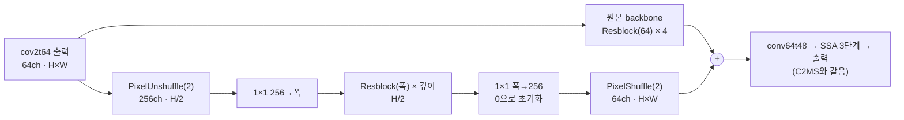

# 75. 축소한 W2 병렬 가지의 폭과 깊이 비교

**연구 분야:** 성능 개선

**실험자:** 이병현

**변경 내용:** C2MS의 W2 병렬 가지(128채널 × 8블록)와 [성능 74번](../74_backbone_matched_parallel_branch/README.md)의 축소 가지(64채널 × 4블록) 사이에서, 폭을 유지하고 깊이를 반으로 줄인 가지(128채널 × 4블록)와 깊이를 유지하고 폭을 반으로 줄인 가지(64채널 × 8블록)를 학습합니다. PixelUnshuffle(2)·PixelShuffle(2)와 학습 조건은 C2MS와 같고, 두 갈래를 서버에서 동시에 학습합니다.

| 확인된 결과 | 상태 | 개선 여부 |
|---|:---:|:---:|
| 아직 없습니다. QB seed 42로 두 갈래를 동시에 학습합니다. | 계획 | 판단&nbsp;보류 |

[실험 목록](../../../research/performance/README.md) · [수치](#results) · [그래프](#graphs) · [이미지](#images) · [재현 자료](#evidence)

## 1. 목적과 상태

[성능 74번](../74_backbone_matched_parallel_branch/README.md)에서 가지를 원본 backbone 크기(64채널 × 4블록)로 줄이자, C2MS 대비 RR이 −0.521 dB였고 원본 대비 이득은 42%(SAM은 18%)만 남았습니다. 학습 MSE가 50에폭부터 C2MS의 1.28배로 일정해, 학습 부족이 아니라 용량 부족이었습니다. 이번에는 가지 용량을 폭과 깊이 중 어느 쪽으로 늘려야 C2MS 이득이 돌아오는지 확인합니다.

**가설:** C2MS 이득이 가지의 폭(채널 수)에 주로 의존한다면 128채널 × 4블록이, 깊이(블록 수, 참조 범위)에 주로 의존한다면 64채널 × 8블록이 C2MS에 더 가깝습니다.

2026-11-04 사용자 결정으로 등록하고 바로 학습을 시작합니다. 74번 측정에서 이 계열 모델은 학습 하나가 GPU를 절반 정도만 써서, 두 갈래를 동시에 학습합니다. 결과가 나오면 한 번에 보관합니다.

## 2. 변경한 구조와 비교 조건

| 모델 | 가지 폭 × 깊이 | 가지 파라미터 | 모델 전체 |
|---|---|---:|---:|
| C2MS (53번, 공식 대조군) | 128 × 8 | 2,427,264 | 2,853,918 |
| **C2MS_W128D4 (이번)** | **128 × 4** | **1,246,592** | **1,673,246** |
| **C2MS_W64D8 (이번)** | **64 × 8** | **623,936** | **1,050,590** |
| C2MS_M (74번) | 64 × 4 | 328,512 | 755,166 |
| 원본 SSA-MRN | 가지 없음 | 0 | 426,654 |

- 가지 구조는 C2MS와 같고 폭과 깊이만 다릅니다. 블록은 3×3 합성곱 → ReLU → 3×3 합성곱 + 건너뛰기 연결입니다.
- 마지막 1×1을 0으로 초기화해 초기 출력이 같은 시드의 원본 SSA-MRN(43번 C0)과 정확히 같습니다. 사전 검사에서 원본 부분의 가중치 해시와 초기 출력을 확인합니다.
- 학습은 C2MS와 같습니다(원래 쌍 MSE + 1.0 × 2배 거친 쌍 MSE, Adam 1e-4 → 1e-6 cosine 150에폭, batch 32, FP16 AMP, validation MSE 최소 가중치 선택).

| 비교 | 의미 |
|---|---|
| 각 갈래 대 53번 C2MS | 공식 판정(v2.4, RR만) |
| 각 갈래 대 57번 재학습 C2MS | 같은 조건 C2MS의 실행 간 차이 참조 |
| 각 갈래 대 원본(43번 C0) | C2MS 이득 중 남은 비율(74번과 함께 용량 곡선으로 읽음) |
| 128 × 4 대 64 × 8 | 폭과 깊이 중 어느 쪽이 중요한지(판정 아님) |

| 항목 | 내용 |
|---|---|
| 데이터 | QB train 17,139개·validation 1,905개(64×64), test RR·FR 각 20장. 파일 SHA-256을 config와 대조 |
| 실행 | 서버 RTX 3060 Ti 1장에서 두 갈래 동시 학습, 새 실행 폴더. 학습 캐시는 H5에서 다시 만들어 63번 기록 해시와 대조 |
| 예상 시간 | 두 갈래 합쳐 약 4시간 |
| 보고 | 에폭별 validation PSNR·SAM, RR(판정), FR QNR·Dλ·Ds(참고), 원본 대비 이득 비율, 동시 학습 에폭 시간 |

두 학습이 GPU를 나눠 쓰므로 cuDNN이 고르는 연산 방식이 단독 학습과 다를 수 있습니다. 학습 방법은 같고, 부동소수점 세부만 달라질 수 있습니다.

## 3. 정량 결과

아직 없습니다.

## 4. 기준선 대비 차이와 해석

아직 없습니다.

## 5. 학습·평가 그래프

아직 없습니다.

## 6. 결과 이미지

아직 없습니다. 고정 6장면(QB RR test 0-based 0·1·3·7·14·17)에서 C2MS와 각 갈래를 비교합니다.

## 7. 재현 자료

- [config.json](config.json): 학습 전에 고정한 가설·구조·비교·데이터 해시.
- [model.py](model.py): 폭과 깊이를 인자로 받는 가지(`SizedParallel`).
- [train.py](train.py): 54번 학습기를 그대로 쓰고, 사전 검사의 초기 상태 확인 한 곳만 바꿉니다(74번과 같음).
- [run.py](run.py): 캐시를 H5에서 다시 만들어 63번 기록 해시와 대조하고, 설정을 봉인한 뒤 두 갈래를 동시에 학습하고 차례로 평가합니다.
- [evaluate.py](evaluate.py): 53번(공식), 57번, 원본(43번 C0)과 RR로 비교하고 결과 이미지·그래프를 만듭니다(74번과 같음).
- [prepare.py](prepare.py): 54번 센서 연산을 그대로 씁니다.

## 8. 개선 여부와 다음 단계

**판단 보류**입니다. 학습 전입니다.
