# 75. 축소한 W2 병렬 가지의 폭과 깊이 비교

**연구 분야:** 성능 개선

**실험자:** 이병현

**변경 내용:** C2MS의 W2 병렬 가지(128채널 × 8블록)와 [성능 74번](../74_backbone_matched_parallel_branch/README.md)의 축소 가지(64채널 × 4블록) 사이에서, 폭을 유지하고 깊이를 반으로 줄인 가지(128채널 × 4블록)와 깊이를 유지하고 폭을 반으로 줄인 가지(64채널 × 8블록)를 학습했습니다. PixelUnshuffle(2)·PixelShuffle(2)와 학습 조건은 C2MS와 같고, 두 갈래를 서버에서 동시에 학습했습니다.

| 확인된 결과 | 상태 | 개선 여부 |
|---|:---:|:---:|
| 53번 C2MS 대비 test RR이 128 × 4는 PSNR −0.201 dB·SAM +0.120°·ERGAS +0.094, 64 × 8은 −0.127 dB·+0.101°·+0.061로 두 갈래 모두 세 지표가 나빠져 개선 없음입니다. 원본 SSA-MRN 대비로는 C2MS 이득(+0.907 dB)의 78%(128 × 4, 1.67M)와 86%(64 × 8, 1.05M)가 남아, 74번(64 × 4, 42%)보다 크게 회복했습니다. 파라미터가 더 적은 64 × 8이 더 많이 남아, 이번 범위에서는 폭보다 깊이가 test 이득에 더 중요했습니다(단일 시드). | 평가&nbsp;완료 seed42 | 개선&nbsp;없음 |

[실험 목록](../../../research/performance/README.md) · [수치](#results) · [그래프](#graphs) · [이미지](#images) · [재현 자료](#evidence)

## 1. 목적과 상태

[성능 74번](../74_backbone_matched_parallel_branch/README.md)에서 가지를 원본 backbone 크기(64채널 × 4블록)로 줄이자, C2MS 대비 RR이 −0.521 dB였고 원본 대비 이득은 42%(SAM은 18%)만 남았습니다. 학습 MSE가 50에폭부터 C2MS의 1.28배로 일정해, 학습 부족이 아니라 용량 부족이었습니다. 이번에는 가지 용량을 폭과 깊이 중 어느 쪽으로 늘려야 C2MS 이득이 돌아오는지 확인합니다.

**가설:** C2MS 이득이 가지의 폭(채널 수)에 주로 의존한다면 128채널 × 4블록이, 깊이(블록 수, 참조 범위)에 주로 의존한다면 64채널 × 8블록이 C2MS에 더 가깝습니다.

2026-11-04 사용자 결정으로 등록하고 19:20 KST에 두 갈래를 동시에 학습하기 시작했습니다. 11-05 00:09에 150에폭 학습을, 00:10에 test 평가를 마쳤습니다. 기준 모델은 C2MS로 유지합니다.

## 2. 변경한 구조와 비교 조건

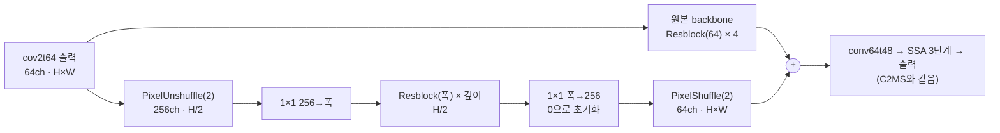

| 모델 | 가지 폭 × 깊이 | 가지 파라미터 | 모델 전체 |
|---|---|---:|---:|
| C2MS (53번, 공식 대조군) | 128 × 8 | 2,427,264 | 2,853,918 |
| **C2MS_W128D4 (이번)** | **128 × 4** | **1,246,592** | **1,673,246** |
| **C2MS_W64D8 (이번)** | **64 × 8** | **623,936** | **1,050,590** |
| C2MS_M (74번) | 64 × 4 | 328,512 | 755,166 |
| 원본 SSA-MRN | 가지 없음 | 0 | 426,654 |

- 가지 구조는 C2MS와 같고 폭과 깊이만 다릅니다. 블록은 3×3 합성곱 → ReLU → 3×3 합성곱 + 건너뛰기 연결입니다.
- 마지막 1×1을 0으로 초기화해 초기 출력이 같은 시드의 원본 SSA-MRN(43번 C0)과 정확히 같습니다. 사전 검사에서 두 갈래 모두 원본 부분의 가중치 해시와 초기 출력이 같은 것을 확인했습니다.
- 학습은 C2MS와 같습니다(원래 쌍 MSE + 1.0 × 2배 거친 쌍 MSE, Adam 1e-4 → 1e-6 cosine 150에폭, batch 32, FP16 AMP, validation MSE 최소 가중치 선택).

| 비교 | 의미 |
|---|---|
| 각 갈래 대 53번 C2MS | 공식 판정(v2.4, RR만) |
| 각 갈래 대 57번 재학습 C2MS | 같은 조건 C2MS의 실행 간 차이 참조 |
| 각 갈래 대 원본(43번 C0) | C2MS 이득 중 남은 비율(74번과 함께 용량 곡선으로 읽음) |
| 128 × 4 대 64 × 8 | 폭과 깊이 중 어느 쪽이 중요한지(판정 아님) |

| 항목 | 내용 |
|---|---|
| 데이터 | QB train 17,139개·validation 1,905개(64×64), test RR·FR 각 20장. 파일 SHA-256을 config와 대조 |
| 실행 | 서버 RTX 3060 Ti 1장에서 두 갈래 동시 학습, 새 실행 폴더. 학습 캐시는 H5에서 다시 만들어 63번 기록 해시와 대조 |
| 실제 시간 | 4시간 50분(두 갈래 동시, 에폭당 각 약 115초) |
| 보고 | 에폭별 validation PSNR·SAM, RR(판정), FR QNR·Dλ·Ds(참고), 원본 대비 이득 비율, 동시 학습 에폭 시간 |

두 학습이 GPU를 나눠 쓰므로 cuDNN이 고르는 연산 방식이 단독 학습과 다를 수 있습니다. 학습 방법은 같고, 부동소수점 세부만 달라질 수 있습니다.

## 3. 정량 결과

QB RR·FR test 20장 평균입니다. 각 갈래를 대조군 세 모델과 같은 서버·같은 코드로 함께 평가했습니다. 장면별 수치는 [128 × 4](results/C2MS_W128D4_QB_s42/evaluation/QB_v2_4.json)와 [64 × 8](results/C2MS_W64D8_QB_s42/evaluation/QB_v2_4.json)의 `QB_v2_4.json`에 있습니다. 74번 수치는 [74번 보고서](../74_backbone_matched_parallel_branch/README.md#results)에서 가져왔습니다(같은 평가 코드·같은 대조군 가중치).

| 모델 | 파라미터 | RR PSNR | RR SAM | RR ERGAS | FR QNR / Dλ / Ds (참고) |
|---|---:|---:|---:|---:|---:|
| 원본 SSA-MRN (43번 C0) | 426,654 | 37.3671 | 4.9651 | 4.1554 | 0.917 / 0.043 / 0.042 |
| C2MS (53번, 공식 대조군) | 2,853,918 | 38.2738 | 4.5770 | 3.7230 | 0.826 / 0.027 / 0.151 |
| C2MS (57번 재학습, 참조) | 2,853,918 | 38.2829 | 4.5736 | 3.7193 | 0.828 / 0.025 / 0.151 |
| **C2MS_W128D4 (이번, 128 × 4)** | **1,673,246** | **38.0732** | **4.6969** | **3.8173** | 0.893 / 0.029 / 0.080 |
| **C2MS_W64D8 (이번, 64 × 8)** | **1,050,590** | **38.1465** | **4.6785** | **3.7844** | 0.881 / 0.028 / 0.093 |
| C2MS_M (74번, 64 × 4) | 755,166 | 37.7524 | 4.8941 | 3.9670 | 0.925 / 0.031 / 0.046 |

### v2.4 판정

| 갈래 | 비교 | ΔRR PSNR / SAM / ERGAS | C2MS보다 좋은 장면 수(PSNR / SAM) | 판정 |
|---|---|---|---:|---|
| 128 × 4 | **53번 C2MS 대비 (공식)** | −0.2006 / +0.1199 / +0.0943 | 0 / 0 | **개선 없음** |
| 128 × 4 | 57번 C2MS 대비 (참조) | −0.2097 / +0.1233 / +0.0980 | 0 / 0 | 개선 없음 |
| 128 × 4 | 원본 대비 (참조) | +0.7061 / −0.2682 / −0.3381 | 원본보다 20 / 20 | 개선 |
| 64 × 8 | **53번 C2MS 대비 (공식)** | −0.1272 / +0.1015 / +0.0614 | 3 / 0 | **개선 없음** |
| 64 × 8 | 57번 C2MS 대비 (참조) | −0.1364 / +0.1048 / +0.0651 | 0 / 0 | 개선 없음 |
| 64 × 8 | 원본 대비 (참조) | +0.7794 / −0.2866 / −0.3710 | 원본보다 20 / 20 | 개선 |

### 가지 크기별 C2MS 이득 중 남은 비율

원본 대비 이득을 같은 seed 42의 C2MS 이득(PSNR +0.907 dB·SAM −0.388°·ERGAS −0.432)으로 나눈 값입니다.

| 가지 | 폭 × 깊이 | 가지 파라미터 | 원본 대비 RR PSNR | PSNR | SAM | ERGAS |
|---|---|---:|---:|---:|---:|---:|
| 74번 C2MS_M | 64 × 4 | 328,512 | +0.385 dB | 42% | 18% | 44% |
| **C2MS_W64D8** | **64 × 8** | **623,936** | **+0.779 dB** | **86%** | **74%** | **86%** |
| **C2MS_W128D4** | **128 × 4** | **1,246,592** | **+0.706 dB** | **78%** | **69%** | **78%** |
| C2MS | 128 × 8 | 2,427,264 | +0.907 dB | 100% | 100% | 100% |

### validation (선택 가중치)

| 모델 | 선택 에폭 | 원래 축척 PSNR / SAM | 거친 축척 PSNR | 150에폭 학습 MSE (C2MS 대비) |
|---|---:|---:|---:|---:|
| C2MS (53번) | 149 | 40.283 / 4.226 | 46.846 | 1.225e-4 (1.00배) |
| **C2MS_W128D4** | 149 | 39.914 / 4.358 | 46.272 | 1.417e-4 (1.16배) |
| **C2MS_W64D8** | 150 | 39.914 / 4.354 | 46.284 | 1.432e-4 (1.17배) |
| C2MS_M (74번) | 150 | 39.548 / 4.522 | 45.628 | 1.579e-4 (1.29배) |

AMP에서 건너뛴 업데이트는 80,400회 중 17회(128 × 4)와 20회(64 × 8)였습니다.

### 두 학습 동시 실행 속도

| 항목 | 128 × 4 | 64 × 8 |
|---|---:|---:|
| 단독 스텝 시간(학습 전 벤치마크, 40스텝 중앙값) | 0.143초 | 0.131초 |
| 동시 학습 에폭 시간(중앙값) | 115.0초 | 114.8초 |
| 학습 시간 합계 | 4.80시간 | 4.80시간 |
| GPU 메모리(예약 최대) | 0.44 GiB | 0.40 GiB |

74번은 단독 학습에서 스텝 0.138초·에폭 68초였습니다. 같은 비율로 계산하면 두 갈래를 하나씩 차례로 학습할 때 약 5.6시간이 걸리고, 동시에 학습해서 4.8시간이 걸렸습니다. 실제 이득은 **약 1.17배**로, 74번에서 학습 스텝만 잰 벤치마크(1.5배)보다 작았습니다. 벤치마크는 학습 스텝만 쟀고, 실제 학습에서는 매 에폭의 validation 두 축척 계산과 데이터 준비도 두 학습이 함께 나눠 쓰기 때문으로 보입니다(원인은 따로 측정하지 않았습니다).

## 4. 기준선 대비 차이와 해석

- **두 갈래 모두 C2MS를 넘지 못했습니다.** 53번 C2MS 대비 세 지표가 모두 나빠졌고, 128 × 4는 20장 모두에서, 64 × 8은 17장에서 PSNR이 C2MS보다 낮았습니다. SAM은 두 갈래 모두 20장 모두 C2MS보다 나빴습니다.
- **가지를 절반 크기로만 줄여도 이득 대부분이 남습니다.** 74번(64 × 4)의 42%에서 폭이나 깊이 한쪽만 두 배로 늘려도 78-86%로 회복했습니다. 이득과 가지 크기의 관계는 직선이 아니라, 작은 범위에서 빠르게 오르고 C2MS 크기 근처에서 완만해집니다.
- **이번 범위에서는 깊이가 폭보다 중요했습니다.** 74번에서 출발해 깊이를 두 배로 늘리면(+0.30M) RR +0.394 dB, 폭을 두 배로 늘리면(+0.92M) +0.321 dB였습니다. 깊이 쪽이 파라미터 3분의 1로 더 큰 test 이득을 냈습니다. 반대로 C2MS에서 깊이를 반으로 줄이면 −0.201 dB, 폭을 반으로 줄이면 −0.127 dB였습니다. 8블록은 4블록보다 절반 해상도에서 참조하는 범위가 두 배 넓습니다.
- **다만 차이는 test에서만 보이고 단일 시드입니다.** 두 갈래의 validation PSNR은 39.914로 소수 셋째 자리까지 같았고, 학습 MSE는 오히려 128 × 4가 약간 낮았습니다. test RR 차이 0.073 dB는 단일 시드 잡음 문턱(0.06 dB)을 조금 넘는 정도입니다. 폭이 넓은 쪽이 학습 데이터에 더 잘 맞지만 test로는 덜 이어졌을 수 있으나, 여러 시드로 확인하기 전에는 "깊이가 더 중요하다"를 확정하지 않습니다.
- **SAM 회복이 PSNR보다 늦습니다.** 남은 비율이 PSNR 78-86%, SAM 69-74%로, 74번(PSNR 42%, SAM 18%)과 같이 밴드 간 색 관계를 맞추는 데 가지 용량이 더 필요한 경향이 이어졌습니다.
- **두 축척을 함께 맞추는 차이는 남았습니다.** validation은 원래 축척 −0.37 dB, 2배 거친 축척 −0.57 dB로, 74번(−0.73, −1.22 dB)보다 줄었지만 거친 축척 쪽 차이가 더 컸습니다.
- FR(참고)에서는 가지가 작을수록 Ds가 낮아 QNR이 높았습니다(74번 0.925, 이번 0.881-0.893, C2MS 0.826). 판정에는 쓰지 않습니다.

## 5. 학습·평가 그래프

학습 MSE(원래 축척), validation PSNR·SAM, 학습률입니다. 점선은 53번 C2MS의 선택 가중치 validation PSNR입니다. 가중치는 validation MSE 최소인 149에폭(128 × 4)과 150에폭(64 × 8)이 선택됐습니다.

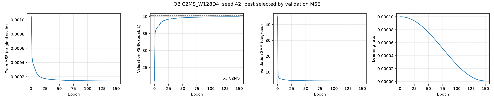

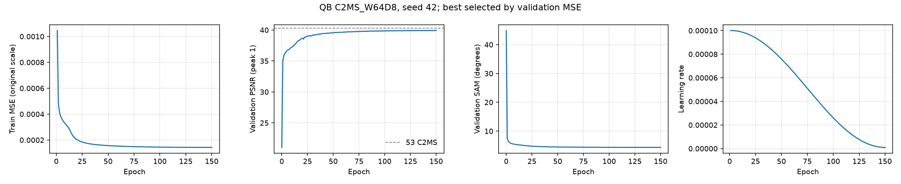

53번 C2MS 대비 test RR PSNR·SAM·ERGAS 차이입니다. 원본(43번 C0)과 57번 재학습 C2MS를 함께 표시했습니다.

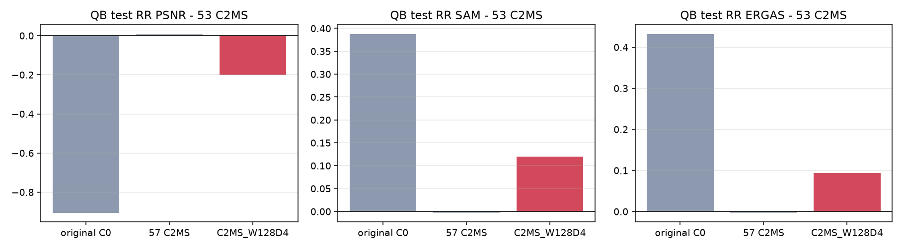

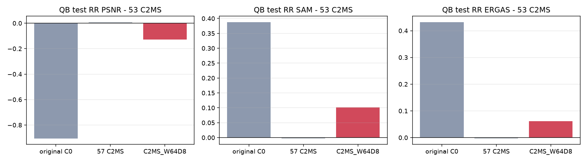

## 6. 결과 이미지

고정 6장면(QB RR test 0-based 0·1·3·7·14·17, seed 42)에서 현재 기준 C2MS(53번)와 각 갈래를 비교했습니다. 장면은 정답만 보고 풍경으로 미리 정했고 결과를 보고 바꾸지 않았습니다. `common/result_images.py`로 서버 평가 중에 만들었습니다.

원본 크기 비교는 256×256 전체 장면의 **LR MS · PAN · C2MS · 후보 · 정답**과 **C2MS 오차 · 후보 오차**(같은 색 척도)입니다. 확대 비교는 후보의 개선이 가장 큰 64×64 창을 4배 확대한 **정답 전체(노란 상자) · C2MS · 후보 · 정답 · C2MS 오차 · 후보 오차**입니다. **확대 창은 장면마다 후보에 가장 유리한 곳을 고른 것**이라, 장면 전체가 나빠졌어도 확대 창은 좋아 보일 수 있습니다. 전체 차이는 장면 PSNR로 판단합니다.

| 장면 | 풍경 | C2MS 장면 PSNR | 128 × 4 (차이) | 64 × 8 (차이) | 확대 창 차이 128 × 4 / 64 × 8 |
|---:|---|---:|---:|---:|---:|
| 0 | 바다·항구 방파제 | 42.812 | 42.701 (−0.110) | 42.813 (+0.002) | +0.306 / +0.615 |
| 1 | 부두·곡선 방파제·수목 | 43.179 | 42.936 (−0.243) | 43.010 (−0.169) | +0.258 / +0.351 |
| 3 | 요트 마리나·운동장 | 37.964 | 37.753 (−0.211) | 37.981 (+0.016) | +0.652 / +1.037 |
| 7 | 숲 공원 | 39.405 | 39.373 (−0.032) | 39.455 (+0.050) | +0.377 / +0.384 |
| 14 | 언덕 공원·곡선 주택가 | 38.473 | 38.283 (−0.190) | 38.274 (−0.199) | +0.030 / +0.094 |
| 17 | 산지 녹지·산책로 | 39.396 | 39.352 (−0.044) | 39.326 (−0.070) | +0.694 / +0.512 |

**장면 0 (바다·항구 방파제) · 128 × 4**

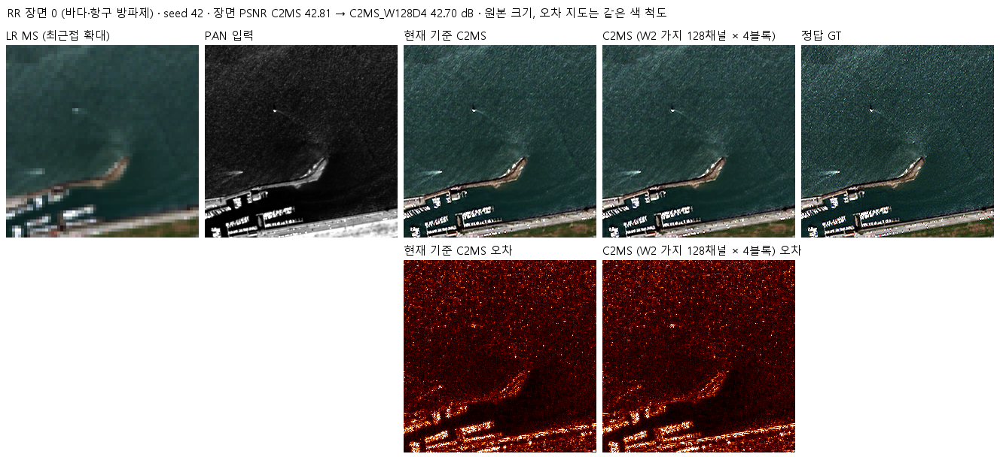

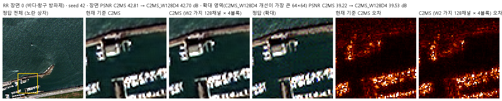

**장면 0 (바다·항구 방파제) · 64 × 8**

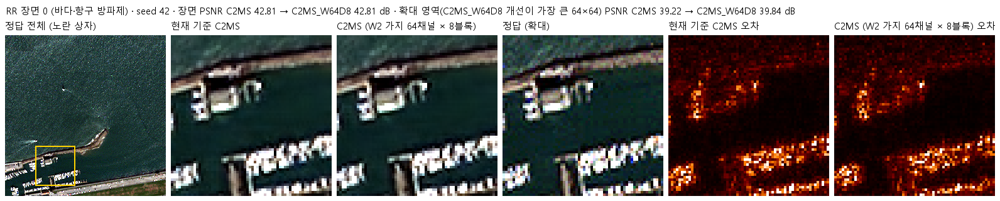

장면 1 · 두 갈래 · 두 비교 형식

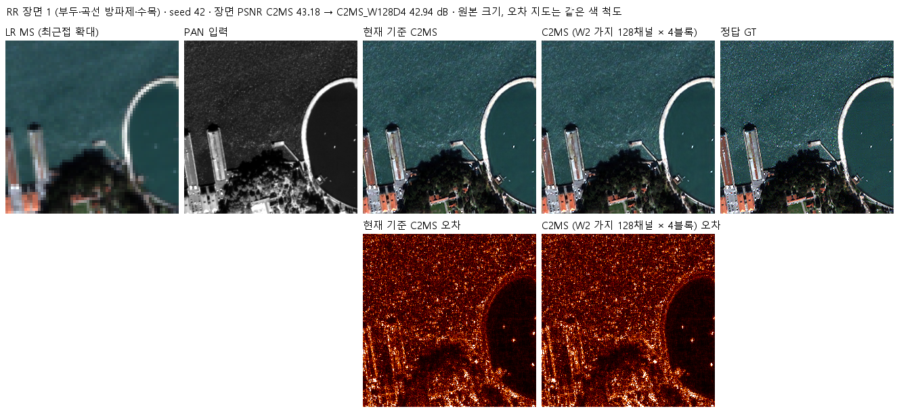

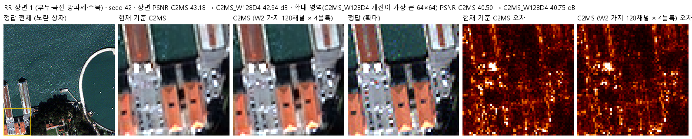

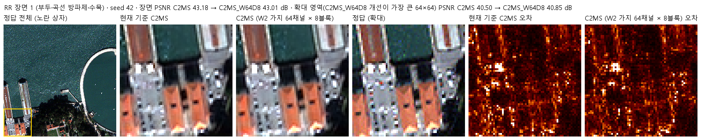

장면 3 · 두 갈래 · 두 비교 형식

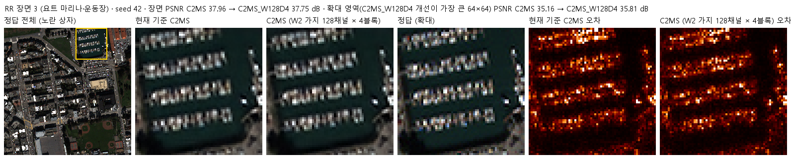

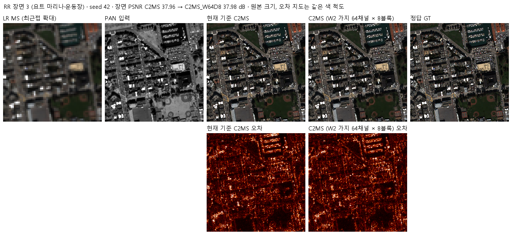

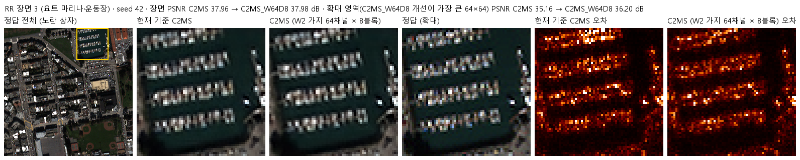

장면 7 · 두 갈래 · 두 비교 형식

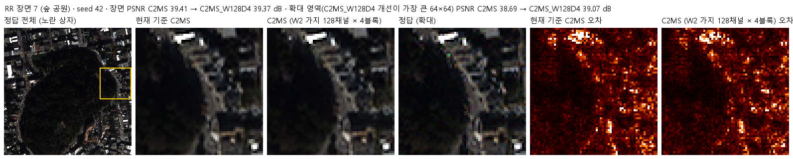

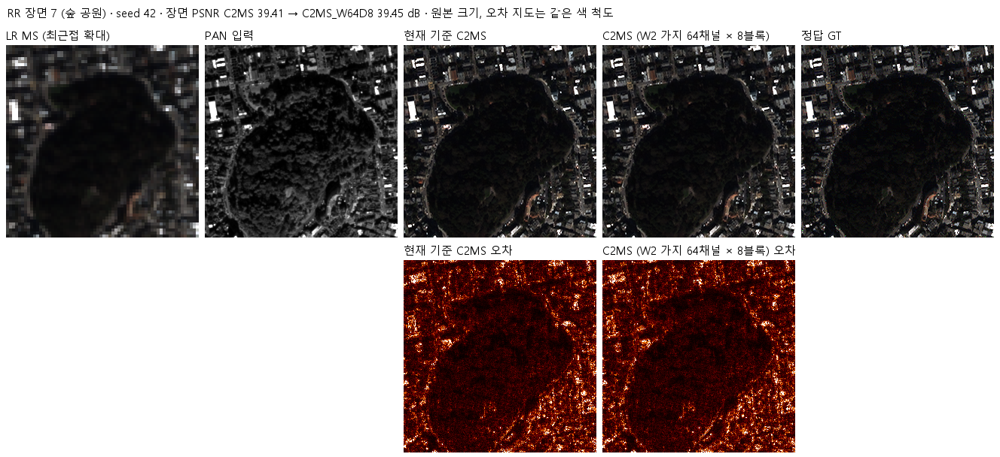

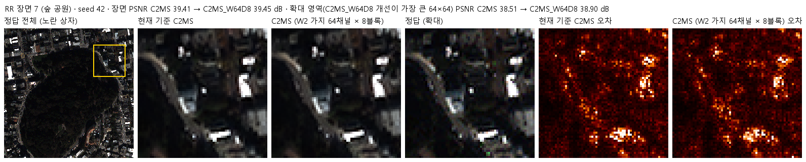

장면 14 · 두 갈래 · 두 비교 형식

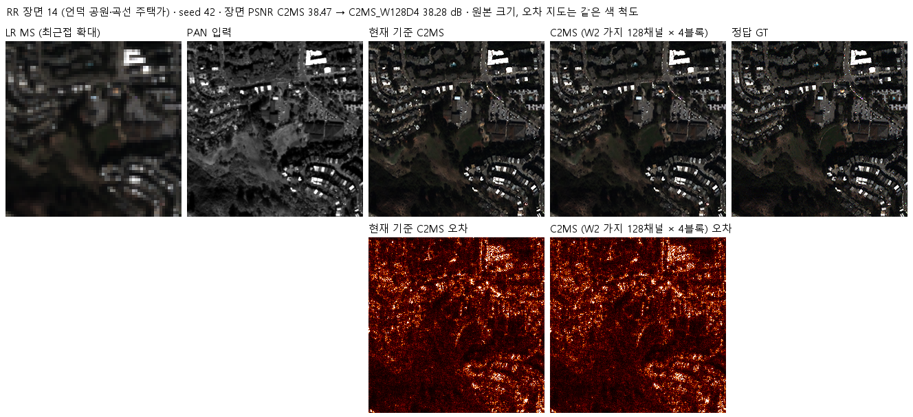

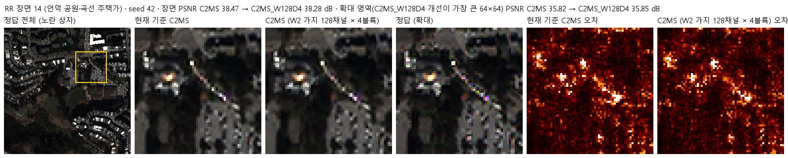

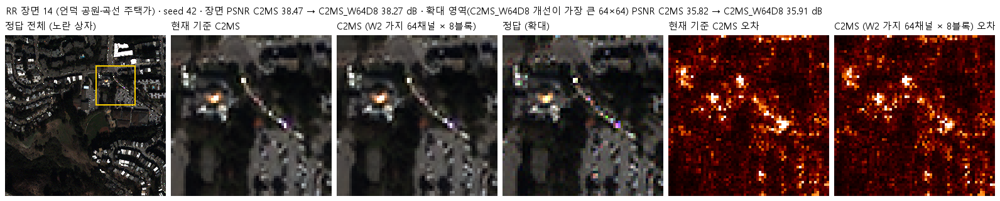

장면 17 · 두 갈래 · 두 비교 형식

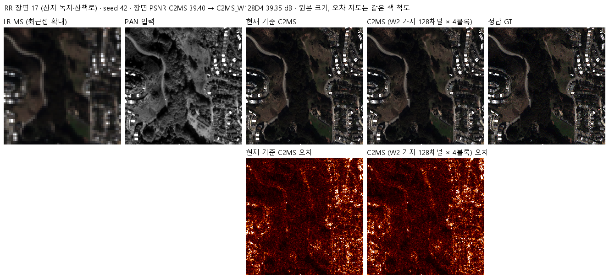

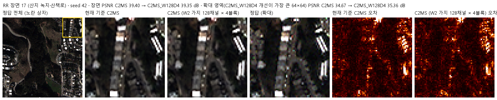

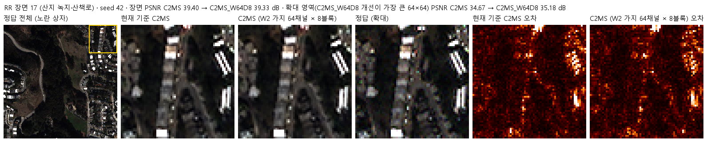

## 7. 재현 자료

- [config.json](config.json): 학습 전에 고정한 가설·구조·비교·데이터 해시. 서버에 봉인된 설정과 소스 해시는 [runtime_config.json](provenance/run_records/runtime_config.json)에 있습니다. 저장소의 학습·평가 소스와 대조군 가중치는 봉인 해시와 같고, config.json은 평가 후 첫머리의 상태·개선 여부 필드만 바꿨습니다.
- [model.py](model.py): 폭과 깊이를 인자로 받는 가지(`SizedParallel`).
- [train.py](train.py): 54번 학습기를 그대로 쓰고, 사전 검사의 초기 상태 확인 한 곳만 바꿨습니다(74번과 같음). 두 갈래 모두 원본 부분의 가중치가 43번 C0와 같고 초기 출력이 비트 단위로 같은 것을 확인했습니다.
- [run.py](run.py): 캐시를 H5에서 다시 만들어 63번 기록 해시와 대조하고, 설정을 봉인한 뒤 두 갈래를 동시에 학습하고 차례로 평가합니다.
- [evaluate.py](evaluate.py): 53번(공식), 57번, 원본(43번 C0)과 RR로 비교하고 결과 이미지·그래프를 만듭니다(74번과 같음).
- [prepare.py](prepare.py): 54번 센서 연산을 그대로 씁니다.
- 가중치: `checkpoints/C2MS_W128D4_QB_s42/best.pt`(149에폭), `checkpoints/C2MS_W64D8_QB_s42/best.pt`(150에폭). 재개용 `latest.pt`와 초기 `initial.pt`는 GitHub Release `weights-experiments-performance-75`에 있고 [manifest.json](manifest.json)의 `release_assets`에 기록했습니다.
- 결과: `results/<갈래>_QB_s42/`의 `history.json`, `training_complete.json`, `evaluation_complete.json`, `evaluation/QB_v2_4.json`(장면별 RR·FR), 그래프와 결과 이미지.
- 실행 기록: `provenance/run_records/`(준비·벤치마크·preflight·컨트롤러 기록, 캐시 manifest, 환경), 서버 소스 manifest·검증 결과, 전송·실행 스크립트, 이전 74번 실행 폴더 정리 기록(`server_cleanup.json`).

## 8. 개선 여부와 다음 단계

QB seed 42에서 두 갈래 모두 53번 C2MS 대비 RR 세 지표가 나빠져 **개선 없음**입니다. 기준 모델은 C2MS로 유지합니다. 가지를 절반 크기로 줄이면 C2MS 이득의 78-86%가 남고, 이번 범위에서는 깊이를 유지한 64 × 8(1.05M)이 폭을 유지한 128 × 4(1.67M)보다 이득이 더 많이 남았습니다(단일 시드, validation은 같음).

- QB 수치를 C2MS보다 높이는 것이 목표라면, 가지를 줄이는 방향은 더 진행하지 않습니다.
- 깊이가 더 중요하다는 결과를 이어 보려면 C2MS보다 깊은 가지(예: 128채널 × 12-16블록)를 C2MS와 비교하는 방법이 있습니다. 다만 폭과 깊이의 차이가 test에서만 보이고 단일 시드라, 먼저 64 × 8과 128 × 4를 seed 43·44로 확인하는 방법도 있습니다. 진행 여부는 사용자가 결정합니다.
- 두 학습 동시 실행의 실제 이득은 약 1.17배였습니다. 이후 계획에서는 1.5배가 아니라 이 값을 기준으로 시간을 예상합니다.
