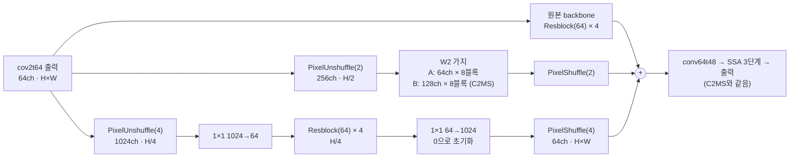

# 76. 1/4 해상도 병렬 가지(W4) 추가

**연구 분야:** 성능 개선

**실험자:** 이병현

**변경 내용:** 원본 backbone과 W2 가지(1/2 해상도) 옆에 1/4 해상도에서 처리하는 세 번째 가지(W4, 0.43M)를 붙였습니다. 75번 64채널 × 8블록 W2 가지에 붙인 갈래(1.48M)와 C2MS에 붙인 갈래(3.28M)를 학습합니다. 학습 조건은 C2MS와 같고, 두 갈래를 서버에서 동시에 학습합니다.

| 확인된 결과 | 상태 | 개선 여부 |
|---|:---:|:---:|
| 아직 없습니다. 11-05 00:58 KST에 두 갈래 동시 학습을 시작했고 1에폭 validation PSNR은 64 × 8 + W4 35.058, C2MS + W4 35.151입니다(53번 C2MS 35.129). 06:00 KST쯤 학습이 끝날 예정입니다. | 학습&nbsp;중 11-05&nbsp;01:01&nbsp;확인 | 판단&nbsp;보류 |

[실험 목록](../../../research/performance/README.md) · [수치](#results) · [그래프](#graphs) · [이미지](#images) · [재현 자료](#evidence)

## 1. 목적과 상태

[성능 75번](../75_parallel_branch_width_depth/README.md)의 64채널 × 8블록 가지(1.05M)는 C2MS 이득의 86%를 남겼지만 C2MS 대비 RR이 −0.127 dB였습니다. 75번 출력을 [성능 72번](../72_c2ms_gain_frequency_structure_analysis/README.md)과 같은 방법으로 나눠 보니 손해는 다음과 같았습니다(QB RR test, seed 42).

| 나눈 기준 | C2MS 대비 손해가 몰린 곳 |
|---|---|
| 주파수 대역 | 주기 4-8 px 73.6%(경계 처리를 바꾼 Hann 창 52.3%), 2-4 px 14.7%(신뢰구간이 0을 포함), 8-16 px 9.9%, 16 px 초과 1.2% |
| 오차 성분 | 4-8 px에서 세부 세기는 정답 대비 0.969로 C2MS(0.973)와 비슷하고, 오차 차이의 92%가 정답과 상관없는 성분 |
| 구조 크기 | 평탄 영역 35.4%(이득에서는 18.4%), 미세 구조 23.9%, 작은 세부 19.9%. 평탄 영역은 C2MS 이득의 77%만 남음 |

C2MS 자체도 남은 오차의 대부분이 같은 4-8 px의 상관없는 성분입니다. 평탄한 곳에 생기는 이런 잔무늬를 억제하려면 넓은 범위의 문맥이 필요하다고 보고, 연산이 싼 1/4 해상도 가지를 추가합니다. 1/4 해상도 가지는 이전에 시도한 적이 없습니다([성능 29번](../29_capacity_refinement/README.md)의 원래 해상도 가지 W3는 W2보다 낮았습니다).

**가설:** W4 가지가 주는 문맥이 평탄 영역의 4-8 px 잔무늬를 줄인다면,
- **갈래 A**(64 × 8 W2 + W4, 1.48M)는 폭을 늘린 75번 128 × 4(1.67M, 78%)보다 C2MS 이득을 더 많이 회복하고,
- **갈래 B**(C2MS + W4, 3.28M)는 53번 C2MS보다 RR이 좋아집니다.

75번 분석의 스크립트와 수치는 [provenance/basis_75_analysis](provenance/basis_75_analysis/)에 있습니다. 2026-11-05 사용자 결정으로 등록하고 00:58 KST에 두 갈래 동시 학습을 시작했습니다. 학습 전에 원본 부분·W2 가지의 초기 가중치가 같은 시드의 원래 모델과 같고 초기 출력이 원본 SSA-MRN과 비트 단위로 같은 것을 확인했습니다. 결과가 나오면 이 보고서에 이어서 보관합니다.

## 2. 변경한 구조와 비교 조건

| 모델 | 원본 backbone | W2 가지 | W4 가지 | 모델 전체 |
|---|---|---|---|---:|
| C2MS (53번, 공식 대조군) | 있음 | 128 × 8 | 없음 | 2,853,918 |
| **C2MS_W64D8_W4 (갈래 A)** | 있음 | 64 × 8 | **64 × 4** | **1,478,174** |
| **C2MS_W4 (갈래 B)** | 있음 | 128 × 8 | **64 × 4** | **3,281,502** |
| C2MS_W64D8 (75번) | 있음 | 64 × 8 | 없음 | 1,050,590 |
| C2MS_W128D4 (75번) | 있음 | 128 × 4 | 없음 | 1,673,246 |

- W4 가지는 64채널 특징을 PixelUnshuffle(4)로 1/4 해상도 1024채널로 바꾸고, 1×1로 64채널로 줄인 뒤 잔차 블록 4개(3×3 합성곱 → ReLU → 3×3 합성곱 + 건너뛰기 연결)를 거쳐 1×1로 1024채널로 되돌리고 PixelShuffle(4)로 원래 해상도로 보냅니다. 파라미터는 427,584개입니다. 세 경로의 출력은 더해 conv64t48로 보냅니다.
- 원본 부분과 W2 가지는 같은 시드의 원래 모델과 같은 순서로 만들어 초기 가중치가 같습니다(갈래 A는 75번 C2MS_W64D8, 갈래 B는 43번 C2 = 53번 C2MS의 초기값). W4는 그다음에 만듭니다. 두 가지의 마지막 1×1을 0으로 초기화해 초기 출력이 원본 SSA-MRN(43번 C0)과 정확히 같습니다. 사전 검사에서 이 세 가지를 모두 확인합니다.
- 학습은 C2MS와 같습니다(원래 쌍 MSE + 1.0 × 2배 거친 쌍 MSE, Adam 1e-4 → 1e-6 cosine 150에폭, batch 32, FP16 AMP, validation MSE 최소 가중치 선택).

| 비교 | 의미 |
|---|---|
| 각 갈래 대 53번 C2MS | 공식 판정(v2.4, RR만) |
| 각 갈래 대 57번 재학습 C2MS | 같은 조건 C2MS의 실행 간 차이 참조 |
| 각 갈래 대 원본(43번 C0) | C2MS 이득 중 남은 비율. 갈래 A는 75번 두 갈래(86%, 78%)와 함께 읽음 |
| 주파수·구조 분해 | 갈래 A 대 75번 W64D8, 갈래 B 대 53번 C2MS에서 4-8 px·상관없는 성분·평탄 영역이 실제로 줄었는지(판정 아님) |

| 항목 | 내용 |
|---|---|
| 데이터 | QB train 17,139개·validation 1,905개(64×64), test RR·FR 각 20장. 파일 SHA-256을 config와 대조 |
| 실행 | 서버 RTX 3060 Ti 1장에서 두 갈래 동시 학습, 새 실행 폴더. 학습 캐시는 H5에서 다시 만들어 63번 기록 해시와 대조 |
| 예상 시간 | 두 갈래 합쳐 약 5시간(75번 동시 학습 에폭당 115초 기준, 갈래 B가 더 큼) |
| 보고 | 에폭별 validation PSNR·SAM, RR(판정), FR QNR·Dλ·Ds(참고), 원본 대비 이득 비율, 주파수·구조 분해 |

**미리 밝혀 두는 한계**

- 주기 4-8 px 무늬는 1/4 해상도에서는 1-2 px 주기라 표현의 한계에 가깝습니다. W4는 그 무늬를 직접 그리기보다 넓은 문맥으로 억제를 돕는 역할을 기대합니다.
- 4블록 W4의 참조 범위는 약 65 px로, 64 × 8 W2 가지와 비슷합니다. 효과가 없으면 문맥 범위가 부족한 것인지 이 방식이 맞지 않는 것인지 이번 결과만으로는 나누지 못합니다.
- 두 학습이 GPU를 나눠 쓰므로 cuDNN이 고르는 연산 방식이 단독 학습과 다를 수 있습니다. 학습 방법은 같고, 부동소수점 세부만 달라질 수 있습니다.

## 3. 정량 결과

아직 없습니다.

## 4. 기준선 대비 차이와 해석

아직 없습니다.

## 5. 학습·평가 그래프

아직 없습니다.

## 6. 결과 이미지

아직 없습니다. 고정 6장면(QB RR test 0-based 0·1·3·7·14·17)에서 C2MS와 각 갈래를 비교합니다.

## 7. 재현 자료

- [config.json](config.json): 학습 전에 고정한 가설·구조·비교·데이터 해시.
- [model.py](model.py): W4 가지(`WithQuarter`)와 두 갈래의 구성. 75번 `SizedParallel`과 43번 `Parallel`을 그대로 씁니다.
- [train.py](train.py): 54번 학습기를 그대로 쓰고, 사전 검사의 초기 상태 확인 한 곳만 바꿉니다.
- [run.py](run.py): 75번 컨트롤러입니다. 캐시를 H5에서 다시 만들어 63번 기록 해시와 대조하고, 설정을 봉인한 뒤 두 갈래를 동시에 학습하고 차례로 평가합니다.
- [evaluate.py](evaluate.py): 53번(공식), 57번, 원본(43번 C0)과 RR로 비교하고 결과 이미지·그래프를 만듭니다(75번과 같음).
- [prepare.py](prepare.py): 54번 센서 연산을 그대로 씁니다.
- [provenance/basis_75_analysis](provenance/basis_75_analysis/): 실험을 설계한 근거인 75번 주파수·구조 분해 스크립트와 수치.

## 8. 개선 여부와 다음 단계

**판단 보류**입니다. 학습 전입니다.
