# 76. 1/4 해상도 병렬 가지(W4) 추가

**연구 분야:** 성능 개선

**실험자:** 이병현

**변경 내용:** 원본 backbone과 W2 가지(1/2 해상도) 옆에 1/4 해상도에서 처리하는 세 번째 가지(W4, 0.43M)를 붙였습니다. 75번 64채널 × 8블록 W2 가지에 붙인 갈래(1.48M)와 C2MS에 붙인 갈래(3.28M)를 학습했습니다. 학습 조건은 C2MS와 같고, 두 갈래를 서버에서 동시에 학습했습니다.

| 확인된 결과 | 상태 | 개선 여부 |
|---|:---:|:---:|
| C2MS + W4는 53번 C2MS 대비 test RR PSNR +0.025 dB·SAM −0.010°·ERGAS −0.010으로 세 지표가 모두 좋아졌지만 잡음 문턱(0.06 dB) 미만이라 부분 개선(잡음 수준)입니다. 64 × 8 + W4는 C2MS 대비 −0.132 dB로 개선 없음이고, W4가 없는 75번 64 × 8(−0.127 dB)과 같았습니다. 노렸던 4-8 px의 정답과 상관없는 성분과 평탄 영역 오차는 두 갈래 모두 줄지 않았습니다. W4는 8-16 px 오차를 16-19% 줄였지만(20/20장) 이 대역은 남은 오차의 2% 미만이고, C2MS + W4의 이득은 87%가 영상 가장자리 16 px 띠에서 나왔습니다. | 평가&nbsp;완료 seed42 | 부분&nbsp;개선 |

[실험 목록](../../../research/performance/README.md) · [수치](#results) · [그래프](#graphs) · [이미지](#images) · [재현 자료](#evidence)

## 1. 목적과 상태

[성능 75번](../75_parallel_branch_width_depth/README.md)의 64채널 × 8블록 가지(1.05M)는 C2MS 이득의 86%를 남겼지만 C2MS 대비 RR이 −0.127 dB였습니다. 75번 출력을 [성능 72번](../72_c2ms_gain_frequency_structure_analysis/README.md)과 같은 방법으로 나눠 보니 손해는 다음과 같았습니다(QB RR test, seed 42).

| 나눈 기준 | C2MS 대비 손해가 몰린 곳 |
|---|---|
| 주파수 대역 | 주기 4-8 px 73.6%(경계 처리를 바꾼 Hann 창 52.3%), 2-4 px 14.7%(신뢰구간이 0을 포함), 8-16 px 9.9%, 16 px 초과 1.2% |
| 오차 성분 | 4-8 px에서 세부 세기는 정답 대비 0.969로 C2MS(0.973)와 비슷하고, 오차 차이의 92%가 정답과 상관없는 성분 |
| 구조 크기 | 평탄 영역 35.4%(이득에서는 18.4%), 미세 구조 23.9%, 작은 세부 19.9%. 평탄 영역은 C2MS 이득의 77%만 남음 |

C2MS 자체도 남은 오차의 대부분이 같은 4-8 px의 상관없는 성분입니다. 평탄한 곳에 생기는 이런 잔무늬를 억제하려면 넓은 범위의 문맥이 필요하다고 보고, 연산이 싼 1/4 해상도 가지를 추가합니다. 1/4 해상도 가지는 이전에 시도한 적이 없습니다([성능 29번](../29_capacity_refinement/README.md)의 원래 해상도 가지 W3는 W2보다 낮았습니다).

**가설:** W4 가지가 주는 문맥이 평탄 영역의 4-8 px 잔무늬를 줄인다면,
- **갈래 A**(64 × 8 W2 + W4, 1.48M)는 폭을 늘린 75번 128 × 4(1.67M, 78%)보다 C2MS 이득을 더 많이 회복하고,
- **갈래 B**(C2MS + W4, 3.28M)는 53번 C2MS보다 RR이 좋아집니다.

75번 분석의 스크립트와 수치는 [provenance/basis_75_analysis](provenance/basis_75_analysis/)에 있습니다. 2026-11-05 사용자 결정으로 등록하고 00:58 KST에 두 갈래 동시 학습을 시작했습니다. 학습 전에 원본 부분·W2 가지의 초기 가중치가 같은 시드의 원래 모델과 같고 초기 출력이 원본 SSA-MRN과 비트 단위로 같은 것을 확인했습니다. 06:24·06:35에 150에폭 학습을 마쳤고, 평가 단계 오류(7절)를 고친 뒤 16:24에 test 평가를 마쳤습니다. 기준 모델은 C2MS로 유지합니다.

## 2. 변경한 구조와 비교 조건

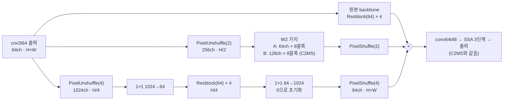

| 모델 | 원본 backbone | W2 가지 | W4 가지 | 모델 전체 |
|---|---|---|---|---:|
| C2MS (53번, 공식 대조군) | 있음 | 128 × 8 | 없음 | 2,853,918 |
| **C2MS_W64D8_W4 (갈래 A)** | 있음 | 64 × 8 | **64 × 4** | **1,478,174** |
| **C2MS_W4 (갈래 B)** | 있음 | 128 × 8 | **64 × 4** | **3,281,502** |
| C2MS_W64D8 (75번) | 있음 | 64 × 8 | 없음 | 1,050,590 |
| C2MS_W128D4 (75번) | 있음 | 128 × 4 | 없음 | 1,673,246 |

- W4 가지는 64채널 특징을 PixelUnshuffle(4)로 1/4 해상도 1024채널로 바꾸고, 1×1로 64채널로 줄인 뒤 잔차 블록 4개(3×3 합성곱 → ReLU → 3×3 합성곱 + 건너뛰기 연결)를 거쳐 1×1로 1024채널로 되돌리고 PixelShuffle(4)로 원래 해상도로 보냅니다. 파라미터는 427,584개입니다. 세 경로의 출력은 더해 conv64t48로 보냅니다.
- 원본 부분과 W2 가지는 같은 시드의 원래 모델과 같은 순서로 만들어 초기 가중치가 같습니다(갈래 A는 75번 C2MS_W64D8, 갈래 B는 43번 C2 = 53번 C2MS의 초기값). W4는 그다음에 만듭니다. 두 가지의 마지막 1×1을 0으로 초기화해 초기 출력이 원본 SSA-MRN(43번 C0)과 정확히 같습니다. 사전 검사에서 이 세 가지를 모두 확인합니다.
- 학습은 C2MS와 같습니다(원래 쌍 MSE + 1.0 × 2배 거친 쌍 MSE, Adam 1e-4 → 1e-6 cosine 150에폭, batch 32, FP16 AMP, validation MSE 최소 가중치 선택).

| 비교 | 의미 |
|---|---|
| 각 갈래 대 53번 C2MS | 공식 판정(v2.4, RR만) |
| 각 갈래 대 57번 재학습 C2MS | 같은 조건 C2MS의 실행 간 차이 참조 |
| 각 갈래 대 원본(43번 C0) | C2MS 이득 중 남은 비율. 갈래 A는 75번 두 갈래(86%, 78%)와 함께 읽음 |
| 주파수·구조 분해 | 갈래 A 대 75번 W64D8, 갈래 B 대 53번 C2MS에서 4-8 px·상관없는 성분·평탄 영역이 실제로 줄었는지(판정 아님) |

| 항목 | 내용 |
|---|---|
| 데이터 | QB train 17,139개·validation 1,905개(64×64), test RR·FR 각 20장. 파일 SHA-256을 config와 대조 |
| 실행 | 서버 RTX 3060 Ti 1장에서 두 갈래 동시 학습, 새 실행 폴더. 학습 캐시는 H5에서 다시 만들어 63번 기록 해시와 대조 |
| 실제 시간 | 학습 5시간 36분(두 갈래 동시, 에폭당 A 130초·B 137초) |
| 보고 | 에폭별 validation PSNR·SAM, RR(판정), FR QNR·Dλ·Ds(참고), 원본 대비 이득 비율, 주파수·구조 분해 |

**미리 밝혀 두는 한계**

- 주기 4-8 px 무늬는 1/4 해상도에서는 1-2 px 주기라 표현의 한계에 가깝습니다. W4는 그 무늬를 직접 그리기보다 넓은 문맥으로 억제를 돕는 역할을 기대합니다.
- 4블록 W4의 참조 범위는 약 65 px로, 64 × 8 W2 가지와 비슷합니다. 효과가 없으면 문맥 범위가 부족한 것인지 이 방식이 맞지 않는 것인지 이번 결과만으로는 나누지 못합니다.
- 두 학습이 GPU를 나눠 쓰므로 cuDNN이 고르는 연산 방식이 단독 학습과 다를 수 있습니다. 학습 방법은 같고, 부동소수점 세부만 달라질 수 있습니다.

## 3. 정량 결과

QB RR·FR test 20장 평균입니다. 각 갈래를 대조군 세 모델과 같은 서버·같은 코드로 함께 평가했습니다. 장면별 수치는 [64 × 8 + W4](results/C2MS_W64D8_W4_QB_s42/evaluation/QB_v2_4.json)와 [C2MS + W4](results/C2MS_W4_QB_s42/evaluation/QB_v2_4.json)의 `QB_v2_4.json`에 있습니다. 75번 수치는 [75번 보고서](../75_parallel_branch_width_depth/README.md#results)에서 가져왔습니다(같은 평가 코드·같은 대조군 가중치).

| 모델 | 파라미터 | RR PSNR | RR SAM | RR ERGAS | FR QNR / Dλ / Ds (참고) |
|---|---:|---:|---:|---:|---:|
| 원본 SSA-MRN (43번 C0) | 426,654 | 37.3671 | 4.9651 | 4.1554 | 0.917 / 0.043 / 0.042 |
| C2MS (53번, 공식 대조군) | 2,853,918 | 38.2738 | 4.5770 | 3.7230 | 0.826 / 0.027 / 0.151 |
| C2MS (57번 재학습, 참조) | 2,853,918 | 38.2829 | 4.5736 | 3.7193 | 0.828 / 0.025 / 0.151 |
| **C2MS_W4 (갈래 B, C2MS + W4)** | **3,281,502** | **38.2990** | **4.5675** | **3.7134** | 0.811 / 0.029 / 0.164 |
| **C2MS_W64D8_W4 (갈래 A, 64 × 8 + W4)** | **1,478,174** | **38.1422** | **4.6733** | **3.7877** | 0.910 / 0.026 / 0.066 |
| C2MS_W64D8 (75번, W4 없음) | 1,050,590 | 38.1465 | 4.6785 | 3.7844 | 0.881 / 0.028 / 0.093 |
| C2MS_W128D4 (75번) | 1,673,246 | 38.0732 | 4.6969 | 3.8173 | 0.893 / 0.029 / 0.080 |

### v2.4 판정

| 갈래 | 비교 | ΔRR PSNR / SAM / ERGAS | C2MS보다 좋은 장면 수(PSNR / SAM) | 판정 |
|---|---|---|---:|---|
| B | **53번 C2MS 대비 (공식)** | +0.0252 / −0.0095 / −0.0096 | 16 / 15 | **부분 개선 (잡음 수준)** |
| B | 57번 C2MS 대비 (참조) | +0.0161 / −0.0061 / −0.0059 | 12 / 14 | 부분 개선 (잡음 수준) |
| B | 원본 대비 (참조) | +0.9319 / −0.3975 / −0.4420 | 원본보다 20 / 20 | 개선 |
| A | **53번 C2MS 대비 (공식)** | −0.1316 / +0.0963 / +0.0647 | 2 / 0 | **개선 없음** |
| A | 57번 C2MS 대비 (참조) | −0.1407 / +0.0997 / +0.0684 | 2 / 0 | 개선 없음 |
| A | 원본 대비 (참조) | +0.7751 / −0.2918 / −0.3677 | 원본보다 20 / 20 | 개선 |

갈래 B는 세 지표가 모두 좋아졌지만 PSNR 이득 +0.025 dB가 단일 시드 잡음 문턱 0.06 dB보다 작습니다. 57번 재학습 C2MS와 53번의 차이(+0.009 dB)보다는 크지만, 같은 크기의 이득은 시드만 바꿔도 나올 수 있는 범위입니다.

### W4를 붙이기 전후

| 비교 | ΔRR PSNR / SAM / ERGAS | C2MS 이득 중 남은 비율(PSNR / SAM / ERGAS) |
|---|---|---|
| 75번 64 × 8 → 갈래 A | −0.0043 / −0.0052 / +0.0033 | 86% / 74% / 86% → 85% / 75% / 85% |
| 53번 C2MS → 갈래 B | +0.0252 / −0.0095 / −0.0096 | 100% → 103% / 102% / 102% |

갈래 A는 W4(0.43M)를 더해도 75번 64 × 8과 RR이 같았습니다. 같은 파라미터를 폭에 쓴 75번 128 × 4(78%)보다는 남은 비율이 높지만, 그 차이는 W4가 아니라 64 × 8 자체에서 나온 것입니다.

### validation (선택 가중치)

| 모델 | 선택 에폭 | 원래 축척 PSNR / SAM | 거친 축척 PSNR | 150에폭 학습 MSE |
|---|---:|---:|---:|---:|
| C2MS (53번) | 149 | 40.283 / 4.226 | 46.846 | 1.225e-4 |
| **C2MS_W4 (B)** | 145 | 40.290 / 4.220 | 46.877 | 1.223e-4 |
| C2MS_W64D8 (75번) | 150 | 39.914 / 4.354 | 46.284 | 1.432e-4 |
| **C2MS_W64D8_W4 (A)** | 149 | 39.942 / 4.349 | 46.368 | 1.420e-4 |

validation에서도 W4의 효과는 B +0.007 dB, A +0.028 dB로 작았습니다. AMP에서 건너뛴 업데이트는 두 갈래 모두 80,400회 중 19회였습니다.

### W4가 바꾼 대역과 영역

75번과 같은 방법([성능 72번](../72_c2ms_gain_frequency_structure_analysis/README.md))으로, W4를 붙이기 전후의 오차 변화를 주파수 대역과 구조 크기로 나눴습니다. 로컬 CPU에서 다시 만든 출력의 장면 PSNR은 서버 평가와 1e-6 dB 이내로 일치했습니다. 수치는 [frequency_structure.json](results/frequency_structure.json)에 있습니다.

| 대역 (무늬 주기) | 75번 64 × 8 → A: dB (오차 감소, 개선 장면) | C2MS → B: dB (오차 감소, 개선 장면) |
|---|---:|---:|
| 16 px 초과 | +0.002 (25-35%, 18-20장) | +0.001 (17-19%, 15-20장) |
| **8-16 px** | **+0.014 (18.5%, 20장)** | **+0.011 (16.3%, 20장)** |
| **4-8 px (노린 대역)** | **−0.012 (−1.2%, 7장)** | **+0.002 (0.4%, 9장, 신뢰구간 0 포함)** |
| 2-4 px | −0.009 (−0.3%, 9장, 신뢰구간 0 포함) | +0.007 (0.2%, 13장, 신뢰구간 0 포함) |
| 합계 | −0.004 | +0.025 |

| 항목 | 75번 64 × 8 → A | C2MS → B |
|---|---|---|
| 4-8 px 정답과 상관없는 성분 | 167.1 → 168.6 (그대로) | 152.0 → 151.7 (그대로) |
| 4-8 px 평탄 영역 오차 | 113.3 → 114.5 (그대로) | 103.4 → 103.7 (그대로) |
| 구조별 dB 변화 | 모든 구조에서 신뢰구간이 0을 포함 | 모든 구조에서 신뢰구간이 0을 포함(미세·작은 세부 +0.011·+0.010) |
| SAM 변화 | −0.005° | −0.010°(4-8 px 0.005°, 8-16 px 0.002°) |

영상 가장자리 16 px 띠(화소의 23.4%)와 안쪽을 나눠 보면 다음과 같습니다([border_interior.json](results/border_interior.json)).

| 갈래 | 8-16 px 오차 감소 (가장자리 / 안쪽) | 4-8 px 오차 감소 (가장자리 / 안쪽) | 전체 오차 감소 (가장자리 / 안쪽) | 전체 감소 중 가장자리 몫 |
|---|---:|---:|---:|---:|
| B | 17.7% / 15.6% | 2.6% / −0.4% | 2.1% / 0.1% | 87% |
| A | 17.1% / 19.2% | −1.6% / −1.1% | −0.6% / 0.05% | (전체가 나빠짐) |

### 학습 시간

두 학습을 동시에 돌려 에폭당 A 130초·B 137초, 학습 시간은 각각 5.41·5.60시간이었습니다. 학습 전 단독 스텝 벤치마크는 A 0.156초·B 0.148초였습니다.

## 4. 기준선 대비 차이와 해석

- **가설은 확인되지 않았습니다.** W4가 줄이려던 4-8 px의 정답과 상관없는 성분과 평탄 영역 오차는 두 갈래 모두 그대로였습니다(A는 오히려 4-8 px가 1.2% 나빠짐). 1/4 해상도의 넓은 문맥이 평탄 영역의 잔무늬를 억제하는 효과는 나타나지 않았습니다.
- **W4는 자기 해상도로 표현할 수 있는 대역만 고쳤습니다.** 8-16 px 오차를 두 갈래 모두 16-19% 줄였고, 20장 모두와 영상 안쪽·가장자리 모두에서 같은 방향이었습니다. 1/4 해상도 격자에서 한 화소 간격으로 나타낼 수 있는 가장 짧은 무늬가 주기 8 px(나이퀴스트)이고, 그보다 짧은 무늬는 PixelShuffle의 16개 하위 화소 채널로만 만들 수 있습니다. 결과적으로 W4는 8 px보다 긴 무늬만 고쳤습니다. 하지만 C2MS의 8-16 px 오차는 전체 오차의 2% 미만이라 dB로는 +0.01 정도입니다.
- **C2MS + W4의 작은 이득은 대부분 영상 가장자리에서 나왔습니다.** 전체 오차 감소의 87%가 가장자리 16 px 띠에서 생겼고, 안쪽의 오차는 0.1%만 줄었습니다. W4의 넓은 참조 범위가 가장자리의 패딩 영향을 조금 줄인 것으로 보이며, 장면 안쪽의 세부가 좋아진 것은 아닙니다.
- **64 × 8에는 효과가 없었습니다.** 8-16 px 이득(+0.014 dB)과 4-8·2-4 px 손해(−0.021 dB)가 상쇄돼 RR이 75번과 같았습니다. 파라미터 0.43M을 더 쓰고도 바뀐 것이 없습니다.
- **남은 4-8 px 오차는 주변을 넓게 보는 것만으로는 줄지 않습니다.** 75번에서 이 오차를 줄인 것은 가지를 64 × 8에서 128 × 8로 키운 것(1/2 해상도에서 쓰는 용량)이었습니다. 이 대역을 줄이려면 1/2 해상도나 원래 해상도에서 쓰는 용량이나 손실·학습 방식을 바꿔야 할 것으로 보입니다.
- FR(참고)에서는 B의 QNR이 C2MS보다 약간 낮고(0.811), A는 75번보다 높았습니다(0.910). 판정에는 쓰지 않습니다.

## 5. 학습·평가 그래프

학습 MSE(원래 축척), validation PSNR·SAM, 학습률입니다. 점선은 53번 C2MS의 선택 가중치 validation PSNR입니다. 가중치는 validation MSE 최소인 145에폭(B)과 149에폭(A)이 선택됐습니다.

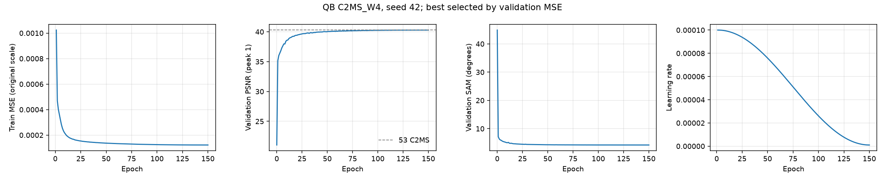

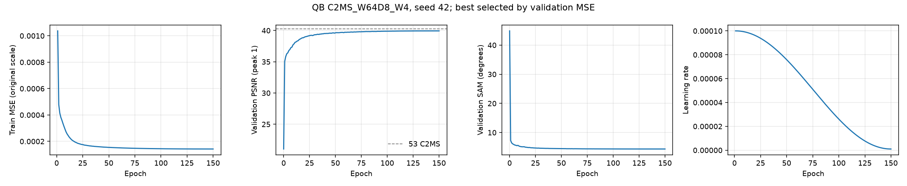

53번 C2MS 대비 test RR PSNR·SAM·ERGAS 차이입니다. 원본(43번 C0)과 57번 재학습 C2MS를 함께 표시했습니다.

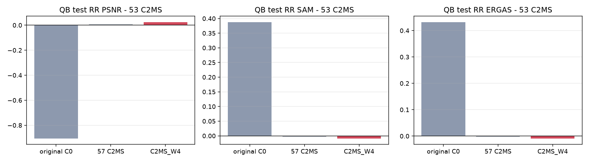

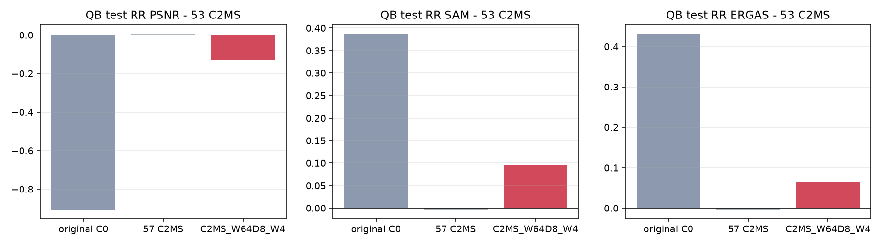

## 6. 결과 이미지

고정 6장면(QB RR test 0-based 0·1·3·7·14·17, seed 42)에서 현재 기준 C2MS(53번)와 각 갈래를 비교했습니다. 장면은 정답만 보고 풍경으로 미리 정했고 결과를 보고 바꾸지 않았습니다. `common/result_images.py`로 서버 평가 중에 만들었습니다.

원본 크기 비교는 256×256 전체 장면의 **LR MS · PAN · C2MS · 후보 · 정답**과 **C2MS 오차 · 후보 오차**(같은 색 척도)입니다. 확대 비교는 후보의 개선이 가장 큰 64×64 창을 4배 확대한 **정답 전체(노란 상자) · C2MS · 후보 · 정답 · C2MS 오차 · 후보 오차**입니다. **확대 창은 장면마다 후보에 가장 유리한 곳을 고른 것**이라, 장면 전체가 나빠졌어도 확대 창은 좋아 보일 수 있습니다. 전체 차이는 장면 PSNR로 판단합니다.

| 장면 | 풍경 | C2MS 장면 PSNR | C2MS + W4 (차이) | 64 × 8 + W4 (차이) | 확대 창 차이 B / A |
|---:|---|---:|---:|---:|---:|
| 0 | 바다·항구 방파제 | 42.812 | 42.890 (+0.079) | 42.685 (−0.127) | +0.624 / +0.521 |
| 1 | 부두·곡선 방파제·수목 | 43.179 | 43.178 (−0.001) | 43.076 (−0.103) | +0.457 / +0.316 |
| 3 | 요트 마리나·운동장 | 37.964 | 38.037 (+0.072) | 37.769 (−0.195) | +0.761 / +0.354 |
| 7 | 숲 공원 | 39.405 | 39.450 (+0.045) | 39.498 (+0.093) | +0.208 / +0.584 |
| 14 | 언덕 공원·곡선 주택가 | 38.473 | 38.478 (+0.005) | 38.296 (−0.177) | +0.205 / +0.125 |
| 17 | 산지 녹지·산책로 | 39.396 | 39.362 (−0.034) | 39.416 (+0.020) | +0.274 / +0.826 |

**장면 0 (바다·항구 방파제) · C2MS + W4**

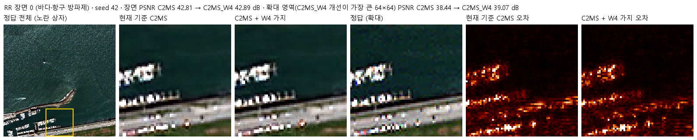

**장면 0 (바다·항구 방파제) · 64 × 8 + W4**

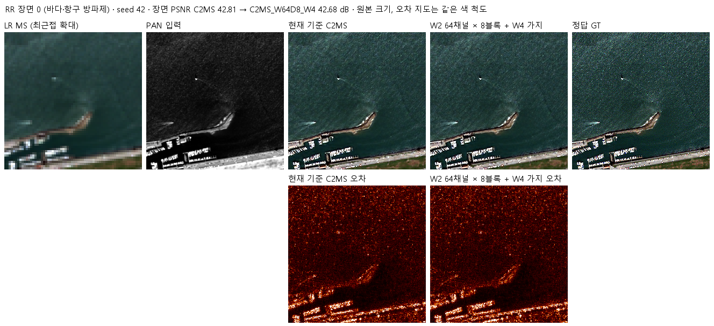

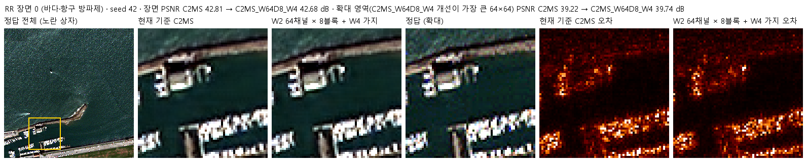

장면 1 · 두 갈래 · 두 비교 형식

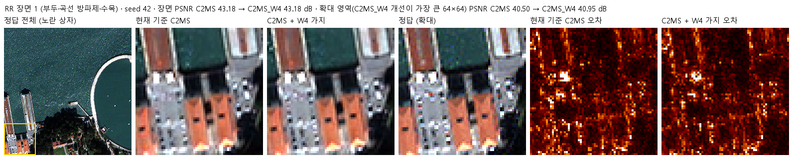

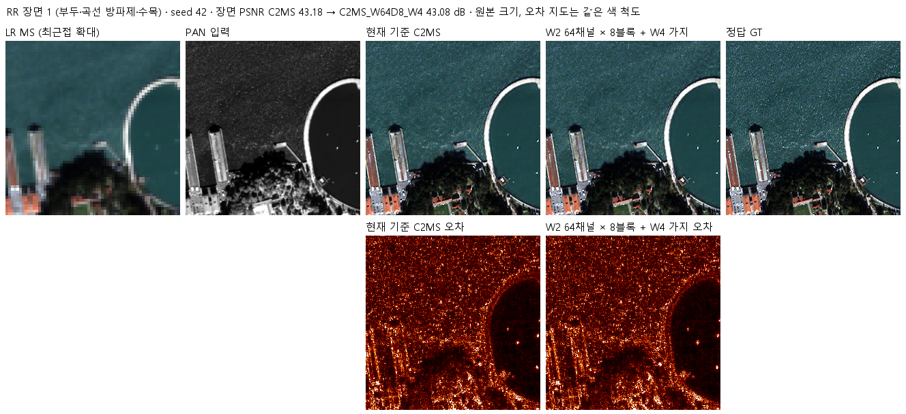

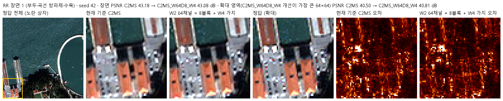

장면 3 · 두 갈래 · 두 비교 형식

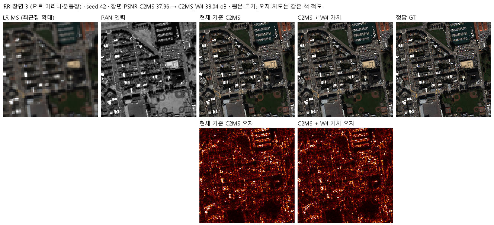

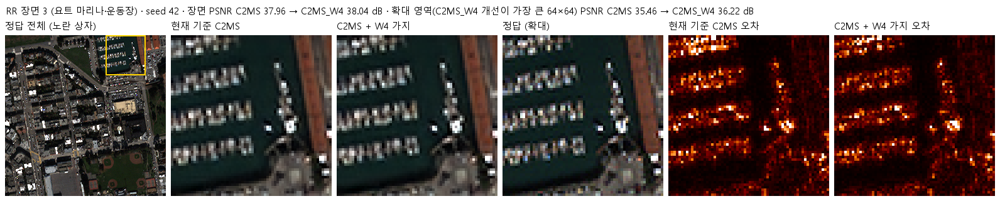

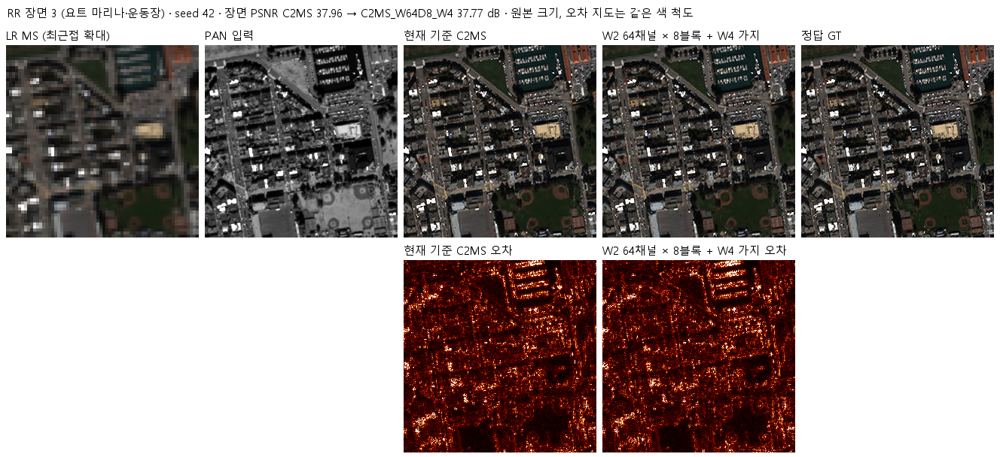

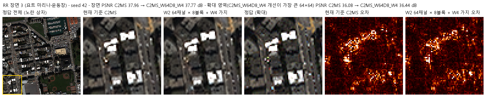

장면 7 · 두 갈래 · 두 비교 형식

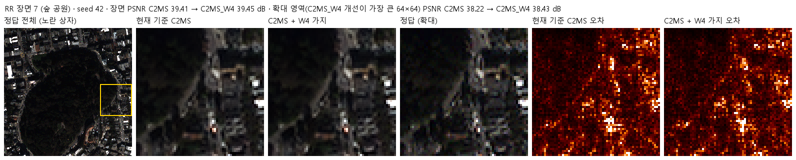

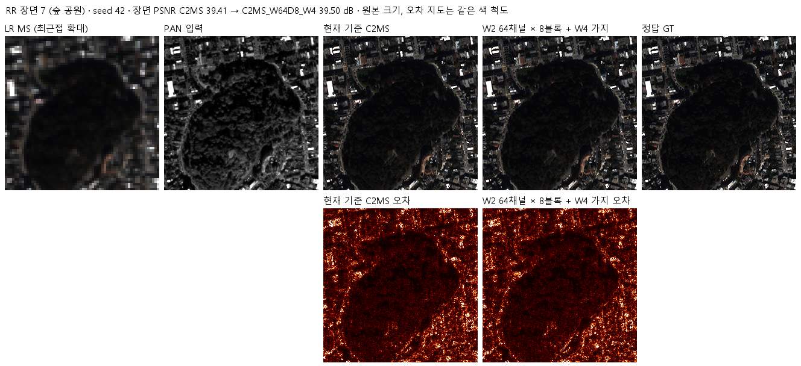

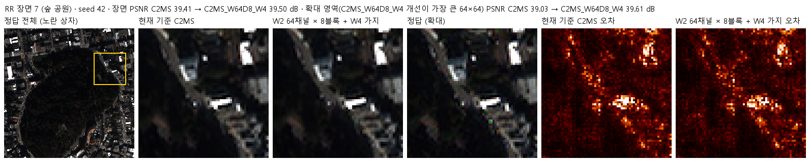

장면 14 · 두 갈래 · 두 비교 형식

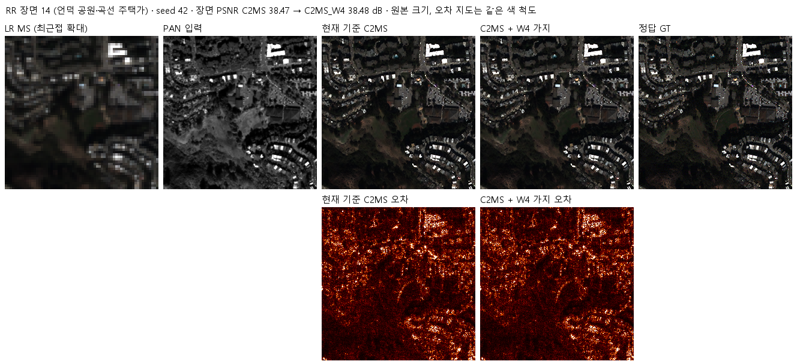

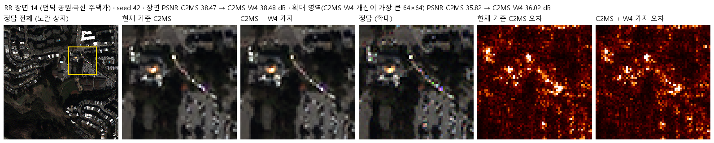

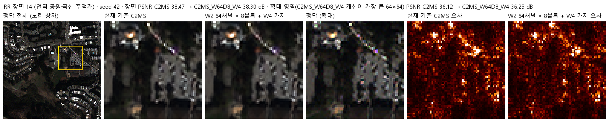

장면 17 · 두 갈래 · 두 비교 형식

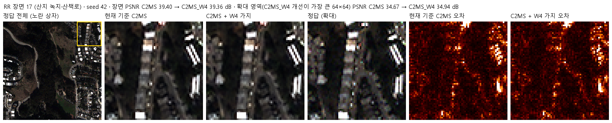

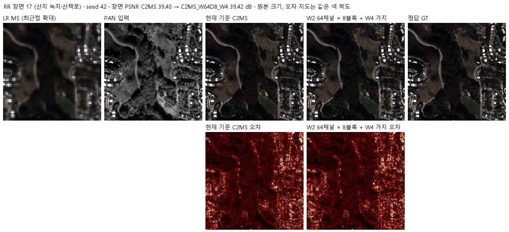

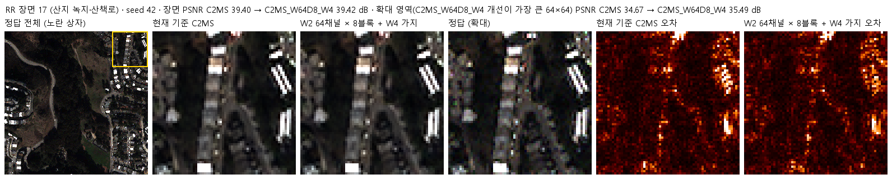

## 7. 재현 자료

- [config.json](config.json): 학습 전에 고정한 가설·구조·비교·데이터 해시. 서버에 봉인된 설정과 소스 해시는 [runtime_config.json](provenance/run_records/runtime_config.json)에 있습니다. config.json은 평가 후 첫머리의 상태·개선 여부 필드만 바꿨습니다.
- [model.py](model.py): W4 가지(`WithQuarter`)와 두 갈래의 구성. 75번 `SizedParallel`과 43번 `Parallel`을 그대로 씁니다.
  - **평가 전 수정 한 줄:** 학습이 끝난 뒤 첫 평가가 `AttributeError: module 'model' has no attribute 'M54'`로 멈췄습니다([기록](provenance/evaluation_rerun/failure_evaluate_C2MS_W64D8_W4.json)). 평가 코드가 53·57번 C2MS 대조군을 `model.M54`로 만드는데 76번 model.py에 그 이름이 없었기 때문입니다.
  - 모델 구조를 바꾸지 않는 별칭 `M54 = M75.M54` 한 줄을 추가하고, 학습한 가중치로 평가만 다시 실행했습니다(`train.py --mode evaluate`, [실행 스크립트](provenance/evaluation_rerun/eval76.cmd)).
  - 학습 당시 봉인된 원래 파일은 [model_sealed_at_training.py](provenance/evaluation_rerun/model_sealed_at_training.py)이고, 해시가 봉인 해시와 같습니다. 이 한 줄을 빼면 저장소의 model.py와 같습니다.
  - 컨트롤러는 봉인 해시가 달라지면 다시 실행하지 않으므로, 이번 실행에는 `all_complete.json`이 없고 [controller_failure.json](provenance/run_records/controller_failure.json)이 남아 있습니다.
- [train.py](train.py): 54번 학습기를 그대로 쓰고, 사전 검사의 초기 상태 확인 한 곳만 바꿨습니다. 두 갈래 모두 원본 부분과 W2 가지가 같은 시드의 원래 모델과 같고 초기 출력이 43번 C0와 비트 단위로 같은 것을 확인했습니다.
- [run.py](run.py): 75번 컨트롤러입니다. 캐시를 H5에서 다시 만들어 63번 기록 해시와 대조(정규화·거친 쌍 모두 일치)하고, 설정을 봉인한 뒤 두 갈래를 동시에 학습했습니다.
- [evaluate.py](evaluate.py): 53번(공식), 57번, 원본(43번 C0)과 RR로 비교하고 결과 이미지·그래프를 만듭니다(75번과 같음).
- [prepare.py](prepare.py): 54번 센서 연산을 그대로 씁니다.
- 가중치: `checkpoints/C2MS_W4_QB_s42/best.pt`(145에폭), `checkpoints/C2MS_W64D8_W4_QB_s42/best.pt`(149에폭). 재개용 `latest.pt`와 초기 `initial.pt`는 GitHub Release `weights-experiments-performance-76`에 있고 [manifest.json](manifest.json)의 `release_assets`에 기록했습니다.
- 결과: `results/<갈래>_QB_s42/`의 `history.json`, `training_complete.json`, `evaluation_complete.json`, `evaluation/QB_v2_4.json`(장면별 RR·FR), 그래프와 결과 이미지. 주파수·구조 분해는 [frequency_structure.json](results/frequency_structure.json), 가장자리·안쪽 분해는 [border_interior.json](results/border_interior.json)입니다.
- 분석 스크립트: [provenance/analysis](provenance/analysis/)(`analyze76.py`, `border76.py`). 실험 설계의 근거가 된 75번 분해는 [provenance/basis_75_analysis](provenance/basis_75_analysis/)에 있습니다.
- 실행 기록: `provenance/run_records/`(준비·벤치마크·preflight·컨트롤러 기록, 캐시 manifest, 환경), 서버 소스 manifest·검증 결과, 전송·실행 스크립트, 이전 75번 실행 폴더 정리 기록(`server_cleanup.json`).

## 8. 개선 여부와 다음 단계

QB seed 42에서 C2MS + W4는 53번 C2MS 대비 RR 세 지표가 모두 좋아졌지만 이득이 잡음 문턱 미만이라 **부분 개선(잡음 수준)**이고, 64 × 8 + W4는 **개선 없음**입니다. 실험 표에는 판정 기준에 따라 후보별 판정 중 가장 높은 부분 개선(C2MS + W4)을 적고, 갈래별 판정을 함께 적습니다. 기준 모델은 C2MS로 유지합니다.

- 1/4 해상도 가지로 평탄 영역의 4-8 px 잔무늬를 줄인다는 가설은 맞지 않았습니다. W4는 8-16 px만 고쳤고, 그 대역은 남은 오차에서 차지하는 몫이 작습니다.
- C2MS + W4의 이득은 대부분 영상 가장자리에서 나와, seed를 늘려 확인할 가치가 크지 않다고 봅니다. 진행 여부는 사용자가 결정합니다.
- 남은 4-8 px 오차를 줄이려면 1/2 해상도 이상에서 쓰는 용량, 또는 손실·학습 방식처럼 다른 쪽을 바꿔야 할 것으로 보입니다.
