# 77. 원래 해상도 backbone의 폭·깊이 확대

**연구 분야:** 성능 개선

**실험자:** 이병현

**변경 내용:** C2MS에서 원래 해상도로 처리하는 원본 backbone(64채널 잔차 블록 4개, 0.30M)을 키웠습니다. 128채널 × 8블록(E1), 64채널 × 8블록(E2)으로 키운 두 갈래와, backbone과 W2 가지를 모두 64채널 × 8블록으로 맞춘 갈래(E3)를 학습했습니다. 학습 조건은 C2MS와 같고, 서버에서 두 개씩 동시에 학습했습니다(QB seed 42).

| 확인된 결과 | 상태 | 개선 여부 |
|---|:---:|:---:|
| E2(64 × 8, 3.15M)는 53번 C2MS 대비 test RR PSNR +0.022 dB·SAM −0.018°·ERGAS −0.008로 세 지표가 모두 좋아졌지만 잡음 문턱(0.06 dB) 미만이라 부분 개선(잡음 수준)입니다. E1(128 × 8, 4.94M)은 validation이 +0.134 dB로 가장 높았지만 test PSNR −0.026 dB·SAM −0.031°(20장 모두 좋아짐)·ERGAS +0.009로 부분 개선이고, E3(1.35M)은 −0.012 dB로 개선 없음입니다. E1은 처음으로 4-8 px의 정답과 상관없는 성분을 줄였지만(−3.1%) 2-4 px 오차가 늘었습니다. 추론 시 W2 출력 배율 진단에서는 α = 1(학습한 세기)이 최적이었습니다. | 평가&nbsp;완료 seed42 | 부분&nbsp;개선 |

[실험 목록](../../../research/performance/README.md) · [수치](#results) · [그래프](#graphs) · [이미지](#images) · [재현 자료](#evidence)

## 1. 목적과 상태

W2 가지를 줄이면 C2MS보다 RR이 낮아졌습니다([74번](../74_backbone_matched_parallel_branch/README.md) 64 × 4 −0.521 dB, [75번](../75_parallel_branch_width_depth/README.md) 128 × 4 −0.201 dB, 64 × 8 −0.127 dB). 반대로 C2MS를 더 키우는 쪽은 1/4 해상도 가지만 해봤고([76번](../76_quarter_resolution_branch/README.md), +0.025 dB, 잡음 수준), 원래 해상도 쪽 용량은 그대로였습니다.

| 근거 | 내용 |
|---|---|
| 원래 해상도 용량의 효율 | [29번](../29_capacity_refinement/README.md)에서 원래 해상도 64채널 × 8블록 가지(W3, 약 0.59M)가 원본 대비 +0.643 dB로, 1/2 해상도 W2(2.43M, +0.723 dB)의 4분의 1 파라미터로 비슷한 이득을 냈습니다(축척 혼합 학습 이전). |
| C2MS 이득이 나오는 대역 | C2MS 이득의 87%가 주기 8 px 미만이고([72번](../72_c2ms_gain_frequency_structure_analysis/README.md)), 원래 해상도는 이 대역을 그대로 다루는 해상도입니다. |
| 남은 오차와 용량 | 4-8 px의 정답과 상관없는 성분 중 시드마다 달라지는 몫(약 15%)은 용량을 키우거나(75번, 9% 감소) 시드를 평균하면(9.8% 감소) 줄었습니다. 1/4 해상도 가지는 줄이지 못했습니다(76번). |
| 확인하지 않은 조합 | 원래 해상도 backbone과 W2 가지를 함께 키운 적은 없습니다. |

**가설:** 원래 해상도의 용량이 아직 한계라면, backbone을 키운 E1(4.94M)과 E2(3.15M)는 53번 C2MS보다 RR이 좋아집니다. E3(1.35M)는 W2 용량을 원래 해상도로 옮기면 파라미터 절반으로 C2MS에 얼마나 가까워지는지 보여 줍니다.

2026-11-06 사용자 결정으로 등록했습니다. 갈래 E3는 사용자가 지정했습니다. 2026-11-06 11:46(KST)에 E1·E3를 동시에 학습하기 시작했고, E3가 끝난 18:30에 E2를 이어서 시작해 23:30에 세 갈래의 학습과 평가를 마쳤습니다. 이 결과를 본 뒤 사용자 요청으로, [50번](../50_w2_branch_inference_scaling/README.md)에서 확인하지 않은 W2 출력 배율 α > 1을 추론만으로 확인했습니다(3절 참고 진단).

## 2. 변경한 구조와 비교 조건

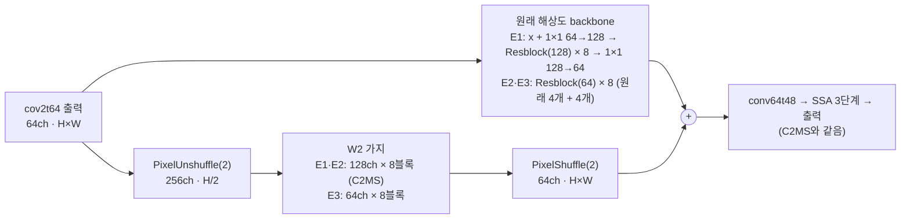

| 모델 | 원래 해상도 backbone | W2 가지 | backbone 파라미터 | 모델 전체 |
|---|---|---|---:|---:|
| C2MS (53번, 공식 대조군) | 64 × 4 | 128 × 8 | 295,424 | 2,853,918 |
| **C2MS_B128D8 (E1)** | **128 × 8** | 128 × 8 | **2,377,920** | **4,936,414** |
| **C2MS_B64D8 (E2)** | **64 × 8** | 128 × 8 | **590,848** | **3,149,342** |
| **C2MS_B64D8_W64D8 (E3)** | **64 × 8** | **64 × 8** | **590,848** | **1,346,014** |
| C2MS_W64D8 (75번) | 64 × 4 | 64 × 8 | 295,424 | 1,050,590 |

- **원본 backbone 구조:** 원본은 잔차 블록 4개를 이어 붙여, 출력이 입력 + 각 블록의 잔차입니다.
- **E2·E3:** 원래 블록 4개 뒤에 같은 64채널 블록 4개를 붙였습니다. 새 블록의 마지막 합성곱을 0으로 시작해, 학습 시작 시 출력이 원본 SSA-MRN(43번 C0)과 정확히 같습니다.
- **E1:** 128채널이라 원래 블록을 대신합니다. 1×1로 64→128채널로 넓혀 블록 8개를 거친 뒤 1×1로 64채널로 되돌리고, 입력을 더하는 연결을 두어 원본과 같은 잔차 형태로 만들었습니다. 원래 블록을 쓰지 않으므로 학습 시작 출력은 원본과 다릅니다.
- **초기값:** W2 가지와 backbone 밖의 층은 같은 시드의 원래 모델과 같은 순서로 만들어 초기 가중치가 같습니다(E1·E2는 43번 C2 = 53번 C2MS, E3는 75번 C2MS_W64D8). 사전 검사에서 이를 확인합니다.
- **학습:** C2MS와 같습니다(원래 쌍 MSE + 1.0 × 2배 거친 쌍 MSE, Adam 1e-4 → 1e-6 cosine 150에폭, batch 32, FP16 AMP, validation MSE 최소 가중치 선택).

| 비교 | 의미 |
|---|---|
| 각 갈래 대 53번 C2MS | 공식 판정(v2.4, RR만) |
| 각 갈래 대 57번 재학습 C2MS | 같은 조건 C2MS의 실행 간 차이 참조 |
| 각 갈래 대 원본(43번 C0) | C2MS 이득 중 남은 비율. E3는 75번 C2MS_W64D8(같은 W2, 원래 backbone)과 함께 읽음 |
| 주파수·구조 분해 | 75·76번과 같은 방법으로 4-8 px 상관없는 성분·평탄 영역이 줄었는지(판정 아님) |

| 항목 | 내용 |
|---|---|
| 데이터 | QB train 17,139개·validation 1,905개(64×64), test RR·FR 각 20장. 파일 SHA-256을 config와 대조 |
| 실행 | 서버 RTX 3060 Ti 1장, 새 실행 폴더. 두 개씩 동시 학습(E1·E3 먼저, 이어서 E2). 학습 캐시는 H5에서 다시 만들어 63번 기록 해시와 대조했습니다(정규화·거친 쌍 모두 일치). E1·E3 평가는 E2 학습 중에 같은 평가 코드로 먼저 실행했습니다(7절) |
| 실제 시간 | 세 갈래 합쳐 11.7시간(학습 시작부터 마지막 평가까지). 3절 학습 시간 참고 |
| 보고 | 에폭별 validation PSNR·SAM, RR(판정), FR QNR·Dλ·Ds(참고), 원본 대비 이득 비율, 주파수·구조 분해 |

**미리 밝혀 두는 한계**

- 원래 해상도 128채널 backbone은 W2 가지보다 합성곱 연산이 약 4배라 학습이 느립니다. 서버 사전 벤치마크에서 학습 한 스텝이 E1 0.197초·E2 0.153초·E3 0.143초였습니다(C2MS 약 0.14초).
- QB에서는 모델을 키우거나 오래 학습하면 validation이 오르는데 test가 내려간 적이 있습니다([59번](../59_extended_cosine_training/README.md), [73번](../73_l1_step_learning_rate_schedule/README.md)).
- 두 학습이 GPU를 나눠 쓰므로 cuDNN이 고르는 연산 방식이 단독 학습과 다를 수 있습니다. 학습 방법은 같고, 부동소수점 세부만 달라질 수 있습니다.

## 3. 정량 결과

QB RR·FR test 20장 평균입니다. 각 갈래를 대조군 세 모델(53번 C2MS, 57번 재학습 C2MS, 원본 43번 C0)과 같은 서버·같은 코드로 함께 평가했습니다. 장면별 수치는 각 갈래의 `results/<갈래>_QB_s42/evaluation/QB_v2_4.json`에 있습니다([E1](results/C2MS_B128D8_QB_s42/evaluation/QB_v2_4.json), [E2](results/C2MS_B64D8_QB_s42/evaluation/QB_v2_4.json), [E3](results/C2MS_B64D8_W64D8_QB_s42/evaluation/QB_v2_4.json)). 75번 수치는 [75번 보고서](../75_parallel_branch_width_depth/README.md#results)에서 가져왔습니다(같은 평가 코드·같은 대조군 가중치).

| 모델 | 원래 해상도 backbone / W2 | 파라미터 | RR PSNR | RR SAM | RR ERGAS | FR QNR / Dλ / Ds (참고) |
|---|---|---:|---:|---:|---:|---:|
| 원본 SSA-MRN (43번 C0) | 64 × 4 / 없음 | 426,654 | 37.3671 | 4.9651 | 4.1554 | 0.917 / 0.043 / 0.042 |
| C2MS (53번, 공식 대조군) | 64 × 4 / 128 × 8 | 2,853,918 | 38.2738 | 4.5770 | 3.7230 | 0.826 / 0.027 / 0.151 |
| C2MS (57번 재학습, 참조) | 64 × 4 / 128 × 8 | 2,853,918 | 38.2829 | 4.5736 | 3.7193 | 0.828 / 0.025 / 0.151 |
| **C2MS_B64D8 (E2)** | **64 × 8** / 128 × 8 | **3,149,342** | **38.2956** | **4.5587** | **3.7150** | 0.802 / 0.024 / 0.178 |
| **C2MS_B128D8 (E1)** | **128 × 8** / 128 × 8 | **4,936,414** | **38.2477** | **4.5465** | **3.7320** | 0.852 / 0.023 / 0.127 |
| **C2MS_B64D8_W64D8 (E3)** | **64 × 8** / **64 × 8** | **1,346,014** | **38.2622** | **4.6278** | **3.7324** | 0.881 / 0.030 / 0.092 |
| C2MS_W64D8 (75번) | 64 × 4 / 64 × 8 | 1,050,590 | 38.1465 | 4.6785 | 3.7844 | 0.881 / 0.028 / 0.093 |

### v2.4 판정

| 갈래 | 비교 | ΔRR PSNR / SAM / ERGAS | C2MS보다 좋은 장면 수(PSNR / SAM) | 판정 |
|---|---|---|---:|---|
| E2 | **53번 C2MS 대비 (공식)** | +0.0218 / −0.0183 / −0.0081 | 14 / 18 | **부분 개선 (잡음 수준)** |
| E2 | 57번 C2MS 대비 (참조) | +0.0127 / −0.0149 / −0.0044 | 15 / 17 | 부분 개선 (잡음 수준) |
| E2 | 원본 대비 (참조) | +0.9285 / −0.4064 / −0.4405 | 원본보다 20 / 20 | 개선 |
| E1 | **53번 C2MS 대비 (공식)** | −0.0260 / −0.0305 / +0.0090 | 8 / 20 | **부분 개선** |
| E1 | 57번 C2MS 대비 (참조) | −0.0351 / −0.0271 / +0.0126 | 6 / 19 | 부분 개선 |
| E1 | 원본 대비 (참조) | +0.8806 / −0.4185 / −0.4235 | 원본보다 20 / 20 | 개선 |
| E3 | **53번 C2MS 대비 (공식)** | −0.0116 / +0.0507 / +0.0094 | 8 / 0 | **개선 없음** |
| E3 | 57번 C2MS 대비 (참조) | −0.0207 / +0.0541 / +0.0130 | 7 / 0 | 개선 없음 |
| E3 | 원본 대비 (참조) | +0.8951 / −0.3373 / −0.4231 | 원본보다 20 / 20 | 개선 |

E2는 세 지표가 모두 좋아졌지만 PSNR 이득 +0.022 dB가 단일 시드 잡음 문턱 0.06 dB보다 작습니다. 57번 재학습 C2MS와 53번의 차이(+0.009 dB)보다는 크지만, 같은 크기의 이득은 시드만 바꿔도 나올 수 있는 범위입니다. E1은 SAM이 20장 모두 좋아졌지만 PSNR과 ERGAS가 나빠졌습니다.

### C2MS 이득 중 남은 비율

원본 대비 C2MS의 RR PSNR 이득(+0.907 dB) 중 각 갈래가 얻은 비율입니다.

| 모델 | 파라미터 | 원본 대비 RR PSNR | 남은 비율 |
|---|---:|---:|---:|
| E2 | 3.15M | +0.929 | 102.4% |
| E3 | 1.35M | +0.895 | 98.7% |
| E1 | 4.94M | +0.881 | 97.1% |
| 75번 C2MS_W64D8 | 1.05M | +0.779 | 86% |

E3는 같은 W2(64 × 8)에 원래 해상도 블록 4개(0.30M)를 더해 75번보다 +0.116 dB 높았고, C2MS의 47% 파라미터로 이득의 98.7%를 얻었습니다.

### validation (선택 가중치)

| 모델 | 선택 에폭 | 원래 축척 PSNR / SAM | 거친 축척 PSNR | 150에폭 학습 MSE | validation 차이 → test 차이 (C2MS 대비) |
|---|---:|---:|---:|---:|---:|
| C2MS (53번) | 149 | 40.283 / 4.226 | 46.846 | 1.225e-4 | |
| **E1** | 149 | **40.417** / **4.180** | **47.048** | **1.148e-4** | **+0.134 → −0.026 dB** |
| **E2** | 141 | 40.299 / 4.214 | 46.888 | 1.217e-4 | +0.016 → +0.022 dB |
| **E3** | 149 | 40.049 / 4.304 | 46.557 | 1.378e-4 | −0.234 → −0.012 dB |
| C2MS_W64D8 (75번) | 150 | 39.914 / 4.354 | 46.284 | 1.432e-4 | −0.369 → −0.127 dB |

validation과 test의 순서가 맞지 않았습니다. E1은 validation이 5에폭부터 끝까지 C2MS보다 높았지만 test PSNR은 가장 낮았고, 학습 MSE가 C2MS보다 6% 낮았습니다. E3는 validation에서 0.234 dB 뒤졌지만 test에서는 차이가 0.012 dB로 줄었습니다. AMP에서 건너뛴 업데이트는 80,400회 중 E1 19회, E2 18회, E3 20회였습니다.

### 원래 해상도 용량이 바꾼 대역과 구조

76번과 같은 방법([성능 72번](../72_c2ms_gain_frequency_structure_analysis/README.md))으로, 오차 변화를 주파수 대역(무늬 주기)과 구조 크기로 나눴습니다. 로컬 CPU에서 다시 만든 여섯 모델 출력의 장면 PSNR은 서버 평가와 1e-6 dB 이내로 일치했습니다. 수치는 [frequency_structure.json](results/frequency_structure.json)에 있습니다. 괄호는 오차 감소율과 그 대역에서 좋아진 장면 수이며, 신뢰구간이 0을 포함하는 경우 표시했습니다.

| 대역 (무늬 주기) | C2MS → E1 | C2MS → E2 | 75번 W64D8 → E3 | C2MS → E3 |
|---|---:|---:|---:|---:|
| 16 px 초과 | +0.000 | +0.000 | +0.000 | −0.001 (−32에서 −51%, 0-2장) |
| 8-16 px | +0.001 (1.5%, 14장, 0 포함) | +0.001 (2.2%, 11장, 0 포함) | −0.002 (0.2%, 6장) | **−0.014 (−20.8%, 0장)** |
| **4-8 px** | **+0.032 (3.4%, 19장)** | +0.009 (1.3%, 14장, 0 포함) | **+0.047 (4.9%, 20장)** | **−0.047 (−5.1%, 1장)** |
| **2-4 px** | **−0.052 (−2.1%, 5장)** | +0.010 (0.7%, 13장, 0 포함) | **+0.063 (2.3%, 18장)** | **+0.045 (1.3%, 17장)** |
| 2 px 미만 | −0.008 (−2.5%, 1장) | +0.002 (0.8%, 15장, 0 포함) | +0.007 (2.8%, 17장) | +0.006 (2.1%, 15장, 0 포함) |
| 합계 | −0.026 | +0.022 | +0.116 | −0.012 |

| 항목 (오차 에너지, DN²) | C2MS | E1 | E2 | E3 | 75번 W64D8 |
|---|---:|---:|---:|---:|---:|
| 4-8 px 정답과 상관없는 성분 | 152.0 | **147.3 (−3.1%)** | 150.2 (−1.2%) | 159.1 | 167.1 |
| 4-8 px 평탄 영역 오차 | 103.4 | **100.9 (−2.4%)** | 102.7 | 108.3 | 113.3 |
| 2-4 px 정답과 상관없는 성분 | 424.4 | **436.5 (+2.9%)** | 421.9 | 410.0 | 415.5 |
| 2-4 px 세부 반영 비율(정답 대비) | 0.807 | 0.808 | 0.808 | 0.798 | 0.792 |

| 구조 (화소 비율) | C2MS → E1 dB (좋아진 장면) | C2MS → E2 dB | 75번 W64D8 → E3 dB |
|---|---:|---:|---:|
| 평탄 (50%) | **+0.013 (17장)** | +0.003 (12장, 0 포함) | +0.021 (19장) |
| 미세 세부 s1 (11%) | −0.002 (9장, 0 포함) | −0.004 (13장, 0 포함) | +0.030 (18장) |
| 작은 세부 s2 (14%) | **−0.027 (4장)** | +0.012 (16장, 0 포함) | +0.032 (19장) |
| 중간 구조 s4 (11%) | **−0.016 (4장)** | +0.004 (14장, 0 포함) | +0.019 (19장) |
| 큰 구조 s8 (13%) | +0.002 (10장, 0 포함) | +0.005 (15장, 0 포함) | +0.013 (20장) |

SAM 변화는 E1 −0.031°(4-8 px 0.016°, 4 px 미만 0.015°), E2 −0.018°(4-8 px 0.007°, 4 px 미만 0.010°)로, 두 갈래 모두 4-8 px와 그보다 짧은 무늬에서 색이 좋아졌습니다.

영상 가장자리 16 px 띠(화소의 23.4%)와 안쪽을 나눠 보면 다음과 같습니다([border_interior.json](results/border_interior.json)). 76번 C2MS + W4와 달리 E2의 이득은 가장자리와 안쪽에서 고르게 나왔습니다.

| 비교 | 4-8 px 오차 감소 (가장자리 / 안쪽) | 4 px 미만 오차 감소 (가장자리 / 안쪽) | 전체 오차 감소 (가장자리 / 안쪽) |
|---|---:|---:|---:|
| C2MS → E1 | 3.7% / 3.3% | −0.3% / **−2.7%** | 0.6% / −1.4% |
| C2MS → E2 | 1.1% / 1.4% | 0.8% / 0.7% | 0.9% / 0.8% (감소의 25%가 가장자리) |
| 75번 W64D8 → E3 | 3.9% / 5.2% | 2.0% / 2.4% | 2.3% / 3.0% |

### 참고 진단: 추론 시 W2 출력 배율 (α)

학습한 가중치를 그대로 두고, 추론에서 backbone 출력을 `원본(x) + α · W2가지(x)`로 바꿔 53번 C2MS와 43번 C2(각 seed 42-44)의 validation과 RR test를 다시 쟀습니다. [50번](../50_w2_branch_inference_scaling/README.md)은 α = 0-1만 확인해 α가 클수록 RR이 좋아졌는데, 1보다 크게 하면 어떻게 되는지 확인한 것입니다. 새로 학습하지 않았고 판정에 쓰지 않습니다. α = 1에서 여섯 가중치 모두 저장된 validation과 서버 RR 평가를 소수점 7자리까지 재현했습니다. 수치는 [w2_output_scaling.json](results/w2_output_scaling.json)에 있습니다.

| α | C2MS validation PSNR | C2MS RR PSNR / SAM / ERGAS | α = 1 대비 RR PSNR | 43번 C2 RR PSNR |
|---:|---:|---:|---:|---:|
| 0.75 | 39.799 | 37.708 / 4.800 / 3.996 | −0.594 | 37.658 |
| 0.9 | 40.208 | 38.204 / 4.600 / 3.760 | −0.098 | 38.071 |
| 0.95 | 40.264 | 38.279 / 4.576 / 3.724 | −0.023 | 38.124 |
| 0.98 | **40.276** | 38.299 / **4.573** / 3.714 | −0.003 | **38.134** |
| **1.0** | 40.275 | **38.302** / 4.576 / **3.712** | 0 | 38.132 |
| 1.02 | 40.266 | 38.297 / 4.583 / 3.713 | −0.005 | 38.122 |
| 1.05 | 40.240 | 38.273 / 4.600 / 3.722 | −0.029 | 38.093 |
| 1.1 | 40.160 | 38.193 / 4.648 / 3.755 | −0.109 | 38.009 |
| 1.2 | 39.882 | 37.893 / 4.815 / 3.887 | −0.409 | 37.718 |
| 1.5 | 38.457 | 36.249 / 5.791 / 4.718 | −2.053 | 36.179 |
| 2.0 | 35.716 | 33.008 / 8.419 / 6.916 | −5.294 | 33.104 |
| 3.0 | 31.390 | 28.115 / 15.146 / 12.257 | −10.187 | 28.342 |

C2MS·43번 C2 모두 3시드 평균입니다. C2MS는 validation 기준으로 seed 42·43이 α = 1, seed 44가 α = 0.98을 골랐고, RR은 세 시드 모두 α = 1이 가장 높았습니다. 43번 C2는 세 시드 모두 validation과 RR에서 α = 0.98이 가장 높았지만 α = 1과의 차이는 0.003 dB입니다.

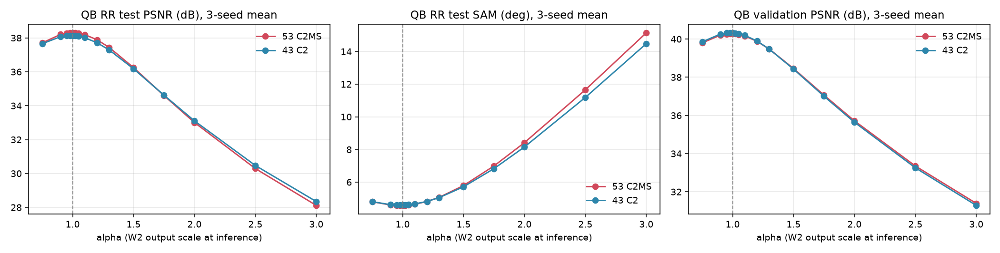

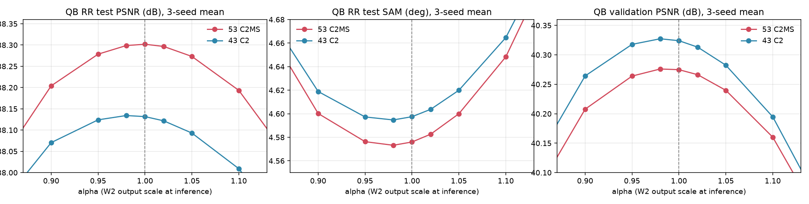

### 학습 시간

| 갈래 | 단독 스텝 (벤치마크) | 에폭 시간 | 학습 시간 |
|---|---:|---:|---:|
| E1 | 0.197초 | 223초 (E3·E2와 동시) | 9.37시간 |
| E3 | 0.143초 | 162초 (E1과 동시) | 6.73시간 |
| E2 | 0.153초 | 182초 (E1과 동시), 83초 (단독) | 4.96시간 |

## 4. 기준선 대비 차이와 해석

- **원래 해상도 용량을 키워도 C2MS의 RR PSNR은 잡음 수준 이상으로 오르지 않았습니다.** 가장 좋은 E2가 +0.022 dB이고, 가장 크게 키운 E1은 오히려 −0.026 dB였습니다. 가설(원래 해상도 용량이 아직 한계라면 E1·E2가 C2MS보다 좋아진다)은 PSNR에서는 확인되지 않았습니다.
- **E1은 노린 대역을 줄였지만, 더 짧은 무늬에서 그만큼 잃었습니다.** 4-8 px의 정답과 상관없는 성분을 3.1%, 평탄 영역의 4-8 px 오차를 2.4% 줄였습니다. 지금까지 이 성분을 줄인 것은 W2 가지를 64 × 8에서 128 × 8로 키운 75번뿐이었는데, C2MS 위에서 줄인 것은 E1이 처음입니다(19/20장, 가장자리·안쪽 모두). 대신 2-4 px의 정답과 상관없는 성분이 2.9% 늘었고, 이 손실(−0.052 dB)이 4-8 px 이득(+0.032 dB)보다 컸습니다. 구조별로는 평탄 영역이 좋아지고(+0.013 dB) 작은·중간 세부가 나빠졌습니다(−0.027·−0.016 dB). 128채널 원래 해상도 backbone이 정답에 없는 2-4 px 무늬를 만든 것입니다.
- **E1의 validation 이득은 test로 이어지지 않았습니다.** E1은 학습 MSE가 C2MS보다 6% 낮고 validation이 0.134 dB 높았지만 test PSNR은 낮았습니다. 학습 장면에 더 맞춘 결과로 보이며, QB에서 모델을 키우거나 오래 학습했을 때 본 양상([59번](../59_extended_cosine_training/README.md), [73번](../73_l1_step_learning_rate_schedule/README.md))과 같습니다. 반대로 SAM은 test에서도 20장 모두 좋아져, 색(분광) 정확도의 이득은 test까지 이어졌습니다.
- **E2의 작은 이득은 대역·영역에 고르게 퍼져 있습니다.** 모든 대역에서 오차가 0.7-2.2% 줄었지만 각 대역의 신뢰구간이 0을 포함했고, 가장자리와 안쪽의 감소율도 같았습니다(0.9%·0.8%). 76번 C2MS + W4처럼 가장자리에 몰린 이득은 아니지만, 단일 시드로는 잡음과 구별할 수 없는 크기입니다.
- **같은 파라미터라면 원래 해상도에 두는 쪽이 효율적이지만, 담당하는 대역이 다릅니다.** E3는 75번 W64D8보다 모든 짧은 대역(4-8 px +0.047, 2-4 px +0.063 dB)과 모든 구조에서 좋아졌습니다. C2MS와 비교하면 W2를 줄인 만큼 8-16 px(−20.8%)와 4-8 px(−5.1%)에서 잃고, 원래 해상도 블록으로 2-4 px(+0.045 dB, 17장)에서 얻었습니다. W2 가지(1/2 해상도)는 4-16 px를, 원래 해상도 블록은 2-4 px를 주로 고친다는 뜻입니다.
- **추론 시 W2 출력 세기는 이미 최적입니다.** 50번에서 α가 클수록 RR이 좋아진 것은 α < 1로 줄였던 출력이 학습한 값으로 돌아오는 과정이었습니다. 최적은 α = 0.98-1.0이고, 1을 넘기면 RR PSNR이 1.1에서 −0.11 dB, 2.0에서 −5.3 dB로 빠르게 떨어졌습니다. 원본 backbone과 뒤쪽 층이 학습한 W2 세기에 맞춰 함께 학습됐기 때문에, 배율 하나만 바꿔서는 얻을 것이 없습니다. 남은 개선은 학습으로 찾아야 합니다.
- FR(참고)에서는 E1의 QNR이 C2MS보다 높고(0.852), E2는 약간 낮았습니다(0.802). 판정에는 쓰지 않습니다.

## 5. 학습·평가 그래프

학습 MSE(원래 축척), validation PSNR·SAM, 학습률입니다. 점선은 53번 C2MS의 선택 가중치 validation PSNR입니다. 가중치는 validation MSE 최소인 149에폭(E1·E3)과 141에폭(E2)이 선택됐습니다.

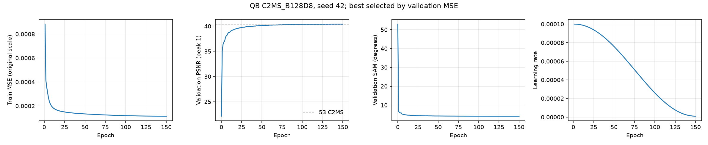

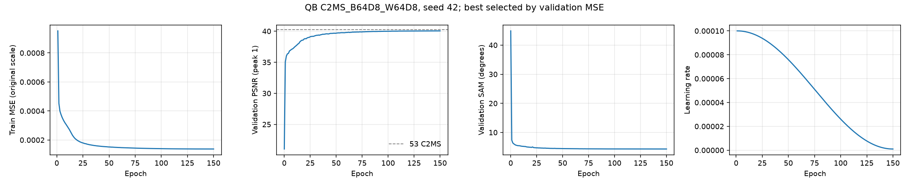

53번 C2MS 대비 test RR PSNR·SAM·ERGAS 차이입니다. 원본(43번 C0)과 57번 재학습 C2MS를 함께 표시했습니다.

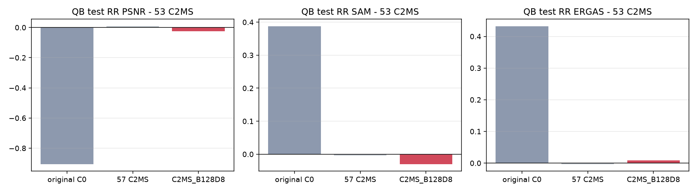

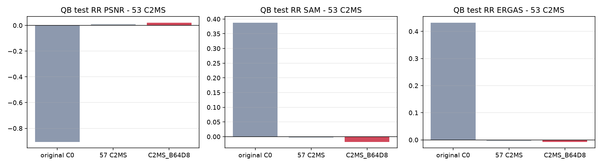

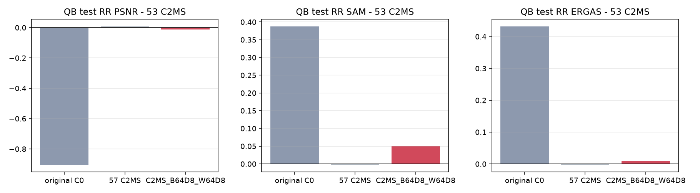

## 6. 결과 이미지

고정 6장면(QB RR test 0-based 0·1·3·7·14·17, seed 42)에서 현재 기준 C2MS(53번)와 각 갈래를 비교했습니다. 장면은 정답만 보고 풍경으로 미리 정했고 결과를 보고 바꾸지 않았습니다. `common/result_images.py`로 서버 평가 중에 만들었습니다.

원본 크기 비교는 256×256 전체 장면의 **LR MS · PAN · C2MS · 후보 · 정답**과 **C2MS 오차 · 후보 오차**(같은 색 척도)입니다. 확대 비교는 후보의 개선이 가장 큰 64×64 창을 4배 확대한 **정답 전체(노란 상자) · C2MS · 후보 · 정답 · C2MS 오차 · 후보 오차**입니다. **확대 창은 장면마다 후보에 가장 유리한 곳을 고른 것**이라, 장면 전체가 나빠졌어도 확대 창은 좋아 보일 수 있습니다. 전체 차이는 장면 PSNR로 판단합니다.

| 장면 | 풍경 | C2MS 장면 PSNR | E1 (차이) | E2 (차이) | E3 (차이) | 확대 창 차이 E1 / E2 / E3 |
|---:|---|---:|---:|---:|---:|---:|
| 0 | 바다·항구 방파제 | 42.812 | 42.930 (+0.118) | 42.358 (−0.454) | 42.806 (−0.006) | +0.975 / +0.534 / +0.368 |
| 1 | 부두·곡선 방파제·수목 | 43.179 | 43.212 (+0.033) | 43.210 (+0.031) | 43.025 (−0.154) | +0.502 / +0.633 / +0.450 |
| 3 | 요트 마리나·운동장 | 37.964 | 37.980 (+0.016) | 37.956 (−0.009) | 37.997 (+0.033) | +0.529 / +0.357 / +1.172 |
| 7 | 숲 공원 | 39.405 | 39.494 (+0.088) | 39.509 (+0.104) | 39.599 (+0.194) | +0.822 / +0.929 / +0.844 |
| 14 | 언덕 공원·곡선 주택가 | 38.473 | 38.437 (−0.035) | 38.447 (−0.025) | 38.418 (−0.055) | +0.193 / +0.407 / +0.286 |
| 17 | 산지 녹지·산책로 | 39.396 | 39.544 (+0.148) | 39.496 (+0.100) | 39.462 (+0.066) | +0.826 / +0.452 / +0.589 |

고정 6장면에서는 E1이 4장, E2가 3장 좋아졌습니다. E2는 장면 0(바다·항구)에서 −0.454 dB로 크게 나빠졌는데, 20장 전체에서는 14장이 좋아졌습니다.

**장면 0 (바다·항구 방파제) · E2 (64 × 8)**

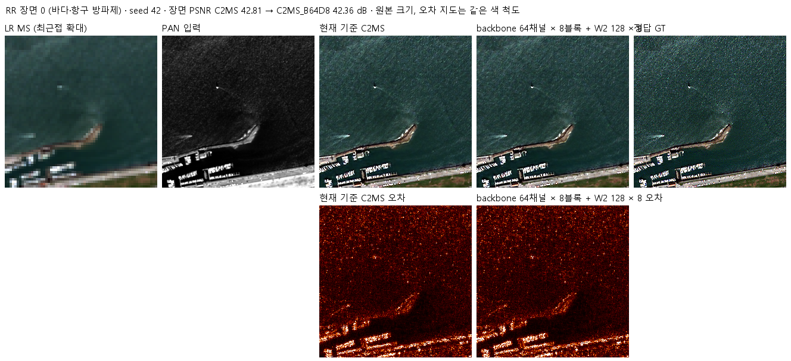

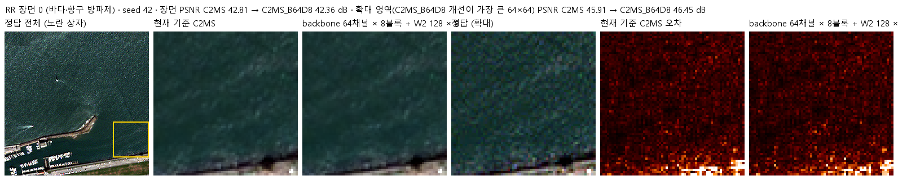

**장면 0 (바다·항구 방파제) · E1 (128 × 8)**

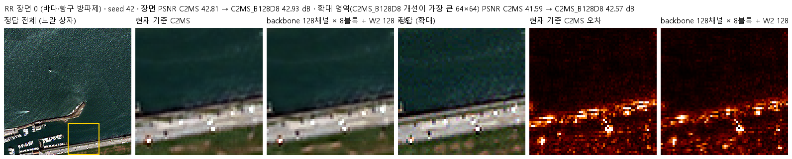

**장면 0 (바다·항구 방파제) · E3 (64 × 8 + W2 64 × 8)**

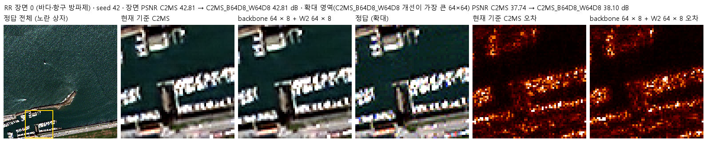

장면 1 · 세 갈래 · 두 비교 형식

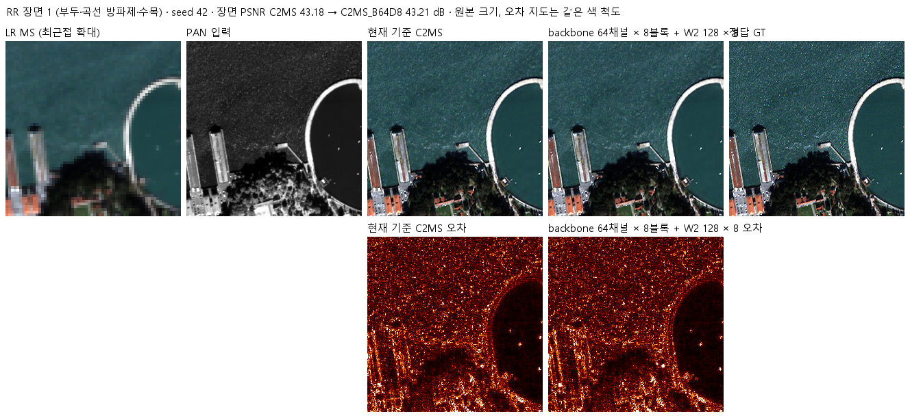

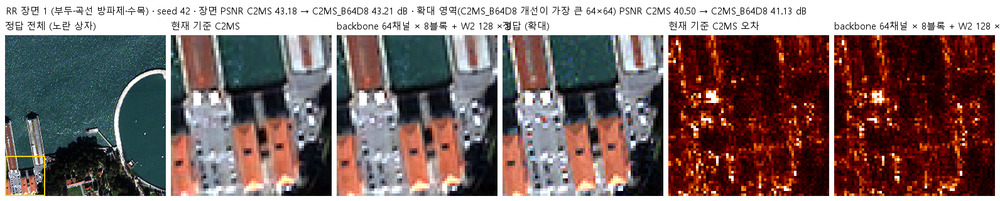

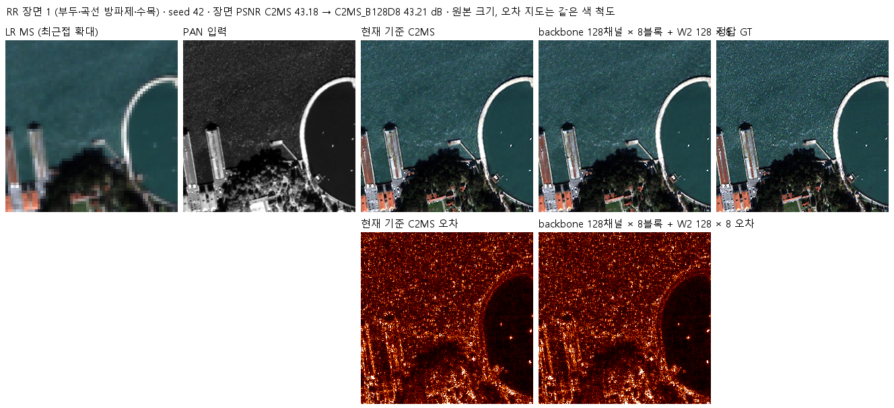

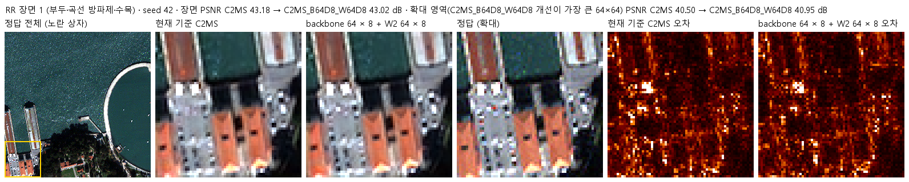

장면 3 · 세 갈래 · 두 비교 형식

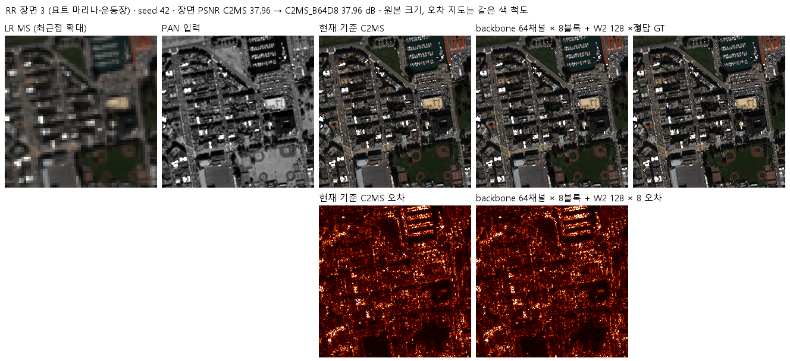

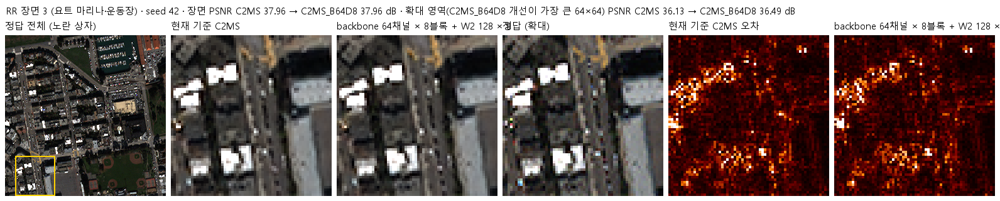

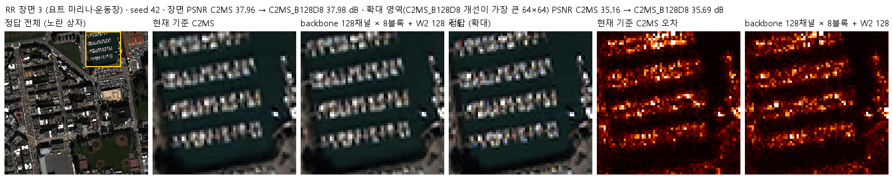

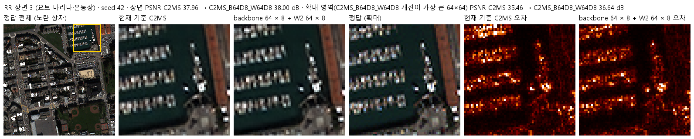

장면 7 · 세 갈래 · 두 비교 형식

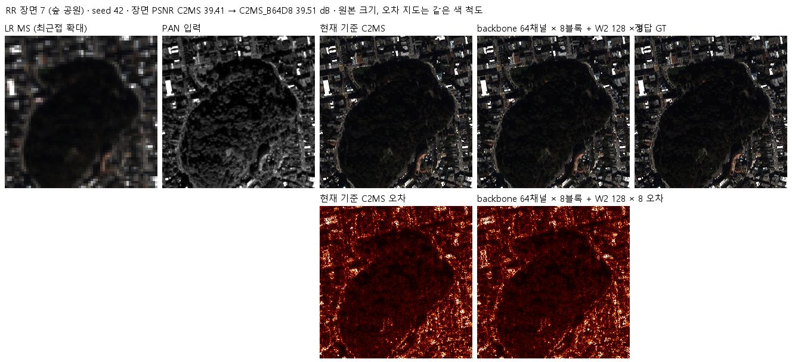

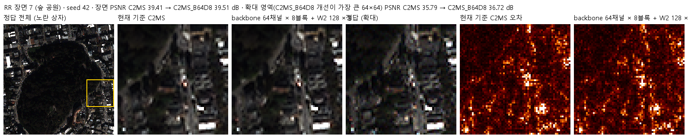

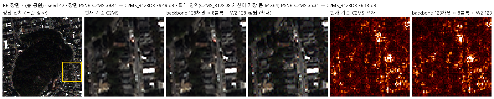

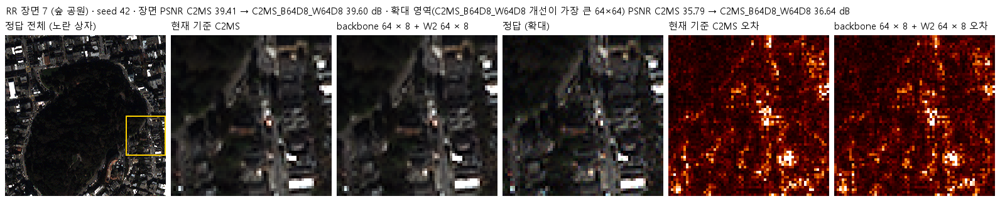

장면 14 · 세 갈래 · 두 비교 형식

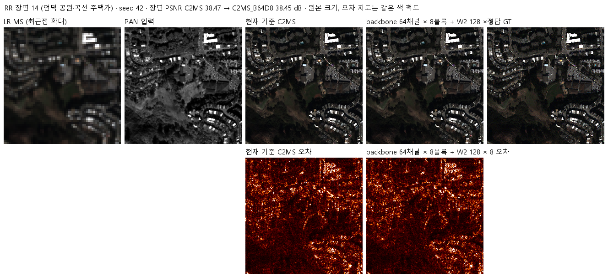

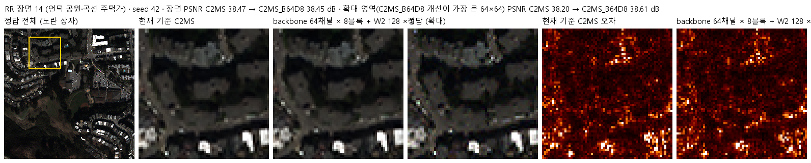

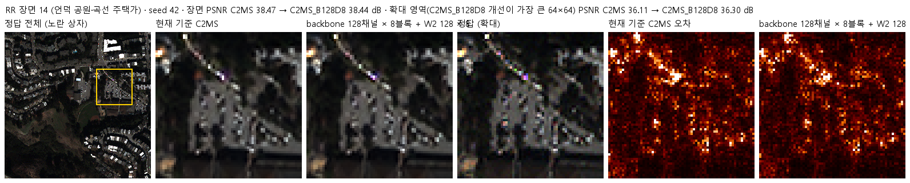

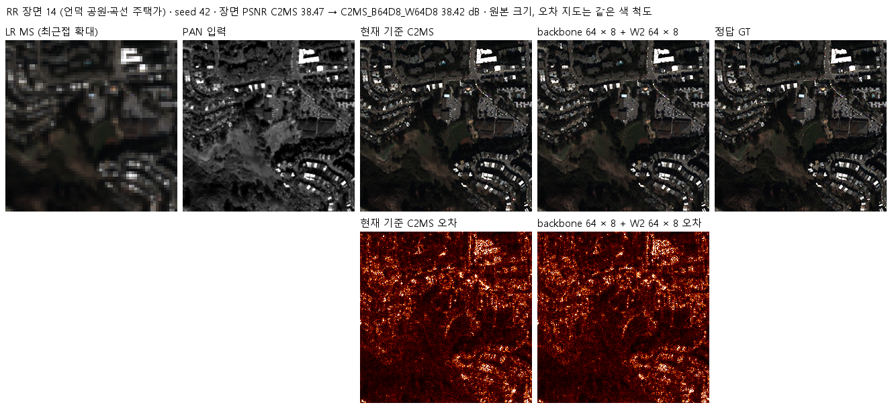

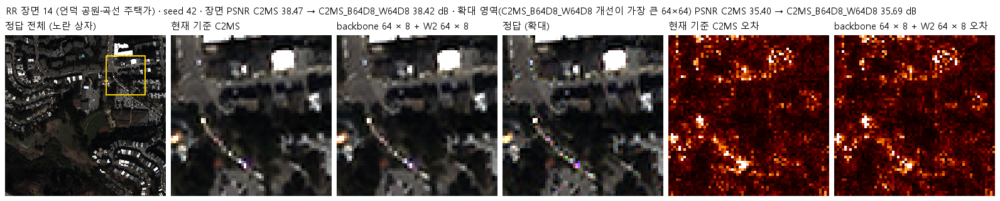

장면 17 · 세 갈래 · 두 비교 형식

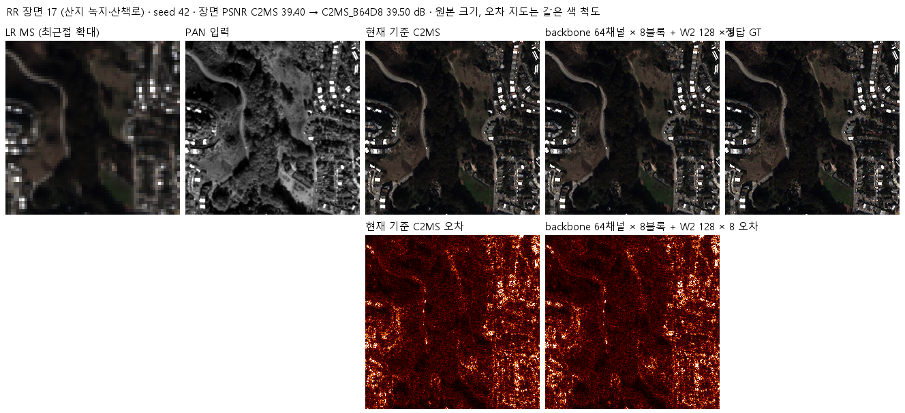

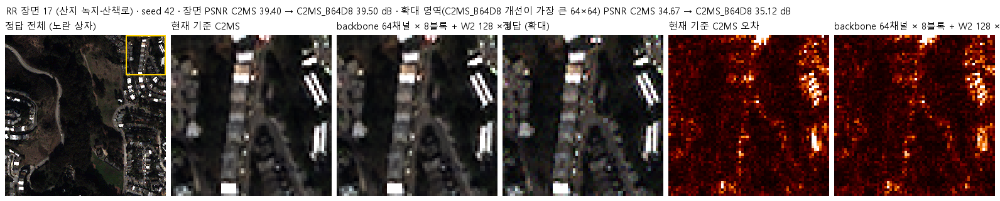

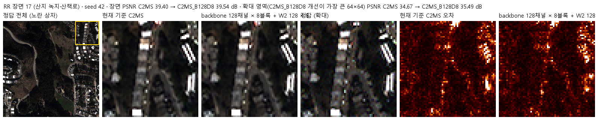

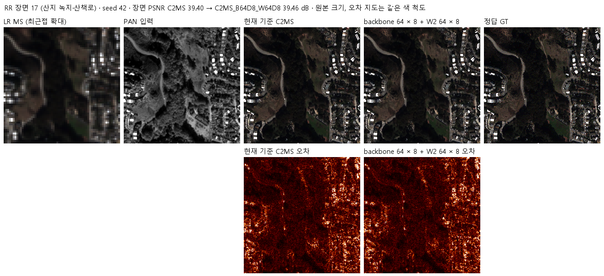

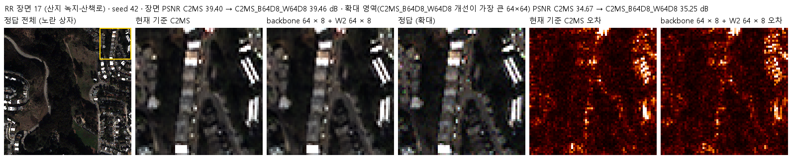

## 7. 재현 자료

- [config.json](config.json): 학습 전에 고정한 가설·구조·비교·데이터 해시. 서버에 봉인된 설정과 소스 해시는 [runtime_config.json](provenance/run_records/runtime_config.json)에 있습니다. config.json은 평가 후 첫머리의 상태·개선 여부 필드만 바꿨습니다.
- [model.py](model.py): 키운 backbone(`WideBackbone`, `deepened`)과 세 갈래의 구성. 43번 `Parallel`과 75번 `SizedParallel`을 그대로 씁니다. 학습 후에도 바꾸지 않았습니다.
- [train.py](train.py): 54번 학습기를 그대로 쓰고, 사전 검사의 초기 상태 확인 한 곳만 바꿨습니다. 세 갈래 모두 W2 가지와 backbone 밖의 층이 같은 시드의 원래 모델과 같았고, E2·E3는 초기 출력이 43번 C0와 비트 단위로 같았습니다. 저장 후 이어서 학습하는 경로도 차이 0이었습니다([checks.json](provenance/run_records/preflight/checks.json)).
- [run.py](run.py): 75·76번 컨트롤러입니다. 캐시를 H5에서 다시 만들어 63번 기록 해시와 대조하고, 설정을 봉인한 뒤 두 개씩 동시에 학습하고 차례로 평가했습니다. 세 갈래를 모두 마치고 [all_complete.json](provenance/run_records/all_complete.json)을 남겼습니다.
- [evaluate.py](evaluate.py): 53번(공식), 57번, 원본(43번 C0)과 RR로 비교하고 결과 이미지·그래프를 만듭니다(75·76번과 같음).
- [prepare.py](prepare.py): 54번 센서 연산을 그대로 씁니다.
- **E1·E3 평가를 먼저 실행한 방법:** E3가 끝난 뒤 GPU에 학습이 하나만 남아, 사용자 요청으로 E1·E3 평가를 E2 학습과 동시에 실행했습니다. 컨트롤러와 같은 봉인 설정으로 `train.py --mode evaluate`만 실행하는 [스크립트](provenance/early_evaluation/eval77early.ps1)를 따로 띄웠고(각 갈래 학습 프로세스가 끝난 뒤 시작), 평가 코드와 가중치는 바꾸지 않았습니다([실행 기록](provenance/early_evaluation/evaluation_early_status.txt)). 컨트롤러는 `evaluation_complete.json`이 있는 갈래를 건너뛰고 E2만 평가했습니다.
- 가중치: `checkpoints/C2MS_B128D8_QB_s42/best.pt`(149에폭), `checkpoints/C2MS_B64D8_QB_s42/best.pt`(141에폭), `checkpoints/C2MS_B64D8_W64D8_QB_s42/best.pt`(149에폭). 재개용 `latest.pt`와 초기 `initial.pt`는 GitHub Release `weights-experiments-performance-77`에 있고 [manifest.json](manifest.json)의 `release_assets`에 기록했습니다.
- 결과: `results/<갈래>_QB_s42/`의 `history.json`, `training_complete.json`, `evaluation_complete.json`, `evaluation/QB_v2_4.json`(장면별 RR·FR), 그래프와 결과 이미지. 주파수·구조 분해는 [frequency_structure.json](results/frequency_structure.json), 가장자리·안쪽 분해는 [border_interior.json](results/border_interior.json), W2 출력 배율 진단은 [w2_output_scaling.json](results/w2_output_scaling.json)입니다.
- 분석 스크립트: [provenance/analysis](provenance/analysis/)(`analyze77.py`, `border77.py`, 로컬 CPU). W2 출력 배율 진단은 [provenance/w2_output_scaling](provenance/w2_output_scaling/)(`sweep.py`와 실행 스크립트, 서버 GPU에서 E2 학습 중 별도 폴더로 실행)입니다.
- 실행 기록: `provenance/run_records/`(preflight·벤치마크·컨트롤러 기록, 캐시 manifest, 환경), 서버 소스 manifest·검증 결과(234개 파일 일치), 전송·실행 스크립트, 이전 76번 실행 폴더 정리 기록(`server_cleanup.json`).

## 8. 개선 여부와 다음 단계

QB seed 42에서 E2(원래 해상도 64 × 8)는 53번 C2MS 대비 RR 세 지표가 모두 좋아졌지만 이득이 잡음 문턱 미만이라 **부분 개선(잡음 수준)**, E1(128 × 8)은 SAM만 좋아져 **부분 개선**, E3(둘 다 64 × 8)는 **개선 없음**입니다. 실험 표에는 판정 기준에 따라 후보별 판정 중 가장 높은 부분 개선을 적고, 갈래별 판정을 함께 적습니다. 기준 모델은 C2MS로 유지합니다.

- 원래 해상도 용량을 C2MS 위에 더해도 RR PSNR은 잡음 수준 이상으로 오르지 않았습니다. 크게 키우면(E1) 4-8 px 잔무늬와 색은 좋아지지만 2-4 px에 정답에 없는 무늬가 생기고, validation 이득이 test로 이어지지 않았습니다.
- E2의 이득(+0.022 dB)이 진짜인지는 seed 43·44를 학습해야 알 수 있습니다(두 시드를 동시에 학습하면 약 6시간). 진행 여부는 사용자가 결정합니다.
- E1이 4-8 px를 줄이면서 2-4 px를 늘렸으므로, 큰 원래 해상도 backbone에 2-4 px의 과한 무늬를 억제하는 손실이나 정규화를 더하면 두 대역을 함께 얻을 수 있을지 확인할 수 있습니다.
- 추론 시 W2 출력 배율 조정은 개선 방법이 아닙니다(최적 α = 0.98-1.0).
