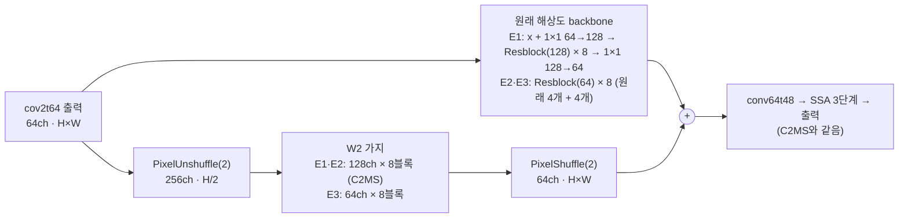

# 77. 원래 해상도 backbone의 폭·깊이 확대

**연구 분야:** 성능 개선

**실험자:** 이병현

**변경 내용:** C2MS에서 원래 해상도로 처리하는 원본 backbone(64채널 잔차 블록 4개, 0.30M)을 키웠습니다. 128채널 × 8블록(E1), 64채널 × 8블록(E2)으로 키운 두 갈래와, backbone과 W2 가지를 모두 64채널 × 8블록으로 맞춘 갈래(E3)를 학습합니다. 학습 조건은 C2MS와 같고, 서버에서 두 개씩 동시에 학습합니다.

| 확인된 결과 | 상태 | 개선 여부 |
|---|:---:|:---:|
| 아직 없습니다. QB seed 42로 세 갈래를 학습합니다. | 계획 | 판단&nbsp;보류 |

[실험 목록](../../../research/performance/README.md) · [수치](#results) · [그래프](#graphs) · [이미지](#images) · [재현 자료](#evidence)

## 1. 목적과 상태

W2 가지를 줄이면 C2MS보다 RR이 낮아졌습니다([74번](../74_backbone_matched_parallel_branch/README.md) 64 × 4 −0.521 dB, [75번](../75_parallel_branch_width_depth/README.md) 128 × 4 −0.201 dB, 64 × 8 −0.127 dB). 반대로 C2MS를 더 키우는 쪽은 1/4 해상도 가지만 해봤고([76번](../76_quarter_resolution_branch/README.md), +0.025 dB, 잡음 수준), 원래 해상도 쪽 용량은 그대로였습니다.

| 근거 | 내용 |
|---|---|
| 원래 해상도 용량의 효율 | [29번](../29_capacity_refinement/README.md)에서 원래 해상도 64채널 × 8블록 가지(W3, 약 0.59M)가 원본 대비 +0.643 dB로, 1/2 해상도 W2(2.43M, +0.723 dB)의 4분의 1 파라미터로 비슷한 이득을 냈습니다(축척 혼합 학습 이전). |
| C2MS 이득이 나오는 대역 | C2MS 이득의 87%가 주기 8 px 미만이고([72번](../72_c2ms_gain_frequency_structure_analysis/README.md)), 원래 해상도는 이 대역을 그대로 다루는 해상도입니다. |
| 남은 오차와 용량 | 4-8 px의 정답과 상관없는 성분 중 시드마다 달라지는 몫(약 15%)은 용량을 키우거나(75번, 9% 감소) 시드를 평균하면(9.8% 감소) 줄었습니다. 1/4 해상도 가지는 줄이지 못했습니다(76번). |
| 확인하지 않은 조합 | 원래 해상도 backbone과 W2 가지를 함께 키운 적은 없습니다. |

**가설:** 원래 해상도의 용량이 아직 한계라면, backbone을 키운 E1(4.94M)과 E2(3.15M)는 53번 C2MS보다 RR이 좋아집니다. E3(1.35M)는 W2 용량을 원래 해상도로 옮기면 파라미터 절반으로 C2MS에 얼마나 가까워지는지 보여 줍니다.

2026-11-06 사용자 결정으로 등록했습니다. 갈래 E3는 사용자가 지정했습니다. 학습은 서버를 켠 뒤 시작합니다.

## 2. 변경한 구조와 비교 조건

| 모델 | 원래 해상도 backbone | W2 가지 | backbone 파라미터 | 모델 전체 |
|---|---|---|---:|---:|
| C2MS (53번, 공식 대조군) | 64 × 4 | 128 × 8 | 295,424 | 2,853,918 |
| **C2MS_B128D8 (E1)** | **128 × 8** | 128 × 8 | **2,377,920** | **4,936,414** |
| **C2MS_B64D8 (E2)** | **64 × 8** | 128 × 8 | **590,848** | **3,149,342** |
| **C2MS_B64D8_W64D8 (E3)** | **64 × 8** | **64 × 8** | **590,848** | **1,346,014** |
| C2MS_W64D8 (75번) | 64 × 4 | 64 × 8 | 295,424 | 1,050,590 |

- **원본 backbone 구조:** 원본은 잔차 블록 4개를 이어 붙여, 출력이 입력 + 각 블록의 잔차입니다.
- **E2·E3:** 원래 블록 4개 뒤에 같은 64채널 블록 4개를 붙였습니다. 새 블록의 마지막 합성곱을 0으로 시작해, 학습 시작 시 출력이 원본 SSA-MRN(43번 C0)과 정확히 같습니다.
- **E1:** 128채널이라 원래 블록을 대신합니다. 1×1로 64→128채널로 넓혀 블록 8개를 거친 뒤 1×1로 64채널로 되돌리고, 입력을 더하는 연결을 두어 원본과 같은 잔차 형태로 만들었습니다. 원래 블록을 쓰지 않으므로 학습 시작 출력은 원본과 다릅니다.
- **초기값:** W2 가지와 backbone 밖의 층은 같은 시드의 원래 모델과 같은 순서로 만들어 초기 가중치가 같습니다(E1·E2는 43번 C2 = 53번 C2MS, E3는 75번 C2MS_W64D8). 사전 검사에서 이를 확인합니다.
- **학습:** C2MS와 같습니다(원래 쌍 MSE + 1.0 × 2배 거친 쌍 MSE, Adam 1e-4 → 1e-6 cosine 150에폭, batch 32, FP16 AMP, validation MSE 최소 가중치 선택).

| 비교 | 의미 |
|---|---|
| 각 갈래 대 53번 C2MS | 공식 판정(v2.4, RR만) |
| 각 갈래 대 57번 재학습 C2MS | 같은 조건 C2MS의 실행 간 차이 참조 |
| 각 갈래 대 원본(43번 C0) | C2MS 이득 중 남은 비율. E3는 75번 C2MS_W64D8(같은 W2, 원래 backbone)과 함께 읽음 |
| 주파수·구조 분해 | 75·76번과 같은 방법으로 4-8 px 상관없는 성분·평탄 영역이 줄었는지(판정 아님) |

| 항목 | 내용 |
|---|---|
| 데이터 | QB train 17,139개·validation 1,905개(64×64), test RR·FR 각 20장. 파일 SHA-256을 config와 대조 |
| 실행 | 서버 RTX 3060 Ti 1장, 새 실행 폴더. 두 개씩 동시 학습(E1·E3 먼저, 이어서 E2). 학습 캐시는 H5에서 다시 만들어 63번 기록 해시와 대조 |
| 예상 시간 | 세 갈래 합쳐 8-10시간(사전 벤치마크로 확인) |
| 보고 | 에폭별 validation PSNR·SAM, RR(판정), FR QNR·Dλ·Ds(참고), 원본 대비 이득 비율, 주파수·구조 분해 |

**미리 밝혀 두는 한계**

- 원래 해상도 128채널 backbone은 W2 가지보다 합성곱 연산이 약 4배라 학습이 느립니다. 로컬 CPU에서 학습 한 스텝이 C2MS의 약 2.2배였고, 서버 GPU 시간은 사전 벤치마크로 확인합니다.
- QB에서는 모델을 키우거나 오래 학습하면 validation이 오르는데 test가 내려간 적이 있습니다([59번](../59_extended_cosine_training/README.md), [73번](../73_l1_step_learning_rate_schedule/README.md)).
- 두 학습이 GPU를 나눠 쓰므로 cuDNN이 고르는 연산 방식이 단독 학습과 다를 수 있습니다. 학습 방법은 같고, 부동소수점 세부만 달라질 수 있습니다.

## 3. 정량 결과

아직 없습니다.

## 4. 기준선 대비 차이와 해석

아직 없습니다.

## 5. 학습·평가 그래프

아직 없습니다.

## 6. 결과 이미지

아직 없습니다. 고정 6장면(QB RR test 0-based 0·1·3·7·14·17)에서 C2MS와 각 갈래를 비교합니다.

## 7. 재현 자료

- [config.json](config.json): 학습 전에 고정한 가설·구조·비교·데이터 해시.
- [model.py](model.py): 키운 backbone(`WideBackbone`, `deepened`)과 세 갈래의 구성. 43번 `Parallel`과 75번 `SizedParallel`을 그대로 씁니다.
- [train.py](train.py): 54번 학습기를 그대로 쓰고, 사전 검사의 초기 상태 확인 한 곳만 바꿉니다.
- [run.py](run.py): 75·76번 컨트롤러입니다. 캐시를 H5에서 다시 만들어 63번 기록 해시와 대조하고, 설정을 봉인한 뒤 두 개씩 동시에 학습하고 차례로 평가합니다.
- [evaluate.py](evaluate.py): 53번(공식), 57번, 원본(43번 C0)과 RR로 비교하고 결과 이미지·그래프를 만듭니다(75·76번과 같음).
- [prepare.py](prepare.py): 54번 센서 연산을 그대로 씁니다.

## 8. 개선 여부와 다음 단계

**판단 보류**입니다. 학습 전입니다.
