# 78. 시드 앙상블 교사 증류로 작은 C2MS 학습

**연구 분야:** 성능 개선

**실험자:** 이병현

**변경 내용:** 구조는 이미 학습한 작은 C2MS 두 가지(77번 E3 1.35M, 75번 W64D8 1.05M)를 그대로 쓰고, 학습 목표만 바꿉니다. 정답 손실에 C2MS·65번 모델 여섯 개의 출력 평균(시드 앙상블 교사)과의 손실을 더해, 원래 쌍과 2배 거친 쌍 모두에 적용합니다. 같은 구조를 정답만으로 학습한 대조군과 53번 C2MS를 기준으로 비교합니다. 학습하기 전에, 학습 패치에서도 교사가 구성원보다 정답에 가까운지 로컬에서 먼저 확인했습니다(0단계).

| 확인된 결과 | 상태 | 개선 여부 |
|---|:---:|:---:|
| 교사(여섯 모델 앙상블)는 53번 C2MS보다 test RR +0.341 dB였지만, 학생에게는 거의 옮겨지지 않았습니다. 같은 구조를 정답만으로 학습한 대조군 대비 E3 학생은 PSNR −0.024 dB·SAM −0.007°·ERGAS +0.012(부분 개선), W64D8 학생은 +0.006 dB·−0.031°·−0.003(세 지표 모두 좋아졌지만 잡음 문턱 미만)으로 1단계 관문(+0.06 dB)을 넘지 못했습니다. 53번 C2MS 대비로는 두 학생 모두 개선 없음(−0.035 dB, −0.121 dB)입니다. 학생은 교사 쪽으로 5-6% 가까워졌지만 정답과의 거리는 줄지 않았습니다. 0단계 교사 점검(학습 패치 앙상블 이득 +0.183 dB)은 통과했습니다. | 평가&nbsp;완료 seed42 | 개선&nbsp;없음 |

[실험 목록](../../../research/performance/README.md) · [수치](#results) · [그래프](#graphs) · [이미지](#images) · [재현 자료](#evidence)

## 1. 목적과 상태

C2MS 이후의 구조·손실·학습 일정 변경은 3시드에서 개선된 적이 없습니다. 용량은 줄이면 나빠지고([74번](../74_backbone_matched_parallel_branch/README.md) −0.521 dB, [75번](../75_parallel_branch_width_depth/README.md) −0.127 dB) 키워도 좋아지지 않았습니다([76번](../76_quarter_resolution_branch/README.md) +0.025 dB, [77번](../77_full_resolution_backbone_capacity/README.md) +0.022 dB). 반면 같은 학습을 시드만 바꿔 평균한 앙상블은 구성원 평균보다 QB test +0.256 dB, WV3 +0.286 dB, WV2 전이 +0.464 dB였습니다([68번](../68_ssai_folding_sam_split_seed_ensemble/README.md)). 남은 오차의 상당 부분이 시드마다 달라지는 성분이라는 뜻입니다.

| 근거 | 내용 |
|---|---|
| 성능 여지 | 68번 C2MS 3시드 앙상블: QB validation +0.191 dB·−0.083°, test +0.256 dB. 여섯 모델 앙상블은 QB RR 38.615 dB(C2MS 평균 38.302 dB) |
| 작은 구조 | 77번 E3(1.35M)는 C2MS 이득의 98.7%(C2MS 대비 −0.012 dB), 75번 W64D8(1.05M)은 86%(−0.127 dB) |
| 대조군 | 두 구조 모두 정답만으로 학습한 seed 42 결과가 보관되어 있어, 같은 초기 가중치·같은 학습 조건에서 교사 항의 효과만 비교할 수 있습니다 |

**가설:** 교사가 시드마다 달라지는 성분을 걷어낸 목표를 주면, 작은 학생은 같은 구조를 정답만으로 학습한 대조군보다 RR이 좋아집니다. 이득이 충분하면 C2MS보다 적은 파라미터·연산으로 C2MS에 가깝거나 더 나은 결과를 냅니다.

**상태:** 평가 완료(QB seed 42)입니다. 2026-11-11 0단계 교사 점검(학습 없음)을 마친 뒤 같은 날 20:52(KST)에 서버에서 두 학생을 동시에 학습하기 시작했고, 2026-11-12 02:25에 학습과 평가를 모두 마쳤습니다. 1단계 관문을 통과한 학생이 없어 2단계(seed 43·44)는 하지 않았습니다.

## 2. 변경한 구조와 비교 조건

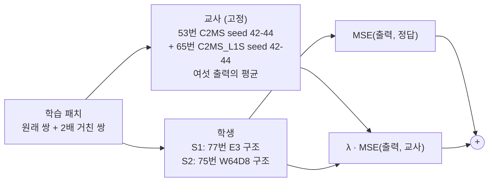

| 모델 | 원래 해상도 backbone / W2 | 파라미터 | 256² conv 연산량 | seed 42 RR PSNR / SAM / ERGAS |
|---|---|---:|---:|---|
| C2MS (53번, 공식 대조군) | 64 × 4 / 128 × 8 | 2,853,918 | 59.6 GMAC | 38.2738 / 4.5770 / 3.7230 |
| **S1** (77번 E3 구조) | 64 × 8 / 64 × 8 | 1,346,014 | 49.4 GMAC (83%) | 대조군 38.2622 / 4.6278 / 3.7324 |
| **S2** (75번 W64D8 구조) | 64 × 4 / 64 × 8 | 1,050,590 | 30.1 GMAC (50%) | 대조군 38.1465 / 4.6785 / 3.7844 |

연산량은 256² 입력 한 장에서 모든 Conv2d의 곱셈-누산 수를 실제로 센 값입니다([model.py](model.py)의 `conv_macs`, bias·활성화·어텐션·원소 연산 제외). 같은 방법으로 원본 SSA-MRN은 19.9036 GMAC으로 기존 기록과 같았고, 서버 `run.py optimize`에서도 같은 값이 나왔습니다. 교사는 C2MS 여섯 개라 추론 연산량이 약 358 GMAC(C2MS의 6배)입니다.

| 항목 | 내용 |
|---|---|
| 교사 | E_ALL(여섯 출력 평균). 0단계 세 교사 중 원래 축척 QB validation PSNR이 가장 높은 교사로 정했습니다(E_ALL 40.479 dB, E_C2MS 40.466 dB, E_L1S 40.364 dB). test는 쓰지 않았습니다 |
| 교사 출력 | 학습 데이터가 무작위 자르기·뒤집기 없는 고정 패치라, 서버 준비 단계에서 원래 쌍과 2배 거친 쌍의 교사 출력을 FP32로 한 번 계산해 저장하고 해시를 기록했습니다(약 1.4 GB). 서버 교사 캐시의 validation 지표는 로컬 0단계 값과 PSNR 2e-7 dB(원래 쌍)·1e-7 dB(거친 쌍) 차이로 같았습니다 |
| 손실 | 각 축척에서 MSE(출력, 정답) + λ · MSE(출력, 교사), λ = 1.0(학습 전 고정). 대조군과 같은 MSE 계열을 유지해 교사 항의 효과만 봅니다 |
| 학습 | 53번 C2MS와 같음: Adam 1e-4 → 1e-6 cosine 150에폭, batch 32, FP16 AMP, 원래 쌍 + 1.0 × 2배 거친 쌍. 서버(RTX 3060 Ti)에서 두 학생을 동시에 학습했고(에폭 약 126-136초), 입력 캐시는 63번 해시와 같았습니다 |
| 가중치 선택 | 원래 축척 validation MSE(정답 기준) 최소, epoch 0 포함. 교사 기준 validation은 기록만 합니다 |
| 초기값 | 같은 시드 대조군과 같은 초기 가중치. 서버 preflight에서 두 학생의 초기 상태 해시가 대조군의 기록(`initialization.json`)과 정확히 같음을 확인했습니다. 로컬 Apple 실리콘에서는 53번 C2MS를 그대로 만들어도 기록과 해시가 달라(같은 torch 2.7.1) 서버에서만 대조했습니다 |
| 기록 | 학습 MSE는 정답 항만 기록해 대조군과 비교할 수 있게 하고, 에폭마다 교사 기준 validation MSE(원래·거친 축척)를 함께 기록합니다 |

| 단계 | 실행 | 통과 조건 |
|---|---|---|
| 0 교사 점검 (완료) | 로컬, 학습 없음 | 학습 패치 E_C2MS 이득 ΔPSNR ≥ +0.10 dB 또는 ΔSAM ≤ −0.05° |
| 1 선별 | QB seed 42, S1·S2 동시 학습 | 같은 구조 대조군 대비 test RR 세 지표 모두 개선, PSNR +0.06 dB 이상. validation 방향도 보고 |
| 2 반복 | 통과한 학생만 seed 43·44 | 같은 시드 53번 C2MS와 짝지은 3시드 평균, v2.4 판정 |
| 3 (선택) | GF2·WV3, WV2 전이(참고) | 센서별 교사를 같은 규칙으로 다시 정함 |

공식 판정은 [판정 기준 v2.4](../../../docs/judgement_criteria.md)로 53번 C2MS와 비교합니다. 2단계에서는 3시드 평균 RR PSNR이 C2MS 대비 −0.04 dB 이상이면 "경량 비열등"을 참고로 함께 적습니다. 이것은 공식 판정이 아닙니다.

## 3. 정량 결과

### 0단계: 교사 점검

학습 없이 보관된 가중치로 QB validation 1,905개와 학습 패치 17,139개(원래 쌍과 2배 거친 쌍)에서 앙상블과 구성원을 비교했습니다. 지표는 53/54번 학습 코드의 validation과 같은 누적 방식(패치·밴드별 PSNR 평균, 화소 SAM 평균)입니다. 관문은 학습 패치를 돌리기 전에 [config.json](config.json)의 `stage0`에 고정했습니다.

**재현 확인 (모두 통과)**

| 항목 | 기준 | 결과 |
|---|---|---|
| 구성원 6개 validation과 best.pt 기록 | 1e-3 dB / 1e-3° 이내 | 1e-6 dB 이내 |
| E_C2MS validation 이득과 68번 | +0.191 dB / −0.083° | +0.191 dB / −0.083° |
| C2MS 2배 거친 validation과 53번 기록 | 46.85 / 46.81 / 46.86 dB | 46.846 / 46.807 / 46.862 dB |

**앙상블 이득 (앙상블 − 구성원 평균)**

| 교사 | 학습 패치 (원래) | validation (원래) | 학습 / validation | 학습 패치 (2배 거친) | validation (2배 거친) |
|---|---|---|---:|---|---|
| **E_C2MS** (주 판정) | **+0.183 dB · −0.079°** | +0.191 dB · −0.083° | 96% | +0.421 dB · −0.106° | +0.449 dB · −0.118° |
| E_L1S | +0.118 dB · −0.057° | +0.126 dB · −0.061° | 94% | +0.328 dB · −0.084° | +0.360 dB · −0.099° |
| E_ALL | +0.218 dB · −0.089° | +0.223 dB · −0.094° | 98% | +0.501 dB · −0.125° | +0.535 dB · −0.142° |

**절대값 (PSNR, dB)**

| | C2MS s42 / s43 / s44 | L1S s42 / s43 / s44 | E_C2MS | E_L1S | E_ALL |
|---|---|---|---:|---:|---:|
| 학습 패치 (원래) | 40.522 / 40.498 / 40.503 | 40.354 / 40.371 / 40.340 | **40.690** | 40.473 | 40.649 |
| validation (원래) | 40.283 / 40.267 / 40.275 | 40.238 / 40.249 / 40.228 | 40.466 | 40.364 | **40.479** |
| 학습 패치 (2배 거친) | 47.576 / 47.564 / 47.570 | 47.835 / 47.879 / 47.788 | 47.991 | 48.162 | **48.202** |
| validation (2배 거친) | 46.846 / 46.807 / 46.862 | 47.110 / 47.092 / 47.059 | 47.288 | 47.448 | **47.498** |

**교사 신호의 크기 (E_C2MS, 학습 패치 원래 쌍):** 교사와 구성원의 거리는 구성원 오차의 RMS 대비 약 21%(시드별 0.210 / 0.210 / 0.208)였습니다. 교사가 구성원을 정답 쪽으로 당기는 정도, 즉 ⟨t − y, g − y⟩ / ‖g − y‖²의 구성원 평균은 0.044(validation 0.047)였습니다.

**판정:** 학습 패치 E_C2MS 이득이 PSNR·SAM 두 조건을 모두 넘어 **충분**입니다.

### 1단계: QB seed 42 학생 평가

QB RR·FR test 20장 평균입니다. 모든 모델을 같은 서버·같은 코드로 함께 평가했습니다. 장면별 수치는 학생별 `results/<학생>_QB_s42/evaluation/QB_v2_4.json`에 있습니다([E3 학생](results/C2MS_B64D8_W64D8_KD_QB_s42/evaluation/QB_v2_4.json), [W64D8 학생](results/C2MS_W64D8_KD_QB_s42/evaluation/QB_v2_4.json)).

| 모델 | 파라미터 | 256² conv 연산량 | RR PSNR | RR SAM | RR ERGAS | FR QNR / Dλ / Ds (참고) |
|---|---:|---:|---:|---:|---:|---:|
| 원본 SSA-MRN (43번 C0) | 426,654 | 19.9 GMAC | 37.3671 | 4.9651 | 4.1554 | 0.917 / 0.043 / 0.042 |
| C2MS (53번, 공식 대조군) | 2,853,918 | 59.6 GMAC | 38.2738 | 4.5770 | 3.7230 | 0.826 / 0.027 / 0.151 |
| C2MS (57번 재학습, 참조) | 2,853,918 | 59.6 GMAC | 38.2829 | 4.5736 | 3.7193 | 0.828 / 0.025 / 0.151 |
| 교사 E_ALL (참고) | 6 × 2,853,918 | 약 358 GMAC | 38.6148 | 4.3947 | 3.5803 | 0.931 / 0.019 / 0.051 |
| E3 구조, 정답만 (77번) | 1,346,014 | 49.4 GMAC | 38.2622 | 4.6278 | 3.7324 | 0.881 / 0.030 / 0.092 |
| **E3 구조 + 교사 증류** | 1,346,014 | 49.4 GMAC | **38.2383** | **4.6209** | **3.7445** | 0.895 / 0.030 / 0.077 |
| W64D8 구조, 정답만 (75번) | 1,050,590 | 30.1 GMAC | 38.1465 | 4.6785 | 3.7844 | 0.881 / 0.028 / 0.093 |
| **W64D8 구조 + 교사 증류** | 1,050,590 | 30.1 GMAC | **38.1524** | **4.6477** | **3.7814** | 0.912 / 0.027 / 0.062 |

**판정 (v2.4, RR만, 단일 시드 잡음 문턱 0.06 dB)**

| 학생 | 비교 | ΔRR PSNR / SAM / ERGAS | 비교 대상보다 좋은 장면 수 (PSNR / SAM) | 판정 |
|---|---|---|---:|---|
| E3 + 증류 | 같은 구조 대조군 (1단계 관문) | −0.0239 / −0.0069 / +0.0122 | 4 / 16 | 부분 개선 → **관문 미통과** |
| E3 + 증류 | 53번 C2MS (공식) | −0.0354 / +0.0439 / +0.0215 | 7 / 0 | **개선 없음** |
| E3 + 증류 | 57번 C2MS (참조) | −0.0446 / +0.0473 / +0.0252 | 6 / 0 | 개선 없음 |
| W64D8 + 증류 | 같은 구조 대조군 (1단계 관문) | +0.0059 / −0.0308 / −0.0030 | 16 / 18 | 부분 개선(잡음 수준) → **관문 미통과** |
| W64D8 + 증류 | 53번 C2MS (공식) | −0.1213 / +0.0706 / +0.0584 | 2 / 0 | **개선 없음** |
| W64D8 + 증류 | 57번 C2MS (참조) | −0.1304 / +0.0740 / +0.0620 | 2 / 0 | 개선 없음 |
| 교사 E_ALL (참고) | 53번 C2MS | +0.3411 / −0.1824 / −0.1427 | 20 / 20 | (학습하지 않은 앙상블) |

**원본 대비 C2MS 이득(+0.907 dB) 중 남은 비율:** E3 학생 96.1%(같은 구조 대조군 98.7%), W64D8 학생 86.6%(대조군 86.0%)입니다.

**validation (선택 가중치, 정답 기준)**

| 학생 | 선택 에폭 | validation PSNR / SAM | 같은 구조 대조군 대비 | 53번 C2MS 대비 | 교사 기준 validation MSE (원래 / 거친) |
|---|---:|---:|---:|---:|---:|
| E3 + 증류 | 150 | 40.014 / 4.306 | −0.034 dB / +0.002° | −0.269 dB / +0.080° | 1.11e-5 / 시작 1.12e-2 |
| W64D8 + 증류 | 150 | 39.937 / 4.338 | +0.024 dB / −0.017° | −0.345 dB / +0.111° | 1.24e-5 / 시작 1.12e-2 |

validation과 test의 방향은 두 학생 모두 같았습니다(E3는 둘 다 낮고, W64D8은 둘 다 조금 높음). AMP에서 건너뛴 업데이트는 각 80,400회 중 18회였습니다.

**참고 진단: 교사·정답과의 거리 (test RR 20장, RMSE, DN)**

서버 평가 뒤 로컬 Apple MPS FP32로 같은 가중치를 다시 추론해 쟀습니다([provenance/analysis/distance78.py](provenance/analysis/distance78.py), [results/teacher_distance_test.json](results/teacher_distance_test.json)). 판정에는 쓰지 않습니다.

| 모델 | 교사까지 | 정답까지 |
|---|---:|---:|
| 교사 E_ALL | 0 | 26.07 |
| C2MS (53번 seed 42) | 7.67 | 27.12 |
| E3, 정답만 → 증류 | 8.31 → **7.80** (−6.1%) | 27.17 → 27.25 |
| W64D8, 정답만 → 증류 | 8.53 → **8.13** (−4.7%) | 27.57 → 27.50 |

## 4. 기준선 대비 차이와 해석

- **가설은 확인되지 않았습니다.** 교사는 C2MS보다 +0.341 dB(20/20장) 좋았지만, 교사를 따라 배운 두 학생은 같은 구조를 정답만으로 학습한 결과와 사실상 같았습니다(−0.024 dB, +0.006 dB). 교사 이득 중 학생에게 옮겨진 몫은 0에 가깝습니다.
- **학생은 교사를 따라갔지만, 그 방향이 정답 쪽이 아니었습니다.** 교사 기준 validation MSE는 1.12e-2에서 1.1-1.2e-5로 꾸준히 줄었고, test에서도 학생은 교사 쪽으로 5-6% 가까워졌습니다. 그러나 정답과의 거리는 E3 27.17 → 27.25 DN, W64D8 27.57 → 27.50 DN으로 거의 그대로였습니다. 교사와 단일 모델의 차이(약 8 DN)는 정답과의 오차(약 27 DN)보다 훨씬 작고, 학생이 줄인 차이는 정답 오차를 줄이는 성분이 아니었던 것으로 보입니다.
- **원인에 대한 해석(확인하지 않음):** 앙상블 이득은 시드마다 독립적으로 생기는 오차가 평균되면서 줄어드는 몫입니다. 정답은 이미 잡음 없는 목표이므로, 교사가 목표를 바꿔도 학생 자신의 학습 과정에서 생기는 시드별 오차는 그대로 남습니다. 0단계에서 확인한 "교사 신호가 학습 패치에도 있다"는 조건은 필요했지만 충분하지 않았습니다.
- **SAM만 조금씩 좋아졌습니다.** 두 학생 모두 대조군보다 SAM이 낮았고(−0.007°, −0.031°; 장면 16-18/20), 이는 교사(SAM −0.18°)의 분광 특성을 일부 따라간 결과로 보입니다. 크기는 판정에 의미가 없을 만큼 작습니다.
- **FR(참고)에서는 교사 쪽으로 이동했습니다.** Ds가 0.092 → 0.077, 0.093 → 0.062로 낮아지고 QNR이 올라갔습니다(교사 Ds 0.051). 판정에는 쓰지 않습니다.
- **경량화 관점:** W64D8 학생은 C2MS 연산량의 50%로 C2MS 이득의 86.6%를 유지했지만, 이는 같은 구조를 정답만으로 학습한 결과(86.0%)와 같습니다. 증류가 경량 모델의 성능 손실을 메우지 못했습니다.
- **0단계 점검의 의미:** 구성원은 학습 패치에 과하게 맞춰져 있지 않았고(학습 패치 앙상블 이득이 validation의 94-98%), 교사 출력도 정상이었습니다. 실패 원인은 교사 신호의 부재가 아니라, 출력 증류가 그 신호를 학생의 정답 오차 감소로 바꾸지 못한 데 있습니다.

## 5. 학습·평가 그래프

학습 MSE(원래 축척, 정답 항), validation PSNR·SAM, 교사 기준 validation MSE(로그 축), 학습률입니다. 회색 점선은 53번 C2MS, 붉은 점선은 같은 구조를 정답만으로 학습한 대조군의 선택 가중치 validation PSNR입니다. 두 학생 모두 150에폭 가중치가 선택됐습니다.

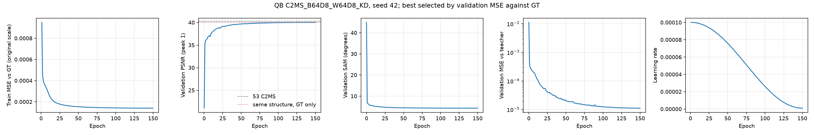

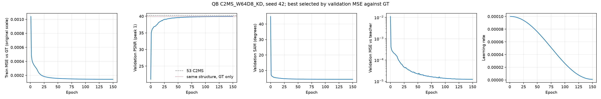

53번 C2MS 대비 test RR PSNR·SAM·ERGAS 차이입니다. 원본, 같은 구조 대조군, 57번 재학습 C2MS, 학생, 교사를 함께 표시했습니다.

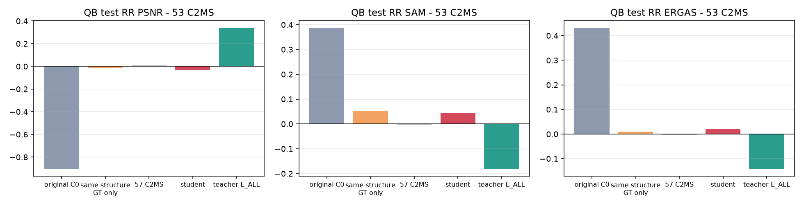

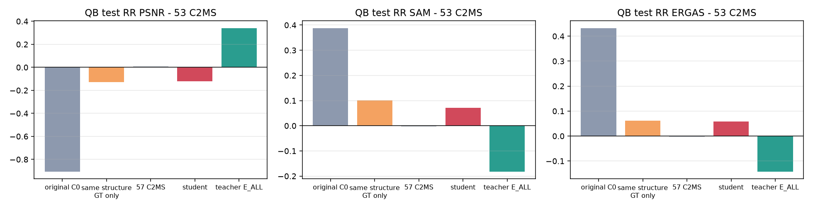

## 6. 결과 이미지

고정 6장면(QB RR test 0-based 0·1·3·7·14·17, seed 42)에서 현재 기준 C2MS(53번)와 각 학생을 비교했습니다. 장면은 정답만 보고 풍경으로 미리 정했고 결과를 보고 바꾸지 않았습니다. `common/result_images.py`로 서버 평가 중에 만들었습니다.

원본 크기 비교는 256×256 전체 장면의 **LR MS · PAN · C2MS · 학생 · 정답**과 **C2MS 오차 · 학생 오차**(같은 색 척도)입니다. 확대 비교는 학생의 개선이 가장 큰 64×64 창을 4배 확대한 **정답 전체(노란 상자) · C2MS · 학생 · 정답 · C2MS 오차 · 학생 오차**입니다. **확대 창은 장면마다 학생에게 가장 유리한 곳을 고른 것**이라, 장면 전체가 나빠졌어도 확대 창은 좋아 보일 수 있습니다. 전체 차이는 장면 PSNR로 판단합니다.

| 장면 | 풍경 | C2MS 장면 PSNR | E3 학생 (차이) | W64D8 학생 (차이) | 확대 창 차이 E3 / W64D8 |
|---:|---|---:|---:|---:|---:|
| 0 | 바다·항구 방파제 | 42.812 | 42.734 (−0.078) | 42.470 (−0.342) | +0.396 / +0.584 |
| 1 | 부두·곡선 방파제·수목 | 43.179 | 43.110 (−0.069) | 43.021 (−0.158) | +0.722 / +0.383 |
| 3 | 요트 마리나·운동장 | 37.964 | 38.053 (+0.088) | 37.747 (−0.217) | +0.762 / +0.334 |
| 7 | 숲 공원 | 39.405 | 39.551 (+0.146) | 39.502 (+0.096) | +0.827 / +0.747 |
| 14 | 언덕 공원·곡선 주택가 | 38.473 | 38.395 (−0.078) | 38.299 (−0.173) | +0.237 / +0.006 |
| 17 | 산지 녹지·산책로 | 39.396 | 39.427 (+0.030) | 39.389 (−0.007) | +0.461 / +0.650 |

고정 6장면에서 E3 학생은 3장, W64D8 학생은 1장이 C2MS보다 좋았고, 20장 전체에서는 각각 7장, 2장이 좋았습니다.

**장면 0 (바다·항구 방파제) · E3 학생**

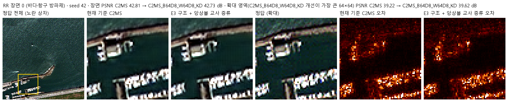

**장면 0 (바다·항구 방파제) · W64D8 학생**

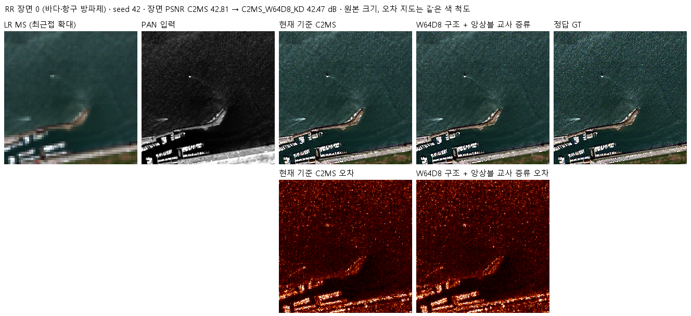

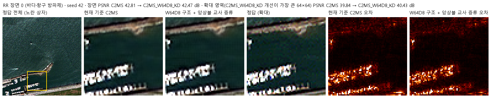

장면 1 · 부두·곡선 방파제·수목 · 두 학생 · 두 비교 형식

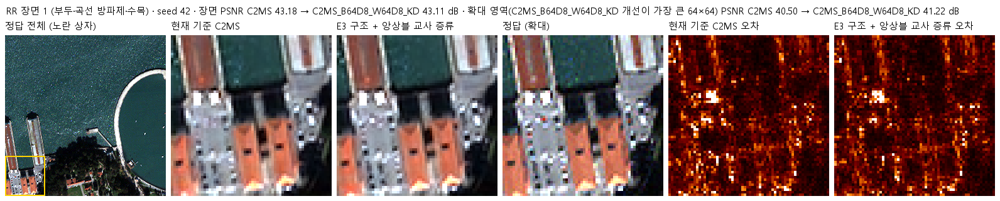

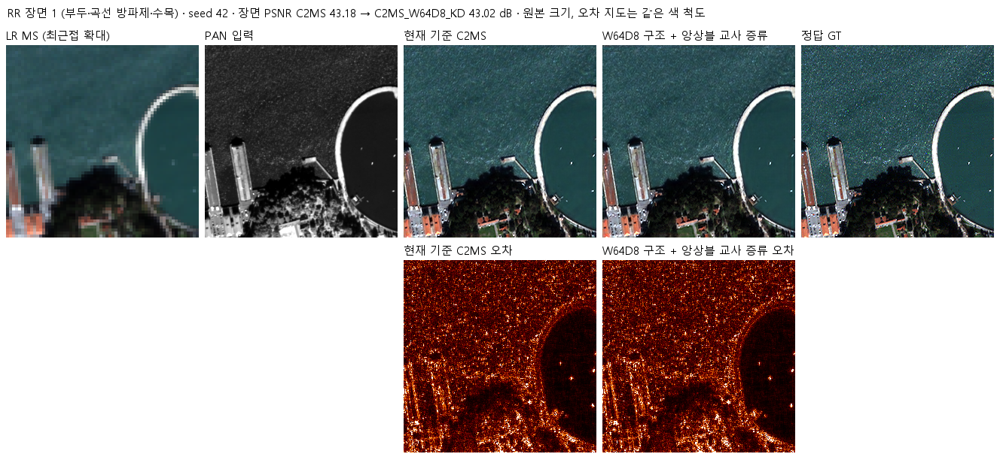

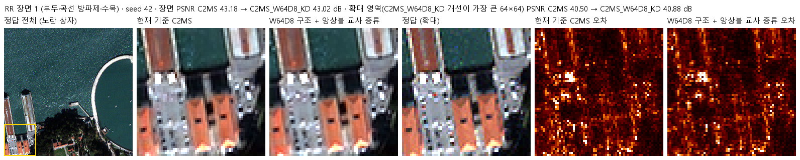

장면 3 · 요트 마리나·운동장 · 두 학생 · 두 비교 형식

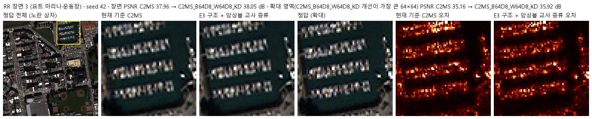

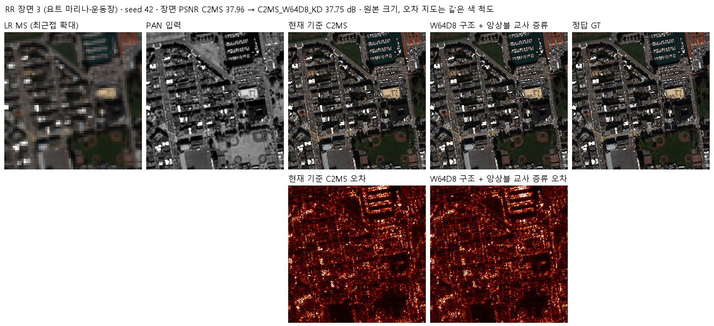

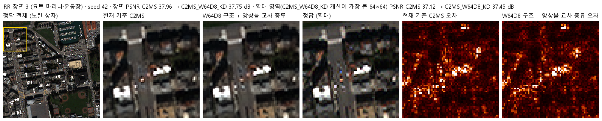

장면 7 · 숲 공원 · 두 학생 · 두 비교 형식

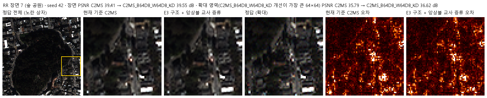

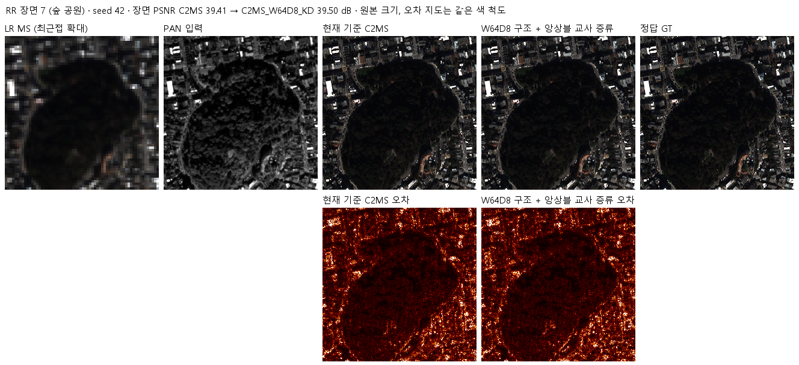

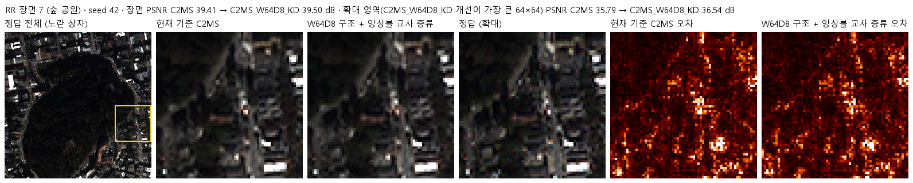

장면 14 · 언덕 공원·곡선 주택가 · 두 학생 · 두 비교 형식

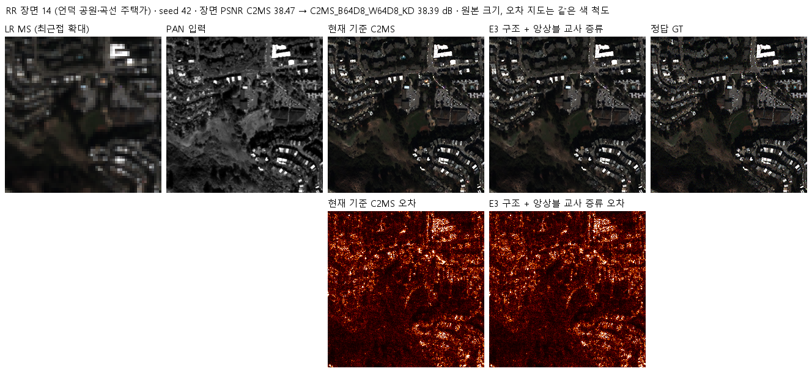

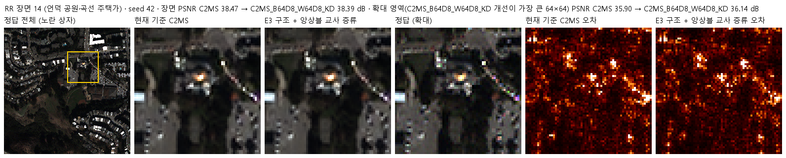

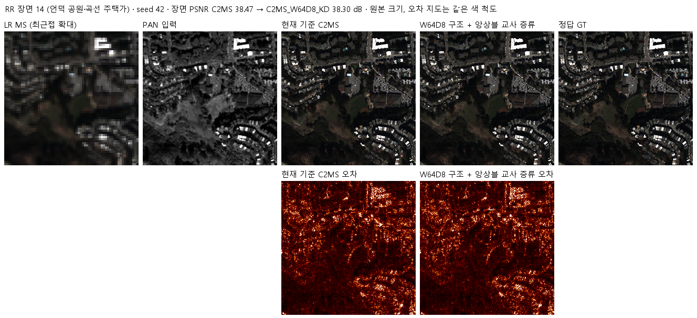

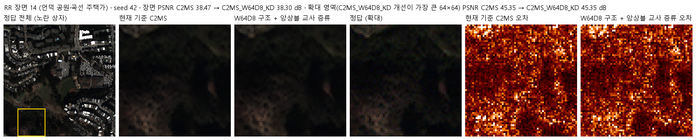

장면 17 · 산지 녹지·산책로 · 두 학생 · 두 비교 형식

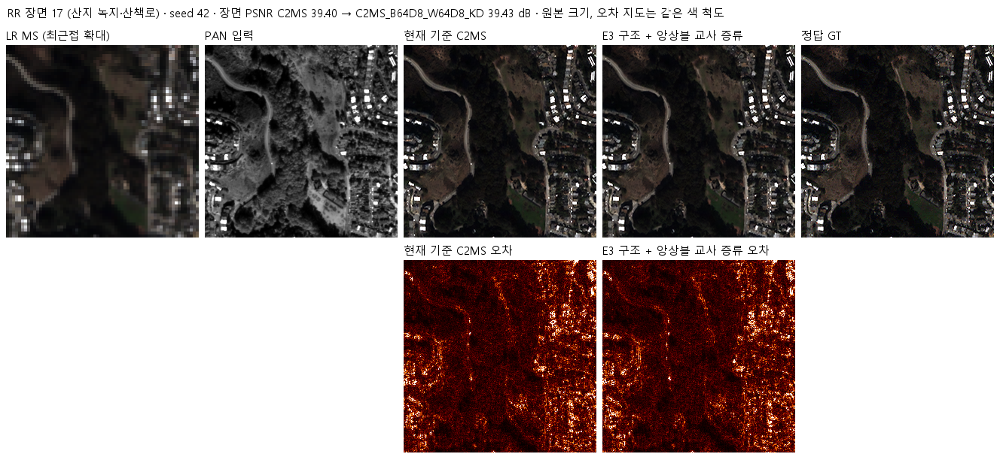

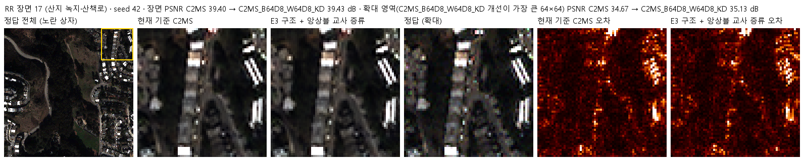

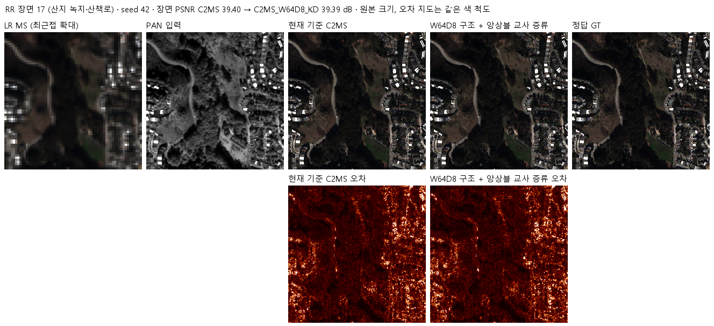

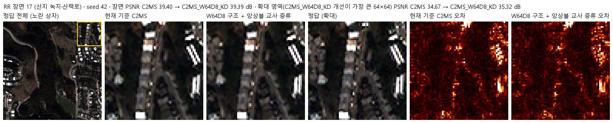

## 7. 재현 자료

- [config.json](config.json): 가설, 0단계 관문과 결과, 교사 선택 규칙, 학생·대조군, 학습·판정 조건, 서버 실행 설정
- [prepare.py](prepare.py): 54번 센서 표·거친 쌍 생성을 그대로 다시 내보내고, 교사 캐시 생성(`build_teacher`)·채점(`teacher_metrics`)과 0단계 교사 점검(`python prepare.py stage0 val|train`)을 담습니다. 0단계는 로컬 Apple MPS FP32에서 validation 약 2분, 학습 패치 약 17분 걸렸고, 이 파일로 validation을 다시 돌린 결과가 보관한 결과와 실행 시간 외에는 같았습니다
- [model.py](model.py): 학생 두 구조(77번 E3, 75번 W64D8을 그대로 생성), 교사(여섯 모델 평균), conv 연산량 측정
- [train.py](train.py): 54번 학습 코드를 그대로 읽고 일곱 곳만 바꿉니다(교사 캐시 열기, 두 축척의 교사 손실, 교사 기준 validation 기록, 초기 상태 대조). 각 교체는 원본에서 정확히 한 번 맞아야 실행됩니다
- [run.py](run.py): 서버 실행 순서. `prepare`(H5에서 캐시 재생성·63번 해시 대조 → 교사 캐시 생성 → 0단계 validation 지표와 PSNR·SAM 0.002 이내 대조) → `optimize`(벤치마크·연산량·preflight) → `run`(두 학생 동시 학습 후 평가)
- [evaluate.py](evaluate.py): 53번 C2MS(공식), 같은 구조 대조군(1단계 관문), 57번 C2MS·원본·교사(참고)를 같은 20장면에서 평가하고 결과 이미지·그래프를 만듭니다
- [results/teacher_check_val.json](results/teacher_check_val.json), [results/teacher_check_train.json](results/teacher_check_train.json): 0단계 모델별·앙상블별 지표, 이득, 교사 신호 크기, 체크포인트 기록 대조
- `results/<학생>_QB_s42/`: 학습 기록(`history.json`, 에폭별 교사 기준 validation 포함), `training_complete.json`, `initialization.json`, 평가(`evaluation_complete.json`, `evaluation/QB_v2_4.json` 장면별 수치, 그래프, 결과 이미지)
- `checkpoints/<학생>_QB_s42/best.pt`: validation으로 선택한 가중치. 재개용 `latest.pt`와 초기 `initial.pt`는 GitHub Release `weights-experiments-performance-78`에 있습니다
- [results/teacher_distance_test.json](results/teacher_distance_test.json), [provenance/analysis/distance78.py](provenance/analysis/distance78.py): test에서 교사·정답까지의 거리 진단
- [provenance/](provenance/): 서버 전송 소스 manifest와 검증 기록, 실행 스크립트, 서버 실행 기록(`run_records/`: 봉인된 설정, 캐시·교사 캐시 해시와 0단계 대조, preflight·벤치마크, 대기열 상태), 77번 서버 실행 폴더 정리 기록
- [manifest.json](manifest.json): 현재 파일의 크기·SHA-256과 Release 자산

## 8. 개선 여부와 다음 단계

**개선 없음**입니다(QB seed 42, 단일 시드). 공식 판정인 53번 C2MS 대비로 두 학생 모두 RR 세 지표가 나빠졌습니다(E3 학생 −0.035 dB, W64D8 학생 −0.121 dB). 교사 증류 효과만 보는 1단계 관문(같은 구조 대조군 대비 세 지표 개선과 PSNR +0.06 dB)도 두 학생 모두 넘지 못했습니다(E3 −0.024 dB 부분 개선, W64D8 +0.006 dB 잡음 수준 부분 개선). 미리 정한 규칙에 따라 2단계(seed 43·44)와 3단계(다른 센서)는 하지 않습니다.

다음 단계:

1. 출력 증류(λ = 1)로는 시드 앙상블 이득을 단일 모델에 옮기지 못했습니다. 학생이 교사 쪽으로 가까워져도 정답 오차가 줄지 않았으므로, λ만 바꾸는 후속 실험은 우선순위가 낮습니다.
2. 앙상블 이득을 쓰려면 추론 때 여러 모델을 함께 쓰는 비용(교사는 C2MS의 6배 연산)을 감수하거나, 한 번의 학습 안에서 시드별 오차를 줄이는 다른 방법이 필요합니다. 가중치 EMA는 57번에서 효과가 없었습니다.
3. 경량 구조는 같은 구조를 정답만으로 학습한 결과(75번 W64D8: 연산량 50%로 이득 86%, 77번 E3: 83%로 98.7%)가 그대로 기준입니다.
