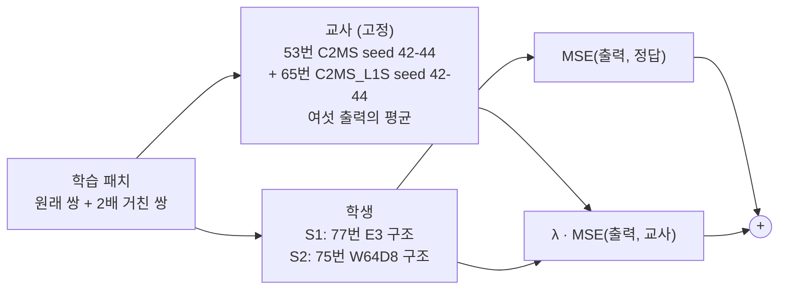

# 78. 시드 앙상블 교사 증류로 작은 C2MS 학습

**연구 분야:** 성능 개선

**실험자:** 이병현

**변경 내용:** 구조는 이미 학습한 작은 C2MS 두 가지(77번 E3 1.35M, 75번 W64D8 1.05M)를 그대로 쓰고, 학습 목표만 바꿉니다. 정답 손실에 C2MS·65번 모델 여섯 개의 출력 평균(시드 앙상블 교사)과의 손실을 더해, 원래 쌍과 2배 거친 쌍 모두에 적용합니다. 같은 구조를 정답만으로 학습한 대조군과 53번 C2MS를 기준으로 비교합니다. 학습하기 전에, 학습 패치에서도 교사가 구성원보다 정답에 가까운지 로컬에서 먼저 확인했습니다(0단계).

| 확인된 결과 | 상태 | 개선 여부 |
|---|:---:|:---:|
| 0단계(학습 없음): QB 학습 패치 17,139개에서 C2MS 3시드 앙상블이 구성원 평균보다 PSNR +0.183 dB·SAM −0.079°로, validation 이득(+0.191 dB·−0.083°)의 96%가 남아 미리 정한 관문(+0.10 dB 또는 −0.05°)을 통과했습니다. 2배 거친 쌍에서는 +0.421 dB였습니다. 학생 학습은 아직 하지 않았습니다. | 계획 (0단계 사전&nbsp;검증&nbsp;완료) | 판단&nbsp;보류 |

[실험 목록](../../../research/performance/README.md) · [수치](#results) · [그래프](#graphs) · [이미지](#images) · [재현 자료](#evidence)

## 1. 목적과 상태

C2MS 이후의 구조·손실·학습 일정 변경은 3시드에서 개선된 적이 없습니다. 용량은 줄이면 나빠지고([74번](../74_backbone_matched_parallel_branch/README.md) −0.521 dB, [75번](../75_parallel_branch_width_depth/README.md) −0.127 dB) 키워도 좋아지지 않았습니다([76번](../76_quarter_resolution_branch/README.md) +0.025 dB, [77번](../77_full_resolution_backbone_capacity/README.md) +0.022 dB). 반면 같은 학습을 시드만 바꿔 평균한 앙상블은 구성원 평균보다 QB test +0.256 dB, WV3 +0.286 dB, WV2 전이 +0.464 dB였습니다([68번](../68_ssai_folding_sam_split_seed_ensemble/README.md)). 남은 오차의 상당 부분이 시드마다 달라지는 성분이라는 뜻입니다.

| 근거 | 내용 |
|---|---|
| 성능 여지 | 68번 C2MS 3시드 앙상블: QB validation +0.191 dB·−0.083°, test +0.256 dB. 여섯 모델 앙상블은 QB RR 38.615 dB(C2MS 평균 38.302 dB) |
| 작은 구조 | 77번 E3(1.35M)는 C2MS 이득의 98.7%(C2MS 대비 −0.012 dB), 75번 W64D8(1.05M)은 86%(−0.127 dB) |
| 대조군 | 두 구조 모두 정답만으로 학습한 seed 42 결과가 보관되어 있어, 같은 초기 가중치·같은 학습 조건에서 교사 항의 효과만 비교할 수 있습니다 |

**가설:** 교사가 시드마다 달라지는 성분을 걷어낸 목표를 주면, 작은 학생은 같은 구조를 정답만으로 학습한 대조군보다 RR이 좋아집니다. 이득이 충분하면 C2MS보다 적은 파라미터·연산으로 C2MS에 가깝거나 더 나은 결과를 냅니다.

**상태(2026-11-11):** 계획입니다. 0단계 교사 점검(학습 없음)은 마쳤고 관문을 통과했습니다. 1단계 서버 코드를 작성했고 로컬 스모크 테스트(작은 패치·2에폭, 결과 아님)를 통과했습니다. 서버 학습은 시작하지 않았습니다.

## 2. 변경한 구조와 비교 조건

| 모델 | 원래 해상도 backbone / W2 | 파라미터 | 256² conv 연산량 | seed 42 RR PSNR / SAM / ERGAS |
|---|---|---:|---:|---|
| C2MS (53번, 공식 대조군) | 64 × 4 / 128 × 8 | 2,853,918 | 59.6 GMAC | 38.2738 / 4.5770 / 3.7230 |
| **S1** (77번 E3 구조) | 64 × 8 / 64 × 8 | 1,346,014 | 49.4 GMAC (83%) | 대조군 38.2622 / 4.6278 / 3.7324 |
| **S2** (75번 W64D8 구조) | 64 × 4 / 64 × 8 | 1,050,590 | 30.1 GMAC (50%) | 대조군 38.1465 / 4.6785 / 3.7844 |

연산량은 256² 입력 한 장에서 모든 Conv2d의 곱셈-누산 수를 실제로 센 값입니다([model.py](model.py)의 `conv_macs`, bias·활성화·어텐션·원소 연산 제외). 같은 방법으로 원본 SSA-MRN은 19.9036 GMAC으로 기존 기록과 같았습니다. 서버 실행 때 `run.py optimize`가 다시 기록합니다.

| 항목 | 내용 |
|---|---|
| 교사 | E_ALL(여섯 출력 평균). 0단계 세 교사 중 원래 축척 QB validation PSNR이 가장 높은 교사로 정했습니다(E_ALL 40.479 dB, E_C2MS 40.466 dB, E_L1S 40.364 dB). test는 쓰지 않았습니다 |
| 교사 출력 | 학습 데이터가 무작위 자르기·뒤집기 없는 고정 패치라, 서버 준비 단계에서 원래 쌍과 2배 거친 쌍의 교사 출력을 FP32로 한 번 계산해 저장하고 해시를 기록합니다(약 1.4 GB). 로컬 0단계 validation 앙상블 지표와 대조합니다 |
| 손실 | 각 축척에서 MSE(출력, 정답) + λ · MSE(출력, 교사), λ = 1.0(학습 전 고정). 대조군과 같은 MSE 계열을 유지해 교사 항의 효과만 봅니다 |
| 학습 | 53번 C2MS와 같음: Adam 1e-4 → 1e-6 cosine 150에폭, batch 32, FP16 AMP, 원래 쌍 + 1.0 × 2배 거친 쌍 |
| 가중치 선택 | 원래 축척 validation MSE(정답 기준) 최소, epoch 0 포함. 교사 기준 validation은 기록만 합니다 |
| 초기값 | 같은 시드 대조군과 같은 초기 가중치. 서버 preflight에서 학생의 초기 상태 해시를 대조군의 기록(`initialization.json`)과 대조합니다. 로컬 Apple 실리콘에서는 53번 C2MS를 그대로 만들어도 기록과 해시가 달라(같은 torch 2.7.1) 서버에서만 대조합니다 |
| 기록 | 학습 MSE는 정답 항만 기록해 대조군과 비교할 수 있게 하고, 에폭마다 교사 기준 validation MSE(원래·거친 축척)를 함께 기록합니다 |

| 단계 | 실행 | 통과 조건 |
|---|---|---|
| 0 교사 점검 (완료) | 로컬, 학습 없음 | 학습 패치 E_C2MS 이득 ΔPSNR ≥ +0.10 dB 또는 ΔSAM ≤ −0.05° |
| 1 선별 | QB seed 42, S1·S2 동시 학습 | 같은 구조 대조군 대비 test RR 세 지표 모두 개선, PSNR +0.06 dB 이상. validation 방향도 보고 |
| 2 반복 | 통과한 학생만 seed 43·44 | 같은 시드 53번 C2MS와 짝지은 3시드 평균, v2.4 판정 |
| 3 (선택) | GF2·WV3, WV2 전이(참고) | 센서별 교사를 같은 규칙으로 다시 정함 |

공식 판정은 [판정 기준 v2.4](../../../docs/judgement_criteria.md)로 53번 C2MS와 비교합니다. 2단계에서는 3시드 평균 RR PSNR이 C2MS 대비 −0.04 dB 이상이면 "경량 비열등"을 참고로 함께 적습니다. 이것은 공식 판정이 아닙니다.

## 3. 정량 결과

### 0단계: 교사 점검

학습 없이 보관된 가중치로 QB validation 1,905개와 학습 패치 17,139개(원래 쌍과 2배 거친 쌍)에서 앙상블과 구성원을 비교했습니다. 지표는 53/54번 학습 코드의 validation과 같은 누적 방식(패치·밴드별 PSNR 평균, 화소 SAM 평균)입니다. 관문은 학습 패치를 돌리기 전에 [config.json](config.json)의 `stage0`에 고정했습니다.

**재현 확인 (모두 통과)**

| 항목 | 기준 | 결과 |
|---|---|---|
| 구성원 6개 validation과 best.pt 기록 | 1e-3 dB / 1e-3° 이내 | 1e-6 dB 이내 |
| E_C2MS validation 이득과 68번 | +0.191 dB / −0.083° | +0.191 dB / −0.083° |
| C2MS 2배 거친 validation과 53번 기록 | 46.85 / 46.81 / 46.86 dB | 46.846 / 46.807 / 46.862 dB |

**앙상블 이득 (앙상블 − 구성원 평균)**

| 교사 | 학습 패치 (원래) | validation (원래) | 학습 / validation | 학습 패치 (2배 거친) | validation (2배 거친) |
|---|---|---|---:|---|---|
| **E_C2MS** (주 판정) | **+0.183 dB · −0.079°** | +0.191 dB · −0.083° | 96% | +0.421 dB · −0.106° | +0.449 dB · −0.118° |
| E_L1S | +0.118 dB · −0.057° | +0.126 dB · −0.061° | 94% | +0.328 dB · −0.084° | +0.360 dB · −0.099° |
| E_ALL | +0.218 dB · −0.089° | +0.223 dB · −0.094° | 98% | +0.501 dB · −0.125° | +0.535 dB · −0.142° |

**절대값 (PSNR, dB)**

| | C2MS s42 / s43 / s44 | L1S s42 / s43 / s44 | E_C2MS | E_L1S | E_ALL |
|---|---|---|---:|---:|---:|
| 학습 패치 (원래) | 40.522 / 40.498 / 40.503 | 40.354 / 40.371 / 40.340 | **40.690** | 40.473 | 40.649 |
| validation (원래) | 40.283 / 40.267 / 40.275 | 40.238 / 40.249 / 40.228 | 40.466 | 40.364 | **40.479** |
| 학습 패치 (2배 거친) | 47.576 / 47.564 / 47.570 | 47.835 / 47.879 / 47.788 | 47.991 | 48.162 | **48.202** |
| validation (2배 거친) | 46.846 / 46.807 / 46.862 | 47.110 / 47.092 / 47.059 | 47.288 | 47.448 | **47.498** |

**교사 신호의 크기 (E_C2MS, 학습 패치 원래 쌍):** 교사와 구성원의 거리는 구성원 오차의 RMS 대비 약 21%(시드별 0.210 / 0.210 / 0.208)였습니다. 교사가 구성원을 정답 쪽으로 당기는 정도, 즉 ⟨t − y, g − y⟩ / ‖g − y‖²의 구성원 평균은 0.044(validation 0.047)였습니다.

**판정:** 학습 패치 E_C2MS 이득이 PSNR·SAM 두 조건을 모두 넘어 **충분**입니다.

### 1-3단계

아직 학습하지 않았습니다.

## 4. 기준선 대비 차이와 해석

- **구성원은 학습 패치에 과하게 맞춰져 있지 않았습니다.** 그랬다면 학습 패치에서는 앙상블 이득이 작아야 합니다. 실제로는 validation 이득의 94-98%가 학습 패치에서도 남았고, C2MS의 학습 패치와 validation PSNR 차이도 약 0.24 dB입니다. 교사 출력을 학습 목표로 쓸 수 있습니다.
- **2배 거친 쌍에서 이득이 두 배 이상 큽니다.** 축척 혼합 학습의 두 손실 항 모두에 교사를 적용합니다.
- **교사 신호는 정답 신호보다 훨씬 작습니다.** 교사가 주는 것은 정답을 대체하는 신호가 아니라 시드마다 달라지는 성분을 걷어낸 목표입니다. 그래서 정답 손실을 유지하고 교사 손실을 더합니다. 같은 크기 모델이 교사를 완전히 따라가도 상한은 약 +0.18에서 +0.22 dB입니다.
- **작은 학생이 이 신호를 얼마나 흡수할지는 이 점검으로 알 수 없습니다.** 1단계에서 확인합니다.
- 교사는 0단계 결과를 읽은 뒤 validation 규칙으로 정했습니다. 학습 패치 원래 쌍에서는 E_C2MS가 조금 더 정답에 가까웠지만(40.690 대 40.649 dB), 선택은 validation으로 했습니다.

## 5. 학습·평가 그래프

아직 학습하지 않아 학습 곡선이 없습니다.

## 6. 결과 이미지

아직 학습하지 않아 결과 이미지가 없습니다. 2단계까지 진행하면 고정 6장면(QB RR test 0-based 0·1·3·7·14·17)에서 53번 C2MS와 학생을 비교합니다.

## 7. 재현 자료

- [config.json](config.json): 가설, 0단계 관문과 결과, 교사 선택 규칙, 학생·대조군, 학습·판정 조건, 서버 실행 설정
- [prepare.py](prepare.py): 54번 센서 표·거친 쌍 생성을 그대로 다시 내보내고, 교사 캐시 생성(`build_teacher`)·채점(`teacher_metrics`)과 0단계 교사 점검(`python prepare.py stage0 val|train`)을 담습니다. 0단계는 로컬 Apple MPS FP32에서 validation 약 2분, 학습 패치 약 17분 걸렸고, 이 파일로 validation을 다시 돌린 결과가 보관한 결과와 실행 시간 외에는 같았습니다
- [model.py](model.py): 학생 두 구조(77번 E3, 75번 W64D8을 그대로 생성), 교사(여섯 모델 평균), conv 연산량 측정
- [train.py](train.py): 54번 학습 코드를 그대로 읽고 일곱 곳만 바꿉니다(교사 캐시 열기, 두 축척의 교사 손실, 교사 기준 validation 기록, 초기 상태 대조). 각 교체는 원본에서 정확히 한 번 맞아야 실행됩니다
- [run.py](run.py): 서버 실행 순서. `prepare`(H5에서 캐시 재생성·63번 해시 대조 → 교사 캐시 생성 → 0단계 validation 지표와 PSNR·SAM 0.002 이내 대조) → `optimize`(벤치마크·연산량·preflight) → `run`(두 학생 동시 학습 후 평가)
- [evaluate.py](evaluate.py): 53번 C2MS(공식), 같은 구조 대조군(1단계 관문), 57번 C2MS·원본·교사(참고)를 같은 20장면에서 평가하고 결과 이미지·그래프를 만듭니다
- [results/teacher_check_val.json](results/teacher_check_val.json), [results/teacher_check_train.json](results/teacher_check_train.json): 모델별·앙상블별 지표, 이득, 교사 신호 크기, 체크포인트 기록 대조
- [manifest.json](manifest.json): 현재 파일의 크기·SHA-256

## 8. 개선 여부와 다음 단계

**판단 보류**입니다. 학생 학습과 RR test 평가가 없습니다. 0단계는 학습하지 않은 사전 검증이며 성능 비교가 아닙니다.

다음 단계:

1. 서버에 별도 실행 폴더(`C:/CtrS-p78`)를 만들고, `run.py prepare`와 `optimize`로 교사 캐시 대조와 초기 상태 해시 대조를 통과시킵니다. 77번 서버 실행 폴더는 보관이 확인됐으므로 시작 전에 정리합니다.
2. QB seed 42에서 S1·S2를 동시에 학습하고, 같은 구조 대조군과 53번 C2MS에 대해 평가합니다.
3. 1단계를 통과한 학생만 seed 43·44로 반복해 3시드로 판정합니다.
