# 79. 깊고 얇은 W2 가지와 L1·분광 손실, 관측 일치 사영 결합

**연구 분야:** 성능 개선

**실험자:** 이병현

**변경 내용:** C2MS의 W2 병렬 가지(128채널 × 8블록)를 64채널 × 12블록 또는 × 16블록으로 깊고 얇게 바꿔 연산을 59-67%로 줄입니다. 학습은 65번의 L1·분광 손실로 하고, 추론 때는 66번의 관측 일치 사영을 붙입니다. 53번 C2MS와 공식 비교하고, 같은 손실의 65번 C2MS와 비교해 구조 효과를 따로 봅니다.

| 확인된 결과 | 상태 | 개선 여부 |
|---|:---:|:---:|
| 64×16 + 사영이 53번 C2MS 대비 QB 3시드 평균 test RR PSNR +0.051 dB·SAM −0.092°·ERGAS −0.020으로 세 지표가 모두 좋아졌고 문턱(0.04 dB)을 넘었습니다(연산 67%, 실사용 파라미터 56%). 다만 이득의 대부분은 사영에서 나옵니다. 사영 전 64×16은 −0.001 dB·SAM −0.088°, C2MS에도 사영을 붙이면 차이는 +0.012 dB입니다. 사영은 GPU 시간을 약 20배로 늘립니다. 64×12는 1단계 관문에서 탈락했습니다. | 평가&nbsp;완료 3seed | 개선 |

[실험 목록](../../../research/performance/README.md) · [수치](#results) · [그래프](#graphs) · [이미지](#images) · [재현 자료](#evidence)

## 1. 목적과 상태

경량화와 수치 개선을 함께 노립니다. 경량화는 구조로, 수치 개선은 이미 단일 모델에서 확인된 "추론 비용이 거의 없는 개선"으로 얻습니다. [78번](../78_seed_ensemble_distillation/README.md)에서 앙상블 이득은 출력 증류로 옮겨지지 않았습니다.

| 근거 | 내용 |
|---|---|
| 경량화: W2 깊이 | W2는 1/2 해상도라 블록을 늘려도 연산이 원래 해상도의 4분의 1만 듭니다. [75번](../75_parallel_branch_width_depth/README.md)에서 64×4 → 64×8(+4.8 GMAC)이 C2MS 이득의 42% → 86%로 가장 큰 회복이었고, 깊이가 폭보다 효율적이었습니다. 8블록보다 깊게는 시험한 적이 없습니다 |
| 연산 대비 효율 | C2MS 이득 중 남은 비율: W2 64×4 42%(25.3 GMAC), 64×8 86%(30.1), 128×4 78%(40.3), [77번](../77_full_resolution_backbone_capacity/README.md) E3 98.7%(49.4), C2MS 100%(59.6) |
| 수치: L1·분광 손실 | [65번](../65_l1_spectral_loss/README.md) C2MS에 적용, QB 3시드: RR +0.028 dB·SAM −0.100°(60/60장)·ERGAS −0.008 |
| 수치: 관측 일치 사영 | [66번](../66_observation_error_projection_analysis/README.md) 추론 시 사영: 시드마다 약 +0.04 dB. 65번 + 사영은 53번 C2MS 대비 3시드 +0.072 dB·−0.102°·−0.027이었지만 사후 진단이라 정식 판정을 받지 않았습니다 |

**가설:** 깊고 얇은 W2가 C2MS 이득 대부분을 지키고, L1·분광 손실과 사영이 이를 C2MS보다 위로 올립니다. 그러면 더 적은 연산으로 C2MS보다 나은 RR을 얻습니다.

**상태(2026-11-13):** 평가 완료입니다. 1단계(QB seed 42, 두 갈래)에서 64×16만 관문을 통과했고, 2단계(seed 43·44)까지 마쳐 3시드로 판정했습니다. 1단계 학습 중 서버가 재부팅돼(2026-11-12 04:31, 19에폭) 같은 코드·설정으로 `latest.pt`에서 재개했습니다.

## 2. 변경한 구조와 비교 조건

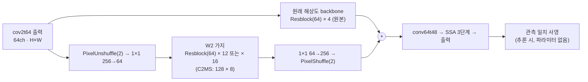

| 모델 | W2 가지 | 파라미터 (실사용) | 256² conv 연산량 | 학습 손실 |
|---|---|---:|---:|---|
| C2MS (53번, 공식 대조군) | 128 × 8 | 2,853,918 (2,735,610) | 59.6 GMAC | MSE |
| C2MS_L1S (65번, 같은 손실 대조군) | 128 × 8 | 2,853,918 (2,735,610) | 59.6 GMAC | L1 + 분광 |
| **C2MS_W64D12_L1S** | **64 × 12** | 1,346,014 (1,227,706) | **34.9 GMAC (59%)** | L1 + 분광 |
| **C2MS_W64D16_L1S** | **64 × 16** | 1,641,438 (1,523,130) | **39.8 GMAC (67%)** | L1 + 분광 |

- **구조:** 75번 `SizedParallel`을 그대로 씁니다. W2의 마지막 1×1을 0으로 시작해 학습 시작 출력이 원본 SSA-MRN과 같습니다. 64×12는 77번 E3와 파라미터 수가 같습니다. 같은 파라미터를 원래 해상도에 두는 E3(49.4 GMAC)와 1/2 해상도에 두는 64×12(34.9 GMAC)를 비교하는 셈입니다.
- **실사용 파라미터:** 공식 코드에 있지만 출력 계산에 쓰이지 않는 층(118,308개, [68번](../68_ssai_folding_sam_split_seed_ensemble/README.md))을 뺀 수입니다.
- **연산량:** 모든 Conv2d의 곱셈-누산 수를 실제로 센 값입니다([model.py](model.py) `conv_macs`). 사영의 계산량은 따로 GPU 시간으로 잽니다.

| 항목 | 내용 |
|---|---|
| 학습 | 65번과 같음: 원래 쌍 L1 + 1.0 × 2배 거친 쌍 L1 + 0.46 × 분광 손실(원래 쌍), Adam 1e-4 → 1e-6 cosine 150에폭, batch 32, FP16 AMP. 58번 학습 코드에 65번과 같은 L1 교체를 적용합니다 |
| 가중치 선택 | 원래 축척 validation MSE 최소, epoch 0 포함(53·65번과 같음). EMA(β 0.99) 가중치는 기록만 합니다 |
| 사영 | 45·66번과 같은 `y′ = y + Dᵀ Mᵀ (M D Dᵀ Mᵀ)⁻¹ M (MS − D y)`, 내부 마스크(가장자리 5), 밴드별 공액 기울기법(float64, 상대 잔차 1e-8). 로컬에서 53번 C2MS seed 42에 붙여 66번 값(38.3136 / 4.5662 / 3.7064)을 그대로 재현했습니다 |
| 초기값 | W2 밖의 층은 같은 시드의 43번 C0, W2의 앞 8블록과 1×1 층은 75번 W64D8과 같고, 학습 시작 출력은 C0와 정확히 같습니다(서버 preflight에서 확인) |

| 비교 | 의미 |
|---|---|
| 학생 + 사영 대 53번 C2MS | 공식 판정(v2.4, RR만) |
| 학생 + 사영 대 C2MS + 사영 | 사영을 C2MS에도 붙였을 때의 공정한 비교 |
| 학생 대 65번 C2MS_L1S (사영 전·후) | 같은 손실에서 구조만 바꾼 효과 |
| 65번 + 사영 대 53번, C2MS + 사영 대 53번 | 66번 재현(참고) |
| GPU 추론 시간 | seed 42 평가 때 C2MS·학생의 사영 전·후 시간을 잽니다(학습이 돌지 않을 때) |

| 단계 | 실행 | 다음 단계 조건 (학습 전 고정) |
|---|---|---|
| 1 선별 | QB seed 42, 두 갈래 동시 학습 | 학생 + 사영이 53번 C2MS보다 RR 세 지표 모두 좋으면 통과. 둘 다 통과하면 연산이 적은 64×12, 아무도 통과하지 못하면 2단계를 하지 않습니다 |
| 2 반복 | 고른 갈래, seed 43·44 동시 학습 | 같은 시드 53번 C2MS와 짝지은 3시드 평균, v2.4(PSNR +0.04 dB 이상, 세 지표 모두 개선) |

`run.py`가 1단계, 관문 판단, 2단계를 한 번에 진행합니다. 단계 사이에 조건을 바꾸지 않습니다. 3시드 평균 RR PSNR이 C2MS 대비 −0.04 dB 이상이면 "경량 비열등"을 참고로 함께 적습니다. 공식 판정은 아닙니다.

## 3. 정량 결과

모든 수치는 QB RR test 20장면 평균입니다(같은 코드, 같은 장면). 사영(+P)은 학습된 가중치를 바꾸지 않고 추론 때만 붙입니다. FR QNR·Dλ·Ds는 참고이며 판정에 쓰지 않습니다.

### 1단계 선별 (seed 42)

| 모델 | RR PSNR ↑ | SAM ↓ | ERGAS ↓ | FR QNR (참고) |
|---|---:|---:|---:|---:|
| 원본 SSA-MRN (43번 C0) | 37.3671 | 4.9651 | 4.1554 | 0.9171 |
| 53번 C2MS (공식 대조군) | 38.2738 | 4.5770 | 3.7230 | 0.8261 |
| 53번 C2MS + 사영 | 38.3136 | 4.5662 | 3.7064 | 0.8034 |
| 65번 C2MS_L1S (같은 손실) | 38.3511 | 4.4665 | 3.6928 | 0.9520 |
| 65번 C2MS_L1S + 사영 | 38.3963 | 4.4646 | 3.6736 | 0.9130 |
| 64×12 | 38.2083 | 4.5160 | 3.7541 | 0.9340 |
| 64×12 + 사영 | 38.2641 | 4.5105 | 3.7305 | 0.9219 |
| 64×16 | 38.2922 | 4.4915 | 3.7187 | 0.9430 |
| **64×16 + 사영** | **38.3466** | **4.4866** | **3.6957** | 0.8976 |

| 갈래 + 사영 | 53번 C2MS 대비 PSNR / SAM / ERGAS | 관문 |
|---|---|:---:|
| 64×12 + 사영 | −0.0096 dB / −0.0665° / +0.0075 | 탈락 |
| 64×16 + 사영 | +0.0728 dB / −0.0904° / −0.0273 | 통과 |

학습 전에 정한 규칙대로 관문을 통과한 64×16만 2단계로 갔습니다(둘 다 통과했다면 64×12를 골랐을 것입니다). 64×12는 SAM이 20/20장 모두 좋아졌지만 PSNR은 10/20장, ERGAS는 C2MS보다 나빴습니다.

### 2단계 3시드 평균 (64×16, seed 42·43·44)

| 모델 | RR PSNR ↑ | SAM ↓ | ERGAS ↓ | FR QNR / Dλ / Ds (참고) |
|---|---:|---:|---:|---|
| 원본 SSA-MRN (43번 C0) | 37.4293 | 4.9411 | 4.1241 | 0.9137 / 0.0439 / 0.0447 |
| 53번 C2MS | 38.3018 | 4.5760 | 3.7116 | 0.8096 / 0.0258 / 0.1686 |
| 53번 C2MS + 사영 | 38.3408 | 4.5659 | 3.6954 | 0.7860 / 0.0217 / 0.1964 |
| 65번 C2MS_L1S | 38.3298 | 4.4757 | 3.7035 | 0.9488 / 0.0217 / 0.0302 |
| 65번 C2MS_L1S + 사영 | 38.3735 | 4.4738 | 3.6849 | 0.9072 / 0.0199 / 0.0744 |
| 64×16 | 38.3009 | 4.4884 | 3.7139 | 0.9459 / 0.0217 / 0.0331 |
| **64×16 + 사영** | **38.3531** | **4.4840** | **3.6918** | 0.8989 / 0.0167 / 0.0857 |

| 비교 (3시드 평균) | PSNR | SAM | ERGAS | v2.4 |
|---|---:|---:|---:|:---:|
| **64×16 + 사영 대 53번 C2MS (공식)** | **+0.0513** | **−0.0919** | **−0.0198** | **개선** |
| 64×16 대 53번 C2MS (사영 전) | −0.0009 | −0.0876 | +0.0023 | 부분&nbsp;개선 |
| 64×16 + 사영 대 C2MS + 사영 | +0.0124 | −0.0819 | −0.0036 | 부분&nbsp;개선 (잡음 수준) |
| 64×16 대 65번 (같은 손실, 구조 효과) | −0.0289 | +0.0127 | +0.0104 | 개선&nbsp;없음 |
| 64×16 + 사영 대 65번 + 사영 | −0.0203 | +0.0103 | +0.0069 | 개선&nbsp;없음 |
| 참고: C2MS + 사영 대 C2MS | +0.0389 | −0.0101 | −0.0162 | 부분&nbsp;개선 (잡음 수준) |
| 참고: 65번 + 사영 대 C2MS | +0.0716 | −0.1022 | −0.0266 | 개선 |

공식 판정의 시드별 결과입니다. 판정은 세 시드 평균으로 하며 일부 시드만 골라 판정하지 않습니다.

| 시드 | 64×16 + 사영 대 53번 C2MS PSNR / SAM / ERGAS | 장면 승수 PSNR · SAM | 사영 전 대 C2MS PSNR | 대 C2MS + 사영 PSNR | 대 65번 (사영 전) PSNR |
|---:|---|:---:|---:|---:|---:|
| 42 | +0.0728 / −0.0904 / −0.0273 | 14 · 20 | +0.0184 | +0.0330 | −0.0589 |
| 43 | +0.0771 / −0.1129 / −0.0333 | 16 · 20 | +0.0279 | +0.0376 | +0.0311 |
| 44 | +0.0039 / −0.0725 / +0.0012 | 10 · 20 | −0.0490 | −0.0335 | −0.0589 |
| 평균 | **+0.0513 / −0.0919 / −0.0198** | 40 · 60 | −0.0009 | +0.0124 | −0.0289 |

| 시드 | 선택 에폭 | validation PSNR 대 53번 | 원본 대비 이득 유지율 (사영 전 / 후) | 사영 반복 횟수 (평균 / 최대) |
|---:|---:|---:|---:|---:|
| 42 | 150 | −0.154 dB | 102.0% / 108.0% | 82.8 / 108 |
| 43 | 147 | −0.134 dB | 103.2% / 109.0% | 83.5 / 108 |
| 44 | 149 | −0.177 dB | 94.2% / 100.5% | 83.0 / 108 |

유지율은 (모델 − 원본) / (53번 C2MS − 원본)의 RR PSNR 비율입니다. 64×12(seed 42)는 92.8% / 98.9%였습니다.

### 비용과 추론 시간

| 모델 | 파라미터 (실사용) | 256² conv 연산량 | GPU 시간 RR 256² | GPU 시간 FR 512² |
|---|---:|---:|---:|---:|
| 53번 C2MS | 2,853,918 (2,735,610) | 59.63 GMAC | 18.0 ms | 54.5 ms |
| 53번 C2MS + 사영 | 같음 | 같음 + 사영 | 375 ms | 1,166 ms |
| 64×12 | 1,346,014 (1,227,706) | 34.94 GMAC (59%) | 16.9 ms | 42.1 ms |
| 64×12 + 사영 | 같음 | 같음 + 사영 | 368 ms | 1,138 ms |
| 64×16 | 1,641,438 (1,523,130) | 39.77 GMAC (67%) | 17.4 ms | 46.1 ms |
| 64×16 + 사영 | 같음 | 같음 + 사영 | 364 ms | 1,143 ms |

GPU 시간은 seed 42 평가 때 학습이 돌지 않는 상태에서 RTX 3060 Ti로 잰 장면 0의 중앙값입니다. 사영은 float64 공액 기울기법이라 이 GPU에서 느립니다. C2MS의 두 측정(64×12·64×16 평가 때)은 18.0 / 17.9 ms, 54.5 / 54.5 ms로 거의 같았습니다.

## 4. 기준선 대비 차이와 해석

- **공식 판정은 개선입니다.** 학습 전에 정한 비교(64×16 + 사영 대 같은 시드 53번 C2MS, 3시드 평균)에서 세 지표가 모두 좋아졌고 PSNR 이득 +0.051 dB가 문턱 0.04 dB를 넘었습니다. SAM은 60/60장 모두 좋아졌습니다. 다만 seed 44는 +0.004 dB, ERGAS +0.001로 거의 같았습니다.
- **이득은 대부분 사영에서 나옵니다.** 사영은 파라미터가 없고 어떤 모델에도 붙일 수 있습니다. C2MS에 붙이면 +0.039 dB(60/60장 PSNR 상승)였고, 64×16 + 사영과 C2MS + 사영의 차이는 +0.012 dB로 잡음 수준입니다. 사영을 뺀 64×16은 C2MS와 PSNR이 같고(−0.001 dB) SAM만 0.088° 좋습니다.
- **경량화 관점:** 64×16은 연산 67%·실사용 파라미터 56%로 C2MS와 같은 RR PSNR을 냈습니다. 계획에서 참고로 정한 "경량 비열등"(3시드 평균 −0.04 dB 이상)에 해당합니다. 모델 자체의 GPU 시간은 256²에서 3%, 512²에서 15% 줄었습니다.
- **구조 효과는 음수입니다.** 같은 L1·분광 손실의 65번 C2MS_L1S(128 × 8)보다 64×16이 −0.029 dB, SAM +0.013°였습니다. 깊이를 8에서 16으로 늘려도 폭 128의 W2를 다 대신하지는 못했습니다. 64×12는 원본 대비 이득의 93%만 지켰습니다. 75번의 깊이 효율(64×4 → 64×8에서 42% → 86%)은 16블록까지 계속됐지만(64×12 93%, 64×16 세 시드 94-103%) 폭을 줄인 손실을 넘어서지는 못했습니다.
- **사영의 비용:** 사영은 관측 오차를 0으로 만들고(MS 관측 RMSE 15-27 DN → 0.000006 DN) RR을 일관되게 올리지만, 반복 계산 때문에 장면당 약 0.35초(256²), 1.1초(512²)가 더 들어 전체 GPU 시간이 C2MS 단독의 약 20배입니다. 연산량과 파라미터 기준으로는 경량이지만, 사영을 포함한 지연 시간 기준으로는 경량이 아닙니다.
- **FR(참고):** L1·분광 손실 모델은 C2MS보다 QNR이 높고(0.946 대 0.810) Ds가 낮습니다. 사영은 Dλ를 줄이지만 Ds를 늘려(0.033 → 0.086) QNR을 낮춥니다. 판정에는 쓰지 않습니다.
- **validation과 test가 엇갈렸습니다.** 세 시드 모두 validation PSNR은 53번 C2MS보다 0.13-0.18 dB 낮았지만 test(사영 전)는 평균 같았습니다. 판정은 규칙대로 test로 합니다.

C2MS 교체에는 3시드 개선이 필요하며, 이 결과는 형식상 그 조건을 만족합니다. 그러나 개선이 모델에 상관없는 사영에서 대부분 나오고 사영이 추론 시간을 크게 늘리며, 사후 진단인 65번 + 사영(+0.072 dB)이 더 높습니다. 그래서 기준 모델로 자동 승격하지 않고 팀 결정으로 남깁니다.

## 5. 학습·평가 그래프

학습 L1(원래 축척), validation PSNR·SAM, 학습률입니다. 회색 점선은 53번 C2MS, 붉은 점선은 65번 C2MS_L1S의 선택 가중치 validation PSNR입니다. seed 42 곡선은 19에폭 뒤 재부팅·재개 구간을 포함합니다. 재개는 `latest.pt`의 모델·옵티마이저·스케일러·EMA·난수 상태로 이어졌습니다.

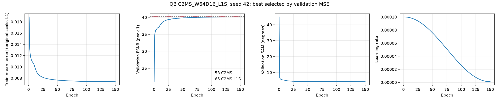

64×16 seed 43·44, 64×12 seed 42 학습 곡선

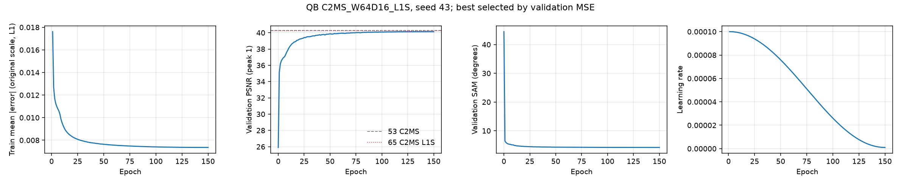

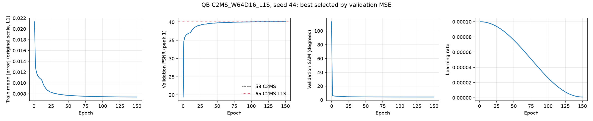

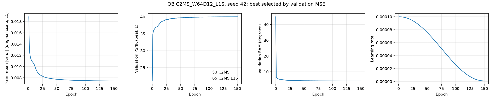

53번 C2MS 대비 test RR PSNR·SAM·ERGAS 차이입니다(seed 42). 원본, C2MS + 사영, 65번(사영 전·후), 갈래(사영 전·후)를 함께 표시했습니다.

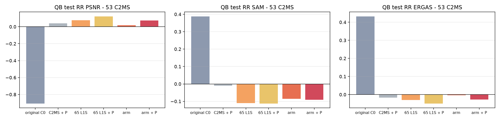

64×16 seed 43·44, 64×12 seed 42 test 비교

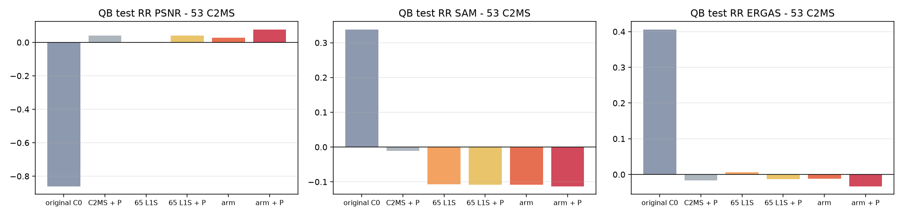

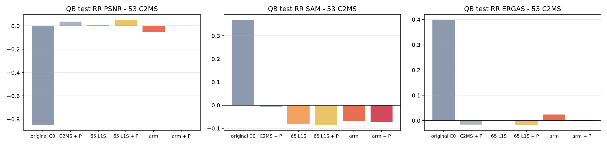

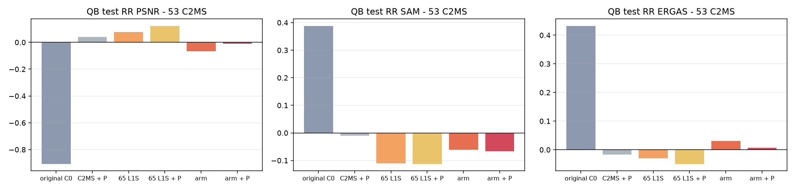

## 6. 결과 이미지

고정 6장면(QB RR test 0-based 0·1·3·7·14·17)에서 현재 기준 C2MS(53번)와 64×16 + 사영을 비교했습니다. 장면은 정답만 보고 풍경으로 미리 정했고 결과를 보고 바꾸지 않았습니다. `common/result_images.py`로 서버 평가 중에 만들었고, 본문은 seed 42입니다.

원본 크기 비교는 256×256 전체 장면의 **LR MS · PAN · C2MS · 64×16 + 사영 · 정답**과 **C2MS 오차 · 64×16 + 사영 오차**(같은 색 척도)입니다. 확대 비교는 후보의 개선이 가장 큰 64×64 창을 4배 확대한 **정답 전체(노란 상자) · C2MS · 64×16 + 사영 · 정답 · C2MS 오차 · 64×16 + 사영 오차**입니다. **확대 창은 장면마다 후보에게 가장 유리한 곳을 고른 것**이라 전체 차이는 장면 PSNR로 판단합니다.

| 장면 | 풍경 | seed 42 C2MS → 후보 (차이) | seed 43 차이 | seed 44 차이 |
|---:|---|---:|---:|---:|
| 0 | 바다·항구 방파제 | 42.812 → 43.006 (+0.194) | +0.465 | +0.188 |
| 1 | 부두·곡선 방파제·수목 | 43.179 → 43.265 (+0.086) | +0.071 | +0.057 |
| 3 | 요트 마리나·운동장 | 37.964 → 38.122 (+0.158) | +0.116 | −0.062 |
| 7 | 숲 공원 | 39.405 → 39.683 (+0.278) | +0.184 | +0.217 |
| 14 | 언덕 공원·곡선 주택가 | 38.473 → 38.523 (+0.050) | −0.001 | −0.022 |
| 17 | 산지 녹지·산책로 | 39.396 → 39.581 (+0.185) | +0.157 | −0.012 |

고정 6장면에서 seed 42는 6장, seed 43은 5장, seed 44는 3장이 C2MS보다 좋았습니다. 20장 전체에서는 각각 14장, 16장, 10장입니다. seed 43·44와 64×12의 이미지는 각 결과 폴더의 `evaluation/QB/`에 있습니다.

**장면 0 (바다·항구 방파제)**

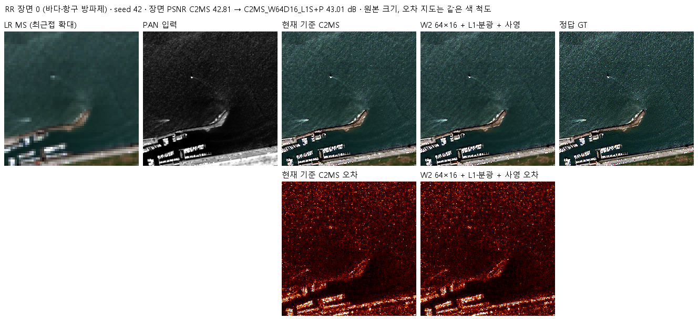

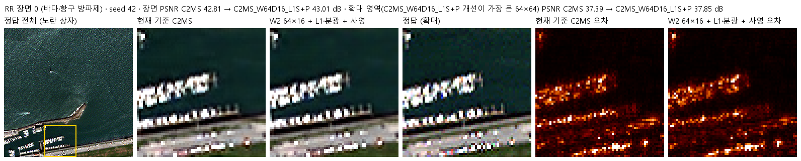

장면 1 · 부두·곡선 방파제·수목

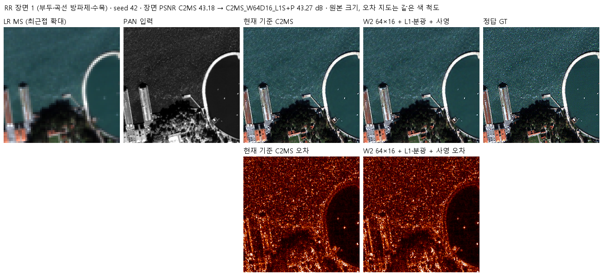

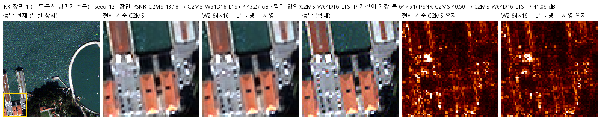

장면 3 · 요트 마리나·운동장

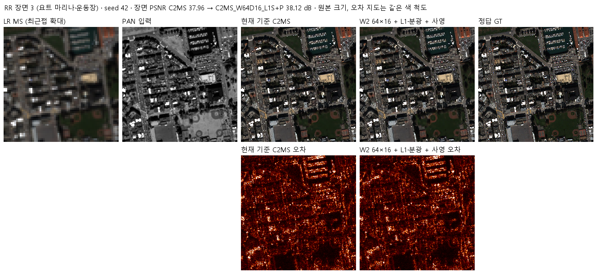

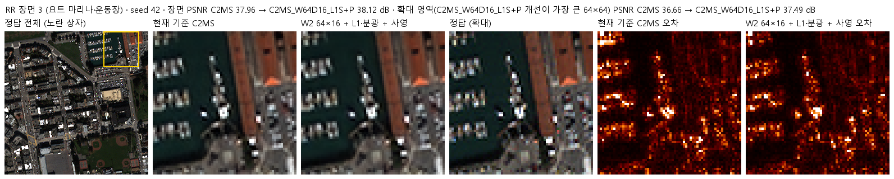

장면 7 · 숲 공원

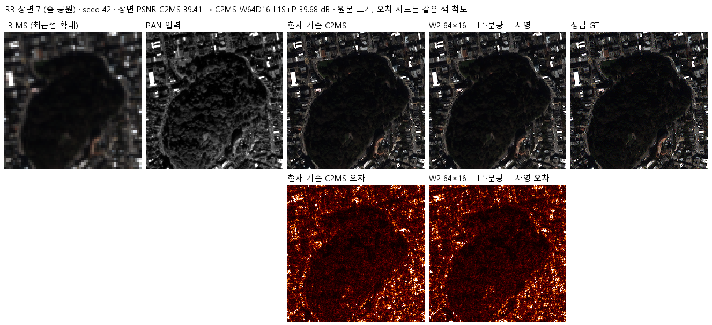

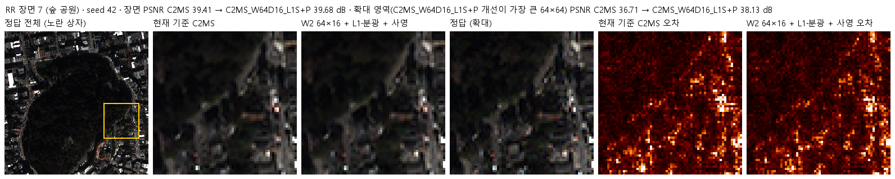

장면 14 · 언덕 공원·곡선 주택가

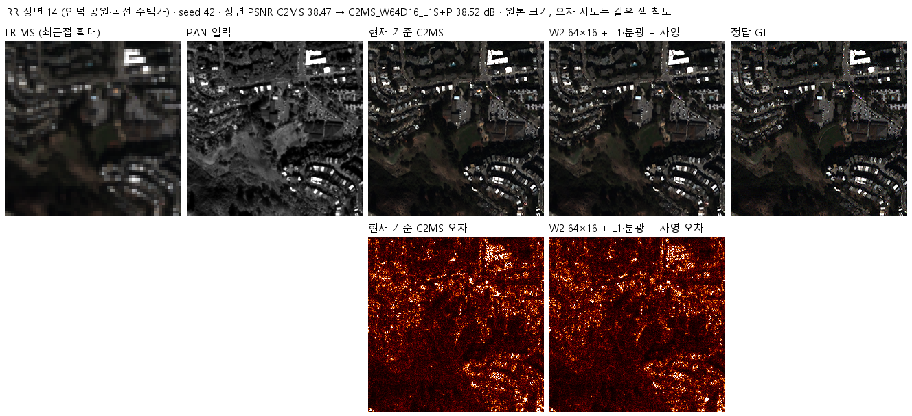

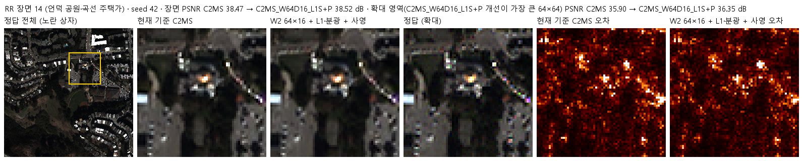

장면 17 · 산지 녹지·산책로

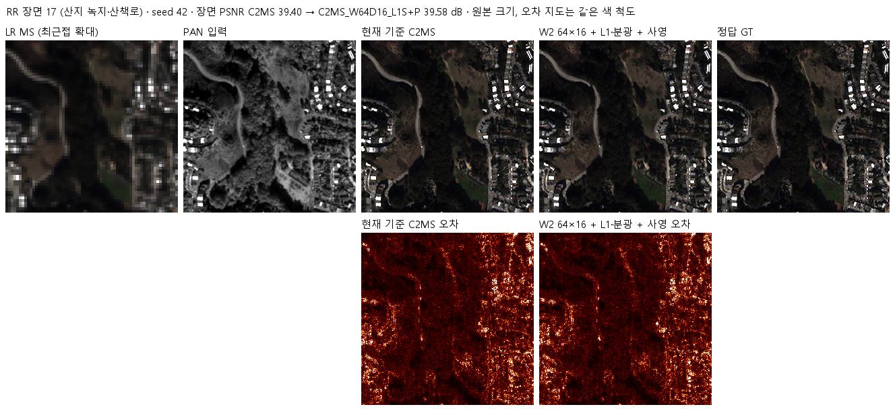

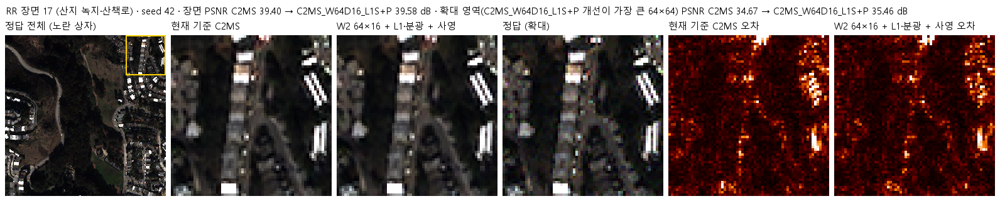

## 7. 재현 자료

- [config.json](config.json): 가설, 근거, 갈래, 손실, 사영, 비교, 단계와 관문, 서버 실행 설정
- [model.py](model.py): 깊고 얇은 W2 구조, conv 연산량·실사용 파라미터 측정
- [prepare.py](prepare.py): 54번 센서 표·거친 쌍 생성을 다시 내보내고, 장치에 상관없이 도는 관측 일치 사영(`Projector`, `Projected`)을 담습니다
- [train.py](train.py): 58번 학습 코드에 65번과 같은 L1 교체와 초기 상태 검사 교체를 적용합니다
- [run.py](run.py): 서버 실행 순서. `prepare`(H5에서 캐시 재생성·63번 해시 대조) → `optimize`(벤치마크·연산량·preflight) → `run`(1단계 → 관문 → 2단계 → 3시드 요약)
- [evaluate.py](evaluate.py): 같은 20장면에서 갈래·C2MS·65번·원본을 사영 전·후로 평가하고, 관문 판단과 3시드 요약을 합니다
- 가중치: `checkpoints/<갈래>_QB_s<시드>/best.pt`(validation MSE 최소, 판정에 사용)와 `best_ema.pt`(기록용). `latest.pt`·`initial.pt`는 GitHub Release `weights-experiments-performance-79`에 있습니다
- 결과: [results/summary.json](results/summary.json)(3시드 평균·판정·시드별 차이), [results/stage_gate.json](results/stage_gate.json)(1단계 관문), `results/<갈래>_QB_s<시드>/`(학습 기록, 초기 상태 검사, 장면별 평가 `evaluation/QB_v2_4.json`, 그래프, 이미지)
- 실행 기록: `provenance/run_records/`(환경, 데이터 해시, preflight, 실행 대기열, 완료 기록, 재부팅·재개 기록 `interruption.json`), `provenance/ctrs79-source-manifest.json`·`source_verification.json`(서버에 보낸 소스 대조), 준비·실행·재개 스크립트, 78번 서버 실행 폴더 정리 기록 `server_cleanup.json`
- [manifest.json](manifest.json): 현재 파일의 크기·SHA-256

## 8. 개선 여부와 다음 단계

**개선**입니다(QB 3시드, 53번 C2MS 대비 RR PSNR +0.051 dB·SAM −0.092°·ERGAS −0.020). 사영 전 64×16은 C2MS와 RR PSNR이 같은 경량 모델(연산 67%)이고, 이득의 대부분은 사영이 냅니다. 기준 모델 교체는 자동으로 하지 않고 팀 결정으로 남깁니다.

다음 단계 후보입니다.

1. **사영 가속:** float32 계산, 반복 횟수 상한, D·Dᵀ를 FFT 한 번으로 처리하는 닫힌 꼴 근사로 사영 시간을 모델 시간 수준으로 줄입니다. 같은 RR 이득이 유지되는지 확인해야 경량 주장이 지연 시간까지 성립합니다.
2. **폭 64 유지, 원래 해상도와 W2 사이 배분 조정:** 64×16의 W2가 128×8보다 약했으므로, 같은 연산 안에서 W2 폭 96 같은 중간 폭을 시험합니다.
3. GF2·WV3에서의 재현은 이번에 하지 않았습니다.
