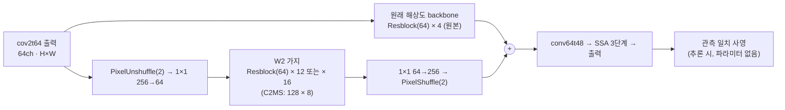

# 79. 깊고 얇은 W2 가지와 L1·분광 손실, 관측 일치 사영 결합

**연구 분야:** 성능 개선

**실험자:** 이병현

**변경 내용:** C2MS의 W2 병렬 가지(128채널 × 8블록)를 64채널 × 12블록 또는 × 16블록으로 깊고 얇게 바꿔 연산을 59-67%로 줄입니다. 학습은 65번의 L1·분광 손실로 하고, 추론 때는 66번의 관측 일치 사영을 붙입니다. 53번 C2MS와 공식 비교하고, 같은 손실의 65번 C2MS와 비교해 구조 효과를 따로 봅니다.

| 확인된 결과 | 상태 | 개선 여부 |
|---|:---:|:---:|
| 아직 평가하지 않았습니다. | 계획 | 판단&nbsp;보류 |

[실험 목록](../../../research/performance/README.md) · [수치](#results) · [그래프](#graphs) · [이미지](#images) · [재현 자료](#evidence)

## 1. 목적과 상태

경량화와 수치 개선을 함께 노립니다. 경량화는 구조로, 수치 개선은 이미 단일 모델에서 확인된 "추론 비용이 거의 없는 개선"으로 얻습니다. [78번](../78_seed_ensemble_distillation/README.md)에서 앙상블 이득은 출력 증류로 옮겨지지 않았습니다.

| 근거 | 내용 |
|---|---|
| 경량화: W2 깊이 | W2는 1/2 해상도라 블록을 늘려도 연산이 원래 해상도의 4분의 1만 듭니다. [75번](../75_parallel_branch_width_depth/README.md)에서 64×4 → 64×8(+4.8 GMAC)이 C2MS 이득의 42% → 86%로 가장 큰 회복이었고, 깊이가 폭보다 효율적이었습니다. 8블록보다 깊게는 시험한 적이 없습니다 |
| 연산 대비 효율 | C2MS 이득 중 남은 비율: W2 64×4 42%(25.3 GMAC), 64×8 86%(30.1), 128×4 78%(40.3), [77번](../77_full_resolution_backbone_capacity/README.md) E3 98.7%(49.4), C2MS 100%(59.6) |
| 수치: L1·분광 손실 | [65번](../65_l1_spectral_loss/README.md) C2MS에 적용, QB 3시드: RR +0.028 dB·SAM −0.100°(60/60장)·ERGAS −0.008 |
| 수치: 관측 일치 사영 | [66번](../66_observation_error_projection_analysis/README.md) 추론 시 사영: 시드마다 약 +0.04 dB. 65번 + 사영은 53번 C2MS 대비 3시드 +0.072 dB·−0.102°·−0.027이었지만 사후 진단이라 정식 판정을 받지 않았습니다 |

**가설:** 깊고 얇은 W2가 C2MS 이득 대부분을 지키고, L1·분광 손실과 사영이 이를 C2MS보다 위로 올립니다. 그러면 더 적은 연산으로 C2MS보다 나은 RR을 얻습니다.

**상태(2026-11-12):** 계획입니다. 코드를 작성했고 로컬 사전 확인을 마쳤습니다.

## 2. 변경한 구조와 비교 조건

| 모델 | W2 가지 | 파라미터 (실사용) | 256² conv 연산량 | 학습 손실 |
|---|---|---:|---:|---|
| C2MS (53번, 공식 대조군) | 128 × 8 | 2,853,918 (2,735,610) | 59.6 GMAC | MSE |
| C2MS_L1S (65번, 같은 손실 대조군) | 128 × 8 | 2,853,918 (2,735,610) | 59.6 GMAC | L1 + 분광 |
| **C2MS_W64D12_L1S** | **64 × 12** | 1,346,014 (1,227,706) | **34.9 GMAC (59%)** | L1 + 분광 |
| **C2MS_W64D16_L1S** | **64 × 16** | 1,641,438 (1,523,130) | **39.8 GMAC (67%)** | L1 + 분광 |

- **구조:** 75번 `SizedParallel`을 그대로 씁니다. W2의 마지막 1×1을 0으로 시작해 학습 시작 출력이 원본 SSA-MRN과 같습니다. 64×12는 77번 E3와 파라미터 수가 같습니다. 같은 파라미터를 원래 해상도에 두는 E3(49.4 GMAC)와 1/2 해상도에 두는 64×12(34.9 GMAC)를 비교하는 셈입니다.
- **실사용 파라미터:** 공식 코드에 있지만 출력 계산에 쓰이지 않는 층(118,308개, [68번](../68_ssai_folding_sam_split_seed_ensemble/README.md))을 뺀 수입니다.
- **연산량:** 모든 Conv2d의 곱셈-누산 수를 실제로 센 값입니다([model.py](model.py) `conv_macs`). 사영의 계산량은 따로 GPU 시간으로 잽니다.

| 항목 | 내용 |
|---|---|
| 학습 | 65번과 같음: 원래 쌍 L1 + 1.0 × 2배 거친 쌍 L1 + 0.46 × 분광 손실(원래 쌍), Adam 1e-4 → 1e-6 cosine 150에폭, batch 32, FP16 AMP. 58번 학습 코드에 65번과 같은 L1 교체를 적용합니다 |
| 가중치 선택 | 원래 축척 validation MSE 최소, epoch 0 포함(53·65번과 같음). EMA(β 0.99) 가중치는 기록만 합니다 |
| 사영 | 45·66번과 같은 `y′ = y + Dᵀ Mᵀ (M D Dᵀ Mᵀ)⁻¹ M (MS − D y)`, 내부 마스크(가장자리 5), 밴드별 공액 기울기법(float64, 상대 잔차 1e-8). 로컬에서 53번 C2MS seed 42에 붙여 66번 값(38.3136 / 4.5662 / 3.7064)을 그대로 재현했습니다 |
| 초기값 | W2 밖의 층은 같은 시드의 43번 C0, W2의 앞 8블록과 1×1 층은 75번 W64D8과 같고, 학습 시작 출력은 C0와 정확히 같습니다(서버 preflight에서 확인) |

| 비교 | 의미 |
|---|---|
| 학생 + 사영 대 53번 C2MS | 공식 판정(v2.4, RR만) |
| 학생 + 사영 대 C2MS + 사영 | 사영을 C2MS에도 붙였을 때의 공정한 비교 |
| 학생 대 65번 C2MS_L1S (사영 전·후) | 같은 손실에서 구조만 바꾼 효과 |
| 65번 + 사영 대 53번, C2MS + 사영 대 53번 | 66번 재현(참고) |
| GPU 추론 시간 | seed 42 평가 때 C2MS·학생의 사영 전·후 시간을 잽니다(학습이 돌지 않을 때) |

| 단계 | 실행 | 다음 단계 조건 (학습 전 고정) |
|---|---|---|
| 1 선별 | QB seed 42, 두 갈래 동시 학습 | 학생 + 사영이 53번 C2MS보다 RR 세 지표 모두 좋으면 통과. 둘 다 통과하면 연산이 적은 64×12, 아무도 통과하지 못하면 2단계를 하지 않습니다 |
| 2 반복 | 고른 갈래, seed 43·44 동시 학습 | 같은 시드 53번 C2MS와 짝지은 3시드 평균, v2.4(PSNR +0.04 dB 이상, 세 지표 모두 개선) |

`run.py`가 1단계, 관문 판단, 2단계를 한 번에 진행합니다. 단계 사이에 조건을 바꾸지 않습니다. 3시드 평균 RR PSNR이 C2MS 대비 −0.04 dB 이상이면 "경량 비열등"을 참고로 함께 적습니다. 공식 판정은 아닙니다.

## 3. 정량 결과

아직 학습하지 않았습니다.

## 4. 기준선 대비 차이와 해석

아직 학습하지 않았습니다.

## 5. 학습·평가 그래프

아직 학습하지 않았습니다.

## 6. 결과 이미지

아직 학습하지 않았습니다. 고정 6장면(QB RR test 0-based 0·1·3·7·14·17)에서 53번 C2MS와 학생 + 사영을 비교합니다.

## 7. 재현 자료

- [config.json](config.json): 가설, 근거, 갈래, 손실, 사영, 비교, 단계와 관문, 서버 실행 설정
- [model.py](model.py): 깊고 얇은 W2 구조, conv 연산량·실사용 파라미터 측정
- [prepare.py](prepare.py): 54번 센서 표·거친 쌍 생성을 다시 내보내고, 장치에 상관없이 도는 관측 일치 사영(`Projector`, `Projected`)을 담습니다
- [train.py](train.py): 58번 학습 코드에 65번과 같은 L1 교체와 초기 상태 검사 교체를 적용합니다
- [run.py](run.py): 서버 실행 순서. `prepare`(H5에서 캐시 재생성·63번 해시 대조) → `optimize`(벤치마크·연산량·preflight) → `run`(1단계 → 관문 → 2단계 → 3시드 요약)
- [evaluate.py](evaluate.py): 같은 20장면에서 학생·C2MS·65번·원본을 사영 전·후로 평가하고, 관문 판단과 3시드 요약을 합니다
- [manifest.json](manifest.json): 현재 파일의 크기·SHA-256

## 8. 개선 여부와 다음 단계

**판단 보류**입니다. 학습과 RR test 평가가 없습니다.
