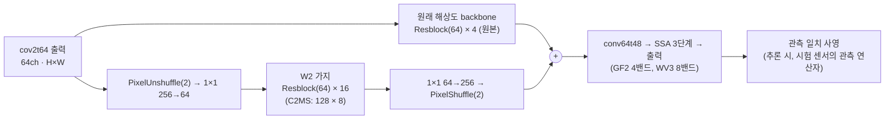

# 80. 깊고 얇은 W2 가지와 사영의 다중 센서 확인

**연구 분야:** 성능 개선

**실험자:** 이병현

**변경 내용:** [79번](../79_deep_narrow_branch_projection/README.md)의 64×16 W2 가지(L1·분광 손실, 추론 시 관측 일치 사영)를 바꾸지 않고 GF2(4밴드)와 WV3(8밴드)에서 학습해, 같은 시드 54번 C2MS와 비교합니다. WV3 모델은 학습하지 않은 WV2에도 적용합니다(참고).

| 확인된 결과 | 상태 | 개선 여부 |
|---|:---:|:---:|
| 아직 평가하지 않았습니다. | 계획 | 판단&nbsp;보류 |

[실험 목록](../../../research/performance/README.md) · [수치](#results) · [그래프](#graphs) · [이미지](#images) · [재현 자료](#evidence)

## 1. 목적과 상태

79번은 QB에서만 확인했습니다. 같은 방법이 다른 센서에서도 성립하는지 확인합니다.

| 근거 | 내용 |
|---|---|
| 79번 (QB 3시드) | 64×16 + 사영이 53번 C2MS 대비 RR +0.051 dB·SAM −0.092°·ERGAS −0.020(개선). 사영 전 64×16은 −0.001 dB·SAM −0.088°로 연산 67%에서 C2MS와 같은 PSNR. 시드별 +0.073·+0.077·+0.004 dB |
| [65번](../65_l1_spectral_loss/README.md) 손실의 다른 센서 결과 | 54번 C2MS 대비 3시드: GF2 +0.106 dB·SAM −0.022°(개선), WV3 +0.047 dB·SAM −0.079°·ERGAS 그대로(부분 개선), WV2 전이 −0.277 dB·SAM −0.091°(참고) |
| [54번](../54_multi_sensor_scale_mixed_training/README.md) | C2MS(W2 가지 + 축척 혼합 학습)가 GF2·WV3 3시드에서 원본 대비 개선 |
| 사영 | [66번](../66_observation_error_projection_analysis/README.md)·79번은 QB에서만 쟀습니다. GF2·WV3·WV2에서의 사영 효과는 처음 확인합니다 |

**가설:** 79번 방법을 그대로 쓰면 GF2·WV3에서도 64×16 + 사영이 같은 시드 54번 C2MS보다 RR 세 지표가 모두 좋고, 사영 전 64×16은 더 적은 연산으로 C2MS와 비슷합니다.

**상태(2026-11-13):** 계획입니다. 코드를 작성했고 로컬 사전 확인을 마쳤습니다. 로컬 CPU에서 GF2·WV3 시험 장면을 잘라 만든 작은 캐시로 2에폭 학습, 4·8밴드 초기 상태 검사, 사영을 포함한 평가(WV3는 WV2까지), 3시드 요약의 실행 경로를 확인했습니다(결과가 아닙니다).

## 2. 변경한 구조와 비교 조건

구조와 학습 방법은 79번과 같고, 학습·평가 센서만 바뀝니다.

| 모델 | W2 가지 | 학습 손실 | 역할 |
|---|---|---|---|
| 54번 C2MS | 128 × 8 | MSE | 공식 대조군(같은 시드) |
| 54번 C2MS + 사영 | 128 × 8 | MSE | 사영을 C2MS에도 붙인 공정 비교 |
| 65번 C2MS_L1S (± 사영) | 128 × 8 | L1 + 분광 | 같은 손실에서 구조만 바꾼 효과 |
| 54번 C0 | 없음 | MSE | 원본 SSA-MRN, C2MS 이득 중 남은 비율 |
| **C2MS_W64D16_L1S (± 사영)** | **64 × 16** | L1 + 분광 | 후보(79번과 같음) |

| 항목 | 내용 |
|---|---|
| 데이터 | GF2 학습 19,809 / validation 2,201, WV3 학습 9,714 / validation 1,080, 시험 각 20장면(RR·FR). WV2는 시험 20장면만(전이) |
| 학습 | 79·65번과 같음: 원래 쌍 L1 + 1.0 × 2배 거친 쌍 L1 + 0.46 × 분광 손실, Adam 1e-4 → 1e-6 cosine 150에폭, batch 32, FP16 AMP. 분광 가중치 0.46은 QB에서 정한 값을 65번처럼 모든 센서에 그대로 씁니다 |
| 가중치 선택 | 원래 축척 validation MSE 최소, epoch 0 포함(54·65번과 같음) |
| 사영 | 79번 `Projected` 그대로. 시험 센서의 관측 연산자를 씁니다(WV2 전이는 WV2 연산자) |
| 초기값 | W2 밖의 층은 같은 시드·밴드 수의 54번 C0, W2 앞 8블록과 1×1 층은 75번 W64D8과 같고, 학습 시작 출력은 54번 C0와 정확히 같습니다. 79번은 4밴드만 검사했고, 이번에는 8밴드(WV3)도 같은 방식으로 검사합니다(서버 preflight) |
| 비용 | 실사용 파라미터·256² conv 연산량: 4밴드(GF2) 64×16 1,523,130·39.77 GMAC, C2MS 2,735,610·59.63 GMAC(67%). 8밴드(WV3·WV2) 64×16 1,543,462·40.52 GMAC, C2MS 2,755,942·60.38 GMAC(67%). 서버 `optimize`에서 다시 세어 기록합니다 |

| 비교 | 의미 |
|---|---|
| 64×16 + 사영 대 54번 C2MS (GF2, WV3) | 공식 판정(v2.4, RR만, 센서별 3시드 평균, 문턱 0.04 dB) |
| 64×16 + 사영 대 C2MS + 사영 | 사영을 C2MS에도 붙였을 때의 공정한 비교 |
| 64×16 대 65번 C2MS_L1S (사영 전·후) | 같은 손실에서 구조만 바꾼 효과 |
| WV2 전이 (WV3 모델) | 위 비교를 모두 보고하지만 참고만 하고 판정하지 않습니다 |
| GPU 추론 시간 | seed 42 평가 때 각 학습 센서에서 C2MS·64×16의 사영 전·후 시간을 잽니다 |

| 실행 | 내용 |
|---|---|
| 학습 대기열 | GF2·WV3 × seed 42·43·44, 6개를 두 개씩 동시에 학습합니다. 79번 방법을 바꾸지 않으므로 선별 단계는 두지 않습니다 |
| 평가 | 학습이 모두 끝난 뒤 실행마다 평가합니다(WV3는 WV2까지). GPU에 학습이 없을 때 시간을 잽니다 |
| 요약 | 시험 센서별(GF2, WV3, WV2 참고) 3시드 평균과 시드별 결과 |
| 예상 시간 | 학습 약 15시간(두 개 동시: GF2 약 146초, WV3 약 95초/에폭, 65·79번 기록으로 추정), 평가 약 2시간 |

3시드 평균 RR PSNR이 사영 전 64×16에서 C2MS 대비 −0.04 dB 이상이면 "경량 비열등"을 참고로 함께 적습니다. 공식 판정은 아닙니다.

## 3. 정량 결과

아직 학습하지 않았습니다.

## 4. 기준선 대비 차이와 해석

아직 학습하지 않았습니다.

## 5. 학습·평가 그래프

아직 학습하지 않았습니다.

## 6. 결과 이미지

아직 학습하지 않았습니다. 65번처럼 고정 장면 번호(0-based 0·1·3·7·14·17)를 GF2·WV3·WV2 시험 세트에 그대로 써서 54번 C2MS와 64×16 + 사영을 비교합니다. 장면은 학습 전에 정했고 결과를 보고 바꾸지 않습니다.

## 7. 재현 자료

- [config.json](config.json): 가설, 근거, 대조군, 비교, 학습 대기열, 데이터 해시, 서버 실행 설정
- [model.py](model.py): 79번 모델을 그대로 불러와 64×16 갈래만 씁니다
- [prepare.py](prepare.py): 79번 데이터 도구와 사영(`Projector`, `Projected`)을 그대로 다시 내보냅니다
- [train.py](train.py): 58번 학습 코드에 65·79번과 같은 L1 교체를 적용하고, 초기 상태 검사를 밴드 수에 상관없이 하도록 바꿉니다
- [run.py](run.py): 서버 실행 순서. `prepare`(H5에서 GF2·WV3 캐시 재생성·65번 해시 대조, WV2 시험 데이터 해시 확인) → `optimize`(벤치마크·연산량·preflight) → `run`(학습 6개 → 평가 → 센서별 3시드 요약)
- [evaluate.py](evaluate.py): 같은 20장면에서 64×16·54번 C2MS·65번·54번 C0를 사영 전·후로 평가하고(WV3는 WV2까지), 센서별 3시드 요약을 합니다

## 8. 개선 여부와 다음 단계

**판단 보류**입니다. 학습과 RR test 평가가 없습니다.
