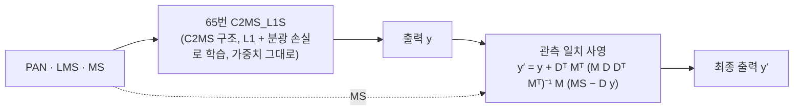

# 81. L1·분광 손실 C2MS에 관측 일치 사영 결합의 정식 판정과 사영 가속

**연구 분야:** 성능 개선

**실험자:** 이병현

**변경 내용:** 새로 학습하지 않습니다. [65번](../65_l1_spectral_loss/README.md) C2MS_L1S(L1 + 분광 손실) 가중치에 추론 때 관측 일치 사영을 붙인 방식을 후보로 미리 정하고, QB·GF2·WV3에서 같은 시드 C2MS와 3시드로 정식 판정합니다. 사영을 더 싸게 하는 변형(float32, 반복 횟수 상한)이 같은 결과를 지키는지와 GPU 시간도 잽니다.

| 확인된 결과 | 상태 | 개선 여부 |
|---|:---:|:---:|
| 아직 평가하지 않았습니다. | 계획 | 판단&nbsp;보류 |

[실험 목록](../../../research/performance/README.md) · [수치](#results) · [그래프](#graphs) · [이미지](#images) · [재현 자료](#evidence)

## 1. 목적과 상태

[66번](../66_observation_error_projection_analysis/README.md)은 65번 + 사영이 C2MS보다 좋다는 것을 사후 분석으로 보였고, 정식 판정을 하려면 추론 방식과 비교 상대를 미리 정한 새 실험이 필요하다고 적었습니다. 이 실험이 그 정식 판정입니다. [79번](../79_deep_narrow_branch_projection/README.md)·[80번](../80_multi_sensor_deep_narrow_projection/README.md)에서도 이 조합을 참고 비교로 다시 쟀습니다.

| 근거 (같은 시드 C2MS 대비, 3시드 평균) | RR PSNR / SAM / ERGAS |
|---|---|
| QB (66·79번) | +0.072 dB / −0.102° / −0.027 |
| GF2 (66·80번) | +0.191 dB / −0.028° / −0.017 |
| WV3 (66·80번) | +0.130 dB / −0.091° / −0.017 |
| WV2 전이 (참고) | +0.171 dB / −0.348° / −0.087 |
| 사영만 (C2MS + 사영 대 C2MS) | QB +0.039, GF2 +0.085, WV3 +0.081, WV2 +0.185 dB |
| 사영 비용 | float64 공액 기울기법, 장면당 43-83회 반복. RTX 3060 Ti에서 모델 단독의 12-20배 GPU 시간 |

**미리 밝혀 둘 점:** 공식 후보의 test 수치는 66·79·80번에서 이미 쟀습니다. 이번 실험은 그 수치를 새로 발견하는 것이 아니라, 후보·비교 상대·판정 방법을 평가 전에 고정하고 같은 코드로 세 센서를 한 번에 다시 평가해 정식 판정을 남기는 것입니다. 새로 확인하는 것은 사영 변형의 결과와 GPU 시간입니다.

**가설:** 65번 + 사영은 QB·GF2·WV3 모두에서 같은 시드 C2MS보다 RR 세 지표가 좋고, 더 싼 사영(float32 또는 반복을 일찍 멈춘 공액 기울기법)도 같은 결과를 지키면서 사영 시간을 크게 줄입니다.

**상태(2026-11-13):** 계획입니다. 코드를 작성했고 로컬 사전 확인을 마쳤습니다. 로컬 CPU에서 float64 변형이 79번 사영과 정확히 같음(차이 0)을 확인했고, QB seed 42 RR(FR 생략)을 실제 가중치로 평가해 79번 기록과 소수 7자리까지 같은 값을 얻었습니다. 이 사전 확인에서 사영 변형의 QB seed 42 RR 값도 나왔지만(K5 −0.002 dB), 변형 유지 규칙은 그 전에 config.json에 고정했고 판정은 서버의 3시드 평가로 합니다.

## 2. 변경한 구조와 비교 조건

모델 구조와 가중치는 바꾸지 않습니다. 추론 뒤에 파라미터 없는 사영 단계를 붙입니다.

`D`는 시험 센서의 관측 연산(MTF 블러 + 4배 축소), `M`은 가장자리 5픽셀을 뺀 내부 마스크입니다. 출력을 다시 관측했을 때 입력 MS와 정확히 맞도록, 그 조건을 만족하는 가장 가까운 영상으로 옮깁니다.

| 시스템 | 가중치 | 사영 |
|---|---|---|
| C2MS (공식 대조군) | QB 53번, GF2·WV3 54번 | 없음 |
| C2MS + 사영 | 같음 | P |
| C2MS_L1S | 65번 | 없음 |
| **C2MS_L1S + 사영 (공식 후보)** | 65번 | **P** |
| C2MS_L1S + 사영 변형 | 65번 | P32, K20, K10, K5 |
| 원본 SSA-MRN C0 | QB 43번, GF2·WV3 54번 | 없음 |

| 사영 | 정밀도 | 멈춤 조건 |
|---|---|---|
| P (66·79·80번과 같음) | float64 | 상대 잔차 1e-8 또는 400회 |
| P32 | float32 (출력·MS·관측 연산 모두) | 상대 잔차 1e-5 또는 400회 |
| K20 · K10 · K5 | float64 | 20 · 10 · 5회에서 멈춤 |

| 비교 | 의미 |
|---|---|
| C2MS_L1S + 사영 대 C2MS (QB, GF2, WV3) | 공식 판정(v2.4, RR만, 센서별 3시드 평균, 문턱 0.04 dB) |
| C2MS_L1S + 사영 대 C2MS + 사영 | 사영을 양쪽에 붙였을 때 손실이 더하는 몫 |
| C2MS + 사영 대 C2MS, C2MS_L1S 대 C2MS | 사영만의 몫, 손실만의 몫(65번) |
| 변형 대 C2MS, 변형 대 C2MS_L1S + 사영 | 변형이 결과를 지키는지. 모든 판정 센서·시드에서 P와의 RR PSNR 차이가 0.005 dB 이내이고 C2MS 대비 판정이 P와 같으면 "사영 효과 유지"로 봅니다(평가 전에 고정) |
| WV2 전이 | 위 비교를 모두 보고하지만 참고만 합니다 |
| GPU 시간 | seed 42에서 센서마다 모든 시스템을 256²·512² 한 장으로 잽니다(다른 GPU 작업 없음) |

| 항목 | 내용 |
|---|---|
| 데이터 | QB·GF2·WV3·WV2 시험 각 20장면(RR·FR). 학습 데이터는 쓰지 않습니다 |
| 지표 | 54·79·80번 장면 지표의 RR(PSNR·SAM·ERGAS·SCC·Q2n)과 FR(QNR·Dλ·Ds·관측 RMSE). v2.4에서 빠진 RR2·FR_WALD는 계산하지 않습니다 |
| 재현 확인 | C2MS·C2MS_L1S·두 시스템의 사영 결과 3시드 평균을 79번(QB)·80번(GF2·WV3·WV2) 기록과 대조합니다 |
| 기준 모델 | 기준 모델 교체에는 3시드 개선이 필요합니다. 이 실험은 조건 충족 여부만 보고하고 자동으로 교체하지 않습니다 |
| 실행 | 서버 GPU에서 센서·시드 9개를 차례로 평가합니다(WV3는 WV2까지). 학습이 없어 약 1시간 걸립니다 |

## 3. 정량 결과

아직 평가하지 않았습니다.

## 4. 기준선 대비 차이와 해석

아직 평가하지 않았습니다.

## 5. 학습·평가 그래프

학습하지 않으므로 학습 곡선은 없습니다. 평가 후 시드·센서별 C2MS 대비 test 비교 그래프를 넣습니다.

## 6. 결과 이미지

아직 평가하지 않았습니다. 고정 장면 번호(0-based 0·1·3·7·14·17)를 QB·GF2·WV3·WV2에 써서 C2MS와 C2MS_L1S + 사영을 비교합니다. 장면은 평가 전에 정했습니다.

## 7. 재현 자료

- [config.json](config.json): 가설, 이미 관찰된 수치, 후보·변형·대조군, 비교, 변형 유지 규칙, 데이터 해시, 재현 대조 기록
- [prepare.py](prepare.py): 79번 사영을 그대로 다시 내보내고, float32·반복 상한 변형(`ProjectedVariant`)을 정의합니다
- [evaluate.py](evaluate.py): 센서·시드별로 모든 시스템을 같은 20장면에서 평가하고(WV3는 WV2까지), 센서별 3시드 요약과 79·80번 재현 대조를 합니다
- [run.py](run.py): 서버 실행 순서. `prepare`(시험 데이터·소스 해시, float64 변형과 79번 사영의 동일성 확인) → `run`(평가 9개 → 요약)

## 8. 개선 여부와 다음 단계

**판단 보류**입니다. RR test 평가가 없습니다.
