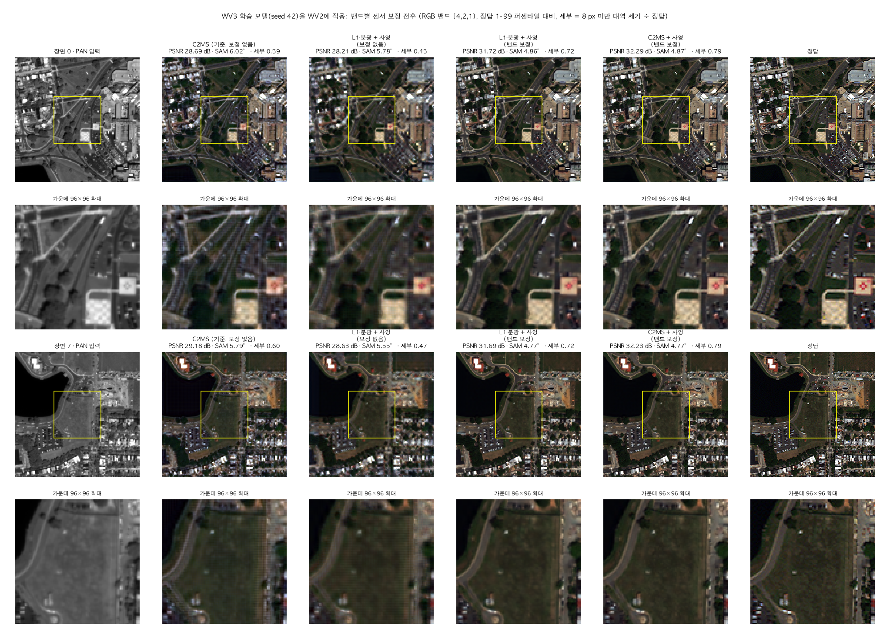

# 82. 미학습 센서 적용 시 밴드별 센서 보정

**연구 분야:** 성능 개선

**실험자:** 이병현

**변경 내용:** 새로 학습하지 않습니다. 한 센서로 학습한 모델을 학습하지 않은 센서에 쓸 때, 입력 MS의 밴드마다 배율 하나를 곱해 학습 센서의 "밴드 평균 ÷ PAN 평균" 비율에 맞춘 뒤 모델에 넣고, 출력을 같은 배율로 되돌린 다음 관측 일치 사영(K10)을 붙입니다. 입력 통계만 쓰며 정답은 쓰지 않습니다. 같은 센서에는 적용하지 않습니다.

| 확인된 결과 | 상태 | 개선 여부 |
|---|:---:|:---:|
| 아직 정식 평가하지 않았습니다. 사전 진단(test 사후 확인, 3시드)에서 WV3 모델을 WV2에 쓸 때 65번 + 사영이 29.58 → 32.35 dB, C2MS가 29.41 → 32.25 dB였고 세부 에너지가 0.51-0.57에서 0.76-0.80으로 회복됐습니다. | 계획 | 성능&nbsp;비교&nbsp;아님 |

[실험 목록](../../../research/performance/README.md) · [수치](#results) · [그래프](#graphs) · [이미지](#images) · [재현 자료](#evidence)

## 1. 목적과 상태

[65번](../65_l1_spectral_loss/README.md)(L1 + 분광 손실)은 학습한 센서에서는 SAM을 줄였지만, WV3 모델을 WV2에 쓰면 C2MS보다 흐리고 어두운 경우가 있었습니다(3시드 PSNR −1.08, −0.16, +0.41 dB). [81번](../81_l1_spectral_loss_projection/README.md)에서 사영을 붙이면 수치는 C2MS보다 좋아졌지만(+0.171 dB) 세부 세기는 여전히 낮았습니다. [67번](../67_pan_brightness_blur_augmentation/README.md)·[71번](../71_coarse_pair_pan_blur/README.md)의 PAN 흐림 증강은 WV2를 개선하는 대신 학습한 WV3를 나쁘게 했습니다.

### 0단계 사전 진단 (로컬, 2026-11-14)

보관 가중치로 학습 없이 확인했습니다. **같은 test를 보고 원인을 찾은 사후 분석**이므로, 이번 실험에서 규칙을 고정하고 다시 평가합니다. 자료는 [provenance/stage0](provenance/stage0/)에 있습니다.

**원인은 PAN이 아니라 밴드별 밝기 척도였습니다.** test 입력에서 잰 밴드 평균 ÷ PAN 평균입니다. PAN 평균은 WV3 369.7 DN, WV2 366.0 DN으로 거의 같습니다.

| 밴드 | 해안 | 파랑 | 초록 | 노랑 | 빨강 | 적색 경계 | NIR1 | NIR2 |
|---|---:|---:|---:|---:|---:|---:|---:|---:|
| WV3 | 0.69 | 0.86 | 1.04 | 0.79 | 0.72 | 0.81 | 1.28 | 0.83 |
| WV2 | 1.12 | 0.80 | 1.05 | 1.22 | 0.87 | 1.31 | 1.53 | 1.26 |

WV3 모델은 WV3 척도에 맞춰 세부를 넣으므로, 척도가 다른 WV2에서는 세부를 덜 넣습니다. 분광 손실 모델은 이 차이에 더 민감합니다(65번 seed 42 밝기 치우침 23 DN).

| WV3 → WV2 (RR 20장, 3시드 평균) | PSNR | SAM | ERGAS | 세부 에너지 | 밝기 치우침 |
|---|---:|---:|---:|---:|---:|
| C2MS | 29.41 | 5.85° | 4.62 | 0.57 | 4.3 DN |
| 65번 + 사영 | 29.58 | 5.51° | 4.53 | 0.52 | 5.2 DN |
| C2MS + 밴드 보정 + 사영 | 32.38 | 5.04° | 3.32 | 0.80 | 0.4 DN |
| 65번 + 밴드 보정 + 사영 | 32.35 | 4.95° | 3.33 | 0.76 | 0.6 DN |

세부 에너지는 8 px 미만 대역의 출력 세기 ÷ 정답(1이 정답)이고, 밝기 치우침은 밴드별 평균 오차의 절댓값 평균입니다.

- 65번 + 보정 + 사영은 시드별로 32.34 · 32.40 · 32.32 dB로, 보정 전의 시드 요동(29.00 · 29.60 · 30.15 dB)이 사라졌습니다.
- 다른 전이에서도 같은 방향이었습니다. QB → GF2는 C2MS 33.77 → 37.02 dB, 65번 23.67 → 37.31 dB이고, GF2 → QB는 C2MS 27.83 → 30.72 dB입니다(보정 + 사영). GF2 → QB는 보정 뒤에도 학습한 QB 모델(38.3 dB)보다 크게 낮습니다.
- PAN 밝기만 맞추는 보정은 C2MS를 오히려 −0.84 dB 나쁘게 했습니다(seed 42). 보정 뒤에는 흐림 증강(67·71번)이나 300에폭 학습(59번) 모델의 이점도 사라졌습니다(모두 32.1-32.7 dB).
- **같은 센서에 적용하면 나빠집니다.** 장면별 보정을 넣으면 WV3 −3.3 dB, QB −0.76 dB, GF2 −0.46 dB였고, QB test 세트 전체로 맞춘 상수도 −0.16 dB였습니다. 같은 센서 안에서 장면마다 다른 비율은 지표면 정보이기 때문입니다.

**가설:** 미학습 센서에서의 흐려짐과 색 치우침은 센서 간 밴드별 척도 차이에서 오며, 학습 센서의 기준 비율과 입력 장면의 비율만으로 정한 밴드별 배율로 재학습 없이 고칠 수 있습니다.

**상태(2026-11-14):** 계획과 평가 코드를 등록했습니다. 학습 센서 기준 비율은 QB를 로컬 학습 세트에서 계산했고, GF2·WV3는 서버의 학습 세트에서 계산합니다.

## 2. 변경한 구조와 비교 조건

| 항목 | 내용 |
|---|---|
| 학습 센서 기준 비율 | 학습 세트 전체의 `ΣLMS_b ÷ ΣPAN`(평균의 비). QB는 로컬 `train_qb.h5`, GF2·WV3는 서버 학습 H5에서 CPU로 계산합니다 |
| 입력 장면 비율 | `mean(LMS_b) ÷ mean(PAN)`. 대상 영상 한 장만으로 계산합니다 |
| 정규화 | 대상 센서 최대값(WV2 2047, GF2 1023, QB 2047), 54번 전이 평가와 같음 |
| 사영 | [83번](../83_factorized_c2ms_finetuning/README.md) prepare의 K10(공액 기울기법 10회), 대상 센서 연산 |
| 안전 규칙 | 학습 센서와 대상 센서가 같으면 적용하지 않습니다 |

| 조건 | 내용 |
|---|---|
| raw / raw+P | 보정 없음 / 사영만 |
| cal / **cal+P** | 장면별 보정 / **장면별 보정 + 사영(주 조건)** |
| const+P | 대상 test 20장 평균 비율로 정한 센서 상수 보정 + 사영(참고, test 세트 전체가 필요) |
| level+P | PAN과 밴드 평균을 학습 세트의 절대 평균에 맞춘 보정 + 사영(참고) |

| 대상 | 모델 |
|---|---|
| WV3 → WV2, QB → GF2, GF2 → QB | C2MS(QB 53번, GF2·WV3 54번), 65번 C2MS_L1S, seed 42-44 |
| WV3 → WV2 참고(seed 42) | 59번 C2MS 300에폭, 67번 C2MS_B·L1S_GB, 71번 BLUR_COARSE |
| 같은 센서 확인 | QB·GF2·WV3에서 C2MS·65번에 장면별 보정(사영 없음), 안전 규칙의 근거 |

**확인 규칙(평가 전 고정):** 전이 쌍마다 C2MS와 65번 모두에서 cal+P가 raw+P·raw보다 3시드 평균 RR PSNR·SAM·ERGAS가 좋고 모든 시드에서 PSNR이 높으면 "보정 효과 확인"으로 적습니다. 세부 에너지와 밝기 치우침을 함께 보고합니다. 전이 시험은 판정 기준 v2.4에서 참고 항목이므로 개선 여부는 **성능 비교 아님**입니다.

## 3. 정량 결과

아직 정식 평가하지 않았습니다. 결과는 `results/evaluation.json`(조건별 장면 지표와 평균)에 저장합니다.

## 4. 기준선 대비 차이와 해석

아직 정식 평가하지 않았습니다. 미리 밝혀 둘 한계는 다음과 같습니다.

- 가설은 같은 test를 본 사후 진단에서 나왔습니다. 규칙은 이번에 고정하지만, 독립된 다른 센서 자료로 확인한 것은 아닙니다.
- 보정은 밴드별 배율만 바꿉니다. 센서 간 MTF 차이(WV2 PAN이 더 흐림)는 고치지 못합니다.
- WV2는 학습 자료가 없어 WV2로 학습한 모델과는 비교할 수 없습니다.

## 5. 학습·평가 그래프

학습하지 않으므로 학습 곡선은 없습니다. 평가 뒤 전이 쌍·조건별 RR 지표와 세부 에너지 그래프를 넣습니다.

## 6. 결과 이미지

평가 뒤 WV2 고정 6장면(0-based 0·1·3·7·14·17, seed 42)에서 ① 현재 기준 C2MS(보정 없음) 대 65번 + 보정 + 사영, ② 65번 + 사영(보정 없음) 대 65번 + 보정 + 사영을 `common/result_images.py`의 원본 크기 비교와 확대 비교로 만듭니다. 사전 진단 그림은 아래와 같습니다(장면 0·7, 가운데 96×96은 고정 위치 확대).

## 7. 재현 자료

- [config.json](config.json): 가설, 보정 규칙, 조건, 모델 경로, 확인 규칙, 안전 규칙
- [prepare.py](prepare.py): 학습 세트 기준 비율 계산(`--stats`), 보정 모듈 `Calibrated`
- [evaluate.py](evaluate.py): 전이 쌍·모델·조건별 평가, 같은 센서 확인, 결과 이미지
- `results/reference_stats/`: 학습 센서 기준 비율(QB·GF2·WV3)
- [provenance/stage0](provenance/stage0/): 사전 진단 스크립트와 요약 결과(입력 통계, PAN만 보정, 장면별 밴드 보정, 3시드 보정 비교, 다른 모델, 정답 기반 주입 관계)

## 8. 개선 여부와 다음 단계

전이 시험만 다루므로 **성능 비교 아님**입니다. 확인 규칙을 통과하면, 다른 센서 적용 결과를 보고할 때 이 보정을 기본 절차로 쓰는 것과 루트 README의 WV2 비교에 함께 표시하는 것을 팀이 정합니다.
