# 82. 미학습 센서 적용 시 밴드별 센서 보정

**연구 분야:** 성능 개선

**실험자:** 이병현

**변경 내용:** 새로 학습하지 않습니다. 한 센서로 학습한 모델을 학습하지 않은 센서에 쓸 때, 입력 MS의 밴드마다 배율 하나를 곱해 학습 센서의 "밴드 평균 ÷ PAN 평균" 비율에 맞춘 뒤 모델에 넣고, 출력을 같은 배율로 되돌린 다음 관측 일치 사영(K10)을 붙입니다. 입력 통계만 쓰며 정답은 쓰지 않습니다. 같은 센서에는 적용하지 않습니다.

| 확인된 결과 | 상태 | 개선 여부 |
|---|:---:|:---:|
| 미리 정한 확인 규칙을 세 전이 쌍 모두에서 통과했습니다(C2MS·65번, 3시드, 모든 시드). WV3 → WV2에서 보정 + 사영은 사영만 붙인 경우보다 C2MS +2.15 dB·SAM −0.62°, 65번 +1.95 dB·SAM −0.44°였고, 세부 에너지가 0.57·0.52에서 0.73·0.70으로 회복됐습니다. QB → GF2 +2.26·+8.22 dB, GF2 → QB +1.62·+1.67 dB입니다. 같은 센서에 쓰면 0.6-4.6 dB 나빠져 적용하지 않습니다. | 평가&nbsp;완료 3seed | 성능&nbsp;비교&nbsp;아님 |

[실험 목록](../../../research/performance/README.md) · [수치](#results) · [그래프](#graphs) · [이미지](#images) · [재현 자료](#evidence)

## 1. 목적과 상태

[65번](../65_l1_spectral_loss/README.md)(L1 + 분광 손실)은 학습한 센서에서는 SAM을 줄였지만, WV3 모델을 WV2에 쓰면 C2MS보다 흐리고 어두운 경우가 있었습니다(3시드 PSNR −1.08, −0.16, +0.41 dB). [81번](../81_l1_spectral_loss_projection/README.md)에서 사영을 붙이면 수치는 C2MS보다 좋아졌지만(+0.171 dB) 세부 세기는 여전히 낮았습니다. [67번](../67_pan_brightness_blur_augmentation/README.md)·[71번](../71_coarse_pair_pan_blur/README.md)의 PAN 흐림 증강은 WV2를 개선하는 대신 학습한 WV3를 나쁘게 했습니다.

### 0단계 사전 진단 (로컬, 2026-11-14)

보관 가중치로 학습 없이 확인했습니다. **같은 test를 보고 원인을 찾은 사후 분석**이므로, 이번 실험에서 규칙을 고정하고 다시 평가합니다. 자료는 [provenance/stage0](provenance/stage0/)에 있습니다.

**원인은 PAN이 아니라 밴드별 밝기 척도였습니다.** test 입력에서 잰 밴드 평균 ÷ PAN 평균입니다. PAN 평균은 WV3 369.7 DN, WV2 366.0 DN으로 거의 같습니다.

| 밴드 | 해안 | 파랑 | 초록 | 노랑 | 빨강 | 적색 경계 | NIR1 | NIR2 |
|---|---:|---:|---:|---:|---:|---:|---:|---:|
| WV3 | 0.69 | 0.86 | 1.04 | 0.79 | 0.72 | 0.81 | 1.28 | 0.83 |
| WV2 | 1.12 | 0.80 | 1.05 | 1.22 | 0.87 | 1.31 | 1.53 | 1.26 |

WV3 모델은 WV3 척도에 맞춰 세부를 넣으므로, 척도가 다른 WV2에서는 세부를 덜 넣습니다. 분광 손실 모델은 이 차이에 더 민감합니다(65번 seed 42 밝기 치우침 23 DN).

| WV3 → WV2 (RR 20장, 3시드 평균) | PSNR | SAM | ERGAS | 세부 에너지 | 밝기 치우침 |
|---|---:|---:|---:|---:|---:|
| C2MS | 29.41 | 5.85° | 4.62 | 0.57 | 4.3 DN |
| 65번 + 사영 | 29.58 | 5.51° | 4.53 | 0.52 | 5.2 DN |
| C2MS + 밴드 보정 + 사영 | 32.38 | 5.04° | 3.32 | 0.80 | 0.4 DN |
| 65번 + 밴드 보정 + 사영 | 32.35 | 4.95° | 3.33 | 0.76 | 0.6 DN |

세부 에너지는 8 px 미만 대역의 출력 세기 ÷ 정답(1이 정답)이고, 밝기 치우침은 밴드별 평균 오차의 절댓값 평균입니다.

- 65번 + 보정 + 사영은 시드별로 32.34 · 32.40 · 32.32 dB로, 보정 전의 시드 요동(29.00 · 29.60 · 30.15 dB)이 사라졌습니다.
- 다른 전이에서도 같은 방향이었습니다. QB → GF2는 C2MS 33.77 → 37.02 dB, 65번 23.67 → 37.31 dB이고, GF2 → QB는 C2MS 27.83 → 30.72 dB입니다(보정 + 사영). GF2 → QB는 보정 뒤에도 학습한 QB 모델(38.3 dB)보다 크게 낮습니다.
- PAN 밝기만 맞추는 보정은 C2MS를 오히려 −0.84 dB 나쁘게 했습니다(seed 42). 보정 뒤에는 흐림 증강(67·71번)이나 300에폭 학습(59번) 모델의 이점도 사라졌습니다(모두 32.1-32.7 dB).
- **같은 센서에 적용하면 나빠집니다.** 장면별 보정을 넣으면 WV3 −3.3 dB, QB −0.76 dB, GF2 −0.46 dB였고, QB test 세트 전체로 맞춘 상수도 −0.16 dB였습니다. 같은 센서 안에서 장면마다 다른 비율은 지표면 정보이기 때문입니다.

**가설:** 미학습 센서에서의 흐려짐과 색 치우침은 센서 간 밴드별 척도 차이에서 오며, 학습 센서의 기준 비율과 입력 장면의 비율만으로 정한 밴드별 배율로 재학습 없이 고칠 수 있습니다.

**상태(2026-11-14):** 평가 완료입니다. 학습 센서 기준 비율은 QB를 로컬 학습 세트에서, GF2·WV3를 서버의 학습 세트에서 CPU로 계산했고(11:00), 평가는 로컬 CPU에서 10:50-12:10에 했습니다.

## 2. 변경한 구조와 비교 조건

| 항목 | 내용 |
|---|---|
| 학습 센서 기준 비율 | 학습 세트 전체의 `ΣLMS_b ÷ ΣPAN`(평균의 비). QB는 로컬 `train_qb.h5`, GF2·WV3는 서버 학습 H5에서 CPU로 계산합니다 |
| 입력 장면 비율 | `mean(LMS_b) ÷ mean(PAN)`. 대상 영상 한 장만으로 계산합니다 |
| 정규화 | 대상 센서 최대값(WV2 2047, GF2 1023, QB 2047), 54번 전이 평가와 같음 |
| 사영 | [83번](../83_factorized_c2ms_finetuning/README.md) prepare의 K10(공액 기울기법 10회), 대상 센서 연산 |
| 안전 규칙 | 학습 센서와 대상 센서가 같으면 적용하지 않습니다 |

| 조건 | 내용 |
|---|---|
| raw / raw+P | 보정 없음 / 사영만 |
| cal / **cal+P** | 장면별 보정 / **장면별 보정 + 사영(주 조건)** |
| const+P | 대상 test 20장 평균 비율로 정한 센서 상수 보정 + 사영(참고, test 세트 전체가 필요) |
| level+P | PAN과 밴드 평균을 학습 세트의 절대 평균에 맞춘 보정 + 사영(참고) |

| 대상 | 모델 |
|---|---|
| WV3 → WV2, QB → GF2, GF2 → QB | C2MS(QB 53번, GF2·WV3 54번), 65번 C2MS_L1S, seed 42-44 |
| WV3 → WV2 참고(seed 42) | 59번 C2MS 300에폭, 67번 C2MS_B·L1S_GB, 71번 BLUR_COARSE |
| 같은 센서 확인 | QB·GF2·WV3에서 C2MS·65번에 장면별 보정(사영 없음), 안전 규칙의 근거 |

**확인 규칙(평가 전 고정):** 전이 쌍마다 C2MS와 65번 모두에서 cal+P가 raw+P·raw보다 3시드 평균 RR PSNR·SAM·ERGAS가 좋고 모든 시드에서 PSNR이 높으면 "보정 효과 확인"으로 적습니다. 세부 에너지와 밝기 치우침을 함께 보고합니다. 전이 시험은 판정 기준 v2.4에서 참고 항목이므로 개선 여부는 **성능 비교 아님**입니다.

## 3. 정량 결과

모든 수치는 대상 센서 RR test 20장면 평균입니다. 별도 표시가 없으면 3시드(42·43·44) 평균이며, 사영(+P)은 대상 센서 연산의 K10입니다. 전체 수치는 [summary.json](results/summary.json), 장면별 수치는 `results/evaluation.json`에 있습니다.

### 학습 센서 기준 비율

| 센서 | 밴드 평균 ÷ PAN 평균 (학습 세트 전체) |
|---|---|
| QB | 1.027 · 1.335 · 0.755 · 0.952 |
| GF2 | 1.800 · 1.235 · 0.953 · 0.881 |
| WV3 | 0.687 · 0.804 · 1.018 · 0.876 · 0.715 · 0.837 · 1.084 · 0.794 |

WV3 값은 사전 진단에서 쓴 WV3 test 입력 평균(0.69 · 0.86 · 1.04 · 0.79 · 0.72 · 0.81 · 1.28 · 0.83)과 NIR1에서 가장 다릅니다. 그래서 WV3 → WV2의 정식 수치는 사전 진단보다 0.6-0.8 dB 작습니다(C2MS 32.38 → 31.75 dB, 65번 32.35 → 31.54 dB).

### 주 조건 (보정 + 사영)과 보정 없는 조건

| 전이 | 모델 | 보정 없음 PSNR / SAM / ERGAS | 사영만 | **보정 + 사영** | 세부 에너지 (사영만 → 보정 + 사영) | 밝기 치우침 |
|---|---|---|---|---|---|---|
| WV3 → WV2 | C2MS | 29.41 / 5.85 / 4.62 | 29.60 / 5.68 / 4.53 | **31.75 / 5.05 / 3.56** | 0.57 → 0.73 | 1.10 → 0.48 DN |
| | 65번 | 29.14 / 5.76 / 4.74 | 29.58 / 5.51 / 4.53 | **31.54 / 5.06 / 3.66** | 0.52 → 0.70 | 5.20 → 0.49 DN |
| QB → GF2 | C2MS | 33.77 / 4.88 / 4.14 | 34.76 / 3.77 / 3.66 | **37.02 / 2.12 / 2.62** | 2.02 → 1.87 | 3.69 → 1.14 DN |
| | 65번 | 23.67 / 10.05 / 14.94 | 29.09 / 4.51 / 7.78 | **37.31 / 2.43 / 2.60** | 1.36 → 1.77 | 37.94 → 1.59 DN |
| GF2 → QB | C2MS | 27.83 / 14.97 / 12.36 | 29.23 / 10.21 / 10.40 | **30.85 / 8.25 / 8.80** | 0.43 → 0.48 | 10.33 → 3.53 DN |
| | 65번 | 27.57 / 14.48 / 13.18 | 29.01 / 10.37 / 10.94 | **30.68 / 8.82 / 9.06** | 0.45 → 0.47 | 9.61 → 4.13 DN |

세부 에너지는 8 px 미만 대역의 출력 세기 ÷ 정답(1이 정답)이고, 밝기 치우침은 밴드별 평균 오차의 절댓값 평균입니다. 같은 모델을 학습한 센서에 쓰면 세부 에너지는 0.93-0.95입니다.

| 시드별 PSNR (보정 + 사영 / 사영만) | seed 42 | seed 43 | seed 44 |
|---|---|---|---|
| WV3 → WV2 C2MS | 31.85 / 29.77 | 31.65 / 29.48 | 31.75 / 29.55 |
| WV3 → WV2 65번 | 31.34 / 29.00 | 31.67 / 29.60 | 31.60 / 30.15 |
| QB → GF2 C2MS | 36.91 / 35.40 | 36.52 / 33.89 | 37.62 / 34.98 |
| QB → GF2 65번 | 37.59 / 33.25 | 36.59 / 25.12 | 37.75 / 28.90 |
| GF2 → QB C2MS | 30.95 / 29.49 | 31.00 / 29.38 | 30.58 / 28.82 |
| GF2 → QB 65번 | 30.82 / 29.66 | 30.38 / 28.01 | 30.83 / 29.35 |

**확인 규칙:** 세 전이 쌍 모두, 두 모델 모두 보정 + 사영이 사영만·보정 없음보다 3시드 평균 RR 세 지표가 좋고 모든 시드에서 PSNR이 높았습니다. **보정 효과 확인**입니다.

FR(참고, WV3 → WV2): QNR이 C2MS 0.895 → 0.902, 65번 0.924 → 0.930(사영만 → 보정 + 사영)으로 조금 올랐고, Ds가 0.063 → 0.053, 0.043 → 0.035로 줄었습니다.

### 참고 변형

| 전이 | 모델 | 보정 + 사영 (주) | 센서 상수 + 사영 | 절대 밝기 맞춤 + 사영 |
|---|---|---|---|---|
| WV3 → WV2 | C2MS | 31.75 / 5.05 | 31.57 / 5.01 | 31.52 / 5.16 |
| | 65번 | 31.54 / 5.06 | 31.43 / 4.99 | 31.41 / 5.15 |
| QB → GF2 | C2MS | 37.02 / 2.12 | 37.05 / 2.14 | **39.74 / 1.95** |
| | 65번 | 37.31 / 2.43 | 37.37 / 2.42 | **39.69 / 2.00** |
| GF2 → QB | C2MS | 30.85 / 8.25 | 30.87 / 8.25 | **33.13 / 6.52** |
| | 65번 | 30.68 / 8.82 | 30.68 / 8.88 | **33.15 / 6.48** |

표 안의 숫자는 PSNR(dB) / SAM(°)입니다. WV3 → WV2는 세 방식이 비슷했지만, QB ↔ GF2에서는 절대 밝기 맞춤이 2.3-2.7 dB 더 높았습니다.

### 다른 WV3 모델 (seed 42, WV3 → WV2)

| 모델 | 사영만 | 보정 + 사영 | 세부 에너지 |
|---|---|---|---|
| 59번 C2MS 300에폭 | 27.92 / 6.57 | 31.84 / 4.99 | 0.82 → 0.73 |
| 67번 C2MS_B (흐림 증강) | 30.75 / 5.61 | 32.15 / 5.11 | 0.70 → 0.80 |
| 67번 L1S_GB (밝기·흐림 증강) | 30.61 / 5.56 | 31.95 / 4.99 | 0.70 → 0.74 |
| 71번 BLUR_COARSE | 30.49 / 5.64 | 32.06 / 5.01 | 0.65 → 0.74 |

### 같은 센서 확인 (보정, 사영 없음)

| 센서 | C2MS 보정 없음 → 보정 | 65번 보정 없음 → 보정 |
|---|---|---|
| QB | 38.30 → 37.54 dB (−0.76) | 38.33 → 37.62 dB (−0.71) |
| GF2 | 48.59 → 47.93 dB (−0.66) | 48.70 → 48.07 dB (−0.63) |
| WV3 | 38.54 → 34.21 dB (−4.33) | 38.59 → 34.00 dB (−4.59) |

## 4. 기준선 대비 차이와 해석

- **미학습 센서의 흐려짐과 어두워짐은 대부분 밴드별 척도 차이에서 왔습니다.** 재학습 없이 밴드마다 배율 하나만 맞췄는데, WV3 → WV2에서 세부 에너지가 0.57 → 0.73(C2MS), 0.52 → 0.70(65번)으로 회복됐습니다. 세부와 정답의 상관도 0.72 → 0.83으로 올라 세부를 더 넣을 뿐 아니라 더 맞게 넣었습니다. 다만 학습한 센서의 0.93-0.95에는 아직 못 미쳐, 남은 차이는 MTF 같은 다른 요인으로 봅니다.
- **분광 손실 모델(65번)의 문제가 특히 크게 줄었습니다.** 밝기 치우침이 5.2 DN에서 0.5 DN으로 줄었고, 시드별 차이(29.00-30.15 dB)도 31.34-31.67 dB로 좁아졌습니다. QB → GF2에서는 보정 없이 23.67 dB(seed 43은 19.30 dB)로 무너지던 65번이 37.31 dB가 됐습니다. 분광 손실 모델이 학습 센서의 밴드 척도에 더 강하게 의존한다는 뜻입니다.
- **보정한 뒤에는 65번과 C2MS의 차이가 작습니다.** WV3 → WV2에서 65번이 0.21 dB 낮고 SAM은 같습니다. 세부 에너지도 65번이 0.03 낮아, L1 학습 모델이 세부를 약간 덜 넣는 성질은 남아 있습니다.
- **흐림 증강·학습 연장의 전이 이점은 대부분 보정으로 대신됩니다.** 보정 뒤 다섯 WV3 모델이 31.8-32.2 dB로 모였습니다. 59번 300에폭 모델은 보정 없이 가장 나빴지만(27.92 dB) 보정 뒤에는 C2MS와 비슷했습니다. 67번 C2MS_B는 보정 뒤에도 가장 높았지만(32.15 dB, seed 42) 학습한 WV3에서 −0.20 dB였으므로 대안이 되지는 않습니다.
- **QB ↔ GF2에서는 절대 밝기도 중요했습니다.** 두 센서는 정규화 최대값이 다르고(2047, 1023) 장면 밝기도 달라, 모델이 보는 입력 크기가 3배 넘게 차이 납니다. 밴드 비율만 맞추는 주 조건으로도 크게 좋아졌지만, 절대 밝기까지 맞추면 2.3-2.7 dB 더 좋았습니다. WV3와 WV2는 최대값과 PAN 밝기가 같아 세 방식의 차이가 작았습니다. 주 조건은 평가 전에 정한 대로 두고, 절대 밝기 맞춤은 다음 확인 항목으로 남깁니다.
- **같은 센서에는 쓰면 안 됩니다.** 같은 센서 안에서 장면마다 다른 밴드 비율은 지표면 정보라, 이를 학습 평균으로 바꾸면 0.6-4.6 dB 나빠졌습니다. 그래서 안전 규칙으로 학습 센서와 대상 센서가 다를 때만 적용합니다.

## 5. 학습·평가 그래프

학습하지 않으므로 학습 곡선은 없습니다. 아래는 전이 쌍(행)별 PSNR·SAM·세부 에너지(열)입니다. 막대는 3시드 평균, 점은 시드별 값입니다.

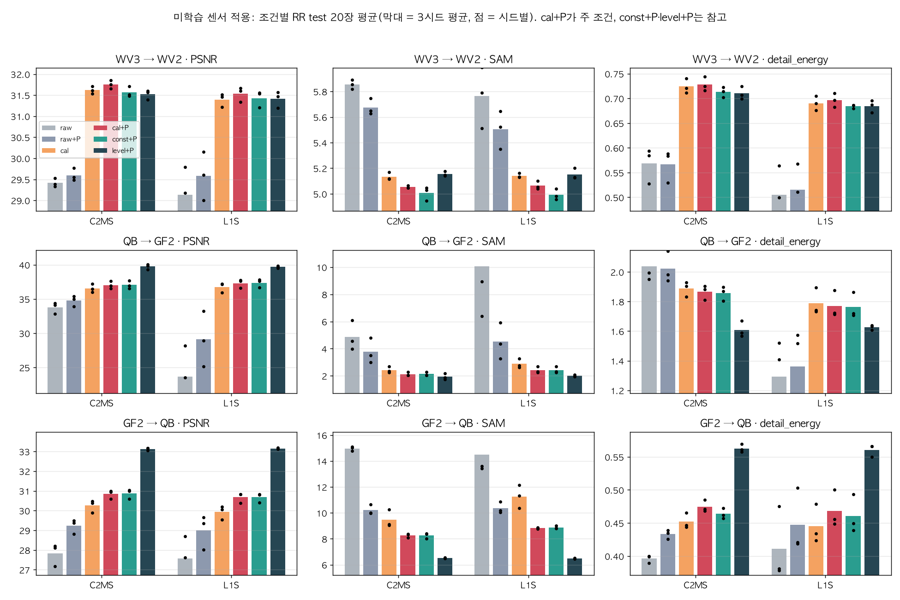

## 6. 결과 이미지

WV2 고정 6장면(0-based 0·1·3·7·14·17, seed 42, RGB 밴드 [4,2,1])입니다. 원본 크기 비교는 LR MS · PAN · 기준 · 후보 · 정답과 두 오차 지도(같은 색 척도)이고, 확대 비교는 후보의 개선이 가장 큰 64×64 창을 4배 확대한 것입니다. **확대 창은 후보에 유리하게 고른 창**이므로 전체 차이는 장면 PSNR로 봅니다.

| 장면 | 현재 기준 C2MS (보정 없음) | 65번 + 사영 (보정 없음) | 65번 + 보정 + 사영 |
|---:|---:|---:|---:|
| 0 | 28.69 | 28.21 | 30.90 |
| 1 | 26.82 | 26.32 | 29.44 |
| 3 | 34.94 | 34.86 | 36.91 |
| 7 | 29.18 | 28.63 | 30.67 |
| 14 | 28.93 | 28.30 | 30.55 |
| 17 | 29.39 | 29.05 | 30.95 |

**① 현재 기준 C2MS 대 65번 + 보정 + 사영 · 장면 0**

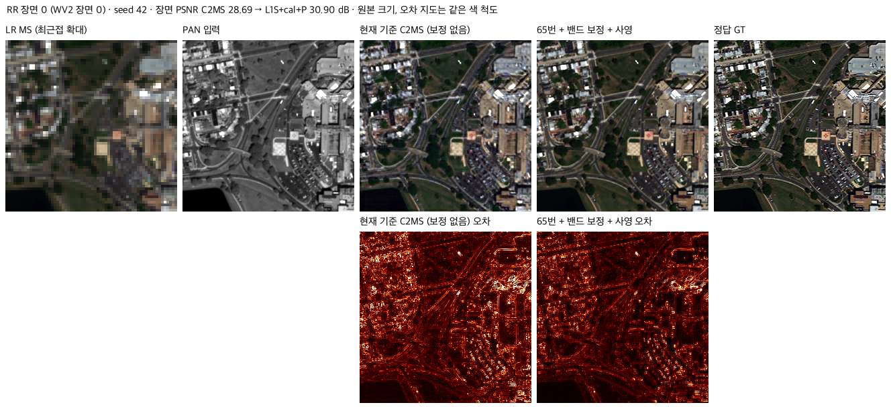

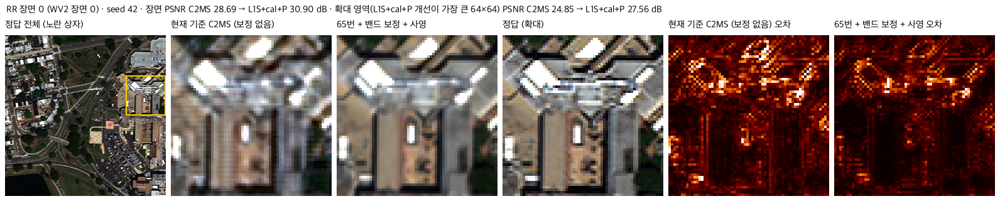

장면 1·3·7·14·17

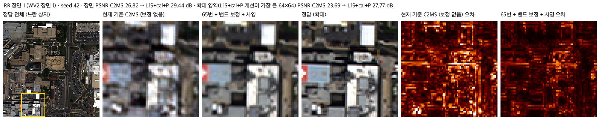

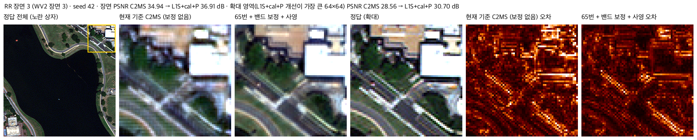

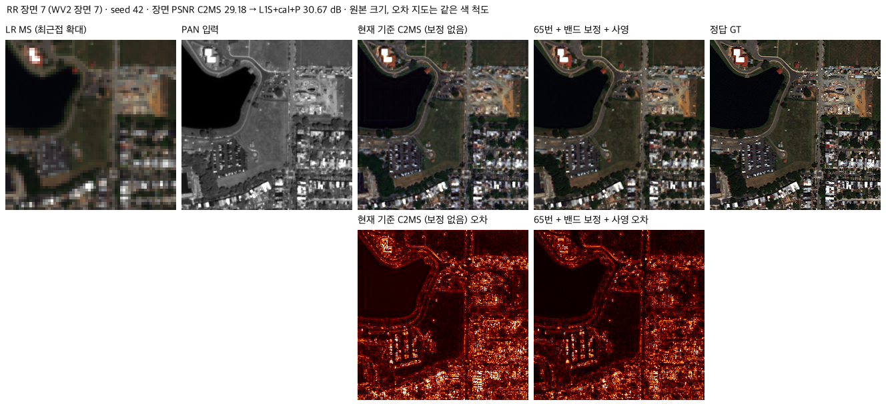

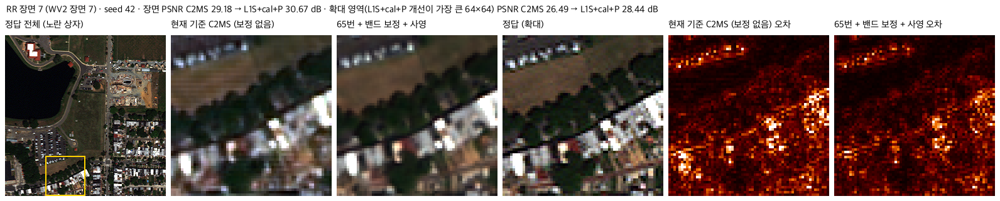

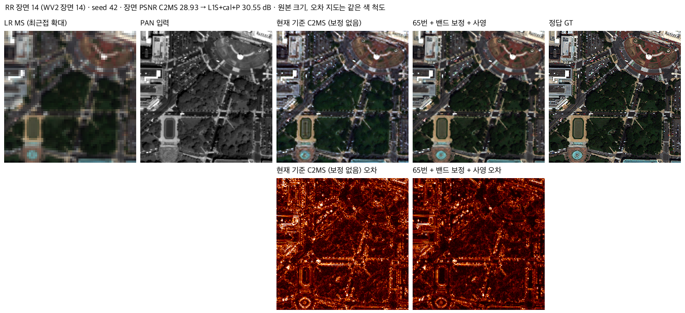

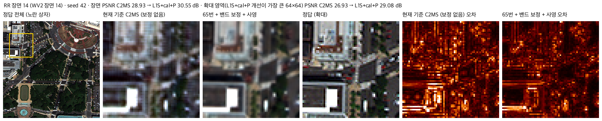

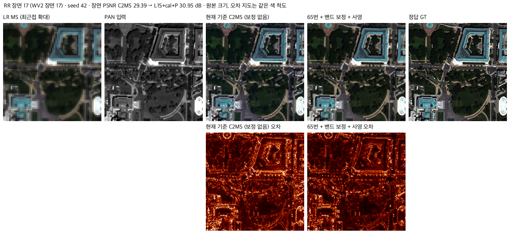

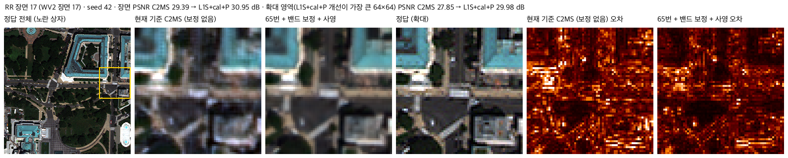

**② 65번 + 사영 (보정 없음) 대 65번 + 보정 + 사영 · 장면 7** — 보정 없는 출력은 어둡고 녹색으로 치우쳤고, 보정 뒤에는 밝기와 색이 정답에 가깝습니다.

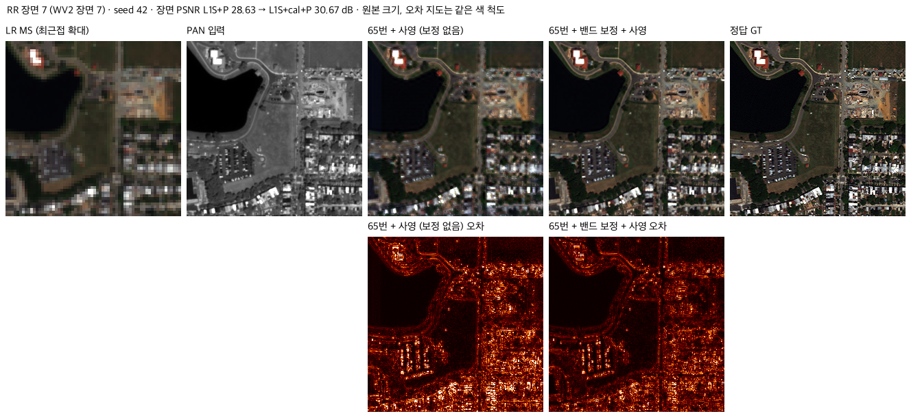

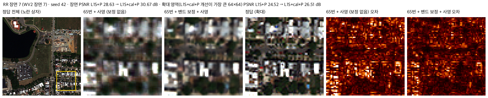

장면 0·1·3·14·17 (보정 전후)

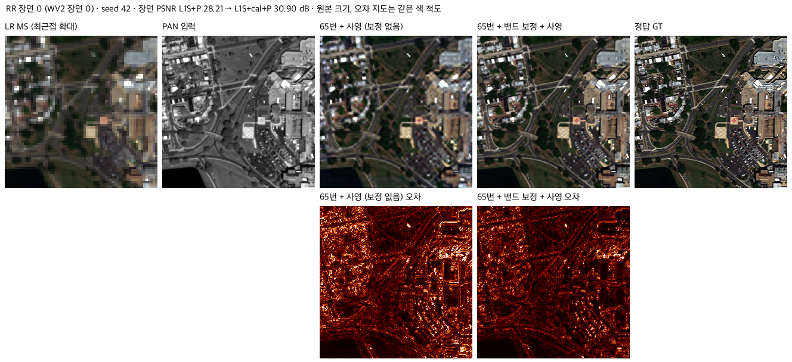

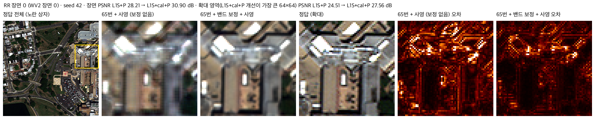

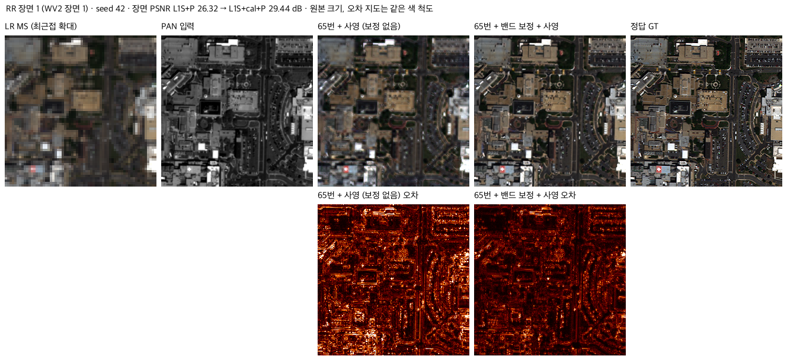

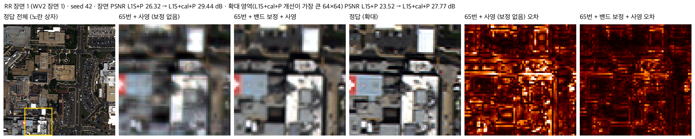

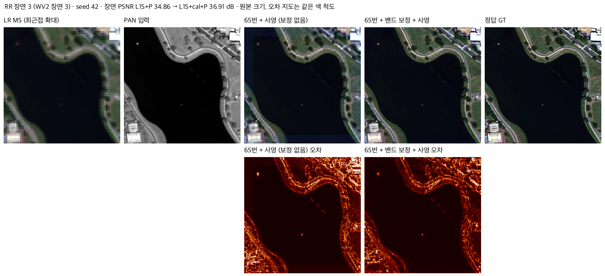

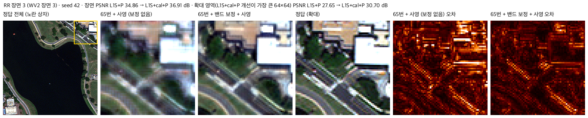

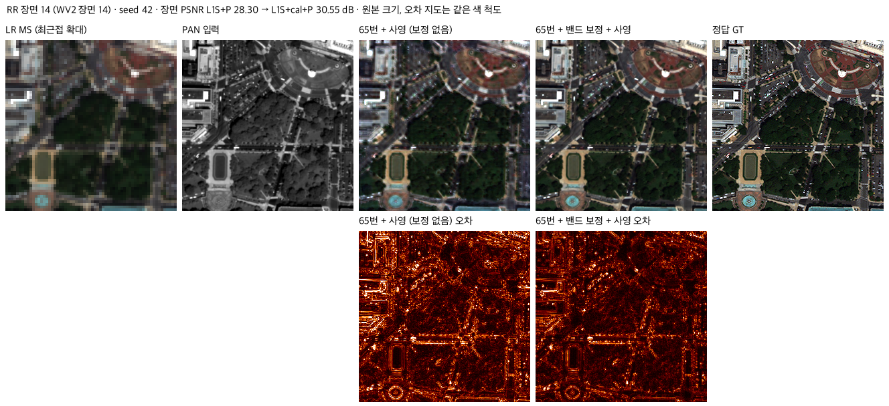

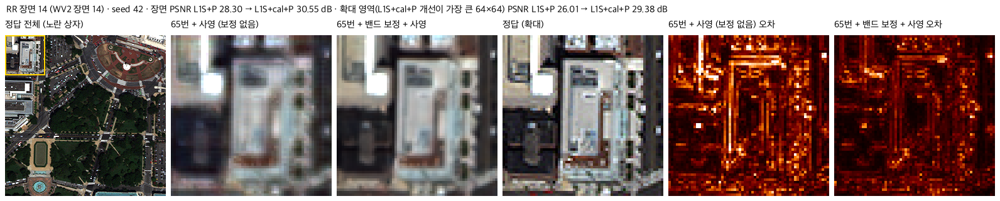

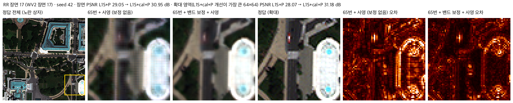

사전 진단 그림(장면 0·7, 가운데 96×96 고정 위치 확대, WV3 기준 비율을 test 입력 평균으로 계산)은 [stage0 그림](provenance/stage0/wv2_band_calibration_s42.png)에 있습니다.

## 7. 재현 자료

- [config.json](config.json): 가설, 보정 규칙, 조건, 모델 경로, 확인 규칙, 안전 규칙
- [prepare.py](prepare.py): 학습 세트 기준 비율 계산(`--stats`), 보정 모듈 `Calibrated`
- [evaluate.py](evaluate.py): 전이 쌍·모델·조건별 평가, 같은 센서 확인, 결과 이미지, `--summary`(3시드 요약·확인 규칙·그래프)
- 결과: [summary.json](results/summary.json)(3시드 평균·시드별 값·확인 규칙), `results/evaluation.json`(조건별 장면 지표), [comparison.png](results/comparison.png), `results/images/`
- `results/reference_stats/`: 학습 센서 기준 비율(QB·GF2·WV3)
- [provenance/stage0](provenance/stage0/): 사전 진단 스크립트와 요약 결과(입력 통계, PAN만 보정, 장면별 밴드 보정, 3시드 보정 비교, 다른 모델, 정답 기반 주입 관계)

## 8. 개선 여부와 다음 단계

전이 시험만 다루므로 **성능 비교 아님**입니다. 미리 정한 확인 규칙은 세 전이 쌍, 두 모델, 모든 시드에서 통과했습니다.

- 미학습 센서에서 C2MS·분광 손실 모델이 흐려지고 어두워지는 문제는 재학습 없이 밴드별 배율 보정으로 크게 줄어듭니다. 분광 손실 모델의 전이 불안정은 이 척도 의존성에서 왔습니다.
- 학습한 센서에는 적용하지 않습니다(안전 규칙).

다음 확인 항목입니다.

1. **절대 밝기 맞춤:** QB ↔ GF2에서 2.3-2.7 dB 더 좋았습니다. 정규화 최대값이 다른 센서 사이의 기본 규칙으로 쓸지는 다른 쌍에서 미리 정한 규칙으로 다시 확인해야 합니다.
2. **보고 절차:** 다른 센서 적용 결과를 보고할 때 이 보정을 함께 표시할지, 루트 README의 WV2 비교에 넣을지는 팀이 정합니다.
3. **남은 세부 부족:** 보정 뒤에도 WV2 세부 에너지는 0.70-0.73입니다. 센서 MTF 차이를 다루는 방법은 따로 설계해야 합니다.
