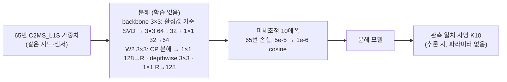

# 83. 학습된 C2MS 가중치의 저랭크·depthwise 분해와 짧은 미세조정

**연구 분야:** 성능 개선

**실험자:** 이병현

**변경 내용:** 새 구조를 처음부터 학습하지 않습니다. [65번](../65_l1_spectral_loss/README.md) C2MS_L1S의 학습된 가중치에서 출발해 원래 해상도 backbone의 3×3 합성곱을 랭크 32 병목으로, W2 가지의 3×3 합성곱을 1×1 · depthwise 3×3 · 1×1로 분해합니다. 그다음 65번 손실로 10에폭만 미세조정하고, 추론 때 [81번](../81_l1_spectral_loss_projection/README.md)의 관측 일치 사영(K10)을 붙여 같은 시드 C2MS와 비교합니다. 목표는 연산을 줄이면서 수치도 C2MS보다 좋게 만드는 것입니다.

| 확인된 결과 | 상태 | 개선 여부 |
|---|:---:|:---:|
| 아직 학습하지 않았습니다. 로컬 사전 진단(QB seed 42, test 사후 확인)에서 연산 66% 분해 모델이 짧은 미세조정으로 C2MS와 −0.045 dB까지 회복했습니다. | 계획 | 판단&nbsp;보류 |

[실험 목록](../../../research/performance/README.md) · [수치](#results) · [그래프](#graphs) · [이미지](#images) · [재현 자료](#evidence)

## 1. 목적과 상태

경량화와 수치 개선을 함께 노립니다. 지금까지 처음부터 학습한 작은 구조는 정확도를 잃었습니다. [74번](../74_backbone_matched_parallel_branch/README.md)·[75번](../75_parallel_branch_width_depth/README.md)은 W2 가지를 줄이자 −0.13에서 −0.52 dB였고, [79번](../79_deep_narrow_branch_projection/README.md)·[80번](../80_multi_sensor_deep_narrow_projection/README.md)의 64×16 가지는 QB·GF2에서는 C2MS와 비슷했지만 WV3(8밴드)에서는 이득의 54-63%만 지켰습니다. [78번](../78_seed_ensemble_distillation/README.md)의 앙상블 증류도 학생에게 거의 옮겨지지 않았습니다. 이번에는 이미 잘 학습된 가중치를 근사하는 데서 출발합니다.

### 0단계 사전 진단 (로컬, 2026-11-14)

보관 가중치로 학습 없이(또는 아주 짧게) 확인했습니다. QB seed 42이고, **test를 보고 한 사후 확인**이라 갈래를 정하는 근거로만 쓰고 판정에는 쓰지 않습니다. 자료는 [provenance/stage0](provenance/stage0/)에 있습니다.

| 바꾼 것 (53번 C2MS) | 연산 (256²) | 분해 직후 test PSNR | 미세조정 뒤 |
|---|---:|---:|---:|
| backbone을 랭크 32 병목으로 (활성값 기준 SVD) | 86% | −0.063 dB | 안 함 |
| backbone 랭크 24 | 81% | −0.262 dB | 안 함 |
| W2를 랭크 96 병목으로 | 89% | −0.248 dB | 안 함 |
| W2를 랭크 64 병목으로 | 71% | −0.731 dB | 안 함 |
| W2를 1×1 · depthwise · 1×1 (CP 랭크 384) | 80% | −0.318 dB | 안 함 |
| backbone 랭크 32 + W2 CP 384 | 66% | −0.400 dB | **−0.045 dB** (batch 16 × 750스텝, 약 0.7에폭) |
| backbone 랭크 32 + W2 CP 256 | 51% | −1.186 dB | −0.190 dB (250스텝에서 중단) |

- 원래 해상도 backbone은 랭크를 절반으로 줄여도 거의 그대로입니다. W2 가지는 랭크가 꽉 차 있어 병목으로는 줄일 수 없지만, depthwise 형태(CP 분해)로 바꾸면 짧은 미세조정으로 회복됩니다.
- 65번 C2MS_L1S 가중치에서도 분해 직후 손실은 같은 양상이었습니다(backbone 랭크 32 −0.048 dB, W2 랭크 96 −0.264 dB).
- depthwise 블록을 처음부터 학습해 W2 출력을 흉내 내게 한 간이 실험은 일반 블록보다 훨씬 느리게 수렴했습니다(1,500스텝 뒤 −4.08 dB, 일반 블록 −2.36 dB). 처음부터 학습하지 않고 분해에서 출발하는 이유입니다.

**가설:** 65번 가중치를 분해하고 65번 손실로 짧게 미세조정하면, 연산 51-86%에서 65번과 같은 validation 정확도를 되찾습니다. 여기에 사영을 붙이면 81번처럼 같은 시드 C2MS보다 RR 세 지표가 좋아집니다.

**상태(2026-11-14):** 계획과 코드를 등록했습니다. 아직 학습하지 않았습니다.

## 2. 변경한 구조와 비교 조건

SSA 3단계, decoder, 입력 처리는 바꾸지 않습니다.

| 갈래 | backbone (64채널 3×3 여덟 개) | W2 가지 (128채널 3×3 열여섯 개) | 미세조정 | 연산 (QB 256²) | 실사용 파라미터 |
|---|---|---|---:|---:|---:|
| C2MS (53·54번, 공식 대조군) | 그대로 | 그대로 | 없음 | 59.63 GMAC | 2,735,610 |
| FT0 (대조군) | 그대로 | 그대로 | 10에폭 | 59.63 GMAC | 2,735,610 |
| K1 | 랭크 32 | 그대로 | 10에폭 | 51.04 GMAC (86%) | 2,604,538 |
| **K2** | 랭크 32 | CP 랭크 384 | 10에폭 | **39.06 GMAC (66%)** | 1,873,402 |
| K3 | 랭크 32 | CP 랭크 256 | 10에폭 | 30.17 GMAC (51%) | 1,330,682 |
| K2L | K2와 같음 | K2와 같음 | 40에폭 | 39.06 GMAC (66%) | 1,873,402 |

- **backbone 분해:** QB 학습 패치 512장(고정 난수)에서 각 합성곱 입력의 3×3 이웃 벡터의 2차 모멘트를 구하고, 그 위에서 출력 오차가 가장 작은 랭크 32 근사를 SVD로 구합니다.
- **W2 분해:** 가중치 텐서(출력 128 × 입력 128 × 3×3)를 CP 분해(교대 최소제곱 150회, 난수 0)해 1×1 · depthwise 3×3 · 1×1 세 층으로 옮깁니다. 데이터는 쓰지 않습니다.
- **FT0:** 분해 없이 같은 미세조정만 합니다. 미세조정 자체의 효과와 분해의 효과를 나눕니다.
- **K2L:** 미세조정 길이(10 대 40에폭)의 효과를 봅니다. QB는 학습을 늘리면 validation은 오르고 test는 내려간 전례([59번](../59_extended_cosine_training/README.md), [73번](../73_l1_step_learning_rate_schedule/README.md))가 있어 기본은 짧게 둡니다.
- **계획에서 뺀 갈래:** 사영을 넣은 채 미세조정하는 갈래는 하지 않습니다. 평가 사영은 가장자리 MS 5픽셀을 빼는데, 64×64 학습 패치(MS 16×16)에서는 가운데 6×6만 남아 학습 때의 정의가 추론과 달라지기 때문입니다.

| 항목 | 내용 |
|---|---|
| 데이터 | QB·GF2·WV3 학습·validation·test(각 20장면 RR·FR). WV3 모델은 WV2 test에도 적용(참고). 캐시는 H5에서 다시 만들고 63번(QB)·65번 3단계(GF2·WV3) 해시와 대조 |
| 손실 | 65번과 같음: 원래 쌍 L1 + 1.0 × 2배 거친 쌍 L1 + 0.46 × 분광 손실 |
| 학습 | Adam 5e-5 → 1e-6 cosine, 10에폭(K2L 40), batch 32, FP16 AMP, 서버 RTX 3060 Ti에서 두 개씩 동시 학습 |
| 가중치 선택 | 원래 축척 validation MSE 최소. 0에폭(분해 직후, FT0는 65번 그대로)도 후보에 포함 |
| 사영 | 81번 사영을 공액 기울기법 10회에서 멈춘 K10. 81번에서 기본 사영과 0.0003 dB 이내였습니다 |
| 대조군 | 같은 시드 C2MS(QB 53번, GF2·WV3 54번), 65번(분해 전 가중치), 원본 C0(이득 유지율) |

| 단계 | 실행 | 다음 단계 조건 (학습 전 고정) |
|---|---|---|
| 1 선별 | QB·WV3 seed 42, 다섯 갈래 | **validation만 씁니다.** 두 센서 모두에서 선택 가중치가 같은 시드 65번보다 validation PSNR −0.04 dB 이상, SAM +0.02° 이하인 갈래 가운데 가장 가벼운 것(K3 → K2 → K2L → K1 순)을 고릅니다. 통과한 갈래가 없으면 2단계를 하지 않습니다 |
| 2 확장 | 고른 갈래, QB·GF2·WV3 × seed 42-44 (1단계 실행 재사용) | 같은 시드 C2MS와 짝지은 센서별 3시드 평균, v2.4 |
| 3 (선택) | 고른 구조를 처음부터 150에폭 학습(QB seed 42) | 2단계 뒤 사용자 결정. 구조 자체와 초기값의 효과를 나눕니다 |

| 비교 | 의미 |
|---|---|
| **갈래 + 사영 대 같은 시드 C2MS** | 공식 판정(v2.4, RR만, 센서별 3시드 평균, 문턱 0.04 dB). QB·GF2·WV3가 모두 개선일 때만 실험 전체를 개선으로 표기합니다 |
| 갈래 + 사영 대 65번 + 사영 | 분해의 손실. 3시드 평균 −0.04 dB 이상이면 "경량 비열등"으로 참고 표기합니다(판정 아님) |
| 갈래 대 FT0 (1단계) | 미세조정만의 효과를 뺀 분해의 효과 |
| 갈래 + 사영 대 C2MS + 사영 | 사영을 양쪽에 붙인 공정 비교 |
| WV2 전이 | 참고만 합니다 |
| 비용 | 실사용 파라미터, 256² 합성곱 연산량, GPU 시간(256²·512², 사영 유무). depthwise는 연산량만큼 빨라지지 않을 수 있어 실제 시간을 함께 보고합니다 |

## 3. 정량 결과

아직 학습하지 않았습니다.

## 4. 기준선 대비 차이와 해석

아직 학습하지 않았습니다. 미리 밝혀 둘 한계는 다음과 같습니다.

- 0단계 수치는 QB seed 42에서 test를 보고 한 사후 확인입니다. 갈래 설계에만 썼고, 1단계 관문은 validation으로 정합니다.
- QB에서 65번 + 사영의 이득은 +0.072 dB라, 분해로 0.03 dB만 잃어도 문턱(0.04 dB) 근처가 됩니다. 이 경우 "경량 비열등"만 성립할 수 있습니다.
- WV3(8밴드)에서 같은 분해가 통하는지는 확인하지 않았습니다. 80번에서 가지를 줄인 손해가 WV3에서 특히 컸습니다.

## 5. 학습·평가 그래프

아직 학습하지 않았습니다. 실행마다 학습 L1, validation PSNR·SAM(0에폭은 분해 직후)과 C2MS·65번 validation 기준선을 `results/<센서>_<갈래>_s<시드>/evaluation/learning.png`에 남깁니다.

## 6. 결과 이미지

아직 학습하지 않았습니다. seed 42에서 고정 6장면(0-based 0·1·3·7·14·17)의 원본 크기 비교와 확대 비교(현재 기준 C2MS 대 갈래 + 사영)를 `common/result_images.py`로 만듭니다. 확대 창은 후보에 유리한 곳이므로 장면 PSNR과 함께 봅니다.

## 7. 재현 자료

- [config.json](config.json): 가설, 0단계 근거, 갈래, 학습 설정, 관문(validation만), 비교, 데이터 해시
- [model.py](model.py): 분해 구조(`Model`), 활성값 기준 SVD(`svd_factor`), CP 분해(`cp_factor`), `factorize`
- [train.py](train.py): 58번 학습기에 65번 L1 치환과 분해 초기값 불러오기를 적용
- [prepare.py](prepare.py): 79번 센서 연산과 K10 사영
- [evaluate.py](evaluate.py): 실행별 평가(대조군은 센서·시드별로 한 번만 계산), validation 관문, 3시드 요약
- [run.py](run.py): 서버 실행 순서. `prepare`(캐시 재생성·해시 대조) → `factorize`(분해 초기값, 해시 봉인) → `optimize`(벤치마크·사전 점검) → `run`(1단계 → 관문 → 2단계 → 요약)
- [provenance/stage0](provenance/stage0/): 0단계 진단 스크립트와 결과(`lowrank.py`, `cp_test.py`, `ft_test.py`, `branch_mimic.py`, `arch_count.py`와 JSON·로그)

## 8. 개선 여부와 다음 단계

아직 판단하지 않았습니다(판단 보류). 2단계까지 마치면 센서별 3시드 평균으로 v2.4 판정을 하고, 기준 모델 교체 여부는 비용과 함께 팀이 정합니다.
