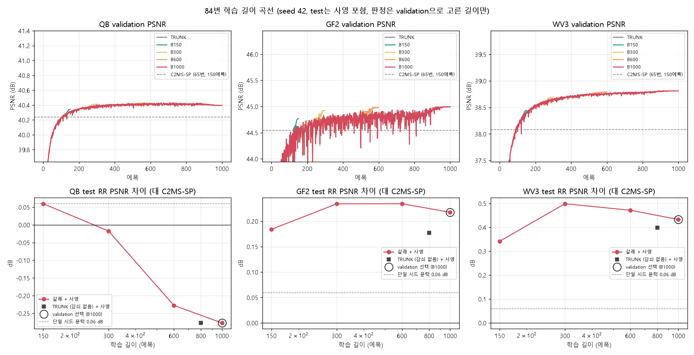
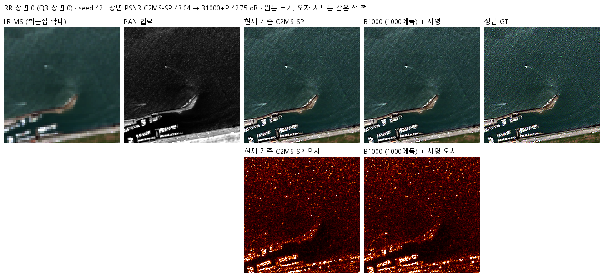
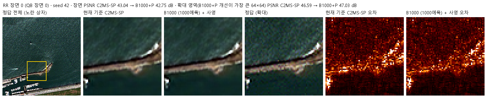
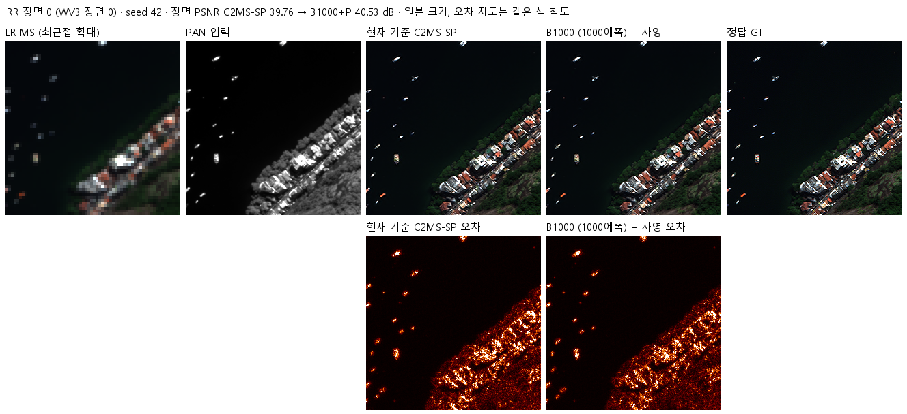
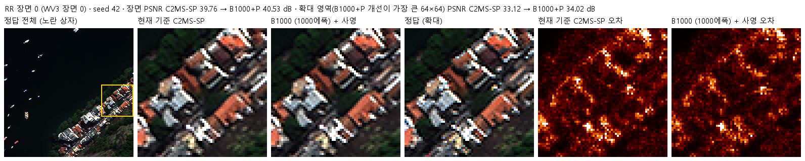

# 84. C2MS-SP 학습 길이 확장: 일정 학습률 학습과 감쇠 갈래로 150-1000에폭 한계 측정

| 분야 | 실험자 | 상태 | 판정 |
|:---:|:---:|:---:|:---:|
| 성능 개선 | 이병현 | 평가 완료 · seed 42 | **부분 개선** |

**변경:** 기준 모델 C2MS-SP의 구조·손실·사영은 그대로 두고 학습 길이와 학습률 일정만 바꿨습니다. 센서마다 학습률 1e-4로 고정한 긴 학습(TRUNK, 800에폭)을 하나 돌리고, 120·240·480·800에폭 지점의 전체 학습 상태에서 갈래를 내어 남은 20% 동안 학습률을 1e-4에서 1e-6으로 cosine 감쇠해 150·300·600·1000에폭 모델을 만들었습니다. 센서마다 validation으로 고른 길이 + 사영을 같은 시드 C2MS-SP(150에폭)와 비교했습니다(QB·GF2·WV3 seed 42, WV2 전이는 참고).

**결과:** validation은 세 센서 모두 1000에폭(B1000)을 골랐습니다. C2MS-SP 대비 test RR은 GF2 +0.218 dB·SAM −0.026°·ERGAS −0.019, WV3 +0.433 dB·−0.108°·−0.100으로 개선이었지만, QB는 −0.277 dB·+0.097°·+0.119로 개선 없음이었습니다(20장 중 PSNR이 좋아진 장면 0장). QB는 학습을 늘릴수록 validation은 오르고 test는 내려갔습니다. 같은 150에폭에서 일정만 바꾼 B150은 세 센서 모두 C2MS-SP보다 좋았습니다(QB +0.060 dB, GF2 +0.184 dB, WV3 +0.342 dB). seed 42 한 개라 기준 모델은 바꾸지 않습니다.

[실험 표](../README.md#experiments) · [결과](#results) · [해석과 판정](#verdict) · [방법](#method) · [그림](#figures) · [재현 자료](#evidence)

## 결과

모든 test 수치는 RR 20장면 평균이고, 갈래·TRUNK와 C2MS-SP 모두 K10 사영을 붙인 값입니다. 대조군 C2MS-SP는 65번 `C2MS_L1S_<센서>_s42` + 사영입니다. 전체 수치는 [summary.json](results/summary.json)과 실행별 `results/<센서>_<갈래>_s42/`에 있습니다.

### 판정 (validation으로 고른 길이 + 사영 대 C2MS-SP, seed 42)

| 센서 | 고른 길이 (best 에폭) | C2MS-SP PSNR / SAM / ERGAS | 후보 PSNR / SAM / ERGAS | 차이 | 좋아진 장면 PSNR · SAM | 판정 |
|---|:---:|---|---|---|:---:|:---:|
| QB | B1000 (731) | 38.396 / 4.465 / 3.674 | 38.119 / 4.562 / 3.793 | −0.277 / +0.097 / +0.119 | 0 · 1 | 개선 없음 |
| GF2 | B1000 (918) | 48.733 / 0.768 / 0.696 | 48.950 / 0.742 / 0.677 | +0.218 / −0.026 / −0.019 | 19 · 20 | **개선** |
| WV3 | B1000 (816) | 38.663 / 2.989 / 2.241 | 39.096 / 2.881 / 2.141 | +0.433 / −0.108 / −0.100 | 20 · 20 | **개선** |
| WV2 전이 (참고) | WV3의 B1000 | 31.335 / 5.100 / 3.750 | 31.763 / 4.945 / 3.542 | +0.428 / −0.155 / −0.208 | — | (개선) |

WV2 전이는 두 모델 모두 82번 밴드별 보정 + 사영입니다. QB의 B1000은 감쇠 구간에서 validation이 더 나아지지 않아 TRUNK의 731에폭 가중치가 그대로 선택됐습니다.

### 학습 길이 곡선 (판정 아님)

| 센서 | 갈래 | best 에폭 | validation PSNR 차이 (대 65번) | test RR 차이 (대 C2MS-SP) PSNR / SAM / ERGAS | FR QNR (참고) |
|---|---|:---:|---:|---|---:|
| QB | B150 | 150 | +0.106 | +0.060 / +0.002 / −0.022 | 0.901 |
| QB | B300 | 300 | +0.174 | −0.017 / +0.047 / +0.013 | 0.878 |
| QB | B600 | 550 | +0.191 | −0.228 / +0.090 / +0.098 | 0.860 |
| QB | B1000 | 731 | +0.193 | −0.277 / +0.097 / +0.119 | 0.852 |
| QB | TRUNK (감쇠 없음) | 731 | +0.193 | −0.277 / +0.097 / +0.119 | 0.852 |
| GF2 | B150 | 150 | +0.224 | +0.184 / −0.017 / −0.015 | 0.963 |
| GF2 | B300 | 297 | +0.380 | +0.234 / −0.024 / −0.019 | 0.964 |
| GF2 | B600 | 567 | +0.440 | +0.234 / −0.028 / −0.020 | 0.965 |
| GF2 | B1000 | 918 | +0.445 | +0.218 / −0.026 / −0.019 | 0.965 |
| GF2 | TRUNK (감쇠 없음) | 723 | +0.370 | +0.177 / −0.023 / −0.015 | 0.964 |
| WV3 | B150 | 150 | +0.367 | +0.342 / −0.093 / −0.088 | 0.946 |
| WV3 | B300 | 295 | +0.618 | +0.499 / −0.127 / −0.122 | 0.931 |
| WV3 | B600 | 538 | +0.704 | +0.472 / −0.121 / −0.112 | 0.921 |
| WV3 | B1000 | 816 | +0.701 | +0.433 / −0.108 / −0.100 | 0.918 |
| WV3 | TRUNK (감쇠 없음) | 787 | +0.711 | +0.398 / −0.093 / −0.091 | 0.914 |

C2MS-SP의 FR QNR(참고)은 QB 0.913, GF2 0.962, WV3 0.948입니다.

### 학습률 일정 확인 (B150 대 65번, 둘 다 150에폭, 사영 없이)

| 센서 | 65번 | B150 | 차이 PSNR / SAM / ERGAS |
|---|---:|---:|---|
| QB | 38.351 | 38.415 | +0.064 / +0.001 / −0.024 (부분 개선) |
| GF2 | 48.640 | 48.834 | +0.193 / −0.017 / −0.016 (개선) |
| WV3 | 38.586 | 38.948 | +0.362 / −0.097 / −0.093 (개선) |

## 해석과 판정

- **GF2·WV3는 학습을 늘리면 좋아졌습니다.** 모든 길이가 C2MS-SP보다 좋았고, test는 300-600에폭에서 가장 높았습니다(GF2 +0.234 dB, WV3 +0.499 dB). validation은 1000에폭까지 조금씩 올라 B1000을 골랐는데, test에서는 최고점보다 GF2 0.016 dB, WV3 0.066 dB 낮았습니다.
- **QB는 validation과 test가 반대로 움직였습니다.** validation은 731에폭까지 올랐지만(+0.193 dB) test는 150에폭 뒤로 계속 내려가 1000에폭에서 −0.277 dB였고, FR QNR도 0.913에서 0.852로 내려갔습니다. 이전 C2MS 300에폭([59번](../59_extended_cosine_training/README.md))과 L1 360에폭([73번](../73_l1_step_learning_rate_schedule/README.md))에서 본 것과 같은 방향입니다. QB에서는 validation으로 학습 길이를 고르면 test가 나빠집니다.
- **같은 150에폭에서도 일정이 결과를 바꿨습니다.** 고정 학습률 120에폭 + 감쇠 30에폭(B150)이 1e-4 → 1e-6 cosine 150에폭(65번)보다 세 센서 모두 좋았습니다(사영 없이 QB +0.064, GF2 +0.193, WV3 +0.362 dB). 학습 비용은 같습니다.
- 감쇠 없이 멈춘 TRUNK는 같은 길이의 감쇠 갈래보다 GF2·WV3에서 0.04-0.06 dB 낮았습니다.

### 판정과 다음 단계

**부분 개선**입니다. 미리 정한 비교(validation으로 고른 길이 + 사영 대 같은 시드 C2MS-SP, v2.4 단일 시드 문턱 0.06 dB)에서 GF2와 WV3는 세 지표가 모두 좋아지고 PSNR 이득이 문턱을 넘어 개선이었지만, QB는 세 지표가 모두 나빠져 개선 없음이었습니다. seed 42 한 개라 기준 모델은 바꾸지 않습니다.

한계와 다음에 확인할 것:

- 단일 시드입니다. 시드 간 편차를 모릅니다.
- B150은 학습 비용이 C2MS-SP와 같으면서 세 센서 모두 좋았습니다(QB는 SAM이 0.002° 나빠 부분 개선). 학습률 일정만 바꾼 B150을 3시드로 확인하는 실험을 제안합니다.
- QB에서는 validation이 test를 대표하지 못했습니다. 길이를 센서별로 고르려면 QB용 선택 기준(예: 150에폭 고정)을 미리 정해야 합니다.

<b>방법</b> · 목적과 상태 · 변경한 구조와 비교 조건

### 목적과 상태

C2MS-SP(65번 가중치 + K10 사영)는 150에폭 cosine 학습에서 best 에폭이 QB·GF2·WV3 모든 시드에서 144-148이었습니다. 학습 끝까지 validation이 오르고 있었습니다. 이전 기준 C2MS(MSE 손실)를 300에폭으로 늘린 59번에서는 GF2 +0.205 dB·WV3 +0.366 dB였지만 QB −0.284 dB, WV2 전이 −1.760 dB였습니다. L1 손실 360에폭(73번)도 QB에서 이득이 없었습니다. 현재 기준 모델의 손실로는 150에폭보다 길게 학습한 적이 없었습니다.

이 실험은 같은 모델·손실을 1000에폭까지 학습해 다음 두 가지를 확인했습니다.

1. 센서마다 몇 에폭에서 validation과 test가 포화되는지(학습 길이 곡선)
2. validation으로 고른 학습 길이가 C2MS-SP(150에폭)보다 RR 세 지표가 좋아지는지

**상태:** 평가 완료입니다. 2026-11-14 22:11 KST에 QB TRUNK부터 시작해 2026-11-18 04:19에 WV3 B1000 평가와 요약까지 마쳤습니다. 시작 전 캐시는 63·65번 기록과 비트 단위로 같았고, 2에폭짜리 사전 시험으로 갈래 이어받기·감쇠·평가를 확인했습니다. 2026-11-15 서버 재시작 뒤 저장 지점에서 이어서 학습했습니다.

### 변경한 구조와 비교 조건

기준선 C2MS-SP → 변경 위치: 학습률 일정과 학습 길이 → 바꾼 연산: 고정 학습률 TRUNK + 감쇠 갈래(WSD, warmup-stable-decay) → 기대 효과: 한 번의 긴 학습에서 여러 학습 길이의 결과를 얻습니다.

| 갈래 | 구성 | 총 에폭 |
|---|---|---:|
| TRUNK | 학습률 1e-4 고정 | 800 |
| B150 | TRUNK 120에폭 + 감쇠 30에폭 | 150 |
| B300 | TRUNK 240에폭 + 감쇠 60에폭 | 300 |
| B600 | TRUNK 480에폭 + 감쇠 120에폭 | 600 |
| B1000 | TRUNK 800에폭 + 감쇠 200에폭 | 1000 |

갈래는 TRUNK가 해당 에폭을 마친 순간의 가중치·Adam 상태·GradScaler·난수·데이터 순서 생성기·best 기록을 그대로 이어받습니다. 그래서 각 갈래는 그 길이로 한 번 학습한 결과와 같습니다. 감쇠 구간의 학습률은 C2MS-SP와 같은 cosine 식 `1e-6 + 0.5 (1e-4 − 1e-6)(1 + cos(π j / (D − 1)))`를 감쇠 에폭 D에 맞춘 것입니다. 처음부터 네 번 학습하면 센서당 2,050에폭이 들지만 이 방식은 1,210에폭입니다.

| 항목 | C2MS-SP (대조군) | 이 실험 |
|---|---|---|
| 구조 | C2MS (원본 SSA-MRN K4 + W2 병렬 가지) | 같음 |
| 손실 | L1 + 거친 쌍 L1 + 0.46 × 분광 손실 | 같음 |
| 학습률 | Adam, 1e-4 → 1e-6 cosine 150에폭 | TRUNK 1e-4 고정, 갈래 끝 20% 감쇠 |
| 학습 길이 | 150에폭 | 150·300·600·1000에폭 |
| 배치·정밀도 | 32, FP16 AMP | 같음 |
| 가중치 선택 | validation MSE 최소(0에폭 포함) | 같음(갈래 자신의 경로 0-N에폭) |
| 추론 | K10 사영 (WV2는 82번 밴드 보정 + 사영) | 같음 |
| 데이터 | PanCollection QB·GF2·WV3 학습·validation, test RR·FR 각 20장 | 같음 |
| 시드 | 42 (대조군 가중치: 65번 `C2MS_L1S_<센서>_s42`) | 42 |

**학습 길이 선택 규칙(학습 전에 고정):** 센서마다 네 갈래 중 선택된 validation MSE가 가장 작은 갈래(같으면 짧은 쪽)를 고릅니다. 그 갈래 + 사영만 test에서 C2MS-SP와 비교해 판정합니다. 나머지 길이는 판정 없이 곡선으로 보고합니다.

**일정 확인:** B150과 C2MS-SP는 둘 다 150에폭이고 학습률 일정만 다릅니다. B150 대 65번(사영 없이)의 차이로 일정 자체의 영향을 확인합니다.

**실행:** 서버 RTX 3060 Ti에서 두 작업을 함께 돌렸습니다. 첫 번째 줄은 TRUNK를 QB → GF2 → WV3 순서로 하나씩 학습하고, 두 번째 줄은 저장 지점이 생기는 대로 갈래를 학습하고 끝난 학습을 평가했습니다.

<b>그림</b> · 학습·평가 그래프 · 결과 이미지

### 학습·평가 그래프

위는 TRUNK와 갈래의 에폭별 validation PSNR(점선은 C2MS-SP의 65번 가중치), 아래는 학습 길이별 test RR PSNR 차이(대 C2MS-SP, 사영 포함)입니다. 동그라미는 validation으로 고른 길이입니다.

### 결과 이미지

고정 6장면(0-based 0·1·3·7·14·17)에서 현재 기준 C2MS-SP와 validation으로 고른 B1000 + 사영을 비교했습니다. 확대 비교는 후보의 개선이 가장 큰 64×64 창을 4배 확대한 것이라 후보에 유리하게 골라졌습니다. 서버 CPU에서 `common/result_images.py`로 만들었습니다.

| 장면 PSNR (C2MS-SP → B1000 + 사영, dB) | 0 | 1 | 3 | 7 | 14 | 17 |
|---|---|---|---|---|---|---|
| QB | 43.04 → 42.75 | 43.31 → 43.23 | 38.10 → 37.95 | 39.71 → 39.36 | 38.56 → 38.27 | 39.62 → 39.39 |
| GF2 | 47.79 → 48.21 | 49.43 → 49.73 | 49.85 → 50.12 | 50.78 → 51.08 | 48.04 → 48.21 | 49.63 → 49.70 |
| WV3 | 39.76 → 40.53 | 37.49 → 38.36 | 41.78 → 42.34 | 38.46 → 38.74 | 33.52 → 33.75 | 36.12 → 36.38 |

**QB 장면 0**

**WV3 장면 0**

나머지 장면과 GF2는 [results/images](results/images/)에 있습니다.

<b>재현 자료</b> · 코드, 가중치, 설정, 실행 기록

- 설정: [config.json](config.json)
- 코드: [model.py](model.py) · [train.py](train.py)(65번 학습 코드 + 일정·저장 지점 치환) · [run.py](run.py)(캐시 생성·두 줄 실행) · [evaluate.py](evaluate.py)(평가·요약) · [prepare.py](prepare.py)
- 가중치: `checkpoints/<센서>_<갈래>_s42/best.pt`(선택 가중치)와 `best_ema.pt`(EMA 기록)는 Git에, 재개용 `latest.pt`와 TRUNK의 `initial.pt`는 GitHub Release `weights-experiments-performance-84`에 있고 [manifest.json](manifest.json)의 `release_assets`에 크기·SHA-256이 있습니다.
- 결과: [summary.json](results/summary.json)(학습 길이 곡선과 판정), 실행별 `history.json`·`training_complete.json`·`evaluation_complete.json`·`evaluation/<대상>_v2_4.json`(장면별 RR·FR), `branch_init.json`(갈래가 이어받은 TRUNK 상태), [results/controls](results/controls/)(C2MS-SP 대조군 장면별 수치)
- 실행 기록: [provenance/run_records](provenance/run_records/)(봉인된 실행 설정, 데이터 해시, 환경, 사전 점검), [provenance/source_manifest.json](provenance/source_manifest.json)(서버에 올린 소스 해시), [provenance/server_cleanup.json](provenance/server_cleanup.json)
- 보관 해시 확인: `python SSA-MRN/common/verify.py --experiment 84 --releases`

