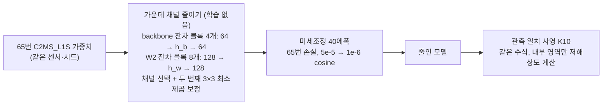
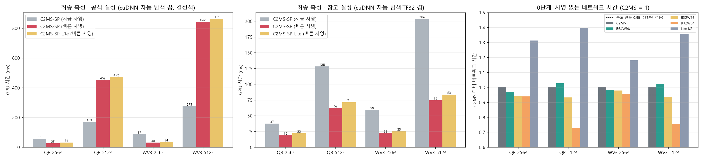
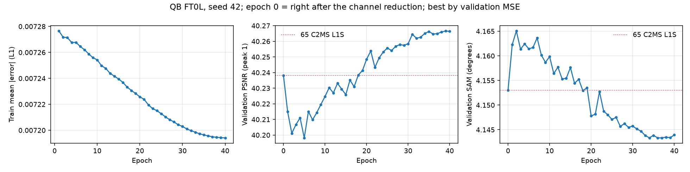
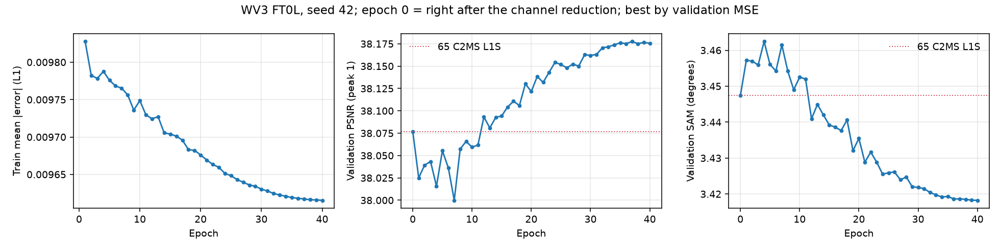
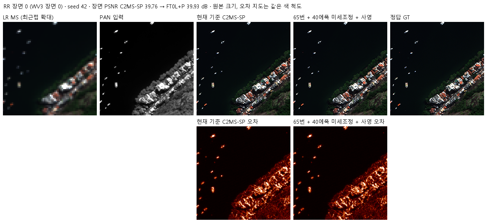
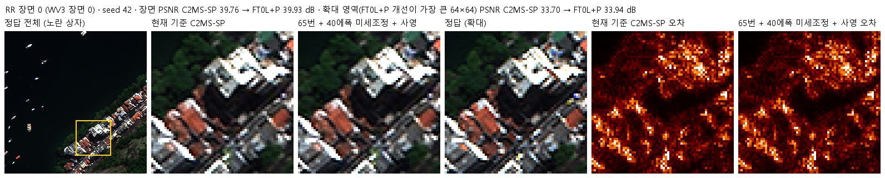

# 85. C2MS-SP 잔차 블록의 가운데 채널 축소·40에폭 미세조정과 빠른 사영 구현

| 분야 | 실험자 | 상태 | 판정 |
|:---:|:---:|:---:|:---:|
| 성능 개선 | 이병현 | 평가 완료 · seed 42 | **성능 비교 아님** |

**변경:** [65번](../65_l1_spectral_loss/README.md) C2MS_L1S(C2MS-SP의 네트워크) 가중치에서 출발해 backbone(64)·W2(128) 잔차 블록의 가운데 채널을 줄인 일반 3×3 합성곱 구조 세 가지(B64W96·B32W96·B32W64, 연산 51-84%)를 만들고, 학습 전 시간 관문을 통과한 갈래만 65번 손실로 40에폭 미세조정할 계획이었습니다. 추론의 관측 일치 사영(공액 기울기법 10회, K10)은 수식·반복·정밀도를 그대로 두고 사영이 실제로 쓰는 내부 영역만 저해상도에서 계산하도록 구현을 바꿨습니다. 대조군은 같은 시드 C2MS-SP입니다.

**결과:** 축소 갈래 셋은 모두 0단계 시간 관문(256²에서 C2MS보다 5% 이상 빠름)을 통과하지 못해 학습하지 않았습니다. 연산을 절반으로 줄인 B32W64도 256² 네트워크 시간이 QB 94%, WV3 96%였습니다(512²에서는 73-75%). 빠른 사영은 모든 test 장면에서 지금 사영과 같은 결과(최대 차이 1.3e-14)를 냈고, C2MS-SP의 256² 추론 시간을 QB 55.9 → 24.9 ms, WV3 87.1 → 30.2 ms로 줄였습니다. 다만 cuDNN 자동 탐색을 끈 공식 설정에서는 512²의 전치 합성곱이 매우 느려져(QB 452 ms) 지금 구현보다 느렸고, 자동 탐색을 켜면 512²도 빨랐습니다(QB 128 → 62 ms). 대조군으로 학습한 FT0L(65번 + 40에폭 미세조정)은 참고로 C2MS-SP 대비 QB +0.007 dB, WV3 +0.105 dB였습니다(seed 42). 판정할 후보가 없어 성능 비교 아님으로 적습니다.

[실험 표](../README.md#experiments) · [결과](#results) · [해석과 판정](#verdict) · [방법](#method) · [그림](#figures) · [재현 자료](#evidence)

## 결과

GPU 시간은 서버 RTX 3060 Ti에서 batch 1, test 장면 0으로 쟀습니다. 공식 설정은 float32, TF32 끔, cuDNN 결정적 모드·자동 탐색 끔(81번과 같음)이고, 예열 5회 뒤 50회의 중앙값을 시스템을 번갈아 세 번 잰 중앙값입니다. 전체 값은 [stage0_timing.json](results/stage0_timing.json), [final_timing.json](results/final_timing.json)에 있습니다.

### 0단계: 축소 구조의 시간 관문 (사영 없는 네트워크, 공식 설정)

| 구조 | 연산 (QB 256²) | QB 256² | WV3 256² | 관문 (둘 다 0.95 이하) | QB 512² | WV3 512² |
|---|---:|---:|---:|:---:|---:|---:|
| C2MS (65번) | 59.63 GMAC | 18.96 ms | 22.97 ms | 기준 | 55.07 ms | 61.17 ms |
| B64W96 | 49.97 GMAC (84%) | 0.968 | 0.984 | 탈락 | 1.026 | 1.023 |
| B32W96 | 40.30 GMAC (68%) | 0.941 | 0.978 | 탈락 | 0.931 | 0.937 |
| B32W64 | 30.64 GMAC (51%) | 0.939 | 0.957 | 탈락 | 0.730 | 0.754 |
| C2MS-SP-Lite K2 (참고) | 39.06 GMAC (66%) | 1.312 | 1.180 | — | 1.398 | 1.354 |

축소 구조의 값은 C2MS 대비 시간 비율입니다. 관문은 학습 전에 256²로 정해 두었습니다. 축소 초기값(학습 패치 512장으로 채널 선택 + 최소제곱 보정)의 블록 잔차 출력 상대 오차는 중앙값 1.0-2.6%였습니다.

### 빠른 사영

**동일성:** 65번 3시드 출력의 QB·GF2·WV3·WV2 test RR·FR 전체(12조합 × 40장)에서 지금 사영과의 출력 차이는 최대 1.3e-14(정규화 값), test 평균 RR PSNR 차이는 최대 7.8e-14 dB였고 반복 횟수도 모두 같았습니다([projection_identity.json](results/projection_identity.json)).

**시간 (최종 측정, ms):**

| 시스템 | 설정 | QB 256² | QB 512² | WV3 256² | WV3 512² |
|---|---|---:|---:|---:|---:|
| C2MS-SP (지금 사영) | 공식 | 55.92 | 169.19 | 87.09 | 274.61 |
| C2MS-SP (빠른 사영) | 공식 | **24.91** | 451.57 | **30.24** | 841.76 |
| C2MS-SP (지금 사영) | 자동 탐색·TF32 (참고) | 37.31 | 128.11 | 58.93 | 203.60 |
| C2MS-SP (빠른 사영) | 자동 탐색·TF32 (참고) | **18.74** | **62.11** | **22.17** | **74.50** |
| 사영 없는 C2MS | 공식 | 19.09 | 56.41 | 22.96 | 62.70 |

빠른 사영의 연산별 시간을 따로 재 보니 512²의 전치 합성곱(Dᵀ, float64, 4칸 간격)이 자동 탐색을 끄면 QB 388 ms, WV3 776 ms였고 켜면 5.2 ms, 10.3 ms였습니다([projection_op_timing.json](provenance/projection_op_timing.json)). 0단계의 512² 빠른 사영 시간(QB 67 ms, WV3 81 ms)은 자동 탐색 값과 비슷합니다. 같은 프로세스에서 앞서 자동 탐색을 켠 채 돈 동일성 점검의 알고리즘 선택이 남아 있었던 것으로 보고, 공식 설정 값으로 쓰지 않습니다. FP16 추론(참고)에서 C2MS-SP(빠른 사영)의 RR PSNR 변화는 QB +0.0002 dB, WV3 −0.0003 dB였습니다.

### FT0L 대조군 (65번 + 40에폭 미세조정 + 사영, seed 42, 참고)

| 대상 | C2MS-SP PSNR / SAM / ERGAS | FT0L + 사영 | 차이 | 좋아진 장면 PSNR · SAM | validation PSNR 차이 (대 65번) |
|---|---|---|---|:---:|---:|
| QB | 38.396 / 4.465 / 3.674 | 38.403 / 4.464 / 3.671 | +0.007 / −0.001 / −0.003 | 17 · 13 | +0.028 (best 39에폭) |
| WV3 | 38.663 / 2.989 / 2.241 | 38.768 / 2.959 / 2.213 | +0.105 / −0.030 / −0.028 | 20 · 20 | +0.101 (best 37에폭) |
| WV2 전이 | 31.335 / 5.100 / 3.750 | 31.350 / 5.087 / 3.744 | +0.015 / −0.013 / −0.006 | 12 · 16 | — |

WV2 전이는 두 모델 모두 82번 밴드별 보정 + 사영입니다. FR QNR(참고)은 QB 0.913 → 0.909, WV3 0.948 → 0.948입니다.

## 해석과 판정

- **연산을 줄여도 256²에서는 거의 빨라지지 않았습니다.** 가운데 채널을 절반으로 줄여 연산을 51%로 만든 B32W64도 256² 네트워크 시간이 94-96%였습니다. 512²에서는 73-75%로 줄어, 작은 영상에서는 합성곱 계산량보다 고정 비용(작은 연산·메모리 이동·실행 지연)이 시간을 정하는 것으로 봅니다. 83번 K2(depthwise)는 256²에서 18-31% 느렸으므로, 같은 연산이면 일반 합성곱이 depthwise보다 빠르다는 점은 확인했습니다.
- **추론 시간을 줄이는 데는 사영 구현이 훨씬 효과가 컸습니다.** 256²에서 C2MS-SP 시간의 55-65%를 줄였고 결과는 같았습니다. 다만 공식 설정(자동 탐색 끔)에서는 512²의 float64 전치 합성곱이 느린 알고리즘을 골라 오히려 느렸습니다. 이 부분을 FFT나 자동 탐색 없이도 빠른 형태로 바꾸면 크기와 설정에 상관없이 빨라질 것으로 봅니다(확인 전).
- **40에폭 추가 미세조정(FT0L)은 WV3에서 이득, QB에서 잡음 수준이었습니다.** [84번](../84_long_training_decay_branches/README.md)에서 WV3·GF2는 학습을 늘리면 좋아지고 QB는 그렇지 않았던 것과 같은 방향입니다.
- 이번 실험에서는 측정·평가 중 문제가 두 번 있었습니다. 1단계 시작 직후 학습 중인 서버에서 큰 압축 작업을 해 QB FT0L이 호스트 메모리 할당 실패로 멈췄고, 저장 지점에서 이어 학습했습니다. WV3 평가에서는 WV2 전이용 82번 보정 값이 CPU에 남아 실패해, 평가 코드만 고쳐 WV3 평가·관문·최종 측정을 다시 실행했습니다(학습과 QB 평가는 봉인된 코드, 기록은 [evaluation_fix.json](results/evaluation_fix.json)).

### 판정과 다음 단계

**성능 비교 아님**입니다. 미리 정한 공식 비교(관문을 통과한 축소 갈래 + 사영 대 같은 시드 C2MS-SP)를 할 후보가 없었습니다. FT0L은 축소의 몫을 나누기 위한 대조군이라 판정하지 않고 참고로만 적습니다. "C2MS-SP보다 가볍고 빠르고 정확한 모델"이라는 목표는 이번 구조로는 이루지 못했습니다.

다음에 확인할 것:

- 빠른 사영의 Dᵀ를 FFT 등으로 바꿔 공식 설정의 512²에서도 빠르게 만들고, 같은 동일성 검사를 거쳐 이후 평가의 기본 사영 구현으로 쓰는 것을 제안합니다.
- 경량화가 시간 이득으로 이어지려면 512² 이상(FR)이나 batch를 키운 조건을 목표로 하거나, 합성곱이 아닌 고정 비용(SSA 단계의 작은 연산 등)을 줄여야 합니다.
- FT0L의 WV3 이득(+0.105 dB)은 단일 시드입니다. 84번의 B150(학습률 일정만 바꾼 150에폭)과 함께 3시드로 확인할 가치가 있습니다.

<b>방법</b> · 목적과 상태 · 변경한 구조와 비교 조건

### 목적과 상태

83번 C2MS-SP-Lite는 연산을 66%로 줄이고도 C2MS-SP에 가까운 수치를 냈지만 두 가지가 남았습니다.

- **실제로 빠르지 않습니다.** W2 가지를 1×1 · depthwise 3×3 · 1×1로 나눈 K2는 RTX 3060 Ti에서 C2MS보다 31-37% 느렸고, backbone만 랭크 32 병목(3×3 + 1×1)으로 나눈 K1은 연산이 86%인데 시간은 같았습니다. 층을 나누면 1×1 층이 늘어나는데, 이 층은 계산보다 메모리 읽기·쓰기에 시간이 들어 연산 감소가 시간 감소로 이어지지 않은 것으로 봅니다. [68번](../68_ssai_folding_sam_split_seed_ensemble/README.md)에서 SSAI는 연산의 약 0.3%이고 접어도 시간이 같았으므로, 네트워크 시간은 주로 backbone·W2의 3×3 합성곱에서 나옵니다.
- **수치가 C2MS-SP보다 조금 낮습니다.** 3시드 평균 −0.012에서 −0.034 dB였습니다.

추론 시간에서는 사영이 더 큰 몫입니다([81번](../81_l1_spectral_loss_projection/README.md) 측정, seed 42, 장면 0).

| GPU 시간 | QB 256² | QB 512² | WV3 256² | WV3 512² |
|---|---:|---:|---:|---:|
| 네트워크 (65번) | 13.6 ms | 50.3 ms | 15.7 ms | 56.0 ms |
| + 사영 K10 (C2MS-SP) | 37 ms | 128 ms | 59 ms | 203 ms |
| 사영의 몫 | 63% | 61% | 73% | 72% |

지금 구현은 반복마다 HR 영상 전체(256²이면 테두리를 붙인 296²)의 FFT 합성곱을 float64로 세 번 하고(전치 연산을 autograd로 구하느라 앞 방향을 한 번 더 계산), 반복마다 GPU와 CPU를 동기화합니다.

긴 미세조정에는 근거가 있습니다. 83번에서 K2를 40에폭 미세조정한 K2L(seed 42)은 10에폭 K2보다 test가 QB +0.030 dB·SAM −0.007°·ERGAS −0.012, WV3 +0.074 dB·−0.025°·−0.018 좋았고, C2MS-SP 대비 QB +0.005 dB, WV3 +0.064 dB였습니다. validation 최고점은 38·39에폭이었습니다. 단일 시드·두 센서의 참고 수치입니다.

**가설:**

1. **사영 구현:** 사영이 빼는 가장자리 MS 5픽셀은 HR 20픽셀로, 41탭 MTF 커널의 반폭과 같습니다. 그래서 사영이 쓰는 내부 MS 화소는 테두리 복제 픽셀을 읽지 않고, 반복에 쓰는 연산 (MD)(MD)ᵀ는 저해상도 내부 격자(RR 54×54, FR 118×118)에서 21×21 커널 하나의 합성곱과 정확히 같습니다. 같은 공액 기울기법 10회를 이 형태로 float64에서 계산하면 결과는 반올림 차이만 남고, 사영 시간은 수 ms로 줄어듭니다(측정 전 추정).
2. **구조:** 잔차 블록의 가운데 채널을 줄이면 층 수가 그대로이고 1×1 층도 생기지 않아, 연산 감소가 실제 GPU 시간 감소로 이어집니다.
3. **정확도:** 65번 가중치에서 가운데 채널을 고르고 두 번째 3×3을 최소제곱으로 보정한 뒤 40에폭 미세조정하면, 줄인 모델 + 사영이 같은 시드 C2MS-SP보다 RR 세 지표가 좋습니다.

**상태:** 평가 완료입니다. 2026-11-17에 계획·코드를 등록했고, 성능 84번이 끝난 직후인 2026-11-18 04:21에 서버에서 자동으로 시작했습니다. 캐시 생성(04:24), 0단계(04:34), 사전 점검(04:36)을 마쳤고, 시간 관문을 통과한 축소 갈래가 없어 1단계는 FT0L만 학습했습니다. QB FT0L은 04:37에 멈춘 뒤 05:21에 이어서 학습했고, WV3 평가 수정 뒤 13:22에 최종 측정까지 마쳤습니다.

### 변경한 구조와 비교 조건

SSA 3단계, decoder, 입력 처리, W2의 PixelUnshuffle·1×1·PixelShuffle은 바꾸지 않습니다. 갈래 이름의 B는 backbone, W는 W2 가지의 가운데 채널 수입니다. 연산·파라미터는 구조에서 계산한 값입니다.

| 갈래 | backbone 가운데 채널 | W2 가운데 채널 | 미세조정 | 연산 (QB 256²) | 실사용 파라미터 (4밴드 · 8밴드) |
|---|:---:|:---:|:---:|---:|---:|
| C2MS-SP (공식 대조군) | 64 | 128 | 없음 | 59.63 GMAC | 2,735,610 · 2,755,942 |
| FT0L (대조군) | 64 | 128 | 40에폭 | 59.63 GMAC | 2,735,610 · 2,755,942 |
| B64W96 | 64 | 96 | 40에폭 | 49.97 GMAC (84%) | 2,145,530 · 2,165,862 (78%) |
| B32W96 | 32 | 96 | 40에폭 | 40.30 GMAC (68%) | 1,997,946 · 2,018,278 (73%) |
| B32W64 | 32 | 64 | 40에폭 | 30.64 GMAC (51%) | 1,407,866 · 1,428,198 (51%) |
| K2L (83번 기록, 참고) | 랭크 32 병목 | CP 384 depthwise | 40에폭 | 39.06 GMAC (66%) | 1,873,402 · 1,893,734 (68%) |

- **채널 선택:** 같은 센서의 학습 패치 512장(고정 난수)에서 블록마다 가운데 활성값 h(ReLU 뒤)를 구하고, 채널 c의 기여 에너지 E[h_c²]·‖W₂[:, c]‖²가 큰 채널을 남깁니다. 첫 번째 3×3은 남긴 채널의 가중치·편향을 그대로 씁니다.
- **두 번째 3×3 보정:** 남긴 채널의 3×3 이웃 값으로 원래 블록의 잔차 출력을 가장 잘 맞추는 가중치·편향을 최소제곱(작은 ridge)으로 구합니다. 앞 블록부터 차례로, 이미 줄인 앞 블록을 거친 입력을 씁니다.
- **FT0L:** 줄이지 않고 같은 40에폭 미세조정만 합니다. 긴 미세조정의 몫과 채널 축소의 몫을 나눕니다.
- **B32W96 대 K2L:** 연산이 비슷할 때(68% 대 66%) depthwise 대신 일반 합성곱을 쓰면 시간과 정확도가 어떻게 다른지 봅니다.
- **계획에서 뺀 것:** 사영을 넣은 채 미세조정하는 갈래는 83번과 같은 이유(64×64 학습 패치에서는 가장자리를 빼면 MS 6×6만 남음)로 하지 않습니다. 1×1·depthwise 분해는 83번에서 느렸으므로 새 갈래로 넣지 않습니다.

**빠른 사영 구현**

| 단계 | 지금 구현 (79·81번) | 바꾼 구현 |
|---|---|---|
| 시작 잔차 M(MS − D y) | 테두리 복제 후 HR 전체 FFT 합성곱, 4칸 간격 추출 | 내부 MS 화소만 41×41 합성곱을 4칸 간격으로 계산 |
| 반복의 M D Dᵀ M p | Dᵀ를 autograd로 구한 뒤 D 적용(FFT 합성곱 3회) | 미리 구한 21×21 커널(MTF 커널의 4칸 간격 자기상관)로 내부 격자 합성곱 1회 |
| 마지막 Dᵀ M λ | autograd | 4칸 간격 전치 합성곱 |
| 정밀도·반복·멈춤 조건 | float64, 10회, 상대 잔차 1e-8 | 같음 |

| 항목 | 내용 |
|---|---|
| 데이터 | QB·GF2·WV3 학습·validation·test(각 20장면 RR·FR). 캐시는 83번과 같은 방식으로 만들고 해시를 대조합니다. WV3 모델은 WV2 test에도 적용합니다(참고, 82번 밴드별 보정 + 사영) |
| 초기값 | 같은 센서·시드의 65번 C2MS_L1S `best.pt` |
| 손실 | 65번과 같음: 원래 쌍 L1 + 1.0 × 2배 거친 쌍 L1 + 0.46 × 분광 손실 |
| 학습 | Adam 5e-5 → 1e-6 cosine, 40에폭, batch 32, FP16 AMP(83번 학습기). 서버 RTX 3060 Ti에서 두 개씩 동시 학습 |
| 가중치 선택 | 원래 축척 validation MSE 최소. 0에폭(줄인 직후, FT0L은 65번 그대로)도 후보에 넣습니다 |
| 추론 | 네트워크 float32(TF32 끔), 사영 K10 float64 |
| 대조군 | 같은 시드 C2MS-SP. 같은 평가에서 다시 계산하고 81·83번 기록과 대조합니다 |

**시간 측정 규칙 (측정 전 고정)**

- 학습이 돌지 않을 때 서버 GPU에서 한 프로세스로 잽니다. batch 1, test 장면 0, RR 256²·FR 512², QB(4밴드)·WV3(8밴드)입니다.
- 설정은 81번과 같습니다: float32, TF32 끔, cuDNN 결정적 모드·자동 탐색 끔, NCHW.
- 예열 5회 뒤 50회의 중앙값을 시스템을 번갈아 가며 잽니다. 이 과정을 세 번 반복한 중앙값을 씁니다.
- 시스템은 C2MS-SP(지금 사영), C2MS-SP(빠른 사영), C2MS-SP-Lite(빠른 사영), 각 갈래(빠른 사영)와 사영 없는 네트워크입니다.
- 참고로 cuDNN 자동 탐색·TF32를 켠 설정과 FP16 추론의 시간, FP16의 test 지표 변화를 적습니다. 판정과 목표에는 쓰지 않습니다.

**단계와 관문 (학습 전 고정)**

| 단계 | 실행 | 다음 단계 조건 |
|---|---|---|
| 0 측정 (학습 없음) | ① 65번 3시드 출력(QB·GF2·WV3, WV2 전이)의 test RR·FR 전체에 두 사영 구현을 적용해 비교 ② 시간 측정 ③ seed 42 QB·WV3의 줄인 초기값을 만들고 validation 손실 기록 | ① 모든 장면에서 출력 차이가 최대 1e-8(정규화 값) 이하이고 test 평균 RR PSNR 차이가 1e-5 dB 이하일 때만 빠른 사영을 씁니다. 아니면 지금 사영으로 진행합니다. ② 사영 없는 네트워크 시간이 C2MS보다 QB·WV3 256²에서 모두 5% 이상 짧은 갈래만 학습합니다 |
| 1 선별 | QB·WV3 seed 42: FT0L과 ②를 통과한 갈래 | **validation만 씁니다.** 두 센서 모두에서 선택 가중치가 같은 시드 65번보다 validation PSNR이 낮지 않고 SAM이 높지 않은 갈래 가운데, 0단계 네트워크 시간이 가장 짧은 것을 고릅니다. 통과한 갈래가 없으면 2단계를 하지 않고 1단계 test를 참고로 보고합니다 |
| 2 확정 | 고른 갈래: QB·WV3 seed 43·44, GF2 seed 42-44 (1단계 seed 42 재사용) | 같은 시드 C2MS-SP와 짝지은 센서별 3시드 평균, v2.4 |
| 3 최종 측정 | 위 규칙으로 시간 측정, 고정 6장면 이미지 | — |

| 비교 | 의미 |
|---|---|
| **갈래 + 사영 대 같은 시드 C2MS-SP** | 공식 판정(v2.4, RR만, 센서별 3시드 평균, 문턱 0.04 dB). QB·GF2·WV3가 모두 개선일 때만 실험 전체를 개선으로 적습니다 |
| 갈래 대 FT0L (1단계) | 긴 미세조정의 몫을 뺀 채널 축소의 효과 |
| B32W96 대 K2L (seed 42, QB·WV3) | 연산이 비슷할 때 일반 합성곱과 depthwise의 정확도·시간 |
| 빠른 사영 대 지금 사영 | 같은 결과인지와 시간 |
| 목표 충족 (판정과 별도) | 가볍다: 실사용 파라미터·연산 모두 C2MS-SP보다 작음. 빠르다: 같은 사영 구현의 C2MS-SP보다 QB·WV3 256²·512²에서 모두 짧음. 더 정확하다: 공식 판정이 개선 |
| WV2 전이 | 참고만 합니다(82번 보정 + 사영) |

**예상 시간 (측정 전 추정):** 0단계 1-2시간, 1단계 8개 실행 4-5시간, 2단계 7개 실행 약 5시간, 평가·측정 약 2시간으로 모두 12-14시간입니다. C2MS 크기의 40에폭 미세조정은 QB 약 55분, GF2 약 70분, WV3 약 40분이고, 줄인 갈래는 이보다 짧을 것으로 봅니다.

<b>그림</b> · 학습·평가 그래프 · 결과 이미지

### 학습·평가 그래프

왼쪽과 가운데는 최종 측정의 사영 구현별 C2MS-SP 추론 시간(공식 설정, 참고 설정), 오른쪽은 0단계의 사영 없는 네트워크 시간(C2MS = 1, 점선은 256²에만 적용한 관문)입니다.

FT0L의 학습 곡선(학습 L1, validation PSNR·SAM, 점선은 65번)입니다.

### 결과 이미지

고정 6장면(0-based 0·1·3·7·14·17)에서 현재 기준 C2MS-SP와 FT0L + 사영(대조군, 참고)을 비교했습니다. 축소 갈래는 학습하지 않아 이미지가 없습니다. 확대 비교는 후보의 개선이 가장 큰 64×64 창을 4배 확대한 것이라 후보에 유리하게 골라졌습니다.

| 장면 PSNR (C2MS-SP → FT0L + 사영, dB) | 0 | 1 | 3 | 7 | 14 | 17 |
|---|---|---|---|---|---|---|
| QB | 43.04 → 43.05 | 43.31 → 43.32 | 38.10 → 38.10 | 39.71 → 39.69 | 38.56 → 38.57 | 39.62 → 39.63 |
| WV3 | 39.76 → 39.93 | 37.49 → 37.66 | 41.78 → 41.92 | 38.46 → 38.55 | 33.52 → 33.62 | 36.12 → 36.17 |

**WV3 장면 0**

나머지 장면과 QB는 `results/<센서>_FT0L_s42/evaluation/<센서>/`에 있습니다.

<b>재현 자료</b> · 코드, 가중치, 설정, 실행 기록

- [config.json](config.json): 가설, 근거, 갈래, 관문, 시간 측정 규칙, 데이터 해시
- [model.py](model.py): 가운데 채널을 줄인 구조(`Model`)와 채널 선택·최소제곱 보정(`reduce`)
- [prepare.py](prepare.py): 83번 센서 연산·사영을 그대로 다시 내보내고, 빠른 사영(`FastProjector`, `FastProjected`)을 정의합니다
- [train.py](train.py): 83번 학습기 구성(58번 학습기 + 65번 L1 치환)에 줄인 초기값 불러오기를 적용
- [evaluate.py](evaluate.py): 실행별 평가, validation 관문, 시간 측정(`measure`). WV2 전이 보정 값을 입력 장치로 옮기는 수정이 학습 뒤에 들어갔습니다
- [run.py](run.py): 서버 실행 순서 `prepare` → `stage0` → `optimize` → `run`
- 가중치: `checkpoints/<센서>_FT0L_s42/best.pt`·`best_ema.pt`는 Git에, `latest.pt`·`initial.pt`는 GitHub Release `weights-experiments-performance-85`에 있고 [manifest.json](manifest.json)의 `release_assets`에 크기·SHA-256이 있습니다. 축소 갈래의 초기값은 학습하지 않아 보관하지 않았고, 해시는 실행 설정의 `init_sha256`에 있습니다
- 결과: [stage0.json](results/stage0.json)(관문·축소 보고), [stage0_timing.json](results/stage0_timing.json), [projection_identity.json](results/projection_identity.json), [stage_gate.json](results/stage_gate.json), [final_timing.json](results/final_timing.json), 실행별 기록·장면별 수치(`results/<센서>_FT0L_s42/`), [results/controls](results/controls/)(C2MS-SP 장면별 수치)
- 실행 기록: [provenance/run_records](provenance/run_records/)(봉인된 실행 설정, 데이터 해시, 환경, 사전 점검), [provenance/source_manifest.json](provenance/source_manifest.json)(서버에 올린 소스 해시), [provenance/finish85.py](provenance/finish85.py)(평가 수정 뒤 마무리), [provenance/projection_op_timing.json](provenance/projection_op_timing.json), [provenance/server_cleanup.json](provenance/server_cleanup.json)(84번 실행 폴더 정리)
- 보관 해시 확인: `python SSA-MRN/common/verify.py --experiment 85 --releases`

