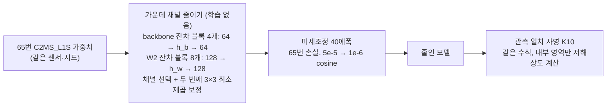

# 85. C2MS-SP 잔차 블록의 가운데 채널 축소·40에폭 미세조정과 빠른 사영 구현

| 분야 | 실험자 | 상태 | 판정 |
|:---:|:---:|:---:|:---:|
| 성능 개선 | 이병현 | 계획 | **판단 보류** |

**변경:** 새 구조를 처음부터 학습하지 않습니다. [65번](../65_l1_spectral_loss/README.md) C2MS_L1S(C2MS-SP의 네트워크) 가중치에서 출발해, 원래 해상도 backbone 잔차 블록(64 → 64 → 64)과 W2 가지 잔차 블록(128 → 128 → 128)의 가운데 채널을 줄인 일반 3×3 합성곱 구조로 바꾸고 65번 손실로 40에폭 미세조정합니다. 추론의 관측 일치 사영(공액 기울기법 10회, K10)은 수식·반복·정밀도를 그대로 두고, 사영이 실제로 쓰는 내부 영역만 저해상도에서 계산하도록 구현을 바꿉니다. 대조군은 같은 시드 C2MS-SP이고, 목표는 파라미터·연산이 더 적고, 같은 GPU에서 더 빠르고, RR 세 지표가 더 좋은 모델입니다.

**결과:** 아직 평가하지 않았습니다.

[실험 표](../README.md#experiments) · [결과](#results) · [해석과 판정](#verdict) · [방법](#method) · [그림](#figures) · [재현 자료](#evidence)

## 결과

아직 학습·측정하지 않았습니다. 0단계(사영 동일성·시간), 1단계(validation 관문), 2단계(3시드 test 판정) 순서로 채웁니다.

## 해석과 판정

### 판정과 다음 단계

아직 판단하지 않았습니다(판단 보류). 판정은 같은 시드 C2MS-SP와 짝지은 RR test의 센서별 3시드 평균([v2.4](../../../docs/judgement_criteria.md), 문턱 0.04 dB)으로 하고, QB·GF2·WV3가 모두 개선일 때만 실험 전체를 개선으로 적습니다. 가벼움·속도는 판정과 별도로 목표 충족 여부를 적습니다. 기준 모델 교체는 결과를 보고 사용자가 정합니다.

미리 밝혀 둘 한계는 다음과 같습니다.

- **QB가 가장 어렵습니다.** [83번](../83_factorized_c2ms_finetuning/README.md)의 40에폭 미세조정 갈래 K2L은 seed 42에서 C2MS-SP 대비 QB +0.005 dB였고, QB는 학습을 늘리면 validation만 오르고 test가 내려간 전례([59번](../59_extended_cosine_training/README.md), [73번](../73_l1_step_learning_rate_schedule/README.md))가 있습니다. QB가 부분 개선에 그치면 실험 전체는 부분 개선입니다.
- **채널을 줄인 직후의 손실은 아직 모릅니다.** 로컬에 torch가 없어 83번처럼 미리 재지 못했습니다. 0단계에서 validation으로 기록합니다.
- **가운데 채널을 줄여도 시간이 기대만큼 줄지 않을 수 있습니다.** cuDNN이 고르는 알고리즘에 따라 달라지므로 학습 전에 시간 관문을 둡니다.
- **긴 미세조정의 몫:** 줄이지 않고 같은 미세조정만 한 FT0L이 줄인 갈래보다 크게 좋으면, 정확도 이득은 채널 축소가 아니라 추가 학습에서 온 것입니다. 이때 C2MS-SP + 40에폭 미세조정은 별도 후보로만 적습니다(가볍지 않음).
- **빠른 사영은 어느 모델에나 붙일 수 있습니다.** "C2MS-SP보다 빠르다"는 같은 사영 구현끼리 비교한 시간으로만 말하고, 지금 구현의 C2MS-SP 대비 시간은 따로 적습니다.

<b>방법</b> · 목적과 상태 · 변경한 구조와 비교 조건

### 목적과 상태

83번 C2MS-SP-Lite는 연산을 66%로 줄이고도 C2MS-SP에 가까운 수치를 냈지만 두 가지가 남았습니다.

- **실제로 빠르지 않습니다.** W2 가지를 1×1 · depthwise 3×3 · 1×1로 나눈 K2는 RTX 3060 Ti에서 C2MS보다 31-37% 느렸고, backbone만 랭크 32 병목(3×3 + 1×1)으로 나눈 K1은 연산이 86%인데 시간은 같았습니다. 층을 나누면 1×1 층이 늘어나는데, 이 층은 계산보다 메모리 읽기·쓰기에 시간이 들어 연산 감소가 시간 감소로 이어지지 않은 것으로 봅니다. [68번](../68_ssai_folding_sam_split_seed_ensemble/README.md)에서 SSAI는 연산의 약 0.3%이고 접어도 시간이 같았으므로, 네트워크 시간은 주로 backbone·W2의 3×3 합성곱에서 나옵니다.
- **수치가 C2MS-SP보다 조금 낮습니다.** 3시드 평균 −0.012에서 −0.034 dB였습니다.

추론 시간에서는 사영이 더 큰 몫입니다([81번](../81_l1_spectral_loss_projection/README.md) 측정, seed 42, 장면 0).

| GPU 시간 | QB 256² | QB 512² | WV3 256² | WV3 512² |
|---|---:|---:|---:|---:|
| 네트워크 (65번) | 13.6 ms | 50.3 ms | 15.7 ms | 56.0 ms |
| + 사영 K10 (C2MS-SP) | 37 ms | 128 ms | 59 ms | 203 ms |
| 사영의 몫 | 63% | 61% | 73% | 72% |

지금 구현은 반복마다 HR 영상 전체(256²이면 테두리를 붙인 296²)의 FFT 합성곱을 float64로 세 번 하고(전치 연산을 autograd로 구하느라 앞 방향을 한 번 더 계산), 반복마다 GPU와 CPU를 동기화합니다.

긴 미세조정에는 근거가 있습니다. 83번에서 K2를 40에폭 미세조정한 K2L(seed 42)은 10에폭 K2보다 test가 QB +0.030 dB·SAM −0.007°·ERGAS −0.012, WV3 +0.074 dB·−0.025°·−0.018 좋았고, C2MS-SP 대비 QB +0.005 dB, WV3 +0.064 dB였습니다. validation 최고점은 38·39에폭이었습니다. 단일 시드·두 센서의 참고 수치입니다.

**가설:**

1. **사영 구현:** 사영이 빼는 가장자리 MS 5픽셀은 HR 20픽셀로, 41탭 MTF 커널의 반폭과 같습니다. 그래서 사영이 쓰는 내부 MS 화소는 테두리 복제 픽셀을 읽지 않고, 반복에 쓰는 연산 (MD)(MD)ᵀ는 저해상도 내부 격자(RR 54×54, FR 118×118)에서 21×21 커널 하나의 합성곱과 정확히 같습니다. 같은 공액 기울기법 10회를 이 형태로 float64에서 계산하면 결과는 반올림 차이만 남고, 사영 시간은 수 ms로 줄어듭니다(측정 전 추정).
2. **구조:** 잔차 블록의 가운데 채널을 줄이면 층 수가 그대로이고 1×1 층도 생기지 않아, 연산 감소가 실제 GPU 시간 감소로 이어집니다.
3. **정확도:** 65번 가중치에서 가운데 채널을 고르고 두 번째 3×3을 최소제곱으로 보정한 뒤 40에폭 미세조정하면, 줄인 모델 + 사영이 같은 시드 C2MS-SP보다 RR 세 지표가 좋습니다.

**상태(2026-11-17 등록):** 계획입니다. 학습·측정은 하지 않았습니다. 서버에서 진행 중인 성능 84번 학습이 모두 끝나면(종료 예상 11-18 04:20 KST 전후) 별도 실행 폴더에서 자동으로 시작하도록 설정합니다. 84번 실행 폴더는 보관을 확인한 뒤 정리합니다.

### 변경한 구조와 비교 조건

SSA 3단계, decoder, 입력 처리, W2의 PixelUnshuffle·1×1·PixelShuffle은 바꾸지 않습니다. 갈래 이름의 B는 backbone, W는 W2 가지의 가운데 채널 수입니다. 연산·파라미터는 구조에서 계산한 값입니다.

| 갈래 | backbone 가운데 채널 | W2 가운데 채널 | 미세조정 | 연산 (QB 256²) | 실사용 파라미터 (4밴드 · 8밴드) |
|---|:---:|:---:|:---:|---:|---:|
| C2MS-SP (공식 대조군) | 64 | 128 | 없음 | 59.63 GMAC | 2,735,610 · 2,755,942 |
| FT0L (대조군) | 64 | 128 | 40에폭 | 59.63 GMAC | 2,735,610 · 2,755,942 |
| B64W96 | 64 | 96 | 40에폭 | 49.97 GMAC (84%) | 2,145,530 · 2,165,862 (78%) |
| B32W96 | 32 | 96 | 40에폭 | 40.30 GMAC (68%) | 1,997,946 · 2,018,278 (73%) |
| B32W64 | 32 | 64 | 40에폭 | 30.64 GMAC (51%) | 1,407,866 · 1,428,198 (51%) |
| K2L (83번 기록, 참고) | 랭크 32 병목 | CP 384 depthwise | 40에폭 | 39.06 GMAC (66%) | 1,873,402 · 1,893,734 (68%) |

- **채널 선택:** 같은 센서의 학습 패치 512장(고정 난수)에서 블록마다 가운데 활성값 h(ReLU 뒤)를 구하고, 채널 c의 기여 에너지 E[h_c²]·‖W₂[:, c]‖²가 큰 채널을 남깁니다. 첫 번째 3×3은 남긴 채널의 가중치·편향을 그대로 씁니다.
- **두 번째 3×3 보정:** 남긴 채널의 3×3 이웃 값으로 원래 블록의 잔차 출력을 가장 잘 맞추는 가중치·편향을 최소제곱(작은 ridge)으로 구합니다. 앞 블록부터 차례로, 이미 줄인 앞 블록을 거친 입력을 씁니다.
- **FT0L:** 줄이지 않고 같은 40에폭 미세조정만 합니다. 긴 미세조정의 몫과 채널 축소의 몫을 나눕니다.
- **B32W96 대 K2L:** 연산이 비슷할 때(68% 대 66%) depthwise 대신 일반 합성곱을 쓰면 시간과 정확도가 어떻게 다른지 봅니다.
- **계획에서 뺀 것:** 사영을 넣은 채 미세조정하는 갈래는 83번과 같은 이유(64×64 학습 패치에서는 가장자리를 빼면 MS 6×6만 남음)로 하지 않습니다. 1×1·depthwise 분해는 83번에서 느렸으므로 새 갈래로 넣지 않습니다.

**빠른 사영 구현**

| 단계 | 지금 구현 (79·81번) | 바꾼 구현 |
|---|---|---|
| 시작 잔차 M(MS − D y) | 테두리 복제 후 HR 전체 FFT 합성곱, 4칸 간격 추출 | 내부 MS 화소만 41×41 합성곱을 4칸 간격으로 계산 |
| 반복의 M D Dᵀ M p | Dᵀ를 autograd로 구한 뒤 D 적용(FFT 합성곱 3회) | 미리 구한 21×21 커널(MTF 커널의 4칸 간격 자기상관)로 내부 격자 합성곱 1회 |
| 마지막 Dᵀ M λ | autograd | 4칸 간격 전치 합성곱 |
| 정밀도·반복·멈춤 조건 | float64, 10회, 상대 잔차 1e-8 | 같음 |

| 항목 | 내용 |
|---|---|
| 데이터 | QB·GF2·WV3 학습·validation·test(각 20장면 RR·FR). 캐시는 83번과 같은 방식으로 만들고 해시를 대조합니다. WV3 모델은 WV2 test에도 적용합니다(참고, 82번 밴드별 보정 + 사영) |
| 초기값 | 같은 센서·시드의 65번 C2MS_L1S `best.pt` |
| 손실 | 65번과 같음: 원래 쌍 L1 + 1.0 × 2배 거친 쌍 L1 + 0.46 × 분광 손실 |
| 학습 | Adam 5e-5 → 1e-6 cosine, 40에폭, batch 32, FP16 AMP(83번 학습기). 서버 RTX 3060 Ti에서 두 개씩 동시 학습 |
| 가중치 선택 | 원래 축척 validation MSE 최소. 0에폭(줄인 직후, FT0L은 65번 그대로)도 후보에 넣습니다 |
| 추론 | 네트워크 float32(TF32 끔), 사영 K10 float64 |
| 대조군 | 같은 시드 C2MS-SP. 같은 평가에서 다시 계산하고 81·83번 기록과 대조합니다 |

**시간 측정 규칙 (측정 전 고정)**

- 학습이 돌지 않을 때 서버 GPU에서 한 프로세스로 잽니다. batch 1, test 장면 0, RR 256²·FR 512², QB(4밴드)·WV3(8밴드)입니다.
- 설정은 81번과 같습니다: float32, TF32 끔, cuDNN 결정적 모드·자동 탐색 끔, NCHW.
- 예열 5회 뒤 50회의 중앙값을 시스템을 번갈아 가며 잽니다. 이 과정을 세 번 반복한 중앙값을 씁니다.
- 시스템은 C2MS-SP(지금 사영), C2MS-SP(빠른 사영), C2MS-SP-Lite(빠른 사영), 각 갈래(빠른 사영)와 사영 없는 네트워크입니다.
- 참고로 cuDNN 자동 탐색·TF32를 켠 설정과 FP16 추론의 시간, FP16의 test 지표 변화를 적습니다. 판정과 목표에는 쓰지 않습니다.

**단계와 관문 (학습 전 고정)**

| 단계 | 실행 | 다음 단계 조건 |
|---|---|---|
| 0 측정 (학습 없음) | ① 65번 3시드 출력(QB·GF2·WV3, WV2 전이)의 test RR·FR 전체에 두 사영 구현을 적용해 비교 ② 시간 측정 ③ seed 42 QB·WV3의 줄인 초기값을 만들고 validation 손실 기록 | ① 모든 장면에서 출력 차이가 최대 1e-8(정규화 값) 이하이고 test 평균 RR PSNR 차이가 1e-5 dB 이하일 때만 빠른 사영을 씁니다. 아니면 지금 사영으로 진행합니다. ② 사영 없는 네트워크 시간이 C2MS보다 QB·WV3 256²에서 모두 5% 이상 짧은 갈래만 학습합니다 |
| 1 선별 | QB·WV3 seed 42: FT0L과 ②를 통과한 갈래 | **validation만 씁니다.** 두 센서 모두에서 선택 가중치가 같은 시드 65번보다 validation PSNR이 낮지 않고 SAM이 높지 않은 갈래 가운데, 0단계 네트워크 시간이 가장 짧은 것을 고릅니다. 통과한 갈래가 없으면 2단계를 하지 않고 1단계 test를 참고로 보고합니다 |
| 2 확정 | 고른 갈래: QB·WV3 seed 43·44, GF2 seed 42-44 (1단계 seed 42 재사용) | 같은 시드 C2MS-SP와 짝지은 센서별 3시드 평균, v2.4 |
| 3 최종 측정 | 위 규칙으로 시간 측정, 고정 6장면 이미지 | — |

| 비교 | 의미 |
|---|---|
| **갈래 + 사영 대 같은 시드 C2MS-SP** | 공식 판정(v2.4, RR만, 센서별 3시드 평균, 문턱 0.04 dB). QB·GF2·WV3가 모두 개선일 때만 실험 전체를 개선으로 적습니다 |
| 갈래 대 FT0L (1단계) | 긴 미세조정의 몫을 뺀 채널 축소의 효과 |
| B32W96 대 K2L (seed 42, QB·WV3) | 연산이 비슷할 때 일반 합성곱과 depthwise의 정확도·시간 |
| 빠른 사영 대 지금 사영 | 같은 결과인지와 시간 |
| 목표 충족 (판정과 별도) | 가볍다: 실사용 파라미터·연산 모두 C2MS-SP보다 작음. 빠르다: 같은 사영 구현의 C2MS-SP보다 QB·WV3 256²·512²에서 모두 짧음. 더 정확하다: 공식 판정이 개선 |
| WV2 전이 | 참고만 합니다(82번 보정 + 사영) |

**예상 시간 (측정 전 추정):** 0단계 1-2시간, 1단계 8개 실행 4-5시간, 2단계 7개 실행 약 5시간, 평가·측정 약 2시간으로 모두 12-14시간입니다. C2MS 크기의 40에폭 미세조정은 QB 약 55분, GF2 약 70분, WV3 약 40분이고, 줄인 갈래는 이보다 짧을 것으로 봅니다.

<b>그림</b> · 학습·평가 그래프 · 결과 이미지

아직 학습하지 않았습니다. 실행마다 학습 L1, validation PSNR·SAM(0에폭은 줄인 직후)과 65번 validation 기준선을 남기고, 0단계 시간 측정은 시스템별 그래프로 남깁니다. 고른 갈래의 seed 42에서 고정 6장면(0·1·3·7·14·17)의 원본 크기 비교와 확대 비교(C2MS-SP 대 갈래 + 사영)를 `common/result_images.py`로 만듭니다. 확대 창은 후보에 유리한 곳이므로 장면 PSNR과 함께 봅니다.

<b>재현 자료</b> · 코드, 가중치, 설정, 실행 기록

- [config.json](config.json): 가설, 근거, 갈래, 관문, 시간 측정 규칙, 데이터 해시
- [model.py](model.py): 가운데 채널을 줄인 구조(`Model`)와 채널 선택·최소제곱 보정(`reduce`)
- [prepare.py](prepare.py): 83번 센서 연산·사영을 그대로 다시 내보내고, 빠른 사영(`FastProjector`, `FastProjected`)을 정의합니다
- [train.py](train.py): 83번 학습기 구성(58번 학습기 + 65번 L1 치환)에 줄인 초기값 불러오기를 적용
- [evaluate.py](evaluate.py): 실행별 평가(대조군은 센서·시드별 한 번), validation 관문, 3시드 요약, 시간 측정(`measure`)
- [run.py](run.py): 서버 실행 순서 `prepare`(캐시 재생성·해시 대조) → `stage0`(줄인 초기값, 사영 동일성, 시간 관문) → `optimize`(벤치마크·사전 점검·설정 봉인) → `run`(1단계 → 관문 → 2단계 → 요약 → 최종 시간 측정)

**학습 전 점검(2026-11-17, 서버 CPU, 84번 학습 중이라 GPU는 쓰지 않음):** 65번 QB seed 42에서 네 갈래의 줄인 구조가 계산한 실사용 파라미터 수와 같았고, FT0L은 65번과 같았습니다(학습 패치 64장으로 채널 선택만 확인). 장면 0의 RR·FR에서 빠른 사영과 지금 사영의 출력 차이는 QB·WV3·WV2 모두 최대 1.1e-14(정규화 값)였고 반복 횟수(10회)도 같았습니다. GPU를 쓰는 학습기 점검은 0단계와 `optimize`의 사전 점검에서 합니다.

