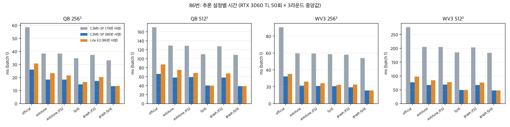

# 86. K10 사영 전치 연산의 FFT 계산과 C2MS-SP 추론 설정 측정

| 분야 | 실험자 | 상태 | 판정 |
|:---:|:---:|:---:|:---:|
| 성능 개선 | 이병현 | 평가 완료 | **성능 비교 아님** |

**변경:** 학습하지 않았습니다. [85번](../85_hidden_width_reduction_fast_projection/README.md)의 빠른 K10 사영(내부 저해상도 격자 계산)에서 마지막 전치 연산 Dᵀ를 float64 전치 합성곱 대신 FFT로 계산했습니다. 수식·반복·정밀도는 그대로입니다. 같은 C2MS-SP(65번 가중치 + 사영)로 네트워크 시간이 어디서 나오는지 프로파일러로 보고, 추론 설정(cuDNN 자동 탐색, TF32, FP16, CUDA Graphs)별 시간과 RR 지표 변화를 쟀습니다.

**결과:** FFT 사영은 65번 3시드의 모든 test 장면(QB·GF2·WV3·WV2, RR·FR)에서 79번 사영과 같았습니다(최대 차이 1.3e-14, 반복 횟수 동일). 공식 설정에서 C2MS-SP 시간은 QB 256² 58.6 → 26.1 ms, 512² 170.4 → 65.8 ms, WV3 256² 90.7 → 32.2 ms, 512² 276.6 → 76.7 ms였습니다. 85번 구현이 공식 설정 512²에서 느려지던 문제(QB 452.7 ms, WV3 847.1 ms)도 없어졌습니다. CUDA Graphs + FP16 설정에서는 13.3·38.8·15.4·47.1 ms로, 지금 C2MS-SP보다 3.6-5.9배 빨랐습니다. 이때 C2MS-SP-Lite(K2)도 같은 시간이었습니다. 설정에 따른 RR 변화는 최대 0.0013 dB(GF2, FP16)로 판정 문턱보다 훨씬 작았습니다. 이후 실험은 86번 사영을 기본 사영 구현으로 씁니다.

[실험 표](../README.md#experiments) · [결과](#results) · [해석과 판정](#verdict) · [방법](#method) · [그림](#figures) · [재현 자료](#evidence)

## 결과

GPU 시간은 서버 RTX 3060 Ti에서 batch 1, test 장면 0으로 쟀습니다. 시스템을 번갈아 예열 5회 뒤 50회의 중앙값을 재고, 이를 세 라운드 반복한 중앙값입니다(85번 측정 규칙). 전체 값은 [timing.json](results/timing.json)에 있습니다.

### 사영 동일성 (79번 사영 대비)

| 범위 | 최대 절대 차이 | RR PSNR 차이 | 반복 횟수 |
|---|---:|---:|---|
| 65번 seed 42·43·44 × QB·GF2·WV3 + WV3 모델의 WV2 전이, RR·FR test 각 20장 (12조합) | 1.3e-14 | 9.1e-13 dB 이하 | 모든 장면에서 같음 |

미리 정한 기준(최대 차이 1e-8 이하, PSNR 차이 1e-5 dB 이하, 반복 횟수 동일)을 통과했습니다([identity.json](results/identity.json)).

### 설정별 시간 (ms)

| 설정 | C2MS (사영 없음) | C2MS-SP 79번 사영 | C2MS-SP 85번 사영 | **C2MS-SP 86번 사영** | Lite K2 + 86번 사영 |
|---|---|---|---|---|---|
| official | 20.7 · 56.4 · 26.0 · 63.1 | 58.6 · 170.4 · 90.7 · 276.6 | 26.8 · 452.7 · 33.4 · 847.1 | **26.1 · 65.8 · 32.2 · 76.7** | 30.7 · 87.2 · 35.1 · 97.4 |
| autotune | 13.5 · 49.0 · 15.5 · 54.3 | 38.3 · 129.1 · 59.5 · 204.7 | 19.0 · 60.8 · 22.3 · 73.8 | **18.3 · 58.0 · 21.1 · 67.3** | 23.2 · 75.0 · 26.0 · 84.1 |
| autotune_tf32 | 13.6 · 50.8 · 15.4 · 56.1 | 38.4 · 128.7 · 59.5 · 204.6 | 19.1 · 62.2 · 22.3 · 74.8 | **18.4 · 59.0 · 21.0 · 68.3** | 21.5 · 68.1 · 24.1 · 77.3 |
| fp16 | 9.7 · 31.9 · 14.8 · 36.6 | 34.8 · 109.8 · 58.7 · 185.0 | 15.4 · 43.4 · 21.8 · 55.3 | **14.7 · 40.1 · 20.5 · 48.8** | 16.4 · 39.9 · 22.1 · 48.6 |
| graph_tf32 | 12.5 · 49.9 · 13.8 · 54.7 | 37.3 · 127.9 · 58.0 · 203.2 | 18.0 · 61.3 · 20.6 · 73.3 | **17.3 · 58.1 · 19.3 · 67.0** | 20.3 · 67.2 · 22.4 · 75.9 |
| graph_fp16 | 8.4 · 30.6 · 9.8 · 35.0 | 33.2 · 108.5 · 53.9 · 183.4 | 13.9 · 42.0 · 16.6 · 53.6 | **13.3 · 38.8 · 15.4 · 47.1** | 13.5 · 38.7 · 15.6 · 47.0 |

- 각 칸은 QB 256² · QB 512² · WV3 256² · WV3 512² 순서입니다.
- **official:** float32, TF32 끔, cuDNN 결정적 모드·자동 탐색 끔(81번과 같음)입니다. 나머지 설정은 참고용 추론 옵션이고, 사영은 항상 float64입니다.
- **graph:** 네트워크 forward를 CUDA Graph로 캡처해 다시 실행합니다(사영은 캡처하지 않음).

### 설정별 RR 변화 (C2MS-SP = 65번 + 86번 사영, seed 42, official 대비)

| 센서 | official PSNR / SAM / ERGAS | autotune | autotune_tf32 | fp16 | graph_tf32 | graph_fp16 |
|---|---|---|---|---|---|---|
| QB | 38.396 / 4.4647 / 3.6738 | 0 | −0.00003 dB | +0.00018 dB | −0.00003 dB | +0.00018 dB |
| GF2 | 48.732 / 0.7676 / 0.6955 | 0 | +0.00012 dB | −0.00132 dB | +0.00012 dB | −0.00132 dB |
| WV3 | 38.663 / 2.9890 / 2.2405 | 0 | −0.00005 dB | −0.00030 dB | −0.00005 dB | −0.00030 dB |

SAM 변화는 0.0003° 이하, ERGAS 변화는 0.0001 이하였습니다([accuracy.json](results/accuracy.json)).

### 네트워크 프로파일 (C2MS, official, forward 1회 평균)

| 입력 | GPU 시간 | CPU(호스트) 시간 | CUDA 커널 수 | 합성곱 비중 | 원소별 연산(add 등) 비중 |
|---|---:|---:|---:|---:|---:|
| QB 256² | 27.2 ms | 21.4 ms | 832 | 약 59% | 약 21% |
| QB 512² | 103.3 ms | 50.1 ms | 832 | 약 61% | 약 22% |
| WV3 256² | 31.0 ms | 26.3 ms | 1,030 | 약 57% | 약 19% |
| WV3 512² | 117.6 ms | 55.0 ms | 1,030 | 약 57% | 약 20% |

- **합성곱 비중:** `aten::cudnn_convolution`과 그 Winograd 커널을 더한 값입니다. 프로파일러 계측이 더해져 GPU 시간이 실제 측정보다 깁니다. 연산별 상위 15개는 [profile.json](results/profile.json)에 있습니다.
- **256²의 병목:** forward 한 번에 커널을 832-1,030개 띄우고 호스트 시간이 GPU 시간과 비슷합니다. 그래서 연산을 줄여도 시간이 덜 줄었고(85·87번), CUDA Graphs와 FP16이 효과가 컸습니다.

## 해석과 판정

### 해석

- **FFT 전치 연산:** 85번의 전치 합성곱은 cuDNN 자동 탐색을 끄면 512²에서 느린 알고리즘을 골랐습니다. FFT로 바꾸자 설정과 크기에 상관없이 사영이 수 ms로 끝났고, 79번 사영과 반올림 차이만 났습니다.
- **추론 설정:** 정확도에 영향 없이 고를 수 있습니다. 가장 빠른 graph_fp16에서 C2MS-SP는 지금 구현(official, 79번 사영) 대비 QB 4.4배·2.6배(256²·512²), WV3 5.9배·3.6배 빨랐습니다(이 배수에는 설정 효과와 사영 구현 효과가 함께 들어 있습니다).
- **Lite:** graph_fp16에서 depthwise 합성곱의 불리함이 사라져 C2MS-SP와 시간이 같았습니다. 그래서 경량판의 이점은 이 GPU에서 시간보다 파라미터·연산에 있습니다.
- **남은 병목:** graph_fp16에서는 사영이 다시 시간의 약 37%(QB 256² 13.3 ms 중 약 5 ms)를 차지합니다.

### 판정과 다음 단계

학습한 후보가 없는 구현·측정 실험이라 **성능 비교 아님**입니다. FFT 사영이 미리 정한 동일성 기준을 통과했으므로 이후 실험의 기본 사영 구현으로 씁니다([87번](../87_reduced_width_short_finetuning/README.md)·[88번](../88_factorization_at_decay_start/README.md)). 판정은 계속 공식 설정(float32)으로 하고, 실제 사용 시간은 graph_fp16 같은 설정으로 따로 보고합니다.

<b>방법</b> · 목적과 상태 · 변경한 구조와 비교 조건

### 목적과 상태

85번에서 빠른 사영은 256²에서 C2MS-SP를 2.2-2.9배 빠르게 했지만, cuDNN 자동 탐색을 끈 공식 설정의 512²에서는 Dᵀ(float64, 4칸 간격 전치 합성곱)가 느린 알고리즘을 골라 QB 388 ms, WV3 776 ms가 걸렸습니다(자동 탐색 시 5.2·10.3 ms). 또 256²에서는 연산을 절반으로 줄여도 네트워크 시간이 거의 줄지 않아, 시간이 어디서 나오는지 확인이 필요합니다.

**가설:** Dᵀ를 FFT로 계산하면 설정과 크기에 상관없이 사영이 수 ms로 끝납니다. 자동 탐색·TF32·FP16·CUDA Graphs는 네트워크 시간을 줄이고, RR 변화는 판정 문턱(0.04 dB)보다 훨씬 작습니다.

**상태:** 2026-11-18 14:19-14:42에 다른 GPU 작업 없이 서버에서 측정했습니다.

### 변경한 구조와 비교 조건

- **FFT 전치 연산:** 내부 MS 화소의 λ를 PAN 격자의 해당 위치(2 + 4j)에 놓고 41탭 커널과 완전 합성곱을 FFT로 계산합니다. FFT 크기가 H + 40 이상이면 순환 겹침이 없어 85번의 전치 합성곱과 반올림 차이만 납니다. D와 21×21 내부 연산은 85번 그대로입니다.
- **동일성 검사:** 65번 3시드 출력의 QB·GF2·WV3·WV2 test RR·FR 전체에서 79번 사영과 비교합니다.
- **프로파일:** C2MS 네트워크(65번 seed 42)를 공식 설정에서 RR 256²·FR 512², QB·WV3로 torch.profiler에 돌려, 연산별 GPU 시간과 커널 수를 기록합니다.
- **설정별 시간:** 85번과 같은 측정 규칙(batch 1, test 장면 0, 예열 5회 + 50회 × 3라운드 중앙값)으로 다음 시스템을 잽니다: 사영 없는 C2MS, C2MS-SP(79번·85번·86번 사영), C2MS-SP-Lite + 86번 사영.

| 설정 | cuDNN | TF32 | FP16 (네트워크) | CUDA Graphs |
|---|---|:---:|:---:|:---:|
| official | 결정적, 자동 탐색 끔 | 끔 | — | — |
| autotune | 자동 탐색 | 끔 | — | — |
| autotune_tf32 | 자동 탐색 | 켬 | — | — |
| fp16 | 자동 탐색 | 끔 | 켬 | — |
| graph_tf32 | 자동 탐색 | 켬 | — | 켬 |
| graph_fp16 | 자동 탐색 | 끔 | 켬 | 켬 |

- **설정별 RR 변화:** C2MS-SP(65번 + 86번 사영, seed 42)의 QB·GF2·WV3 test RR 20장 평균을 설정마다 계산해 official과의 차이를 적습니다. 사영은 항상 float64입니다.

<b>그림</b> · 학습·평가 그래프 · 결과 이미지

학습하지 않으므로 학습 곡선과 결과 이미지는 없습니다.

<b>재현 자료</b> · 코드, 가중치, 설정, 실행 기록

- [config.json](config.json): 가설, 근거, 설정, 측정 규칙
- [prepare.py](prepare.py): 85번 사영을 다시 내보내고 `FastProjectorV2`(FFT 전치)와 `Graphed`(CUDA Graphs 재생)를 정의합니다
- [run.py](run.py): `identity` → `profile` → `timing` → `accuracy` (`--mode all`)
- 결과: [identity.json](results/identity.json), [profile.json](results/profile.json), [timing.json](results/timing.json), [accuracy.json](results/accuracy.json), [started.json](results/started.json)(실행 소스 해시·환경), [complete.json](results/complete.json)
- 실행 기록: [provenance/source_manifest.json](provenance/source_manifest.json)(서버에 올린 86·87번 소스 해시)
- 가중치: 학습하지 않아 새 가중치가 없습니다. 65번·83번 가중치를 그대로 썼습니다
- 보관 해시 확인: `python SSA-MRN/common/verify.py --experiment 86`

