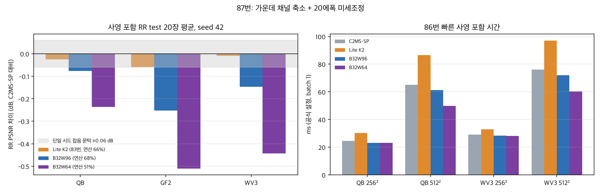
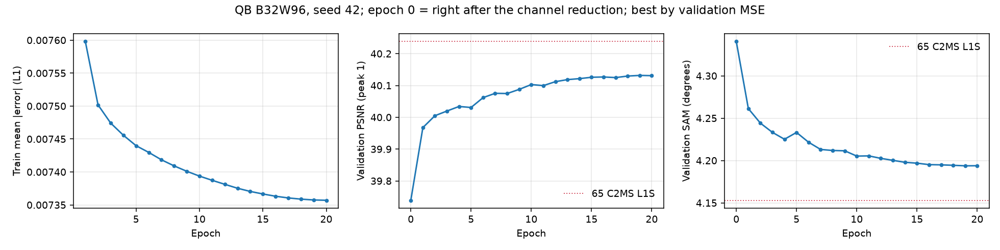
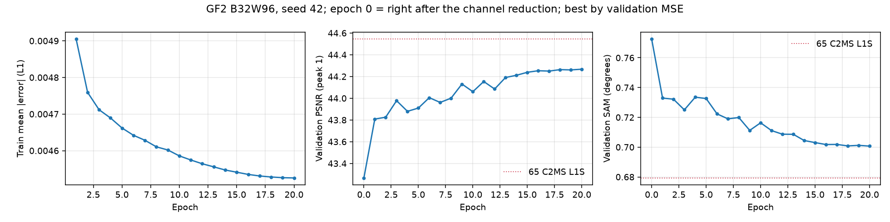
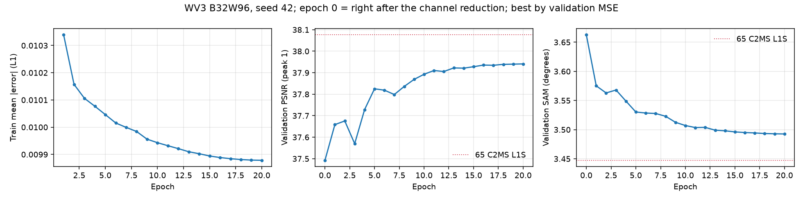
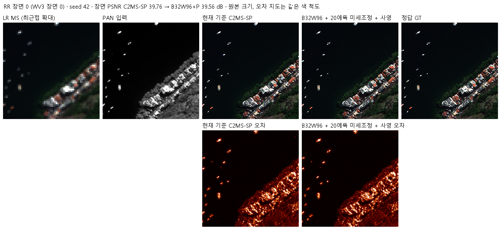
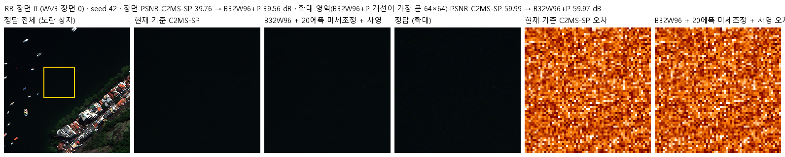

# 87. C2MS-SP 잔차 블록 가운데 채널 축소 구조의 20에폭 미세조정 단일 시드 확인

| 분야 | 실험자 | 상태 | 판정 |
|:---:|:---:|:---:|:---:|
| 성능 개선 | 이병현 | 평가 완료 · seed 42 | **개선 없음** |

**변경:** [85번](../85_hidden_width_reduction_fast_projection/README.md)에서 시간 관문에 막혀 학습하지 않은 축소 구조 두 가지(B32W96 연산 68%, B32W64 연산 51%)를 실제로 학습해 정확도를 확인했습니다. 65번 C2MS_L1S(C2MS-SP의 네트워크) 가중치에서 backbone·W2 잔차 블록의 가운데 채널을 고르고 두 번째 3×3을 최소제곱으로 보정한 뒤, 65번 손실로 20에폭 미세조정했습니다. 추론 사영은 [86번](../86_fft_adjoint_fast_inference/README.md)의 빠른 K10 사영입니다. 대조군은 같은 시드 C2MS-SP이고 seed 42 한 개입니다.

**결과:** 두 갈래 모두 세 센서에서 C2MS-SP보다 낮았습니다. RR PSNR 차이는 B32W96이 QB −0.076, GF2 −0.253, WV3 −0.146 dB, B32W64가 −0.236, −0.510, −0.443 dB였고 SAM·ERGAS도 모두 나빠졌습니다. 같은 시드 C2MS-SP-Lite(83번 K2, 연산 66%)의 손실(QB −0.026, GF2 −0.058, WV3 −0.010 dB)보다 3-25배 큽니다. best 에폭은 19-20으로 끝까지 오르고 있었지만, 오름 폭으로 보아 Lite 수준까지 따라잡기는 어렵습니다. 시간은 512²에서 B32W64가 C2MS-SP보다 공식 설정 21-24%, FP16 16-20% 빨랐습니다. 가운데 채널 축소는 경량판 구조로 쓰지 않고, 이후 경량판은 K2 구조로 진행합니다([88번](../88_factorization_at_decay_start/README.md)).

[실험 표](../README.md#experiments) · [결과](#results) · [해석과 판정](#verdict) · [방법](#method) · [그림](#figures) · [재현 자료](#evidence)

## 결과

### RR test (사영 포함, 같은 시드 C2MS-SP 대비, seed 42)

QB·GF2·WV3 test RR 20장 평균입니다. 시드가 하나라 시드별 값이 곧 표의 값입니다. 장면별 수치는 `results/<센서>_<갈래>_s42/evaluation/<센서>_v2_4.json`에 있습니다.

| 센서 | C2MS-SP PSNR / SAM / ERGAS | B32W96 + 사영 | 차이 | B32W64 + 사영 | 차이 | 판정 (B32W96 · B32W64) |
|---|---|---|---|---|---|---|
| QB | 38.396 / 4.4647 / 3.6738 | 38.320 / 4.4970 / 3.7057 | −0.076 / +0.032 / +0.032 | 38.160 / 4.5595 / 3.7768 | −0.236 / +0.095 / +0.103 | 개선 없음 · 개선 없음 |
| GF2 | 48.732 / 0.7676 / 0.6955 | 48.479 / 0.7881 / 0.7167 | −0.253 / +0.021 / +0.021 | 48.222 / 0.8143 / 0.7384 | −0.510 / +0.047 / +0.043 | 개선 없음 · 개선 없음 |
| WV3 | 38.663 / 2.9890 / 2.2405 | 38.517 / 3.0410 / 2.2827 | −0.146 / +0.052 / +0.042 | 38.220 / 3.1546 / 2.3693 | −0.443 / +0.166 / +0.129 | 개선 없음 · 개선 없음 |
| WV2 전이 (참고) | 31.335 / 5.0999 / 3.7502 | 31.336 / 5.1525 / 3.7545 | +0.001 / +0.053 / +0.004 | 31.354 / 5.2193 / 3.7501 | +0.019 / +0.119 / −0.000 | 참고 |

- 장면별 PSNR 승수(갈래가 높은 장면)는 B32W96이 QB 1, GF2 0, WV3 0장, B32W64는 세 센서 모두 0장입니다(각 20장).
- WV2는 WV3 모델에 82번 보정 + 사영을 붙인 전이 결과입니다. PSNR은 비슷하지만 SAM이 나빠졌습니다.
- FR QNR(참고) 차이는 −0.006에서 +0.024입니다.

### validation과 학습 경과

| 실행 | 축소 직후 val PSNR (65번 대비) | best 에폭 | best val PSNR (65번 대비) | best val SAM (65번 대비) |
|---|---:|---:|---:|---:|
| QB B32W96 | 39.739 (−0.499) | 19 | −0.107 | +0.041 |
| QB B32W64 | 39.158 (−1.080) | 19 | −0.291 | +0.110 |
| GF2 B32W96 | 43.266 (−1.279) | 20 | −0.278 | +0.021 |
| GF2 B32W64 | 41.563 (−2.982) | 20 | −0.782 | +0.063 |
| WV3 B32W96 | 37.493 (−0.584) | 20 | −0.136 | +0.045 |
| WV3 B32W64 | 36.892 (−1.185) | 20 | −0.392 | +0.137 |

- 축소 직후 손실을 미세조정이 대부분 되찾았지만, 20에폭 끝에도 65번보다 validation PSNR이 0.1-0.8 dB 낮았습니다.
- 학습률이 1e-6까지 내려간 마지막 에폭에서 best가 나왔으므로, 같은 일정으로 더 길게 학습하면 조금 더 오를 수 있습니다.

### 비용과 시간

| 구조 | 파라미터 (4밴드) | 연산 (QB 256²) | 공식 설정 256² / 512² (QB) | 공식 설정 256² / 512² (WV3) | FP16 512² (QB · WV3) |
|---|---:|---:|---|---|---|
| C2MS-SP | 2,735,610 | 59.63 GMAC | 24.5 / 65.1 ms | 29.1 / 76.1 ms | 47.5 · 58.7 ms |
| Lite K2 (83번) | 1,873,402 | 39.06 GMAC | 30.3 / 86.6 ms | 32.9 / 97.0 ms | 47.0 · 58.3 ms |
| B32W96 | 1,997,946 | 40.30 GMAC | 23.3 / 61.3 ms | 28.4 / 71.9 ms | 42.2 · 53.4 ms |
| B32W64 | 1,407,866 | 30.64 GMAC | 23.1 / 49.8 ms | 28.1 / 60.3 ms | 38.2 · 49.5 ms |

- **측정 조건:** 모두 86번 빠른 사영을 포함하고, batch 1, test 장면 0, 85번 측정 규칙으로 쟀습니다. 전체 값은 [final_timing.json](results/final_timing.json)에 있습니다.
- **256²:** 축소해도 시간이 거의 줄지 않았습니다(85번과 같음).
- **FP16:** RR 변화는 모든 시스템에서 0.002 dB 이하였습니다.
- **학습 시간:** 두 개씩 동시에 돌린 실제 에폭 시간은 QB 118, GF2 136, WV3 86초였습니다(85번 학습기).

## 해석과 판정

### 해석

- **손실 크기:** 비슷한 연산(66-68%)에서 B32W96의 손실은 Lite(K2)보다 QB 3배, GF2 4배, WV3 15배였습니다.
- **원인 추정:** K2는 3×3 합성곱을 저랭크로 분해해 모든 채널의 정보 흐름을 유지합니다. 가운데 채널을 버리는 방식은 축소 직후 손실이 크고(validation PSNR −0.5에서 −3.0 dB), 20에폭 미세조정으로 다 되찾지 못했습니다.
- **연산 51%(B32W64):** 손실이 0.24-0.51 dB로 커서, 512²에서 얻는 20% 남짓의 시간 이득과 바꿀 수 없습니다.
- **256²:** 85번처럼 시간이 거의 줄지 않아, 이 크기에서는 연산이 아닌 커널 호출 수가 시간을 정합니다([86번](../86_fft_adjoint_fast_inference/README.md) 프로파일).

### 판정과 다음 단계

**개선 없음**입니다. 두 갈래 모두 QB·GF2·WV3에서 같은 시드 C2MS-SP보다 RR PSNR·SAM·ERGAS가 모두 나빴습니다([v2.4](../../../docs/judgement_criteria.md), 단일 시드 문턱 0.06 dB). 세 센서 모두 −0.04 dB 이내인 "경량 비열등"도 아니어서 3시드 확인은 하지 않습니다. 경량판 구조는 K2(C2MS-SP-Lite)를 유지하고, 84번 학습 일정과 K2 분해를 합친 [88번](../88_factorization_at_decay_start/README.md)에서 정확도를 높입니다.

<b>방법</b> · 목적과 상태 · 변경한 구조와 비교 조건

### 목적과 상태

85번은 학습 전 시간 관문(256²에서 C2MS보다 5% 이상 빠름)을 정해 두어 축소 구조를 학습하지 않았고, 그래서 축소 구조의 정확도를 모릅니다. 512²에서는 B32W64가 C2MS보다 25% 빨랐고 파라미터·연산은 절반이라, 정확도를 유지한다면 가벼운 모델로 쓸 수 있습니다. 83번 분해 모델(K2L)은 미세조정 이득의 90%를 13-14에폭에 얻었으므로 20에폭으로 줄여 확인합니다.

**상태:** 2026-11-18 14:47-17:00에 86번 측정 뒤 서버에서 자동으로 학습·평가했습니다.

### 변경한 구조와 비교 조건

| 갈래 | backbone 가운데 채널 | W2 가운데 채널 | 연산 (QB 256²) | 실사용 파라미터 (4밴드 · 8밴드) |
|---|:---:|:---:|---:|---:|
| C2MS-SP (대조군) | 64 | 128 | 59.63 GMAC | 2,735,610 · 2,755,942 |
| B32W96 | 32 | 96 | 40.30 GMAC (68%) | 1,997,946 · 2,018,278 (73%) |
| B32W64 | 32 | 64 | 30.64 GMAC (51%) | 1,407,866 · 1,428,198 (51%) |

| 항목 | 내용 |
|---|---|
| 초기값 | 65번 C2MS_L1S `best.pt`(같은 센서, seed 42)에서 85번 방식으로 채널 선택 + 최소제곱 보정 |
| 데이터 | QB·GF2·WV3 학습·validation·test(각 20장면 RR·FR), 캐시는 H5에서 다시 만들고 해시 대조. WV3 모델은 WV2 test에도 적용(참고, 82번 보정 + 사영) |
| 손실 | 65번과 같음: 원래 쌍 L1 + 1.0 × 2배 거친 쌍 L1 + 0.46 × 분광 손실 |
| 학습 | Adam 5e-5 → 1e-6 cosine, 20에폭, batch 32, FP16 AMP(83·85번 학습기), 두 개씩 동시 학습 |
| 가중치 선택 | 원래 축척 validation MSE 최소, 0에폭(축소 직후) 포함 |
| 추론 | 네트워크 float32(TF32 끔), 사영 K10 float64(86번 동일성 검사를 통과하면 86번 구현, 아니면 83번 구현) |
| 시드 | 42 |
| 시간 | 85번 측정 규칙으로 공식 설정·참고 설정(자동 탐색·TF32, FP16), 256²·512² |

<b>그림</b> · 학습·평가 그래프 · 결과 이미지

### 학습·평가 그래프

실행마다 학습 L1, validation PSNR·SAM(0에폭 = 축소 직후)과 65번 기준선(점선)을 그렸습니다.

B32W64 그래프는 `results/<센서>_B32W64_s42/evaluation/learning.png`에 있습니다.

### 결과 이미지

고정 6장면(0-based 0·1·3·7·14·17)에서 현재 기준 C2MS-SP와 갈래 + 사영을 비교했습니다. 확대 비교는 후보의 개선이 가장 큰 64×64 창을 4배 확대한 것이라 후보에 유리하게 골라졌습니다.

| 장면 PSNR (C2MS-SP → 갈래 + 사영, dB) | 0 | 1 | 3 | 7 | 14 | 17 |
|---|---|---|---|---|---|---|
| QB B32W96 | 43.04 → 43.06 | 43.31 → 43.25 | 38.10 → 37.95 | 39.71 → 39.68 | 38.56 → 38.47 | 39.62 → 39.55 |
| GF2 B32W96 | 47.79 → 47.39 | 49.43 → 49.11 | 49.85 → 49.63 | 50.78 → 50.66 | 48.04 → 47.78 | 49.63 → 49.33 |
| WV3 B32W96 | 39.76 → 39.56 | 37.49 → 37.32 | 41.78 → 41.59 | 38.46 → 38.30 | 33.52 → 33.44 | 36.12 → 36.02 |
| QB B32W64 | 43.04 → 42.75 | 43.31 → 43.14 | 38.10 → 37.79 | 39.71 → 39.57 | 38.56 → 38.30 | 39.62 → 39.41 |
| GF2 B32W64 | 47.79 → 47.08 | 49.43 → 48.92 | 49.85 → 49.43 | 50.78 → 50.33 | 48.04 → 47.48 | 49.63 → 48.97 |
| WV3 B32W64 | 39.76 → 39.07 | 37.49 → 36.88 | 41.78 → 41.27 | 38.46 → 38.04 | 33.52 → 33.25 | 36.12 → 35.86 |

**WV3 장면 0 (B32W96)**

나머지 장면과 센서는 `results/<센서>_<갈래>_s42/evaluation/<센서>/`에 있습니다.

<b>재현 자료</b> · 코드, 가중치, 설정, 실행 기록

- [config.json](config.json): 가설, 근거, 갈래, 학습 설정, 비교, 데이터 해시
- [model.py](model.py): 85번 축소 구조와 채널 선택·최소제곱 보정을 두 갈래로 제한해 다시 내보냅니다
- [prepare.py](prepare.py): 86번 센서 연산·사영을 다시 내보냅니다(`FastProjected` = 86번 FFT 전치 사영)
- [train.py](train.py): 83·85번 학습기 구성에 축소 초기값 불러오기를 적용
- [evaluate.py](evaluate.py): 실행별 평가, 단일 시드 갈래별 요약(`summarize_arms`), 시간 측정
- [run.py](run.py): `prepare` → `stage0`(축소 초기값, 86번 동일성 결과 확인) → `optimize` → `run`
- 가중치: `checkpoints/<센서>_<갈래>_s42/best.pt`·`best_ema.pt`는 Git에, `latest.pt`·`initial.pt`(축소 직후 초기값)는 GitHub Release `weights-experiments-performance-87`에 있고 [manifest.json](manifest.json)의 `release_assets`에 크기·SHA-256이 있습니다
- 결과: [summary.json](results/summary.json)(갈래별 판정), [stage0.json](results/stage0.json)(축소 보고, 86번 동일성 확인), [final_timing.json](results/final_timing.json), 실행별 기록·장면별 수치(`results/<센서>_<갈래>_s42/`), [results/controls](results/controls/)(C2MS-SP 장면별 수치)
- 실행 기록: [provenance/run_records](provenance/run_records/)(봉인된 실행 설정, 데이터 해시, 환경, 사전 점검), [provenance/source_manifest.json](provenance/source_manifest.json)(서버에 올린 86·87번 소스 해시), [provenance/server_cleanup.json](provenance/server_cleanup.json)(87번 시작 전 85번 실행 폴더 정리)
- 보관 해시 확인: `python SSA-MRN/common/verify.py --experiment 87 --releases`

