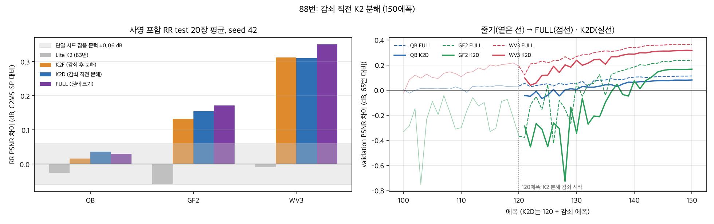
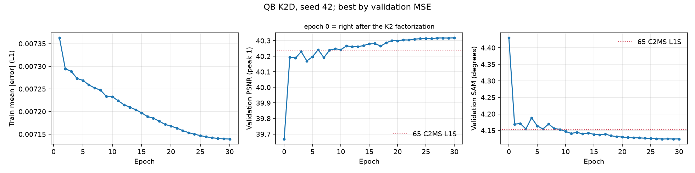
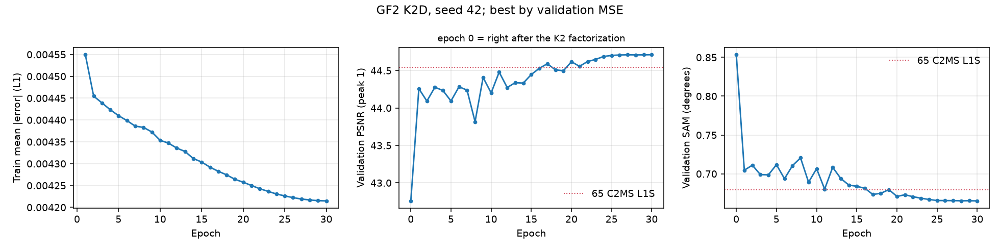
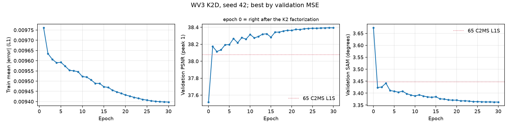
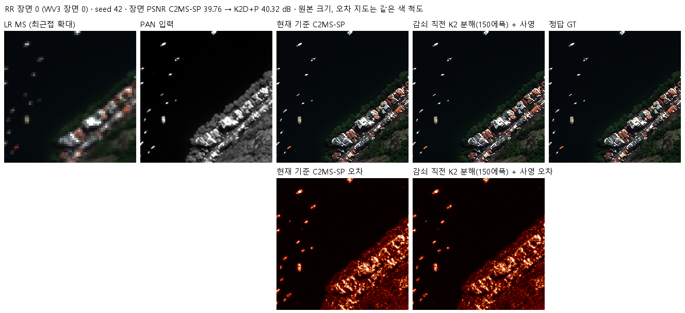
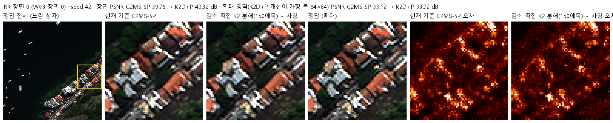

# 88. 일정 학습률 학습 뒤 감쇠 시작 시점의 저랭크 분해(K2)와 감쇠 구간 학습: 150에폭 경량 C2MS-SP 단일 시드 확인

| 분야 | 실험자 | 상태 | 판정 |
|:---:|:---:|:---:|:---:|
| 성능 개선 | 이병현 | 평가 완료 · seed 42 | **부분 개선** |

**변경:** 원래 크기 C2MS를 학습률 1e-4로 고정해 120에폭 학습했습니다([84번](../84_long_training_decay_branches/README.md) TRUNK와 같은 방식). 감쇠를 시작하는 120에폭에 [83번](../83_factorized_c2ms_finetuning/README.md) K2 구조(연산 66%, C2MS-SP-Lite와 같은 구조)로 분해하고, 남은 30에폭 cosine 감쇠를 K2 모델로 학습했습니다(K2D). 감쇠 구간이 분해 손실을 되찾는 미세조정 역할을 겸하므로 전체 학습은 C2MS-SP와 같은 150에폭입니다. 추론에는 [86번](../86_fft_adjoint_fast_inference/README.md)의 빠른 K10 사영을 썼습니다. 대조군은 같은 시드 C2MS-SP이고 seed 42 한 개입니다.

**결과:** K2D + 사영은 같은 시드 C2MS-SP보다 RR PSNR이 QB +0.036, GF2 +0.154, WV3 +0.310 dB였습니다. GF2·WV3는 PSNR·SAM·ERGAS가 모두 좋아져 개선이고, QB는 문턱(0.06 dB) 안이며 SAM이 0.0003° 나빠 부분 개선입니다. 세 센서 모두 −0.04 dB 이내라 경량 비열등도 만족합니다. 구조와 추론 비용이 같은 C2MS-SP-Lite보다는 QB +0.062, GF2 +0.213, WV3 +0.320 dB로 세 센서 모두 개선이었습니다. 같은 줄기에서 원래 크기로 감쇠한 FULL과의 차이(분해 비용)는 +0.007에서 −0.040 dB로 작았고, 감쇠 후 분해(K2F)보다 같거나 나았습니다. 판정은 부분 개선이며, 3시드 확인(seed 43·44)은 보류했습니다.

[실험 표](../README.md#experiments) · [결과](#results) · [해석과 판정](#verdict) · [방법](#method) · [그림](#figures) · [재현 자료](#evidence)

## 결과

### RR test (사영 포함, seed 42)

QB·GF2·WV3 test RR 20장 평균입니다. 시드가 하나라 시드별 값이 곧 표의 값입니다. 장면별 수치는 `results/<센서>_<갈래>_s42/evaluation/<센서>_v2_4.json`에, 대조군 장면별 수치는 [results/controls](results/controls/)에 있습니다.

| 센서 | C2MS-SP PSNR / SAM / ERGAS | **K2D + 사영** | 차이 | 판정 | 장면 승수 (PSNR · SAM) |
|---|---|---|---|---|---|
| QB | 38.396 / 4.4647 / 3.6738 | 38.432 / 4.4650 / 3.6615 | +0.036 / +0.0003 / −0.012 | 부분 개선 | 15 · 11 / 20 |
| GF2 | 48.732 / 0.7676 / 0.6955 | 48.887 / 0.7526 / 0.6820 | +0.154 / −0.015 / −0.014 | 개선 | 19 · 20 / 20 |
| WV3 | 38.663 / 2.9890 / 2.2405 | 38.973 / 2.9084 / 2.1599 | +0.310 / −0.081 / −0.081 | 개선 | 20 · 20 / 20 |
| WV2 전이 (참고) | 31.335 / 5.0999 / 3.7502 | 31.759 / 4.9747 / 3.5641 | +0.424 / −0.125 / −0.186 | 참고 | 16 · 18 / 20 |

FR QNR(참고)은 C2MS-SP 대비 QB −0.032, GF2 +0.000, WV3 −0.005, WV2 −0.002였습니다. FULL·K2F도 QB QNR이 −0.03 수준으로 낮아, 학습 일정(84번 방식)에서 오는 차이로 보입니다.

### 갈래별 RR PSNR (C2MS-SP 대비, dB)

| 갈래 | 구조 | 학습 | QB | GF2 | WV3 | WV2 (참고) |
|---|---|---|---:|---:|---:|---:|
| C2MS-SP-Lite (83번) | K2 | 65번 + 10에폭 | −0.026 | −0.058 | −0.010 | +0.002 |
| TRUNK (참고) | C2MS | 1e-4 고정 120에폭 | −0.001 | +0.121 | +0.149 | +0.393 |
| FULL (참고) | C2MS | 120 + 감쇠 30 | +0.030 | +0.172 | +0.350 | +0.427 |
| **K2D** | **K2** | **120 + 분해 + 감쇠 30** | **+0.036** | **+0.154** | **+0.310** | **+0.424** |
| K2F (참고) | K2 | FULL + 분해 + 10에폭 | +0.017 | +0.132 | +0.312 | +0.420 |
| (참고) 84번 B150 | C2MS | 120 + 감쇠 30 | +0.060 | +0.184 | +0.342 | +0.391 |

| 짝 비교 (RR PSNR, dB) | QB | GF2 | WV3 | 뜻 |
|---|---:|---:|---:|---|
| K2D − Lite | +0.062 | +0.213 | +0.320 | 같은 구조에서 학습법의 효과 (세 센서 모두 PSNR·SAM·ERGAS 개선) |
| K2D − FULL | +0.007 | −0.018 | −0.040 | 같은 줄기에서 분해 비용 |
| K2F − K2D | −0.020 | −0.022 | +0.002 | 감쇠 후 분해 대 감쇠 직전 분해 |
| FULL − 84번 B150 | −0.030 | −0.012 | +0.008 | 같은 방식 재실행의 차이 |

### validation과 학습 경과

| 실행 | 분해 직후 val PSNR | best 에폭 | best val PSNR (65번 대비) | best val SAM (65번 대비) |
|---|---:|---:|---:|---:|
| QB TRUNK · FULL · K2D · K2F | — · — · 39.668 · 39.573 | 120 · 150 · 30 · 10 | +0.032 · +0.112 · +0.080 · +0.069 | −0.006 · −0.039 · −0.029 · −0.024 |
| GF2 TRUNK · FULL · K2D · K2F | — · — · 42.759 · 42.834 | 118 · 148 · 30 · 10 | −0.075 · +0.236 · +0.167 · +0.139 | +0.008 · −0.019 · −0.014 · −0.012 |
| WV3 TRUNK · FULL · K2D · K2F | — · — · 37.518 · 37.548 | 120 · 150 · 29 · 10 | +0.191 · +0.364 · +0.317 · +0.315 | −0.053 · −0.098 · −0.085 · −0.083 |

- **분해 직후 회복:** 분해 직후 validation PSNR은 분해 전보다 K2D 0.60-1.42 dB, K2F 0.78-1.95 dB 낮았습니다. K2D는 학습률 1e-4에서 시작했지만 첫 에폭에 대부분 되찾았습니다(QB 39.668 → 40.194).
- **분해 오차:** backbone SVD 에너지 손실 0.35-0.57%, W2 CP 상대 오차 5.6-5.8%였습니다([init 기록](provenance/run_records/init/)).
- **GF2 흔들림:** 120에폭(분해 시점) validation이 직전 best보다 0.29 dB 낮았습니다. 고정 학습률 구간의 흔들림이며, 84번도 같은 지점에서 흔들렸습니다. FULL도 같은 상태에서 시작했으므로 K2D와의 비교는 공정합니다.

### 비용과 시간

| 시스템 | 파라미터 (4밴드) | 연산 (QB 256²) | 공식 설정 256² / 512² (QB) | 공식 설정 256² / 512² (WV3) | FP16 512² (QB · WV3) |
|---|---:|---:|---|---|---|
| C2MS-SP | 2,735,610 | 59.63 GMAC | 24.4 / 65.0 ms | 29.1 / 76.1 ms | 47.3 · 58.6 ms |
| C2MS-SP-Lite | 1,873,402 | 39.06 GMAC | 30.3 / 86.4 ms | 33.2 / 97.0 ms | 46.9 · 58.1 ms |
| **K2D** | **1,873,402 (68%)** | **39.06 GMAC (66%)** | **30.3 / 86.4 ms** | **33.3 / 97.2 ms** | **47.0 · 58.2 ms** |

- **측정 조건:** 모두 86번 빠른 사영을 포함하고, batch 1, test 장면 0, 85번 측정 규칙으로 쟀습니다([final_timing.json](results/final_timing.json)).
- **시간:** 공식 설정에서는 depthwise 합성곱 때문에 C2MS-SP보다 느리고, FP16에서는 같습니다(86번과 같은 경향). FP16의 RR 변화는 0.001 dB 이하였습니다.
- **학습량:** C2MS-SP와 같은 150에폭입니다. 이번 실행은 두 개씩 동시에 돌렸고, 에폭 시간은 TRUNK QB 134, GF2 152, WV3 99초, K2D 감쇠 QB 140, GF2 164, WV3 95초였습니다.

## 해석과 판정

### 해석

- **학습 일정의 이득:** 84번에서 본 학습 일정의 이득이 K2 구조에서도 대부분 남았습니다. 분해 비용은 감쇠 구간 30에폭 안에 거의 되찾아져, 같은 줄기의 원래 크기 모델과 0.04 dB 안이었습니다.
- **Lite보다 나은 이유:** Lite는 cosine으로 다 학습한 65번을 분해해 5e-5에서 10에폭 미세조정합니다. K2D는 고정 학습률로 학습한 상태를 분해한 뒤 감쇠 전체를 K2로 학습해, 같은 구조로 0.06-0.32 dB 높았습니다.
- **분해 시점:** 감쇠 전에 분해하는 쪽(K2D)이 감쇠 뒤 분해하는 쪽(K2F)보다 QB·GF2에서 0.02 dB 높고 WV3에서 같았습니다. 학습량도 150에폭으로 K2F(160에폭)보다 적어, K2D를 경량판 학습법으로 씁니다.
- **QB:** 84번처럼 학습 일정의 이득이 작았습니다. 원래 크기 FULL도 +0.030 dB로 문턱 안이고, 같은 방식을 다시 돌린 84번 B150(+0.060)과의 차이(0.03 dB)도 같은 크기입니다.

### 판정과 다음 단계

**부분 개선**입니다. 미리 정한 비교(K2D + 사영 대 같은 시드 C2MS-SP, [v2.4](../../../docs/judgement_criteria.md), 단일 시드 문턱 0.06 dB)에서 GF2·WV3는 개선, QB는 PSNR·ERGAS가 좋아졌지만 문턱 안이고 SAM이 0.0003° 나빠 부분 개선이었습니다. 세 센서 모두 −0.04 dB 이내라 경량 비열등(참고)이고, 같은 구조의 C2MS-SP-Lite보다는 세 센서 모두 개선입니다.

**2단계(3시드 확인):** 미리 정한 시작 조건(경량 비열등)을 통과했지만, 사용자 결정으로 seed 43·44는 보류했습니다. 실행하면 같은 설정으로 TRUNK와 K2D만 학습하고 3시드 평균을 판정합니다(2시드 이상 문턱 0.04 dB). 기준 모델 교체에는 3시드 개선과 사용자 결정이 필요합니다.

<b>방법</b> · 목적과 상태 · 변경한 구조와 비교 조건

### 목적과 상태

경량판 하나를 기준 모델로 삼으려면 C2MS-SP보다 가벼우면서 정확도가 같거나 높아야 합니다.

- **[87번](../87_reduced_width_short_finetuning/README.md):** 가운데 채널을 줄이는 방식은 seed 42에서 C2MS-SP보다 B32W96이 QB −0.076, GF2 −0.253, WV3 −0.146 dB, B32W64가 −0.236, −0.510, −0.443 dB였습니다. 같은 시드 Lite(K2)보다 손실이 훨씬 커서, 88번은 K2 구조를 씁니다.
- **[84번](../84_long_training_decay_branches/README.md):** 같은 150에폭에서도 고정 학습률 + 감쇠 일정이 cosine 일정보다 세 센서 모두 높았습니다.
- **88번의 질문:** 이 일정의 이득을 K2 구조에서도 얻을 수 있는지 봅니다.

**상태:** 1단계(seed 42)는 2026-11-18 17:34 - 11-19 04:22에 서버에서 학습·평가했습니다. 2단계(seed 43·44, TRUNK + K2D)는 코드와 조건을 등록해 두었지만 보류했습니다(2026-11-19 사용자 결정, seed 42 결과 전).

### 변경한 구조와 비교 조건

| 갈래 | 시작 | 학습 | 역할 |
|---|---|---|---|
| TRUNK | seed 42 초기값 | C2MS, Adam 1e-4 고정, 120에폭 | 모든 갈래의 공통 앞부분 |
| FULL | TRUNK 120에폭 전체 상태 | C2MS, 1e-4 → 1e-6 cosine 30에폭 | 같은 줄기의 원래 크기 감쇠(84번 B150 재실행), 참고 |
| **K2D** | TRUNK 120에폭 가중치 → K2 분해 | K2, 새 Adam, 1e-4 → 1e-6 cosine 30에폭 | **판정 후보** (총 150에폭) |
| K2F | FULL best → K2 분해 | K2, 5e-5 → 1e-6 cosine 10에폭(83번 Lite 방식) | 감쇠 후 분해, 참고 (총 160에폭) |

| 항목 | 내용 |
|---|---|
| 구조 | K2: backbone 3×3 64→64 8개를 3×3 64→32 + 1×1 32→64로, W2 3×3 128→128 16개를 1×1 128→384 · depthwise 3×3 · 1×1 384→128로 분해. 연산 66%, 파라미터 68%(C2MS-SP-Lite와 같음) |
| 분해 | 83번 방식: backbone은 학습 패치 512개(고정 생성기, seed 0)의 입력 2차 모멘트로 활성 인식 SVD, W2는 CP-ALS rank 384(150회, seed 0) |
| 데이터 | QB·GF2·WV3 학습·validation·test(각 20장면 RR·FR). WV3 모델은 WV2 test에도 적용(참고, 82번 보정 + 사영) |
| 손실 | 65번과 같음: 원래 쌍 L1 + 1.0 × 2배 거친 쌍 L1 + 0.46 × 분광 손실 |
| 학습 | batch 32, FP16 AMP(84번 학습기), 두 개씩 동시 학습. K2D는 데이터 순서·난수·GradScaler를 TRUNK에서 이어받고 Adam만 새로 만듭니다 |
| 가중치 선택 | 원래 축척 validation MSE 최소. FULL은 줄기 + 감쇠 에폭, K2D는 K2 에폭 0-30(0 = 분해 직후), K2F는 0-10 |
| 추론 | 네트워크 float32(TF32 끔), 사영 K10 float64(86번 FFT 전치) |
| 비교 | 공식: K2D + P vs C2MS-SP. 참고: K2D vs Lite(같은 구조, 학습법 효과), K2D vs FULL(분해 비용), K2F vs K2D(분해 시점), FULL vs 84번 B150(재실행 차이) |
| 시드 | 1단계 42(네 갈래). 2단계 43·44(TRUNK + K2D만, 조건부, 보류) |
| 시간 | 85번 측정 규칙으로 공식 설정과 참고 설정(cuDNN 자동 탐색 + TF32, FP16), 256²·512² |
| 소요 | 1단계 약 10.8시간(학습·평가·시간 측정). 2단계는 학습 약 15시간 + 평가 약 1시간 예상 |

<b>그림</b> · 학습·평가 그래프 · 결과 이미지

### 학습·평가 그래프

실행마다 학습 L1, validation PSNR·SAM과 65번 기준선(점선)을 그렸습니다(K2D·K2F의 0에폭 = 분해 직후).

다른 갈래의 그래프는 `results/<센서>_<갈래>_s42/evaluation/learning.png`에 있습니다.

### 결과 이미지

고정 6장면(0-based 0·1·3·7·14·17)에서 현재 기준 C2MS-SP와 각 갈래 + 사영을 비교했습니다. 확대 비교는 후보의 개선이 가장 큰 64×64 창을 4배 확대한 것이라 후보에 유리하게 골라졌습니다.

| 장면 PSNR (C2MS-SP → K2D + 사영, dB) | 0 | 1 | 3 | 7 | 14 | 17 |
|---|---|---|---|---|---|---|
| QB | 43.04 → 42.96 | 43.31 → 43.29 | 38.10 → 38.27 | 39.71 → 39.70 | 38.56 → 38.54 | 39.62 → 39.60 |
| GF2 | 47.79 → 47.96 | 49.43 → 49.66 | 49.85 → 50.08 | 50.78 → 51.00 | 48.04 → 48.12 | 49.63 → 49.82 |
| WV3 | 39.76 → 40.32 | 37.49 → 38.06 | 41.78 → 42.17 | 38.46 → 38.66 | 33.52 → 33.83 | 36.12 → 36.32 |

**WV3 장면 0 (K2D)**

나머지 장면·센서·갈래는 `results/<센서>_<갈래>_s42/evaluation/<센서>/`에 있습니다.

<b>재현 자료</b> · 코드, 가중치, 설정, 실행 기록

- [config.json](config.json): 가설, 근거, 갈래, 학습률 일정, 분해, 선택 규칙, 비교, 2단계 조건, 데이터 해시
- [model.py](model.py): 갈래별 구조(TRUNK·FULL은 C2MS, K2D·K2F는 83번 K2)와 83번 분해 함수
- [prepare.py](prepare.py): 86번 센서 연산·사영을 다시 내보냅니다(`FastProjected` = 86번 FFT 전치 사영)
- [train.py](train.py): 65번 손실의 58번 학습기에 84번 줄기·갈래 방식(학습률 일정, 120에폭 스냅샷, FULL 시작)과 분해 초기값 불러오기를 적용
- [evaluate.py](evaluate.py): 실행별 평가(C2MS-SP·Lite·84번 B150 대조), 단일 시드 요약(`summarize_arms`), 3시드 요약(`summarize_seeds`), 시간 측정
- [run.py](run.py): `prepare` → `optimize` → `run`(TRUNK → FULL·분해·K2D → 분해·K2F 순서로 두 개씩, 평가, 요약, 시간). `--stage 2`는 `gate` → `prepare` → `optimize` → `run`(seed 43·44 TRUNK + K2D, 3시드 요약). 1단계는 [source_manifest](provenance/source_manifest.json)의 커밋 코드로 실행했고, 2단계 코드는 그 뒤에 추가했습니다(1단계 경로의 동작은 같음)
- 가중치: `checkpoints/<센서>_<갈래>_s42/best.pt`·`best_ema.pt`는 Git에, `latest.pt`·`initial.pt`(K2D·K2F는 분해 직후 초기값)는 GitHub Release `weights-experiments-performance-88`에 있고 [manifest.json](manifest.json)의 `release_assets`에 크기·SHA-256이 있습니다. 120에폭 스냅샷은 TRUNK 마지막 상태와 같아 따로 보관하지 않았고, 해시는 `results/<센서>_TRUNK_s42/snapshot_e120.json`에 있습니다
- 결과: [summary.json](results/summary.json)(갈래별 판정과 짝 비교), [final_timing.json](results/final_timing.json), 실행별 기록·장면별 수치(`results/<센서>_<갈래>_s42/`), [results/controls](results/controls/)(C2MS-SP·Lite·84번 B150 장면별 수치)
- 실행 기록: [provenance/run_records](provenance/run_records/)(봉인된 실행 설정, 데이터 해시, 환경, 사전 점검, 분해 기록 `init/`), [provenance/source_manifest.json](provenance/source_manifest.json)(서버에 올린 소스 해시), [provenance/server_cleanup.json](provenance/server_cleanup.json)(88번 시작 전 86·87번 실행 폴더 정리)
- 보관 해시 확인: `python SSA-MRN/common/verify.py --experiment 88 --releases`

