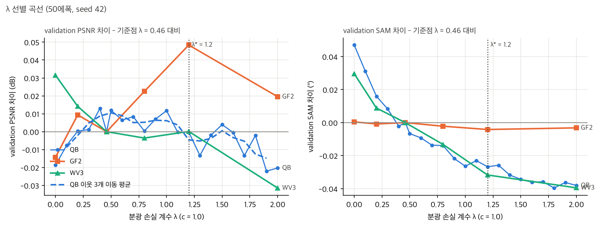
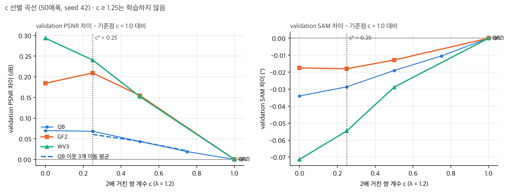
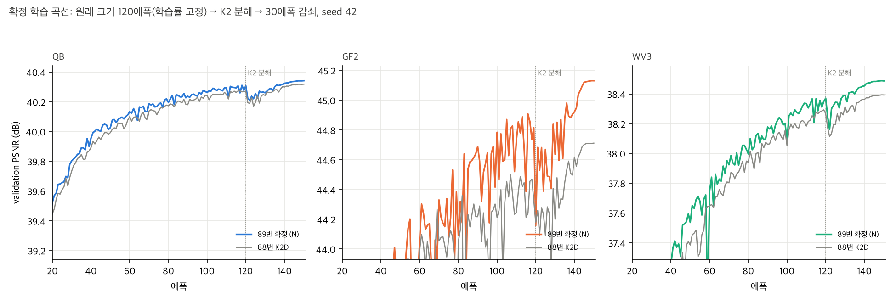
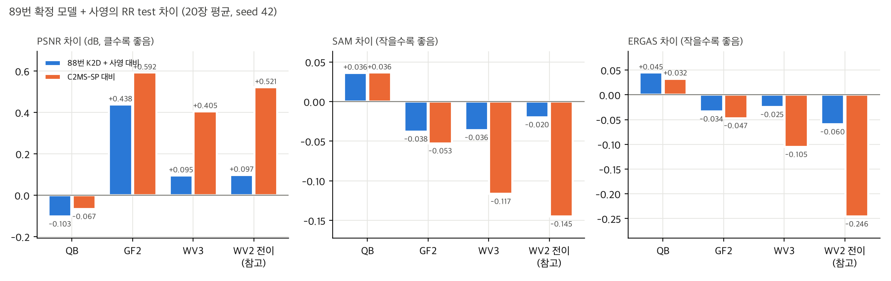
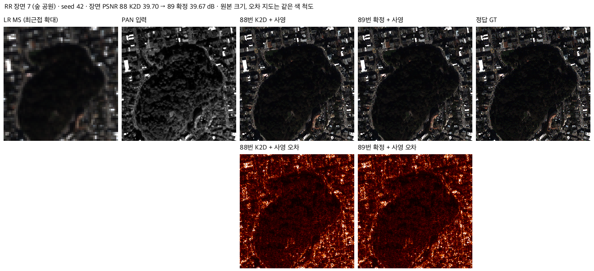

# 89. 분광 손실 계수(λ)와 2배 거친 쌍 계수(c) 탐색: K2D 학습법, W2 2×2 합성곱 구현

| 분야 | 실험자 | 상태 | 판정 |
|:---:|:---:|:---:|:---:|
| 성능 개선 | 이병현 | 평가 완료 · seed 42 | **부분 개선** |

**변경:** 학습 손실 `L1(원래 쌍) + c × L1(2배 거친 쌍) + λ × 분광 손실`의 두 계수를 50에폭 선별 학습 곡선으로 다시 골랐습니다(기존 λ = 0.46, c = 1.0). W2 병렬 가지의 입·출력 층은 같은 연산의 2×2 합성곱 구현으로 바꿨습니다. 고른 λ\* = 1.2, c\* = 0.25로 [88번](../88_factorization_at_decay_start/README.md) K2D 학습법(원래 크기 120에폭 → K2 분해 → 30에폭 감쇠)을 QB·GF2·WV3 seed 42에서 학습해, 같은 시드 88번 K2D와 사영 포함 RR test로 비교했습니다.

**결과:** 88번 K2D + 사영 대비 RR test PSNR이 GF2 +0.438 dB(20/20장), WV3 +0.095 dB(19/20장)로 개선이고, QB는 −0.103 dB(2/20장)로 개선 없음이라 부분 개선입니다(seed 42). C2MS-SP 대비로는 GF2 +0.592, WV3 +0.405, QB −0.067 dB이고, WV2 전이(참고)는 +0.521 dB입니다. 연산량은 88번 K2D와 같습니다(256² 39.06 GMAC, C2MS-SP의 66%).

[실험 표](../README.md#experiments) · [결과](#results) · [해석과 판정](#verdict) · [방법](#method) · [그림](#figures) · [재현 자료](#evidence)

## 결과

### 확정 모델 RR test (사영 포함, 20장 평균, seed 42)

대조군은 같은 시드 88번 K2D + 사영, 참고는 같은 시드 C2MS-SP(65번 + 사영)입니다. 차이는 확정 모델 − 비교 대상이고, 좋아진 장면은 20장 중 PSNR·SAM이 좋아진 장면 수입니다.

| 센서 | 88번 K2D + 사영 PSNR / SAM / ERGAS | 확정 모델 + 사영 PSNR / SAM / ERGAS | 88번 K2D 대비 차이 | 좋아진 장면 PSNR · SAM | C2MS-SP 대비 차이 | 판정 (88번 K2D 대비) |
|---|---|---|---|---|---|:---:|
| QB | 38.432 / 4.465 / 3.662 | 38.329 / 4.501 / 3.706 | −0.103 / +0.036 / +0.045 | 2 · 2 | −0.067 / +0.036 / +0.032 | 개선 없음 |
| GF2 | 48.887 / 0.753 / 0.682 | 49.325 / 0.715 / 0.648 | +0.438 / −0.038 / −0.034 | 20 · 20 | +0.592 / −0.053 / −0.047 | **개선** |
| WV3 | 38.973 / 2.908 / 2.160 | 39.068 / 2.873 / 2.135 | +0.095 / −0.036 / −0.025 | 19 · 20 | +0.405 / −0.117 / −0.105 | **개선** |
| WV2 전이 (참고) | 31.759 / 4.975 / 3.564 | 31.856 / 4.955 / 3.504 | +0.098 / −0.020 / −0.060 | 9 · 16 | +0.521 / −0.145 / −0.246 | (참고) |

- WV2 전이는 WV3 모델에 82번 밴드별 보정을 붙인 값입니다(세 모델 모두 같은 처리).
- FR QNR(참고, 사영 포함): QB 0.890(88번 K2D 0.881, C2MS-SP 0.913), GF2 0.966(0.963, 0.962), WV3 0.938(0.944, 0.948), WV2 0.912(0.928, 0.929).
- validation(사영 없는 네트워크 출력)은 세 센서 모두 88번 K2D보다 높습니다: QB 40.342 대 40.318(+0.023 dB), GF2 45.131 대 44.711(+0.420), WV3 38.489 대 38.394(+0.096).

### λ·c 선택 (validation, 50에폭 선별)

| 단계 | QB 이동 평균 최대 (x_QB) | 세 센서 공통 점 최고 (p\*) | p\* 구간 | 고른 값 | SAM 확인 (고른 값, 기준점 대비) |
|---|---|---|---|---|---|
| A (λ, c = 1.0, 기준점 λ = 0.46) | 0.5 (+0.0105 dB) | 1.2 (+0.0161 dB) | 0.8-2.0 | **λ\* = 1.2** (x_QB가 구간 밖이라 p\*) | QB −0.027°, GF2 −0.004°, WV3 −0.032° 통과 |
| B (c, λ = 1.2, 기준점 c = 1.0) | 0.25 (+0.0604 dB) | 0 (+0.1825 dB) | 0-0.25 | **c\* = 0.25** (범위 끝 표시) | QB −0.029°, GF2 −0.018°, WV3 −0.055° 통과 |

- A단계 공통 점의 세 센서 평균은 λ = 0, 0.2, 0.8, 1.2, 2.0에서 −0.001, +0.008, +0.006, +0.016, −0.011 dB입니다. QB는 0.2-1.9에서 ±0.02 dB 안으로 평평하고, SAM은 세 센서 모두 λ가 클수록 좋아집니다.
- B단계(c = 0, 0.25, 0.5, 1.0) 기준점 대비: QB +0.070, +0.068, +0.043, 0; GF2 +0.184, +0.209, +0.155, 0; WV3 +0.293, +0.241, +0.152, 0 dB. QB c = 0.75는 +0.019 dB입니다. c ≥ 1.25는 학습하지 않았습니다(사용자 결정).
- 같은 설정(λ = 1.2, c = 1.0)을 A·B단계에서 두 번 학습한 validation 차이는 QB 0.001, GF2 0.028, WV3 0.025 dB입니다. λ 차이(0.02 dB 수준)는 이 재현 차이 안이고, c 차이(최대 0.29 dB)는 그보다 큽니다.
- 선별 학습 타당성 참고: QB λ = 0의 기준점 대비 차이(−0.019 dB, SAM +0.047°)는 150에폭 cosine validation 비교(63번 λ = 0 − 65번 λ = 0.46: −0.029 dB, +0.048°)와 방향과 크기가 비슷합니다.

### W2 2×2 합성곱 확인 (QB seed 42, λ = 0.46, c = 1.0, K2D 150에폭)

| 비교 | validation PSNR / SAM | 판정 |
|---|---|---|
| 2×2 구현 − 88번 K2D | +0.002 dB / −0.002° (40.320 대 40.318) | 적용 (−0.06 dB 이상) |
| test RR (사영 포함, 보고만) | 88번 K2D 대비 −0.027 dB, C2MS-SP 대비 +0.009 dB | |

출력 쪽은 `ConvTranspose2d`를 썼습니다(PixelShuffle 구현이 공식 설정에서 5-7% 빨랐지만 graph_fp16에서 1% 느려 규칙상 `ConvTranspose2d`). 파라미터는 원래 구현보다 192개 적습니다.

## 해석과 판정

**계수:** λ를 0.46에서 1.2로 올리면 PSNR은 거의 그대로이고 SAM이 세 센서 모두 좋아집니다. c를 1.0에서 0.25로 낮추면 원래 축척 validation이 크게 좋아집니다(c = 0이 가장 높지만 규칙상 범위 끝을 뺀 0.25). 50에폭 선별에서 2배 거친 쌍 학습이 원래 축척 학습을 늦추는 효과가 크게 보였고, 150에폭 확정에서도 GF2·WV3 validation과 test가 함께 좋아졌습니다.

**QB:** validation은 88번 K2D보다 높지만(+0.023 dB) test는 낮습니다(−0.103 dB, 2/20장). 84번에서 학습을 늘렸을 때 QB에서 본 validation·test 엇갈림과 같은 모양입니다. 89번 선별 실행의 test(보고용)에서 QB는 λ·c를 바꿔도 C2MS-SP 대비 −0.10 - −0.14 dB로 비슷해, λ나 c 하나 때문이라고 할 근거는 없습니다. W2 2×2 확인에서도 QB test는 −0.027 dB였습니다. 단일 시드라 QB 시드 편차일 가능성도 있습니다.

### 판정과 다음 단계

[v2.4](../../../docs/judgement_criteria.md) 단일 시드 문턱 0.06 dB로 88번 K2D + 사영 대비 GF2·WV3는 PSNR·SAM·ERGAS가 모두 좋아지고 PSNR이 문턱을 넘어 개선, QB는 세 지표가 모두 나빠져 개선 없음입니다. 세 센서가 모두 개선은 아니므로 **부분 개선**입니다(seed 42, 보고용). 기준 모델은 바꾸지 않습니다. 이 확정 모델(λ 1.2, c 0.25, W2 2×2, K2D)이 [90번](../90_dataset_matched_internal_resampling/README.md)(#203)의 기반(N 갈래)이고, 기준 모델 교체 판정은 최종 모델 3시드에서 한 번만 합니다.

한계:

- 단계마다 seed 42 하나로 골랐고, 3시드 판정은 최종 모델에서만 합니다.
- 선별은 원래 크기 모델 50에폭이고 확정은 K2D 150에폭입니다.
- GF2·WV3는 공통 점만 학습해 QB 최적 구간을 확인하는 데만 썼습니다. c\* = 0.25는 범위 끝(중심 후보 0.25-0.75의 끝)이고, c ≥ 1.25는 학습하지 않았습니다.
- validation은 사영 없는 네트워크 출력이고, 확정 비교는 사영을 붙였습니다.

<b>방법</b> · 목적과 상태 · 변경한 구조와 비교 조건

### 목적과 상태

최종 모델(C2MS-SP보다 가볍고 정확도가 같거나 높은 모델)을 만드는 두 번째 단계입니다. 88번 K2D → 이 실험(W2 2×2, λ·c) → #203(모델 내부 축소·확대) 순서로 쌓고, 마지막 모델만 3시드로 C2MS-SP 교체를 판정합니다. **test는 측정·보고만 하고 고르거나 적용 여부를 정하는 데 쓰지 않습니다.**

**상태:** 평가 완료(seed 42, 2026-11-21). 88번 K2D 채택을 전제로 88번 체인이 끝난 뒤 자동으로 시작했습니다(`chain89.ps1`, 2026-11-19 04:27). 순서는 0단계 확인 → 캐시 준비 → GPU가 빈 상태에서 W2 출력 쪽 구현 시간 측정·대조군 평가·사전 점검 → 2×2 확인과 A단계 → A단계 선택(2026-11-20 14:13) → B단계 → B단계 선택(2026-11-21 01:15) → 확정 학습(90번 컨트롤러 N 갈래, 2026-11-21 02:11-11:58)입니다.

**중단 규칙(사용자 결정):** 프로세스 오류, 끝나지 않은 실행, validation 이상(best 에폭 0, 유한하지 않은 값, 같은 시드 C2MS-SP보다 validation PSNR이 1.0 dB 넘게 낮음), 2×2 확인 −0.06 dB 미만 중 하나라도 생기면 새 학습을 띄우지 않습니다. 돌고 있는 학습은 강제로 끝내지 않고 마치게 둔 뒤 `stopped.json`을 남기고 멈춥니다. 2026-11-19 14시 사용자 결정으로 validation PSNR 1.0 dB 문턱은 뺐습니다. 실행 중인 컨트롤러는 그대로 두고, 이 문턱만으로 멈추면 [continue_without_margin.py](provenance/continue_without_margin.py)가 문턱 없이 이어서 실행합니다(학습 코드·설정은 같음, 감시: [watch_margin_stop.ps1](provenance/watch_margin_stop.ps1)). 나머지 중단 조건은 그대로입니다.

**B단계 범위 축소(2026-11-20 사용자 결정):** A단계 선택은 λ\* = 1.2입니다. B단계에서 c = 0·0.5·1.0의 validation이 c가 클수록 낮아져, 시간을 줄이려고 c ≥ 1.25(1.25·1.5·1.75·2.0)는 학습하지 않고 작은 c 구간을 촘촘히 봅니다. 실행 중인 컨트롤러는 그대로 두고, [block_high_c.py](provenance/block_high_c.py)가 c ≥ 1.25 실행의 작업 잠금을 미리 잡아 첫 c ≥ 1.25 학습이 체크포인트 없이 끝나면 컨트롤러가 멈춥니다. 그 뒤 [run_fine_c.py](provenance/run_fine_c.py)가 같은 학습 코드·설정으로 GF2·WV3·QB c = 0.25와 QB c = 0.75를 학습·평가하고, 선택 규칙을 줄인 격자(QB 0-1.0, 0.25 간격, 중심 0.25-0.75, 세 센서 공통 점 0·0.25·0.5·1.0, 기준점 c = 1.0)로 적용합니다(`selection_B_reduced.json`).

**확정 학습(2026-11-20 사용자 결정):** c\* = 0.25가 뽑히면 서버 정리 뒤 자동으로 시작합니다. 확정 모델은 [90번](../90_dataset_matched_internal_resampling/README.md)의 대조군(N 갈래)과 같은 모델이라, 90번 컨트롤러에서 함께 학습합니다(λ = 1.2, c = 0.25, W2 2×2, 88번 K2D 150에폭, QB·GF2·WV3 seed 42). 결과(88번 K2D + 사영 대비 RR test, WV2 전이·FR 참고)는 이 보고서에 적습니다.

### W2 2×2 합성곱 확인

| | 지금 (C2MS-SP) | 바꾼 구현 |
|---|---|---|
| 입력 쪽 | `PixelUnshuffle(2)` → `Conv2d(256, 128, 1)` | `Conv2d(64, 128, 2, stride=2)` (같은 연산) |
| 출력 쪽 | `Conv2d(128, 256, 1)` (0 초기화) → `PixelShuffle(2)` | 2×2 보폭 2 전치 합성곱 128→64 (0 초기화), 바이어스 256 → 64개 |

- 출력 쪽은 `ConvTranspose2d`와 `Conv2d(128, 256, 1, bias=False)` → `PixelShuffle(2)` → 채널별 바이어스 중 빠른 쪽을 씁니다. 85번 규칙(공식 설정)과 86번 graph_fp16, 256²·512²에서 재고, 두 설정 모두 3% 이상 빠른 쪽이 없으면 `ConvTranspose2d`를 씁니다.
- K2 분해가 2×2 입·출력 층을 건드리지 않는지, 분해 후 파라미터가 원래 구현 K2보다 정확히 192개 적은지 확인합니다.
- **확인 실행:** QB seed 42, λ = 0.46, c = 1.0, 88번 K2D 학습법. **적용 규칙:** validation PSNR 차이(88번 K2D seed 42 대비)가 −0.06 dB 이상이면 적용합니다. test는 보고만 합니다.
- A·B단계는 처음부터 2×2 구현을 씁니다. 적용하지 않기로 하면 확정 학습만 원래 구현으로 합니다.

### λ·c 탐색

| 단계 | 바꾸는 계수 | QB | GF2·WV3 | 기준점 |
|---|---|---|---|---|
| A | λ (c = 1.0) | 0, 0.1-2.0(0.1 간격), 0.46 → 22개 | 0, 0.2, 0.46, 0.8, 1.2, 2.0 → 6개씩 | λ = 0.46 |
| B | c (λ = λ\*) | 0-2.0(0.25 간격) → 9개 | 0, 0.5, 1.0, 1.5, 2.0 → 5개씩 | (λ\*, c = 1.0), B단계에서 다시 학습 |

**선별 학습:** 원래 크기 모델 50에폭(40에폭 1e-4 고정 + 10에폭 1e-6까지 cosine), 원래 축척 validation MSE 최소 에폭.

**선택 규칙** (A·B 같음, [config.json](config.json)의 `selection_rule`):

1. Δ_s(x) = 센서 s, 후보 x의 원래 축척 validation PSNR − 기준점의 값
2. QB 고른 간격 점에서 이웃 3개 이동 평균이 가장 큰 중심 x_QB(양 끝 제외, 0.46은 기준점으로만 씀)
3. 세 센서 공통 점에서 Δ 평균이 가장 큰 p\*. x_QB가 p\* 양옆 공통 점 사이에 있으면 x_QB, 아니면 p\*
4. 고른 값을 학습한 센서에서 validation SAM이 기준점보다 τ_s(QB 0.004°, GF2 0.004°, WV3 0.024°, 65번 3시드 표준편차의 2배) 넘게 나빠지면 다음 후보(p\* 구간 안 QB 중심 → 나머지 공통 점 순). 모두 실패하면 기준점 유지
5. 범위 끝이 뽑히면 범위 밖 가능성을 적고 넓히지 않습니다. c = 0이 뽑히면 받아들이고 축척 혼합이 빠졌다고 적습니다.

고른 λ\*·c\*는 곡선과 함께 보고하고 사용자 확인을 받은 뒤 다음 단계로 넘어갑니다.

### 확정과 비교 조건

| 항목 | 내용 |
|---|---|
| 확정 학습 | λ\*·c\*, 확인 결과의 W2 구현, 88번 K2D 학습법 150에폭, QB·GF2·WV3 seed 42 |
| 대조군 | 같은 시드 88번 K2D + 사영 |
| 참고 | 같은 시드 C2MS-SP(65번 + 사영) |
| 판정 | v2.4 RR test PSNR·SAM·ERGAS, 단일 시드 문턱 0.06 dB (보고용) |
| WV2 전이·FR | 확정 모델만 참고로 측정(82번 보정, 사영 포함) |
| 실행 | 공용 서버(RTX 3060 Ti), 두 개씩 동시. 선별은 `C:\CtrS-p89`(A단계는 공통 점 먼저, 나머지 QB 16개를 뒤에), 확정은 90번 runtime `C:\CtrS-p90`의 N 갈래(`NT` → `NK`) |
| 예상 GPU 시간 | 2×2 확인 약 2.8, A단계 약 31, B단계 약 17, 확정 약 8시간(두 개 동시 실행 시간 합 ÷ 2, 88번 실측 에폭 시간 기준) |

<b>그림</b> · 학습·평가 그래프 · 결과 이미지

**λ 선별 곡선 (A단계):** 센서별 validation 차이(기준점 λ = 0.46), QB 이웃 3개 이동 평균, 고른 값.

**c 선별 곡선 (B단계, λ = 1.2):**

**확정 학습 곡선:** 원래 크기 120에폭 → K2 분해 → 30에폭 감쇠. 회색은 같은 시드 88번 K2D입니다.

**확정 모델 RR test 차이 (사영 포함):**

**결과 이미지 (RR test 고정 6장면, 88번 K2D + 사영 대 확정 모델 + 사영):** 장면마다 원본 크기 비교(`full_scene_XX.png`)와 확대 비교(`compare_scene_XX.png`)가 있습니다. QB는 [results/QB_NK_s42/evaluation/QB](results/QB_NK_s42/evaluation/QB), GF2는 [results/GF2_NK_s42/evaluation/GF2](results/GF2_NK_s42/evaluation/GF2), WV3는 [results/WV3_NK_s42/evaluation/WV3](results/WV3_NK_s42/evaluation/WV3), WV2 전이(참고, 82번 보정 포함)는 [results/WV3_NK_s42/evaluation/WV2](results/WV3_NK_s42/evaluation/WV2)에 있습니다. 장면 번호는 QB 정답만 보고 정한 표준 번호를 모든 데이터셋에 같이 썼습니다. 확대 창은 확정 모델의 개선이 가장 큰 64×64라 확정 모델에 유리하게 고른 것이고, 장면 PSNR은 각 이미지 제목과 `result_images.json`에 있습니다(서버 평가값과 같음).

| 장면 PSNR (88번 K2D → 확정) | 0 | 1 | 3 | 7 | 14 | 17 |
|---|---|---|---|---|---|---|
| QB | 42.96 → 43.11 | 43.29 → 43.29 | 38.27 → 38.08 | 39.70 → 39.67 | 38.54 → 38.37 | 39.60 → 39.47 |
| GF2 | 47.96 → 48.68 | 49.66 → 50.08 | 50.08 → 50.54 | 51.00 → 51.46 | 48.12 → 48.58 | 49.82 → 50.17 |
| WV3 | 40.32 → 40.41 | 38.06 → 38.21 | 42.17 → 42.39 | 38.66 → 38.71 | 33.83 → 33.87 | 36.32 → 36.34 |
| WV2 전이 (참고) | 31.39 → 31.33 | 29.42 → 29.96 | 37.10 → 36.84 | 31.37 → 31.49 | 31.22 → 31.09 | 31.51 → 31.51 |

**C2MS-SP 대 확정 모델 (같은 장면, 둘 다 사영 포함):** `results/<센서>_NK_s42/evaluation/<대상>_vs_C2MS_SP`([QB](results/QB_NK_s42/evaluation/QB_vs_C2MS_SP), [GF2](results/GF2_NK_s42/evaluation/GF2_vs_C2MS_SP), [WV3](results/WV3_NK_s42/evaluation/WV3_vs_C2MS_SP), [WV2 전이](results/WV3_NK_s42/evaluation/WV2_vs_C2MS_SP)).

| 장면 PSNR (C2MS-SP → 확정) | 0 | 1 | 3 | 7 | 14 | 17 |
|---|---|---|---|---|---|---|
| QB | 43.04 → 43.11 | 43.31 → 43.29 | 38.10 → 38.08 | 39.71 → 39.67 | 38.56 → 38.37 | 39.62 → 39.47 |
| GF2 | 47.79 → 48.68 | 49.43 → 50.08 | 49.85 → 50.54 | 50.78 → 51.46 | 48.04 → 48.58 | 49.63 → 50.17 |
| WV3 | 39.76 → 40.41 | 37.49 → 38.21 | 41.78 → 42.39 | 38.46 → 38.71 | 33.52 → 33.87 | 36.12 → 36.34 |
| WV2 전이 (참고) | 30.90 → 31.33 | 29.44 → 29.96 | 36.91 → 36.84 | 30.67 → 31.49 | 30.55 → 31.09 | 30.95 → 31.51 |

<b>재현 자료</b> · 코드, 가중치, 설정, 실행 기록

- [config.json](config.json): 가설, 2×2 확인과 적용 규칙, 선별 학습, A·B단계 후보, 선택 규칙과 잡음 문턱 근거, 중단 규칙, 확정과 비교
- [model.py](model.py): W2 2×2 변환(`to_2x2`, 입력 쪽은 시드 초기값을 그대로 재배열해 초기 함수가 같음), 출력 쪽 두 구현, 갈래 이름(`W2T`·`W2K`·`L<λ>C<c>`·`BL<λ>C<c>`)
- [train.py](train.py): 88번 학습기에 갈래별 학습률 일정과 갈래 이름에서 읽는 λ·c를 적용
- [evaluate.py](evaluate.py): RR test 평가(사영 유무, 같은 시드 C2MS-SP·88번 K2D 대비, 보고용), 출력 쪽 구현 시간 측정
- [selection.py](selection.py): validation 선택 규칙
- [run.py](run.py): `gate88` → `prepare` → `optimize` → `run`(2×2 확인 + A단계 → 선택 → B단계 → 선택), 중단 규칙
- 실행 중 변경 기록: [continue_without_margin.py](provenance/continue_without_margin.py)·[watch_margin_stop.ps1](provenance/watch_margin_stop.ps1)(PSNR 문턱 제거, 실제로는 쓰이지 않음), [block_high_c.py](provenance/block_high_c.py)·[run_fine_c.py](provenance/run_fine_c.py)(B단계 범위 축소와 c = 0.25 추가)
- 확정 학습 소스: [provenance/confirmation_source](provenance/confirmation_source)(90번 컨트롤러가 학습 당시 쓴 파일, 봉인된 `source_hashes`와 같음)
- 실행 기록: [provenance/run_records](provenance/run_records)(선별 runtime 설정·데이터 manifest·사전 점검·중단·선택 기록, 잠금으로 막은 GF2 c = 1.5 실행의 실패 기록), [provenance/confirmation_run_records](provenance/confirmation_run_records)(확정 runtime 설정·분해 기록·사전 점검)
- 결과: [results](results)의 실행별 `training_complete.json`·`history.json`·`evaluation/`, `selection_A.json`, `selection_B_reduced.json`, `w2_check.json`, 대조군 평가(`controls/`)
- 가중치: 확정 모델(`{QB,GF2,WV3}_NT_s42`, `_NK_s42`)과 2×2 확인(`QB_W2T_s42`, `QB_W2K_s42`)은 `checkpoints/<실행>/best.pt`·`best_ema.pt`(Git)와 `latest.pt`·`initial.pt`(Release `weights-experiments-performance-89`). 50에폭 선별 47개는 `best.pt`만 같은 Release에 올렸습니다(2026-11-21 사용자 결정). 경로·크기·SHA-256은 [manifest.json](manifest.json)에 있습니다.

