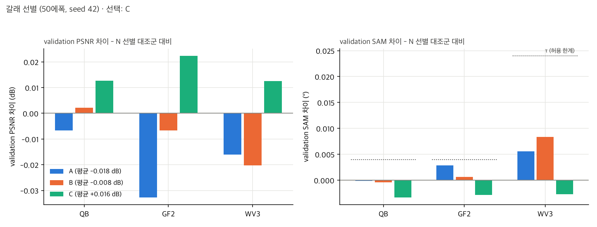
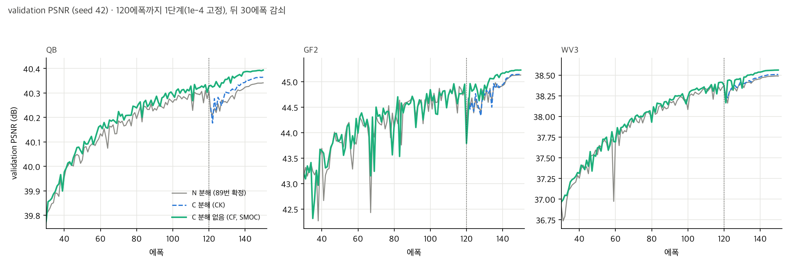
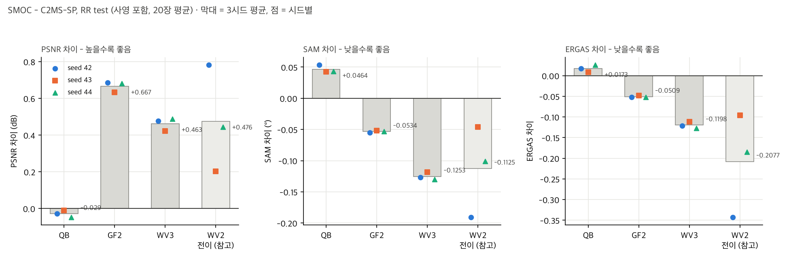
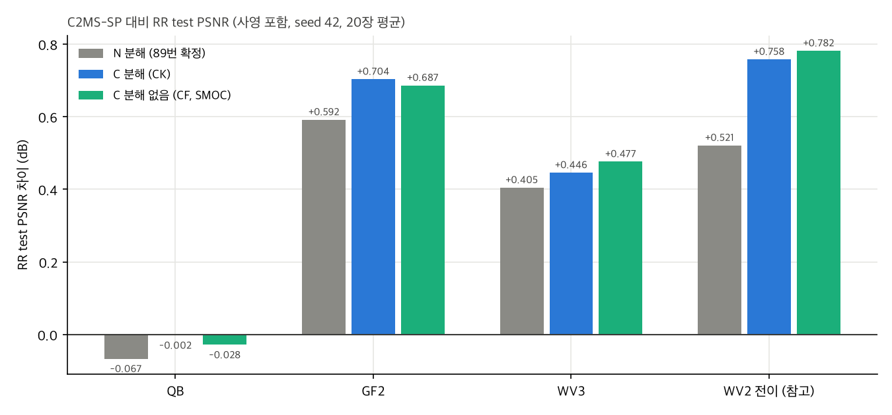
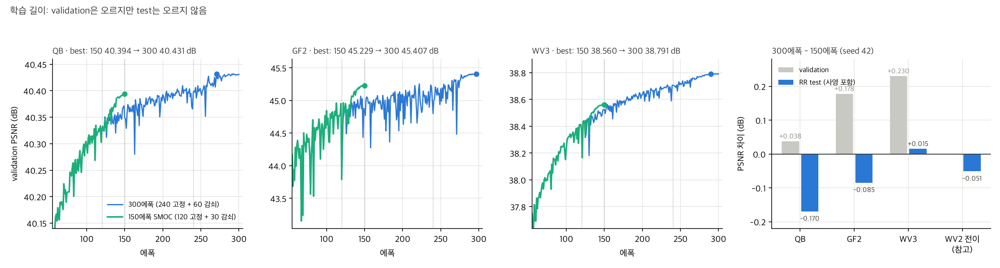
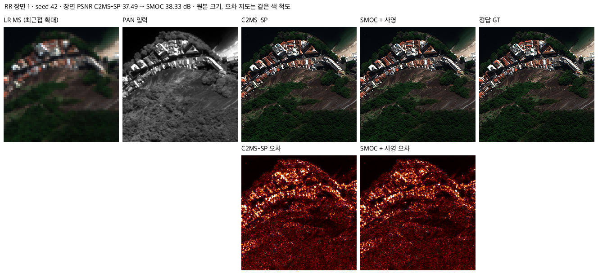

# 90. 모델 내부 축소·확대를 데이터셋 방식(23탭 보간, MTF 블러 + 솎음)으로 교체

| 분야 | 실험자 | 상태 | 판정 |
|:---:|:---:|:---:|:---:|
| 성능 개선 | 이병현 | 평가 완료 | **부분 개선** |

**변경:** 원본 코드가 모델 안에서 쓰는 bilinear 축소·확대(`nn.Upsample`, `align_corners=True`)를 데이터셋을 만든 연산으로 바꿉니다. A는 입력 확대(LRPAN 4배, MS 2배)를 23탭 보간으로, B는 A에 더해 LRPAN을 PAN MTF 블러 + 4배 솎음으로 바꿉니다. C는 모델 안의 고정 축소·확대를 모두 데이터셋 연산으로 맞춘 모델로, B에 더해 내부 축소를 센서 MTF 블러 + 솎음으로, 출력 확대를 23탭 보간으로 바꿉니다. 학습할 파라미터는 바뀌지 않습니다. 대조군은 같은 조건에서 연산을 바꾸지 않은 N이며, N은 [89번](../89_spectral_coarse_loss_weights/README.md)에서 고른 λ = 1.2, c = 0.25의 확정 모델입니다. 50에폭 선별에서 고른 C를 K2 분해 없이 원래 크기 150에폭으로 학습한 모델(`CF`)이 최종 모델 **SMOC**입니다.

**결과:** 50에폭 선별 validation에서 C만 세 센서 모두 N보다 좋아(평균 +0.016 dB) C를 골랐습니다. 같은 K2D 학습법으로 비교한 RR test(사영 포함, seed 42)에서 C는 N보다 QB +0.065, GF2 +0.112, WV3 +0.041 dB였고 세 센서 모두 SAM·ERGAS도 좋아졌습니다. 최종 모델 SMOC(C, 분해 없음)는 같은 시드 C2MS-SP와 짝지은 3시드 평균에서 GF2 +0.667 dB, WV3 +0.463 dB로 PSNR·SAM·ERGAS가 모두 좋아 개선이었고, QB는 −0.029 dB, SAM +0.046°로 개선 없음이었습니다. 판정은 부분 개선입니다. 같은 일정으로 300에폭까지 늘리면(seed 42) validation은 세 센서 모두 올랐지만 RR test는 QB −0.170, GF2 −0.085, WV3 +0.015 dB로 좋아지지 않아, 기준 모델은 150에폭으로 둡니다.

[실험 표](../README.md#experiments) · [결과](#results) · [해석과 판정](#verdict) · [방법](#method) · [그림](#figures) · [재현 자료](#evidence)

## 결과

### 갈래 선별 (50에폭 validation, seed 42)

원래 크기 2×2 모델을 40에폭 1e-4 고정 + 10에폭 cosine으로 학습한 validation(사영 없음, 원래 축척)을 N 선별 대조군(89번 B단계 `BL1.20C0.25`, 같은 학습법·시드)과 비교했습니다.

| 갈래 | QB PSNR / SAM | GF2 PSNR / SAM | WV3 PSNR / SAM | 세 센서 평균 PSNR |
|---|---|---|---|---:|
| A (입력 확대 23탭) | −0.007 / −0.0001 | −0.033 / +0.0029 | −0.016 / +0.0056 | −0.018 |
| B (A + LRPAN MTF) | +0.002 / −0.0004 | −0.007 / +0.0006 | −0.020 / +0.0083 | −0.008 |
| **C (내부 축소·확대 모두)** | **+0.013 / −0.0033** | **+0.022 / −0.0029** | **+0.013 / −0.0027** | **+0.016** |

PSNR은 dB, SAM은 °입니다. 평균이 0보다 크고 어느 센서도 SAM이 τ(QB·GF2 0.004°, WV3 0.024°)보다 나빠지지 않은 갈래 중 평균이 가장 큰 C를 골랐습니다([screen_selection.json](results/screen_selection.json)).

### 갈래 효과: C 대 N (K2D 150에폭, seed 42)

두 모델 모두 1단계 120에폭(1e-4 고정) → K2 분해 → 30에폭 cosine입니다(88번 K2D). test는 RR 20장 평균, 사영 포함입니다([chosen_comparison.json](results/chosen_comparison.json)).

| 센서 | validation PSNR (N → C) | test PSNR 차이 | test SAM 차이 | test ERGAS 차이 | 참고 판정 (단일 시드) |
|---|---|---:|---:|---:|---|
| QB | 40.342 → 40.365 (+0.023) | +0.065 | −0.0080 | −0.0286 | 개선 |
| GF2 | 45.131 → 45.144 (+0.013) | +0.112 | −0.0038 | −0.0067 | 개선 |
| WV3 | 38.489 → 38.507 (+0.018) | +0.041 | −0.0059 | −0.0091 | 부분 개선 (문턱 0.06 dB 안) |
| WV2 전이 (참고) | - | +0.237 | −0.0440 | −0.0899 | 참고 |

### 최종 모델 SMOC 3시드 대 C2MS-SP (RR test, 사영 포함)

같은 시드 C2MS-SP(65번 가중치 + K10 사영)와 짝지은 차이의 3시드 평균입니다(v2.4, 문턱 0.04 dB). WV2는 WV3 가중치에 82번 밴드별 보정을 붙인 전이입니다([final_summary.json](results/final_summary.json)).

| 센서 | PSNR | SAM | ERGAS | 시드별 PSNR (42 / 43 / 44) | 판정 |
|---|---:|---:|---:|---|---|
| QB | −0.029 | +0.0464 | +0.0173 | −0.028 / −0.011 / −0.048 | 개선 없음 |
| GF2 | +0.667 | −0.0534 | −0.0509 | +0.687 / +0.633 / +0.680 | 개선 |
| WV3 | +0.463 | −0.1253 | −0.1198 | +0.477 / +0.423 / +0.489 | 개선 |
| WV2 전이 (참고) | +0.476 | −0.1125 | −0.2077 | +0.782 / +0.203 / +0.443 | 참고 |

| SMOC 시드별 | QB PSNR / SAM | GF2 PSNR / SAM | WV3 PSNR / SAM | WV2 전이 PSNR / SAM |
|---|---|---|---|---|
| seed 42 | 38.368 / 4.5181 | 49.419 / 0.7123 | 39.140 / 2.8620 | 32.117 / 4.9091 |
| seed 43 | 38.334 / 4.5242 | 49.504 / 0.7039 | 39.143 / 2.8538 | 31.870 / 5.0064 |
| seed 44 | 38.331 / 4.5187 | 49.432 / 0.7127 | 39.125 / 2.8614 | 32.047 / 4.9368 |
| validation PSNR (42 / 43 / 44) | 40.394 / 40.397 / 40.373 | 45.229 / 45.226 / 45.244 | 38.560 / 38.556 / 38.563 | - |

FR QNR(참고, 3시드 평균)은 C2MS-SP 대비 QB 0.907 → 0.882, GF2 0.963 → 0.967, WV3 0.949 → 0.936, WV2 0.930 → 0.916입니다. 구조와 비용이 같은 C2MS-SP-Lite(83번 K2) 대비로는 QB −0.009, GF2 +0.701, WV3 +0.474 dB였습니다(참고).

### 최종 모델 SMOC 대 C2MS-SP 상세 (seed 42)

SMOC는 갈래 C를 분해 없이 원래 크기로 학습한 모델입니다(1단계 120에폭 상태에서 원래 크기로 30에폭 cosine, `CF`). 구조와 연산량은 C2MS-SP와 같습니다. 대조군은 같은 시드 C2MS-SP(65번 가중치 + K10 사영)입니다. WV2는 WV3 가중치에 82번 밴드별 보정을 붙인 전이입니다.

| 센서 | C2MS-SP PSNR / SAM / ERGAS | **SMOC** | 차이 | 장면 승수 (PSNR · SAM) | FR QNR (C2MS-SP → SMOC, 참고) |
|---|---|---|---|---|---|
| QB | 38.396 / 4.4647 / 3.6738 | 38.368 / 4.5181 / 3.6912 | −0.028 / +0.0533 / +0.0174 | 9 · 1 / 20 | 0.913 → 0.891 |
| GF2 | 48.732 / 0.7676 / 0.6955 | 49.419 / 0.7123 / 0.6430 | +0.687 / −0.0553 / −0.0524 | 20 · 20 / 20 | 0.962 → 0.967 |
| WV3 | 38.663 / 2.9890 / 2.2405 | 39.140 / 2.8620 / 2.1194 | +0.477 / −0.1270 / −0.1211 | 20 · 20 / 20 | 0.948 → 0.934 |
| WV2 전이 (참고) | 31.335 / 5.0999 / 3.7502 | 32.117 / 4.9091 / 3.4073 | +0.782 / −0.1908 / −0.3429 | 20 · 20 / 20 | 0.929 → 0.914 |

| 같은 seed 42, C2MS-SP 대비 RR PSNR (dB) | QB | GF2 | WV3 | WV2 (참고) |
|---|---:|---:|---:|---:|
| N, K2D (89번 확정) | −0.067 | +0.592 | +0.405 | +0.521 |
| C, K2D (`CK`) | −0.002 | +0.704 | +0.446 | +0.758 |
| **C, 분해 없음 (`CF`, SMOC)** | **−0.028** | **+0.687** | **+0.477** | **+0.782** |
| 분해 없음 − 분해 (`CF` − `CK`) | −0.026 | −0.017 | +0.031 | +0.023 |

validation(원래 축척, 사영 없음) best는 `CT` 120에폭 → `CK` → `CF` 순으로 QB 40.335 → 40.365 → 40.394, GF2 44.960 → 45.144 → 45.229, WV3 38.413 → 38.507 → 38.561 dB였습니다. `CF`의 best 에폭은 세 센서 모두 150입니다. 장면별 수치는 `results/<센서>_<갈래>_s42/evaluation/`, 대조군은 [results/controls](results/controls/)에 있습니다.

### 학습 길이: 300에폭 (seed 42)

SMOC와 같은 1단계(`CT`) 120에폭 상태에서 학습률 1e-4를 240에폭까지 이어 간 뒤 60에폭 cosine으로 마친 모델(`CL`, [84번](../84_long_training_decay_branches/README.md) B300과 같은 일정)을 같은 seed의 150에폭 SMOC(`CF`)와 비교했습니다. test는 RR 20장, 사영 포함입니다([long_comparison.json](results/long_comparison.json)).

| 센서 | validation PSNR (150 → 300) | test PSNR (150 → 300) | test 차이 PSNR / SAM / ERGAS | C2MS-SP 대비 PSNR (150 → 300) | 300에폭이 좋은 장면 (PSNR · SAM) | FR QNR (참고) |
|---|---|---|---|---|---|---|
| QB | 40.394 → 40.431 (+0.038, best 271) | 38.368 → 38.198 | −0.170 / +0.0699 / +0.0756 | −0.028 → −0.198 | 0 · 0 / 20 | 0.891 → 0.868 |
| GF2 | 45.229 → 45.407 (+0.178, best 297) | 49.419 → 49.334 | −0.085 / +0.0052 / +0.0063 | +0.687 → +0.602 | 5 · 7 / 20 | 0.967 → 0.967 |
| WV3 | 38.560 → 38.791 (+0.230, best 290) | 39.140 → 39.155 | +0.015 / +0.0000 / +0.0023 | +0.477 → +0.492 | 12 · 9 / 20 | 0.933 → 0.915 |
| WV2 전이 (참고) | - | 32.117 → 32.065 | −0.051 / −0.0117 / +0.0138 | +0.782 → +0.730 | 1 · 11 / 20 | 0.914 → 0.891 |

validation은 세 센서 모두 300에폭이 높았고 best 에폭도 271-297로 학습 끝 무렵이었습니다. test는 QB가 20장 모두 나빠졌고, GF2는 조금 나빠졌으며, WV3는 같았습니다.

## 해석과 판정

- **데이터셋 연산으로 맞추면 좋아졌습니다.** 선별에서는 입력 확대만 바꾼 A와 LRPAN까지 바꾼 B가 N보다 나빴고, 내부 축소와 출력 확대까지 모두 바꾼 C만 세 센서에서 좋아졌습니다. 150에폭 K2D에서도 C는 세 센서 모두 N보다 PSNR·SAM·ERGAS가 좋았습니다. 모델 안의 축소·확대가 데이터를 만든 연산과 일치할 때만 이득이 났고, 일부만 바꾸면 오히려 손해였습니다.
- **QB의 89번 손실을 거의 되찾았습니다.** 89번 확정(N)은 QB에서 C2MS-SP보다 0.067 dB 낮았는데, C는 같은 학습법에서 −0.002 dB였습니다.
- **분해 여부의 차이는 잡음 수준입니다.** 같은 1단계에서 갈라진 `CF`와 `CK`의 차이는 −0.026에서 +0.031 dB로 방향이 센서마다 달랐습니다. validation은 세 센서 모두 `CF`가 높았습니다. 88번의 분해 비용(+0.007에서 −0.040 dB)과 같은 범위입니다.
- **3시드에서도 결과가 안정적이었습니다.** GF2(+0.633에서 +0.687 dB)와 WV3(+0.423에서 +0.489 dB)는 세 시드 모두 PSNR·SAM·ERGAS가 좋았습니다. WV2 전이는 시드에 따라 +0.203에서 +0.782 dB로 흔들렸습니다.
- **학습을 늘리면 validation만 올랐습니다.** 300에폭은 validation이 QB +0.038, GF2 +0.178, WV3 +0.230 dB 높았지만 test는 QB −0.170(20장 모두 악화), GF2 −0.085, WV3 +0.015 dB였습니다. 84번 C2MS의 QB에서 본 현상이 SMOC에서는 QB·GF2에 나타났습니다. validation으로 길이를 고르면 300에폭이 뽑히지만 test가 좋아지지 않으므로, 최종 모델과 기준 모델은 150에폭으로 둡니다.
- **QB는 C2MS-SP를 넘지 못했습니다.** 세 시드 모두 PSNR이 0.011-0.048 dB 낮고 SAM이 0.043-0.053° 나빴습니다. FR QNR도 QB·WV3에서 C2MS-SP보다 낮습니다(88번 이후 같은 학습 일정에서 본 경향).

### 판정과 다음 단계

**부분 개선**입니다([v2.4](../../../docs/judgement_criteria.md)). 최종 모델 SMOC는 같은 시드 C2MS-SP와 짝지은 3시드 평균에서 GF2·WV3가 PSNR·SAM·ERGAS 모두 좋고 PSNR이 문턱(0.04 dB)을 넘어 개선, QB는 세 지표 모두 나빠 개선 없음입니다. 개선 판정에는 세 센서가 모두 개선이어야 합니다. 갈래 효과(C 대 N, seed 42)는 단일 시드 참고 판정으로 QB·GF2 개선, WV3 부분 개선입니다(문턱 0.06 dB). 이 결과로 기준 모델이 자동으로 바뀌지 않으며, 교체는 사용자가 정합니다.

한계:

- 300에폭은 seed 42 하나입니다. QB의 −0.170 dB는 재현 차이보다 크지만 GF2·WV3의 차이는 그 범위에 가깝습니다.
- 서버의 300에폭 비교 요약 단계는 150에폭 실행 폴더를 정리한 뒤에 돌아 실패했습니다. 학습·평가는 정상으로 끝났고, `long_comparison.json`은 보관한 150에폭 결과와 서버의 300에폭 평가로 같은 식을 로컬에서 계산했습니다.
- 갈래는 seed 42의 50에폭 선별로 골랐습니다. 선별 차이(평균 +0.016 dB)는 재현 차이(최대 0.03 dB)보다 작습니다. 다만 150에폭 K2D에서도 C가 세 센서 모두 N보다 좋았습니다.
- 갈래와 학습 길이는 validation으로만 고르고, test는 측정·보고만 합니다.
- B·C는 학습 센서의 MTF를 씁니다. WV2 전이에서도 WV3 커널을 그대로 씁니다.
- C는 내부 축소와 출력 확대를 함께 바꿉니다. 두 부분의 효과는 나누지 않았습니다.
- C의 1/4 크기 특징은 2배 MTF 두 번(사이에 SSAI 융합)으로 만들어, 데이터의 4배 MTF와 비슷하지만 같지는 않습니다.
- 2026-11-22 10:37-14:43에 학습이 세 개씩 동시에 돌았습니다(아래 방법). 동시 실행은 계산 결과를 바꾸지 않습니다.
- 결과 이미지는 seed 42만 만들었습니다.

<b>방법</b> · 목적과 상태 · 변경한 구조와 비교 조건

### 목적과 상태

최종 모델(C2MS-SP보다 정확도가 같거나 높은 모델)을 만드는 세 번째 단계입니다([#203](https://github.com/BIYONGHIYON/CtrS/issues/203)). 같은 교체는 원본 SSA-MRN(K=6) 시절에 입력 확대만 바꿨을 때 개선이었지만(성능 6번), 지금 모델(K=4, W2 가지, L1·분광 손실, K2 분해, 사영)에서는 확인한 적이 없습니다.

**상태:** 평가 완료입니다(2026-11-23 13시 확인, 300에폭 포함). 2026-11-20 사용자 결정으로 89번 B단계가 c\* = 0.25를 고른 뒤 서버에서 자동으로 시작했습니다(2026-11-21 02:11, [chain90.ps1](provenance/chain90.ps1)). 첫 사전 점검이 58번 점검 단계의 모델 생성에 학습 센서가 빠져 멈췄고, 고친 뒤 사전 점검부터 다시 실행했습니다([chain90_resume.ps1](provenance/chain90_resume.ps1)). N 갈래(89번 확정) 세 센서, 50에폭 선별, 갈래 C의 K2D 150에폭(seed 42), 최종 모델 SMOC 3시드(seed 42·43·44)를 마쳤고(2026-11-23 01:10), 300에폭(seed 42)을 학습하고 있습니다.

**갈래 선별 방식 변경(2026-11-21 사용자 결정):** A·B·C는 150에폭 K2D 대신 89번 λ 탐색과 같은 50에폭 선별 학습(원래 크기 2×2 모델, 40에폭 1e-4 고정 + 10에폭 cosine, λ 1.2, c 0.25, `AS`·`BS`·`CS`)으로 고릅니다. N의 선별 대조군은 같은 조건으로 이미 학습한 89번 B단계 `BL1.20C0.25`입니다(같은 학습법·시드, 별도 실행이라 재현 차이 최대 0.03 dB). 실행 중인 컨트롤러는 그대로 두고 [block_abc.py](provenance/block_abc.py)가 150에폭 A·B·C 실행의 작업 잠금을 잡아, 컨트롤러는 N을 마치는 대로 멈춥니다. `run.py --mode screen`(같은 runtime, 별도 소스 사본)이 빈 칸부터 선별 학습을 돌리고, 컨트롤러가 남긴 N 작업(WV3 분해·감쇠·평가)을 마친 뒤 같은 선택 규칙으로 갈래를 고릅니다(`screen_selection.json`). A·B·C 중 하나가 뽑히면 `run.py --mode chosen`이 이어서 그 갈래를 K2D 150에폭으로 QB·GF2·WV3 seed 42에서 학습하고, 89번 확정(NK)과 validation·RR test(사영 포함)·WV2 전이(참고)로 비교합니다(`chosen_comparison.json`). N이 남으면 아무것도 학습하지 않습니다. 선별 결과 갈래 C가 뽑혀(세 센서 평균 +0.016 dB) 2026-11-21 18:34부터 C를 150에폭으로 학습하고 있습니다.

**최종 모델 3시드(2026-11-21 사용자 결정):** 고른 갈래로 seed 42·43·44 최종 모델을 학습해 같은 시드 C2MS-SP와 비교합니다. 기준 모델 교체는 이 결과를 보고 사용자가 정합니다.

**최종 모델은 분해하지 않음(2026-11-22 00시 사용자 결정):** 최종 모델을 K2 분해 없이 원래 크기로 150에폭 학습합니다. 갈래 C의 1단계(`CT`, 학습률 1e-4 고정 120에폭)를 같게 두고, 120에폭 상태(모델·Adam·데이터 순서·best 포함)에서 원래 크기 그대로 30에폭 cosine 1e-4 → 1e-6을 이어 학습합니다(`CF`, 88번 FULL 방식). 88번에서 같은 줄기의 분해 비용은 +0.007에서 −0.040 dB였습니다. 구조와 연산량이 C2MS-SP와 같아지므로 대조군과 크기가 같은 비교가 됩니다. `run.py --mode final`(네 번째 소스 사본, 같은 runtime)이 seed 42는 `chosen`의 `CT`에서, seed 43·44는 `CT`부터 학습하고 `CF`를 평가합니다. `chosen`은 89번 확정(NK)과 같은 학습법으로 갈래 효과를 재는 비교이므로 WV3 `CK`까지 그대로 마치고, 그동안 `final`은 한 칸만 씁니다. 서버 전체 작업 수는 두 개를 넘지 않습니다. 끝나면 같은 시드 C2MS-SP(사영 포함)와 시드별로 짝지어 RR test 3시드 평균을 비교합니다(v2.4 3시드 문턱 0.04 dB, 보고용). C2MS-SP-Lite, seed 42 `CK`(분해 비용), WV2 전이, FR은 참고로 남깁니다(`final_summary.json`). 결정 전에 띄워 둔 K2D 3시드 실행기는 학습을 하나도 시작하지 않은 상태에서 멈추고 교체했습니다.

**동시 학습 세 개(2026-11-22 10:37-):** `final` 실행기의 서버 작업 수 확인이 실행 중인 작업이 하나일 때 0을 돌려줘(Windows PowerShell 5.1에서 객체 하나에는 `.Count`가 없음), 작업이 하나 남을 때마다 두 개를 더 띄웠습니다. 그래서 10:37부터 학습·평가가 세 개씩 동시에 돌았습니다. 동시 실행은 계산 결과를 바꾸지 않고 속도만 늦추므로 돌고 있는 학습은 그대로 두었습니다. 14:43에 작업 수를 목록 길이로 세고 다른 실행기가 띄운 작업을 이어받는 실행기로 교체해, 그 뒤로는 새 작업을 두 개 아래로 떨어질 때만 띄웁니다.

**300에폭 학습(2026-11-22 15시 사용자 결정):** 3시드가 끝나면 최종 모델을 세 센서 모두 300에폭으로 학습합니다(`CL`, seed 42). 같은 seed 42 1단계(`CT`)의 120에폭 상태에서 학습률 1e-4로 240에폭까지 이어 학습한 뒤, 60에폭 cosine 1e-4 → 1e-6으로 마칩니다([84번](../84_long_training_decay_branches/README.md) B300과 같은 마지막 20% 감쇠). 이미 학습한 120에폭을 다시 쓰므로 센서마다 180에폭을 더 학습합니다. `run.py --mode long`(다섯 번째 소스 사본)이 3시드 실행기가 마지막 작업(seed 44 WV3)만 남겼을 때 한 칸으로 시작하고, 3시드가 끝나면 두 칸을 씁니다. 같은 시드 150에폭 `CF`와 validation·RR test(사영 포함)로, C2MS-SP와 RR test로 비교합니다(`long_comparison.json`, 단일 시드 보고용). 84번에서 QB는 학습을 늘릴수록 validation은 오르고 test는 내려갔으므로, 학습 길이는 test로 고르지 않습니다.

**중단 규칙(89번과 같음, PSNR 문턱 없음):** 프로세스 오류, 끝나지 않은 실행, validation 이상(best 에폭 0, 유한하지 않은 값) 중 하나라도 생기면 새 학습을 띄우지 않고, 돌고 있는 학습은 마치게 둔 뒤 `stopped.json`을 남기고 멈춥니다.

### 변경한 구조와 비교 조건

| 위치 | 원본 (N) | A | B | C |
|---|---|---|---|---|
| `downsample1` (PAN 1/4, LRPAN용) | bilinear | bilinear | PAN MTF(4배) 블러 + 솎음(위상 2) | B와 같음 |
| `upsample1` (LRPAN 4배) | bilinear | 23탭 보간 | 23탭 보간 | 23탭 보간 |
| `upsample100` (MS 2배) | bilinear | 23탭 보간(4배 사슬의 첫 단) | 23탭 보간 | 23탭 보간 |
| `downsample100` (특징·PAN 1/2) | bilinear | bilinear | bilinear | 특징은 밴드별 MS MTF(2배), PAN은 PAN MTF(2배) 블러 + 솎음(위상 0) |
| `downsample200` (특징 1/2 → 1/4) | bilinear | bilinear | bilinear | MS MTF(2배) 블러 + 솎음(위상 1) |
| `downsample2` (PAN 1/4) | bilinear | bilinear | bilinear | PAN MTF(4배) 블러 + 솎음(위상 2) |
| `upsample101`·`upsample102` (출력 2배씩) | bilinear | bilinear | bilinear | 23탭 보간 두 단(삽입 위상 1, 0) |
| W2 2×2 층 | 학습 | 학습 | 학습 | 학습 |

- 솎음 위상은 데이터의 격자에 맞췄습니다. MS 화소 j는 원래 크기 4j + 2 위치에 놓이고, 1/2 크기 화소 k는 원래 크기 2k 위치입니다.
- PAN 4배 축소는 데이터 열화 연산(54번 `Wald.pan`)과 1e-6 이내로, 2배 MS MTF 커널은 2배 거친 학습 쌍의 커널과 같습니다. 출력 확대 두 단을 이으면 데이터셋 23탭 4배 보간과 정확히 같습니다.
- 필터는 저장되지 않는 고정 버퍼라서 상태와 시드 초기값은 N과 같습니다. K2 분해 대상(3×3 합성곱 24개)도 같습니다.

| 항목 | 내용 |
|---|---|
| 학습법 | 89번 확정: W2 2×2(convT), 88번 K2D(원래 크기 120에폭 학습률 1e-4 고정 → K2 분해 → 30에폭 cosine 1e-4 → 1e-6), λ = 1.2, c = 0.25 |
| 센서·시드 | QB·GF2·WV3, seed 42. N은 K2D 150에폭(89번 확정), A·B·C는 50에폭 선별 |
| 가중치 선택 | 원래 축척 validation MSE 최소 에폭 |
| 갈래 선택 | 50에폭 선별 validation에서 세 센서 PSNR 차이(N 선별 대조군 대비) 평균이 가장 큰 갈래. 평균이 0보다 크고 어느 센서에서도 validation SAM이 τ(QB·GF2 0.004°, WV3 0.024°)보다 크게 나빠지지 않을 때만 고르고, 아니면 다음 갈래, 모두 안 되면 N |
| 평가 | RR test 20장(사영 유무), FR QNR(참고), WV3는 WV2 전이(82번 보정, 참고). 대조군 N, 88번 K2D, C2MS-SP(같은 시드) |
| 89번 확정 | N 갈래가 89번 확정 모델입니다. 88번 K2D + 사영과 RR test로 비교해 89번 보고서에 적습니다 |
| 실행 | 공용 서버 `C:\CtrS-p90`, 두 개씩 동시 |
| 예상 GPU 시간 | N 약 8.5, A·B·C 선별 약 8.5, 고른 갈래 seed 42(K2D) 약 9, 최종 모델(분해 없음) 3시드 약 19, 300에폭 seed 42 약 10.5시간 |

<b>그림</b> · 학습·평가 그래프 · 결과 이미지

### 학습·평가 그래프

**갈래 선별 (50에폭 validation, N 선별 대조군 대비):**

**validation PSNR (seed 42):** 회색은 N(89번 확정, K2D), 파란 점선은 C의 K2D(`CK`, 분해 직후 떨어졌다가 회복), 초록은 SMOC(`CF`, 분해 없음)입니다. 120에폭까지는 C의 1단계(`CT`)가 `CF`와 같은 곡선입니다.

**SMOC 3시드 대 C2MS-SP (막대 = 3시드 평균, 점 = 시드별):**

**C2MS-SP 대비 RR test PSNR (사영 포함, seed 42):**

**학습 길이 300에폭 대 150에폭 (seed 42):**

### 결과 이미지

**C2MS-SP 대 SMOC (RR test 고정 6장면, 둘 다 사영 포함, seed 42):** 장면마다 원본 크기 비교(`full_scene_XX.png`)와 확대 비교(`compare_scene_XX.png`)가 있습니다. QB는 [results/QB_CF_s42/evaluation/QB_vs_C2MS_SP](results/QB_CF_s42/evaluation/QB_vs_C2MS_SP), GF2는 [results/GF2_CF_s42/evaluation/GF2_vs_C2MS_SP](results/GF2_CF_s42/evaluation/GF2_vs_C2MS_SP), WV3는 [results/WV3_CF_s42/evaluation/WV3_vs_C2MS_SP](results/WV3_CF_s42/evaluation/WV3_vs_C2MS_SP), WV2 전이(참고, 82번 보정 포함)는 [results/WV3_CF_s42/evaluation/WV2_vs_C2MS_SP](results/WV3_CF_s42/evaluation/WV2_vs_C2MS_SP)에 있습니다. 장면 번호는 QB 정답만 보고 정한 표준 번호를 모든 데이터셋에 같이 썼습니다. 확대 창은 SMOC의 개선이 가장 큰 64×64라 SMOC에 유리하게 고른 것이고, 장면 PSNR은 각 이미지 제목과 `result_images.json`에 있습니다.

| 장면 PSNR (C2MS-SP → SMOC) | 0 | 1 | 3 | 7 | 14 | 17 |
|---|---|---|---|---|---|---|
| QB | 43.04 → 43.04 | 43.31 → 43.34 | 38.10 → 38.09 | 39.71 → 39.61 | 38.56 → 38.41 | 39.62 → 39.58 |
| GF2 | 47.79 → 48.52 | 49.43 → 49.99 | 49.85 → 50.67 | 50.78 → 51.41 | 48.04 → 48.73 | 49.63 → 50.34 |
| WV3 | 39.76 → 40.53 | 37.49 → 38.33 | 41.78 → 42.45 | 38.46 → 38.83 | 33.52 → 33.90 | 36.12 → 36.35 |
| WV2 전이 (참고) | 30.90 → 31.76 | 29.44 → 30.01 | 36.91 → 37.17 | 30.67 → 31.93 | 30.55 → 31.53 | 30.95 → 31.78 |

**SMOC 150에폭 대 300에폭 (RR test 고정 6장면, 둘 다 사영 포함, seed 42):** `results/<센서>_CL_s42/evaluation/<대상>_vs_CF`([QB](results/QB_CL_s42/evaluation/QB_vs_CF), [GF2](results/GF2_CL_s42/evaluation/GF2_vs_CF), [WV3](results/WV3_CL_s42/evaluation/WV3_vs_CF), [WV2 전이](results/WV3_CL_s42/evaluation/WV2_vs_CF)). 확대 창은 300에폭의 개선이 가장 큰 64×64라 300에폭에 유리하게 고른 것입니다.

| 장면 PSNR (150 → 300에폭) | 0 | 1 | 3 | 7 | 14 | 17 |
|---|---|---|---|---|---|---|
| QB | 43.04 → 42.95 | 43.34 → 43.29 | 38.09 → 37.98 | 39.61 → 39.36 | 38.41 → 38.27 | 39.58 → 39.43 |
| GF2 | 48.52 → 48.60 | 49.99 → 50.07 | 50.67 → 50.72 | 51.41 → 51.42 | 48.73 → 48.52 | 50.34 → 50.11 |
| WV3 | 40.53 → 40.57 | 38.33 → 38.38 | 42.45 → 42.53 | 38.83 → 38.81 | 33.90 → 33.83 | 36.35 → 36.38 |
| WV2 전이 (참고) | 31.76 → 31.74 | 30.01 → 29.95 | 37.17 → 37.13 | 31.93 → 31.89 | 31.53 → 31.46 | 31.78 → 31.75 |

<b>재현 자료</b> · 코드, 가중치, 설정, 실행 기록

- [config.json](config.json): 가설, 갈래 정의, 손실 계수, 선택 규칙, 평가, 중단 규칙, 최종 모델(`final`)과 300에폭(`long`) 설정
- [model.py](model.py): 갈래별 내부 축소·확대 연산(`Interp23`, `Up23`, `MTFDown`)과 갈래 이름(`<v>T` 1단계, `<v>K` 분해, `<v>F` 분해 없는 감쇠, `<v>L` 300에폭, `<v>S` 선별)
- [train.py](train.py): 89번 학습기에 K2D 일정, 분해 없는 감쇠(`<v>F`)와 300에폭(`<v>L`)의 120에폭 상태 이어 학습, 89번 손실 계수를 적용
- [evaluate.py](evaluate.py): RR·FR test와 WV2 전이 평가(보고용)
- [run.py](run.py): `prepare` → `optimize` → `run`(학습 → 분해 → 학습 → 평가), `screen`(50에폭 선별과 갈래 선택), `chosen`(고른 갈래 K2D 150에폭과 89번 확정 비교), `final`·`finalctrl`(분해 없는 최종 모델 seed 42·43·44와 C2MS-SP 3시드 비교), `long`(300에폭 seed 42와 150에폭 비교), 중단 규칙
- [chain90.ps1](provenance/chain90.ps1)·[chain90_resume.ps1](provenance/chain90_resume.ps1): 89번 B단계 뒤 자동 시작과 사전 점검 수정 뒤 재시작
- [block_abc.py](provenance/block_abc.py): 150에폭 A·B·C 실행 차단
- 가중치(Git): `checkpoints/<센서>_CF_s<42·43·44>/`(SMOC), `checkpoints/<센서>_CK_s42/`(C의 K2D), `checkpoints/<센서>_CL_s42/`(300에폭)의 `best.pt`·`best_ema.pt`. N(89번 확정)은 [89번 checkpoints](../89_spectral_coarse_loss_weights/checkpoints/)에 있습니다.
- 가중치(Release `weights-experiments-performance-90`): 1단계 `<센서>_CT_s<시드>`의 `initial.pt`·`latest.pt`(120에폭 상태, `CF`·`CK`·`CL`의 공통 시작점), `CF`·`CK`·`CL`의 `latest.pt`, `CK`의 `initial.pt`(분해 초기값), 50에폭 선별 `AS`·`BS`·`CS`의 `best.pt`. 경로·크기·SHA-256은 [manifest.json](manifest.json)의 `release_assets`에 있습니다.
- 결과: `results/<센서>_<갈래>_s42/`(학습 기록 `history.json`, `training_complete.json`, 평가 `evaluation_complete.json`·`evaluation/`), [results/controls](results/controls/)(같은 시드 C2MS-SP·88번 K2D·Lite), [results/factorization](results/factorization/)(K2 분해 기록), [screen_selection.json](results/screen_selection.json), [chosen_comparison.json](results/chosen_comparison.json)
- 실행 기록: [provenance/run_records](provenance/run_records/)(봉인한 `runtime_config.json`, 단계별 시작·완료·중단 기록)

