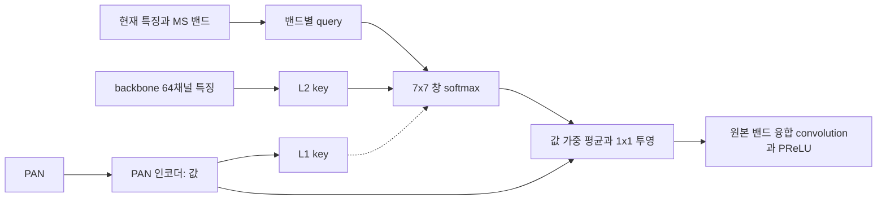

# 10. 국소 창 교차 어텐션 SSAI

**연구 분야:** SSAI 개선

**실험자:** 이병현

**변경 내용:** 세 해상도·4밴드의 SSA 블록 내부 연산만 교체했습니다. 원본의 패치 전체 공간 softmax 대신, 각 위치 주변 7×7 창 안에서 MS 밴드 query와 key를 비교하고 PAN 인코더 특징을 값으로 가져옵니다. backbone·밴드 융합 convolution·PReLU·decoder·손실·데이터는 원본과 같습니다.

| 확인된 결과 | 상태 | 개선 여부 |
|---|---|---|
| 사전 진단: 원본 SSAI 제거 시 validation MSE 변화 +0.00004%. 새 블록은 크기 불변성 확인. 학습 중이며 test 결과는 없습니다. | 학습&nbsp;중 2026-10-16 00:10 확인 | 판단&nbsp;보류 |

[실험 목록](../../../README.md#ssai-experiments) · [수치](#results) · [그래프](#graphs) · [이미지](#images) · [재현 자료](#evidence)

## 1. 목적과 상태

SSAI 1-9번의 변화 폭은 ±0.06 dB 안에 머물렀습니다. 8번 진단에서 원본 SSAI 출력은 PAN 투영의 정확히 1/(H×W)였고, 100에폭 동안 SSAI 가중치는 1-3%만 바뀌었습니다. 이번 실험은 SSAI를 실제로 작동하는 경로로 바꾸면 RR·FR이 함께 크게 개선되는지 확인합니다.

가설은 두 가지입니다. 첫째, 전역 정규화를 국소 창 정규화로 바꾸면 출력 감쇠가 사라지고 입력 크기(학습 64, RR 256, FR 512)와 무관하게 같은 연산이 됩니다. 둘째, 주입하는 값을 실제 PAN 특징으로 제한하면 용량 증가 실험(성능 29번)에서 나타난 FR 공간 왜곡(Ds) 악화를 줄일 수 있습니다.

2026-10-15 23:17경 L2·C 학습을 2개 병렬로 시작했습니다. L1은 슬롯이 비면 자동으로 시작하고, 세 후보 학습이 끝나면 A0 재평가와 RR 20장·FR 20장 전체 평가가 이어서 실행됩니다. 2026-10-16 00:10 확인 시 L2는 9에폭, C는 20에폭을 학습 중이었습니다.

## 2. 변경한 구조와 비교 조건

각 단계(전체·절반·1/4 해상도)에서 다음과 같이 계산합니다. 밴드별 출력은 원본과 같은 4채널이므로 원본 밴드 융합 convolution(16→4)을 그대로 사용합니다.

| 요소 | 원본 A0 | 이번 후보 |
|---|---|---|
| 정규화 | 패치 전체 H×W 공간 softmax | 각 위치의 유효한 7×7 이웃 softmax(영상 밖 위치는 제외) |
| 값 | PAN 투영 1→4 | 단계별 공유 PAN 인코더 3×3 1→16, ReLU, 3×3 16→16 |
| query | 없음(원소 곱 결합) | 밴드별 3×3(현재 특징 4채널 + 해당 MS 밴드) → 16 |
| 출력 | p/(H×W) 수준으로 감쇠 | 이웃 값의 가중 평균을 밴드별 1×1(16→4)로 투영 |
| 내부 폭 | K4 | 폭 16, head 2, 위치 bias(초기값 0) |

| 후보 | key | 확인하는 효과 |
|---|---|---|
| A0 | 원본 SSAI | 실험4의 원본 대조군입니다. 재학습하지 않고 같은 환경에서 재평가합니다. |
| L2 | backbone 64채널 특징을 1×1로 16채널 투영 | 주 후보입니다. |
| C | 어텐션 없음. L2와 같은 입력을 1×1 → depthwise 7×7 → 1×1로 결합 | 파라미터 수를 맞춘 대조군입니다. 이득이 어텐션 때문인지 용량 때문인지 구분합니다. |
| L1 | PAN 인코더 출력을 1×1로 투영 | 원본과 같은 입력만 쓰는 국소화 효과입니다. |

추가 파라미터는 L2 21,384개, C 21,648개, L1 19,080개입니다. A0는 426,654개입니다. C는 파라미터 수를 맞췄으며 연산량은 L2보다 적습니다. 원본 SSA 모듈은 공통 초기값 일치를 위해 등록만 유지하고 forward에서 사용하지 않습니다.

| 조건 | 실제 설정 |
|---|---|
| 데이터 | QB 원본 train 17,139·validation 1,905, 2047 정규화, 추가 augmentation 없음 |
| 학습 | seed42, 100에폭, micro·유효 배치 32, FP32, AMP·TF32 미사용, 결정론 모드 |
| 최적화 | Adam lr 1e-4, MSE |
| 초기값 | 실험4 A0와 같은 공통 초기값(해시 일치 확인), 새 파라미터는 원본 생성 후에 생성 |
| 크기 | 학습 64×64, RR 256×256, FR 512×512, K4 융합, 공간 4배 |
| 캐시 | 기존 GPU 부분 캐시와 같은 샘플 순서·값, GPU 상주 비율 60% |
| 선택 | 최소 validation MSE, 동률은 먼저 나온 에폭, test로 선택하지 않음 |
| 장치 | Ryzen 5600X, RAM 16GB, RTX 3060 Ti 8GB, PyTorch 2.7.1+cu128 |

GPU 캐시 비율은 학습 전 측정으로 정했습니다. 85%에서는 L2와 L1이 함께 학습할 때 여유 VRAM이 36 MiB였으므로, 512 MiB 이상 여유를 유지하는 60%를 사용했습니다. 어텐션 역전파는 직접 구현했으며 float64 기준 구현과 1e-15 이내로 일치했습니다.

## 3. 정량 결과

학습 전 진단만 확인했습니다. test 결과는 아직 없습니다.

| 진단 | 결과 |
|---|---|
| D1 원본 SSAI 제거(A0 best, validation 1,905개) | MSE 0.00017155093 → 0.00017155100, 변화 +0.00004% |
| D2 크기 불변성(96×96 입력과 64×64 crop의 내부 출력) | L2·C·L1 최대 차이 0. 원본 블록은 출력 평균 크기의 약 5배 차이 |
| A0 validation 재현 | 기록값과 정확히 일치 |

D1에서 원본 SSA 출력을 0으로 바꿔도 validation이 거의 같았습니다. 원본 모델의 성능은 SSAI 연산 내용이 아니라 backbone과 decoder에서 나온다는 뜻입니다.

## 4. 기준선 대비 차이와 해석

학습 중이므로 판정하지 않습니다. 사전에 정한 판정 기준은 다음과 같습니다.

- 개선: A0 대비 RR PSNR·SAM·ERGAS가 함께 좋아지고 잠정 QNR이 A0 이상인 경우입니다.
- 큰 향상 목표: PSNR +0.2 dB 이상, SAM −0.1° 이하, 잠정 QNR이 A0 이상입니다.
- Ds가 0.005보다 크게 악화하면 RR 이득이 있어도 부분 개선으로 판정합니다.
- L2가 C보다 RR과 FR 모두 앞설 때만 어텐션 구조의 효과로 해석합니다.

## 5. 학습·평가 그래프

학습 완료 후 실측 기록으로 추가합니다.

## 6. 결과 이미지

평가 완료 후 고정 RR 장면 1·8·11·13·19를 추가합니다.

## 7. 재현 자료

[설정](config.json) · [모델](model.py) · [학습](train.py) · [실행·큐](run.py) · [사전 검증](prepare.py) · [평가](evaluate.py)

학습 당시 원본 소스·설정·초기값·plan은 서버 runtime의 provenance에 보존했습니다. 가중치와 결과는 평가 완료 후 이 폴더의 checkpoints·results·provenance와 manifest로 보관합니다.

## 8. 개선 여부와 다음 단계

판단 보류입니다. 학습과 RR·FR 전체 평가가 끝나면 판정합니다. 단일 QB seed42, 반복 사용한 탐색 test, 잠정 QNR·Q2n·SCC의 MATLAB parity 미검증이라는 한계는 이전 실험과 같습니다. 개선이 확인되더라도 기준 모델로 자동 승격하지 않습니다.
