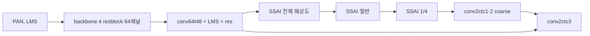

# 11. SSAI 경로 제거 분해와 PAN 기저 결합 상한·FR 대리 지표 검증

**연구 분야:** SSAI 개선

**실험자:** 이병현

**변경 내용:** 새 모델을 학습하지 않았습니다. 원본 A0 best 가중치(실험4, 98에폭)를 그대로 두고 forward 경로만 바꿔 SSA 출력 제거, SSAI 단계 전체 제거, decoder coarse 경로 제거, backbone 잔차 제거를 RR·FR test에서 비교했습니다. 또한 A0 오차를 PAN 기저의 국소 선형 결합으로 얼마나 줄일 수 있는지 GT를 쓰는 oracle 상한과 PAN을 섞은 null 대조군으로 측정했고, validation 축소 해상도 FR 대리 지표가 실제 FR test와 맞는지 15개 모델로 확인했습니다.

| 확인된 결과 | 상태 | 개선 여부 |
|---|---|---|
| SSA 출력을 0으로 바꿔도 RR·FR 지표가 소수 5자리까지 같습니다. SSAI 단계 전체를 제거하면 RR PSNR −1.55 dB입니다. PAN 기저 결합 oracle의 null 초과 설명량은 8×8 칸에서 11.3%입니다. validation FR 대리 지표와 FR test Ds의 순위 상관은 −0.18입니다. | 사전&nbsp;검증&nbsp;완료 2026-10-16&nbsp;03:02 | 성능&nbsp;비교&nbsp;아님 |

[실험 목록](../../../README.md#ssai-experiments) · [수치](#results) · [재현 자료](#evidence)

## 1. 목적과 상태

SSAI 1-10번의 RR 변화는 대부분 ±0.06 dB 안에 머물렀고, 10번 진단(D1)에서 원본 SSA 출력을 0으로 바꿔도 validation MSE가 0.00004% 증가하는 데 그쳤습니다. 다만 D1은 SSA 블록 출력만 0으로 바꾸고 밴드 융합 convolution의 bias와 PReLU는 남겼으므로, SSAI 단계 전체가 필요 없다는 근거는 아니었습니다. backbone의 기여도 직접 측정하지 않았습니다.

이번 진단은 학습 전에 세 가지를 확인합니다.

1. 원본 모델에서 SSA 연산, SSAI 단계, decoder coarse 경로, backbone 잔차가 각각 제거될 때 RR·FR이 얼마나 바뀌는지 확인합니다.
2. SSAI가 할 수 있는 형태의 결합(PAN 기저 × 국소 계수)을 완벽하게 맞춘다고 가정할 때 A0 오차를 얼마나 줄일 수 있는지 상한을 구합니다.
3. 학습 중 FR 악화를 미리 거르기 위한 validation 대리 지표를 쓸 수 있는지 확인합니다.

2026-10-16 02:53에 상한·대리 지표 진단을, 03:02에 경로 제거 평가를 마쳤습니다. 학습은 하지 않았습니다.

## 2. 변경한 구조와 비교 조건

경로 제거는 모두 A0 best 가중치를 strict load한 뒤 forward만 바꿨습니다. 재학습하지 않았으므로 각 수치는 "학습된 A0가 그 경로에 얼마나 의존하는가"를 뜻하며, 그 경로를 처음부터 빼고 학습했을 때의 성능이나 기여율을 뜻하지 않습니다.

| 변형 | 바꾼 위치 | 남는 것 |
|---|---|---|
| A0 | 없음 | 원본 forward |
| Z_SSA | 세 단계·4밴드 SSA 블록 출력을 0으로 바꿈 | 밴드 융합 convolution bias와 PReLU (10번 D1과 같은 정의) |
| Z_STAGE | 세 SSAI 단계 출력 전체를 0으로 바꿈 | 융합 convolution·bias·PReLU도 제거 |
| Z_COARSE | decoder 마지막 결합에서 업샘플한 coarse 출력을 0으로 바꿈 | 전체 해상도 잔차 경로 |
| Z_BACKBONE | backbone 잔차(conv64t48 출력)를 0으로 바꿈 | `res = LMS`, 이후 경로는 그대로 |

PAN 기저 결합 상한(D6)은 A0 validation 오차 `GT − A0`를 밴드·칸마다 PAN 기저에 최소제곱으로 맞춘 뒤 제거된 오차 에너지 비율입니다. 계수를 GT로 직접 구하므로 어떤 모델도 넘을 수 없는 상한입니다.

| 기저 | 구성 |
|---|---|
| S1 | 상수, PAN − LP4 |
| S2 | 상수, PAN − LP4, PAN − LP2, LP2 − LP4, PAN 가로·세로 기울기 |

LP2·LP4는 PAN을 2배·4배 bicubic(antialias) 축소 후 다시 확대한 영상입니다. 칸 크기는 4, 8, 16, 64입니다. 칸이 작고 기저가 많을수록 우연한 맞춤만으로도 설명량이 커지므로, PAN을 다른 패치의 PAN으로 바꾼 null 대조군을 같은 방식으로 계산해 실제 설명량에서 뺐습니다. 같은 방법을 LMS 오차에도 적용해 진단이 PAN으로 설명되는 오차를 잡아낼 수 있는지 확인했습니다.

FR 대리 지표 검증(D7)은 validation 256개 패치(64×64)에서 축소 해상도 FR 지표를 계산하고, 이미 FR test 결과가 있는 15개 모델(A0, SSAI 8 N1·N2, SSAI 9 A1·A2, 성능 29 R0·W2·W3·F01·F11의 50·150에폭)의 FR test Ds·QNR과 비교했습니다. 사전 기준은 Ds 순위 상관 0.7 이상이면 사용 가능입니다.

| 조건 | 실제 설정 |
|---|---|
| 가중치 | 실험4 A0 best(98에폭), QB, seed42 |
| 데이터 | validation 1,905개(64×64), RR test 20장(256×256), FR test 20장(512×512) |
| 지표 | RR: PSNR·SAM·ERGAS·SCC·Q2n, FR: Dλ·Ds·QNR, 최댓값 2047 |
| 장치 | RTX 3060 Ti 8GB, PyTorch 2.7.1+cu128, CUDA FP32, 결정론 모드 |
| 학습 | 없음 |

## 3. 정량 결과

### 경로 제거(A0 best, 재학습 없음)

| 변형 | validation MSE | RR PSNR | RR SAM | RR ERGAS | RR Q2n | FR Dλ | FR Ds | FR QNR | RR 출력 차이 평균/최대(DN) |
|---|---:|---:|---:|---:|---:|---:|---:|---:|---:|
| A0 | 1.71551e-4 | 37.4536 | 4.9283 | 4.1101 | 0.9232 | 0.0452 | 0.0396 | 0.9174 | 0 / 0 |
| Z_SSA | 1.71551e-4 | 37.4536 | 4.9282 | 4.1101 | 0.9232 | 0.0452 | 0.0396 | 0.9174 | 0.001 / 0.005 |
| Z_STAGE | 2.31403e-4 | 35.9054 | 5.3944 | 4.6889 | 0.8939 | 0.0436 | 0.0417 | 0.9169 | 14.0 / 30.5 |
| Z_COARSE | 1.33302e-3 | 32.0045 | 24.0059 | 8.8695 | 0.8430 | 0.0416 | 0.0687 | 0.8928 | 48.3 / 161.1 |
| Z_BACKBONE | 3.07776e-3 | 25.8804 | 17.1409 | 17.1464 | 0.3041 | 0.1299 | 0.3325 | 0.5813 | 72.7 / 2056.4 |

Z_SSA의 validation MSE 증가는 0.00004%이고, 출력 차이는 validation 최대 0.085 DN, RR 최대 0.005 DN, FR 최대 0.002 DN입니다. Z_STAGE는 A0 대비 validation MSE +34.9%, RR PSNR −1.548 dB, SAM +0.466°, ERGAS +0.579, Q2n −0.029이며 FR QNR은 −0.0005입니다.

### PAN 기저 결합 상한(D6, A0 validation 오차)

| 기저·칸 | 실제 PAN | null(다른 패치 PAN) | null 초과 | LMS 오차 참고 |
|---|---:|---:|---:|---:|
| S1·4 | 17.7% | 13.9% | 3.8% | 74.6% |
| S1·8 | 5.4% | 3.1% | 2.3% | 66.8% |
| S1·16 | 2.1% | 0.8% | 1.3% | 63.5% |
| S1·64 | 0.6% | 0.1% | 0.5% | 61.6% |
| S2·4 | 49.6% | 37.7% | 12.0% | 89.6% |
| S2·8 | 20.7% | 9.4% | 11.3% | 79.6% |
| S2·16 | 10.0% | 2.4% | 7.6% | 73.8% |
| S2·64 | 3.6% | 0.2% | 3.4% | 70.3% |

사전 기준(S2·8 실제 설명량 15% 이상이면 통과, 5% 이하이면 중단)으로는 20.7%로 통과였지만, null 대조군에서 9.4%가 우연한 맞춤으로 확인되어 실제 PAN 정보로 설명되는 부분은 11.3%입니다. GT로 계수를 정한 완전한 oracle이 11.3%를 모두 제거해도 MSE 기준 약 0.52 dB입니다.

### validation FR 대리 지표 검증(D7, 15개 모델)

| 상관 | 값 |
|---|---:|
| 대리 Ds ↔ test Ds Spearman | −0.18 |
| 대리 Ds ↔ test Ds Pearson | −0.30 |
| 대리 QNR ↔ test QNR Spearman | −0.37 |
| 대리 QNR ↔ test QNR Pearson | −0.64 |

| 모델 | 대리 Ds | test Ds | 대리 QNR | test QNR |
|---|---:|---:|---:|---:|
| A0 | 0.0432 | 0.0396 | 0.9288 | 0.9174 |
| 성능 29 W2 150에폭 | 0.0436 | 0.1461 | 0.9309 | 0.8318 |
| 성능 29 W3 150에폭 | 0.0412 | 0.1691 | 0.9331 | 0.7891 |

FR test에서 Ds가 크게 악화한 성능 29 W2·W3를 대리 지표는 A0와 같거나 더 좋게 평가했습니다. 사전 기준(Spearman 0.7 이상)을 충족하지 못했습니다.

## 4. 기준선 대비 차이와 해석

- **SSA 연산은 학습된 A0 출력에 영향을 주지 않습니다.** SSA 출력이 PAN 투영의 1/(H×W) 수준이어서 0으로 바꿔도 RR·FR 출력 차이가 0.005 DN 이하입니다.
- **SSAI 단계는 단계·밴드별 상수 보정으로 작동합니다.** SSA 출력이 사실상 0이므로 각 단계의 출력은 PReLU(융합 bias), 즉 위치와 입력에 무관한 상수입니다. 이 상수를 제거한 Z_STAGE에서 RR PSNR이 1.55 dB 떨어졌습니다. 같은 상수를 일반 bias로 대체해도 같은 결과일 것으로 해석하지만, 재학습으로 확인하지는 않았습니다.
- **backbone 잔차와 decoder coarse 경로는 학습된 A0가 크게 의존하는 경로입니다.** 다만 재학습 없는 제거이므로 이 수치를 경로별 기여율(%)로 해석하지 않습니다.
- **PAN 기저 결합의 상한은 작습니다.** SSAI가 할 수 있는 형태의 결합을 완전하게 맞춰도 null 초과 설명량은 8×8 칸에서 11.3%, 약 0.5 dB입니다. 계수를 입력만으로 예측해야 하는 실제 모델은 이보다 작습니다. 반면 같은 진단은 LMS 오차의 67-80%를 설명하므로, 진단 방법이 PAN으로 설명되는 오차를 놓치는 것은 아닙니다. A0 오차에서 PAN 기저로 설명되는 부분은 이미 backbone이 대부분 제거했다고 해석합니다.
- **FR 악화는 validation 대리 지표로 거를 수 없습니다.** FR 판단은 FR test로만 합니다.

이 결과는 내부 진단이며 논문 대비 비교가 아닙니다.

## 5. 학습·평가 그래프

학습하지 않았으므로 학습 그래프는 없습니다.

## 6. 결과 이미지

경로 제거는 지표 비교만 수행했으며 예측 이미지는 저장하지 않았습니다.

## 7. 재현 자료

[설정](config.json) · [상한·대리 지표 진단](prepare.py) · [경로 제거 평가](evaluate.py)

- 결과: [D6·D7 진단](results/diagnostics.json) · [D6 null 대조군](results/oracle_null_control.json) · [경로 제거](results/ablation.json)
- 실행 당시 원본: [분석 소스](provenance/analysis_source.zip)(prepare.py, null 대조군 스크립트, evaluate.py 원본) · [기반 소스 commit](provenance/source_main_commit.txt)
- [파일 크기·SHA-256 manifest](manifest.json)

스크립트에는 실행 서버의 절대 경로(A0 가중치, 캐시, 기존 실험 가중치)가 그대로 남아 있습니다. 실행 당시 원본 보존을 위해 경로를 바꾸지 않았습니다. 새 가중치는 만들지 않았으므로 checkpoints 폴더가 없습니다.

## 8. 개선 여부와 다음 단계

성능 비교 아님입니다. 새 후보를 만들지 않은 진단 실험입니다. 한계는 다음과 같습니다.

- QB·seed42의 A0 하나만 분석했습니다.
- 분석한 SSAI는 공개 코드 구현(원소 곱·H×W 공간 softmax)입니다. 논문 식 10-12의 K×K 채널 상관 연산과 다르며, 논문 식을 그대로 구현한 모델은 분석하지 않았습니다.
- 경로 제거는 재학습 없이 수행했으므로 의존도이며 기여율이 아닙니다.
- D6은 선형 결합 상한이며, SSAI를 큰 용량의 비선형 모듈로 바꾸는 경우는 다루지 않았습니다.
- 대리 지표는 256개 validation 패치, 15개 모델로 확인했습니다. QNR·Q2n·SCC의 MATLAB parity는 검증하지 않았습니다.
