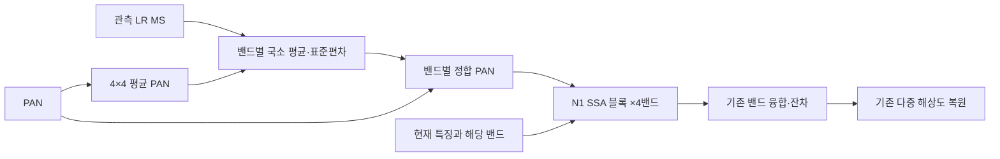

# 12. 관측 통계로 정합한 밴드별 PAN 입력

**연구 분야:** SSAI 개선

**실험자:** 이병현

**변경 내용:** 세 해상도·4밴드 SSA 블록에 들어가는 PAN만 바꿉니다. 각 장면에서 관측한 LR MS 밴드와 MS 크기로 줄인 PAN의 국소 평균·표준편차로 PAN을 밴드별로 정합해 입력합니다. SSA 블록·밴드 융합·backbone·decoder·손실·데이터는 SSAI 8번 N1과 같고 추가 파라미터는 없습니다.

| 확인된 결과 | 상태 | 개선 여부 |
|---|:---:|:---:|
| 서버 사전 검사를 통과했습니다(초기값 A0·N1과 동일, 원 PAN 입력 시 N1 best와 출력 일치). B2·B3를 2026-10-16 05:56에 시작해 1에폭 validation MSE가 B2 0.0005346, B3 0.0005352입니다. RR·FR은 아직 평가하지 않았습니다. | 학습&nbsp;중<br>10-16&nbsp;05:59 | 판단&nbsp;보류 |

[실험 목록](../../../README.md#ssai-experiments) · [수치](#results) · [그래프](#graphs) · [이미지](#images) · [재현 자료](#evidence)

## 1. 목적과 상태

선행 성능 개선 실험(27·29·34번)에서는 RR이 좋아질 때 FR의 Ds가 나빠지는 일이 반복되었습니다. 이번 실험은 학습된 PAN 주입량이 축소 해상도에서 정해져 원 해상도의 PAN–MS 관계와 어긋난다는 가설을 SSAI 안에서 확인합니다. PAN을 장면마다 관측 MS 통계로 정합하면 FR에서도 같은 기준으로 다시 계산되므로 Ds가 줄어들 것이라고 예상합니다. 고전적 CS·MRA 기법의 히스토그램 정합을 학습 모델의 SSAI 입력에 적용한 형태입니다.

원본 A0에서는 SSA 출력을 0으로 바꿔도 지표가 같았습니다([SSAI 11](../11_ssai_contribution_headroom/README.md)). 그래서 A0에 정합 PAN을 넣으면 출력이 바뀌지 않습니다. SSA 경로가 실제로 쓰이는 [SSAI 8번](../8_spatial_mean_normalization/README.md) N1 블록을 기반으로 했습니다.

2026-10-16 05:45에 서버에서 옵티마이저 업데이트 없는 사전 검사를 통과했고, 승인에 따라 05:56에 B2·B3를 병렬로 처음부터 학습하기 시작했습니다. 05:59에 두 군의 1에폭 완료와 best/latest 저장을 확인했습니다. 100에폭 완료와 RR·FR 평가는 아직입니다. 평가는 학습 완료 후 별도로 진행합니다.

## 2. 변경한 구조와 비교 조건

| 위치 | 원본·N1 | 이번 변경 |
|---|---|---|
| SSA 블록의 PAN 입력 | 같은 PAN을 4밴드 블록에 공통 입력 | 밴드 b마다 `PAN*_b = μ_b + g_b·(PAN − μ_P)` |
| 정합 계수 | 없음 | `g_b = min(σ_b / √(σ_P² + ε²), g_max)` |
| 통계 | 없음 | μ_b·σ_b는 관측 LR MS 밴드, μ_P·σ_P는 PAN 4×4 평균, MS 격자에서 계산 |
| 해상도 | 전체·절반·1/4 | 통계 지도를 각 단계 크기로 bilinear 확대, 단계 PAN은 원본 forward와 같음 |
| SSA 연산 | N1: 원본 좌표, 공간 softmax×HW, gamma 1 | 같음 |
| 융합·이후 | conv48tnum·PReLU·잔차·decoder | 같음 |

정합 PAN은 데이터에서만 계산하며 gradient가 흐르지 않습니다. ε와 g_max는 train 17,139패치의 국소 통계에서만 정합니다. ε는 국소 PAN 표준편차의 5번째 백분위, g_max는 정합 계수의 99.9번째 백분위이며, test 입력을 보기 전에 고정합니다.



위 구조는 전체·절반·1/4 해상도에 모두 적용합니다.

| 군 | 내용 | 학습 |
|---|---|---|
| A0 | 원본 SSA-MRN K4 ([SSAI 4번](../4_aligned_sigmoid_gating/README.md)) | 기존 결과 재사용 |
| B1 | SSAI 8번 N1, 원 PAN 입력 | 기존 결과 재사용 |
| B2 | N1 블록, 5×5 국소 창(MS 격자, PAN 20px) 정합 PAN | 새 학습 |
| B3 | N1 블록, 장면 전체 통계로 정합한 PAN | 새 학습, 진단 전용 |

B2와 B1의 차이는 PAN 입력 하나뿐이며 가설은 이 비교로 판단합니다. B3는 학습 패치(MS 16×16)와 FR 장면(MS 128×128)의 통계 범위 차이를 보는 진단용이며 후보로 선택하거나 승격하지 않습니다.

| 조건 | 설정 |
|---|---|
| 데이터 | QB 원본 H5 train 17,139·validation 1,905패치, RR20·FR20 전체 장면, DN/2047 |
| 특징 차원·공간비 | K4·4배 |
| 학습 | seed42, 처음부터 100에폭, Adam lr 1e-4 고정, 최종 출력 MSE |
| 배치·정밀도 | micro/effective 32, FP32, AMP·TF32 off, 결정론 모드 |
| 초기화 | A0·N1과 같은 공통 초기값, 추가 파라미터 0개 |
| 학습 함수 | SSAI 8번 train.py를 그대로 사용 |
| 장치 | 공용 서버 RTX 3060 Ti 8GB, N1과 같은 Python·PyTorch 환경 필요 |
| 선택 | validation MSE 최소, 정확한 동률은 먼저 나온 에폭 |
| 평가 | RR20·FR20 전체, peak 2047, 예측 clipping 없음, test로 선택하지 않음 |

### 사전에 고정한 판정 기준

| 항목 | 기준 |
|---|---|
| 가설 판정(B2 대 B1) | FR Ds −0.003 이하, 잠정 QNR +0.005 이상. RR PSNR −0.03 dB 이상, SAM +0.02° 이하 |
| 저장소 표기(B2 대 A0) | PSNR·SAM·ERGAS·잠정 QNR이 모두 좋아야 개선, 그 외는 부분 개선 또는 개선 없음 |
| 경로 사용 확인 | 학습 후 B2의 SSA 출력을 0으로 바꿔 지표가 그대로면 가설을 검증하지 못한 것으로 기록 |
| 반복 | B2가 가설 기준을 통과할 때만 seed43·44로 A0·B1·B2 반복(별도 승인) |

같은 조건 A0 두 번의 차이(PSNR 0.036 dB, QNR 0.004)를 넘도록 QNR 기준을 정했습니다. FR이 주 목표라서 RR이 그대로이면 저장소 표기는 부분 개선이 됩니다.

### 학습 전 입력 통계 진단

GT와 모델 없이 QB test 입력만으로 계산했습니다. 설계를 정하기 위한 참고이며 이 결과로 설정을 조정하지 않았습니다. 값은 "PAN 고주파 크기 ÷ 밴드 국소 대비"의 장면 평균이며, 시제품 ε=0.001과 상한 없는 정합 계수를 사용했습니다.

| 입력 | 밴드 0 | 밴드 1 | 밴드 2 | 밴드 3(NIR) |
|---|---:|---:|---:|---:|
| 원 PAN, RR | 1.874 | 1.068 | 1.248 | 1.065 |
| 원 PAN, FR | 1.788 | 1.003 | 1.204 | 0.811 |
| 정합 PAN, RR | 0.982 | 0.961 | 0.946 | 0.877 |
| 정합 PAN, FR | 1.158 | 1.128 | 1.111 | 1.002 |

원 PAN에서는 RR에서 FR로 갈 때 밴드 0-2는 4-6% 줄고 NIR은 24% 줄었습니다. 정합 PAN에서는 네 밴드 모두 14-18% 늘었습니다. 정합은 RR–FR 차이를 없애지 않고, 밴드마다 다르던 변화를 같은 방향·비슷한 크기로 바꿉니다. 이 변화가 FR에서 맞는 방향인지는 GT가 없어 학습 전에는 알 수 없습니다. FR에서 정합 계수가 4를 넘는 화소는 0.54%로 RR(0.015%)보다 많아 상한을 미리 고정합니다.

<a id="results"></a>

## 3. 정량 결과

### 서버 사전 검사(학습 없음, 2026-10-16 05:45)

| 검사 | 결과 |
|---|---|
| 환경 | Python 3.10.6·PyTorch 2.7.1+cu128·cuDNN 90701·RTX 3060 Ti, N1 학습 환경과 같음 |
| 소스 | 공용 suite·원본 모델·8번 model/train/diagnostics가 N1 학습 당시 snapshot과 바이트 단위로 같음 |
| 데이터·캐시 | 원본 H5 해시 일치. 기존 캐시가 없어 원본 H5로 다시 만들었고 8번 기록과 해시 일치 |
| 대조군 가중치 | A0·N1 best/latest 해시 일치, strict load 통과 |
| 초기값 | B2·B3 모두 A0·N1과 같은 공통 초기값 해시, 추가 파라미터 0개 |
| N1 일치 | 원 PAN 입력 시 N1 best와 64×64 validation·32×48 출력이 정확히 같음 |
| 유한 출력 | 64·256·512·32×48 통과 |
| 기울기(업데이트 0회, N1 진단 배치 20개) | 세 SSAI 단계 L2 B2 0.01422·0.00478·0.00311, N1 기록 0.01413·0.00474·0.00304 |
| SSA 출력/PAN 특징 RMS | 세 단계 모두 약 1.000 |

첫 실행은 N1 기준 출력을 결정론·TF32 off 설정 전에 계산해 일치 검사에서 멈췄습니다. 설정 순서만 고쳐 다시 실행했고, 첫 실행에서 학습이나 가중치 저장은 없었습니다.

### train에서 고정한 정합 상수

| 항목 | 값 |
|---|---:|
| ε (국소 PAN 표준편차 5번째 백분위) | 0.002154 |
| g_max (정합 계수 99.9번째 백분위) | 2.878 |
| 정합 계수 중앙값(train) | 0.642 |

상수를 고정한 뒤 test 입력만으로 요약한 값입니다. 이 값으로 설정을 바꾸지 않았습니다.

| 입력 | B2 계수 중앙값 | B2 상한 적용 비율 | B3 계수 중앙값 | B3 상한 적용 비율 |
|---|---:|---:|---:|---:|
| RR 20장면 | 0.730 | 0.15% | 0.813 | 0% |
| FR 20장면 | 0.911 | 1.64% | 0.940 | 0% |

FR에서 국소 정합 계수가 상한에 걸리는 비율은 train(0.10%)보다 높습니다. 평가 후 FR 해석에 함께 고려합니다.

### 학습 시작 확인

| 군 | 1에폭 validation MSE | 1에폭 시간 |
|---|---:|---:|
| B2 | 0.0005346 | 121초 |
| B3 | 0.0005352 | 113초 |
| 참고: N1 | 0.0005452 | 113초 |
| 참고: A0 | 0.0005396 | |

두 군 모두 발산 기준(A0 1에폭의 2배, 0.001079) 아래입니다. 두 워커 probe에서 최소 여유 VRAM은 1,289MiB, 합계 처리량은 330 patch/s였습니다.

<a id="graphs"></a>

## 5. 학습·평가 그래프

학습 후 실제 train·validation 곡선과 A0·B1 대비 RR·FR 그래프를 추가합니다.

<a id="images"></a>

## 6. 결과 이미지

학습 전에 고정한 RR 0기준 장면 1·8·11·13·19를 LR MS · PAN · B2 예측 · GT 순서로 저장할 예정입니다. FR에는 GT를 만들지 않습니다.

<a id="evidence"></a>

## 7. 재현 자료

[모델](model.py) · [학습 없는 사전 검사](prepare.py) · [실행](run.py) · [설정](config.json) · [manifest](manifest.json)

[사전 검사 결과](results/preflight.json) · [진단](results/diagnostics.json) · [probe](results/benchmark.json) · [학습 당시 plan](provenance/plan.json) · [학습 당시 소스](provenance/training_source.zip)

재사용 대조군: [A0 가중치](../4_aligned_sigmoid_gating/checkpoints/A0_QB_s42) · [N1 가중치](../8_spatial_mean_normalization/checkpoints/N1_QB_s42) · [N1 학습 당시 plan](../8_spatial_mean_normalization/provenance/plan.json)

```bash
python SSA-MRN/experiments/ssai/12_observation_matched_pan_guide/prepare.py --runtime <새_runtime> --data <QB_H5_폴더>
```

사전 검사는 옵티마이저 업데이트 없이 실행하며 후보 가중치를 저장하지 않습니다. 학습(`run.py benchmark`, `run.py start`)은 별도 승인 후에만 실행합니다.

## 8. 개선 여부와 다음 단계

판단 보류입니다. 학습 중이며 성능 결과가 없습니다.

다음 단계는 100에폭 학습 완료 확인, validation 최소 MSE로 best 선택, RR20·FR20 전체 평가, B2의 SSA 출력 제거 확인입니다. 사전에 고정한 기준으로 판정하며 test로 후보나 에폭을 다시 고르지 않습니다. 단일 QB·seed42, 탐색에 반복 사용된 test, QNR·Q2n·SCC MATLAB 정합 미검증이라는 한계를 유지합니다.
