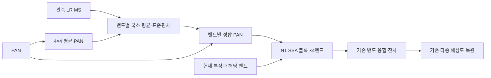
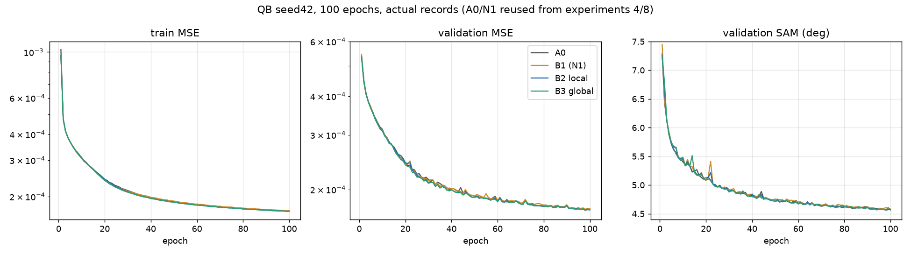
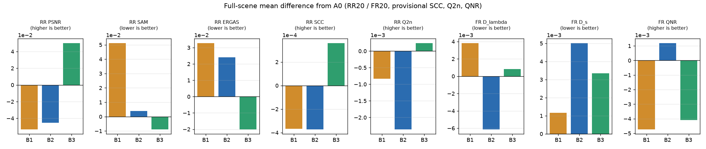
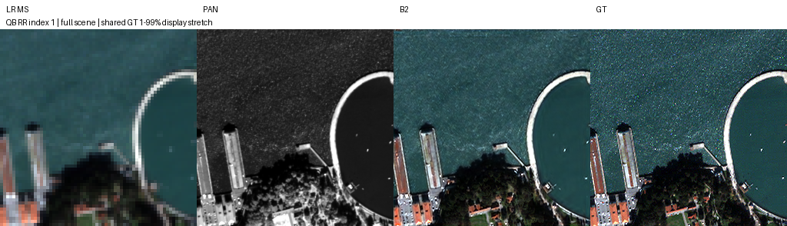
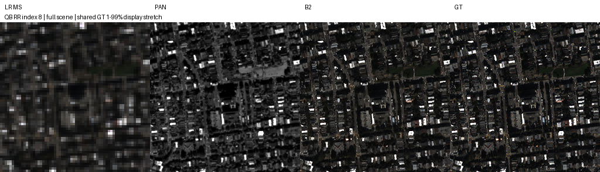
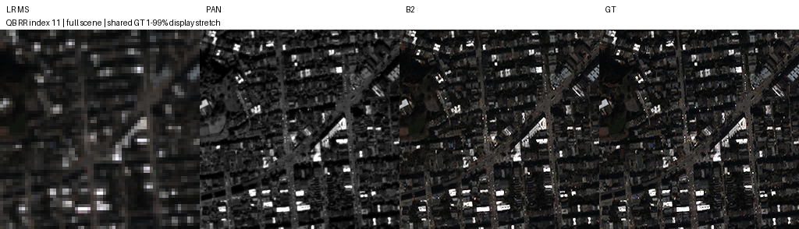
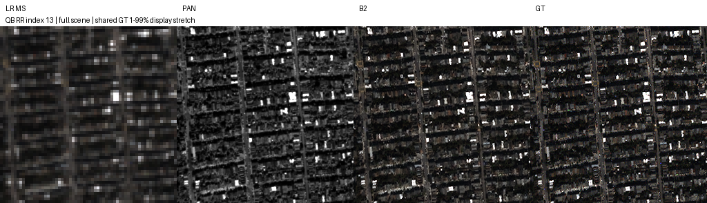
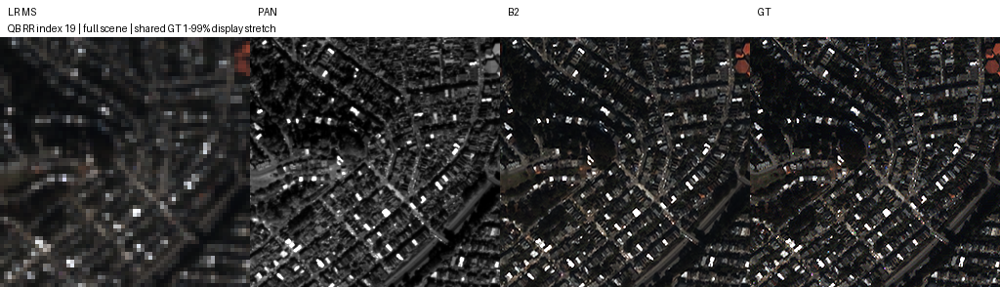

# 12. 관측 통계로 정합한 밴드별 PAN 입력

**연구 분야:** SSAI 개선

**실험자:** 이병현

**변경 내용:** 세 해상도·4밴드 SSA 블록에 들어가는 PAN만 바꿉니다. 각 장면에서 관측한 LR MS 밴드와 MS 크기로 줄인 PAN의 국소 평균·표준편차로 PAN을 밴드별로 정합해 입력합니다. SSA 블록·밴드 융합·backbone·decoder·손실·데이터는 SSAI 8번 N1과 같고 추가 파라미터는 없습니다.

| 확인된 결과 | 상태 | 개선 여부 |
|---|:---:|:---:|
| B2(국소 정합)는 B1(N1) 대비 Dλ −0.0100·QNR +0.0059였지만 Ds가 +0.0038 나빠져 Ds 감소 가설은 기각했습니다. A0 대비 B2는 RR PSNR −0.0454 dB·SAM +0.0039°, 잠정 QNR +0.0012로 지표가 엇갈립니다. 진단용 B3는 A0 대비 PSNR +0.0502 dB, QNR −0.0041입니다. | 평가&nbsp;완료 | 부분&nbsp;개선 |

[실험 목록](../../../README.md#ssai-experiments) · [수치](#results) · [그래프](#graphs) · [이미지](#images) · [재현 자료](#evidence)

## 1. 목적과 상태

선행 성능 개선 실험(27·29·34번)에서는 RR이 좋아질 때 FR의 Ds가 나빠지는 일이 반복되었습니다. 이번 실험은 학습된 PAN 주입량이 축소 해상도에서 정해져 원 해상도의 PAN–MS 관계와 어긋난다는 가설을 SSAI 안에서 확인합니다. PAN을 장면마다 관측 MS 통계로 정합하면 FR에서도 같은 기준으로 다시 계산되므로 Ds가 줄어들 것이라고 예상합니다. 고전적 CS·MRA 기법의 히스토그램 정합을 학습 모델의 SSAI 입력에 적용한 형태입니다.

원본 A0에서는 SSA 출력을 0으로 바꿔도 지표가 같았습니다([SSAI 11](../11_ssai_contribution_headroom/README.md)). 그래서 A0에 정합 PAN을 넣으면 출력이 바뀌지 않습니다. SSA 경로가 실제로 쓰이는 [SSAI 8번](../8_spatial_mean_normalization/README.md) N1 블록을 기반으로 했습니다.

2026-10-16 05:45에 서버에서 옵티마이저 업데이트 없는 사전 검사를 통과했고, 승인에 따라 05:56에 B2·B3를 병렬로 처음부터 학습했습니다. B3는 09:01, B2는 09:15에 100에폭을 실패 없이 마쳤습니다. 10:05에 validation-best로 A0·N1·B2·B3와 경로 확인용 B2Z의 RR20·FR20 전체 평가(200개 예측)를 완료했습니다. A0·N1 재평가 평균은 보관된 기존 평가와 정확히 같았습니다.

## 2. 변경한 구조와 비교 조건

| 위치 | 원본·N1 | 이번 변경 |
|---|---|---|
| SSA 블록의 PAN 입력 | 같은 PAN을 4밴드 블록에 공통 입력 | 밴드 b마다 `PAN*_b = μ_b + g_b·(PAN − μ_P)` |
| 정합 계수 | 없음 | `g_b = min(σ_b / √(σ_P² + ε²), g_max)` |
| 통계 | 없음 | μ_b·σ_b는 관측 LR MS 밴드, μ_P·σ_P는 PAN 4×4 평균, MS 격자에서 계산 |
| 해상도 | 전체·절반·1/4 | 통계 지도를 각 단계 크기로 bilinear 확대, 단계 PAN은 원본 forward와 같음 |
| SSA 연산 | N1: 원본 좌표, 공간 softmax×HW, gamma 1 | 같음 |
| 융합·이후 | conv48tnum·PReLU·잔차·decoder | 같음 |

정합 PAN은 데이터에서만 계산하며 gradient가 흐르지 않습니다. ε와 g_max는 train 17,139패치의 국소 통계에서만 정합니다. ε는 국소 PAN 표준편차의 5번째 백분위, g_max는 정합 계수의 99.9번째 백분위이며, test 입력을 보기 전에 고정합니다.



위 구조는 전체·절반·1/4 해상도에 모두 적용합니다.

| 군 | 내용 | 학습 |
|---|---|---|
| A0 | 원본 SSA-MRN K4 ([SSAI 4번](../4_aligned_sigmoid_gating/README.md)) | 기존 결과 재사용 |
| B1 | SSAI 8번 N1, 원 PAN 입력 | 기존 결과 재사용 |
| B2 | N1 블록, 5×5 국소 창(MS 격자, PAN 20px) 정합 PAN | 새 학습 |
| B3 | N1 블록, 장면 전체 통계로 정합한 PAN | 새 학습, 진단 전용 |

B2와 B1의 차이는 PAN 입력 하나뿐이며 가설은 이 비교로 판단합니다. B3는 학습 패치(MS 16×16)와 FR 장면(MS 128×128)의 통계 범위 차이를 보는 진단용이며 후보로 선택하거나 승격하지 않습니다.

| 조건 | 설정 |
|---|---|
| 데이터 | QB 원본 H5 train 17,139·validation 1,905패치, RR20·FR20 전체 장면, DN/2047 |
| 특징 차원·공간비 | K4·4배 |
| 학습 | seed42, 처음부터 100에폭, Adam lr 1e-4 고정, 최종 출력 MSE |
| 배치·정밀도 | micro/effective 32, FP32, AMP·TF32 off, 결정론 모드 |
| 초기화 | A0·N1과 같은 공통 초기값, 추가 파라미터 0개 |
| 학습 함수 | SSAI 8번 train.py를 그대로 사용 |
| 장치 | 공용 서버 RTX 3060 Ti 8GB, N1과 같은 Python·PyTorch 환경 필요 |
| 선택 | validation MSE 최소, 정확한 동률은 먼저 나온 에폭 |
| 평가 | RR20·FR20 전체, peak 2047, 예측 clipping 없음, test로 선택하지 않음 |

### 사전에 고정한 판정 기준

| 항목 | 기준 |
|---|---|
| 가설 판정(B2 대 B1) | FR Ds −0.003 이하, 잠정 QNR +0.005 이상. RR PSNR −0.03 dB 이상, SAM +0.02° 이하 |
| 저장소 표기(B2 대 A0) | PSNR·SAM·ERGAS·잠정 QNR이 모두 좋아야 개선, 그 외는 부분 개선 또는 개선 없음 |
| 경로 사용 확인 | 학습 후 B2의 SSA 출력을 0으로 바꿔 지표가 그대로면 가설을 검증하지 못한 것으로 기록 |
| 반복 | B2가 가설 기준을 통과할 때만 seed43·44로 A0·B1·B2 반복(별도 승인) |

같은 조건 A0 두 번의 차이(PSNR 0.036 dB, QNR 0.004)를 넘도록 QNR 기준을 정했습니다. FR이 주 목표라서 RR이 그대로이면 저장소 표기는 부분 개선이 됩니다.

### 학습 전 입력 통계 진단

GT와 모델 없이 QB test 입력만으로 계산했습니다. 설계를 정하기 위한 참고이며 이 결과로 설정을 조정하지 않았습니다. 값은 "PAN 고주파 크기 ÷ 밴드 국소 대비"의 장면 평균이며, 시제품 ε=0.001과 상한 없는 정합 계수를 사용했습니다.

| 입력 | 밴드 0 | 밴드 1 | 밴드 2 | 밴드 3(NIR) |
|---|---:|---:|---:|---:|
| 원 PAN, RR | 1.874 | 1.068 | 1.248 | 1.065 |
| 원 PAN, FR | 1.788 | 1.003 | 1.204 | 0.811 |
| 정합 PAN, RR | 0.982 | 0.961 | 0.946 | 0.877 |
| 정합 PAN, FR | 1.158 | 1.128 | 1.111 | 1.002 |

원 PAN에서는 RR에서 FR로 갈 때 밴드 0-2는 4-6% 줄고 NIR은 24% 줄었습니다. 정합 PAN에서는 네 밴드 모두 14-18% 늘었습니다. 정합은 RR–FR 차이를 없애지 않고, 밴드마다 다르던 변화를 같은 방향·비슷한 크기로 바꿉니다. 이 변화가 FR에서 맞는 방향인지는 GT가 없어 학습 전에는 알 수 없습니다. FR에서 정합 계수가 4를 넘는 화소는 0.54%로 RR(0.015%)보다 많아 상한을 미리 고정합니다.

<a id="results"></a>

## 3. 정량 결과

### 서버 사전 검사(학습 없음, 2026-10-16 05:45)

| 검사 | 결과 |
|---|---|
| 환경 | Python 3.10.6·PyTorch 2.7.1+cu128·cuDNN 90701·RTX 3060 Ti, N1 학습 환경과 같음 |
| 소스 | 공용 suite·원본 모델·8번 model/train/diagnostics가 N1 학습 당시 snapshot과 바이트 단위로 같음 |
| 데이터·캐시 | 원본 H5 해시 일치. 기존 캐시가 없어 원본 H5로 다시 만들었고 8번 기록과 해시 일치 |
| 대조군 가중치 | A0·N1 best/latest 해시 일치, strict load 통과 |
| 초기값 | B2·B3 모두 A0·N1과 같은 공통 초기값 해시, 추가 파라미터 0개 |
| N1 일치 | 원 PAN 입력 시 N1 best와 64×64 validation·32×48 출력이 정확히 같음 |
| 유한 출력 | 64·256·512·32×48 통과 |
| 기울기(업데이트 0회, N1 진단 배치 20개) | 세 SSAI 단계 L2 B2 0.01422·0.00478·0.00311, N1 기록 0.01413·0.00474·0.00304 |
| SSA 출력/PAN 특징 RMS | 세 단계 모두 약 1.000 |

첫 실행은 N1 기준 출력을 결정론·TF32 off 설정 전에 계산해 일치 검사에서 멈췄습니다. 설정 순서만 고쳐 다시 실행했고, 첫 실행에서 학습이나 가중치 저장은 없었습니다.

### train에서 고정한 정합 상수

| 항목 | 값 |
|---|---:|
| ε (국소 PAN 표준편차 5번째 백분위) | 0.002154 |
| g_max (정합 계수 99.9번째 백분위) | 2.878 |
| 정합 계수 중앙값(train) | 0.642 |

상수를 고정한 뒤 test 입력만으로 요약한 값입니다. 이 값으로 설정을 바꾸지 않았습니다.

| 입력 | B2 계수 중앙값 | B2 상한 적용 비율 | B3 계수 중앙값 | B3 상한 적용 비율 |
|---|---:|---:|---:|---:|
| RR 20장면 | 0.730 | 0.15% | 0.813 | 0% |
| FR 20장면 | 0.911 | 1.64% | 0.940 | 0% |

FR에서 국소 정합 계수가 상한에 걸리는 비율은 train(0.10%)보다 높습니다. 평가 후 FR 해석에 함께 고려합니다.

### 학습 시작 확인

두 군 모두 1에폭 validation MSE(B2 0.0005346, B3 0.0005352)가 발산 기준(A0 1에폭의 2배, 0.001079) 아래였습니다. 두 워커 probe에서 최소 여유 VRAM은 1,289MiB, 합계 처리량은 330 patch/s였습니다.

### Validation best

| 군 | best 에폭 | validation MSE | A0 대비 | N1 대비 |
|---|---:|---:|---:|---:|
| A0 | 98 | 0.000171551 | 기준 | −0.64% |
| B1 (N1) | 98 | 0.000172655 | +0.64% | 기준 |
| B2 국소 정합 | 98 | 0.000171471 | −0.05% | −0.69% |
| B3 전체 정합 | 98 | 0.000171179 | −0.22% | −0.86% |

### RR 20장면 평균

| 지표 | A0 | B1 (N1) | B2 | B3 | B2−B1 | B2−A0 | B3−A0 |
|---|---:|---:|---:|---:|---:|---:|---:|
| PSNR ↑ | 37.453589 | 37.400141 | 37.408195 | 37.503755 | +0.008055 | −0.045394 | +0.050166 |
| SAM ↓ | 4.928274 | 4.979478 | 4.932211 | 4.919301 | −0.047267 | +0.003937 | −0.008974 |
| ERGAS ↓ | 4.110100 | 4.142893 | 4.134224 | 4.089930 | −0.008669 | +0.024123 | −0.020170 |
| SCC ↑ (잠정) | 0.976948 | 0.976581 | 0.976575 | 0.977309 | −0.000006 | −0.000374 | +0.000361 |
| Q2n ↑ (잠정) | 0.923239 | 0.922408 | 0.920875 | 0.923480 | −0.001532 | −0.002364 | +0.000241 |

### FR 20장면 평균 (잠정 지표)

| 지표 | A0 | B1 (N1) | B2 | B3 | B2−B1 | B2−A0 | B3−A0 |
|---|---:|---:|---:|---:|---:|---:|---:|
| Dλ ↓ | 0.045167 | 0.048994 | 0.039014 | 0.045977 | −0.009980 | −0.006153 | +0.000810 |
| Ds ↓ | 0.039614 | 0.040772 | 0.044618 | 0.042967 | +0.003846 | +0.005005 | +0.003354 |
| QNR ↑ | 0.917411 | 0.912670 | 0.918604 | 0.913329 | +0.005934 | +0.001194 | −0.004082 |

### 장면별 개선 수

| 비교 | PSNR | SAM | ERGAS | Dλ | Ds | QNR |
|---|---:|---:|---:|---:|---:|---:|
| B2 대 B1 | 11/20 | 20/20 | 11/20 | 20/20 | 6/20 | 20/20 |
| B2 대 A0 | 2/20 | 7/20 | 2/20 | 20/20 | 1/20 | 14/20 |
| B3 대 A0 | 17/20 | 13/20 | 17/20 | 12/20 | 6/20 | 3/20 |

### SSA 경로 사용 확인(B2Z)

B2 best에서 모든 SSA 블록 출력을 0으로 바꾸면 RR PSNR 33.007 dB(−4.40 dB), SAM 23.56°, FR QNR 0.682로 크게 나빠졌습니다. A0에서는 같은 조작을 해도 지표가 변하지 않았습니다(SSAI 11). 따라서 B2는 SSA 경로와 정합 PAN을 실제로 사용했고, 가설을 검증할 수 있는 조건이었습니다.

RR PSNR은 peak 2047의 밴드별 값을 장면 안에서 평균한 뒤 20장 평균했습니다. 예측은 clipping하지 않았습니다. FR에는 GT가 없으며 QNR·Dλ·Ds·Q2n·SCC의 MATLAB 정합은 미검증입니다.

## 4. 기준선 대비 차이와 해석

**가설 판정(B2 대 B1): 기각.** 사전 기준인 Ds −0.003 이하를 충족하지 못했습니다. Ds는 오히려 +0.0038 나빠졌습니다(6/20장 개선). QNR +0.0059와 RR 비열등 기준은 충족했지만, QNR 상승은 Ds가 아니라 Dλ(−0.0100, 20/20장)에서 나왔습니다. 즉 정합 PAN은 FR에서 분광 일관성을 높였지만 공간 일관성은 낮췄습니다.

학습 전 진단에서 정합 PAN은 RR→FR로 모든 밴드에서 14-18% 커졌고, FR에서 계수 상한에 걸리는 비율도 1.64%로 높았습니다. 이것이 Ds 악화와 관련 있을 수 있지만 확인하지 않은 추정입니다.

**저장소 표기(B2 대 A0): 부분 개선.** RR PSNR·SAM·ERGAS는 나빠졌고 잠정 QNR(+0.0012)·Dλ는 좋아져 지표가 엇갈립니다. QNR 차이는 같은 조건 A0 두 번의 차이(0.004)보다 작습니다.

**B3(진단).** 장면 전체 통계 정합은 A0 대비 RR이 좋아졌지만(PSNR +0.0502 dB, 17/20장) FR QNR이 −0.0041 나빠졌습니다. RR 개선·FR 악화라는 선행 실험의 패턴과 같습니다. B3는 사전에 진단용으로 정했으므로 후보로 선택하지 않습니다.

정합 PAN은 N1에서 SSA를 활성화하며 생긴 손실(validation +0.64%, RR PSNR −0.053 dB)을 대부분 되돌렸습니다. 하지만 원본 A0를 RR·FR 모두에서 넘지는 못했습니다. 이 결론은 QB seed42 단일 학습과 이번 정합 정의(5×5 창, 4×4 평균 PAN, train 백분위 상수)에 한정됩니다.

<a id="graphs"></a>

## 5. 학습·평가 그래프



A0·N1은 SSAI 4·8번의 실제 기록이며 B2·B3와 같은 초기값·학습 함수·데이터 순서입니다.



막대는 A0와의 평균 차이이며 지표마다 좋아지는 방향이 다릅니다. 단위가 다른 지표를 하나의 점수로 합치지 않았습니다.

<a id="images"></a>

## 6. 결과 이미지

학습 전에 고정한 RR 0기준 장면 1·8·11·13·19입니다. 패널은 LR MS · PAN · B2 예측 · GT 순서이고, RGB 밴드는 [2,1,0]입니다. LR MS·예측·GT에는 GT의 1-99 백분위 대비를 공통 적용하고 LR MS는 최근접 확대, PAN은 별도 대비로 표시했습니다. FR에는 GT를 만들지 않았습니다. B3 패널은 [평가 폴더](results/evaluation/B3)에 있습니다.







<a id="evidence"></a>

## 7. 재현 자료

[모델](model.py) · [학습 없는 사전 검사](prepare.py) · [실행](run.py) · [평가](evaluate.py) · [설정](config.json) · [manifest](manifest.json)

[B2 가중치](checkpoints/B2_QB_s42) · [B3 가중치](checkpoints/B3_QB_s42) · [학습 기록](results/training) · [best 선택](results/evaluation/selection.json) · [장면별 전체 지표](results/evaluation) · [평균 요약](results/evaluation/summary.json)

[사전 검사 결과](results/preflight.json) · [진단](results/diagnostics.json) · [probe](results/benchmark.json) · [학습 당시 plan](provenance/plan.json) · [학습 당시 소스](provenance/training_source.zip)

재사용 대조군: [A0 가중치](../4_aligned_sigmoid_gating/checkpoints/A0_QB_s42) · [N1 가중치](../8_spatial_mean_normalization/checkpoints/N1_QB_s42) · [N1 학습 당시 plan](../8_spatial_mean_normalization/provenance/plan.json)

```bash
python SSA-MRN/experiments/ssai/12_observation_matched_pan_guide/prepare.py --runtime <새_runtime> --data <QB_H5_폴더>
```

사전 검사는 옵티마이저 업데이트 없이 실행하며 후보 가중치를 저장하지 않습니다. 학습(`run.py benchmark`, `run.py start`)은 별도 승인 후에만 실행합니다.

## 8. 개선 여부와 다음 단계

**부분 개선, 가설 기각**입니다. B2는 A0 대비 RR이 나빠지고 잠정 FR QNR·Dλ만 좋아져 지표가 엇갈립니다. 주 가설인 Ds 감소는 B1·A0 대비 모두 나타나지 않았습니다. 사전 기준에 따라 seed43·44 반복은 진행하지 않으며 원본 기준 모델을 유지합니다. test 결과를 본 뒤 정합 창·상수·후보를 바꾸지 않았습니다.

관측된 Dλ 개선(20/20장)은 정합 PAN이 FR 분광 일관성에 기여할 수 있다는 단서입니다. 다만 단일 시드 결과이고 Ds 악화와 함께 나타났습니다. 이 방향을 이어 가려면 별도 가설로 등록해야 하며, 이번 결과를 근거로 성능 개선을 주장하지 않습니다. 단일 QB·seed42, 탐색에 반복 사용된 test, QNR·Q2n·SCC MATLAB 정합 미검증이라는 한계를 유지합니다.
